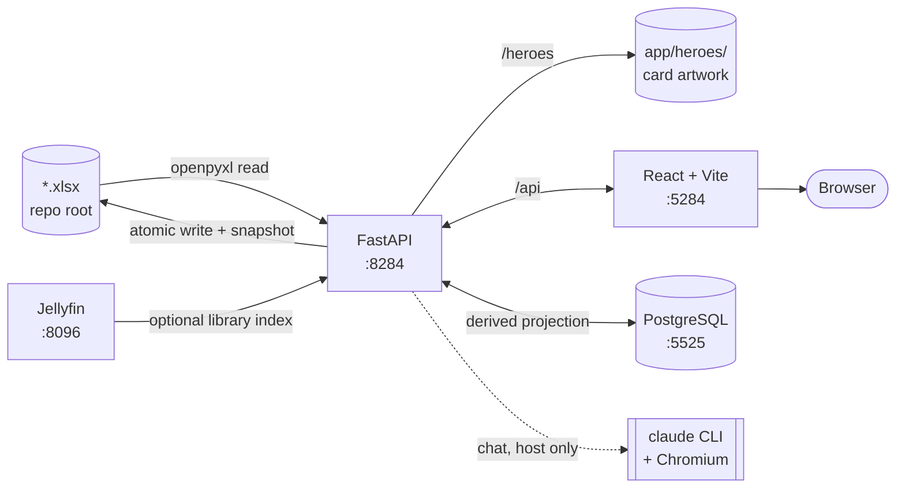
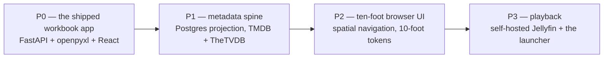
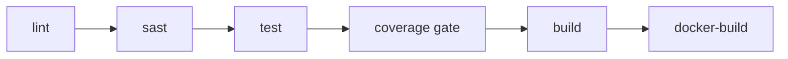

# TV Watch List

[](https://github.com/amrambouskila/watch-list/actions/workflows/ci.yml)
[](https://github.com/amrambouskila/watch-list/actions/workflows/codeql.yml)

A local web app for nineteen hand-curated watch orders — Marvel, DCU, Star Wars, Middle Earth, a
WWII chronology, and a shelf of anime — that live as Excel workbooks and stay that way.

**The workbooks are the data.** The nineteen `.xlsx` files in this repository's root are the
hand-curated watch orders, and they stay authoritative for order and curation: the app reads them
with openpyxl and writes edits straight back into the same sheets, preserving each workbook's table,
dropdowns and conditional formatting, so opening one in Excel afterwards shows exactly what you did.
That is why the workbooks are committed here: a clone arrives with the library already in it. From
Phase 1 a PostgreSQL projection sits **beside** them — episodes, air dates, runtimes, alternate
episode orders and an append-only watch log — derived from the sheets and never the other way
round. Nothing in Postgres can reorder a workbook, and a workbook opened on its own still means what
it always meant (`docs/TV_MASTER_PLAN.md`, ADR-001).

`app/README.md` is the guide to the app itself — how a category works, how the artwork is built,
what happens when Excel is holding a file. This file is about the repository: what is in it, how to
run it on a fresh machine, and what CI does to it.

---

## The stack

| Layer | Choice |
|---|---|
| Backend | Python 3.13, FastAPI, Pydantic v2, openpyxl, uvicorn — managed by `uv` |
| Frontend | React 18, TypeScript strict, Vite, Redux Toolkit — managed by `pnpm` |
| Chat | `claude-agent-sdk`, shelling out to the Claude Code CLI, with Playwright/Chromium for pages that block plain fetches |
| Storage | The `.xlsx` workbooks themselves, plus pre-write snapshots in `app/.backups/` |
| Projection | PostgreSQL 16 via SQLAlchemy 2.0 async + asyncpg + Alembic on host port 5525 — derived from the workbooks, never authoritative for order |
| Tests | pytest against disposable real PostgreSQL and workbook copies; Vitest (320 tests); real-Chromium layout guard (196 checks). Current backend counts and coverage: `docs/status.md`. |
| CI | GitHub Actions — lint → sast → test → coverage gate → build → docker-build, plus CodeQL |



## Layout

```
.
├─ *.xlsx                 The library. Nineteen workbooks, one per category. This is the data.
├─ run_tv.sh / .bat       Launchers: install on first run, start both servers, [r] restart, [k]/[q]/[v] stop.
├─ docker-compose.yml     The containerised alternative (no chat — see below).
├─ docs/                  TV_MASTER_PLAN.md (the plan), status.md (now), versions.md (history), phases/.
├─ app/
│  ├─ README.md           How the app works.
│  ├─ backend/            FastAPI + openpyxl. src/tv_watchlist/workbook/ is the Excel layer.
│  ├─ frontend/           React 18 + TS strict + Vite + Redux Toolkit, and the layout guard.
│  ├─ heroes/             Per-category card artwork + ATTRIBUTION.md.
│  ├─ docs/               Design notes.
│  └─ .backups/           Automatic pre-write snapshots (local only, not committed).
├─ .github/workflows/     CI and CodeQL.
└─ scripts/hooks/         Node .cjs hooks Claude Code runs (session-start, pre-tool-use, …).
```

## Phases



The phases are numbered P0 → P1 → P2 → P3. **The build order is P0 → P1 → P3 → P2**: Phase 2 is
deferred behind Phase 3 by ADR-014 in `docs/TV_MASTER_PLAN.md`, because everything Phase 3 needs
(the `title` table keyed by `tmdb_id`, the curated queue, the append-only watch log) is Phase 1's,
and nothing it needs is Phase 2's. Phase 2 is deferred, not cancelled.

Phase 3.5 runs beside Phase 3 after the Jellyfin client: discover files the owner already has,
identify them against the local projection, then move/hash/refresh them into the media library
(ADR-015). qBittorrent is an optional **read-only** source of completed-file metadata; the app has
no search, torrent-add or magnet surface. Discovery support does not imply that playback or the
full import pipeline is already available; task state lives in `docs/status.md`.

---

## Clone and run

### What the repo cannot carry

The workbooks travel; the toolchain does not. Install these first, on whichever machine you are on:

| | Why | Install |
|---|---|---|
| **uv** | runs the backend and owns its Python 3.13 | <https://docs.astral.sh/uv/getting-started/installation/> |
| **Node 20+ and pnpm 9.15.9** | run the frontend | <https://nodejs.org> then `corepack enable` — `app/frontend/package.json` pins `pnpm@9.15.9`, the version CI and the Docker image use, and corepack fetches and runs exactly that. |
| **`claude` on PATH** | chat shells out to it | `npm i -g @anthropic-ai/claude-code` |
| **Playwright's Chromium** | chat reads bot-blocked pages with it; the layout guard needs it too | see below |

`claude` is **signed in per machine**. A cloned repo carries no session — run `claude` once on the
new machine and log in there. Until both it and Chromium are ready, the launcher names what is
missing before it prints the URLs; chat answers 503 in the meantime and every other part of the app
works normally.

Nothing else has to be set up for the workbook app: no export, no import, no seed — the workbooks
arrive working. Phase 1 adds a PostgreSQL projection as a compose service
(`docker compose up -d postgres`); the backend entrypoint migrates it with `alembic upgrade head`
before uvicorn starts. It is derived from the sheets, never something they depend on.

### Windows

```bat
git clone https://github.com/amrambouskila/watch-list.git TV
cd TV
run_tv.bat
```

### macOS / Linux

```bash
git clone https://github.com/amrambouskila/watch-list.git TV
cd TV
chmod +x run_tv.sh      # only if your clone lost the executable bit
./run_tv.sh
```

Either launcher installs both halves on first run, brings up the compose Postgres service and runs
`alembic upgrade head` against it, starts the two dev servers, and then sits on a menu: `[r]`
restarts both servers (Postgres stays up), `[k]` stops everything (`docker compose down`), `[q]`
stops and additionally removes this project's own images while keeping volumes, and `[v]` does a
full cleanup — volumes included, dropping `tv_postgres_data` and the Jellyfin config.

Both servers run in the terminal you launched from; neither launcher opens a second window.
`run_tv.bat` additionally tags every line `[backend]` or `[frontend]`, so two interleaved logs stay
tellable apart. That costs a little machinery, documented in the file itself: each server goes
through a PowerShell pipeline that adds the prefix, which in turn needs `CI=1` for the frontend so
Vite does not bind its own `r`/`q` keys and fight the menu for keystrokes, `PYTHONUNBUFFERED=1` so
uvicorn's access log is not block-buffered once its stdout is a pipe, and UTF-8 pinned for the
duration so Vite's box-drawing survives the pipe. `run_tv.sh` backgrounds both with `&` and does
not prefix them yet, so on macOS the two logs still interleave unlabelled.

| | |
|---|---|
| App | <http://localhost:5284> |
| API | <http://localhost:8284> |
| API docs | <http://localhost:8284/docs> |

Ports come from `TV_BACKEND_PORT` and `TV_FRONTEND_PORT`; the library folder from `TV_LIBRARY_DIR`.

### First ingest

Once Postgres is up and migrated — the launcher does this for you, or run
`docker compose up -d postgres` yourself and wait for it to report healthy — project the nineteen
workbooks into it:

```bash
cd app/backend && uv run python -m tv_watchlist.ingest.bootstrap
```

On a fresh library this prints:

```
bootstrap: 19 workbooks, 19 ingested, 0 skipped, 0 refused
996 rows projected, 996 identities minted, 19 workbooks written
```

and exits `0`. Each workbook gains one hidden `Row ID` column at the far right — the grid the app
renders is unchanged, because that column is excluded from what the UI reads and writes. Exit code
`1` means a workbook was refused (open in Excel, changed mid-pass, or unreadable) while every other
workbook still ran; exit code `2` means the run itself could not proceed at all — an unreachable
database or a schema behind `head` — and should be retried once the cause is fixed. Add `--dry-run`
to plan the run and report the same counts without writing to either store, or `--only SLUG …` to
ingest one or more categories by id. TMDB and TheTVDB tokens are optional: without them every entry
stays `unresolved` and the identity column and backup snapshots are still written exactly the same.
A second run against an unchanged library reports `0 ingested, 19 skipped` and writes nothing.

### Chromium, for chat and for the layout guard

```bash
cd app/backend  && uv run playwright install chromium
cd app/frontend && pnpm exec playwright install chromium
```

### A note on line endings

`.gitattributes` pins `*.sh` to LF and `*.bat` to CRLF, and marks every `.xlsx` and image as binary.
That is not housekeeping: a CRLF checkout of `run_tv.sh` breaks its shebang on macOS with
`bad interpreter`, and a text-mode checkout of a workbook — an `.xlsx` is a zip — would corrupt the
whole library. Do not set `core.autocrlf` in a way that overrides it.

---

## Docker

```bash
docker compose up --build -d     # app on http://localhost:5284
docker compose down
```

Four services: FastAPI behind an unprivileged nginx that serves the built SPA and proxies `/api`
and `/heroes`; `postgres` — Postgres 16-alpine, the Phase 1 projection, published on
`127.0.0.1:${TV_POSTGRES_PORT:-5525}:5432` with a named volume (`tv_postgres_data`), which the
backend `depends_on` with `condition: service_healthy` and migrates itself before serving (the
container's entrypoint runs `alembic upgrade head`, then `exec`s uvicorn); and `jellyfin` — the
owner's own media server, pinned to `jellyfin/jellyfin:12.1` and published on
`${TV_JELLYFIN_PORT:-8096}`, with the media directory bind-mounted read-only from
`${TV_JELLYFIN_MEDIA_HOST:-./media}`. Jellyfin is an **optional peer**: nothing `depends_on` it, and
the backend boots and serves the workbooks whether or not it is running — it starts with the stack,
but nothing waits on it. It is the Phase 3 playback layer (ADR-013, ADR-014), joined to the library
by `tmdb_id`. The repo root is bind-mounted into the backend as `/library`, so the containers read
and write the very same workbooks the clone arrived with — nothing has to be exported back out.
Override `TV_LIBRARY_HOST` to point them at a copy instead.

**Chat does not work in a container**, deliberately. It needs the `claude` CLI, Chromium, and a
per-machine login, none of which belong in an image; `/api/chat` answers HTTP 503 with the same
message the launcher's preflight prints, and everything else behaves normally. Use the launchers if
you want chat.

---

## Continuous integration

`.github/workflows/ci.yml` runs six stages in order, each gated on the one before it:



| Stage | What runs |
|---|---|
| **lint** | `ruff check` + `ruff format --check`; `eslint` + `tsc -b` |
| **sast** | Semgrep over six named packs — `p/default`, `p/owasp-top-ten`, `p/python`, `p/typescript`, `p/react`, `p/docker` — at `--severity ERROR`, never `--config auto` (SARIF into the Security tab), `pip-audit` over the exported lockfile, `pnpm audit --audit-level=high`, and `gitleaks` over the tree |
| **test** | `test / backend` runs against a real `postgres:16-alpine` service container (database `tv_test`) with `TV_REQUIRE_POSTGRES=1` (the Postgres-gated tests fail rather than skip) and an Alembic round trip (`upgrade head && downgrade base && upgrade head`) before pytest; Vitest (320); the Playwright layout guard (196 runs, real Chromium). Current backend counts are in `docs/status.md`. Each publishes its own JUnit report — `junit-backend.xml`, `junit-frontend.xml`, `junit-layout.xml` — so the run shows per-test-case results, including when it fails |
| **coverage gate** | Holds each suite at the figure it measures today: backend **97%** lines, frontend **56%** lines / 54% statements / 45% functions / 45% branches. It ratchets — coverage may rise, never slip |
| **build** | `uv build`, `pnpm build`, and `docker compose config` |
| **docker-build** | Builds both images and scans each with `trivy --severity HIGH,CRITICAL --ignore-unfixed` |

`.github/workflows/codeql.yml` adds GitHub's own analysis for `python` and `javascript-typescript`
on every push and PR plus a weekly schedule.

**There is deliberately no `dependabot.yml`.** It was here briefly and opened eleven pull requests
in its first hour — five ecosystems on a weekly cadence, most of them proposing major version bumps
of tooling this app does not need to chase. For a personal project touched a few times a year that
is noise, and noise is how a pipeline stops being read. Dependabot *security* alerts are a
repository setting rather than a file, so they keep working: you still hear about an actual
vulnerability, just not about TypeScript 5.9 becoming 6.0.

Every `uses:` in both workflows is pinned to a 40-character commit SHA, with the release it belongs
to in the trailing comment. A tag is mutable — an action's owner can silently repoint `@v4` at new
code — and Semgrep fails the `sast` stage on any tag reference. With Dependabot gone those SHAs are
now bumped by hand, which is the trade: fewer interruptions, and an occasional deliberate afternoon
updating pins rather than a trickle of pull requests.

**About the coverage floors.** The frontend number looks low because Vitest is not the whole
frontend test story: most components are exercised by the Playwright layout guard, in a real
browser, and that produces no coverage data. The floors are set at what is measured today so a
regression is caught; raising them toward 100 is separate work and does not belong in the same
change as the pipeline that reports them.

### Testing against a real Postgres

The tests under `tests/data/` and `tests/ingest/` skip loudly when nothing answers on
`TV_POSTGRES_HOST:TV_POSTGRES_PORT` — that is the 225 in the count above. Three ways to make them
run for real: CI's `postgres:16-alpine` service container, `docker compose up -d postgres` on a
workstation, or — the fallback while NordVPN blocks Docker's image pulls — a real PostgreSQL 16
running natively via the `pgserver` Python package (with a `pg_trgm` extension built from the 16.2
contrib source), listening on `127.0.0.1:5525` exactly like the compose service. Whichever is up,
`TV_REQUIRE_POSTGRES=1 TV_POSTGRES_DB=tv_test uv run pytest -q` turns the loud skip into a real run.
The harness derives a PID-isolated database name from `tv_test`, cleans up only its disposable
database, and reclaims stale test siblings. Concurrent runners do not share or recreate the owner's
application database.

### Running the checks yourself

```bash
cd app/backend  && TV_REQUIRE_POSTGRES=1 TV_POSTGRES_DB=tv_test uv run pytest -q
cd app/backend  && uv run ruff check .              # lint
cd app/backend  && uv run ruff format --check .     # formatting
cd app/frontend && pnpm exec tsc -b && pnpm lint    # types + lint
cd app/frontend && pnpm test                        # 320 tests
cd app/frontend && pnpm test:coverage               # with a coverage report
cd app/frontend && pnpm test:layout                 # 196 layout assertions in real Chromium
```

The SAST set, reproduced locally (all four are what CI runs):

```bash
docker run --rm -v "$PWD:/src" -w /src semgrep/semgrep semgrep scan \
  --config p/default --config p/owasp-top-ten \
  --config p/python --config p/typescript --config p/react --config p/docker \
  --severity ERROR --error --metrics=off
docker run --rm -v "$PWD:/src" ghcr.io/gitleaks/gitleaks:latest detect --source /src --no-git --redact
cd app/backend  && uv export --frozen --no-dev --no-emit-project --format requirements-txt -o /tmp/reqs.txt \
                && uvx pip-audit -r /tmp/reqs.txt --disable-pip
cd app/frontend && pnpm audit --audit-level=high
```

---

## Ports

| Port | Service |
|---|---|
| 5284 | Frontend (Vite dev server, or nginx under Docker) |
| 8284 | Backend (FastAPI) |
| 5286 | Layout-guard probe server, during `pnpm test:layout` only |
| 8096 | Jellyfin (compose service) |
| 5525 | PostgreSQL 16, loopback only (compose service `postgres`, `127.0.0.1:5525`, the Phase 1 projection) |

---

## Licensing

> **All rights reserved.** This repository is public but deliberately unlicensed: no `LICENSE` file
> exists and none will be added (ADR-009 in `docs/TV_MASTER_PLAN.md`, decided 2026-09-20). The code
> is personal work, not open source, and nobody else may reuse it.

The **card artwork in `app/heroes/` is licensed separately** and is not the repo owner's to
relicense. Every image came from Wikimedia Commons under a free licence — public domain, CC0, or
CC BY — and each one's source file, licence and source page are recorded in
[`app/heroes/ATTRIBUTION.md`](app/heroes/ATTRIBUTION.md). Whatever the code's own terms are, those
licences continue to govern the images; the CC BY items in particular carry an attribution
requirement that `ATTRIBUTION.md` exists to satisfy.

The workbooks themselves are hand-curated content, and their contents — titles, release dates,
viewing order — are the owner's own compilation.
