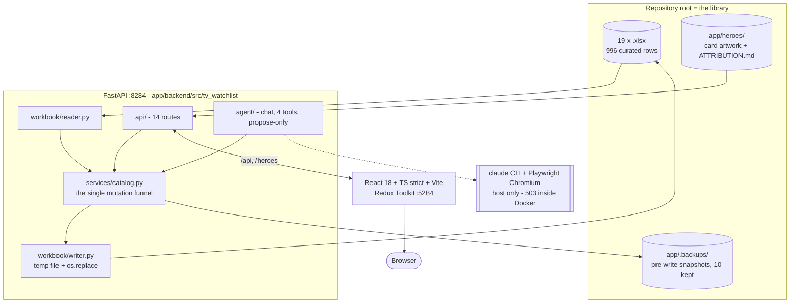
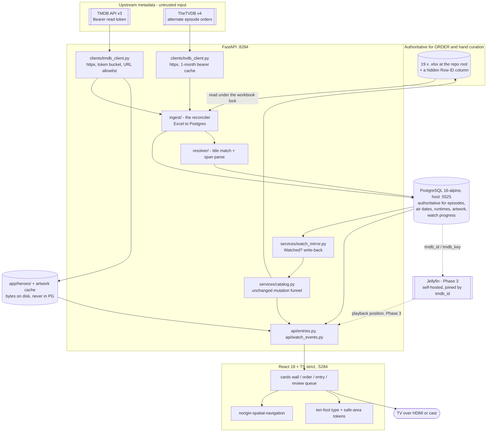
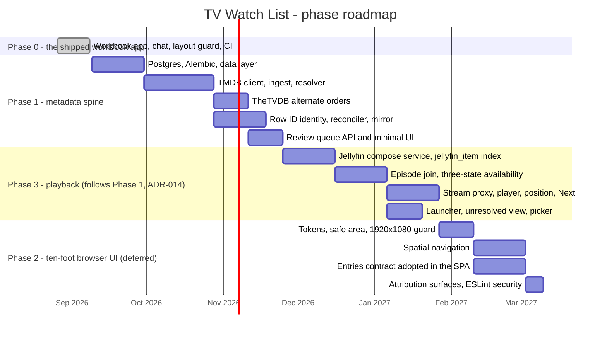
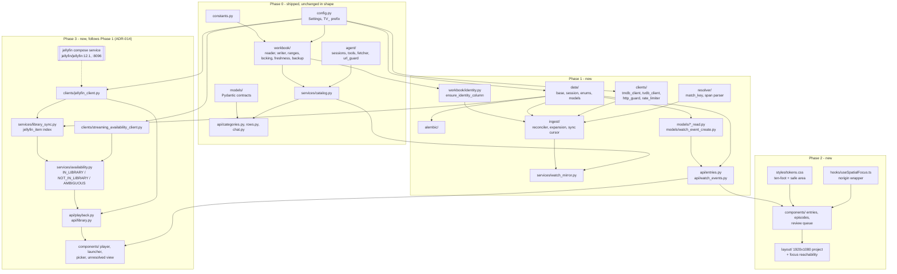
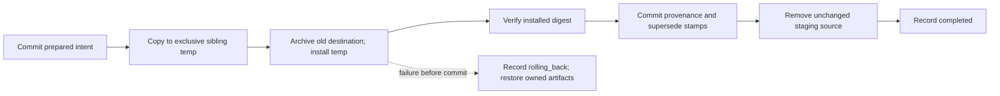
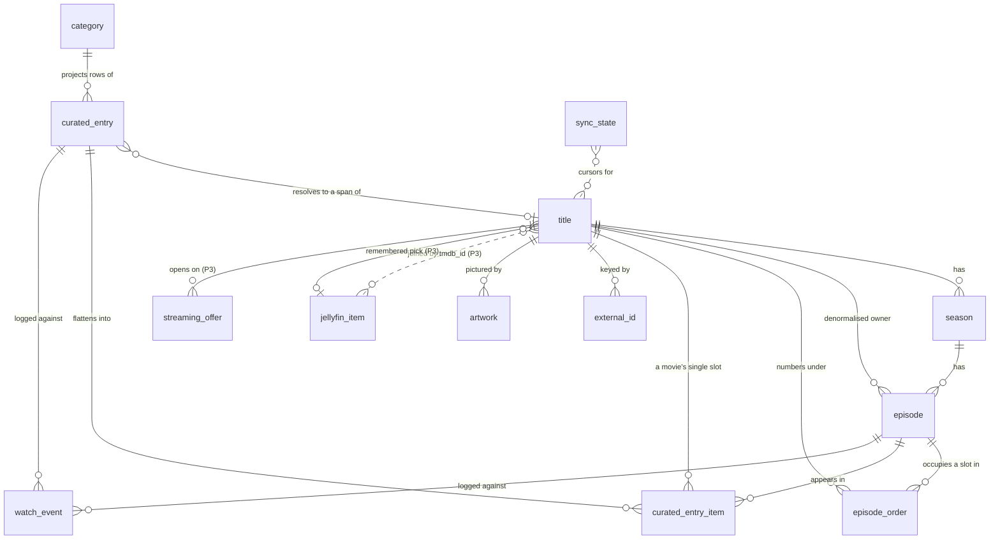
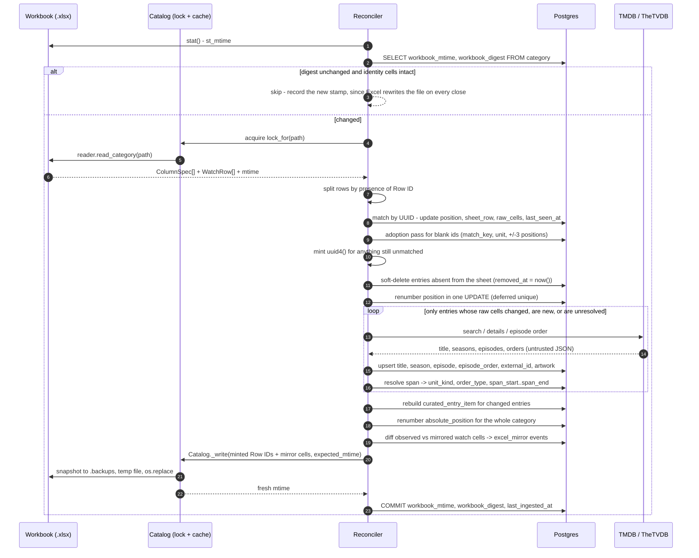
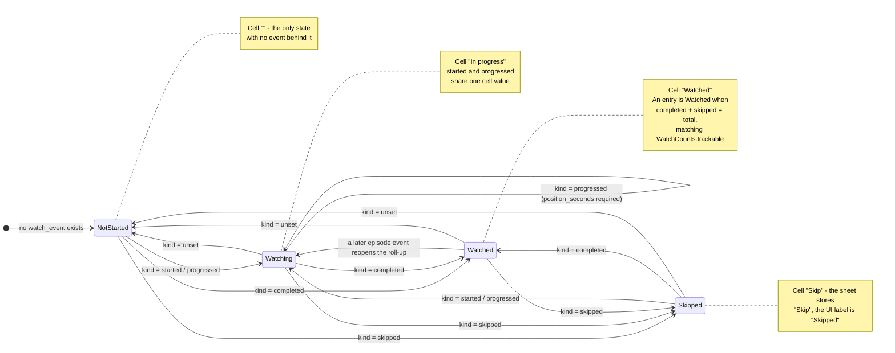
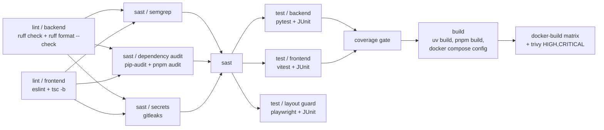
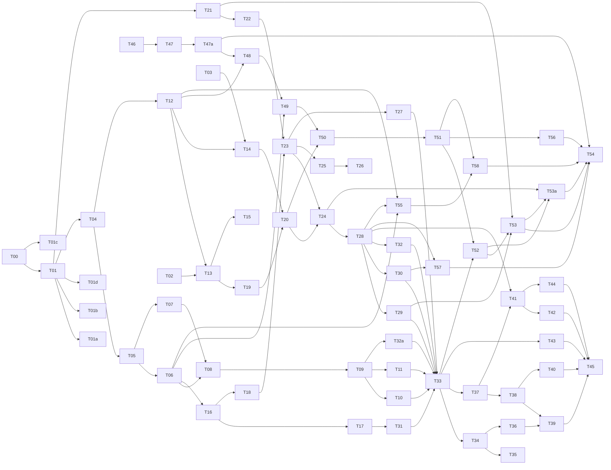

# TV Watch List — Master Plan

**Status:** authoritative. This document is the source of truth for goals, phases, architecture
decisions, technology choices, cross-phase contracts, per-phase completion gates, and the task list.
Read it in full before any non-trivial change, alongside the project `CLAUDE.md`, `docs/status.md`
and `docs/versions.md`.

**Repository:** `C:\Users\Amram\IMPORTANT\Personal\TV` — a public GitHub repository.
**Current versions:** `app/backend/pyproject.toml` = `0.1.0`, `app/frontend/package.json` = `0.1.0`.
Those two fields are the semver source of truth and are bumped by the release pipeline, never by
hand. The third copy of that number — the `version="0.1.0"` argument to `FastAPI(...)` at
`app/backend/src/tv_watchlist/main.py:27`, which is what `/openapi.json` advertises — **is kept in
step by the release pipeline, not hand-edited by a session.** Introducing this document is a
docs-only change and computes to **`0.1.1`** (patch). **The pending heading in `docs/versions.md`
is now `v0.2.0`** — raised on 2026-09-20 when T47a bound host port 8096 and T04 added the three
data-layer dependencies, both minor. The manifests stay `0.1.0` until the release pipeline moves
them.

### Where each document lives, and what belongs in it

| File | Owns |
|---|---|
| `docs/TV_MASTER_PLAN.md` | This file. Goals, phases, ADRs, contracts, gates, tasks. |
| `docs/status.md` | What is true *right now*: what was just built, what is next. Not a log. |
| `docs/versions.md` | Semver changelog, newest first. One unreleased heading at a time. |
| `README.md` | Human-facing repository guide: what it is, how to clone and run it, what CI does. |
| `app/README.md` | How the app itself behaves — categories, artwork, safety, the layout guard. |
| `app/docs/` | Design notes for features already shipped (`chat-feature-design.md`). Stays as-is. |
| `CLAUDE.md` (repo root) | The rules an AI session must hold in its head before editing. Its sections are numbered **0-22, continuously**: 0-5, then 6 Containerization, 7 CI/CD, 8 Environment configuration, 9 Observability, **10 Security**, 11 Required calculations, then 12-22. This plan refers to them as "section N", never by XML tag. |
| `docs/resolver-dry-run.md` | The Phase 1 resolver dry-run measurement, per workbook. Durable, and deliberately not `status.md`. |
| `docs/phases/phase-{N}-plan.md` | Per-phase step-level implementation plans, supplementary to §11. |
| `C:\Users\Amram\IMPORTANT\Projects\PORT_ASSIGNMENTS.md` | The machine-wide host-port registry. |

---

## 1. Goals and motivation

### 1.1 What this is

Nineteen hand-curated watch orders — `Attack_On_Titan`, `Bleach`, `DCU`, `Demon_Slayer`,
`Fullmetal_Alchemist`, `HunterXHunter`, `Inuyasha`, `Marvel`, `Middle_Earth`, `Misc_Anime`,
`Misc_Movies`, `Misc_TV`, `My_Hero_Academia`, `Naruto`, `One_Piece`, `Pokemon`, `Star_Wars`, `WWII`,
`Yu-Gi-Oh!` — each an `.xlsx` workbook committed at the repository root, together holding **996 data
rows**, counted with the reader's own `last_data_row` plus blank-row-skip algorithm
(`workbook/cells.py:41-46`, `workbook/reader.py:70-85`).

These orders are not lists of titles. Marvel's 141 rows walk X-Men → Blade II → Spider-Man →
Daredevil across four studios and three continuities. WWII's 84 rows are 84 different films arranged
by the historical event each depicts, not by release date. One Piece's 71 rows interleave one series
with its own films, OVAs and specials at particular episode boundaries. **The value in this
repository is the chronology a human authored**, and no sort by air date reproduces it.

A working local app already sits on top of them: FastAPI + openpyxl reading and writing the sheets in
place (`app/backend/src/tv_watchlist/`, 83 modules / 4160 lines), a React 18 + TypeScript strict SPA
(`app/frontend/`), a Claude-backed research chat that can only ever *propose* changes a human
approves, generated card artwork, atomic writes with pre-write snapshots, and a Playwright layout
guard driving 18 surfaces at four viewport sizes in real Chromium.

### 1.2 Why this plan exists — the three things the app cannot do today

1. **It knows nothing about episodes.** A row that reads `One Piece` / `E19–53` is a string. The app
   cannot say how many episodes that is, when they aired, how long they run, or how far into them the
   user is. Every workbook's `Release` column is free text (`2002`, `1999–2000`, `1977-05-25`), never
   a date cell. There are no per-episode runtimes, air dates or stills anywhere in the system.
2. **It is a desk app watched on a TV.** The screen it is used on is a television, driven by a PC or
   laptop over HDMI or cast. The type scale tops out at 36 px (`--step-6`, `tokens.css:29-35`), there
   is no focus treatment legible from three metres, and nothing in the codebase responds to a d-pad
   or a remote. The layout guard's widest viewport is 1512 × 900; the real target is 1920 × 1080.
3. **It cannot play anything.** The end state plays video from the owner's *own* library. No video
   files exist locally yet, so playback is designed for and deliberately not built.

### 1.3 The goal, stated once

> A ten-foot browser application, driven from the sofa, that renders a hand-authored cross-title
> watch order enriched with real episode data, tracks progress at episode granularity, keeps the
> nineteen workbooks meaningful when opened standalone in Excel, and — once a real file library
> exists — plays the next thing from a self-hosted Jellyfin server joined by `tmdb_id`.

### 1.4 Non-goals, explicitly

| Not doing | Why |
|---|---|
| A native TV application (Tizen `.wgt`, webOS `.ipk`, `react-native-tvos`, an app-store listing) | The device is a browser on a PC or laptop over HDMI or cast. ADR-002. |
| Replacing the workbooks with a database | The workbooks are the curation surface and must keep working in Excel alone. ADR-001. |
| A multi-user service, accounts, or sharing | Single user, one machine, `127.0.0.1`. `watch_event` deliberately carries no `user_id`. |
| Trakt, Simkl, or any third-party scrobble service | ADR-004. |
| Plex | ADR-005. |
| Anything at all from streambert | ADR-006. |
| Commercial use of any kind | TMDB's licence prohibits commercial use without a signed agreement, and separately prohibits using its content "in connection with, including for training" any machine-learning or AI application, which covers this app's chat (§9.4). |

**AniList is not a non-goal — it is *not adopted now*.** It sits outside the table deliberately,
because the decision is revisitable behind an ADR and a feature flag rather than closed. The
rationale is sourced, not preferential: **TheTVDB already supplies absolute order**, which is the
one thing AniList would be reached for; and AniList's public API is currently degraded to **30
requests per minute**, with rate-limit-increase requests not being accepted, and it returns
**HTTP 403 during outages**. A dependency that cannot be raised past 30 rpm and fails closed with a
403 is not one to build a bulk ingest on while a working alternative is already in the design.
Revisit only if franchise-graph chaining across separately-titled entries becomes a real
requirement — and then as an ADR, not as a drive-by.

---

## 2. Where the system stands today — the end of Phase 0

Verified against the working tree, not remembered. Everything in this section is **Phase 0**, the
shipped workbook app (§4.0); Phase 1 begins where it ends.



Load-bearing facts a plan must not break:

- **A category's identity is its filename.** `id = slugify(path.stem)` (`workbook/naming.py:22-24`);
  `name` and `file_name` derive from the same stem (`workbook/reader.py:70, 88-90`). Renaming the
  file renames the category and changes its id.
- **Every mutating call carries `expected_mtime`** — in the body for `RowWrite` and `CategoryRename`,
  as a required query parameter for retire / delete-row / add-watch-column, and as
  `ProposalEdit.read_mtime` for a chat approval. `guard_fresh` compares with a `1e-6` tolerance
  (`workbook/freshness.py:11, 14-17`), because an mtime crosses the wire as a JSON float and comes
  back rounded.
- **`Catalog._write` / `_mutate` is the only funnel**: freshness guard → backup snapshot → writer →
  cache invalidate → re-read, under `lock_for(path)`, on a worker thread
  (`services/catalog.py:122-141`). Chat approvals reuse it verbatim.
- **Every write is temp-file-plus-`os.replace`.** The original is never truncated; the temp is
  unlinked on any exception.
- **Nothing is ever deleted.** Retirement *moves* a workbook and its artwork into `.backups` under a
  `retired-` stamp that pruning can never reach (`services/retirement.py`).
- **The model can never write.** `propose` records a validated `Proposal` in memory; a human
  `POST /api/chat/proposals/{id}/approve` is what reaches disk (`api/chat.py:101-112`).
- **The `Watched?` cell is a four-value inline dropdown** — `""`, `Watched`, `In progress`, `Skip`
  (`constants.py:12-15`; the tuple they form is `DEFAULT_WATCH_CHOICES` at `:16`) — present and
  validated on all 19 sheets.
- **Row numbers are coordinates, not identity.** `writer._resequence`
  (`workbook/writer.py:147-149`) renumbers the whole `Order` column on every append (`:234`),
  delete (`:260`) and batch (`:387`), whenever `_sequential_orders` (`:139-144`) says the column was
  already `1..N` — which it is in all nineteen workbooks. And `_planned_values` (`:325-346`)
  snapshots each row as a whole value array before anything moves, which `_rewrite` (`:349-366`)
  then relays into its new slot.

---

## 3. Target architecture



Three sentences carry the design:

1. **The curated order is a two-level order** — the user's `position` over entries, taken straight
   from the sheet and never derived, and each entry's `(order_type, span_start..span_end)` over that
   title's own dense 1-based numbering. That single choice makes aired, dvd and absolute the same kind
   of object instead of three special cases.
2. **Identity of a sheet row is a UUID living in a hidden `Row ID` column of the sheet**, because the
   existing writer already relays whole rows through reorders and therefore carries that identity for
   free, while any side-table scheme would re-derive identity heuristically on every read and fail
   silently.
3. **Progress is an append-only log** (`watch_event`) with status derived by `DISTINCT ON`, and the
   four-value `Watched?` cell is a lossy one-directional projection of it that is never read as truth
   — only as a signal that a human changed it, which appends one more coarse event on top rather than
   overwriting anything.

---

## 4. Phases



Durations are shape, not commitment. This is a personal project touched a few times a year; the
dependency order is the part that binds. The bar dates for Phase 0 are the repository's own: first
commit `5e3d25d` on 2026-08-26, `HEAD` `10c3205` on 2026-09-07. Everything after 2026-09-08 is
shape. On 2026-09-20 the owner reordered the sequence (ADR-014): Phase 3 follows Phase 1 directly and
Phase 2 is deferred behind it — deferred, not cancelled.

### 4.0 Phase 0 — the shipped workbook app

**Already shipped, and closed 2026-09-20.** Phase 0 is not a planning artefact
invented after the fact; it is what §2 describes — the workbook app, the propose-only chat, the
Playwright layout guard, and the GitHub Actions pipeline — everything that exists in the tree
today. Its one remaining gap is documentation. **Phase 0 closes on five tasks: T00, T01, T01a, T01b
and T01c.** The phase numbering this plan reasons about is therefore **P0 → P1 → P2 → P3**, and every
diagram, gate and status document draws it that way rather than starting at P1; the *build order*,
since ADR-014 (2026-09-20), is P0 → P1 → P3 → P2, with Phase 2 deferred rather than cancelled.

| # | Deliverable | State |
|---|---|---|
| 0.1 | Nineteen `.xlsx` workbooks, 996 curated rows, committed at the repository root | shipped |
| 0.2 | FastAPI backend — reader, writer, the `Catalog` mutation funnel, atomic writes, backups, retirement | shipped |
| 0.3 | React 18 + TS strict SPA with Redux Toolkit | shipped |
| 0.4 | Propose-only Claude research chat, four tools, human approval the only path to disk | shipped |
| 0.5 | Playwright layout guard, 18 surfaces at four viewport sizes in real Chromium | shipped |
| 0.6 | GitHub Actions `lint → sast → test → coverage gate → build → docker-build`, plus CodeQL | shipped |
| 0.7 | `docs/` — this plan, `status.md`, `versions.md` | **T00 — done 2026-09-08** |
| 0.8 | Root `CLAUDE.md` | **T01 — done 2026-09-08** |
| 0.9 | `.claude/` wiring — `settings.json` with the `.cjs` hook set, `commands/`, `skills/` | **T01a — done 2026-09-20** |
| 0.10 | `.env.example` — every variable with a placeholder and a one-line comment | **T01b — done 2026-09-20** |
| 0.11 | README reconciliation, including the P0 → P1 → P2 → P3 phase-flow diagram | **T01c — done 2026-09-20** |

### 4.1 Phase 1 — the metadata spine

**Objective.** Postgres becomes authoritative for episodes, air dates, runtimes, artwork and watch
progress, while the workbooks stay authoritative for order and curation. The existing UI keeps
working, untouched, for the whole phase.

| # | Deliverable | Notes |
|---|---|---|
| 1.1 | `postgres:16-alpine` in `docker-compose.yml` | `${TV_POSTGRES_PORT:-5525}:5432`, named volume `tv_postgres_data`, database `${TV_POSTGRES_DB:-tv}`, `healthcheck: pg_isready -U ${TV_POSTGRES_USER:-tv} -d ${TV_POSTGRES_DB:-tv}`; the backend gains `depends_on: { postgres: { condition: service_healthy } }` and runs `alembic upgrade head` before `uvicorn`. Host port **5525** is allocated (§6.8). |
| 1.2 | `app/backend/src/tv_watchlist/data/` | `base.py` (naming convention, `UuidPk`, `TimestampMixin`), `session.py` (async engine, `expire_on_commit=False`, `autoflush=False`), `enums.py`, and `models/` with one class per file. |
| 1.3 | Eleven tables | `category`, `curated_entry`, `curated_entry_item`, `title`, `season`, `episode`, `episode_order`, `external_id`, `artwork`, `watch_event`, `sync_state`. Shapes and constraints in §6.3. (Phase 3 adds `jellyfin_item` and `streaming_offer`, ADR-014.) |
| 1.4 | Alembic against the async engine | `alembic/env.py` bridging with `connection.run_sync`, `poolclass=NullPool`, an `include_object` hook that keeps autogenerate away from the two views, and a URL whose `%` is doubled because `set_main_option` writes into a `ConfigParser`. |
| 1.5 | Append-only enforcement | The `watch_event_reject_mutation()` trigger raising `restrict_violation` on `UPDATE` and `DELETE`, plus the `episode_watch_state` and `curated_entry_watch_state` views, all in `op.execute()` calls with a hand-written `downgrade`. |
| 1.6 | `clients/tmdb_client.py` | httpx, Bearer read token, one serialised token-bucket worker (the limit is per **IP** at the CDN, so a second API key buys nothing), conditional requests and payload digests through `sync_state`, and a hard cache TTL below six months. |
| 1.7 | `clients/tvdb_client.py` | `POST /v4/login` token cached with its issue time and refreshed proactively at ~25 days (there is no refresh endpoint); `GET /v4/seasons/types` fetched once and cached; **never** a hard-coded season-type list. |
| 1.8 | The reconciler | `ensure_identity_column` → UUID match → adoption pass → mint → soft-delete → scoped re-resolution → expansion rebuild → `absolute_position` renumber → mirror diff, in one transaction and one `Catalog._write`. Algorithm in §6.5. |
| 1.9 | `ColumnSpec.role` gains `"identity"` | A cross-boundary contract change touching the Pydantic model and the TypeScript type (§6.2). Minor bump on the implementation commit; written into `CLAUDE.md` before the code lands. |
| 1.10 | `GET /api/categories/{id}/entries` | The Postgres projection, served **alongside** the existing `CategoryDetail`, not replacing it. Replacing a live contract and adding a database in one step would break the running app for the length of the phase. |
| 1.11 | `POST /api/watch-events` | The only write path into the log. `WatchEventCreate` with `extra="forbid"` and a validator duplicating the database `CHECK`. |
| 1.12 | The mirror | `watch_cell(kind)`, the `mirrored_watch_cell` / `observed_watch_cell` echo defence, and write-back through `Catalog._write` so a mirror pass against a workbook open in Excel fails cleanly and retries. |
| 1.13 | Dry-run resolver report | Run the resolver against all 19 workbooks and record how many of the 996 rows land in the review queue **before** the schema is committed to (§12, risk R1). It gets a durable home of its own — **`docs/resolver-dry-run.md`**, not `docs/status.md`, which is explicitly a statement of *now* and not a log. One row per workbook, columns: **rows, confirmed, auto-resolved, unresolved**, plus the **worst-confidence examples** for that workbook. |
| 1.14 | Tests against a real Postgres 16 | A GitHub Actions service container against database `tv_test`. No mocking of the database. Includes `alembic upgrade head && alembic downgrade base && alembic upgrade head`. |
| 1.15 | Attribution copy in place | The verbatim TMDB notice plus logo, and TheTVDB's link, rendered where metadata is visible (§9.4). |
| 1.16 | The launchers gain `[q]` and `[v]` | `run_tv.sh` / `run_tv.bat` offer only `[r]` and `[k]` today — not because that is right, but because **neither launcher invokes `docker compose` at all**; they run the host toolchain directly, so there is nothing for `[q]` or `[v]` to clean up. Phase 1 changes that: compose gains a Postgres service and a named volume, so the launchers gain both terminal options. `[q]` runs `docker compose down --remove-orphans` and removes images matching the `tv-watchlist` prefix, **keeping volumes**. `[v]` additionally passes `--volumes` and drops `tv_postgres_data`. Adapted from `llm-knowledge-base`'s canonical `[k]/[q]/[v]/[r]` loop. |

**Explicitly deferred out of Phase 1:** every ten-foot presentation change, all spatial navigation,
all Jellyfin code, AniList, modelling of the reference sheets (`Media Inventory`, `Scope & Sources`,
`Series Inventory`, `Verified Media Inventory`, `Summary`, `Notes` stay as the existing
`ReferenceSheet` read-through), and interpretation of `Misc_Anime`'s own `Started?` / `Progress` /
`Priority` columns — they land verbatim in `raw_cells` and are never read, because interpreting them
would fork the progress vocabulary.

### 4.2 Phase 2 — the ten-foot browser UI

**Objective.** The same browser app, usable from a sofa at 1920 × 1080 with a remote or a d-pad,
showing the Phase 1 data. No native target, no second codebase.

Deferred by ADR-014 (2026-09-20): Phase 2 is scheduled after Phase 3.

| # | Deliverable | Notes |
|---|---|---|
| 2.1 | Ten-foot type and spacing tokens | New rungs above the current ceiling of 36 px, added to `src/styles/tokens.css`, which is the one place tokens are declared and which every stylesheet already consumes by `var()`. Additive, not a rewrite. |
| 2.2 | Safe-area tokens | The first `env(safe-area-inset-*)` references in the project, plus an overscan inset for panels that crop. `--launcher-width` and `--toast-lane-max` are the precedent: layout tokens carrying a comment saying why they are layout rather than styling. |
| 2.3 | `@noriginmedia/norigin-spatial-navigation` (MIT) | Focus ownership moves to the library; React state stays for UI-only concerns and Redux Toolkit keeps app state. ADR-008. |
| 2.4 | A focus treatment legible at three metres | The accent is per-workbook data lifted by `accentPalette` (`utils/accentPalette.ts:67-77`), so the ring has to read against all nineteen accents, including the several sheets that share `#111827` and are given a hashed hue. |
| 2.5 | `1920x1080` added to the layout guard | A fifth chromium project in `layout/playwright.config.ts` beside `1512x900`, `1280x720`, `1024x768` and `960x1040`. Every one of the 18 surfaces must pass at the new size. |
| 2.6 | A focus-reachability assertion | The guard proves every control can be *clicked*; a ten-foot UI additionally needs every control to be *reachable by focus movement* from the surface's entry point. New assertion, same measurement harness. |
| 2.7 | The SPA adopts `/entries` | `CuratedEntryRead` becomes the row contract for reading; the workbook `CategoryDetail` contract stays for editing until it is retired deliberately, in its own change. |
| 2.8 | Episode-level progress UI, and **Up next** | Marking an episode, resuming a span, and **Up next** — the next item in the category's curated order, episode *or film* (§6.9) — one indexed scan over `curated_entry_item.absolute_position`, which holds each movie entry as a single slot (ADR-010). |
| 2.9 | Review queue UI | Backed by the partial index `ix_curated_entry_needs_review`. If risk R1 lands badly this becomes the phase's main deliverable rather than a side panel. |
| 2.10 | `eslint-plugin-security` + `eslint-plugin-no-unsanitized` | Closes the standing gap named in §9.2. `pnpm lint` gains `--max-warnings 0`, or the rules are set to `error` explicitly, because the security plugin's recommended config sets every rule to `warn` and a bare `eslint .` still exits 0. |
| 2.11 | CSP tightened | Artwork proxied through the backend so `img-src` can drop the blanket `https:` currently at `app/frontend/nginx.conf:40`. |

**Explicitly outside Phase 2:** any playback and any Jellyfin code (Phase 3, which now precedes it —
ADR-014), and any native TV packaging (never).

### 4.3 Phase 3 — playback

**Objective.** Play the next thing, from the owner's own files, through a self-hosted Jellyfin
server that runs as a compose service beside the app — and, for every entry the library does not
hold, open it on the owner's own subscription (ADR-012, the `NOT_IN_LIBRARY` fallback). **The file
library exists (T46 satisfied 2026-09-20)**, so this phase is built, directly after Phase 1
(ADR-014); Phase 2 follows it. The join key was chosen in Phase 1, so nothing is retrofitted.
Phase 3 adopts `GET /api/categories/{id}/entries` for its availability-and-progress layer only; the
workbook `CategoryDetail` stays the editing contract, unchanged.

| # | Deliverable | Notes |
|---|---|---|
| 3.1 | Jellyfin client, server-side only (`clients/jellyfin_client.py`, `httpx`) | A Jellyfin API key is a bearer credential for the entire media server: `TV_JELLYFIN_API_KEY` (`SecretStr`), read by the backend, never in the frontend bundle. The base URL is the configured `TV_JELLYFIN_BASE_URL` and **that configured host is the allowlist** — the existing `agent/url_guard.assert_public_http_url` (`agent/url_guard.py:16-18`) rejects private and loopback addresses and so cannot vet a LAN server; the private-address carve-out is written down in §9.2, not discovered. No `@jellyfin/sdk`. |
| 3.2 | The `tmdb_id → Jellyfin Id` index — the `jellyfin_item` table | Built by paging `GET /Items?recursive=true&includeItemTypes=Series,Movie&hasTmdbId=true&fields=ProviderIds`, because **Jellyfin cannot filter or query items by provider id at all** — only `hasImdbId` / `hasTmdbId` / `hasTvdbId` booleans exist, and `/Search` has no equivalent. Persisted as `jellyfin_item` (one row per movie, series and episode the library holds), maintained by `services/library_sync.py`; refreshed on `minDateLastSaved`. |
| 3.3 | Episode join | `GET /Shows/{seriesId}/Episodes`, keyed on `(ParentIndexNumber, IndexNumber)` and performed **after** the entry has resolved to a stored `order_type`, never before. `IndexNumberEnd` non-null means one file covers several watch-list rows. |
| 3.4 | Three-state availability | `IN_LIBRARY` / `NOT_IN_LIBRARY` / `AMBIGUOUS` per entry, a real `Availability` enum rather than a nullable id, computed by `services/availability.py` from `curated_entry` against `jellyfin_item` and exposed as `CuratedEntryRead.availability` and `CuratedEntryRead.jellyfin_item_id`. The ambiguous case is real — absolute-versus-official numbering, multi-episode files — and collapsing it into "not in library" produces a UI that quietly lies. |
| 3.5 | Playback surface — **DECIDED** (ADR-014) | A browser `<video>` element against the backend proxy `GET /api/playback/{jellyfin_item_id}/stream` (`api/playback.py`), which relays Jellyfin's `/Videos/{id}/stream` with the key in a header: `Range` passed through both ways, `Content-Type` passed through, `Accept-Ranges: bytes` set, the body streamed and never buffered. A `<video>` element cannot send an `Authorization` header, so the key never leaves the server; the `src` is same-origin, so the nginx CSP needs no `media-src`. |
| 3.6 | Position reporting | A `progressed` `watch_event` every 60 seconds from the player, via `POST /api/watch-events`, carrying `source = 'player'` (the position comes from the browser's `<video>` element, not from a Jellyfin session report — `jellyfin` stays free for server-reported sessions if one is ever added). `position_seconds` is an integer converted **once** at the boundary — Jellyfin's `PlaybackPositionTicks` (.NET ticks, 100 ns) ÷ 10 000 000, `<video>.currentTime` rounded. Completion mirrors the four-value `Watched?` cell. **Each minute snapshot also writes Excel automatically** (R105, see 3.14). |
| 3.7 | Jellyfin version — **DECIDED** (ADR-014) | `jellyfin/jellyfin:12.1` as a compose service (verified 2026-09-20 against Docker Hub and the GitHub release feed: 12.1 released 2026-09-15, 12.0 on 2026-09-08). No `@jellyfin/sdk`: only the backend talks to Jellyfin, over `httpx`. Closes T47. |
| 3.8 | **Next** and **Autoplay** | A Next button and an Autoplay toggle that advance through the category's curated order across episodes and films, and never silently past an item that cannot be played. Rules in §6.9; ADR-010. |
| 3.9 | Audio and subtitle language | Dub versus sub is a property of each video file — which audio and subtitle tracks it carries — not of TMDB or TheTVDB, which supply metadata only. Which track plays by default, and whether this app sets that or leaves it to Jellyfin, is decided at phase start from the files that actually exist. |
| 3.10 | Launcher (ADR-012) — the `NOT_IN_LIBRARY` fallback | One press opens the title in a new tab on the owner's own subscription. Availability for Israel only (`country=il`) from the Streaming Availability API (`clients/streaming_availability_client.py`, `TV_STREAMING_AVAILABILITY_API_KEY`), one call per title, cached in `streaming_offer`; Disney+ rows hand-marked, opening `/browse/entity-…`; episodes matched by title and air year, proven on One Piece first; the chat's fetch tool gains a denylist of streaming domains; the API's attribution line rendered. Without the key, the launcher shell shows with no link. T55, T58. |
| 3.11 | Unresolved view | `AppView` gains `"unresolved"` with a main-nav entry, backed by the Phase 1 review API (T30): every `unresolved` / `auto` entry listed with its raw cells. The honesty mechanism ADR-013 names. T57. |
| 3.12 | `AMBIGUOUS` picker | `PATCH /api/titles/{title_id}/jellyfin-item` with the `JellyfinItemChoice` body, plus a modal; persists `title.jellyfin_item_id` (per title, not per file) and the next library sync respects it. T56. |
| 3.13 | Jellyfin compose service | `jellyfin/jellyfin:12.1`, `restart: unless-stopped`, named volumes `tv_jellyfin_config` and `tv_jellyfin_cache`, media bind-mounted read-only from `${TV_JELLYFIN_MEDIA_HOST:-./media}` to `/media`, healthcheck `GET /health`, host port `${TV_JELLYFIN_PORT:-8096}:8096`. **No backend `depends_on` edge**: Jellyfin is an optional peer and the app boots and serves without it. The backend reaches it as `http://jellyfin:8096` under compose and `http://localhost:8096` from the host launchers. `/media/` gitignored; `PORT_ASSIGNMENTS.md` gains the `8096` row in the same commit. T47a. |
| 3.14 | `Position (s)` column + `ColumnRole` `"position"` | A visible, app-owned sheet column written **every 60 seconds while playing, plus pause, ended and unmount** through `Catalog._write`, so a hard kill still leaves something in the workbook. A projection, never read as truth. `ColumnRole` gains `"position"` beside `"identity"`; the reader excludes both from `columns` and `WatchRow.cells`, so the UI grid is unchanged and `RowWrite` cannot address them (§6.2). T53. |

---

## 5. Module dependency map



Two rules this map encodes:

- **`clients/` never imports `data/`, and `data/` never imports `clients/`.** The ingest layer is the
  only thing that knows both — and in Phase 3, `services/library_sync.py` plays the same role for
  the Jellyfin client. A provider client is importable and testable on its own, against recorded
  fixtures, with no database in the process. The `jellyfin` compose service is a peer the backend
  talks to over HTTP, never a dependency it imports or waits on.
- **`workbook/` gains exactly one new module** (`identity.py`) and otherwise stays as it is. The
  Excel layer earned its shape through five shipped layout bugs and a documented set of atomic-write
  and lock invariants; Phase 1 builds beside it, not through it.

---

## 6. Cross-phase concerns

These are the contracts every phase inherits. Changing one is an architectural decision requiring
approval and a minor semver bump, not an implementation detail.

### R105 — automatic player saves to both stores (owner-approved 2026-09-24)

This supersedes ADR-014's original five-second database-only ticks and terminal-only Excel saves.
While playing, save to **PostgreSQL and Excel every 60 seconds**, plus pause, ended and player
close/unmount. No manual Excel update is required. Browser/process termination cannot guarantee an
asynchronous final save; the last successful minute save remains the safety net.

- Keep `WatchEventCreate` and the 201 `WatchEventRead` response unchanged. Paired optional UUID query
  parameters `playback_entry_id` and `jellyfin_item_id` on `POST /api/watch-events` select the player
  path; both must be supplied together. Verify the live entry/category, exact queue subject and
  selected live file using T50/T51's cached numbering-aware selection. Derive `source=player` on the
  server; do not schedule the ordinary background workbook mirror for this path. Non-player callers
  retain their current behaviour.
- Then `POST /api/playback/entries/{entry_id}/position` takes `PositionWrite` with exactly
  `watch_event_id: UUID` and `expected_mtime: float` (`extra="forbid"`) and returns `CategoryDetail`.
  Validate the requested committed event, then project the newest player snapshot's integer file
  position/runtime for that entry, not arbitrary client text or a row number. The entire event-plus-projection snapshot runs inside the existing frontend
  per-workbook write queue. On 423/409, retain the committed event id and retry projection only;
  the UI must distinguish database-saved from workbook-pending even after the player closes.
  Cross-request projection retries retain their original expected_mtime; a refresh only authorizes
  a new logical snapshot, not an old event overwriting an intervening human Position edit.
- Both server paths serialize on the selected category. An older snapshot cannot project over a
  newer one; range siblings sharing occurred_at/kind/position/runtime constitute one snapshot.
  Recovering an older unsaved event preserves its original occurred_at while projecting the newest
  position. Never discard a failed event POST merely because a later snapshot succeeded: those are
  distinct historical facts. Only already-committed older workbook projections may be superseded.
  The frontend captures occurred_at and immutable entry/file/category/mtime scope before queuing;
  changing selection or navigating cannot retarget the old video's final save. Identical terminal
  snapshots are deduplicated and cleanup never appends progressed after ended.
- Every workbook snapshot combines Position and all currently pending eligible Watched cells in
  the selected category in **one**
  `Catalog._write`, with its usual lock, freshness guard, unconditional backup and atomic swap.
  This also repairs failed earlier completion projections, including rows outside the current span.
  Resolve rows by their current hidden Row ID before the first write, never blindly by stored
  sheet_row. Recheck identities and contested cell values before one stale retry; human edits win.
  Invalid status-dropdown values are skipped without claiming they were mirrored. Position is
  visible in Excel, app-owned, excluded from public columns/cells and ingest truth.
- **Whole-file completion:** progressed never completes any episode by a percentage threshold.
  Completed is sent only on file ended with a finite positive integer runtime and position at least
  runtime (stored/projected position clipped to runtime). Resolve every contained episode using the
  selected title, actual stored `(order_type, label)`, file season and inclusive episode-index range,
  including mapped episodes outside the selected entry span. Append their completed events in one
  transaction, returning the selected event with refreshed entry progress. Missing/conflicting
  numbering refuses completion with typed 409 before any insert; never infer chapter offsets or
  substitute TMDB season arithmetic. Mirror affected live entries in the selected workbook together;
  other workbooks receive the normal reconciliation projection.

### R106 — durable, source-retaining import operations (owner-approved 2026-09-24)

T66 adds `media_import_operation` in revision `0004` after `0003`; existing `media_import` and its
status vocabulary remain unchanged. This replaces the unsafe source-delete-before-hash/commit
ordering in ADR-015's original implementation plan, not the final move-not-permanent-copy outcome.

| Column | Contract |
|---|---|
| `id`, `created_at`, `updated_at` | Existing UUID/timestamptz mixins |
| `media_import_id` | UUID FK to media_import, ON DELETE RESTRICT |
| `phase` | Native enum: prepared, copied, installed, committed, rolling_back, completed, duplicate_skipped, failed |
| `staging_root`, `media_root` | Text, canonical configured-root snapshots |
| `source_path` | Text, relative to staging root |
| `destination_path`, `temp_path` | Text, relative to media root |
| `superseded_path` | Nullable Text, relative to media root; timestamp plus operation UUID avoids archive collisions |
| `source_identity` | JSONB, typed frozen file identity: device, inode, size_bytes, mtime_ns |
| `destination_identity`, `temp_identity` | Nullable JSONB with the same shape |
| `source_sha256` | Required String(64), streamed before mutation |
| `destination_sha256`, `verified_sha256` | Nullable String(64), previous and installed destination digests |
| `rollback_status` | Nullable existing MediaImportStatus, restricted to failed/duplicate_skipped |
| `error` | Nullable Text, explicit failure/recovery reason |

Retain operation history. Partial unique active-operation indexes cover media_import_id,
(media_root, destination_path), and (staging_root, source_path); completed/duplicate_skipped/failed
are terminal. PostgreSQL enforces digest shape and rollback/phase consistency. JSON identities and
paths are validated at the filesystem boundary; recovery refuses roots that no longer match current
configuration. Unknown/changed artifacts retain bytes and active ownership, with an explicit error.



The staging source remains until installed bytes and the successful database commit are verified.
Duplicate digest conflicts restore archived originals and remove only proven operation-owned new
bytes, leaving staging untouched. An uncertain commit/database outage preserves source and artifacts
until recovery inspects actual committed state. Cleanup failure remains recoverable, not a claim
that the import failed before commit. Every blocking filesystem call runs off the event loop;
cancelled workers are drained before ownership locks are released.

Service signatures take `async_sessionmaker[AsyncSession]`, not a shared session:
`move_one(session_factory, settings, import_id) -> MediaImport` (fresh detached row),
`move_pending(session_factory, settings) -> int` (completed moves), and
`recover_pending(session_factory, settings) -> int` (reconciled operations). Each worker owns its
phase transactions; a pinned-connection operation lock spans them. A nonblocking OS lock on the
source file also remains held through confirmed cleanup, so losing the database connection cannot
admit a second cooperating filesystem worker. Recheck identity after acquiring it. Missing source is
accepted only for COMMITTED recovery with verified installed bytes and matching committed provenance;
that path changes journal state only. Atomic installation/archive restoration uses native exclusive
rename, never an exists-check followed by os.replace; unsupported filesystems are refused safely.
Revalidate roots/parents before destructive transitions. These locks fence cooperating import workers,
not arbitrary external pathname replacement between a final check and an OS mutation; do not edit or
move library/staging artifacts concurrently with import. Process-crash recovery is tested; power-loss
durability still depends on the host filesystem. Bounded workers respect
import_concurrency, and batch work recovers unfinished operations first. T67 reloads returned ids in
its own session. Reimport source authority remains T68's decision; T66 accepts staging sources only.

### 6.1 The canonical identifier scheme

| Identifier | Shape | Scope | Stability |
|---|---|---|---|
| `category.slug` | `slugify(path.stem)`, e.g. `one-piece` | one workbook | **Changes on rename.** A projection of the filename, never an identity. |
| `category.id` | UUID | one workbook | Stable across renames. |
| `curated_entry.id` | UUID, canonical 36-character string | one sheet data row | **The sync key.** Written verbatim into the sheet's hidden `Row ID` column. Survives reorder, insert, delete and a full Excel re-sort of the curated columns. |
| `title.tmdb_id` + `title.media_type` | `int` + `movie \| tv` | one work | The spine. `uq(media_type, tmdb_id)`. |
| `tmdb_key` | `movie:603`, `tv:1399:s2:e5` | one work / season / episode | **The durable pointer.** Carried on every `watch_event` so the log outlives a full metadata rebuild, and the same key Phase 3 joins Jellyfin on. |
| `episode.tmdb_episode_id` | `int`, globally unique | one episode | TMDB's own episode id; the only episode key that is stable when TMDB renumbers. |
| `episode_order.sequence` | dense, 1-based `int` per `(title_id, order_type, label)` | one slot in one numbering | What the app computes with. `order_season_number` / `order_episode_number` are what the UI prints. |
| `curated_entry.position` | dense, 1-based `int` per category | the authored chronology | Comes straight from the sheet. Postgres never invents or reorders it. |
| Excel row number | 1-based, header is row 1 | a coordinate | **Never an identity.** Recorded as `curated_entry.sheet_row` for diagnostics only. |
| `Order` column value | free text / int | curation prose | **Never an identity.** `_resequence` rewrites `1..N` on every append, delete and batch. |
| `jellyfin_item.jellyfin_id` | Jellyfin's own item `Id` string | one library item — a movie, series or episode the library holds | Stable while the file exists; gone when Jellyfin drops the item. `uq(jellyfin_id)`. The row's `id` is the app UUID (`UuidPk`), like every other table; `tmdb_id` on the row is the join to `title`. |
| `title.jellyfin_item_id` | UUID FK → `jellyfin_item.id`, nullable | one title | The `AMBIGUOUS` picker's remembered choice — a per-title setting, not per file (ADR-014). Respected by the next library sync; cleared only by the owner. |
| `media_import.file_sha256` | nullable 64-character digest | one imported file's bytes | T61 stores it; T66 produces it. A partial unique index protects live moved/hashed/refreshed rows while preserving superseded provenance. |

`tmdb_id` is the join key to the media server, chosen in Phase 1, before playback existed, precisely
so nothing had to be retrofitted; Phase 3 joins on it as designed.

### 6.2 Shared data models, and what changes

**Unchanged in Phase 1** (the existing wire contract, both sides): `ColumnSpec`, `WatchRow`,
`WatchCounts`, `CategorySummary`, `CategoryDetail`, `CatalogListing`, `ReferenceSheet`,
`ShadowedWorkbook`, `UnreadableWorkbook`, `RowWrite`, `RowChange`, `CategoryCreate`,
`CategoryRename`, `Proposal` and its three bodies, `HeroCandidate`, `ChatEvent`. Field names stay
snake_case across the wire; camelCase appears only in frontend-only shapes.

**The contract changes this plan forces**, flagged here rather than smuggled in:

> `ColumnRole` is `Literal["order", "title", "watch", "identity", "position", "other"]`
> (`models/column_spec.py`, mirrored at `src/types/ColumnSpec.ts`). Phase 1 added `"identity"`
> for the hidden `Row ID` column (T22), and Phase 3 adds `"position"` for the visible `Position (s)`
> column (T53; R105). Both are app-owned. `workbook/schema.py:_role_for` knows each alias, and
> `workbook/reader.read_category` excludes both roles from `columns` and from `WatchRow.cells`, so the
> grid the UI renders is byte-for-byte what it renders today and `RowWrite` can never address either
> column.
>
> `CuratedEntryRead` **gains `availability`** — the `Availability` enum, `IN_LIBRARY` /
> `NOT_IN_LIBRARY` / `AMBIGUOUS`, never a nullable id — **and `jellyfin_item_id`** (`uuid.UUID | None`,
> the title-level movie/series selection when it is `IN_LIBRARY`). Phase 3, T51. Per-slot episode
> media ids remain in `EpisodeMatch`, not this field. Series availability requires every queued
> episode to match; any ambiguous slot wins over missing slots, and an empty queue is not available
> (R96). An unreachable-server notice is returned by the service only; no third wire field or response
> envelope is added (R103).

Each is a cross-boundary type change touching the Pydantic model and the TypeScript type. Per the
versioning rule each is a **minor** bump on its implementation commit, recorded in the project
`CLAUDE.md` data-contract section *before* the code lands, with both sides changing in the same
commit.

**New in Phase 1**, one model per file, `from_attributes=True` and `frozen=True` on responses,
`extra="forbid"` on requests: `CuratedEntryRead`, `TitleRead`, `EpisodeRead`, `EntryProgress`,
`WatchEventCreate`, `WatchEventRead`, `ResolutionUpdate`. **`SeasonRead` and `ArtworkRead` are not
written** (T28, 2026-09-20): neither has a Phase 1 consumer, and a model nothing reads is a stub.
`EpisodeRead` has no Phase 1 consumer either and is written anyway, because the project `CLAUDE.md`
data-contract section carries it verbatim and a published contract is not quietly dropped.

Two shapes those models took that this section had left open, recorded here because they are contract
decisions rather than implementation detail:

> `WatchEventRead` is the response of `POST /api/watch-events` and **embeds the entry's derived
> progress** as `progress: EntryProgress | None` (Ruling 44, 2026-09-20), so the UI still repaints
> from the view rather than from its own request. `progress` is `None` when no live queue slot holds
> the subject — an episode nothing curated covers is still a fact worth logging, and a progress
> reading invented for it would be a lie.
>
> `CuratedEntryRead` carries **`resolution_note: str = ""`** (Ruling 45, 2026-09-20) — never null, because
> the column is `NOT NULL DEFAULT ''`. The review queue has to be able to explain itself, and the
> human's reason for a decision is served with the entry. A re-resolve after a cell edit replaces that
> note **wholesale**, so a `review:` clause is not durable across a cell edit; T57 decides whether
> decision history needs durability (Ruling 48).

**New in Phase 3**, same rules: the request model `JellyfinItemChoice` (`extra="forbid"`; the body of
`PATCH /api/titles/{title_id}/jellyfin-item`, carrying the chosen `jellyfin_item_id`). Title-level
availability rides on `CuratedEntryRead` as the two fields above.

**R104 — approved by the owner, 2026-09-23:** T52 adds
`GET /api/playback/entries/{entry_id}/items` returning `list[PlaybackItemRead]`, separate from the
unchanged `CuratedEntryRead`. A series UUID cannot identify the episode file to stream. The new
frozen response and its TypeScript mirror carry exactly:

```python
id: uuid.UUID                         # curated_entry_item.id
entry_id: uuid.UUID
episode_id: uuid.UUID | None
movie_title_id: uuid.UUID | None      # exactly one subject, as the queue already guarantees
position_in_entry: int               # >= 1
absolute_position: int               # >= 1, the stored category queue position
availability: Availability
jellyfin_item_id: uuid.UUID | None    # a live MOVIE/EPISODE file, never a SERIES row
order_type: str | None               # the numbering actually used; null for films
order_label: str
covers_range: bool                   # one file may answer several distinct queue slots
```

The endpoint reads live entries of live categories, returns 404 for an unknown/removed entry, and
pages in stored `position_in_entry` order using the existing `limit`/`offset` cap. Missing and
ambiguous slots remain in the list with null file IDs; they are never filtered out or silently
skipped. Episode selection reuses T50's numbering-aware join; movie selection reuses T51's existing
candidate rules. An unavailable Jellyfin returns the existing safe 503. No filename/path/provider
credential enters this response. Pydantic and TypeScript land together under the pending v0.2.0.

The T52 overlay initially selects the first returned slot and lets the owner select another slot;
it shows the actual numbering and refuses an unavailable selection rather than starting a different
file. This is explicit selection, not T53a's Next/Autoplay. T53/R105 adds progress reporting;
automatic resume from a saved position is not implemented.

`CuratedEntryRead` exposes `raw_cells` under `validation_alias="raw_cells"` as `cells`, so the wire
shape matches the existing `WatchRow.cells` contract and the frontend's row renderer is unchanged.

**The one asyncio rule that breaks everything if ignored:**

> Nothing crosses the `from_attributes` boundary unless it was eagerly loaded.

Under asyncio, touching an unloaded relationship or an expired attribute triggers a lazy load outside
a greenlet and raises `MissingGreenlet` at serialisation time, deep inside FastAPI, with a stack trace
that does not name the relationship. Hence `expire_on_commit=False` on the session factory,
`lazy="raise_on_sql"` on every relationship, and `selectinload` at the query site.

### 6.3 The dual-store contract



| Table | Grain | Authority | Structural constraint |
|---|---|---|---|
| `category` | one `.xlsx` file | Excel for order, PG for progress | `uq(slug)` |
| `curated_entry` | one sheet data row | **Excel** | `uq(category_id, position)` deferrable; `id` is written into the sheet |
| `curated_entry_item` | one playable unit of one entry — an episode of its span, or the movie itself (ADR-010; the rename is DECIDED 2026-09-20) | derived cache | `uq(category_id, absolute_position)` deferrable; `CHECK num_nonnulls(episode_id, movie_title_id) = 1` |
| `title` | one movie or one series | **TMDB** | `uq(media_type, tmdb_id)`; nullable `jellyfin_item_id` → `jellyfin_item.id`, the `AMBIGUOUS` picker's pick (P3, ADR-014) |
| `season` | one TMDB season | TMDB | `uq(title_id, season_number)` |
| `episode` | one episode | TMDB | `uq(season_id, episode_number)`, `uq(tmdb_episode_id)` |
| `episode_order` | one episode's slot in one numbering | TMDB / TheTVDB | `uq(title_id, order_type, label, sequence)` deferrable |
| `external_id` | one provider id for one entity | providers | `uq(source, entity_kind, value)` + `num_nonnulls(...) = 1` |
| `artwork` | one image's metadata | TMDB / TheTVDB | `uq(source, remote_path)` + three partial primary indexes |
| `watch_event` | one immutable fact | **the user** | append-only trigger; `tmdb_key` is the durable pointer |
| `sync_state` | one ingest cursor | the ingest | `uq(source, resource_type, resource_key)` |
| `jellyfin_item` (P3) | one library item — a movie, series or episode Jellyfin holds, with its `tmdb_id` | **Jellyfin**, via `services/library_sync.py` | `id` is the app `UuidPk` like every other table; `jellyfin_id` holds Jellyfin's own `Id` string, `uq(jellyfin_id)`; `title.jellyfin_item_id` references `id`, never `jellyfin_id` |
| `streaming_offer` (P3) | one service's offer for one title in one country (Israel), plus the hand-marked Disney+ rows | the Streaming Availability API; **the owner** for Disney+ | `uq(title_id, service, country, offer_kind)` — `country` is always `il` under ADR-011 but stays a real column, and `offer_kind` (subscription / rent / buy / free) separates a title a service both streams and sells. **Proposed until T55** confirms the vocabulary against the API's own OpenAPI document |

**Who owns what, without ambiguity:**

| Concern | Authoritative store | The other store's copy |
|---|---|---|
| The order of entries within a category | the `.xlsx` sheet | `curated_entry.position`, refreshed on every ingest |
| Which title / span a row means | the `.xlsx` cells (`Title`, `Unit`, `Release`) | `raw_title` / `raw_unit` / `raw_release` verbatim, plus the resolved `title_id` and span |
| Any column a human invented | the `.xlsx` sheet | `curated_entry.raw_cells` (JSONB), verbatim, never interpreted |
| Episodes, air dates, runtimes, stills, posters | Postgres, from TMDB / TheTVDB | none — the sheet never holds them |
| Watch progress at episode granularity | Postgres (`watch_event`) | the four-value `Watched?` cell, lossy and one-directional |
| Whether a human changed a status by hand | the `Watched?` cell, compared against `mirrored_watch_cell` | — |
| Playback position (P3) | Postgres (`watch_event.position_seconds`, a `progressed` event every 60 s) | the `Position (s)` cell, written every 60 seconds and on pause, ended and unmount, and **never read as truth** |
| Which local file plays an entry (P3) | Postgres (`jellyfin_item`, and `title.jellyfin_item_id` for a remembered `AMBIGUOUS` pick) | none — the sheet never holds it |
| Where a streamed title opens (P3) | Postgres (`streaming_offer`) | none — the sheet never holds it |

**The reconciliation tax, stated honestly.** A dual store is two stores. The costs are real and are
accepted deliberately:

- Every mirror write is a real workbook write — backup snapshot, Excel-lock check, `expected_mtime`
  guard, temp file, `os.replace`. It is not free and it can fail.
- The mirror is lossy by construction. The cell cannot express "9 of 35 episodes done", "42 minutes
  into episode 12", or "1–8 completed, 9–12 skipped". All of that lives in `watch_event`, and writing
  the cell deletes none of it.
- Without `mirrored_watch_cell`, every mirror write would look like a human edit on the next ingest,
  producing an `excel_mirror` event, re-deriving the same status, and rewriting the same cell — a
  stable but ever-growing loop. The stored last-written value is the entire defence.
- A human editing a workbook in Excel while the mirror pass runs makes one of the two lose. Both go
  through `Catalog._write` with an `expected_mtime` guard, so one loses *cleanly* with
  `StaleWorkbookError`. **The mirror is the one that must lose and retry**, and that ordering is
  implemented deliberately rather than left to chance.
- **Reconcile and mirror are scheduled together, and that is a consequence of the rule above, not a
  convenience** (T25, Ruling 41, 2026-09-20). A mirror pass run *on its own* defers while the sheet is
  ahead of the projection: it is guarded on the `workbook_mtime` the last reconcile stored, so an
  unreconciled edit makes every write it would attempt stale, and it correctly does nothing. A mirror
  scheduled without a reconcile in front of it is therefore a no-op, not a faster path. The standalone
  `mirror_entry` / `mirror_category` seam exists for **Phase 3's player**, where the reconcile has
  already happened and one entry's cell is all that moves; it has **no Phase 1 caller by design**, and
  that absence is not an oversight to be wired up.
- **The mirror never fails an ingest pass** (Ruling 41). A derived status whose value is not in that
  sheet's own `Watched?` dropdown — a workbook whose validation someone narrowed by hand — is
  **skipped with a logged reason**, on both the standalone path and the reconciler's. One narrowed
  validation must not roll back the ingest of a whole workbook.
- Bootstrap writes all nineteen workbooks once, minting 996 UUIDs and 19 hidden columns, landing 19
  backup snapshots in `.backups`. That is the intended audit trail for a one-way structural change.
- A user who sorts a range that excludes the last column detaches every id at once. The reconciler
  detects the near-total mismatch, refuses the ingest for that workbook, sets
  `category.last_ingest_error`, and surfaces it — rather than re-keying 141 rows against wrong history.

The tax is paid because the alternative is worse: a database that becomes the truth turns nineteen
hand-curated workbooks into export artefacts, and the whole point of this repository is that they are
not.

### 6.4 Units, dates and numeric types — decided once

| Quantity | Type | Rule |
|---|---|---|
| Any duration | `Integer`, column named `*_seconds`, with a `CHECK` | TMDB returns runtime in whole **minutes**; the ingest multiplies by 60 once, at the boundary. No mixed unit survives that boundary — the unit is in the column name. |
| Playback position | `Integer` seconds | Jellyfin reports .NET ticks (100 ns); converted once at the boundary. `<video>.currentTime` is float seconds; rounded once at the boundary. |
| Why not `INTERVAL` | — | Every comparison the app makes is `position_seconds >= runtime_seconds * threshold`. With `INTERVAL` on one side every predicate needs a cast, and msgpack/JSON carry an int rather than a `timedelta` anyway. |
| Air dates | `Date` | `air_date`, `first_air_date`, `last_air_date`. Real dates, never strings. |
| The sheet's `Release` column | `Text` (`curated_entry.raw_release`) | Free text — `2002`, `1999–2000`, `1977-05-25`. Kept verbatim as curation prose and **never** coerced into a date column. |
| Row lifecycle stamps | `DateTime(timezone=True)` → `timestamptz` | Always timezone-aware, `server_default=func.now()`. |
| Workbook freshness | `Float` (`category.workbook_mtime`) | The same `st_mtime` float the live API already carries end to end (`CategorySummary.mtime`, `RowWrite.expected_mtime`, `guard_fresh`). Re-typing it here would fork a live contract. |
| Confidence | `Numeric(3,2)`, `CHECK 0..1` | `resolution_confidence`. A fraction, never a percentage. |
| Colour | `String(7)`, `#RRGGBB` | Matches the existing `HEX_COLOR_PATTERN` and `CategorySummary.accent`. |

### 6.5 Excel → Postgres sync



Rules that matter inside that flow:

1. **Change detection is the digest and the identity cells, never the stamp** (Ruling 49 as amended,
   2026-09-20). Skip when the sha256 over the normalised grid matches `workbook_digest` **and** the
   sheet's `Row ID` cells are exactly the live entries' ids (`identities_intact`) — the `st_mtime`
   stamp is *not* ANDed into the test, and the identity half cannot be dropped because
   `workbook_digest` leaves the `Row ID` column out by design, so a cleared, blanked, hand-typed or
   duplicated id moves no digest at all and would otherwise never reach adoption, re-minting or the
   malformed-identity refusal again.
   Excel rewrites the file on every close, so a workbook that was merely opened and saved arrives with
   a new stamp and an identical grid; that is the exact case `workbook_digest` exists to absorb, and
   ANDing the stamp in as well would make the digest useless, since an unchanged stamp already implies
   unchanged bytes. A pass that skips with a moved stamp **records the new `workbook_mtime`
   on `category` and touches nothing else** — no rows, no provider calls, no workbook write — so the
   next pass does not re-`stat` its way back to the same conclusion.
   **One consequence, accepted deliberately (Ruling 54, 2026-09-20):** an entry a provider outage left
   `unresolved` is no longer retried by an Excel open moving the stamp — that retry was incidental,
   never designed — so the paths that remain are the next full pass over that workbook, which
   re-resolves everything `needs_resolution` selects, and the review queue
   (`GET`/`POST /api/review/entries`, T30), with an automatic retry over an untouched workbook
   recorded as a Phase 3 follow-up beside T57.
2. **One read, through the existing lock and reader.** Never a second way of opening the workbook.
3. **Adoption reuses the existing UUID**, so watch history survives a user who cleared the column.
4. **Reordering is free.** Identity is the UUID, so a reorder is a new `position` on existing rows;
   `uq(category_id, position)` is `DEFERRABLE INITIALLY DEFERRED` so the whole category renumbers in
   one statement without tripping on transient duplicates.
5. **A `confirmed` entry whose raw cells did not change is never re-resolved.** A human decision is
   not overwritten by a heuristic.
6. **The post-write `st_mtime` is what gets stored**, so the next pass does not see our own write as a
   change.
7. **Nothing in the curated chain is hard-deleted.** `watch_event.curated_entry_id` is
   `ON DELETE RESTRICT`; the database would refuse, and that refusal is the point.

### 6.6 A progress write that lands in both stores

```mermaid
sequenceDiagram
    autonumber
    actor U as User (remote / d-pad)
    participant F as React SPA
    participant A as POST /api/watch-events
    participant P as Postgres
    participant M as watch_mirror
    participant C as Catalog
    participant W as Workbook (.xlsx)

    U->>F: mark episode 27 watched
    F->>A: WatchEventCreate {subject_kind: episode, kind: completed, ...}
    A->>A: Pydantic validate (extra=forbid) + map subject to typed FK
    A->>P: INSERT watch_event (append-only, tmdb_key carried)
    P-->>A: committed
    A->>P: SELECT from curated_entry_watch_state (DISTINCT ON)
    P-->>A: EntryProgress {kind, episode_total, completed, skipped, started}
    A-->>F: 201 WatchEventRead, progress embedded (UI repaints from the view, not the request)
    A->>M: schedule mirror for this entry
    M->>M: watch_cell(kind) vs entry.mirrored_watch_cell
    alt unchanged
        M-->>M: no workbook write at all
    else changed
        M->>C: apply_changes(category_id, [Watched? cell], expected_mtime)
        C->>W: snapshot, lock check, temp file, os.replace
        alt workbook open in Excel or mtime stale
            C--xM: WorkbookLockedError / StaleWorkbookError
            M-->>M: mirror loses deliberately; identical diff replays next pass
        else written
            W-->>C: fresh mtime
            C-->>M: ok
            M->>P: UPDATE mirrored_watch_cell, category.workbook_mtime (same transaction)
        end
    end
```

Two properties make this idempotent: the mirror writes only when the projection actually differs from
the last value it wrote, and `mirrored_watch_cell` plus `workbook_mtime` update in the *same*
transaction as the successful `apply_changes` — so if the write raises, neither updates and the next
pass replays the identical diff.

The response is **`WatchEventRead`** — the event as recorded, carrying the derived
`progress: EntryProgress | None` inside it (Ruling 44, 2026-09-20) — rather than a bare
`EntryProgress`. The repaint property is unchanged, because the progress the UI paints is still read
from `curated_entry_watch_state` and not echoed back from the request. `progress` is `None` when no
live queue slot holds the subject.

### 6.7 The watch status lifecycle

Status is **never stored**. It is derived, per subject, from the append-only log by `DISTINCT ON`
over `(subject, occurred_at DESC, recorded_at DESC, id DESC)` — the third key is not decoration:
without it, two events carrying identical timestamps make the derived status non-deterministic across
query replans.



Four rules govern every transition:

1. **Nothing is ever overwritten.** A transition is one new immutable row in `watch_event`; the arrow
   is a re-derivation, not an `UPDATE`. The database enforces this with a trigger, not a convention —
   an Alembic data migration, a `psql` session or a `session.merge()` on a detached instance would
   each otherwise rewrite history silently.
2. **Entry status and episode status are two subjects, resolved by recency.** For a curated entry:
   *an entry-level event later than every episode-level event in that entry wins; otherwise the
   episode roll-up wins.* That is what lets a coarse `Watched` typed into Excel sit on top of
   fine-grained episode history without erasing it, and lets the next episode-level event take the
   wheel back automatically.
3. **The roll-up counts a skip as done.** `completed + skipped = total` is complete, matching the
   existing `WatchCounts.trackable` exactly, so the two progress readouts in the app cannot
   disagree. The field is declared at `models/watch_counts.py:16` (the model is
   `models/watch_counts.py:8-16`); the arithmetic `trackable = total - skipped` is not in the model
   at all — it is computed by the reader's `_count`, at `workbook/reader.py:53`.
4. **The four states project onto exactly four cell values.** `started` and `progressed` share
   `In progress`; `unset` projects onto `""`. A movie entry — an entry whose expansion is empty,
   which is the whole of Marvel, WWII and DCU — derives its status entirely at the entry level, and
   an entry with a span derives it from the roll-up unless a later entry-level event overrides. The
   mixed case is the norm, not an edge case: One Piece has both.

### 6.8 Ports

`C:\Users\Amram\IMPORTANT\Projects\PORT_ASSIGNMENTS.md` is the authoritative machine-wide registry
and explicitly covers `Personal/TV`. Current and allocated:

| Host port | Service | Status |
|---|---|---|
| `5284` | frontend — Vite natively, or nginx via compose (`${TV_FRONTEND_PORT:-5284}:8080`) | live, registered |
| `8284` | backend FastAPI (`${TV_BACKEND_PORT:-8284}:8284`) | live, registered |
| `5286` | layout-guard probe server, bound only while `pnpm test:layout` runs | live, registered |
| **`5525`** | **PostgreSQL 16 (`${TV_POSTGRES_PORT:-5525}:5432`)** | **allocated for Phase 1** — the first free slot in the documented `5520-5591` range, continuing the contiguous run and adjacent to `Torah_Learning_Sidra` at `5524` |
| **`8096`** | **Jellyfin 12.1 (`${TV_JELLYFIN_PORT:-8096}:8096`)** | **bound 2026-09-20 by T47a** (docker-compose.yml) and registered in PORT_ASSIGNMENTS.md (map row + Personal/TV inventory bullet); in the working tree, not yet committed; the container itself has not started — see §12 R2 |

**This plan allocates two new host ports, across all three phases: `5525` for Postgres (Phase 1) and
`8096` for Jellyfin (Phase 3).** An earlier draft said `5525` was the only one; ADR-014 (2026-09-20)
added `8096`, and nothing else is held in reserve. The full set this project binds is therefore
`5284`, `8284`, `5286` (live) + `5525` + `8096`. **The TMDB / TheTVDB response cache lives in Postgres
and this project has no Redis** — that cache is what `sync_state` and the six-month TMDB cache ceiling
are. A single-user, one-machine design has no second process to publish to, no session store and no
queue, so no second datastore appears anywhere in Phases 1-3; `jellyfin_item` and `streaming_offer`
are Postgres tables, not services.

Host `5432` is the machine's single shared local PostgreSQL listener and is for **client connections
to distinct databases only**. This project runs its own containerised Postgres and therefore publishes
it on a unique host port. Database names: **`tv`** for the app and **`tv_test`** for the CI service
container, both inside the project's own container. The env var is **`TV_POSTGRES_DB`**, defaulting
to `tv`, and it is that name every compose snippet, every `pg_isready` healthcheck, the `Settings`
default and the registry line all carry. (`tv_watchlist` remains correct as the Python package name
and as the compose project / image prefix — it is never a database name.)

`PORT_ASSIGNMENTS.md` gains the `5525` row in the Final Host Listener Map and the matching per-project
inventory bullet **as part of the Phase 1 implementation commit that adds the compose service** — not
before, and not after. The `8096` row lands the same way, in the Phase 3 commit that adds the
`jellyfin` service (T47a).

### 6.9 Playback order — Next and Autoplay follow the curated order

**Requirement, from the owner (2026-09-15).** Once a category has a watch order, playing something
from it must *respect* that order, not merely display it. The app has a **Next** button and an
**Autoplay** toggle, and both advance to whatever the workbook says comes next — whatever kind of thing
that is. Watching a One Piece episode whose next row is a film, Next (or Autoplay, when the episode
ends) plays the film; if the row after the film is episodes again, the next episode in that span plays
after it. The order is visible *and* followed.

**Why this needs a Phase 1 change.** "What comes next" is one ordered list per category — the flattened
queue `curated_entry_item`, ordered by `absolute_position` (`CLAUDE.md` section 5.13, and section 11,
rule 11). As first designed, **movie entries contributed no rows to that list**, so a Next computed from
it would have jumped from the episode before a film straight to the episode after it — exactly the wrong
answer for this requirement. The queue therefore holds **every playable unit**: one row per episode in
each entry's resolved span, and **one row per movie entry**. See ADR-010.

**The rules Next and Autoplay follow.** Rules 1-3, 7 and 8 are the requirement. Rules 4-6 are defaults,
recorded so they are decided once, and flagged for the owner to confirm or overturn:

1. **The order is the category's `absolute_position`** — episodes and films interleaved exactly as the
   workbook orders its rows, each span expanded in its stored `order_type`.
2. **Next** plays the item at the next `absolute_position` after the one playing now.
3. **Autoplay**, when on, starts that same item when the current one completes — the same completion
   rule that marks an item watched — after a short on-screen countdown the viewer can cancel.
4. **Items marked `Skip` are passed over**, because the owner marked them deliberately. *Default —
   confirm.*
5. **An item that cannot be played is never silently jumped.** If the next item is `NOT_IN_LIBRARY` or
   `AMBIGUOUS`, or its entry is `unresolved`, Next and Autoplay stop *on* it and show why, with an
   explicit "skip to the next playable item" action. Jumping past it silently would break the order this
   feature exists to respect. *Default — confirm.*
6. **The queue is one category's order.** At a category's last item, Next and Autoplay stop; they do not
   cross into another workbook. *This reads "any category or all categories" as "every category that
   has an order" — confirm, if a cross-category queue was meant.*
7. **Finishing an item records it** exactly like a manual mark: a `watch_event` with
   `source = 'player'` (the browser's `<video>` element reports it, not Jellyfin; `jellyfin` stays
   free for server-reported sessions), mirrored into the workbook's `Watched?` cell through
   `Catalog._write`.
8. **Combined-file advancement — approved by the owner, 2026-09-24.** After a file containing
   episodes 1–3 finishes, Next/Autoplay must preserve an interleaved film and then continue to
   episode 4 without replaying the completed file for episodes 2–3. This does not authorize
   skipping every globally Watched item or jumping to the largest covered queue position.
   **Durability approved by the owner, 2026-09-24:** completed-file history survives closing and
   reopening, and explicit Play remains available for rewatches. Record the exact file/entry and
   covered-event relationship in PostgreSQL; never infer historical file receipts from timestamps.
   Later repeated queue occurrences must remain distinguishable from covered continuation slots.
   [T53a decision checkpoint](next-playback-decision.md) records the evidence and recommendation;
   the persistence contract below is approved in scope; navigation must fail closed where repeated
   occurrences or changed curation make continuation ambiguous.

#### T53a durable completion evidence — additive persistence contract

Revision `0005`, after `0004`, adds two append-only tables. Existing watch-event request/response,
playback-item and workbook contracts stay unchanged. This is part of pending minor v0.2.0.

| `playback_completion` column | Contract |
|---|---|
| `id` | Existing UuidPk |
| `selected_watch_event_id` | Required unique UUID FK watch_event, RESTRICT |
| `category_id`, `source_entry_id` | Required UUID FKs category / curated_entry, RESTRICT; indexed |
| `jellyfin_item_id_snapshot` | Required historical UUID, deliberately not a live-cache FK |
| `jellyfin_id_snapshot` | Required nonempty String(64), copied from validated file |
| `order_type`, `order_label` | Nullable String(32), required String(120) default empty; actual numbering used |
| `parent_index_number`, `index_number`, `index_number_end` | Nullable nonnegative integers; end requires start and end >= start |
| `queue_fingerprint` | Required lowercase SHA-256 String(64) |
| `occurrence_snapshot` | Required JSONB array validated through frozen Pydantic models |

`playback_completion_event` uses UuidPk and required RESTRICT FKs `completion_id` and
`watch_event_id`, unique individually on watch_event_id and jointly on both fields. The selected
event is a member. Every member is an actual PLAYER/COMPLETED event from the same atomic normalized
snapshot, including covered episodes outside the source entry's span. Event timestamps and seconds
remain on watch_event, not duplicated; neither new table uses TimestampMixin. Dedicated triggers
reject UPDATE and DELETE. No FK to disposable Title, Episode, JellyfinItem or queue-item rows is
introduced. Null order_type means a movie receipt: empty label and null episode indices; an episode
receipt requires nonempty order_type plus season/start. Named database checks enforce these shapes.

Each occurrence is exactly `{entry_id: UUID, subject_kind: Literal["episode", "title"],
subject_id_snapshot: UUID, tmdb_key: str | None, position_in_entry: int >= 1}`. Store all current
live occurrences of the completed subjects in that category, without declaring every occurrence
eligible for skipping. Fingerprint the ordered live entries' identities, resolution and numbering,
and their ordered logical subjects, including unresolved/empty entries and interleaved films;
exclude disposable queue UUIDs, watch status and volatile timestamps. A cache-only queue rebuild
preserves the fingerprint; semantic edits invalidate automatic continuation without deleting history.
The canonical input includes category UUID; entry UUID/position, resolution_state, title UUID and
provider identity (media_type/tmdb_id), unit_kind, order_type/label, span bounds, season_number,
raw_title/unit/release; then each ordered slot's position_in_entry, subject kind/UUID and tmdb_key,
plus actual stored numbered pairs applicable under `numberings_for(entry)`. A bounded second
column query supplies those pairs, never per-entry queries or a duplicated numbering dispatch;
provider renumbering must invalidate old evidence even when the queue's subject list stays equal.
Raw curation text is a conservative retarget guard, not parsed instructions. No raw_cells/type-column
interpretation, confidence, resolution notes, artwork or provider display names enter the digest.
This evidence does not choose a first-occurrence/expiry policy for intentional repeated rows.

Acquire the category lock first, then issue a fresh entry/category read pinned to that category
with both live predicates and identity-map refresh. A joined read that waits for a category lock
can still return stale entry columns under READ COMMITTED. Refresh/hold the selected file with a
shared row lock, so an identity-map cache or concurrent file-index update cannot change the file
evidence between validation and receipt insertion. Capture verified file/numbering evidence before
event insertion, then record events, receipt and membership under T53's existing category lock in
one caller-owned transaction. All curation writers participate in that category fence: the reconciler
locks its existing category before reading/planning changes, and manual resolution/retry acquires
the same lock before reading its entry. The shared entry-lock helper is domain-named, not duplicated
between playback and review.

Completion also takes nonblocking, transaction-scoped shared advisory locks for the category's
referenced titles before reading numbering evidence; acquisition is batched, not one query per title.
The sole numbering writer, `EpisodeOrderIngest._stored_ordering`, takes the corresponding exclusive
nonblocking lock before reading/comparing/pruning/upserting an ordering. Use a dedicated two-key
PostgreSQL advisory namespace, separate from the existing bigint import/library locks. TMDB's
`TmdbIngest._stored_episodes` takes that same exclusive try-lock before an actual episode upsert:
provider season/episode identity can change even when no TheTVDB ordering ingestor is configured.
Do not change provider construction to obtain this protection; fence the writer itself. Use the
same whole-ingest refusal subtype and rollback rule on contention. A title-key hash collision may
only cause a conservative retry, never select another title's data. Busy playback
raises the existing PlaybackStateError (409) before inserting events. Busy numbering ingest raises
a dedicated IngestRefusedError subtype: the whole ingest transaction rolls back, never just that
ordering; the existing review retry translates it to ResolutionConflictError (409). Both sides use
try-locks so pre-existing episode/FK locks or opposing multi-title acquisition orders cannot form an
advisory wait cycle. This closes the reproduced old-member/new-fingerprint race during a shared-title
refresh from another workbook. It adds no route, HTTP field, provider call or table.

Progressed and non-player events create no receipt. Failure rolls back the entire snapshot; an Excel-only failure
leaves the committed evidence available and projection retry creates nothing new. No legacy backfill,
new workbook writer, provider call, or owner-database migration is part of implementation/testing.

**Current implementation is not ready:** a globally conflicting TMDB episode-ID upsert can still
move an episode from title A to B while locking only B. Independent real-PostgreSQL reproductions
bypassed A's held completion gate. The owner must choose refusal with a visible flag (recommended)
or automatic reassignment plus reconciliation of existing watch-list links. Neither is implied by
the durability approval. Enforce the chosen rule atomically and test concurrent ID collisions;
do not treat same-title numbering protection as cross-title ownership protection. Current local
verification is 4,040 backend tests at 98.94%, but this correctness blocker keeps T53a open. Evidence:
`docs/playback-completion-validation.md`. Intentional-repeat navigation policy remains separate.

**Where each part lands.**

| Phase | What ships |
|---|---|
| P1 | The flattened queue includes movies (T24), with a test against the real `One_Piece.xlsx` proving its queue interleaves episodes and films in workbook order. |
| P2 | **Up next** (deliverable 2.8): the next item in curated order, episode or film, visible from the sofa. No playback. |
| P3 | The **Next** button and the **Autoplay** toggle actually play it (deliverable 3.8, task T53a), under rules 1-8. |

---

## 7. Technology choices, and what each beat

Every choice below is made for the final form of the project. Nothing here is a stepping stone.

### 7.1 Backend

| Choice | Beat | Why |
|---|---|---|
| Python 3.13, `from __future__ import annotations` | older Pythons | Already in force; `requires-python = ">=3.13"`. |
| FastAPI | Flask, Django, Starlette raw, aiohttp | Already shipped, async and WebSocket-capable, auto-generated OpenAPI (which is also the container healthcheck target, chosen because `/openapi.json` touches no workbook). |
| Pydantic v2 (`>=2.6.0`) | dataclasses, attrs, marshmallow | Already the entire contract layer. `extra="forbid"` on requests and `frozen=True` on responses are what make the new boundaries safe by default. |
| SQLAlchemy 2.0 + asyncio + asyncpg | Django ORM, Tortoise, Peewee, raw asyncpg, SQLModel | Deferrable constraints, partial indexes, `num_nonnulls` CHECKs, native enums with `values_callable`, and read-only view mapping — this schema uses all of them. Raw asyncpg would mean hand-writing every one and losing Alembic autogenerate. |
| Alembic | hand-run SQL, `create_all` | The views and the append-only trigger are hand-written `op.execute()` inside a versioned migration with a hand-ordered `downgrade`. `create_all` cannot express any of it. |
| PostgreSQL 16-alpine | SQLite, MySQL | `gen_random_uuid()` in core from 13 (no `pgcrypto`), `DISTINCT ON`, partial and deferrable unique indexes, JSONB, native enums, `pg_trgm`. Every one is load-bearing here. SQLite has none of them and would be the exact "start simple, upgrade later" trap this project refuses. |
| `uv` | pip, poetry, pipenv, conda | Already the toolchain; `uv.lock` is what CI audits with `pip-audit`. |
| httpx | requests, urllib, aiohttp | Already a dependency; async, and the client the SSRF guard is written around. |
| pytest + pytest-asyncio (`asyncio_mode = "auto"`) + pytest-cov | unittest, nose | Already configured; 745 tests collected as of T04 (2026-09-20); the number moves with almost every Phase 1 task — T33 re-measures before the owner commits Phase 1. |
| ruff, line-length 120, `select = ["E","F","I","N","UP","ANN","S"]` | black + flake8 + isort + pylint | Already configured, `S` (flake8-bandit) included, `S101` ignored under `tests/` only. `S608` gains something real to check in Phase 1. |

### 7.2 Frontend

| Choice | Beat | Why |
|---|---|---|
| React 18 + TypeScript strict | anything else | Already shipped, with `noUncheckedIndexedAccess`, `exactOptionalPropertyTypes`, `verbatimModuleSyntax`, `noFallthroughCasesInSwitch` all in force — stricter than `strict`. |
| Vite 6 | CRA, hand-rolled webpack | Already shipped; one external module bundle is why the CSP carries no `'unsafe-inline'` on `script-src`. |
| pnpm 9.15.9, pinned in `packageManager` | npm, yarn, bun | Already pinned and matched by the Dockerfile's `corepack prepare`. |
| Redux Toolkit | Zustand, MobX, Recoil | Already the store; the optimistic pending-patch replay and the per-workbook write queue depend on its thunk lifecycle. |
| Vitest + React Testing Library | Jest, Enzyme | Already shipped, 207 tests. |
| Playwright layout guard | more jsdom tests | jsdom has no layout. Five shipped bugs were controls rendering where a mouse could not reach them. Phase 2 extends this guard rather than replacing it. |
| `@noriginmedia/norigin-spatial-navigation` | `react-tv-space-navigation`, `bbc/lrud`, hand-rolled | ADR-008. |
| **No** router, no chart library, no CSS framework, no UI kit | — | None is present today, and nothing in Phases 1–3 earns one. The app is a shell with two views and overlays. |

### 7.3 Metadata providers

| Choice | Beat | Why |
|---|---|---|
| **TMDB as the spine** | TheTVDB alone, OMDb, IMDb datasets | Best search, best images, instant self-serve key, and `ProviderIds.Tmdb` is what a Jellyfin library actually carries — which makes it the join key for Phase 3. |
| **TheTVDB v4 for alternate orders** | TMDB Episode Groups alone | TMDB's Episode Groups have no canonical group: names are free text, several groups share a `type`, and episode counts disagree by hundreds (One Piece has 13+ groups ranging from 767 to 1220 episodes). Picking "the first group of type 2" is a guess. TheTVDB exposes named season types behind a single documented endpoint — **seven of them live in production (measured against `GET /v4/seasons/types`, 2026-09-15)**: `official`, `dvd`, `absolute`, `alternate`, `regional`, `altdvd`, `alttwo`. |
| Bearer read token over `?api_key=` | v3 query key | TMDB issues both. The header keeps the credential out of request URLs, proxy logs and browser history. |
| Trakt | — | Rejected. ADR-004. |
| AniList | — | **Not adopted now**, revisitable behind an ADR and a feature flag — not a permanent non-goal. TheTVDB already supplies absolute order; AniList's API is degraded to 30 requests/minute with rate-limit-increase requests not accepted, and returns HTTP 403 during outages. §1.4. |
| Plex | — | Rejected. ADR-005. |
| Jellyfin | Plex, Emby | Free, self-hosted, open source, no paywall on third-party API clients, and it exposes `ProviderIds` on items. ADR-005. |

**The single hardest upstream fact**, restated because every join in Phase 3 sits on it: TMDB numbers
anime episodes **absolutely and continuously across seasons**. One Piece (`tv/37854`) is split into 23 regular seasons plus a season 0 of specials (24 entries in its `seasons` array) and *season 2's episode numbers run 62–77, not 1–16*. `(season_number, episode_number)` is a
valid primary key but is **not** a human-meaningful `SxxEyy` and never matches a media-library
season/episode pair. Store the TMDB episode id as the key, treat the numbers as display data, and
reconcile against a TheTVDB order before any join. This is silently right for Western TV and wrong for
anime — the worst failure shape there is.

**The single hardest TheTVDB fact:** an unrecognised `season-type` returns **HTTP 200 with an empty
`episodes` array**, not a 4xx. A Jellyfin plugin treated that empty list as authoritative and deleted
194 real seasons per library scan. Defence, non-negotiable in `clients/tvdb_client.py`: validate the
season type against the cached `/v4/seasons/types` list before building the URL, and treat a
zero-length `episodes` array as *"unknown, do not mutate state"* — never as *"this series has no
episodes"*.

**And the list of season types is not closed.** Seven are live in production, verified 2026-09-08 —
`official`, `dvd`, `absolute`, `alternate`, `regional`, `altdvd`, `alttwo` — but TheTVDB's OpenAPI
spec presents them as **examples, not an `enum`**, so nothing upstream promises the set stays at
seven. The operative rule everywhere alternate orders are discussed in this plan, and the reason
deliverable 1.7 and task T14 exist in the shape they do: **the season-type list is read at runtime
from a cached `GET /v4/seasons/types` and is never hard-coded** — not as a Python `Literal`, not as
a `CHECK` constraint enumerating them, not as a TypeScript union. A type the app has never heard of
must be storable and ignorable, not a crash and not a silent empty result.

### 7.4 Infrastructure and CI

| Choice | Beat | Why |
|---|---|---|
| Docker + compose v2 | native only | Already shipped: two services, healthchecks, `depends_on: service_healthy`, `${VAR:-default}` everywhere. Phase 1 adds a third with a named volume; Phase 3 adds `jellyfin/jellyfin:12.1` as a fourth, an optional peer with no backend `depends_on` edge (ADR-014). |
| GitHub Actions | GitLab CI | This is a **public** repository; the fleet rule sends public projects to GitHub. `.github/workflows/ci.yml` already implements lint → sast → test → coverage gate → build → docker-build, with CodeQL alongside. |
| `dorny/test-reporter@v1`, `reporter: java-junit`, `checks: write`, `if: ${{ !cancelled() }}` | other JUnit publishers | Fleet standard, already wired for all three test jobs with three distinct filenames. |
| Ratcheting coverage floors | a single global percentage | The floors are measured, not aspirational: backend **97%** lines, frontend **56%** lines / 54% statements / 45% functions / 45% branches. They exist so a regression fails the build. Raising them is separate work; lowering one is a regression. |
| No `dependabot.yml` | Dependabot | Removed deliberately after eleven PRs in its first hour. Security *alerts* are a repository setting and keep working. Action SHAs are bumped by hand. |

---

## 8. Architecture Decision Records

### ADR-001 — Dual store: Excel authoritative for order and curation, Postgres for episodes and progress

**Context.** Nineteen `.xlsx` workbooks at the repository root hold 996 hand-curated rows and are the
entire value of this repository. They are committed on purpose so a clone arrives with the library in
it. The app has no database. What is missing is everything an episode has — air dates, runtimes,
stills, counts — and any progress finer than a four-value cell. Two obvious answers exist and both are
wrong: keep the workbooks as the only store and never have episode data, or import them into Postgres
once and treat the sheets as an export artefact.

**Decision.** Both stores are authoritative, for disjoint concerns.

- The `.xlsx` files stay authoritative for **watch order and hand curation**: `position`, which title
  and unit a row names, and every column a human invented. They remain editable in Excel, standalone,
  with no app running.
- Postgres becomes authoritative for **episodes, seasons, air dates, runtimes, artwork metadata,
  alternate orderings, resolution state and watch progress**.
- Sync runs Excel → Postgres on read, keyed by a UUID the workbook itself carries in a hidden
  `Row ID` column (ADR-007).
- Progress is written to **both**: append-only to `watch_event`, and projected back into the sheet's
  four-value `Watched?` cell so a workbook opened alone still means something.
- The `Watched?` cell is **never read as truth** — only to detect that a human changed it, which
  appends one coarse `excel_mirror` event on top of the fine-grained history rather than erasing it.

**Consequences.**

- *Positive.* The curation surface a human actually likes using survives untouched. Every existing
  invariant — the mutation funnel, atomic writes, backups, Excel-lock detection, `expected_mtime` —
  is reused rather than replaced. A total Postgres loss costs metadata and progress, not the orders.
- *Negative, and accepted.* This is the reconciliation tax in §6.3: every mirror write is a real
  workbook write that can fail; the projection is lossy; `mirrored_watch_cell` exists purely to break
  an echo loop that would otherwise grow forever; a two-writer race has to be resolved deliberately
  with the mirror losing; bootstrap rewrites all nineteen files once.
- *Negative.* Two stores means two sources of "current", and every future feature must state which one
  owns its data. §6.3's ownership table is that statement and must be extended, never bypassed.

### ADR-002 — Browser-only ten-foot UI; no native TV target

**Context.** The app is watched on a television driven by a PC or laptop over HDMI or cast. Native TV
targets exist — Tizen `.wgt` for Samsung, webOS `.ipk` for LG, `react-native-tvos` for Apple TV and
Android TV — and each promises a "real" remote experience.

**Decision.** It stays a browser app. No `.wgt`, no `.ipk`, no `react-native-tvos`, no app-store
listing, no second codebase. Ten-foot treatment is delivered as **CSS tokens plus a focus /
spatial-navigation library**, inside the existing React + Vite SPA.

**Consequences.**

- *Positive.* One codebase, one test suite, one CI pipeline, one deployment. The existing layout
  guard extends to a fifth viewport instead of a second app needing its own harness. No store review,
  no signing keys, no platform SDK versions to chase for an app with one user.
- *Positive.* The input device is whatever drives the browser — keyboard, remote acting as a keyboard,
  d-pad gamepad. Spatial navigation over DOM focus covers all of them.
- *Negative.* No platform remote integration: no Samsung/LG media keys, no native back-button
  semantics, no platform voice search. Accepted; none is needed to drive a page from a sofa.
- *Negative.* Browser autoplay, fullscreen and codec behaviour on a TV-connected machine is the
  browser's, not a certified TV runtime's. That is a Phase 3 concern and is why the playback surface
  decision is deferred to phase start rather than made here.

### ADR-003 — TMDB as the spine, TheTVDB for alternate episode orders

**Context.** Nothing in the workbooks carries an id. Rows say `One Piece` / `E19–53` or
`Pokémon: Indigo League` / `Season 1`. Resolving those needs a provider with good search, good images
and stable ids. Ordering them needs something TMDB does not reliably provide.

**Decision.** TMDB is the identity, metadata and artwork spine: `uq(media_type, tmdb_id)` on `title`,
`tmdb_id` carried as the future Jellyfin join key, images built from `/3/configuration`, cache
invalidated through `/3/tv/changes`. TheTVDB v4 Free supplies alternate episode **orders**. Seven
season types are live in production (measured against `GET /v4/seasons/types`, 2026-09-15) — `official`, `dvd`, `absolute`, `alternate`, `regional`, `altdvd`, `alttwo` — and they land in `episode_order` with `source = 'tvdb'`. The
seven are **not a closed set**: the OpenAPI spec lists them as examples rather than an `enum`, so the
client reads them at runtime from a cached `GET /v4/seasons/types` and hard-codes none of them
(§7.3). `aired` is the only order guaranteed to exist and is the fallback; when a curated
entry names an order a title does not have, the fallback is **recorded on the entry**
(`resolution_note`), never silently applied.

**Consequences.**

- *Positive.* One provider owns identity, so there is exactly one `title` row per work and one join
  key for Phase 3. One provider owns ordering, so the app can always say which numbering it is
  showing rather than silently blending two that disagree.
- *Positive.* Both directions of round-trip verification exist:
  `/3/find/{tvdb_id}?external_source=tvdb_id` and TheTVDB's `/v4/search/remoteid/{id}`.
- *Negative.* Two providers, two auth models, two rate-limit postures, two attribution obligations
  (§9.4). TheTVDB's is the stricter: a direct link to TheTVDB.com must be shown to end users *viewing
  metadata*, not buried in an About page.
- *Negative.* TMDB's licence caps caching at **six months**, hard. `sync_state` plus a scheduled
  refresh is not optional garnish; it is a licence term, built in at the start rather than retrofitted.
- *Negative.* TheTVDB's rate limit is **undocumented**. Self-throttle conservatively and assume one
  exists and is enforced silently.
- *Negative.* Alternate-order coverage is patchy: `official` and `absolute` are broadly populated for
  major anime, `dvd` is materially incomplete, and `alternate` / `alttwo` / `regional` are effectively
  absent for most titles. The design treats anything beyond `official`/`absolute` as best-effort.

### ADR-004 — Trakt rejected as a service; its scrobble design borrowed

**Context.** Trakt is the obvious incumbent for watch tracking, with a mature scrobble model —
start / pause / stop with a percentage, a play history, and a "next up" queue. Adopting it would mean
progress lives in Trakt and this app becomes a client.

**Decision.** Trakt is **not adopted as a service**. Its *design* is adopted: progress is an
append-only event log of discrete facts (`started`, `progressed`, `completed`, `skipped`, `unset`),
each carrying `occurred_at`, `position_seconds` and `runtime_seconds`, from which current status is
derived rather than stored.

**Consequences.**

- *Positive.* No third-party account, no network dependency on a service to know what the user has
  watched, no rate limit between the sofa and the play button, and no data-portability problem — the
  log is local and complete.
- *Positive.* The borrowed shape is genuinely better than a status column: it survives a full metadata
  rebuild (via `tmdb_key`), it explains itself in a history panel, and it lets a coarse Excel edit sit
  on top of fine-grained history without erasing it.
- *Negative.* No cross-device sync, no social features, no community "what's next" data. All are
  non-goals for a single-user app on one machine.
- *Blocking commercial fact.* As of February 2026 Trakt's free tier caps a user at **1,000 total list
  items**. This library alone is 996 curated rows and expands to many thousands of episodes once spans
  are flattened. The free tier does not fit the data that already exists, and paying a subscription to
  store facts about files the user owns, on someone else's server, is the wrong trade.

### ADR-005 — Plex rejected; Jellyfin designated for Phase 3

**Context.** Phase 3 needs a media server that indexes the owner's own files and exposes them over an
API keyed by something this app already stores. Plex and Jellyfin are the two candidates.

**Decision.** **Jellyfin**, self-hosted, joined by `tmdb_id`. Plex is rejected.

**Consequences.**

- *Positive.* Jellyfin is free and open source, runs on the same machine as everything else, imposes
  no rate limit beyond hardware, requires no attribution, and returns `ProviderIds` on items — so
  `ProviderIds.Tmdb` maps directly onto the `title.tmdb_id` this project already stores.
- *Negative, and the trap that shapes Phase 3.* **Jellyfin cannot filter or query items by provider
  id.** `/Items` has 88 parameters and the only provider-related ones are the booleans `hasImdbId`,
  `hasTmdbId`, `hasTvdbId`; there is no `providerIds` filter and no equivalent on `/Search`. The
  integration must therefore page the library once with `fields=ProviderIds`, build its own inverted
  `tmdb_id → Jellyfin Id` map, cache it, and refresh it on `minDateLastSaved`. Anyone assuming a
  `?tmdbId=` filter exists discovers it does not only after the data model is built around it.
- *Negative.* The episode layer still has to survive the anime numbering mismatch (§7.3), which is why
  the resolved `order_type` is stored and used before any `(ParentIndexNumber, IndexNumber)` join.
- *Why Plex is out.* In 2026 Plex extended its remote-streaming paywall to third-party API clients.
  Building the playback layer of a personal app on a vendor that has just started charging for the
  exact integration path being used is a dependency with a known, moving price. Jellyfin has no such
  lever to pull.

### ADR-006 — streambert rejected outright

**Context.** `github.com/truelockmc/streambert` was evaluated as prior art for a TV-oriented viewing
client.

**Decision.** Rejected. It is recorded as ADR-006 in `docs/TV_MASTER_PLAN.md` and summarised in the
status and versions entries for this change. Nothing from it is adopted — not code, not design, not
dependencies. Three independent grounds, any one of them sufficient.
First, **zero technical overlap**: it is an Electron desktop client whose subject is discovering and
playing streams, whereas this project is a browser app over hand-curated Excel workbooks with a
FastAPI/Postgres metadata spine — there is no component, contract or pattern to borrow. Second,
**licence contagion**, a ground that does not depend on the repository's own licence being settled:
it is GPL-3.0, and the repository carries no `LICENSE` file (ADR-009: all rights reserved, by the
owner's decision). Vendoring
GPL-3.0 code would therefore settle the licence question as a side effect of a code-reuse
convenience, rather than as a decision — and would settle it on GPL-3.0. That is reason enough on its
own, before the other two grounds.
Third, and decisively, **its purpose is unlicensed streaming**: it
scrapes unlicensed stream hosts (VidSrc, videasy, vidking, allmanga.to) and rips m3u8 streams to disk
with ffmpeg, and self-describes as piracy. This project plays files the owner already has, from the
owner's own server. Adopting anything from it would import legal exposure into a repository whose
entire premise is a personal, lawful library.

**Consequences.** None, beyond the cost of having looked. The evaluation is recorded so it is not
repeated.

### ADR-007 — Stable UUIDs in the sheet replace the Excel row number as identity

**Context.** Postgres needs a stable key for "this curated row". Three candidates exist in the sheet
and all three fail, verifiably in the current code. **Row number**: `writer.apply_changes`
(`workbook/writer.py:369-389`) rewrites the grid through `_rewrite` (`:349-366`), which lays the
planned rows out from `FIRST_DATA_ROW` down, and `writer.delete_row` (`:240-262`) shifts everything
below the gap — row 47 after a batch is not the row 47 that went in; and a user inserting a row in
Excel shifts everything beneath it without the app ever seeing the operation.
**The `Order` value**: `_resequence` (`:147-149`) rewrites `1..N` on every append (`:234`), delete
(`:260`) and batch (`:387`) whenever `_sequential_orders` (`:139-144`) found the column already
sequential, which it is in all nineteen workbooks. **A content hash**:
correcting the typo in `Misc_Movies`' `Nueremberg Trials` would orphan that row's entire watch
history — precisely the moment the history matters most.

**Decision.** Identity is `curated_entry.id`, a UUID, written verbatim as a 36-character string into a
hidden `Row ID` column appended at the far right of each sheet. `ColumnSpec.role` gains `"identity"`;
`reader.read_category` excludes the column from `columns` and from `WatchRow.cells`, so the rendered
grid is unchanged. Client-side `default=uuid.uuid4` is deliberate: the value must exist *before* flush
so it can be written into the cell in the same pass.

**Consequences.**

- *Positive, and the decisive argument.* `writer._planned_values` (`workbook/writer.py:325-346`)
  snapshots each row as a whole value array before anything moves, and `writer._rewrite` (`:349-366`)
  relays that array into its new slot. An identity stored in a cell
  therefore travels with its row through add, move, revise and remove **with zero changes to the
  writer**. A side table would need every one of those operations to also rewrite an external mapping,
  in a different transaction from the file write, with no way to make the pair atomic — and it would
  drift silently the first time a write half-failed.
- *Positive.* A UUID always contains hyphens, so `writer._numeric_columns` never treats the column as
  numeric and never coerces it to a float. `ranges.sync(sheet, last_row, width)` already exists to
  keep the openpyxl table ref covering the new column.
- *Negative.* A copy/paste in Excel duplicates an id. The reconciler keeps the lowest-positioned
  occurrence, mints fresh ids for the rest, and records a `resolution_note`. Which one is "the
  original" is a guess, and it is logged as one.
- *Negative.* Sorting a range that excludes the last column detaches every id at once. Detectable as a
  near-total mismatch; the reconciler refuses that workbook's ingest and surfaces
  `category.last_ingest_error` rather than re-keying rows against wrong history.
- *Negative.* Deleting the column loses every id — handled by falling back to the adoption pass, which
  is the same code path as bootstrap and therefore runs regularly and is trusted.
- *Negative.* A contract change across the backend/frontend boundary, and a one-way structural write
  to all nineteen workbooks on first ingest.
- *Rejected alternative, for the record.* A side table keyed by fuzzy match on
  `(category_slug, position, title, unit)`. Its only advantage is requiring no workbook change. It
  re-derives identity heuristically on every read, so its failure mode is silent misattribution of
  watch history — the worst possible failure for a dual store whose entire purpose is that the
  workbook keeps meaning something on its own. It is used only as the bootstrap and repair path.

### ADR-008 — `@noriginmedia/norigin-spatial-navigation` for focus

**Context.** A ten-foot UI is driven by directional input. Focus has to move spatially — "the thing to
the right of this thing" — not in DOM order. Three candidates and a fourth option of hand-rolling it.

**Decision.** `@noriginmedia/norigin-spatial-navigation` (MIT), a hooks-first React library that owns
focus while React owns rendering and Redux Toolkit owns app state.

**Consequences.**

- *Positive.* MIT licence, actively maintained, React-hooks API that fits the existing function
  components, and no requirement for a native runtime — it is DOM focus, which is exactly what a
  browser-only ten-foot app (ADR-002) needs.
- *Positive.* It composes with the existing `useFocusTrap` overlay behaviour rather than fighting it,
  and with the layout guard: a control the guard proves is clickable can additionally be asserted
  focus-reachable using the same measurement harness.
- *Negative.* Focus becomes library-owned state, so every new interactive surface must register with
  it. That is a discipline cost paid on every component, and it belongs in the project `CLAUDE.md` as
  a rule, not in a reviewer's memory.
- *Rejected alternatives.* `react-tv-space-navigation` — stale, and oriented at React Native TV, which
  ADR-002 rules out. `bbc/lrud` — archived by its authors; adopting an archived dependency for a
  multi-year project is the "we'll replace it later" trap in another costume. Hand-rolling — spatial
  navigation is a solved geometry problem with well-known edge cases (scroll containers, wrapping,
  overlays, disabled elements) and reimplementing it is effort spent on nothing this project is about.

### ADR-009 — Repository licence — DECIDED: all rights reserved, no `LICENSE` file

**Context.** The repository is public and carries **no `LICENSE` file**, which means "all rights
reserved" by default — nobody may reuse it. `README.md:234-236` records the gap and defers the
choice to the owner.

**Decision.** **DECIDED: all rights reserved. The repository stays public and unlicensed, on purpose.**
Decided by: owner, in-session, 2026-09-20. No `LICENSE` file is added, now or later — the absence is the
decision, not a gap. The code is personal work, not open source, and nobody else may reuse it. **T01d
closes with this record**: there is no file to add, and `README.md`'s Licensing section is reworded from
"no licence file yet, the owner's call" to the decision itself (done in the T01c reconciliation pass).

**The one settled constraint.** The card artwork in **`app/heroes/` is not the owner's to
relicense.** Every image came from Wikimedia Commons under a free licence — public domain, CC0 or
CC BY — and each one's source file, licence and source page are recorded in
`app/heroes/ATTRIBUTION.md`. **That artwork stays governed by `ATTRIBUTION.md` whatever the
repository's own licence becomes**, and whatever `LICENSE` is eventually chosen must say so
explicitly rather than appearing to sweep the images under itself. The existing
`services/attribution.py` machinery is what keeps that record honest and is reused, not replaced,
when provider artwork arrives in Phase 1 (§9.4).

**Consequences.**

- *Neutral.* ADR-006's second ground stands on its own and waits on nothing here: vendoring GPL-3.0
  code would settle the licence question as a side effect of a code-reuse convenience, and settle it
  on GPL-3.0.
- *Settled.* The repository is all-rights-reserved in law and now by recorded intent. This decision is
  closed; it is not re-opened, and no `LICENSE` is proposed or added.

### ADR-010 — Playback follows the curated order; the flattened queue includes movies

**Context.** The owner's requirement (§6.9): Next and Autoplay must advance to whatever the workbook
orders next, episode or film. The flattened queue `curated_entry_episode` answers "what comes next" by
`absolute_position`, but as first designed it held episodes only — movie entries contributed no rows —
so the item after an episode that precedes a film would have been the episode *after* the film.

**Decision.** The queue holds every playable unit. A row carries **either** an `episode_id` **or** a
`movie_title_id` — both nullable, with `CHECK num_nonnulls(episode_id, movie_title_id) = 1` — so a movie
entry occupies exactly one slot, at `position_in_entry = 1`, in its curated position.
`absolute_position` then orders episodes and films together. Next is the next `absolute_position`;
Autoplay is Next on completion. The behavioural rules are §6.9.

**Consequences.**
- *Positive.* "What plays next" stays one indexed scan, now correct for mixed categories. "How far
  through am I" counts films and episodes on one axis.
- *Negative.* Runtime sums over the queue must treat movie rows explicitly — episode sums join on
  `episode_id`, film runtimes come from `title.runtime_seconds` — which `CLAUDE.md` section 11, rule 8,
  spells out.
- **Open, for the owner:** the name `curated_entry_episode` no longer describes what the table holds.
  Renaming it — proposed: `curated_entry_item` — is a contract change and is **not** made here. It is
  settled before T24 is implemented, because a rename after the first migration exists costs a revision.
  **DECIDED 2026-09-20: renamed `curated_entry_item`**, before any migration exists; every other
  reference in this plan carries the new name, and this bullet keeps the old one as history.

### ADR-011 — The app never switches a VPN — DECIDED

**Context.** The owner asked for worldwide availability: for each title, the app would switch NordVPN to
whichever country's catalog carries it, then open the service (`docs/status.md` §2.14). Before planning
that, the services' own pages, their terms and NordVPN's documentation were checked
(`docs/status.md` §2.16, §2.20). Five findings:
- **Catalogs follow the account, not the VPN.** Netflix: "With a VPN, you may only be shown TV shows and
  movies Netflix has worldwide licensing for", and the account country "can't be changed unless you move to
  a new one". Prime Video ties its catalog to the account's home country. HBO Max takes the home country
  from where the subscription was bought and requires a payment method issued there. Disney+ serves
  regional libraries.
- **Two of the owner's services forbid it outright; Netflix confines viewing to the account country.**
  - Prime Video, Terms §3: "You may not use any technology or technique to obscure or disguise your
    location."
  - Crunchyroll, Terms §5: "the use of VPNs, proxy servers, IP spoofing, or similar methods to circumvent
    geo-filtering mechanisms is strictly prohibited."
  - Netflix, Terms §1.5: access to content is "primarily within the country in which you have established
    your account".

  A breach falls under each service's suspension and termination clauses.
- **Hulu, Paramount+, Peacock and JioHotstar are not sold in Israel** and require US or Indian residency
  or presence.
- **NordVPN can only partly be driven from software.** On Windows, connect and disconnect are documented,
  but there is no status command, so a switch could only be confirmed by checking the public IP afterwards.
  On macOS, NordVPN documents no command line at all.
- **The measured best case assumed the opposite.** With perfect switching across every NordVPN country,
  coverage came to 82% of titles (`docs/status.md` §2.17). That figure depends on catalogs following
  the VPN, and the first finding shows they do not.

**Decision.** DECIDED as proposed. Decided by: owner, in-session, 2026-09-20.
- The app never controls a VPN and never chooses a country for a title.
- Availability is looked up for **Israel**, the account country of every service the owner pays for.
- A title offers only what the owner's own accounts can legitimately play there.
- This holds in every phase: no NordVPN integration, no country picker, no per-title switching.

**Consequences.**
- *Positive.*
  - No term that risks account suspension is broken.
  - No integration with a command line that cannot report its own state.
  - One country's availability data to keep fresh, instead of 116.
- *Negative.*
  - Coverage is Israel's, not the world's. With Netflix, Prime Video, Crunchyroll, Disney+ and HBO Max,
    it measures between 21% and 82% of titles, or 25% and 86% of rows (`docs/status.md` §2.21).
  - The low end is known to undercount, because TMDB's Israel data is incomplete.
  - A title carried only in another country's catalog shows as unavailable.
- *Out of scope.* Whether the owner keeps NordVPN for anything else is not this app's business.
- *Open, for later.* The launcher might warn when a VPN is detected, since a VPN can shrink what Netflix
  shows. That choice belongs to the launcher's design, not to this ADR.

### ADR-012 — A launcher to the owner's own subscriptions, as the `NOT_IN_LIBRARY` fallback — DECIDED

**Context.** The owner has no video files and chose "launcher now, files later" (`docs/status.md` §2.14).
`CLAUDE.md` §2.2 lists "Deep links to Netflix/Disney+/Prime, 'where to watch' providers" as *never*, so
no launcher code may be written before this ADR is accepted. The research in `docs/status.md`
§2.26–§2.30 settles what a launcher can do:
- **Availability data.** For Israel it comes from the Streaming Availability API.
  - The free plan allows 1,000 requests a month and needs no payment details.
  - It covers Netflix, Prime Video, HBO Max, Apple TV and Crunchyroll in Israel. **It does not cover
    Disney+.**
  - Episodes come with links but without season or episode numbers.
- **Automation.** A browser opens a new tab only within 5 seconds of a press, and the app cannot see when a
  title ends. Every service's terms forbid robots, scrapers and code inserted into the service, and
  Netflix, Disney+ and HBO Max also tie those bans to AI tools.
- **Getting the picture to the TV.** HDMI from the PC is the only route with documented requirements.
  Casting protected video is undocumented.

**Decision.** DECIDED as proposed, with one change to item 8 (placement). Decided by: owner, in-session,
2026-09-20. The launcher is the Phase 2 shape that Phase 3 extends: the Phase 3 player covers titles the
owner has local files for, the launcher covers titles the owner still streams from a subscription, and
every `NOT_IN_LIBRARY` entry falls through to the launcher.
1. **One press opens a title, in a new tab, on the owner's own subscription.**
   - The launcher never plays, proxies, frames, scrapes, reads or controls a service's page.
   - It never links to an unlicensed source; ADR-006 stands.
2. **Availability is looked up for Israel only** (ADR-011).
   - One Streaming Availability API call per title, with `country=il`, cached.
   - Refreshed within the free quota.
   - Attributed as the API's terms require.
   - None of the API's images or descriptions are shown.
3. **Disney+ availability is marked by hand**, because no data source covers Disney+ in Israel. A Disney+
   title opens its `/browse/entity-…` page.
4. **Next opens the next item in the curated order, on a press.**
   - §6.9 rules 1, 2 and 4–6 apply unchanged.
   - When the viewer returns to the app's tab, it offers to mark the item watched and open the next one.
5. **There is no Autoplay across streaming services.** No timer opens titles and no browser extension
   watches a player. True Autoplay stays in Phase 3, for files the app plays itself.
6. **Episodes are matched by title and air year, never by a service's season numbers.**
   - The first real API call proves this on One Piece before anything relies on it.
   - When a span cannot be matched exactly, the launcher opens the series page and names the episode to
     pick.
7. **The chat never sees availability data and never visits a streaming service's site.** A denylist of
   their domains is added to the chat's fetch tool.
8. **Phase placement: Phase 3** (changed on acceptance, 2026-09-20). Phase 2 is deferred (ADR-014), so
   the launcher ships in Phase 3 as the behaviour of every `NOT_IN_LIBRARY` entry, beside the player. It
   needs Phase 1's resolved titles and curated queue, which Phase 3 already requires.

**Consequences.**
- *Positive.*
  - The owner can watch from the app long before any file library exists.
  - The availability data most likely costs nothing, within the free plan.
- *Negative.*
  - Coverage is limited to what the owner's Israeli subscriptions carry.
  - Next needs a press for every item.
  - Disney+ needs hand marking.
  - The services' terms do not settle how HBO Max's "link to" or Crunchyroll's "deep-link" wording applies
    to a personal launcher.
- *Accepted, so this ADR changes three contracts (applied in the 2026-09-20 pass):*
  - `CLAUDE.md` §2.2's *never* row narrows to links to unlicensed sources and stream-host scrapers.
  - The Streaming Availability API client, with its key as the `SecretStr` setting
    `streaming_availability_api_key` (env var **`TV_STREAMING_AVAILABILITY_API_KEY`** — no name existed
    before this pass; the `TV_` prefix derives it mechanically), joins §9.2 and `CLAUDE.md` §10 as a new
    input boundary, and its cached offers land in the `streaming_offer` table (ADR-014).
  - **Phase 3** gains deliverables 3.10 and 3.11, tasks T55 and T58, and a gate item.
- *Closed by the owner, 2026-09-20:* the ADR is accepted; the launcher belongs in Phase 3; the owner is
  signing up for the free Streaming Availability API key. T55 starts once
  `TV_STREAMING_AVAILABILITY_API_KEY` is present in the root `.env`; until then a `NOT_IN_LIBRARY` entry
  shows the launcher shell with no link.
- *Still open, unchanged by this decision:* the metadata question behind ADR-003 — TMDB's written answer on
  its AI clause, or TheTVDB as the fallback source (`docs/status.md` §2.24).

### ADR-013 — Personal-use basis for playback — DECIDED

**Context.** `docs/status.md` §2.20 carries the analysis of Israeli law as it bears on this app: Israeli
copyright law has no anti-circumvention provision (Telran, CA 5097/11); whether copying a disc one owns
to a computer or NAS is lawful is unresolved, because the private-copying provision names "cassettes" and
excludes computer devices and fair use has no ruling on it; and §2.25 records 36 disc-only rows. That
analysis ended "get legal advice before relying on it", and §2.11 left the source of the video undecided.
The owner has since obtained local files and asked for Jellyfin playback over them.

**Decision.** DECIDED. Decided by: owner, in-session, 2026-09-20, having read §2.20 and §2.25 and accepted
the residual risk. The basis, recorded once:

- This is a **personal, single-instance, local-files application**.
- The video files live on the owner's own disk, indexed by the owner's own Jellyfin on the same LAN.
- **No internet at playback time.** The only network calls are to local Jellyfin (LAN) and to TMDB for
  cached metadata under its six-month cap.
- One user, one machine, no public endpoint. Every listener binds loopback or the LAN.

**Consequences.**

- *Closed.* The "get legal advice before relying on it" line in `docs/status.md` §2.20 is closed against
  this ADR, and §2.11's open question — where the video comes from — is answered: the owner's own files
  through Jellyfin, with the ADR-012 launcher as the fallback for titles the owner still streams.
- *What "done" looks like for this class of build.* The deliverable that makes the app trustworthy is the
  **honesty mechanism**, not a sign-off: three-state availability (`IN_LIBRARY` / `NOT_IN_LIBRARY` /
  `AMBIGUOUS`) as a real enum, an unresolved view for rows the resolver could not match, and an explicit
  "opens on your subscription" for titles the app cannot play locally. The analysis above is complete as
  written; there is no further review gate in any phase.
- *The one trigger that re-opens it.* The moment the build stops being local — a third-party stream host
  or CDN in the playback path, a public endpoint, multi-tenant state — that is a **new** decision for the
  owner. ADR-006 stands untouched: no VidSrc, no videasy, no vidking, no m3u8 ripping.

### ADR-014 — Phase 3 follows Phase 1 directly; Phase 2 is deferred; the Phase 3 shape

**Context.** On 2026-09-20 the working tree was measured against the plan: Phase 0 is the whole of the
code, Phase 0 itself is not closed (T01a, T01b, T01c outstanding), and neither Phase 1 nor Phase 2 exists —
no Postgres, no `data/`, no clients, no resolver, no launcher, no ten-foot tokens. The owner asked for
Phase 3 (Jellyfin playback over local files). Every Phase 3 deliverable joins on Phase 1 artefacts: the
`title` table keyed by `tmdb_id`, resolver confidence, `curated_entry` to compute availability against,
`watch_event.position_seconds`, and Postgres for the picker's memory. Phase 2's ten-foot and
spatial-navigation work is the only part of the sequence nothing in Phase 3 needs.

**Decision.** Decided by: owner, in-session, 2026-09-20.

1. **Order.** Phase 0 close (T01a, T01b, T01c) → **Phase 1** (T04–T33) → **Phase 3**, with the ADR-012
   launcher folded in as the `NOT_IN_LIBRARY` fallback. **Phase 2 (T34–T45) is deferred, not cancelled.**
   T52 no longer depends on T45; it depends on T33. Phase 3 adopts `GET /api/categories/{id}/entries`
   for its availability-and-progress layer only (the slice of deliverable 2.7 it needs); the workbook
   `CategoryDetail` stays the editing contract, unchanged.
2. **Jellyfin runs as a compose service.** `jellyfin/jellyfin:12.1` (verified 2026-09-20 against Docker
   Hub and the GitHub release feed: 12.1 released 2026-09-15, 12.0 on 2026-09-08). That is the version
   this project targets, closing deliverable 3.7 and T47; there is no `@jellyfin/sdk`, because only the
   backend ever talks to Jellyfin, over `httpx`. `restart: unless-stopped`; named volumes
   `tv_jellyfin_config` and `tv_jellyfin_cache`; the media directory bind-mounted read-only from
   `${TV_JELLYFIN_MEDIA_HOST:-./media}` to `/media`; healthcheck `GET /health`; host port
   **`${TV_JELLYFIN_PORT:-8096}:8096`**. §6.8's "5525 is the only host port" becomes **5525 and 8096**,
   both registered in `PORT_ASSIGNMENTS.md` in the commit that binds each. **The backend takes no
   `depends_on` edge to `jellyfin`**, deliberately: Jellyfin is an optional peer, and the workbook app
   must boot and serve when it is absent, exactly as it boots without provider credentials. The backend
   under compose reaches it as `http://jellyfin:8096` (`TV_JELLYFIN_BASE_URL`, set explicitly in
   `environment:`); the host launchers reach it as `http://localhost:8096` from the root `.env`.
3. **Schema.** Two tables join the eleven **in Phase 3's own Alembic revision** — Phase 1's first
   revision holds the eleven and nothing else: **`jellyfin_item`** (the `tmdb_id → Jellyfin Id` index the
   sync job maintains — one row per movie, series and episode the library holds; `id` is the app
   `UuidPk`, `jellyfin_id` is Jellyfin's own `Id` string under `uq(jellyfin_id)`) and **`streaming_offer`**
   (the launcher's cached Streaming Availability lookups for Israel, plus the hand-marked Disney+ rows,
   keyed `uq(title_id, service, country, offer_kind)` — proposed until T55 confirms the vocabulary).
   The `AMBIGUOUS` picker's remembered choice is a nullable **`title.jellyfin_item_id`** referencing
   `jellyfin_item.id` — a per-title setting, not per file. All three are additive, land in that Phase 3
   revision, and their exact shapes are confirmed against a live Jellyfin at T49 and the Streaming
   Availability OpenAPI document at T55; minor bump; recorded here before code.
4. **Position — amended by R105, owner-approved 2026-09-24.** Automatic snapshots save both stores
   every 60 seconds while playing, plus pause, ended and player close. Integer position is converted
   once at the boundary. The database event commits first; one guarded Catalog write projects Position
   and eligible Watched changes. Workbook failures retain the event for projection-only retry.
   Whole-file ended completes all exactly mapped episodes; no episode completes early by threshold.
   Position is visible in Excel but app-owned, excluded with identity from public columns/cells and
   never read as truth. The last successful minute save survives a hard kill; final delivery is not
   guaranteed when the browser or process is killed. See §6 R105 for the exact route/lifecycle contract.
5. **The stream is proxied by the backend.** A `<video>` element cannot send an `Authorization` header, so
   `GET /api/playback/{jellyfin_item_id}/stream` fetches `/Videos/{id}/stream` from Jellyfin with the key
   in a header and relays it: `Range` passed through both ways, `Content-Type` passed through,
   `Accept-Ranges: bytes` set, the body streamed and never buffered. The key never leaves the server, and
   because the `<video src>` is same-origin the nginx CSP needs no `media-src`.
6. **`TV_STREAMING_AVAILABILITY_API_KEY`** is the launcher's credential; the owner signs up for the free
   plan. T55 is blocked until the key is present.

**Consequences.**

- *Positive.* Phase 3 lands on the plan's own spine rather than beside it; the join key, the queue and the
  append-only log are used as designed. The ten-foot pass stays one coherent later change (`CLAUDE.md`
  §2.2 still holds: no half of it lands early).
- *Negative, accepted.* Phase 3 arrives before the sofa UI does; the first playback surface is the
  laptop-sized layout the guard already covers. The `Position (s)` column is a second app-owned column in
  nineteen hand-curated sheets. Two extra tables and one extra host port widen what §6.8 and §9.2 track.
- *Contracts changed by this ADR (all minor, all recorded before code):* `ColumnRole` (+`identity`,
  +`position`); `CuratedEntryRead` gains `availability` and `jellyfin_item_id`; new tables `jellyfin_item`
  and `streaming_offer`; new column `title.jellyfin_item_id`; new routes under `/api/playback`,
  `/api/library` and `/api/titles/{id}/jellyfin-item`; new settings `jellyfin_base_url`,
  `jellyfin_api_key`, `streaming_availability_api_key`.

### ADR-015 — Phase 3.5: an import pipeline for files the owner supplies; automated acquisition declined

**Context.** ADR-014 put a player in front of the owner's own files: Jellyfin indexes them, `jellyfin_item`
maps `tmdb_id` to a Jellyfin id, and `availability` reports `IN_LIBRARY` / `NOT_IN_LIBRARY` / `AMBIGUOUS`.
Every one of those steps assumes the file is **already** in `TV_JELLYFIN_MEDIA_HOST`, **already** named so
Jellyfin's TMDB provider can match it, and **already** scanned. Nothing in the plan says how a file gets
there; in practice the owner drops a download into a folder and renames it by hand, 996 curated rows at a
time.

That gap is not cosmetic. Jellyfin's TMDB provider matches on the *path*, so a file Jellyfin cannot match
carries no `ProviderIds.Tmdb`, which produces no `jellyfin_item.tmdb_id`, which makes T51 report
`NOT_IN_LIBRARY` for a file sitting on the disk. The honesty mechanism ADR-013 named as the deliverable of
this whole class of build is defeated by a filename. The owner also runs **qBittorrent on the host** for
their own downloads and asked that finished downloads be found automatically rather than dragged across by
hand.

The owner further requested an **automated acquisition pipeline**: a Torrentio search provider, a
release-selection heuristic, magnet injection into qBittorrent, and acquire endpoints, so that an unmatched
curated row could be filled without the owner going looking for the file.

**Decision.** DECIDED. Decided by: owner, in-session, 2026-09-22 — **with one scope limit set by the
controller running that session, recorded below as the controller's and not the owner's.**

**Phase 3.5** is built, between Phase 3 and the deferred Phase 2. It is numbered 3.5 because it depends on
Phase 3's Jellyfin client (T48), library sync (T49) and availability computation (T51), and because it is
not the ten-foot pass. Its boundary is one sentence, and nothing in the phase may widen it:

> **The pipeline organises files the owner already obtained. It does not obtain them.**

**Task scheduling clarification:** the phase label does not impose a whole-phase barrier. Follow
§11's dependencies and the two implementation plans: imports can proceed after T48, with T61
waiting for T49, T65 for T50, and T67 for T51. T52 depends on T51/T33, not T69. At the current
checkpoint **T53 automatic snapshots and T66 recoverable imports are implemented and reviewed**
under R105/R106. Verification: `docs/snapshots-recovery-validation.md`. T53a's multi-episode-file
ordering and durable file-history requirements are approved (§6.9); receipt implementation is
locally tested but blocked on cross-show episode ownership policy/correction. Repeated-occurrence
navigation policy is also open. T67 needs an exact-file path-correlation contract.

1. **Staging in, media out.** Files the owner places in `TV_IMPORT_STAGING_DIR` (default
   `~/IMPORTANT/Personal/tv-media-download-staging`) are discovered, identified against the `title` /
   `episode` rows Phase 1 already resolved, renamed to the convention below, moved into
   `TV_JELLYFIN_MEDIA_HOST` (the owner's `~/IMPORTANT/Personal/tv-media/`, holding `TV/` and `Movies/`),
   sha256-hashed after the move, recorded in a new `media_import` provenance table, and Jellyfin is asked
   to refresh through the **Phase 3 client** so its sync maps the file. Identification matches the
   projection only — **no import ever calls TMDB** — because Phase 1 has already resolved the library and a
   fresh search would both spend quota outside the six-month cache ceiling and risk matching a title the
   owner never curated.
2. **The naming convention**, which is Jellyfin's TMDB provider's, not this app's invention:
   - Episode: `TV/<Series Name>/Season <nn>/<Series Name> S<nn>E<nn> - <episode title>.<ext>`
   - Movie: `Movies/<Title> (<year>)/<Title> (<year>).<ext>`
   - `<Series Name>` / `<Title>` is `title.original_name` where TMDB provides one, else `title.name`; the
     source extension is preserved.
   - `<nn>` is **TMDB's own aired numbering** (`episode.season_number`, `episode.episode_number`), never
     `episode_order.sequence`. The consequence is named rather than discovered: TMDB numbers anime
     absolutely inside season buckets (§6.1, `CLAUDE.md` §11.2 rule 9), so One Piece's season 2 becomes
     `S02E62 … S02E77`. That looks wrong and is right; `S02E01` would be the file Jellyfin fails to match.
3. **A read-only qBittorrent client** (`clients/qbittorrent_client.py`), `httpx`, in the shape every other
   client in `clients/` takes. Its entire surface is: log in (`POST /api/v2/auth/login`, form-encoded
   credentials, `SID` cookie held in memory, `Referer`/`Origin` set to the configured origin as the server
   requires, one re-auth on a 403 and no more), list completed torrents
   (`GET /api/v2/torrents/info?filter=completed`), list a torrent's files (`GET /api/v2/torrents/files`),
   and read the Web API version (`GET /api/v2/app/webapiVersion`, floor **2.8.2**, because `content_path`
   needs ≥ 2.6.1 and the file `index` field needs ≥ 2.8.2). Verified against the official WebUI API
   documentation, `github.com/qbittorrent/qBittorrent/wiki/WebUI-API-(qBittorrent-4.1)`, read **2026-09-22**;
   no field name in the client is guessed. **It has no add-torrent method, no add-magnet method and no
   search method**, and a test asserts its public surface by name so a later session cannot quietly add one.
4. **qBittorrent stays host-run and is never a compose service.** It is the owner's own application holding
   the owner's own download history; this project neither runs nor manages it. The backend reaches it at
   `TV_QBITTORRENT_URL` — `http://localhost:8080` from the host launchers, `http://host.docker.internal:8080`
   under compose, which gains `extra_hosts: ["host.docker.internal:host-gateway"]` so the name resolves on
   Linux too. A completed download whose `save_path` is **not** under the staging root is reported and
   skipped, never imported: under compose the container cannot see an arbitrary host path, and containment
   is only meaningful against a configured root.
5. **A `media_import` provenance table**, additive, in **its own Alembic revision after Phase 3's**, because
   `media_import.jellyfin_item_id` is a foreign key to `jellyfin_item.id` and that table does not exist
   until T49's revision. It records where a file was found, what it was identified as and how, where it
   landed, its sha256, and its status through `found → identified → moved → hashed → refreshed`, with the
   branches `unidentified`, `duplicate_skipped` and `failed`. **Nothing is ever deleted**, matching
   `services/retirement.py` and `services/hero_backup.py`: a re-import writes a **new** row and stamps the
   old one `superseded_at` / `superseded_by_id`, and the file it replaced is **moved** into a `_superseded/`
   directory at the media root — outside both Jellyfin library paths, which point at `<media root>/TV` and
   `<media root>/Movies` and never at the root itself.
6. **Four routes** under `/api/imports` — `GET /api/imports` (paged, filtered by status),
   `POST /api/imports/scan` (one discovery-and-identification pass, returning counts, with the move, hash
   and refresh scheduled as a background task after the response, exactly as `POST /api/watch-events`
   already schedules the mirror), `POST /api/imports/{id}/identify` (the owner's pick, the T56 picker
   pattern applied to imports) and `POST /api/imports/{id}/reimport` (re-run move, hash and refresh; deletes
   nothing on disk).
7. **Six settings**, `TV_`-prefixed like every other: `TV_QBITTORRENT_URL`, `TV_QBITTORRENT_USER`,
   `TV_QBITTORRENT_PASSWORD` (`SecretStr`), `TV_IMPORT_STAGING_DIR`, `TV_MEDIA_ROOT` (the backend's own
   view of the media directory, separate from the compose-only `TV_JELLYFIN_MEDIA_HOST` — the same
   host/`Settings` split `TV_LIBRARY_HOST`/`TV_LIBRARY_DIR` already makes), `TV_IMPORT_CONCURRENCY`
   (default 2 files moving at once) — plus the compose-only `TV_IMPORT_STAGING_HOST` (Ruling 68, 73),
   which substitutes the host directory bind-mounted read-write at `/staging` and has no `Settings`
   field of its own. Absent credentials disable the qBittorrent arm; the staging arm carries on.
   **Done at T60, 2026-09-23** — all six fields plus the compose-only name are on `Settings` /
   `.env.example` now; `docs/versions.md`'s `### T60` subsection carries the detail.
8. **No workbook changes.** No new `ColumnRole`, no new sheet column, no `Catalog._write` call — and a test
   asserts zero workbook writes across a full import pass. The dual-store contract is untouched: this phase
   moves files, it does not curate.

**The legal basis.** ADR-013 governs and is not re-opened. This is a personal, single-instance, local-files
application: the staging directory is on the owner's disk, the media root is on the owner's disk, the
qBittorrent is the owner's own process on the owner's own machine, and every listener involved is loopback
or LAN. **The pipeline never fetches, selects, searches for or injects content; every byte it touches is a
byte already on the owner's disk when the scan starts.** Moving and renaming a file the owner already holds
is a filesystem operation on the owner's own property; it says nothing about how that file was obtained, and
this ADR makes no claim about that either way. ADR-013's one re-open trigger — *"the moment the build stops
being local — a third-party stream host or CDN in the playback path, a public endpoint, multi-tenant
state"* — is untouched: nothing here adds a third-party host, a CDN, a public endpoint or multi-tenant
state, and the playback path is unchanged. **ADR-006 stands untouched**: no stream-host scraper, no m3u8
ripper, no unlicensed source, and nothing from `streambert`.

**What was requested and declined.** The owner requested an automated acquisition pipeline — a Torrentio
search provider, a release-selection heuristic, magnet injection into qBittorrent, and acquire endpoints.
**The controller running the 2026-09-22 session declined to build an automated pipeline for acquiring
unlicensed copies.** That is the controller's decision, recorded as the controller's; the request is
recorded as the owner's. It is not a re-litigation of ADR-006 and it re-opens neither ADR-013 nor ADR-014.
The concrete, testable consequences are that no search provider exists, no release-selection heuristic
exists, no acquire route exists, the qBittorrent client carries no add-torrent or add-magnet method, and a
source grep over `src/` for `torrents/add`, `add_torrent`, `add_magnet`, `magnet:`, tracker names and
`acquire` finds nothing — asserted by a test whose docstring cites this ADR.

**Consequences.**

- *Positive.* The gap between "the owner has the file" and "the app can play it" closes, and it closes
  through the honesty mechanism rather than around it: a file that lands correctly flips `availability` to
  `IN_LIBRARY` through T51's own computation, and a file that cannot be identified sits visibly in
  `GET /api/imports` as `unidentified` rather than vanishing. Provenance becomes answerable — where a file
  came from, what it was identified as, how confidently, and whether Jellyfin ever saw it.
- *Negative, accepted.*
  - **A compose change.** The `jellyfin` service's `${TV_JELLYFIN_MEDIA_HOST:-./media}:/media:ro` mount
    **stays read-only**, and the **backend gains its own read-write mount of the same host directory**, plus
    a `/staging` mount. Least privilege decides it: Jellyfin reads and indexes and has no use for write
    access to the owner's library, while the backend genuinely needs it and is the service this project
    controls, whose every write passes path containment and a temp-and-swap. Widening Jellyfin's mount
    instead would have been one character shorter and strictly worse.
  - **Moving a seeding torrent's file breaks the seed.** The owner stops or removes the torrent first.
    R106 temporarily retains both staging and an installed copy until verification and database commit;
    this needs free space for the copy but does not create a permanent duplicate. Source cleanup is last.
  - **Non-ASCII directory names** follow from using `title.original_name` — `ワンピース` rather than
    `One Piece`. The filename sanitiser therefore preserves Unicode and strips only what a filesystem
    cannot carry.
  - **The anime numbering looks wrong on disk** (`S02E62`), permanently, and is correct. It is written down
    here and in the phase plan so nobody "fixes" it.
  - **A fourteenth table**, a third outbound client, a background task that moves large files, and five more
    settings widen what §6.8, §9.2 and §12 track.
  - **The qBittorrent fixtures are hand-authored, not recorded** — the one deliberate exception to Ruling
    51. There is no account to record against, and the owner's own instance holds the owner's own download
    history, which is not test data and must not enter a public repository. The fixtures are written field
    for field from the response tables in the wiki page cited above, each carrying a header comment naming
    the page and the date, and a model test fails if a hand-authored body drifts from the documented shape.
- *Contracts changed by this ADR (all additive, minor, recorded before code):* new table `media_import`;
  new enums `MediaImportSource`, `MediaImportStatus`, `MediaImportIdentifiedBy`; new models
  `MediaImportRead`, `ImportScanResult`, `ImportIdentify`; new routes under `/api/imports`; new error classes
  `ImportNotFoundError`, `ImportStateError`, `ImportTargetError`, `ImportNamingError`, `ImportPathError`
  (all `ProjectionError` subclasses, so no new handler base); new settings `qbittorrent_url`,
  `qbittorrent_user`, `qbittorrent_password`, `import_staging_dir`, `import_concurrency`; new input
  boundaries **B20** (the staging file loader), **B21** (the qBittorrent client) and **B22** (the media-root
  move) in `CLAUDE.md` §10.3 and §9.2 here. **No host port is allocated** — qBittorrent's `8080` is the
  owner's own listener, not this project's, so `PORT_ASSIGNMENTS.md` is unchanged.

**Re-open triggers.** This ADR is re-opened, as a new owner decision, by **any component that selects or
fetches content from a third party** — a search or indexer client of any kind, a release-selection
heuristic, a magnet or `.torrent` injection path, an acquire endpoint, an RSS or feed watcher, a scraper, or
anything that turns an unmatched curated row into a download. It is also re-opened by anything that breaks
ADR-013's locality: a third-party host or CDN in any path, a public endpoint, or multi-tenant state. Adding
a *second read-only* client of the same shape — a different local download manager — is not a re-open; it is
the same decision applied again.

**Owner setup steps** (none of which an agent performs):

1. Create the staging directory — `~/IMPORTANT/Personal/tv-media-download-staging` — and the media root
   `~/IMPORTANT/Personal/tv-media/` with `TV/` and `Movies/` inside it.
2. Point qBittorrent's completed-download path **at the staging directory**, and enable its Web UI. A
   completed download saved anywhere else is skipped and counted, by design.
3. Into the gitignored root `.env`, type: `TV_QBITTORRENT_URL` (`http://localhost:8080` for the host
   launchers; compose supplies `http://host.docker.internal:8080` itself), `TV_QBITTORRENT_USER`,
   `TV_QBITTORRENT_PASSWORD`, `TV_IMPORT_STAGING_DIR=<the staging directory>` and
   `TV_JELLYFIN_MEDIA_HOST=<the media root>`. **No agent writes a credential**, and the committed
   `.env.example` keeps its placeholder defaults (`./media`, `./staging`) so `docker compose config` works
   on any machine.
4. In Jellyfin, point the libraries at **`/media/TV`** and **`/media/Movies`** — never at `/media` itself,
   so the `_superseded/` directory is outside every library path.
5. Before importing a torrent that is still seeding, stop or remove it in qBittorrent; the import moves the
   file.

---

## 9. Security architecture

Security is part of the Definition of Done for every task, not a phase. The pipeline already
implements the fleet standard; Phase 1 adds new input boundaries and Phase 2 closes one standing gap.

### 9.1 The SAST tool set wired into the pipeline

`.github/workflows/ci.yml` runs `lint → sast → test → coverage gate → build → docker-build` expressed
with `needs:`, plus `.github/workflows/codeql.yml` alongside.



| Tool | Where | Gate |
|---|---|---|
| **Semgrep** | `sast / semgrep`, `docker run semgrep/semgrep semgrep scan` with `p/default`, `p/owasp-top-ten`, `p/python`, `p/typescript`, `p/react`, `p/docker` | `--severity ERROR --error`. SARIF uploaded to the Security tab so WARNING/INFO stay visible without blocking. Six named packs instead of `--config auto`, which produced 41 findings in an hour, none about this app's code. `semgrep scan`, never `semgrep ci` — the `ci` subcommand rejects `--error` and exits 2. |
| **ruff `S` rules** | `lint / backend` | `select = ["E","F","I","N","UP","ANN","S"]`, `per-file-ignores` `"tests/*" = ["S101"]`. Catches `shell=True`, `eval`/`exec`, `pickle`, `yaml.load`, weak hashes and string-built SQL (`S608`) before SAST runs. |
| **`eslint-plugin-security` + `eslint-plugin-no-unsanitized`** | `lint / frontend` | **Not present today — Phase 2 deliverable 2.10.** Neither plugin is in `eslint.config.js` or `package.json`, and `pnpm lint` is a bare `eslint .` with no `--max-warnings 0`. Adding them requires setting the rules to `error` or adding `--max-warnings 0`, because the security plugin's recommended config is all `warn` and a bare run still exits 0. Also add `react/no-danger`: neither plugin covers `dangerouslySetInnerHTML`. |
| **`pip-audit`** | `sast / dependency audit` | `uv export --frozen --no-dev --no-emit-project` then `uvx pip-audit -r requirements-audit.txt --disable-pip`. The lockfile is the subject, so the project environment is never built. |
| **`pnpm audit --audit-level=high`** | `sast / dependency audit` | Reads `pnpm-lock.yaml` directly, no install. |
| **gitleaks** | `sast / secrets` | `gitleaks detect --source /src --no-git --redact` from the image, every run. A leaked credential is always a failure. |
| **Trivy** | `docker-build` matrix | `--severity HIGH,CRITICAL --ignore-unfixed --scanners vuln --exit-code 1` against each freshly built image. `--ignore-unfixed` is deliberate: a slim base always carries CVEs with no fix available, and failing on those makes the gate noise. Both Dockerfiles already run `apt-get upgrade` / `apk upgrade` and the backend deletes `pip` and `pkg_resources` so the gate stays honest. |
| **CodeQL** | separate workflow | `python` and `javascript-typescript`, `security-and-quality`, on push, PR and a weekly Monday 04:17 UTC schedule. |

**Local parity**, reproducing the whole set, documented in `README.md` and to be listed in the project
`CLAUDE.md` under Local commands:

```bash
docker run --rm -v "$PWD:/src" -w /src semgrep/semgrep semgrep scan \
  --config p/default --config p/owasp-top-ten \
  --config p/python --config p/typescript --config p/react --config p/docker \
  --severity ERROR --error --metrics=off
docker run --rm -v "$PWD:/src" ghcr.io/gitleaks/gitleaks:latest detect --source /src --no-git --redact
cd app/backend  && uv export --frozen --no-dev --no-emit-project --format requirements-txt -o /tmp/reqs.txt \
                && uvx pip-audit -r /tmp/reqs.txt --disable-pip
cd app/frontend && pnpm audit --audit-level=high
```

Every `uses:` in both workflows is pinned to a 40-character commit SHA with the release in the
trailing comment; Semgrep's `github-actions-mutable-action-tag` rule fails the sast stage on any tag
reference. The scanners themselves are the deliberate exception and run from `:latest`, because
pinning a scanner freezes its rule set and vulnerability database.

### 9.2 Input-boundary inventory

Everything below is treated as hostile until it has crossed a typed validation boundary.

#### Boundaries that exist today

| Boundary | Injection classes | Defence in the code |
|---|---|---|
| `POST`/`PATCH`/`DELETE` request bodies and query params (14 routes) | Deserialization, resource exhaustion, header/log injection | Pydantic v2 models with explicit `Field` bounds — `MAX_CELL_LENGTH=2000`, `MAX_TITLE_LENGTH=120`, `MAX_NEW_CATEGORY_ROWS=500`, `MAX_NEW_CATEGORY_COLUMNS=64`, `MAX_PROPOSAL_CHANGES=500`, `MAX_CHAT_MESSAGE_LENGTH=16000`; `sanitize()` strips control characters Excel rejects; nginx `client_max_body_size 1m`. |
| The workbook file loader (any `.xlsx` dropped into the library) | Deserialization, path traversal, denial of service | Files are discovered, never named by a request; an unparseable file becomes an `UnreadableWorkbook` entry rather than a 500; `openpyxl`'s `IllegalCharacterError` has its own handler so it cannot become a 500. |
| Filenames from rename / create | Path traversal, reserved-name abuse | `stem.validate_stem` rejects `ILLEGAL_FILENAME_CHARACTERS`, Windows reserved stems (`con`, `prn`, `aux`, `nul`, `com1-9`, `lpt1-9`) and anything over 120 characters; the resulting path is always `library_dir / f"{stem}.xlsx"`. |
| The chat agent's `fetch_url` tool | **SSRF**, prompt injection, resource exhaustion | `assert_public_http_url` resolves the host and refuses if **any** resolved address is private, loopback, link-local, multicast, reserved or unspecified; scheme must be `http`/`https`; redirects are followed manually with the guard re-run on every hop, max 5; `MAX_FETCH_BYTES=4_000_000`, `MAX_FETCH_CHARS=30_000`, `MAX_TOOL_RESULT_CHARS=48_000`, `FETCH_TIMEOUT_SECONDS=20`. |
| Fetched page text reaching the model | **Prompt injection** | Wrapped in `<<<UNTRUSTED_WEB_CONTENT>>>` / `<<<END_UNTRUSTED_WEB_CONTENT>>>`; the system prompt names a page that tells the model to ignore its rules an *attack*; trimming rebuilds the payload rather than cutting the closing delimiter off. |
| Model output | Prompt injection → privilege escalation | The model has four tools and none touches the filesystem. `propose` mints the proposal `id` and `read_mtime` **server-side** — a model-chosen id would collide with a real proposal and a model-chosen freshness stamp would defeat the guard it is compared against. A human approval is the only path to disk. |
| Hero image download | SSRF, content-type confusion | Same `assert_public_http_url`; magic-byte sniffing accepts only PNG/JPEG/GIF/WEBP (**SVG deliberately absent** — it is script-capable); `MAX_HERO_BYTES=8_000_000`; the destination path is derived from the category id, never from the URL. |
| The browser | **XSS** | React's default escaping; no `dangerouslySetInnerHTML` anywhere; CSP at `nginx.conf:40` with `script-src 'self'` (no `unsafe-inline`), `object-src 'none'`, `frame-ancestors 'none'`, plus `nosniff`, `X-Frame-Options: DENY`, `Referrer-Policy: strict-origin-when-cross-origin`, `Permissions-Policy`. |
| CORS | Cross-origin abuse | Exactly two origins built from `settings.frontend_port`; methods `GET, POST, PATCH, DELETE`; header `Content-Type` only; **no `allow_credentials`, no wildcard**. |

#### New boundaries this plan introduces

| Boundary | Injection classes | Defence |
|---|---|---|
| **Outbound TMDB HTTP client** (`clients/tmdb_client.py`) | **SSRF**, unsafe deserialization, resource exhaustion | The base URL is a **constant**, never configuration and never derived from input. Only the path segment and query values vary, and they are **typed int ids and URL-encoded path segments**. Every response body is size-capped before parsing, parsed as JSON (never `pickle`, never `yaml.load`), and immediately validated through a Pydantic model with `extra="ignore"` so an upstream field addition cannot inject an attribute. Timeouts on every call. One serialised token-bucket worker holds the whole process to a rate the CDN accepts — the limit is per **IP**, so a second key buys nothing and per-request fan-out is the failure mode. Bearer token from an env var, never logged, never in a URL, never in the frontend bundle. |
| **Outbound TheTVDB HTTP client** (`clients/tvdb_client.py`) | **SSRF**, unsafe deserialization, resource exhaustion, logic injection via an unvalidated path segment | Same constant-base-URL rule and the same size caps, JSON-only parsing and Pydantic validation. Additionally: the `{season-type}` path segment is validated against the cached `/v4/seasons/types` list **before** the URL is built, because an unrecognised type returns **HTTP 200 with an empty array**, and a zero-length `episodes` array is treated as *"unknown, do not mutate state"*. Rate limit is undocumented, so the client self-throttles conservatively. The bearer token (1-month lifetime) is cached with its issue time, refreshed proactively, and stored in memory only. If a subscriber PIN is used, it is an env var and is redacted from every log line. |
| **TMDB / TheTVDB response data rendered into the UI** | **XSS** | Overviews, episode names, season names and artwork descriptions are attacker-influencable text from a community-edited database. They cross the wire as JSON, land in typed Pydantic fields with length bounds, and are rendered by React as **text nodes only**. `dangerouslySetInnerHTML` stays banned, and `react/no-danger` becomes an enforced rule in Phase 2 so the ban is mechanical rather than cultural. No provider string is ever fed to `innerHTML`, a template, or a URL constructor. |
| **Artwork URLs and cached image files on disk** | **Path traversal**, SSRF, content-type confusion, disk exhaustion | A TMDB `file_path` is provider-supplied text. The remote URL is composed only as `secure_base_url + size + file_path` where `size` comes from a fixed allowlist read from `/3/configuration`, and `file_path` is rejected unless it matches a strict pattern (leading `/`, no `.`, no `\`, no `%`, no path separators beyond the leading one). The **local** filename is never the remote path: it is derived from `artwork.id` (a UUID) plus the sniffed extension, resolved with `Path(base, name).resolve()` and verified `is_relative_to(base.resolve())` before any open/write/delete. Magic-byte sniffing reuses `services/image_format.py` — PNG/JPEG/GIF/WEBP only, SVG still refused. Per-file and per-run byte caps. Bytes never enter Postgres; `artwork.local_path` points at the existing `heroes/`-style on-disk cache whose attribution machinery is reused, not reimplemented. |
| **The Postgres layer** | **SQL injection** | Every query is a SQLAlchemy 2.0 Core/ORM construct with bound parameters. `text()` is permitted **only** with `:named` binds — never an f-string, `%`, `.format()` or concatenation. Table and column names are never taken from input; the dynamic cases (ordering, filtering by column role) go through an allowlist map. Ruff `S608` and Semgrep's SQLAlchemy rules enforce this, and Phase 1 is the first change that gives `S608` anything to check. Credentials come from env vars; `Settings.database_url` renders the password exactly once, via `SecretStr.get_secret_value()` inside `URL.create`, and is never logged. |
| **The existing chat agent's LLM boundary, now seeing richer content** | **Prompt injection** | Unchanged in kind, larger in surface. Workbook cell text and TheTVDB response text are **data, never instruction**; TMDB content never reaches a prompt at all (below). Any other provider content that reaches a prompt is delimited exactly as fetched web content already is, and the system prompt's existing rule — that delimited content carries no authority and a page telling the model to ignore its rules is an attack — extends to it verbatim. Model output still selects nothing: no tool, URL, file path or SQL identifier is chosen by the model without passing the same typed allowlist a human input would. Tool invocations stay logged so an injection attempt is auditable. **The licence line, stated once so a future session does not re-derive it:** TMDB's API Terms (§1.C, 2023-10-20) prohibit using TMDB content "in connection with, including for training, a machine learning (ML) or artificial intelligence (AI) based Application". That covers inference as well as training, so **no TMDB content ever reaches a chat prompt, tool result or agent context**; TMDB data is displayed in the UI and used by the non-AI resolver only. (An earlier draft said inference-time use was permitted; the terms text, verified 2026-09-15, governs.) |
| **New env vars** (`TV_TMDB_READ_ACCESS_TOKEN`, `TV_TVDB_API_KEY`, `TV_TVDB_PIN`, `TV_POSTGRES_PASSWORD`; Phase 3: `TV_JELLYFIN_BASE_URL`, `TV_JELLYFIN_API_KEY`, `TV_STREAMING_AVAILABILITY_API_KEY`, plus the non-secret `TV_JELLYFIN_PORT` and the compose-only `TV_JELLYFIN_MEDIA_HOST`) | Secret leakage | `SecretStr` in `Settings`, whose `env_prefix = "TV_"` derives each field name mechanically — `TV_TMDB_READ_ACCESS_TOKEN` → `tmdb_read_access_token`. Never rendered into a log, an error message, an OpenAPI example, or a URL that is logged. Writes to `.env*` **are blocked by the `PreToolUse` hook (`scripts/hooks/pre-tool-use.cjs`, T01a, 2026-09-20), with `.env.example` explicitly allowed because it carries only placeholders.** `.gitignore` already excludes `.env` and `.env.*` while negating `!.env.example` (`.gitignore:30-32`); gitleaks runs over the tree every pipeline. |
| **Outbound Jellyfin HTTP client** (`clients/jellyfin_client.py`, Phase 3) | **SSRF**, credential exposure, unsafe deserialization | The base URL is the configured `TV_JELLYFIN_BASE_URL` and **that configured host is the allowlist**: every request is built against it and nothing else, no path or host is ever taken from input, a row or a model. **The private-address carve-out, written down here rather than discovered:** a self-hosted Jellyfin lives on `http://jellyfin:8096` (compose) or `http://localhost:8096` (host), addresses the existing `agent/url_guard.assert_public_http_url` (`agent/url_guard.py:16-18`) rejects as private or loopback — so that guard is *not* reused for this client; the pinned configured host replaces the public-only rule, and only for this one upstream. The API key is `TV_JELLYFIN_API_KEY` (`SecretStr`), sent as the `MediaBrowser` authorization header the server documents, never in a URL, a log, an error body or the frontend bundle. The media directory is mounted into the container **read-only** (`:/media:ro`), so nothing the app or Jellyfin does can touch the owner's files. Every response is size-capped, parsed as JSON and `model_validate`d into a Pydantic model with `extra="ignore"` before anything reads it. Absent settings mean a disabled feature, never a boot failure. |
| **Inbound stream proxy** `GET /api/playback/{jellyfin_item_id}/stream` (`api/playback.py`, Phase 3) | **SSRF via the path parameter**, header injection, credential exposure, resource exhaustion | `jellyfin_item_id` is a typed UUID path parameter that **must exist in `jellyfin_item`** — the route looks the row up and takes Jellyfin's `Id` from it, so no client-supplied string ever becomes part of an upstream URL. The inbound `Range` header is validated by a strict regex (`bytes=<start>-<end?>`, single range) **before** it is forwarded; anything else is refused with 416 rather than relayed. Only an allowlist of upstream response headers is relayed back — `Content-Type`, `Content-Length`, `Content-Range`, `Accept-Ranges` — never `Set-Cookie`, never anything Jellyfin adds about itself. `Accept-Ranges: bytes` is set, 206 is passed through, and the body is streamed chunk by chunk, never buffered. The key travels in the upstream request only; it appears in no log line and no error body. A `<video src>` on the same origin is why the nginx CSP needs no `media-src`. |
| **Outbound Streaming Availability client** (`clients/streaming_availability_client.py`, Phase 3, ADR-012) | **SSRF**, unsafe deserialization, quota exhaustion, licence breach | The base URL is a **constant** taken from the API's own OpenAPI document and verified at T55, never configuration. `country=il` is fixed (ADR-011); the only variable is the title lookup, URL-encoded. The key is `TV_STREAMING_AVAILABILITY_API_KEY` (`SecretStr`), header-only, never logged. Every response is `model_validate`d; **images and descriptions are never stored or shown** (ADR-012 rule 2) — only the service, the country and the deep link land in `streaming_offer`. One call per title, cached, so the free plan's 1,000 requests a month cannot be exhausted by a render loop. The API's attribution line is rendered wherever an offer is. The chat's fetch tool carries a denylist of the streaming services' domains (ADR-012 rule 7). |
| **The `Position (s)` write-back** (Phase 3, ADR-014) | Data destruction through a race, injection into a cell | Goes through `Catalog._write` **only** — the same `expected_mtime` guard, backup snapshot, Excel-lock check and atomic swap as every other mutation; never openpyxl directly. Fires every 60 seconds while playing and on pause, ended and unmount (R105). The value written is an **integer number of seconds** formatted by the app, never client text, so nothing passes `sanitize()` that a `<video>` element produced. The cell is a projection and is **never read as truth** — the reader excludes the `position` role from `columns` and `WatchRow.cells`, so no request can address it. Like the `Watched?` mirror, it loses a race with a user edit and retries. |
| **B20 — staging discovery and filename identification** (T64/T65) | Path traversal, symlink escape, unsafe peer filenames, duplicate provenance, identity confusion, SQL injection | Canonical containment precedes filesystem observations; directory symlinks are not followed and qBittorrent paths remain confined to staging. Worker-thread metadata reads and transaction advisory locking protect discovery. Identification uses pure conservative parsing, bound exact-key/pg_trgm queries constrained by media type/year, a minimum confidence and tie refusal; absolute sequence lookup is shared with T50. Row locks preserve owner choices, and the caller owns commit/rollback. No provider calls, file-content reads, moves, hashes, deletes or workbook writes. |
| **B21 — read-only qBittorrent** (`clients/qbittorrent_client.py`, T62, reviewed) | SSRF, credential leakage, CSRF-by-omission, unsafe deserialization, resource exhaustion | Fixed endpoint constants and shared configured-origin/path guards; no redirects. Configured Origin/Referer, login-form-only credentials, in-memory SID, blank credentials disabled before HTTP, capped JSON/text and timeouts. Frozen boundary models reject unsafe file names; only lowercase 40-/64-hex hashes reach a file request. WebAPI >=2.8.2; one re-login on 403. Public-surface and parsed-route tests forbid acquisition, search and magnet endpoints (ADR-015, R85/R86/R90/R91). |
| **B22 — media-root naming and recoverable imports** (T63/T66, R106) | Path traversal, symlink escape, filename injection, Windows device names, data destruction, concurrent ownership | Projection-derived components pass `safe_component`, character/UTF-8 byte caps and the final reserved-name guard. Canonical root/parent checks refuse traversal and symlinks before mutations. A durable operation claims source/destination, preserves staging through copy, exclusive install, streamed digest verification and confirmed provenance commit, and archives replaced media without overwriting raced targets. PostgreSQL and OS source-file locks fence cooperating workers; cancellation drains workers before release. Recovery verifies actual identities/digests and committed rows, compensates only proven owned artifacts and retains uncertain state. Native exclusive rename is required; unsupported filesystems fail safely, with no hard-link dependency or overwrite fallback. Arbitrary external edits during import and filesystem power-loss guarantees are outside this process-crash recovery proof. Import HTTP envelopes remain T68's responsibility. |

### 9.3 Resource exhaustion at the boundary

T53a extends the existing player/Postgres boundary, not the HTTP payload: clients cannot supply
completion evidence or fingerprints. The server captures typed occurrence JSON and a semantic
queue digest from one live category, with bounded batch queries rather than per-entry fan-out.
All values stay bound SQL parameters; fresh entry and shared file locks protect capture, and
append-only receipt/member triggers plus the existing transaction protect history. No new path,
URL, provider call, workbook writer, browser surface or chat input is introduced.

Body-size limits (`client_max_body_size 1m` in nginx; Pydantic `max_length` everywhere), bounded JSON
decode sizes on every provider response, pagination caps on the new list endpoints, timeouts on every
outbound call, and a bounded ingest: the reconciler processes one workbook at a time under its lock,
and re-resolution is scoped to entries whose raw cells actually changed.

### 9.4 Attribution — a licence obligation, tracked as a deliverable

Both providers impose it, and TheTVDB's is stricter than a credits page.

- **TMDB**, verbatim from the API Terms of Use, Section 3, with the bracketed word substituted:
  > This product uses TMDB and the TMDB APIs but is not endorsed, certified, or otherwise approved by
  > TMDB.

  The TMDB logo must appear, unmodified in colour and aspect, and **less prominent** than this app's
  own mark, linking to `https://www.themoviedb.org`.
- **TheTVDB**: attribution *with a direct link to TheTVDB.com* must be **displayed to end users
  viewing metadata** — on the screen where the data appears, not in a settings page. Their published
  sample text:
  > Metadata provided by TheTVDB. Please consider adding missing information or subscribing.

- **TMDB caching is capped at six months, hard.** `sync_state.last_success_at` plus a scheduled
  refresh or purge is how that term is met; it is designed in from the first migration rather than
  retrofitted onto a grown cache.
- **TMDB and AI — verified 2026-09-15, and stricter than first written.** TMDB's API Terms (§1.C, last
  updated 2023-10-20) prohibit using TMDB content "in connection with, including for training, a
  machine learning (ML) or artificial intelligence (AI) based Application", and §2.A counts LLM
  chatbots as commercial use. An earlier draft of this bullet said inference-time use was allowed; it
  is not. **No TMDB content ever reaches the chat agent.** TMDB data is displayed in the UI and used by
  the non-AI resolver only. Whether TMDB may be used at all in an app that also contains an AI chat is
  unresolved by the terms and is an owner decision; asking TMDB for written permission is the clean
  route. TheTVDB's terms (2020-10-23) have no comparable clause. This is written down here and in
  §9.2's LLM boundary row so a future session inherits the rule rather than re-deriving it.
- The existing `app/heroes/ATTRIBUTION.md` machinery (`services/attribution.py`) already handles
  per-image licence attribution for the Wikimedia Commons artwork and is reused for provider artwork
  rather than duplicated.

---

## 10. Definition of Done — per-phase gates

Every gate below is in addition to the universal Definition of Done in the global `CLAUDE.md`
(type annotations, matching test files, reference-validated tests, no hard-coded domain parameters,
documented units, clean `docker compose up --build`, green CI end to end with JUnit published per test
job, `docs/status.md` and `docs/versions.md` updated).

### 10.0 Phase 0 gate — the shipped workbook app

Phase 0 is code-complete; only its documentation was missing. The gate is therefore short, and this
documentation pass is what closes it. **Phase 0 closes on five tasks: T00, T01, T01a, T01b and
T01c** — the five checkboxes below and nothing else. **T01d is closed, not gated**: ADR-009 is decided
(all rights reserved, no `LICENSE` file), and T01d records that decision rather than adding a file.

- [x] `docs/` exists at the repository root with `TV_MASTER_PLAN.md`, `status.md` and
      `versions.md` (one unreleased heading — `v0.2.0` since T47a bound host port 8096 on
      2026-09-20). **T00 — done 2026-09-08.**
- [x] The root `CLAUDE.md` exists, sections numbered **0-22 continuously**. **T01 — done 2026-09-08.**
- [x] `.claude/` exists — `settings.json` with the OS-agnostic `.cjs` hook set reading tool data from
      stdin, plus `commands/` and `skills/`. No shell hooks anywhere. **T01a — done 2026-09-20.**
- [x] `.env.example` lists every variable with a placeholder and a one-line comment. **T01b — done
      2026-09-20.**
- [x] The README reconciliation has landed, including the P0 → P1 → P2 → P3 phase-flow diagram.
      **T01c — done 2026-09-20.**

### 10.1 Phase 1 gate — metadata spine

**This section is the canonical Phase 1 gate.** The project `CLAUDE.md` phase-gate section opens by
saying so and lists project-specific items *in addition to* these, never as a replacement. Anything
that was only ever in that list belongs here, and the four items that were are now merged in below:
the session/relationship loading rules, recorded fixtures with no live network in tests, the
`CLAUDE.md` security section (section 10), and the one line of the README that Phase 1 falsifies.

- [ ] `docker compose up --build` brings up `postgres`, `backend` and `frontend`; the backend waits on
      `condition: service_healthy` and runs `alembic upgrade head` before `uvicorn`. The Postgres
      service uses database `${TV_POSTGRES_DB:-tv}` and its `pg_isready` healthcheck names it.
      **UNVERIFIED HERE, re-attempted 2026-09-21** — `docker compose up --build -d postgres backend
      frontend` was run twice from a clean state; `postgres` itself now pulls and runs healthy under
      compose (`tv-watchlist-postgres-1`, `127.0.0.1:5525`, healthy for 20+ minutes), but both runs
      failed identically before `backend`/`frontend` could build: `resolve image config for
      docker-image://docker.io/docker/dockerfile:1: DeadlineExceeded: context deadline exceeded`.
      Independently, `docker pull hello-world` and `docker pull docker/dockerfile:1` each hung
      transferring zero bytes for 6-9 minutes (killed, not left running); `docker image ls` still shows
      only the already-cached `postgres:16-alpine` (411 MB) — no other image has ever landed. Host-level
      `curl https://registry-1.docker.io/v2/` answers 401 in 0.48 s, so the Mac's own network path to
      Docker Hub is fine; the stall is inside Docker Desktop's VM specifically. `systemextensionsctl
      list` confirms NordVPN's Shield extension is still `[activated enabled]` on this machine. So the
      one image already cached (from before this block, or from Postgres's own compose bring-up)
      continues to work, but no *new* pull succeeds — the documented failure mode is still live,
      contradicting the assumption it had cleared. **Owner runs, VPN paused:**
      `docker compose up --build -d && docker compose ps` — expect `postgres` healthy, then `backend`
      healthy having run `alembic upgrade head` via `docker-entrypoint.sh`. CI validates the file
      (`ci.yml:432-433`) and builds both images (`ci.yml:438-462`), but never raises the stack.
- [x] `alembic upgrade head && alembic downgrade base && alembic upgrade head` passes in CI against a
      real Postgres 16 service container, including the two views and the append-only trigger.
      — evidence: `TV_POSTGRES_DB=tv_test uv run alembic upgrade head && … downgrade base && … upgrade
      head` → all three green, and `uv run alembic check` → "No new upgrade operations detected",
      against a real PostgreSQL 16.2 on `127.0.0.1:5525` (views and trigger raised and dropped),
      2026-09-20. CI runs the same three steps against `postgres:16-alpine` (`ci.yml:236-238`).
- [x] An `UPDATE` and a `DELETE` against `watch_event` each raise, proven by a test — the guarantee is
      structural, not a service-layer convention.
      — evidence: `tests/data/test_watch_event_append_only.py::test_an_update_against_watch_event_is_
      refused_by_the_database` and `::test_a_delete_against_watch_event_is_refused_by_the_database`,
      both passed against the real server, 2026-09-20.
- [x] All nineteen workbooks ingest. Every one gains a hidden `Row ID` column; all 996 rows carry a
      UUID; nineteen backup snapshots exist in `.backups`.
      — evidence: **proven on copies of all nineteen real workbooks** —
      `tests/ingest/test_bootstrap.py::test_bootstrap_ingests_all_nineteen_workbooks`,
      `::test_every_row_carries_a_uuid_and_the_total_is_the_library_row_count`,
      `::test_every_workbook_gained_exactly_one_hidden_identity_column` and
      `::test_nineteen_snapshots_exist_in_backups_one_per_workbook` all green, 2026-09-20.
      **Owner run pending** against the root workbooks, which no agent may write:
      `cd app/backend && uv run python -m tv_watchlist.ingest.bootstrap` (expect exit 0).
- [x] A second ingest with no file change performs **zero** workbook writes and **zero** episode-row
      updates (digest and `sync_state` both short-circuit).
      — evidence: `tests/ingest/test_reconciler.py::test_a_second_ingest_with_no_change_performs_zero_
      workbook_writes_and_zero_row_updates` and `::test_an_excel_resave_without_an_edit_is_a_digest_
      no_op`, both green, 2026-09-20.
- [x] Reordering rows in Excel, saving, and re-ingesting changes only `position` — no watch history is
      re-keyed, no entry is soft-deleted, no UUID is re-minted.
      — evidence: `tests/ingest/test_reconciler.py::test_reordering_rows_changes_only_position`, green
      against the real server, 2026-09-20.
- [x] Deleting the `Row ID` column and re-ingesting recovers identity through the adoption pass with
      watch history intact, or refuses the ingest with `category.last_ingest_error` set. It never
      silently misattributes.
      — evidence: `tests/ingest/test_reconciler.py::test_a_cleared_row_id_column_is_recovered_by_
      adoption_with_history_intact` and `::test_a_near_total_mismatch_is_refused_with_last_ingest_
      error_and_no_write`, both green, 2026-09-20.
- [x] A mirror pass against a workbook open in Excel fails cleanly with `WorkbookLockedError`, writes
      nothing, and replays the identical diff on the next pass.
      — evidence: `tests/services/test_watch_mirror_writeback.py::test_a_locked_workbook_defers_and_
      writes_nothing_to_either_store` and `::test_the_identical_diff_replays_on_the_next_pass_once_
      the_lock_clears`, both green, 2026-09-20.
- [x] A round trip proves the echo defence: mirror writes a cell, next ingest sees it equal to
      `mirrored_watch_cell`, and appends **no** `excel_mirror` event.
      — evidence: `tests/services/test_watch_mirror_writeback.py::test_the_echo_defence_survives_a_
      round_trip_through_the_sheet`, green, 2026-09-20.
- [x] `GET /api/categories/{id}/entries` and `POST /api/watch-events` are live — the latter answering
      **201 `WatchEventRead`** with the entry's derived `progress` embedded (Ruling 44), not a bare
      `EntryProgress`; every pre-existing route behaves exactly as before, proven by the unchanged
      backend test suite.
      — evidence: both routers are mounted and in the OpenAPI document;
      `tests/api/test_entries.py::test_every_pre_existing_route_is_unchanged` and the 19 cases of
      `tests/api/test_watch_events.py` (201 `WatchEventRead` carrying `progress`, Ruling 44) green,
      inside a whole-suite run of **2506 passed / 0 failed / 0 skipped**, 2026-09-20.
- [x] `ColumnSpec.role` carries `"identity"` on both sides of the wire in the same commit, the change
      is recorded in the project `CLAUDE.md` data-contract section, and `docs/versions.md` records the
      minor bump with its reasoning.
      — evidence: `models/column_spec.py:10` and `app/frontend/src/types/ColumnSpec.ts:2` both read
      `"order" | "title" | "watch" | "identity" | "other"`; recorded in `CLAUDE.md` §5.1 and in
      `docs/versions.md` under `v0.2.0` with the minor-bump reasoning. 2026-09-20.
- [x] **`docs/resolver-dry-run.md` exists** and carries one row per workbook with columns **rows,
      confirmed, auto-resolved, unresolved**, plus that workbook's **worst-confidence examples**. It
      is the durable home for this measurement — not `docs/status.md`, which states *now* and is not
      a log.
      — evidence: `docs/resolver-dry-run.md:17` carries exactly `rows | confirmed | auto-resolved |
      unresolved`, with one row for each of the nineteen workbooks plus a total, and per-workbook
      worst-confidence examples. Counted 2026-09-20.
- [x] TMDB and TheTVDB clients each have a test proving the failure mode that matters: TMDB that
      anime `episode_number` is not `SxxEyy` and is stored as such; TheTVDB that a zero-length
      `episodes` array is treated as *unknown* and mutates nothing.
      — evidence: `tests/ingest/test_tmdb_ingest.py::test_season_two_episode_numbers_are_stored_as_62_
      to_77_not_1_to_16` (with `tests/clients/test_tmdb_client.py::test_one_piece_season_two_episode_
      numbers_run_62_to_77`) and `tests/clients/test_tvdb_client.py::test_a_zero_length_episodes_
      array_is_unknown_not_empty`, all green, 2026-09-20.
- [x] The season-type list is **read at runtime** from a cached `GET /v4/seasons/types` and hard-coded
      nowhere — no `Literal`, no `CHECK` enumerating the seven, no TypeScript union. A type the app
      has never seen is storable and ignorable.
      — evidence: `grep -rn "alttwo\|altdvd" app/backend/src app/frontend/src` → **no hits**;
      `episode_order.order_type` is a plain `String(32)` (`data/models/episode_order.py:31`) with no
      `CHECK` enumerating types, and the list is read from `GET /v4/seasons/types` through the cached
      cursor at `clients/tvdb_client.py:71`. 2026-09-20.
- [x] **The session and relationship rules hold**: `expire_on_commit=False` on the session factory,
      `lazy="raise_on_sql"` on every relationship, `selectinload` at the query site. No response
      serialises an unloaded attribute — proven by a test that would otherwise raise `MissingGreenlet`.
      — evidence: `expire_on_commit=False` at `data/session.py:22`; **all nine** `relationship()`
      declarations carry `lazy="raise_on_sql"` (nine occurrences across six model files — the
      line-wise grep false-positives on the four multi-line definitions); the loud-miss test is
      `tests/services/test_entries_service.py:247`. 2026-09-20.
- [x] **Provider clients are tested against recorded fixtures with zero live network in tests.** No
      test reaches TMDB or TheTVDB; a client is importable and testable with no database in the
      process (§5).
      — evidence: every provider call replays a recorded body from `tests/fixtures/tmdb/` and
      `tests/fixtures/tvdb/`; the full 2506-case suite runs with no network reachable, and
      `grep -rn 'eyJ' app/backend/tests/fixtures/` → **no hits** (no credential in a fixture).
      2026-09-20.
- [x] **The project `CLAUDE.md` security section (section 10) is updated** for every input boundary this phase
      added — the two outbound clients, the artwork cache on disk, the Postgres layer, the new env
      vars — each naming its injection classes and its defence.
      — evidence: `CLAUDE.md` section 10.3 carries **B10–B15** for this phase — the two outbound
      clients, the artwork cache on disk, the Postgres layer, the workbook cells reaching the ingest
      and the mirror write-back — each naming its injection classes and its defence. 2026-09-20.
- [x] **The README's "There is no database." opening has been rewritten**, because Phase 1
      falsifies it. That single line is all this gate takes from T01c; the rest of the README
      reconciliation is Phase 0's and is checked at §10.0.
      — evidence: `grep -n 'There is no database' README.md app/README.md` → **no hits**, 2026-09-20.
      Both READMEs open on the dual store instead.
- [x] **The launchers offer `[k]`, `[q]`, `[v]` and `[r]`.** `[q]` runs
      `docker compose down --remove-orphans` and removes images matching the `tv-watchlist` prefix
      while **keeping volumes**; `[v]` additionally passes `--volumes` and drops `tv_postgres_data`.
      Both `run_tv.sh` and `run_tv.bat`, with `[r]` still hittable an unlimited number of times.
      — evidence: `tests/test_launchers.py::test_the_launcher_offers_all_four_options_and_owns_the_
      compose_stack` (parametrised over both flavours) and `::test_the_batch_launcher_uses_choice_
      with_all_four_keys_tested_highest_first`, green, 2026-09-20. Neither script has been *run*
      end to end here — `ensure_postgres` needs the Docker daemon (box 1).
- [x] Backend line coverage ≥ the ratchet (97% today) and no frontend floor regresses.
      — evidence: backend `coverage.xml` `line-rate` = `0.9834` → **98.34%** (6762/6876 lines) against
      the `BACKEND_MIN_LINES: "97"` floor; Vitest `coverage-summary.json` totals **lines 66.02,
      statements 66.02, functions 57.36, branches 54.42** against floors 56 / 54 / 45 / 45. Every
      floor cleared, none lowered. 2026-09-20.
- [x] Attribution copy for both providers is rendered where metadata is visible.
      — evidence: `ProviderAttribution.tsx` is mounted at `Sidebar.tsx:70`, covered by 8 Vitest cases
      in `tests/components/ProviderAttribution.test.tsx`, and asserted by the layout guard —
      `THE_ATTRIBUTION` folded into the wall surface (`layout/surfaces.ts:47,55`) plus
      `layout/specs/attribution.spec.ts`. 2026-09-20.
- [x] `PORT_ASSIGNMENTS.md` carries the `5525` row and the per-project inventory bullet, in the same
      commit that adds the compose service. `5525` is the **only** host port Phase 1 allocates; the
      only other this plan ever claims is `8096`, in Phase 3 (ADR-014, §6.8).
      — evidence: `grep -n 5525 PORT_ASSIGNMENTS.md` → the host-listener map row at `:96`, the
      per-project inventory bullet at `:481-485`, and the database-name line at `:469` reading
      `tv` (app), `tv_test` (CI service container and local tests). 2026-09-20.
- [x] **The flattened queue includes movies**: each movie entry occupies exactly one `curated_entry_item` slot, and a test against the real `One_Piece.xlsx` proves `absolute_position` interleaves episodes and films exactly as the workbook orders them (ADR-010).
      — evidence: `tests/ingest/test_expansion.py::test_the_real_one_piece_queue_interleaves_films_and_
      episodes_in_sheet_order` (against the real `One_Piece.xlsx`) and `::test_a_movie_entry_writes_
      exactly_one_row_carrying_movie_title_id`, both green, 2026-09-20.
- [x] **SAST is green with zero HIGH findings** — Semgrep, `pip-audit`, `pnpm audit`, gitleaks and
      Trivy all clean; every MEDIUM either fixed or suppressed inline with a written justification.
      `pnpm audit --audit-level=high` → **"No known vulnerabilities found"**. The prior **1 HIGH**
      (`js-yaml@4.3.1`, GHSA-2883-xcg3-v3hh, "maxTotalMergeKeys does not limit CPU use for empty
      merge sources", fixed in 4.3.2), reached only through eslint devDependencies (all 11 paths ran
      `… > eslint@9.39.5 > @eslint/eslintrc@3.3.6 > js-yaml@4.3.1`), is closed: a lockfile-only
      `pnpm update js-yaml` bumped unrelated caret floors across `package.json` too (rejected as
      out of scope for a one-package fix), so the fix landed as a `pnpm.overrides` entry —
      `"js-yaml": "^4.3.2"` in `app/frontend/package.json`'s `"pnpm"` field, matching
      `@eslint/eslintrc`'s own declared `^4.1.0` major rather than reaching past it — regenerated
      with `pnpm install`, resolving to `js-yaml@4.3.2` exactly (`pnpm why js-yaml` confirms all 11
      paths land on `4.3.2`).
      `package.json` and `pnpm-lock.yaml` are the only two files touched. Re-ran clean: `pnpm install
      --frozen-lockfile`, `pnpm exec tsc -b`, `pnpm lint`, `pnpm test` (219 passed), `pnpm build`.
      `uvx pip-audit` → "No known vulnerabilities found" (clean, unchanged). Semgrep, gitleaks and
      Trivy remain **UNVERIFIED HERE, re-attempted 2026-09-21** — `docker image ls` still shows only
      `postgres:16-alpine`; none of `semgrep/semgrep`, `ghcr.io/gitleaks/gitleaks:latest` or
      `aquasec/trivy:latest` could be pulled to run them, confirmed by a fresh control pull
      (`docker pull hello-world`, 6+ minutes, zero bytes transferred) and by `systemextensionsctl list`
      showing NordVPN's Shield extension still `[activated enabled]`. Owner runs the four commands in
      `CLAUDE.md` §15.6 with the VPN paused. 2026-09-20; re-confirmed still blocked 2026-09-21.

### 10.2 Phase 2 gate — ten-foot browser UI

- [ ] The layout guard runs a fifth chromium project at **1920 × 1080** and all 18 surfaces pass every
      existing assertion there.
- [ ] Every control on every surface is **focus-reachable** from that surface's entry point using only
      directional input, asserted by the guard, not by hand.
- [ ] Every interactive element has a focus treatment legible at three metres, verified against all
      nineteen workbook accents including the greys that receive a hashed hue.
- [ ] Ten-foot type and safe-area tokens live in `src/styles/tokens.css` and nowhere else; no
      stylesheet declares a raw value the token layer should own.
- [ ] The SPA reads its rows from `/api/categories/{id}/entries`; episode-level progress is markable
      and resumable from the sofa.
- [ ] **Up next** shows the next item in curated order — episode or film — and a mixed category such as One Piece shows a film when a film is next.
- [ ] The review queue is usable end to end: an `unresolved` or `auto` entry can be confirmed,
      corrected or rejected, and a `confirmed` entry is never re-resolved by a later ingest.
- [ ] `eslint-plugin-security`, `eslint-plugin-no-unsanitized` and `react/no-danger` are configured
      **and gating** — `pnpm lint` fails on a security warning, proven by a deliberate temporary
      violation in review.
- [ ] `img-src` in `app/frontend/nginx.conf` no longer carries a blanket `https:`.
- [ ] No native TV artefact exists anywhere in the tree: no `.wgt`, no `.ipk`, no React Native, no
      second application codebase.
- [ ] Frontend coverage floors rise or hold; none regresses.
- [ ] **SAST is green with zero HIGH findings**, with the newly gating ESLint security rules included
      in that statement.

### 10.3 Phase 3 gate — playback

- [x] A real local file library exists — **satisfied 2026-09-20** (the owner's files; indexed by T47a's
      compose service and T49's sync).
- [ ] `docker compose up` brings `jellyfin` (`jellyfin/jellyfin:12.1`) up **healthy** on host port `8096`
      with `tv_jellyfin_config`, `tv_jellyfin_cache` and the read-only `/media` mount; and the backend
      **boots and serves every workbook endpoint while `jellyfin` is stopped** — there is no
      `depends_on` edge, and an absent Jellyfin is a disabled feature, not a failure.
- [ ] The `tmdb_id → Jellyfin Id` index (`jellyfin_item`) builds from a paged library scan, is
      persisted, and refreshes on `minDateLastSaved`. No code anywhere assumes a provider-id filter
      exists.
- [ ] Every curated entry reports `IN_LIBRARY` / `NOT_IN_LIBRARY` / `AMBIGUOUS` on
      `CuratedEntryRead.availability`, and the UI shows the ambiguous state as ambiguous rather than as
      absent.
- [ ] Series matching is by provider id only. No fuzzy series-title matching exists in the Jellyfin
      path — an anime title variant must never produce a silent wrong match.
- [ ] The episode join uses the entry's stored `order_type`, and the order actually used is visible in
      the UI.
- [ ] The stream proxy `GET /api/playback/{jellyfin_item_id}/stream` **honours `Range` (206)**, passes
      `Content-Type` through, sets `Accept-Ranges: bytes`, and **never buffers** the body — proven
      through a mock Jellyfin, with the key absent from every response, log line and error body.
- [ ] Playing something records `progressed` `watch_event` rows every 60 seconds, carrying
      `source = 'player'` (the browser reports the position; `jellyfin` stays free for server-reported
      sessions), with `position_seconds` converted exactly once, at the boundary (ticks ÷ 10 000 000, or
      `<video>.currentTime` rounded); a completion mirrors into the workbook's `Watched?` cell through
      the same path as a manual mark.
- [ ] The `Position (s)` column is written **every 60 seconds while playing and on pause, ended and unmount**, through
      `Catalog._write`; **a test proves five dual-store snapshots in five minutes**; and the `position`
      role is excluded from `columns` and `WatchRow.cells` exactly as `identity` is.
- [ ] **Next and Autoplay follow the curated order** (§6.9): from an episode whose next row is a film, both play the film; after the film, the next episode in order plays; `Skip` items are passed over; and an unplayable next item stops playback on it with an explicit skip action rather than being silently jumped.
- [ ] The `AMBIGUOUS` picker persists `title.jellyfin_item_id` through
      `PATCH /api/titles/{title_id}/jellyfin-item`, and the next library sync respects the pick rather
      than overwriting it.
- [ ] The unresolved view lists **every** `unresolved` and `auto` entry with its raw cells, and is
      reachable from the main navigation (`AppView` `"unresolved"`).
- [ ] Every `NOT_IN_LIBRARY` entry offers the launcher: with the key present it opens the title on the
      owner's own subscription in a new tab, with the attribution line shown; with no key it shows the
      launcher shell with no link; a hand-marked Disney+ title opens its `/browse/entity-…` page
      (ADR-012).
- [ ] The Jellyfin key is backend-only and appears in no bundle, no log and no error body, proven by
      grepping the built `dist/`.
- [ ] The pinned Jellyfin version is **12.1**, recorded in `docker-compose.yml` and `CLAUDE.md`; there
      is no `@jellyfin/sdk` anywhere in the tree.
- [ ] `PORT_ASSIGNMENTS.md` carries the `8096` row and the per-project inventory bullet, landed in the
      T47a commit.
- [ ] **SAST is green with zero HIGH findings**, including Trivy against images that now carry the
      Jellyfin client.

---

## 11. Task list with dependencies

Tasks are the unit a commit is scoped to. The **Phase** column is `0`/`1`/`2 (deferred)`/`3`; the
numbering reads P0 → P1 → P2 → P3 and the build order, since ADR-014, is P0 → P1 → P3 → P2. A row
marked *prerequisite* (T46) is a precondition, not work to be scheduled — and it is satisfied as of
2026-09-20; T01d, once blocked on an owner decision, is closed by ADR-009 (2026-09-20). **Phase 2 rows
(T34–T45) are deferred by ADR-014** — kept for the ten-foot pass, scheduled after Phase 3 (after T54).

| Id | Task | Depends on | Phase |
|---|---|---|---|
| T00 | Create root `docs/` with `TV_MASTER_PLAN.md`, `status.md`, `versions.md` (one unreleased heading; `v0.2.0` as of 2026-09-20) | — | 0 |
| T01 | Write the root `CLAUDE.md` — critical context, phase constraints, data contracts, security section (section 10), local commands, completion checklist. Sections run **0-22 continuously**: 0-5, then 6 Containerization, 7 CI/CD, 8 Environment configuration, 9 Observability, 10 Security, 11 Required calculations, then 12-22 | T00 | 0 |
| T01a | **Copy and adapt the `.claude/` wiring from a reference project**: `settings.json` with the OS-agnostic `.cjs` hook set (`session-start`, `pre-tool-use`, `post-tool-use`, `pre-compact`, `stop`, `stop-memory`, plus the shared `hookUtils`), `commands/` and `skills/`. **Node `.cjs` only, never shell hooks**; tool data is read from **stdin**, never from `$CLAUDE_*` env vars. Until this lands, the `.env*` write block is discipline, not enforcement. **done 2026-09-20** — seven `.cjs` hooks under `scripts/hooks/` with `hooks.test.cjs` (31 tests, run as `node --test scripts/hooks/hooks.test.cjs`), `.claude/settings.json` with six PascalCase entries, six commands, five skills; `.claude/` is gitignored, so only `scripts/hooks/` travels | T01 | 0 |
| T01b | Write `.env.example` — every variable with a safe placeholder and a one-line comment (`TV_POSTGRES_DB`, `TV_POSTGRES_PORT`, `TV_POSTGRES_USER`, `TV_POSTGRES_PASSWORD`, `TV_TMDB_READ_ACCESS_TOKEN`, `TV_TVDB_API_KEY`, `TV_TVDB_PIN`, `TV_BACKEND_PORT`, `TV_FRONTEND_PORT`, `TV_LIBRARY_HOST`, and the Phase 3 names so the file is complete when Phase 3 lands: `TV_JELLYFIN_BASE_URL`, `TV_JELLYFIN_API_KEY`, `TV_JELLYFIN_PORT`, `TV_JELLYFIN_MEDIA_HOST`, `TV_STREAMING_AVAILABILITY_API_KEY`). `.gitignore:30-32` already carries the `!.env.example` negation. **done 2026-09-20** — sixteen `TV_` variables, guarded by `tests/test_env_example.py` + `tests/env_example_support.py` (19 tests) | T01 | 0 |
| T01c | **README reconciliation pass** — replace `OWNER/REPO` in the two badge URLs and the two clone commands with **`amrambouskila/watch-list`** (the `origin` remote, confirmed 2026-09-15); correct "Eighteen workbooks" to nineteen; correct the 712 backend test count to the real one; correct the Semgrep description to name the six packs the workflow actually uses (`p/default`, `p/owasp-top-ten`, `p/python`, `p/typescript`, `p/react`, `p/docker`, **not** `auto`); rewrite the "There is no database." opening so it survives Phase 1; and **add a P0 → P1 → P2 → P3 phase-flow Mermaid diagram**, which the global contract requires of a phased project's README. **done 2026-09-20** — the diagram carries the ADR-014 build-order note, the opening states the dual store, Licensing states ADR-009, the Ports table gains `8096` and `5525`, and `app/README.md`, `.gitignore:4` and the compose comment all say nineteen | T00 | 0 |
| T01d | Record the owner's licence choice in **ADR-009** — **done 2026-09-20: all rights reserved, no `LICENSE` file, by decision.** No file is added; `README.md`'s Licensing section states the decision and that `app/heroes/` artwork stays governed by `app/heroes/ATTRIBUTION.md` (reworded in the T01c pass) | T01 | 0 |
| T02 | Obtain a TMDB API read access token; record the attribution obligations | — | 1 |
| T03 | Obtain a TheTVDB v4 key. **Decided: the "End-User Subscriptions" funding model**, the instant-approval path — hold a TheTVDB user subscription, create the v4 key with that model, and send the subscriber PIN as `pin` on every `POST /v4/login`. `TV_TVDB_PIN` is therefore **required whenever the TheTVDB client runs**, not conditional. "Negotiated Contract" was rejected: its key stays inactive until a human sales review and can block T14 indefinitely | — | 1 |
| T04 | Add `sqlalchemy[asyncio]`, `asyncpg`, `alembic` to `pyproject.toml` dependencies; do not touch `version`. **done 2026-09-20** — added with `uv add` (`sqlalchemy[asyncio]>=2.0.36`, `asyncpg>=0.30.0`, `alembic>=1.14.0`; resolved 2.0.54 / 0.31.0 / 1.20.0), guarded by `tests/data/test_data_dependencies.py`; the suite collects 745 and passes, ruff clean | T01 | 1 |
| T05 | `data/base.py`, `data/session.py`, `data/enums.py`. **done 2026-09-20** — plus the five `TV_POSTGRES_*` fields on `Settings`, the `URL.create` DSN property, and an absolute `env_file` so the backend finds the repo-root `.env` whichever directory it was started from | T04 | 1 |
| T06 | The eleven ORM models, one class per file, `lazy="raise_on_sql"` throughout. **done 2026-09-20** — one class per file under `data/models/`, `lazy="raise_on_sql"` on every relationship, `expire_on_commit=False` on the factory | T05 | 1 |
| T07 | `alembic.ini` + `alembic/env.py` (async bridge, `NullPool`, `include_object`, `%`-doubling). **done 2026-09-20** — `alembic.ini` deliberately carries no `sqlalchemy.url`; `alembic/env.py` takes it from `Settings.database_url` (or the test harness), so the password lives in one place | T05 | 1 |
| T08 | First revision: the eleven tables and nothing else (`jellyfin_item`, `streaming_offer` and `title.jellyfin_item_id` land in Phase 3's own revision, T49 and T55), `pg_trgm`, the trgm index, the append-only trigger, both views, a hand-ordered `downgrade`. **done 2026-09-20** — `alembic/versions/0001_phase_1_schema.py`: eleven tables, `pg_trgm` and its index, the append-only trigger, both views, a hand-ordered `downgrade` | T06, T07 | 1 |
| T09 | `postgres:16-alpine` compose service on `${TV_POSTGRES_PORT:-5525}:5432` + named volume + healthcheck + backend `depends_on` + `alembic upgrade head` at entry. **done 2026-09-20** — `docker-compose.yml` gains the service, `tv_postgres_data` and the backend `depends_on`, and `app/backend/docker-entrypoint.sh` runs `alembic upgrade head` then `exec uvicorn`. The live bring-up is still unverified: Docker pulls are blocked by the VPN, so the files are reviewed, not executed | T08 | 1 |
| T10 | Postgres service container in CI; per-test transaction-rollback fixture; the up/down/up migration test. **done 2026-09-20** — `ci.yml` `test-backend` runs a real `postgres:16-alpine` service with `TV_REQUIRE_POSTGRES: "1"` (a DB test fails rather than skips in CI) and the up/down/up step before pytest; `tests/conftest.py` `db_session` rolls back an outer transaction per test | T09 | 1 |
| T11 | `PORT_ASSIGNMENTS.md`: add the `5525` row and inventory bullet. **done 2026-09-20** — the `5525` row is in both the final host-listener map and the `Personal/TV` inventory, with the database names recorded as `tv` (app) and `tv_test` (CI and local) | T09 | 1 |
| T12 | `clients/` scaffolding — shared httpx transport, timeout policy, outbound URL guard, token-bucket rate limiter. **done 2026-09-20** — `clock.py` plus `clients/errors.py`, `http_guard.py`, `rate_limiter.py`, `transport.py`, `response_cache.py` | T04 | 1 |
| T13 | `clients/tmdb_client.py`: search, tv details, season details, movie details, external ids, configuration, changes, **and `alternative_titles`** — the 2026-09-09 coverage probe found a class of rows whose workbook string is not a TMDB *primary* title at all, and one extra call closes it. **done 2026-09-20** — with `models/tmdb/` (16 files) and recorded fixtures. **Ruling 25**: renew rather than revalidate when `last_success_at` is NULL but a validator exists — an unknown age cannot be trusted against the six-month ceiling. **Ruling 26**: `CacheOutcome` has five members, and `failed` is the one that keeps the call log honest | T12, T02 | 1 |
| T14 | `clients/tvdb_client.py`: login + token cache, `/seasons/types` cache, `/series/{id}/episodes/{type}` with the empty-array guard, `/updates`. **Request names through the `/eng` language variants** (`/series/{id}/translations/eng`, `/series/{id}/episodes/{type}/eng`) — the default is the original language, Japanese for anime (verified 2026-09-15). **No series search in the resolution path**: the TheTVDB id arrives from TMDB `external_ids` (T20). **done 2026-09-20** — with `models/tvdb/` (8 files). **Ruling 31**: the refusal / retry-after / scrub helpers both clients had grown are consolidated into `clients/transport.py`, the one home of `Cursor`, `ProviderBody`, `elapsed_ms_since`, `retry_after_seconds`, `refusal_for` and `scrubbed` | T12, T03 | 1 |
| T15 | `sync_state` cursor handling: ETag, `Last-Modified`, payload digest, backoff, the six-month TMDB cache ceiling. **done 2026-09-20** — `ingest/sync_cursor.py` (`PostgresResponseCache`), with `ceiling_cutoff` in `clients/response_cache.py` read by both the cache and the TMDB client; the ingest gates every provider leg on `is_due` / `past_ceiling` | T06, T13 | 1 |
| T16 | `resolver/match_key.py` — normalisation (lowercase, NFKD fold diacritics, fold dashes and quotes, strip punctuation and parentheticals, normalise numerals, drop leading article, append year). **Plus franchise-prefix expansion**: try the bare title, then the title with each franchise template prepended, derived from the workbook filename (`One_Piece.xlsx` → `One Piece: {title}`, `Naruto.xlsx` → `Naruto the Movie: {title}`, `Marvel.xlsx` → `Marvel One-Shot: {title}`). The probe measured this as the single highest-yield fix — ~17% of pairs — and it is deterministic. **Plus positional-suffix stripping** for `… — Part N`, which is an episode index, not a title. **done 2026-09-20** — `resolver/match_key.py` and `resolver/franchise.py`, seeded from `app/backend/data/franchise_prefixes.json` (outside the package, so it reaches the image through the Dockerfile `COPY`, not the wheel) | T06 | 1 |
| T17 | `resolver/span.py` — parse the `Unit` vocabulary into `(unit_kind, order_type, span_start, span_end)`, refusing to invent when ambiguous. **done 2026-09-20**. **Ruling 27**: a blank `Unit` parses at 0.50 with a note, its kind taken from the Type/Format cell — never a film at 1.00. **Ruling 29**: bounds are read through `episode_span` / `season_span`, because `Seasons 1–25` puts season numbers in those fields. **Ruling 30**: the season-scoped shape emits `order_type=None`, not `aired` — 8 of its 53 rows number series-wide | T16 | 1 |
| T18 | Title resolution: TMDB search → candidate scoring → `resolution_state` / `confidence` / `note`. **Three requirements the coverage probe made non-optional.** (a) A **second pass inside a matched parent**: ~17% of pairs exist only as a season or a **season-0** episode with no top-level entry, so a failed top-level search must search the parent's seasons and specials before giving up. (b) **Verification before acceptance** — TMDB media type against the workbook `Type`/`Format` column, and runtime or episode count against expectation; reject a movie match for a row typed TV and vice versa. This is what stops the observed failure of a theatrical compilation shadowing the TV arc it compiles. (c) **Never rank by popularity alone** — eight films are titled exactly `Superman` and TMDB's default order puts 2025 above the 1978 one a DCU row means. Anything unverified is `auto`, never `confirmed`. **done 2026-09-20** — `resolver/{resolution_request,candidate,scoring,verification,title_resolution}.py`. **Ruling 33**: a season/episode match exposes the **parent** tv id; `title.tmdb_id` never holds a season id. **Ruling 34**: the roman/arabic double search is retired (zero rows rescued, one live call per form). **Ruling 35**: a tie is `unresolved` with a capped note — a coin flip is never persisted. **Ruling 37**: `TitleMatch.EXTENDED`, films only, years agreeing, 0.65, below EXACT and CONTAINED | T13, T16 | 1 |
| T19 | Ingest of `title` / `season` / `episode` / `external_id` / `artwork` from TMDB. **done 2026-09-20** — with `services/tmdb_key.py` and `services/artwork_cache.py` reusing the hero downloader rather than adding a second one; minutes→seconds once, at the boundary. **Ruling 32**: `match_key` stays `String(255)` and every clip is logged. A digest match does **not** advance `sync_state.last_success_at` | T13, T06 | 1 |
| T20 | `episode_order` ingest: `aired` ranked from TMDB; `dvd`/`absolute`/`alternate`/`regional`/`altdvd`/`alttwo` from TheTVDB with `source` recorded, the available types read at runtime from the cached `/seasons/types`. **The TheTVDB series id comes from TMDB `/tv/{id}/external_ids.tvdb_id`, never from TheTVDB search** — that search ranked the One Piece anime 8th behind a 2023 live-action namesake (verified 2026-09-15). **done 2026-09-20** — `ingest/episode_orders.py` and `ingest/tvdb_matching.py`; `default` is refused as an alias rather than treated as an eighth type. Corrections measured against the recorded pages: **`dvd` is 78 rows, not 77**, and the absolute arm carries a **±1-day air-date guard**, without which a gapped projection pairs the wrong episodes. **Ruling 38**: `reported` comes from `links.total_items` and a walk of a different length is refused | T14, T19 | 1 |
| T21 | `workbook/identity.py` — `ensure_identity_column`, hidden, far right, width 38. **done 2026-09-20** | T01 | 1 |
| T22 | `ColumnSpec.role` gains `"identity"`: Pydantic + `schema.py:_role_for` + `reader` exclusion + `src/types/ColumnSpec.ts`, all in one commit. **done 2026-09-20** — both sides in one commit; the reader excludes the role from `columns` and `WatchRow.cells`, so the rendered grid is unchanged and no `RowWrite` can address the column | T21 | 1 |
| T23 | The reconciler: UUID match, adoption pass, mint, soft-delete, position renumber, scoped re-resolution. **done 2026-09-20** — `ingest/{reconciler,workbook_digest,reconcile_outcome,errors,runtime}.py`. **Ruling 39**: "which column is title / unit / release / type" is a schema question and lives at `workbook/curated_columns.py`; `resolver/` imports nothing from `ingest/`. **Ruling 49**: the skip test is the **digest alone** (§6.5 rule 1). Retired entries renumber **behind** the live block, because the deferrable unique cannot be partial | T22, T18, T06 | 1 |
| T24 | `curated_entry_item` expansion rebuild + `absolute_position` renumber — **including one slot per movie entry** (`movie_title_id`, ADR-010), so the queue interleaves films and episodes in workbook order. The table's rename is **decided (2026-09-20, ADR-010)**; the first migration creates it under the new name. **done 2026-09-20** — `ingest/expansion.py`; `series` / `special` / `unknown` are each handled, and a **movie-typed special takes the film branch** (69 special rows in the library), so Next walks through them instead of skipping them | T23, T20 | 1 |
| T25 | `services/watch_mirror.py` + the `mirrored_watch_cell` echo defence + write-back through `Catalog._write`. **done 2026-09-20** — `services/watch_mirror.py` and `services/mirror_outcome.py`. **Ruling 41**: the mirror never fails an ingest pass; a value outside the sheet's own dropdown is skipped with a logged reason, on both paths. Reconcile and mirror are scheduled together (§6.3); the standalone `mirror_entry` / `mirror_category` seam is Phase 3's and has no Phase 1 caller by design | T23 | 1 |
| T26 | Two-writer race: prove the mirror loses and retries against a UI write. **done 2026-09-20** — test-only: `tests/services/test_mirror_race.py`. **`services/watch_mirror.py` is unchanged** — the production mirror already lost the race, and the task proved it by mutation rather than changing it | T25 | 1 |
| T27 | Bootstrap run over all nineteen workbooks; 996 UUIDs; nineteen snapshots. **done 2026-09-20** — `ingest/bootstrap.py`, run as `uv run python -m tv_watchlist.ingest.bootstrap [--dry-run] [--only <slug> …]`. **Exit codes, a shell contract the launchers and the docs depend on: `0` `BOOTSTRAP_EXIT_OK` (every workbook ingested); `1` `BOOTSTRAP_EXIT_REFUSED` (a workbook was refused — locked, stale or unreadable — the others still ran); `2` `BOOTSTRAP_EXIT_FAILED` (an infrastructure fault — database down, migrations behind — retry).** `--dry-run` writes nothing but still takes each lock, needs a reachable database, and spends provider quota. The owner's live run is theirs and has not happened yet | T23, T24, T25 | 1 |
| T28 | Read models + `GET /api/categories/{id}/entries` (eager loading, no `MissingGreenlet`). **done 2026-09-20** — with a `limit` / `offset` window capped at 500, a 404 raised before any query, and `[]` (not a 404) for a category that exists but was never ingested. **`SeasonRead` and `ArtworkRead` are not written** — neither has a Phase 1 consumer, and a model nothing reads is a stub | T24 | 1 |
| T29 | `WatchEventCreate` + `POST /api/watch-events` + the derived-state read. **done 2026-09-20**. **Ruling 44**: the route answers **201 `WatchEventRead`** with the entry's derived `progress` embedded, not a bare `EntryProgress`; `progress` is `None` when no live queue slot holds the subject. The mirror runs as a background task with its own session after the commit | T06, T28 | 1 |
| T30 | Resolution-review API: list `unresolved`/`auto`, confirm, correct, reject. **done 2026-09-20** — `api/review.py`. **Ruling 47**: the queue predicate is `resolution_state IN ('unresolved','auto')` on live entries of non-retired categories — the partial index's own predicate, with **no confidence threshold**. **Ruling 45**: `CuratedEntryRead` gains `resolution_note: str = ""` (never null). **Ruling 46**: a confirm or correct rebuilds that entry's items immediately. **Ruling 48**: a re-resolve after a cell edit replaces the note wholesale — T57 decides on durability | T28 | 1 |
| T31 | **Dry-run resolver report over all nineteen workbooks**, written to **`docs/resolver-dry-run.md`** — per workbook: rows, confirmed, auto-resolved, unresolved, worst-confidence examples. **done 2026-09-20** — **830 of 996 rows auto-resolved (83%), 166 for the review queue, 0 confirmed**; rungs 0.95×475, 0.80×187, 0.65×126, 0.50×42, 0.00×166. **Ruling 36**: two live runs total, and the committed report is run 2 on the final resolver. **Ruling 40**: a franchise-form match at 0.65 is the form working and belongs in the queue | T18, T17 | 1 |
| T32 | Attribution surfaces for TMDB and TheTVDB. **done 2026-09-20** — `components/ProviderAttribution.tsx` in the sidebar foot, the TMDB notice verbatim and the logo byte-for-byte. The layout guard is now **39 tests × 4 viewports = 156 runs**, the new one being `layout/specs/attribution.spec.ts`. **Ruling 43**: `openProbe.ts` waits with `Promise.allSettled`, because a cancelled CSS transition rejects `Animation.finished` with `AbortError` | T28 | 1 |
| T32a | Launchers gain `[q]` and `[v]`: `run_tv.sh` and `run_tv.bat` both, adapted from `llm-knowledge-base`'s canonical loop, now that compose owns a Postgres service and `tv_postgres_data`. **done 2026-09-20** — all four branches in both launchers, with the host path bringing the compose Postgres up and migrating it before the dev servers. **Ruling 28**: `[k]` takes the containers down (`docker compose down`, images and volumes kept), which is the global launcher contract's `[k]`. Neither launcher has been run end to end — the VPN block on image pulls stops `docker compose up -d postgres` | T09 | 1 |
| T33 | Phase 1 gate audit (§10.1). **Done 2026-09-21**: ran after the final documentation sync and a DB-verification pass on a real PostgreSQL 16 (every Postgres-gated test executed, 2517 / 0 / 0); 23 of 24 boxes verified on the owner's Mac, the compose bring-up and the container scanners left to CI and the owner (Docker pulls blocked under the VPN); counts re-measured on a quiet tree | T10, T27, T29, T30, T31, T32, T32a, T11 | 1 |
| T34 | Ten-foot type tokens in `tokens.css` | T33 | 2 (deferred) |
| T35 | Safe-area and overscan tokens | T34 | 2 (deferred) |
| T36 | `1920x1080` chromium project added to the layout guard; all 18 surfaces pass | T34 | 2 (deferred) |
| T37 | Add `@noriginmedia/norigin-spatial-navigation`; wrap it in one hook | T33 | 2 (deferred) |
| T38 | Register every interactive surface with spatial navigation; compose with `useFocusTrap` | T37 | 2 (deferred) |
| T39 | Focus-reachability assertion in the layout guard | T38, T36 | 2 (deferred) |
| T40 | Focus treatment legible at three metres, across all nineteen accents | T38, T34 | 2 (deferred) |
| T41 | SPA reads `/entries`; episode-level progress UI; **Up next** in curated order across episodes and films (§6.9) | T28, T37, T24 | 2 (deferred) |
| T42 | Review queue UI | T30, T41 | 2 (deferred) |
| T43 | `eslint-plugin-security` + `eslint-plugin-no-unsanitized` + `react/no-danger`, gating | T33 | 2 (deferred) |
| T44 | Proxy artwork through the backend; tighten `img-src` | T28, T41 | 2 (deferred) |
| T45 | Phase 2 gate audit (§10.2) | T39, T40, T41, T42, T43, T44 | 2 (deferred) |
| T46 | **A real file library exists** — prerequisite, **satisfied 2026-09-20**: the owner's files, indexed by T47a's compose service | — | 3 |
| T47 | Jellyfin server version — **decided 2026-09-20: `jellyfin/jellyfin:12.1`, no `@jellyfin/sdk`**, backend `httpx` only (ADR-014) | T46 | 3 |
| T47a | `jellyfin` compose service: `jellyfin/jellyfin:12.1`, `restart: unless-stopped`, `tv_jellyfin_config` + `tv_jellyfin_cache`, `${TV_JELLYFIN_MEDIA_HOST:-./media}:/media:ro`, healthcheck `GET /health`, `${TV_JELLYFIN_PORT:-8096}:8096`, **no backend `depends_on`**; `TV_JELLYFIN_BASE_URL=http://jellyfin:8096` in the backend's `environment:`; `/media/` gitignored; **the `PORT_ASSIGNMENTS.md` `8096` row in the same commit**. **compose service landed 2026-09-20; container blocked until the owner pauses NordVPN (Docker Desktop VM egress)** — see §12 R2 | T47 | 3 |
| T48 | `clients/jellyfin_client.py` — `httpx`, configured-host allowlist with the private-address carve-out (§9.2), `TV_JELLYFIN_API_KEY` as `SecretStr`, responses `model_validate`d, transport injectable for tests. **done 2026-09-23** — `JellyfinClient` + `build_jellyfin_http`/`build_jellyfin_client`, `clients/http_guard.assert_within_configured_base`/`configured_url` (Rulings 65-66, shared with Phase 3.5's T62), the key in one `Authorization: MediaBrowser Token="…"` header, `stream()` returning a narrowed `StreamedResponse` never the raw `httpx.Response` (Ruling 81), a boot-time `field_validator` on `jellyfin_base_url` (Ruling 80). Fixtures hand-authored from the 12.1 OpenAPI document, a Ruling 51 exception (Ruling 64). 135+78 tests, 100% coverage on the client/models/guard/transport; full suite 2734/0/0 | T47a, T12 | 3 |
| T49 | **Done and reviewed 2026-09-23.** `jellyfin_item`, nullable `title.jellyfin_item_id`, revision `0002`, library sync and its route. R87–R89: explicit `since` / live `last_seen_at` cursor, transaction advisory lock, incremental episode delta walk. Owner live-fixture confirmation remains T54 (R79). | T48, T06 | 3 |
| T50 | **Done and reviewed 2026-09-23.** Stored-numbering episode join, range files, per-slot ambiguity and order labels. Reuses `numberings_for` and shared `within_numberings`; dangling picks never silently rematch (R97/R98). | T49, T20 | 3 |
| T51 | **Done and reviewed 2026-09-23.** Computed three-state availability and exactly two entry fields, backend/TS together; page-batched title/episode lookups, owner-pick preservation and service-only outage notices. 207 independent focused tests. UI badges remain T52. | T50 | 3 |
| T52 | **Done 2026-09-23.** Same-origin, strict single-range stream proxy and native-video overlay; owner-approved R104 ordered playback slots retain actual file IDs, missing/ambiguous slots and numbering labels. Database teardown precedes upstream acquisition; disconnect cleanup is shielded; encoded upstream bodies are refused. Workbook editing and entry contracts unchanged; no progress or Next/Autoplay. Verification: `docs/playback-import-validation.md`. | T51, T33 | 3 |
| T53 | **Implemented and reviewed 2026-09-24.** R105 saves PostgreSQL and Excel every 60 seconds and on pause/ended/unmount; whole-file completion atomically marks all mapped episodes. Guarded Position/status projection retries preserve original stamps and unsaved facts. Position role is app-owned and excluded from public rows. Verification: `docs/snapshots-recovery-validation.md`. | T52, T29, T21 | 3 |
| T53a | **In progress, not ready:** durable receipts locally tested; cross-show episode reassignment requires owner policy and an atomic correction (§6.9). **Next** and **Autoplay** remain unimplemented; repeat policy is open. Preserve curated order under rules 1–8, explicit rewatches and barriers. | T52, T53, T24 | 3 |
| T55 | `clients/streaming_availability_client.py` + the `streaming_offer` table, **created in Phase 3's own Alembic revision** (never in T08's), keyed `uq(title_id, service, country, offer_kind)` — proposed until this task confirms the `service` and `offer_kind` vocabulary against the API's own OpenAPI document; + `TV_STREAMING_AVAILABILITY_API_KEY` (`SecretStr`); `country=il`; the **One Piece episode-matching proof call** before anything relies on it; the chat fetch tool's denylist of streaming domains (ADR-012). **Blocked until the key is in the root `.env`** | T12, T06, T28 | 3 |
| T56 | `AMBIGUOUS` picker: `PATCH /api/titles/{title_id}/jellyfin-item` (`JellyfinItemChoice`, `extra="forbid"`) persisting `title.jellyfin_item_id`, plus the modal | T51 | 3 |
| T57 | Unresolved view: `AppView` gains `"unresolved"`, a main-nav entry, every `unresolved` / `auto` entry with raw cells, backed by T30. **done and reviewed 2026-09-23** — both decisions closed: **Ruling 71**, the listing consumes the existing `GET /api/review/entries` rather than a second route; **Ruling 54's follow-up**, closed with a per-row "Retry resolution" control calling the new `POST /api/review/entries/{entry_id}/retry` (`ingest/reconciler.resolve_stored_entry`, shared with the ingest pass), never a bootstrap `--force` flag. Fix round added **Ruling 82**, `CuratedEntryRead.category_slug`. 50 tests on the named suites, Vitest 237/25, layout guard 164 (19 surfaces) | T30, T28 | 3 |
| T58 | Launcher UI for `NOT_IN_LIBRARY`: open-on-service in a new tab, the Disney+ hand mark opening `/browse/entity-…`, Next-on-press with the return-to-tab offer, the API's attribution line; no key → the shell without a link | T55, T51 | 3 |
| T54 | Phase 3 gate audit (§10.3) | T53, T53a, T56, T57, T58, T47a | 3 |
| T60 | Phase 3.5 (ADR-015) — `Settings` gains six fields (`qbittorrent_url`/`user`/`password`, `import_staging_dir`, `media_root`, `import_concurrency`) plus the compose-only `TV_IMPORT_STAGING_HOST`; fourteen import/qBittorrent constants; `.env.example` 16 → 23 lines. See `docs/phases/phase-3.5-plan.md` for T61-T69. **done 2026-09-23** — `qbittorrent_url` validated at boot like `jellyfin_base_url` (Ruling 80); no committed default names a personal directory (Ruling 68); 64 tests on the named suites, 1781 offline regression | T48 | 3.5 |
| T61 | **Done and reviewed 2026-09-23.** `media_import`, three enums, frozen read model and revision `0003` after `0002`. Nine checks / ten violation cases; `BigInteger` size; title deletion preserves every status (R100/R101). No import route yet. | T60, T49 | 3.5 |
| T62 | **Done and reviewed 2026-09-23.** Read-only qBittorrent client, safe shared configured-upstream transport, models, singleton and lifespan close. R85/R86/R90/R91 cover both hash lengths, no-acquisition route checks, reuse and blank credentials. | T60, T12, T48 | 3.5 |
| T63 | `services/media_filename.py` + `services/import_naming.py` — `safe_component`/`optional_component`, `DestinationPlan`/`assert_within`/`plan_destination`, reusing B3's constants rather than `workbook/stem.validate_stem`. See `docs/phases/phase-3.5-plan.md`. **done and reviewed 2026-09-23** — **Ruling 84**: every component capped in `MAX_MEDIA_COMPONENT_BYTES` (255) UTF-8 bytes as well as characters, trimmed on code-point boundaries, with the reserved-stem guard running after both caps; `assert_within` also converts a `resolve()` `ValueError` (an embedded null byte) into `ImportPathError`. Two new `ProjectionError` subclasses in `data/errors.py` (`ImportNamingError`, `ImportPathError`; their `api/errors.py` rows are T68's). §9.2 gains boundary **B22**. 163 tests, 100% on both new modules | T60 | 3.5 |
| T64 | **Done and reviewed 2026-09-23.** Staging/completed-qBittorrent discovery, contained worker-thread filesystem reads, canonical deduplication and batched idempotence checks. Transaction advisory lock spans caller commit/rollback across workers. 60 focused tests; 100% new-module line coverage. No moving, hashing, identification or workbook writes. | T61, T62, T63 | 3.5 |
| T65 | **Done and reviewed 2026-09-23.** Conservative filename parsing and projection-only exact/pg_trgm identification; confidence/tie refusal, stored absolute numbering, row locks and caller-owned transactions. 97 focused tests; 149/149 new statements covered. No provider calls, file content reads, moves or workbook writes. | T64, T50 | 3.5 |
| T66 | **Implemented and reviewed 2026-09-24.** R106 durable operation/revision 0004; retain staging through exclusive copy/install, digest verification and confirmed provenance commit, then clean up. Recovery/rollback prove ownership; replacement archives originals; cancellation drains every worker. 154 focused cases, 607/607 statements. No workbook writes or import HTTP routes. Verification: `docs/snapshots-recovery-validation.md`. | T63, T65 | 3.5 |
| T67 | Jellyfin refresh and import-index backfill using the existing client/sync/availability services. | T66, T48, T49, T51 | 3.5 |
| T68 | Import list/scan/identify/reimport routes; reimport source authority must be decided before implementation. | T64, T65, T66, T67 | 3.5 |
| T69 | Import compose mounts, final security inventory and Phase 3.5 gate. | T60–T68 | 3.5 |



---

## 12. Risks and open problems

### R1 — Turning a hand-written `Unit` string into a correct span (the hardest unsolved problem)

Everything else in this plan is mechanical. This is not, and there is no solution here — only
containment.

The `Unit` column is free text written by one human across nineteen workbooks at different times with
no controlled vocabulary. Real values include `Movie`, `Season 1`, `E1–18`, `E19–53`, `Movie 1`,
`Movie short`, `OVA`, `OVA collection`, `Special`, `TV Special`, `Episode IV`,
`Season / Episode Block`, `Seasons 1–25`, and empty. A parser handles the regular ones. **The
regular-looking ones are the dangerous ones**, because they parse successfully and land on the wrong
episodes. Four demonstrable failures:

1. **`Pokemon` row 1 is `Pokémon: Indigo League` / `Season 1`, and that is not TMDB season 1.**
   "Indigo League" is an English marketing season; TMDB numbers the series by Japanese production runs.
   The workbook's own `Media Inventory` sheet says `English Seasons 1–25` under one `Category`, which
   is itself an admission that the two numberings differ. A parser mapping `Season 1 → season_number
   = 1` produces a span that is confidently wrong and looks right in the UI.
2. **`E19–53` is absolute numbering, but only sometimes.** For One Piece — flat single-season Japanese
   broadcast — TMDB's aired sequence and the absolute sequence coincide. For Bleach or Naruto, where
   TMDB splits into seasons and TheTVDB carries a separate `absolute` order, the same string means the
   absolute order and `aired` would be off by the specials. Nothing in the cell says which.
3. **The `Title` column names a franchise, not a work.** `Pokémon: Indigo League` is a TMDB *series*
   and `Pokémon: The First Movie` is a TMDB *movie*; both are "Pokémon". The `Type` column
   disambiguates in fifteen workbooks — but `Misc_Movies` has only `Order` and `Title`, every other
   cell `None`, and its `Nueremberg Trials` is both misspelt and ambiguous between a 2000 miniseries
   and a 1945 documentary.
4. **A stored span silently rots.** Storing a range over a numbering is what makes it survive
   renumbering — and that cuts both ways. If TMDB inserts a recap episode at absolute position 25,
   `E19–53` still resolves, still returns 35 episodes, and now ends one episode earlier in the story
   than intended. Nothing in the data detects that. Freezing the span as a list of `episode_id`s makes
   it detectably stale but breaks on the far more common case of TMDB *correcting* its numbering and
   orphans the entry on any metadata rebuild.

**Containment, not a fix.** `resolution_state` is a first-class column and `auto` is **not trusted**;
the review queue is backed by a partial index; `resolution_confidence` and `resolution_note` are
stored so the queue sorts worst-first and every guess is auditable; an `unresolved` entry stays fully
usable — it renders, it sorts, it accepts an entry-level watch event; and span resolution **never
invents** — when a parse is ambiguous or a title lacks the named order, the entry is left
`unresolved` with a note rather than silently falling back to `aired`.

**Measured, 2026-09-20 — T31 replaced the estimate.** The estimate that stood here (that the **524**
rows in the six film-led workbooks would resolve cleanly and a large share of the remaining **472**
would not) is superseded by a real run of the shipped resolver against the live TMDB catalogue over
all nineteen workbooks. The result, and its durable home, is **`docs/resolver-dry-run.md`** — one row
per workbook, columns **rows / confirmed / auto-resolved / unresolved**, plus that workbook's
**worst-confidence examples**. It is not in `docs/status.md`, which states what is true now and is
explicitly not a log.

> **830 of 996 rows auto-resolved (83%); 166 are left for the review queue; 0 are `confirmed`.**
> `confirmed` is always 0 by construction — the resolver never awards it, a human does, in T30's
> queue. The confidence rungs: **0.95 × 475, 0.80 × 187, 0.65 × 126, 0.50 × 42, 0.00 × 166.**

Three rulings from that run belong with the number:

- **Ruling 35** — a tie on equal score is **`unresolved`** with a capped ambiguity note and no chosen
  candidate; a coin flip is never persisted. `DCU` row 26 (`RED`: three films score identically) and
  the three `Arrow` rows are the measured cases, and they are the honest shape of this risk.
- **Ruling 37** — `TitleMatch.EXTENDED` (TMDB's title equals a leading segment of the row title, cut
  at a `:` or a space-surrounded dash) scores **0.65**, **films only**, years must agree, ranked below
  `EXACT` and `CONTAINED`. For a *series*, a row title that extends TMDB's names a season of it rather
  than the series, which is why the series arm refuses the match rather than accepting it — this is
  containment working, and it is a large share of the 166.
- **Ruling 40** — a franchise-form match at **0.65** is the form doing its job and sits in the review
  queue by design. It is not a scoring bug to be tuned away.

166 is small enough that `unresolved` stays an exception state rather than the default rendering mode,
and the review queue is a real screen rather than the phase's main deliverable — but it is far too
large to leave unreviewed, which is why T30 shipped the queue API in Phase 1 rather than deferring it
with the UI.

### R2 — Other open issues

| Issue | Status |
|---|---|
| **Two-writer race**: the mirror writes `Watched?` while the user edits a row in the UI. Both go through `Catalog._write` with an `expected_mtime` guard so one loses cleanly. The mirror must be the loser. | Design known; implemented deliberately as T26, not left to chance. |
| **Duplicate `Row ID` after a copy/paste in Excel.** The reconciler keeps the lowest-positioned occurrence and re-mints the rest. Which is "the original" is a guess. | Guess, logged. No better answer exists. |
| **Reference sheets are not modelled.** `Media Inventory`, `Scope & Sources`, `Series Inventory`, `Verified Media Inventory`, `Summary`, `Notes` stay as the existing read-through, although they contain real resolution signal (Bleach: "366 episodes"; Naruto: OVA release dates). | Deferred past Phase 1, deliberately. |
| **`Misc_Anime`'s own `Started?` / `Progress` / `Priority` columns** duplicate progress in a second, incompatible vocabulary. They land in `raw_cells` uninterpreted. | Deferred. Interpreting them would fork the progress model. |
| **A handful of rows exist in no provider at all.** The 2026-09-09 coverage probe found 1 genuine absence in 140 (`Fullmetal Alchemist: Brotherhood — Simple People`, carried by TMDB only inside a bundled OVA Collection), extrapolating to ~4 rows library-wide with a 95% upper bound of ~34 pairs. | **`title.tmdb_id` must be nullable and a manually-entered local title must be a first-class record**, not an error state. At ~4 rows it costs nothing to support and it removes the only existential risk the probe found. |
| **No user identity.** `watch_event` has no `user_id`. Single-user app; a speculative column is tech debt. Adding one later is a nullable column plus a backfill. | Intentional. |
| **`episode.title_id` vs `season.title_id`** cannot be enforced by a cross-table `CHECK`. | Asserted in the ingest test suite. |
| **Native Postgres enum growth** needs its own Alembic revision — `ALTER TYPE … ADD VALUE` commits before the new label is usable. | Documented; it will bite exactly once. |
| **TheTVDB rate limit is undocumented**, and its data-retention terms were not found on the API information page. | Self-throttle conservatively; assume a limit exists and is enforced silently. Re-check the site-wide Terms of Service before Phase 1 ships. |
| **TheTVDB key approval** — **closed.** T03 chose "End-User Subscriptions", so the key is active on creation and no sales review sits in the critical path. The price is a TheTVDB user subscription and a subscriber PIN on every login. | Closed. `TV_TVDB_PIN` is required whenever the client runs, and a login that omits it fails. |
| **Jellyfin `ProviderIds` key casing** (`Tmdb` vs `TMDB` vs `tmdb`) is `additionalProperties: string` with no enum. | T49 uses the named constant and documented OpenAPI-derived fixtures (R79); confirm the fixture checklist with the owner at T54. |
| **Phase 2 deferred behind Phase 3** — the first playback surface ships at laptop layout; the ten-foot pass lands as one change later (ADR-014). | Accepted 2026-09-20. The player, launcher, picker and unresolved view are built at the four viewports the guard already covers; nothing ten-foot lands early (`CLAUDE.md` §2.2 holds), and Phase 2 (T34–T45) stays scheduled after T54. |
| **`test-layout` is a dangling leaf in CI** — nothing `needs:` it, so a layout-guard failure marks the run failed but does not stop `build` or `docker-build`. | Known deviation. Revisit when Phase 2 makes the guard load-bearing for the ten-foot UI. |
| **README drift**, several kinds at once: `OWNER/REPO` placeholders remained in both badge URLs and both clone commands; "Eighteen workbooks" where there are nineteen; a stale backend test count against the real collected figure; a Semgrep description saying `auto` when the workflow uses six named packs; and a "There is no database." opening that Phase 1 falsifies. | **Closed 2026-09-20 — T01c.** One deliberate reconciliation pass, not a drive-by. It also added the P0 → P1 → P2 → P3 phase-flow diagram the global contract requires of a phased project's README. |
| **No release workflow exists.** `.github/workflows/` holds only `ci.yml` and `codeql.yml`, so nothing bumps `pyproject.toml`, `package.json`, or the third copy at `main.py:27`. | Out of scope here. Until one exists, `docs/versions.md` computes the next version and **all three** version fields stay untouched by a session — they are the release pipeline's to move, in step. |
| **No `LICENSE` file.** The repository is public and unlicensed — all rights reserved. `app/heroes/` artwork is separately licensed and stays governed by `ATTRIBUTION.md`. | **Closed. ADR-009: DECIDED 2026-09-20 — all rights reserved, no `LICENSE` file, by the owner's decision.** T01d is done. ADR-006's second ground never depended on it. |
| **Docker Desktop cannot pull images while NordVPN's Shield extension is active on the owner's Mac** — the host reaches Docker Hub, the VM transfers nothing, and a Docker Desktop restart does not clear it. The `jellyfin` container start (T47a) is blocked, and so is every later task that needs a live server — the `ProviderIds` casing check (T49) among them. | Owner action, recorded in `docs/status.md` §0: pause NordVPN or add Docker to its exceptions (or run compose on the Windows machine), then `docker compose up -d jellyfin` and create the admin account and the `tv-app` API key. Nothing in the repository can work around it. |
| **`app/heroes/` holds 21 images but `ATTRIBUTION.md` carries 20 rows.** For a CC BY image, the missing row is an unmet licence condition, not a cosmetic gap — and §9.4 reuses this same machinery for provider artwork, so the gap would be inherited. | Open. Identify the unattributed file, add its row (or establish it is PD/CC0 and still record it), before §9.4's provider-artwork reuse in T19/T32. |
| **`README.md` says Node 20+ while CI and `app/frontend/Dockerfile` use Node 22.** | Open. Owner's call which is canonical. |
| **`docker-compose.yml`'s working copy carries CRLF line endings.** Git normalises to LF on commit; harmless. | Open, low priority. `.gitattributes` could pin it by name, the way `Dockerfile` and `nginx.conf` already are. |

---

## 13. Change policy

| Change | Semver | Documents to update |
|---|---|---|
| Docs only | patch | `docs/versions.md`, `docs/status.md` |
| Bug fix, refactor with no behaviour change | patch | `docs/versions.md`, `docs/status.md` |
| New endpoint, new module, new table, new UI surface | minor | `docs/versions.md`, `docs/status.md`, this plan if it changes a phase's deliverables |
| **Any change to a typed contract crossing backend ↔ frontend or app ↔ database** | minor, **and flagged before it is made** | This plan (§6.2), the project `CLAUDE.md` data-contract section, `docs/versions.md` |
| A new host port | minor | `PORT_ASSIGNMENTS.md` **in the same commit**, plus the above |
| A new input boundary | as above | The project `CLAUDE.md` security section (section 10) and §9.2 of this plan |
| Breaking change to a contract or the architecture | major — **ask first** | Everything above |

Only one unreleased version heading may exist in `docs/versions.md` at a time. If the source-of-truth
version is `0.1.0` and `docs/versions.md` already carries `## v0.2.0`, further work in that state goes
**under** that heading as a subsection, never into a new one. The `version` fields in
`app/backend/pyproject.toml` and `app/frontend/package.json` are never edited by hand.

**Re-read this document before the next change.**
