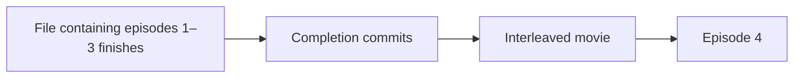

# T53a — combined-file advancement decision checkpoint

2026-09-24. Durable receipts are implemented and locally tested, but **not ready**: cross-show
episode reassignment still needs an owner policy and correction. Next/Autoplay is not implemented.
Current verification, blocker and 14-item audit: [T53a foundation](playback-completion-validation.md).
The previous completed code checkpoint remains [T53/T66](snapshots-recovery-validation.md).

## Approved behavior

The owner answered yes to: after a file containing episodes 1–3 finishes, preserve an interleaved
movie and then continue to episode 4, without replaying the completed file for episodes 2–3.
This settles the ordering example, not a rule to skip all Watched items or every future repeat.



## Durable history — approved

The owner approved saving completed-file history in PostgreSQL so it survives closing/reopening,
while keeping deliberate manual rewatches available. This is no longer an open lifetime question.

The additive contract was recorded before code in master plan §6.9 and CLAUDE.md §5.19:
revision 0005 adds immutable `playback_completion` and `playback_completion_event` records,
capturing the validated file/numbering, exact completed-event membership and logical queue evidence
inside the existing completion transaction. No timestamp-based historical backfill, disposable
queue-item FK, or second workbook writer. Existing HTTP contracts stay unchanged.

**New blocking decision:** a provider can claim an existing episode belongs to a different show.
The current TMDB upsert can make that move while bypassing the original show's completion fence,
as reproduced independently against PostgreSQL. Should the app refuse and flag that update
(recommended), or automatically move the episode and reconcile its existing watch-list links?
Neither policy is implemented by the durability approval; the foundation stays incomplete until
the chosen behavior is enforced atomically and reviewed.

Later repeated queue occurrences are not automatically equivalent to covered continuation slots.
An asynchronous owner question asks whether intentional later repeats should play again; the
recommendation is yes. No first-occurrence/expiry policy is implemented by receipt capture.
Read-only inspection found a real conditional repeat in `WWII.xlsx`: sheet rows 33 and 85 name
Empire of the Sun (1987), with the latter's note saying to mark Skip if already watched. Preserve
distinct occurrences and honor actual Skip state; do not turn prose or global title completion
into implicit skip instructions. Ambiguous or semantically changed queues must stop, not guess.

## Evidence and reuse seams

- `app/backend/src/tv_watchlist/ingest/expansion.py::rebuild_items` deletes/reinserts queue items and
  renumbers positions. A raw absolute position is not a stable cursor, and an item UUID does not
  survive rebuilding. A logical entry UUID plus episode/movie subject can be re-resolved; a missing
  or nonunique subject must stop navigation rather than guess.
- `app/backend/src/tv_watchlist/models/playback_item_read.py` already carries entry and subject UUIDs,
  current ordering, file UUID and availability. Reuse this model for real slots. An unresolved entry
  can have no slot, so the new result also needs an explicit barrier with entry identity and reason.
- `app/backend/src/tv_watchlist/services/playback_events.py` already validates selected-file mapping
  and completes the exact stored-numbering range atomically. Reuse its coverage computation instead
  of deriving episode numbers in the browser or jumping to the largest covered queue position.
- `app/backend/src/tv_watchlist/data/models/watch_event.py` stores a single subject, category,
  source, kind, seconds and timestamps, but no selected file or completion-batch reference. An
  episode event does not also carry its curated entry: the one-subject constraint forbids that.
  Matching timestamps are not a file identity or unique batch foreign key. Revalidating a
  client-supplied file against today's mapping is not proof of the file selected historically.
- `app/frontend/src/stores/playbackSavesSlice.ts::eventRecorded` is the existing PostgreSQL commit
  milestone. Automatic advancement must wait for durable completion, not merely the native ended
  callback. Excel-only failure retains its existing visible retry and original freshness stamp;
  navigation must not append another completion just to retry a projection.
- `app/frontend/src/App.tsx` currently keys `PlayerOverlay` by entry UUID. Context stored only in
  the overlay disappears when it advances to the interleaved movie. Any implementation must retain
  navigation identity outside that remount and reject late responses from an older player session.

The existing plan's undefined `NextItem`/`CuratedEntryItemRef` and numeric-cursor GET proposal are
not an approved wire contract. A bounded typed read-only navigation request/result is needed;
finalize it with the chosen lifetime, server validation, barrier handling and explicit error cases.
The persistence implementation adds models and a migration, not a navigation endpoint or UI.

## Prior docs-only checkpoint audit — not the current implementation audit

1. **Summary:** recorded the approved ordering and isolated the remaining persistence decision;
   did not claim an implementation or select an unapproved lifetime.
2. **Reuse check:** searched the master/phase plans, source tree, playback API/models, queue
   expansion, playback/watch-event services, player overlay and save slice. The seams above exist;
   no duplicate runtime helper was written.
3. **Tech-debt check:** no runtime code, stub, type escape hatch or deferred cleanup was added.
   A schema-free design is explicitly limited to session scope, not sold as durable provenance.
4. **File-organisation check:** one decision checkpoint document; no runtime module expanded.
5. **Data-contract check:** existing API and database contracts unchanged. The future contract
   remains proposed, not approved by implication from the owner's ordering answer.
6. **Docs check:** updated `docs/TV_MASTER_PLAN.md`, `docs/phases/phase-3-plan.md`,
   `docs/status.md`, `docs/versions.md`, `CLAUDE.md`, and this checkpoint. Docs-only work joins the
   existing pending **v0.2.0**; manifests remain **0.1.0**, with no second unreleased heading.
7. **Test check:** no runtime/test changes; application suites and builds not rerun for this
   documentation-only pass. Prior measured results remain explicitly attributed to T53/T66.
   `git diff --check` and explicit whitespace checks on the untracked decision/phase documents
   pass; existing CRLF-normalisation notices remain. Version inspection confirms only v0.2.0
   above v0.1.0 and both source manifests still at 0.1.0.
8. **Forward-compatibility check:** no premature Phase 2 work, provider join change or new writer;
   persistent versus session-only continuation must be chosen before committing to an architecture.
9. **Git state:** only the six repository documentation files listed here changed in this pass;
   pre-existing code changes remain untouched. No git mutation. Suggested grouping/message below.
10. **Security check:** no executable input boundary changed. Full SAST was not run and remains
    unverified locally as recorded in the prior checkpoint; no new clean-scanner claim is made.
11. **Excel-safety check:** no workbook opened for writing; no freshness/lock/backup/atomic-write
    path changed, no deletion or grid change, and no bypass of Catalog.
12. **Derived-column-schema contract check:** no column role, row shape, schema inference or
    backend/TypeScript wire field changed. The future navigation types are not yet implemented.
13. **Layout-guard check:** no rendered code or styles changed; guard not rerun in this pass.
14. **Dual-store check:** no progress write performed or changed. Both-store minute saving and
    projection-only retry remain the implemented T53 behavior; the dual-store skill directs reuse.

## Prior docs-only changed-file attribution and owner-only handoff

- `CLAUDE.md`: active checkpoint and §5.19 distinguish approved ordering from pending persistence.
- `docs/TV_MASTER_PLAN.md`: §6.9 records the owner's answer; active frontier no longer asks it again.
- `docs/phases/phase-3-plan.md`: T53a names the remaining scope/contract gate instead of the settled question.
- `docs/status.md`: current state and next task reflect that same distinction.
- `docs/versions.md`: documentation-only entry under the existing pending version.
- `docs/next-playback-decision.md`: code evidence, options and this exact 14-item audit.

Local memory also records the owner feedback in
`/Users/amrambouskila/.codex/memories/tv_playback_advancement.md`, indexed by `MEMORY.md`;
it now records the subsequent durable-history approval too, not implementation status or a repeat policy.

This documentation delta is one cohesive owner-managed commit, separate from earlier runtime work.
**Suggested commit message** (not executed):

```text
docs(playback): record approved combined-file advancement order

Preserve interleaved films without replaying completed range files.
Distinguish the approved ordering from pending continuation lifetime
and navigation-contract decisions; record current code evidence.
```
