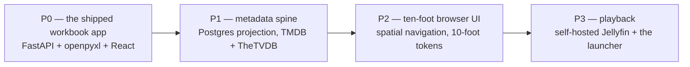

# Phase 0 Close + Phase 1 Metadata Spine — Implementation Plan

> **For agentic workers:** REQUIRED SUB-SKILL: Use superpowers:subagent-driven-development (recommended) or superpowers:executing-plans to implement this plan task-by-task. Steps use checkbox (`- [ ]`) syntax for tracking.

**Goal:** Close Phase 0 (T01a `.claude/` wiring, T01b `.env.example`, T01c README reconciliation) and stand up the Phase 1 data layer — SQLAlchemy 2.0 async + asyncpg + Alembic against a `postgres:16-alpine` compose service on host port `5525`, **eleven** ORM models, the first migration with its views and append-only trigger, a real-Postgres test harness in CI, the port registry rows, and the `[q]`/`[v]` launcher branches. `jellyfin_item`, `streaming_offer` and `title.jellyfin_item_id` are Phase 3's and are created by Phase 3's own revision, not front-loaded here.

**Architecture:** The nineteen `.xlsx` workbooks stay the authored data; Postgres is a *derived projection* beside them (ADR-001, `CLAUDE.md` §0.2). This plan builds the projection's container, schema and test harness — nothing here reads a provider or writes a workbook; ingest (T12–T31) follows in `docs/TV_MASTER_PLAN.md` §11. Every step is TDD: failing test → run → implement → run → hand to the owner to commit.

**Tech Stack:** Python 3.13, FastAPI, Pydantic v2 + pydantic-settings, SQLAlchemy 2.0 (asyncio) + asyncpg + Alembic, PostgreSQL 16-alpine (compose), pytest + pytest-asyncio 1.4 (`asyncio_mode = "auto"`), ruff, uv; Node `.cjs` hooks with `node:test`; bash + cmd launchers; GitHub Actions.

**Spec:** `docs/TV_MASTER_PLAN.md` (§6.3–§6.8, §10.0, §10.1, §11, ADR-009 … ADR-014) + `CLAUDE.md` sections 5.13–5.16 + ADR-014. This plan is supplementary to §11: it expands T01a, T01b, T01c, T04–T11 and T32a to step level, and — from "Phase 1 — the remaining tasks, T12–T33" onward — T12–T33 to task level (files, interfaces, acceptance, tests), ending with the §10.1 gate audit checklist.

**Build order (ADR-014, decided 2026-09-20):** Phase 0 close (T01a, T01b, T01c) → Phase 1 (T04–T33) → Phase 3 with the ADR-012 launcher as the `NOT_IN_LIBRARY` fallback → Phase 2 (T34–T45) **deferred, not cancelled**. T52 depends on T33, not T45.

## Global Constraints

Copied from `CLAUDE.md` and `docs/TV_MASTER_PLAN.md`; every task's requirements implicitly include this block.

- **Python 3.13+.** `requires-python = ">=3.13"` (`app/backend/pyproject.toml:5`).
- **`from __future__ import annotations`** at the top of every module.
- **Ruff:** `line-length = 120`, `select = ["E", "F", "I", "N", "UP", "ANN", "S"]`, `per-file-ignores { "tests/*" = ["S101"] }` (`pyproject.toml:33-41`). CI runs **both** `uv run ruff check .` and `uv run ruff format --check .`. Exactly three `# noqa` exist in `src/` (all `ANN401`); a new one needs a written reason on the same line.
- **pytest:** `asyncio_mode = "auto"`, `testpaths = ["tests"]`, `pythonpath = ["tests/agent", "tests/services"]` (`pyproject.toml:43-48`). Test directories carry no `__init__.py`, so every test file basename must be unique across the tree (`tests/agent/test_session.py` and `tests/agent/test_dependencies.py` already exist).
- **No mocking of the workbook layer or the database.** Tests write real `.xlsx` copies in `tmp_path` and hit a **real Postgres 16** — never SQLite, never a mock (`CLAUDE.md` §16.4).
- **Recorded fixtures for provider clients** — zero live network in tests; `httpx.MockTransport` via `tests/agent/mock_responder.py:8-18` is the seam (not exercised by this plan; binding on T13/T14).
- **One concept per file.** One SQLAlchemy model per file under `data/models/`; the single sanctioned exception is `data/enums.py` (`CLAUDE.md` §3.1).
- **Every workbook write goes through `Catalog._write` → `_mutate`** (`services/catalog.py:131-141`, `:122-129`): `guard_fresh` → snapshot → writer → invalidate → re-read, inside `lock_for(path)` on a worker thread. Nothing in this plan writes a workbook; nothing may add a second path.
- **`TV_` env prefix** (`config.py:17`, `env_prefix="TV_"`): a field `postgres_db` is set by `TV_POSTGRES_DB`, mechanically, never by a bare name.
- **Never edit `version`** in `app/backend/pyproject.toml:3`, `app/frontend/package.json:4`, or the `version="0.1.0"` argument at `main.py:27`. Compute the next number and record it in `docs/versions.md`; **one unreleased heading at a time** (`CLAUDE.md` §17.4).
- **The owner does git.** No `git add/commit/checkout/…`, no `gh` mutation. Each task ends with "Hand to the owner to commit — suggested message".
- **Never create or edit any `.env*` file except `.env.example`** (T01b). The root `.env` exists (three provider names) and is the owner's.
- **Host ports this project binds:** 5284, 8284, 5286 (live) + **5525** Postgres (Phase 1, this plan) + **8096** Jellyfin (Phase 3; the compose service already exists in `docker-compose.yml:80-105` and `PORT_ASSIGNMENTS.md:109` already carries its row). Never host `5432`.
- **Durations are `Integer` seconds named `*_seconds` with a `CHECK`; never `INTERVAL`. Timestamps are `DateTime(timezone=True)`.** Native enum labels are member *values* (`values_callable`). `expire_on_commit=False`; `lazy="raise_on_sql"` on every relationship.
- **`curated_entry_episode` is renamed `curated_entry_item`** (decided 2026-09-20 before any migration exists). Only ADR-010's own text keeps the old name as history.

### Conventions used in this plan

- Every backend path is under `/Users/amrambouskila/IMPORTANT/Personal/TV/app/backend/` unless it starts with `/` or with a repo-root name (`README.md`, `docker-compose.yml`, `run_tv.sh`, `scripts/`, `.claude/`).
- `BACKEND=/Users/amrambouskila/IMPORTANT/Personal/TV/app/backend` and `REPO=/Users/amrambouskila/IMPORTANT/Personal/TV` in every `Run:` line.
- **Versions bookkeeping.** `docs/versions.md` now carries exactly one unreleased heading, `## v0.2.0 — the plan, written down, and the first service beside the app` (raised from `v0.1.1` on 2026-09-20 because the `jellyfin` compose service binds host port `8096` — T47a — a minor bump under the plan's change policy). T01a–T01c and T04 already sit under it as subsections, and every later task in this plan adds its own subsection under that same `## v0.2.0` heading. Never open a second heading.
- Line numbers cite the tree as read on 2026-09-20; other agents are editing `CLAUDE.md`, `docker-compose.yml`, `docs/status.md`, `docs/versions.md` concurrently, so re-read the region before every Edit.

---

## Task T01a: `.claude/` wiring — hooks, commands, skills

**Files:**
- Create: `.claude/settings.json` (gitignored by `.gitignore:27`; stays local — fleet convention)
- Create: `scripts/hooks/hookUtils.cjs`, `scripts/hooks/session-start.cjs`, `scripts/hooks/pre-tool-use.cjs`, `scripts/hooks/post-tool-use.cjs`, `scripts/hooks/pre-compact.cjs`, `scripts/hooks/stop.cjs`, `scripts/hooks/stop-memory.cjs` (committed; `.gitattributes:27` already pins `*.cjs` to LF)
- Create: `.claude/commands/scaffold.md`, `review.md`, `pre-commit.md`, `validate.md`, `phase-status.md`, `new-model.md`
- Create: `.claude/skills/phase-awareness/SKILL.md`, `excel-safety-protocol/SKILL.md`, `data-driven-check/SKILL.md`, `validation-protocol/SKILL.md`, `dual-store-protocol/SKILL.md`
- Test: `scripts/hooks/hooks.test.cjs` (Node's built-in `node:test`; no dependency added)

**Interfaces:**
- Consumes: the reference hook set at `/Users/amrambouskila/IMPORTANT/Projects/llm-knowledge-base/scripts/hooks/*.cjs` and `/Users/amrambouskila/IMPORTANT/Projects/oft-master-plan/oft-frontend/scripts/hooks/*.cjs` (read them first; `hookUtils.cjs` is copied verbatim — its `isSensitivePath` already excludes `.example`/`.sample`/`.template`).
- Produces: hooks that read the tool payload from **stdin** (`readHookPayload()`), never from `$CLAUDE_*` variables; `pre-tool-use.cjs` emits `{"decision":"block","reason":…}` **and** `hookSpecificOutput.permissionDecision = "deny"` for `.env`, `.env.*` (not `.env.example`), `credentials.*`, `secrets.*`, `*.pem`, `*.key`, `*.p12`, and for **any `*.xlsx`** (an agent never writes a workbook through a tool — `Catalog._write` is the only path).

- [ ] **Step 1: Read the two reference hook sets in full**

Run: `cat /Users/amrambouskila/IMPORTANT/Projects/llm-knowledge-base/.claude/settings.json /Users/amrambouskila/IMPORTANT/Projects/llm-knowledge-base/scripts/hooks/*.cjs /Users/amrambouskila/IMPORTANT/Projects/oft-master-plan/oft-frontend/scripts/hooks/*.cjs`
Expected: the `node -e "var p=require('path');require(p.join(process.env.CLAUDE_PROJECT_DIR||process.cwd(),'scripts','hooks','<hook>.cjs'))"` command form, and `hookUtils.cjs` with `readHookPayload`, `getToolFilePath`, `isSensitivePath`, `uncommittedFiles`, `emit`. Neither reference has `pre-tool-use.cjs` or `pre-compact.cjs`; this project writes both.

- [ ] **Step 2: Write the failing test**

Create `scripts/hooks/hooks.test.cjs`:

```js
const test = require("node:test");
const assert = require("node:assert/strict");
const { spawnSync } = require("node:child_process");
const path = require("node:path");

const HOOKS_DIR = __dirname;
const PROJECT_DIR = path.resolve(HOOKS_DIR, "..", "..");

function runHook(name, payload) {
  return spawnSync(process.execPath, [path.join(HOOKS_DIR, name)], {
    input: payload === undefined ? "" : JSON.stringify(payload),
    encoding: "utf8",
    cwd: PROJECT_DIR,
    env: { ...process.env, CLAUDE_PROJECT_DIR: PROJECT_DIR },
  });
}

function writePayload(filePath) {
  return { tool_name: "Write", tool_input: { file_path: filePath } };
}

const BLOCKED = [
  "/repo/.env",
  "/repo/.env.production",
  "C:\\Users\\Amram\\IMPORTANT\\Personal\\TV\\.env.local",
  "/repo/app/credentials.json",
  "/repo/secrets.yaml",
  "/repo/certs/server.pem",
  "/repo/certs/server.key",
  "/repo/certs/client.p12",
  "/repo/Marvel.xlsx",
  "C:\\Users\\Amram\\IMPORTANT\\Personal\\TV\\One_Piece.xlsx",
];

for (const blocked of BLOCKED) {
  test(`pre-tool-use denies a write to ${blocked}`, () => {
    const result = runHook("pre-tool-use.cjs", writePayload(blocked));
    assert.equal(result.status, 0);
    const out = JSON.parse(result.stdout);
    assert.equal(out.decision, "block");
    assert.equal(out.hookSpecificOutput.hookEventName, "PreToolUse");
    assert.equal(out.hookSpecificOutput.permissionDecision, "deny");
    assert.match(out.hookSpecificOutput.permissionDecisionReason, /owner|Catalog\._write/);
  });
}

const ALLOWED = ["/repo/.env.example", "/repo/app/backend/src/tv_watchlist/config.py", "/repo/README.md"];

for (const allowed of ALLOWED) {
  test(`pre-tool-use stays silent for ${allowed}`, () => {
    const result = runHook("pre-tool-use.cjs", writePayload(allowed));
    assert.equal(result.status, 0);
    assert.equal(result.stdout, "");
  });
}

test("pre-tool-use tolerates an empty payload", () => {
  const result = runHook("pre-tool-use.cjs");
  assert.equal(result.status, 0);
  assert.equal(result.stdout, "");
});

test("post-tool-use reminds about the funnel when the Excel layer is edited", () => {
  const result = runHook("post-tool-use.cjs", writePayload("/repo/app/backend/src/tv_watchlist/workbook/writer.py"));
  const out = JSON.parse(result.stdout);
  assert.equal(out.hookSpecificOutput.hookEventName, "PostToolUse");
  assert.match(out.hookSpecificOutput.additionalContext, /Catalog\._write/);
  assert.match(out.hookSpecificOutput.additionalContext, /ranges\.sync/);
});

test("post-tool-use reminds about both sides when a contract file is edited", () => {
  const result = runHook("post-tool-use.cjs", writePayload("/repo/app/frontend/src/types/ColumnSpec.ts"));
  const out = JSON.parse(result.stdout);
  assert.match(out.hookSpecificOutput.additionalContext, /minor/);
});

test("post-tool-use reminds about the ORM rules when a data model is edited", () => {
  const result = runHook("post-tool-use.cjs", writePayload("/repo/app/backend/src/tv_watchlist/data/models/title.py"));
  const out = JSON.parse(result.stdout);
  assert.match(out.hookSpecificOutput.additionalContext, /raise_on_sql/);
  assert.match(out.hookSpecificOutput.additionalContext, /_seconds/);
});

test("post-tool-use is silent for an unremarkable file", () => {
  const result = runHook("post-tool-use.cjs", writePayload("/repo/app/README.md"));
  assert.equal(result.stdout, "");
});

test("session-start prints the orientation banner in under 20 lines", () => {
  const result = runHook("session-start.cjs");
  assert.equal(result.status, 0);
  assert.match(result.stdout, /TV WATCH LIST SESSION START/);
  assert.match(result.stdout, /P0 .* P1 .* P3 .* P2/);
  assert.match(result.stdout, /workbooks/);
  assert.ok(result.stdout.trim().split("\n").length <= 20, `banner is ${result.stdout.trim().split("\n").length} lines`);
});

test("pre-compact tells the summariser what to keep", () => {
  const result = runHook("pre-compact.cjs", { trigger: "auto" });
  const out = JSON.parse(result.stdout);
  assert.match(out.systemMessage, /phase/i);
  assert.match(out.systemMessage, /versions\.md/);
});

test("stop-memory emits the memory review prompt", () => {
  const result = runHook("stop-memory.cjs");
  const out = JSON.parse(result.stdout);
  assert.match(out.systemMessage, /MEMORY REVIEW/);
});

test("stop never exits non-zero", () => {
  const result = runHook("stop.cjs");
  assert.equal(result.status, 0);
});
```

- [ ] **Step 3: Run it to verify it fails**

Run: `cd $REPO && node --test scripts/hooks/`
Expected: every test FAILS with `Cannot find module '.../scripts/hooks/pre-tool-use.cjs'` (and the siblings); `node:test` reports `fail N`.

- [ ] **Step 4: Write `scripts/hooks/hookUtils.cjs`** (verbatim copy of the reference — same functions, same behaviour)

```js
const childProcess = require("node:child_process");
const fs = require("node:fs");
const path = require("node:path");

// Project root: Claude/Codex set CLAUDE_PROJECT_DIR and run hooks with cwd = root.
// Fall back to cwd so the same code works under both agents and any shell.
const PROJECT_DIR = process.env.CLAUDE_PROJECT_DIR || process.cwd();

function readStdin() {
  return new Promise((resolve) => {
    let input = "";
    process.stdin.setEncoding("utf8");
    process.stdin.on("data", (chunk) => {
      input += chunk;
    });
    process.stdin.on("end", () => {
      resolve(input);
    });
    // If nothing is piped, end never fires on some shells; guard with a tick.
    if (process.stdin.isTTY) {
      resolve("");
    }
  });
}

async function readHookPayload() {
  const input = await readStdin();
  const trimmed = input.trim();
  if (trimmed.length === 0) {
    return {};
  }
  try {
    return JSON.parse(trimmed);
  } catch {
    return {};
  }
}

function getToolFilePath(payload) {
  if (!payload || typeof payload !== "object") {
    return "";
  }
  const toolInput = payload.tool_input;
  if (toolInput && typeof toolInput === "object") {
    if (typeof toolInput.file_path === "string") {
      return toolInput.file_path;
    }
    if (typeof toolInput.path === "string") {
      return toolInput.path;
    }
  }
  const toolResponse = payload.tool_response;
  if (toolResponse && typeof toolResponse === "object" && typeof toolResponse.filePath === "string") {
    return toolResponse.filePath;
  }
  return "";
}

function toPosixPath(filePath) {
  return String(filePath).replace(/\\/g, "/");
}

// Block any .env / .env.* (except example/sample/template), credentials, secrets,
// and private-key material. Comprehensive union of every project's prior guard.
function isSensitivePath(filePath) {
  const normalized = toPosixPath(filePath).toLowerCase();
  if (!normalized) {
    return false;
  }
  const basename = path.posix.basename(normalized);
  const isEnv =
    basename === ".env" ||
    (basename.startsWith(".env.") &&
      !basename.endsWith(".example") &&
      !basename.endsWith(".sample") &&
      !basename.endsWith(".template"));
  return (
    isEnv ||
    normalized.includes("credentials.") ||
    normalized.includes("secrets.") ||
    basename.endsWith(".pem") ||
    basename.endsWith(".key") ||
    basename.endsWith(".p12") ||
    basename.endsWith(".pfx") ||
    basename.endsWith(".pickle") ||
    basename.includes("id_rsa") ||
    basename.includes("id_ed25519") ||
    normalized.includes("/.tokens/")
  );
}

function projectName() {
  return path.basename(PROJECT_DIR);
}

function readText(relativePath) {
  try {
    return fs.readFileSync(path.join(PROJECT_DIR, relativePath), "utf8");
  } catch {
    return null;
  }
}

function fileExists(relativePath) {
  try {
    return fs.existsSync(path.join(PROJECT_DIR, relativePath));
  } catch {
    return false;
  }
}

function splitLines(text) {
  return text.split(/\r?\n/);
}

function head(text, count) {
  return splitLines(text).slice(0, count).join("\n");
}

function tail(text, count) {
  const lines = splitLines(text);
  return lines.slice(Math.max(0, lines.length - count)).join("\n");
}

// Run git read-only against the project dir; "" on any failure (not a repo, no git).
function gitOutput(args) {
  const safeDirectory = toPosixPath(PROJECT_DIR);
  const result = childProcess.spawnSync(
    "git",
    ["-C", PROJECT_DIR, "-c", `safe.directory=${safeDirectory}`, ...args],
    { encoding: "utf8", windowsHide: true },
  );
  if (!result || result.status !== 0 || typeof result.stdout !== "string") {
    return "";
  }
  return result.stdout.trim();
}

function uncommittedFiles() {
  const changed = gitOutput(["diff", "--name-only"]);
  const staged = gitOutput(["diff", "--cached", "--name-only"]);
  const untracked = gitOutput(["ls-files", "--others", "--exclude-standard"]);
  return Array.from(
    new Set(
      `${changed}\n${staged}\n${untracked}`
        .split(/\r?\n/)
        .map((line) => line.trim())
        .filter(Boolean),
    ),
  );
}

function emit(object) {
  process.stdout.write(JSON.stringify(object));
}

module.exports = {
  PROJECT_DIR,
  emit,
  fileExists,
  getToolFilePath,
  gitOutput,
  head,
  isSensitivePath,
  projectName,
  readHookPayload,
  readText,
  tail,
  toPosixPath,
  uncommittedFiles,
};
```

- [ ] **Step 5: Write `scripts/hooks/pre-tool-use.cjs`**

```js
const { emit, getToolFilePath, isSensitivePath, readHookPayload, toPosixPath } = require("./hookUtils.cjs");

// A workbook is written by Catalog._write and nothing else (CLAUDE.md section 3.4). An agent editing
// an .xlsx through a tool would bypass the freshness guard, the snapshot, the Excel-lock check and the
// atomic swap at once, so it is refused outright.
function isWorkbook(filePath) {
  return filePath.toLowerCase().endsWith(".xlsx");
}

function reasonFor(filePath) {
  if (isWorkbook(filePath)) {
    return `Refusing to write ${filePath}: workbooks are written only through Catalog._write (CLAUDE.md section 3.4), never by a tool call.`;
  }
  return `Refusing to write ${filePath}: credentials and .env files are typed by the owner, never written by an agent (CLAUDE.md section 8.3). .env.example is the one such file an agent may write.`;
}

async function main() {
  const payload = await readHookPayload();
  const filePath = toPosixPath(getToolFilePath(payload));
  if (!filePath) {
    return;
  }
  if (!isSensitivePath(filePath) && !isWorkbook(filePath)) {
    return;
  }
  const reason = reasonFor(filePath);
  // Both shapes on purpose: `decision`/`reason` is the form the global CLAUDE.md names; the
  // hookSpecificOutput form is the one current Claude Code documents for PreToolUse.
  emit({
    decision: "block",
    reason,
    hookSpecificOutput: {
      hookEventName: "PreToolUse",
      permissionDecision: "deny",
      permissionDecisionReason: reason,
    },
  });
}

main().catch((error) => {
  process.stderr.write(`[hook] pre-tool-use failed: ${error.message}\n`);
  process.exitCode = 0;
});
```

- [ ] **Step 6: Write `scripts/hooks/post-tool-use.cjs`**

```js
const { emit, getToolFilePath, readHookPayload, toPosixPath } = require("./hookUtils.cjs");

const RULES = [
  {
    test: (p) => p.includes("/app/backend/src/tv_watchlist/workbook/"),
    context:
      "EXCEL LAYER EDITED. Before continuing verify: (1) every write still reaches disk only through Catalog._write -> _mutate (guard_fresh -> snapshot -> writer -> invalidate -> re-read); (2) the grid still ends at the first blank header cell, never sheet.max_column; (3) if rows moved or the grid widened, ranges.sync(sheet, last, width) ran so the table ref, dropdowns and conditional formats cover rows 2..last; (4) identity ('Row ID') and position ('Position (s)') columns are excluded by the reader from `columns` and WatchRow.cells but kept in build_columns so writer._validate accepts them; (5) a fingerprint test (tests/snapshot.py) covers the change against copies of the real workbooks.",
  },
  {
    test: (p) => p.includes("/app/backend/src/tv_watchlist/data/models/"),
    context:
      "ORM MODEL EDITED. Verify: one class per file; lazy=\"raise_on_sql\" on every relationship; every duration is Integer named *_seconds with a CHECK (never INTERVAL); every timestamp is DateTime(timezone=True); enum columns use pg_enum() so labels are member VALUES; a new enum value needs its own Alembic revision; any column change needs a hand-ordered revision and the round trip upgrade head -> downgrade base -> upgrade head; watch_event has no updated_at and no UPDATE/DELETE path.",
  },
  {
    test: (p) => p.includes("/app/backend/alembic/versions/"),
    context:
      "MIGRATION EDITED. downgrade() is hand-ordered: views drop before their tables, the watch_event_no_mutation trigger and its function before watch_event, tables in reverse dependency order, enum types last. Run `uv run alembic upgrade head && uv run alembic downgrade base && uv run alembic upgrade head` against the compose Postgres before calling it done.",
  },
  {
    test: (p) => p.includes("/app/backend/src/tv_watchlist/models/") || p.includes("/app/frontend/src/types/"),
    context:
      "CONTRACT FILE EDITED. A Pydantic model and its TypeScript twin move together in one commit (ColumnSpec <-> ColumnSpec.ts, WatchRow <-> WatchRow.ts, CategorySummary/CategoryDetail <-> theirs, RowChange/Proposal*/HeroCandidate/ChatEvent <-> theirs). Wire field names are snake_case on both sides. Write the change into CLAUDE.md section 5 FIRST and record a minor bump in docs/versions.md.",
  },
  {
    test: (p) => p.includes("/app/backend/src/tv_watchlist/services/"),
    context:
      "SERVICE EDITED. Any workbook write must be one Catalog._write call carrying every cell change (one snapshot, one temp file, one os.replace). The mirror pass must LOSE a race with a UI edit (catch StaleWorkbookError and retry next pass), and mirrored_watch_cell + category.workbook_mtime update in the same transaction as the successful apply_changes.",
  },
  {
    test: (p) => p.includes("/app/frontend/src/components/") || p.includes("/app/frontend/src/styles/"),
    context:
      "UI EDITED. jsdom has no layout engine: run `pnpm test:layout` (38 tests x 4 viewports) before calling this done. A new screen or overlay needs a surface in layout/surfaces.ts and an arrangement in layout/probes/arrangements.ts.",
  },
  {
    test: (p) => p.includes("/app/backend/src/tv_watchlist/config.py"),
    context:
      "SETTINGS EDITED. Every credential is SecretStr and never logged; the env var is TV_ + the field name, mechanically; absent provider credentials degrade, never crash; add the variable to .env.example with a placeholder and a one-line comment, and to CLAUDE.md section 8.",
  },
];

async function main() {
  const payload = await readHookPayload();
  const filePath = toPosixPath(getToolFilePath(payload));
  if (!filePath) {
    return;
  }
  const rule = RULES.find((candidate) => candidate.test(filePath));
  if (rule) {
    emit({ hookSpecificOutput: { hookEventName: "PostToolUse", additionalContext: rule.context } });
  }
}

main().catch((error) => {
  process.stderr.write(`[hook] post-tool-use failed: ${error.message}\n`);
  process.exitCode = 0;
});
```

- [ ] **Step 7: Write `scripts/hooks/session-start.cjs`**

```js
const fs = require("node:fs");
const { PROJECT_DIR, head, readText } = require("./hookUtils.cjs");

function workbookCount() {
  try {
    return fs.readdirSync(PROJECT_DIR).filter((name) => name.endsWith(".xlsx") && !name.startsWith("~$")).length;
  } catch {
    return 0;
  }
}

function versionIn(text, pattern) {
  const match = text ? text.match(pattern) : null;
  return match ? match[1] : "unknown";
}

function firstHeading(text) {
  if (!text) return "(docs/versions.md missing)";
  const line = text.split(/\r?\n/).find((candidate) => candidate.startsWith("## v"));
  return line || "(no version heading)";
}

function main() {
  const backend = versionIn(readText("app/backend/pyproject.toml"), /^version = "([^"]+)"/m);
  const frontend = versionIn(readText("app/frontend/package.json"), /"version"\s*:\s*"([^"]+)"/);
  const status = readText("docs/status.md");
  console.log("=== TV WATCH LIST SESSION START ===");
  console.log("Read in full, in this order, before any change: CLAUDE.md, docs/TV_MASTER_PLAN.md, docs/status.md, docs/versions.md.");
  console.log(`Library: ${workbookCount()} workbooks at the repo root. They ARE the data; every write goes through Catalog._write.`);
  console.log("Build order: P0 close (T01a/T01b/T01c) -> P1 metadata spine (T04-T33) -> P3 playback + launcher -> P2 ten-foot (deferred). ADR-014.");
  console.log(`Versions: backend ${backend}, frontend ${frontend} (never hand-edit); pending heading: ${firstHeading(readText("docs/versions.md"))}`);
  console.log("--- docs/status.md, first lines ---");
  console.log(status ? head(status, 8) : "(docs/status.md missing - flag it)");
  console.log("--- Reminders ---");
  console.log("1. Workbooks: never written by a tool; Postgres is a projection, never authoritative for order.");
  console.log("2. Contracts (CLAUDE.md section 5) change in CLAUDE.md first, both sides together, minor bump.");
  console.log("3. No mocking of the workbook layer or the database; recorded fixtures for providers.");
  console.log("4. Git is the owner's. Report files and a suggested commit message; never commit.");
}

try {
  main();
} catch (error) {
  process.stderr.write(`[hook] session-start failed: ${error.message}\n`);
  process.exitCode = 0;
}
```

- [ ] **Step 8: Write `scripts/hooks/pre-compact.cjs`**

```js
const { emit, readHookPayload } = require("./hookUtils.cjs");

const KEEP = [
  "PRE-COMPACT - the summary MUST preserve, verbatim where short:",
  "(1) the current phase and task id (T-number) and the build order P0 -> P1 -> P3 -> P2 (ADR-014);",
  "(2) every architectural decision made this session and which ADR or CLAUDE.md section records it;",
  "(3) every measured number - test counts, coverage figures, resolver dry-run counts, timings;",
  "(4) every file created or modified and why, as path:line where known;",
  "(5) unresolved issues and owner-only steps (values to type into .env, commits to make);",
  "(6) any data-contract change (ColumnSpec, CuratedEntryRead, ORM columns, views) and whether docs/versions.md recorded the bump;",
  "(7) the computed next version and whether docs/status.md was updated.",
];

async function main() {
  const payload = await readHookPayload();
  const trigger = payload && typeof payload.trigger === "string" ? payload.trigger : "unknown";
  const systemMessage = `${KEEP.join(" ")} (trigger: ${trigger})`;
  emit({ systemMessage, hookSpecificOutput: { hookEventName: "PreCompact", additionalContext: systemMessage } });
}

main().catch((error) => {
  process.stderr.write(`[hook] pre-compact failed: ${error.message}\n`);
  process.exitCode = 0;
});
```

- [ ] **Step 9: Write `scripts/hooks/stop.cjs` and `scripts/hooks/stop-memory.cjs`**

`stop.cjs`:

```js
const { emit, projectName, uncommittedFiles } = require("./hookUtils.cjs");

function main() {
  const files = uncommittedFiles();
  if (files.length === 0) {
    return;
  }
  const posix = files.map((file) => file.replace(/\\/g, "/"));
  const parts = [
    `Uncommitted changes in ${projectName()}: ${files.length} file(s). The owner manages git - run no mutating git command; report the files and suggest a commit message only.`,
  ];
  if (!posix.some((file) => file.startsWith("docs/"))) {
    parts.push("Source changed but docs/ did not - docs/status.md and docs/versions.md need updating (one unreleased heading, computed number).");
  }
  const workbooks = posix.filter((file) => file.endsWith(".xlsx"));
  if (workbooks.length > 0) {
    parts.push(`Workbook(s) changed on disk: ${workbooks.join(", ")}. Confirm each went through Catalog._write (a snapshot exists in app/.backups) or was the owner's own Excel edit.`);
  }
  if (posix.some((file) => file.startsWith("app/frontend/src/components/") || file.startsWith("app/frontend/src/styles/"))) {
    parts.push("UI changed - pnpm test:layout must have run at all four viewports.");
  }
  emit({ systemMessage: parts.join(" ") });
}

try {
  main();
} catch (error) {
  process.stderr.write(`[hook] stop failed: ${error.message}\n`);
}
```

`stop-memory.cjs` (verbatim from the reference):

```js
const { emit } = require("./hookUtils.cjs");

const systemMessage = [
  "SESSION END — MEMORY REVIEW: review what was learned and suggest memories the user may want to save.",
  "Check the project's memory index first (~/.claude/projects/<slug>/memory/ for Claude, ~/.codex/memories/<slug>/memory/ for Codex) to avoid duplicates — update existing memories rather than creating new ones when the topic already exists.",
  "Memory types: user (role, preferences, knowledge), feedback (corrections / confirmed approaches — include WHY), project (decisions with external motivation, deadlines, stakeholders), reference (pointers to external systems).",
  "Worth saving: corrections the user gave you, non-obvious approaches they confirmed, decisions driven by external factors, pointers to external tools.",
  "NOT worth saving: anything derivable from code or git history, debugging solutions, ephemeral task details, things already in CLAUDE.md / AGENTS.md.",
  "Present a short bulleted list of suggested memories and let the user decide.",
].join(" ");

emit({ systemMessage });
```

- [ ] **Step 10: Write `.claude/settings.json`**

```json
{
  "permissions": {
    "allow": ["Read(./**)"]
  },
  "hooks": {
    "SessionStart": [
      {
        "hooks": [
          {
            "type": "command",
            "command": "node -e \"var p=require('path');require(p.join(process.env.CLAUDE_PROJECT_DIR||process.cwd(),'scripts','hooks','session-start.cjs'))\"",
            "timeout": 8000
          }
        ]
      }
    ],
    "PreToolUse": [
      {
        "matcher": "Write|Edit",
        "hooks": [
          {
            "type": "command",
            "command": "node -e \"var p=require('path');require(p.join(process.env.CLAUDE_PROJECT_DIR||process.cwd(),'scripts','hooks','pre-tool-use.cjs'))\"",
            "timeout": 3000
          }
        ]
      }
    ],
    "PostToolUse": [
      {
        "matcher": "Write|Edit",
        "hooks": [
          {
            "type": "command",
            "command": "node -e \"var p=require('path');require(p.join(process.env.CLAUDE_PROJECT_DIR||process.cwd(),'scripts','hooks','post-tool-use.cjs'))\"",
            "timeout": 3000
          }
        ]
      }
    ],
    "PreCompact": [
      {
        "matcher": "auto|manual",
        "hooks": [
          {
            "type": "command",
            "command": "node -e \"var p=require('path');require(p.join(process.env.CLAUDE_PROJECT_DIR||process.cwd(),'scripts','hooks','pre-compact.cjs'))\"",
            "timeout": 3000
          }
        ]
      }
    ],
    "Stop": [
      {
        "hooks": [
          {
            "type": "command",
            "command": "node -e \"var p=require('path');require(p.join(process.env.CLAUDE_PROJECT_DIR||process.cwd(),'scripts','hooks','stop.cjs'))\"",
            "timeout": 5000
          }
        ]
      },
      {
        "hooks": [
          {
            "type": "command",
            "command": "node -e \"var p=require('path');require(p.join(process.env.CLAUDE_PROJECT_DIR||process.cwd(),'scripts','hooks','stop-memory.cjs'))\"",
            "timeout": 5000
          }
        ]
      }
    ]
  }
}
```

- [ ] **Step 11: Run the hook tests to verify they pass**

Run: `cd $REPO && node --test scripts/hooks/`
Expected: `pass 22`, `fail 0` (10 blocked paths + 3 allowed + 1 empty payload + 4 post-tool-use + session-start + pre-compact + stop-memory + stop = 22 tests; the count printed must equal the number of `test(` calls and every one must pass). Then by hand: `printf '%s' '{"tool_name":"Write","tool_input":{"file_path":".env"}}' | CLAUDE_PROJECT_DIR=$REPO node scripts/hooks/pre-tool-use.cjs` prints the deny JSON; the same with `.env.example` prints nothing.

- [ ] **Step 12: Write the six commands under `.claude/commands/`**

Every body opens with the same "Before anything else" block. Write each file exactly as below.

`scaffold.md`:

```markdown
---
name: scaffold
description: Scaffold a new backend module, ORM model, Pydantic contract, client or frontend unit with signatures only - no logic
---

Before anything else: read `CLAUDE.md` in full, then `docs/TV_MASTER_PLAN.md`, `docs/status.md`, `docs/versions.md`. Confirm the scope in one sentence and wait for a yes.

1. Name the phase this scaffold belongs to (P0/P1/P2/P3) and the §11 task id. Refuse anything §2.2 lists as a later phase.
2. Grep before creating: `models/` (20 contracts), `workbook/` (17 modules), `services/`, `data/models/`, `frontend/src/{types,api,hooks,utils,components}`. Name what you found.
3. Produce ONLY the files this kind of unit needs, one concept per file:
   - Backend module -> `src/tv_watchlist/<pkg>/<snake>.py` with `from __future__ import annotations`, full signatures, one-line docstrings, `raise NotImplementedError` bodies; plus `tests/<pkg>/test_<unique_name>.py` with one failing test per public function.
   - ORM model -> `src/tv_watchlist/data/models/<snake>.py` extending `UuidPk, TimestampMixin, Base` (no TimestampMixin on append-only tables), every relationship `lazy="raise_on_sql"`, added to `data/models/__init__.py`, plus an Alembic revision stub with a hand-ordered `downgrade()`.
   - Pydantic model -> `src/tv_watchlist/models/<snake>.py` (`extra="forbid"` for requests, `frozen=True, from_attributes=True` for responses) AND its TypeScript twin in `app/frontend/src/types/<Pascal>.ts`, snake_case wire names on both sides.
   - Frontend component/hook/util -> `PascalCase.tsx` / `useCamelCase.ts` / `camelCase.ts`, one per file, plus a Vitest file; if it renders, a surface in `layout/surfaces.ts`.
4. No logic during scaffolding. No literals: constants come from `constants.py` or `Settings`.
5. Report the tree you created and stop. Do not commit.
```

`review.md`:

```markdown
---
name: review
description: Review the working tree's changes against CLAUDE.md - findings only, nothing fixed
---

Before anything else: read `CLAUDE.md` in full, then `docs/TV_MASTER_PLAN.md`, `docs/status.md`, `docs/versions.md`.

1. Run `git status --short` and `git diff` (read-only). Read every changed file IN FULL, not just the hunks.
2. Check each change against, in order: the write funnel (every workbook write via `Catalog._write`; `ranges.sync` after a row move or widened grid); the derived-schema rule (no fixed column indexes, first blank header ends the grid); contracts (§5: both sides moved together, snake_case wire names, CLAUDE.md updated first, minor bump recorded); the dual store (Postgres never authoritative for order; `Watched?` never read as truth; `mirrored_watch_cell` maintained); the ORM rules (`*_seconds` Integer + CHECK, timestamptz, `lazy="raise_on_sql"`, enum member values, hand-ordered downgrade); security (§10: the injection classes each touched boundary is exposed to and the defence in the code); tests (real workbooks, real Postgres, recorded provider fixtures, fingerprint on every write; `pnpm test:layout` for any UI change); docs (`status.md`, `versions.md`, one unreleased heading).
3. Report in this shape and nothing else:

=== REVIEW ===
CRITICAL (blocks): [file:line] finding
SHOULD FIX:        [file:line] finding
MINOR:             [file:line] finding
POSITIVE:          what is right and should stay
VERDICT: APPROVED | CHANGES REQUESTED

Do not fix anything. Do not stage or commit anything.
```

`pre-commit.md`:

```markdown
---
name: pre-commit
description: Read-only audit the owner runs before committing - verdict table only, never stages or commits
---

Before anything else: read `CLAUDE.md` in full, then `docs/TV_MASTER_PLAN.md`, `docs/status.md`, `docs/versions.md`.

Run each gate and record PASS/FAIL with the exact command output line that decides it:

| Gate | Command |
|---|---|
| Backend lint | `cd app/backend && uv run ruff check . && uv run ruff format --check .` |
| Backend tests | `cd app/backend && uv run pytest -q` (against the compose Postgres: `docker compose up -d postgres` first, `TV_POSTGRES_DB=tv_test`) |
| Frontend types + lint | `cd app/frontend && pnpm exec tsc -b && pnpm lint` |
| Frontend tests | `cd app/frontend && pnpm test` |
| Layout guard (only if `src/components/` or `src/styles/` changed) | `cd app/frontend && pnpm test:layout` |
| Migrations round trip (only if `alembic/` or `data/` changed) | `cd app/backend && uv run alembic upgrade head && uv run alembic downgrade base && uv run alembic upgrade head` |
| Compose validates | `docker compose config --quiet` |
| SAST | the four commands in `CLAUDE.md` §15.6, from the repo root |
| Docs | `docs/status.md` reflects now; `docs/versions.md` has exactly one heading above the manifests' version and it is the computed number; `PORT_ASSIGNMENTS.md` updated if a host port changed |
| Contracts | any changed model in `models/` or `types/` has its twin changed in the same tree and CLAUDE.md §5 updated |
| Hygiene | no `TODO`/`FIXME` without a task, no dead code, no `Any`/`any`, no new `# noqa` without a reason, no `.env*` or `*.xlsx` in the diff unless the owner edited it |

Then print:

VERDICT: READY TO COMMIT | NOT READY
Suggested commit message (subject + body):
<message>

You never run `git add` or `git commit`. The owner does.
```

`validate.md`:

```markdown
---
name: validate
description: Validate the data layer and workbook code for correctness against the contracts in CLAUDE.md section 5
---

Before anything else: read `CLAUDE.md` in full (section 5 twice), then `docs/TV_MASTER_PLAN.md` §6, `docs/status.md`, `docs/versions.md`.

Inspect, and cite file:line for every finding:

1. Structural completeness - every table in §5.13 has one model file under `data/models/`; `data/models/__init__.py` imports all; `Base.metadata.tables` equals the expected set (run `uv run pytest tests/data -q`).
2. Constraint fidelity - deferrable uniques on `(category_id, position)`, `(category_id, absolute_position)`, `(title_id, order_type, label, sequence)`; `num_nonnulls(...) = 1` on `curated_entry_item`, `external_id`, `artwork`; `ON DELETE RESTRICT` on `watch_event.curated_entry_id`; three partial unique indexes on `artwork`; `ix_sync_state_due`; `ix_curated_entry_needs_review`.
3. Units - grep `data/models` for `Interval`, `minutes`, `_ms`, `ticks`: all must be absent. Every `*_seconds` is Integer with a CHECK.
4. Views and trigger - `episode_watch_state` and `curated_entry_watch_state` use the tie-break `(subject, occurred_at DESC, recorded_at DESC, id DESC)`; the precedence rule reads: entry-level event at or after the latest unit-level event wins, else the roll-up; `completed + skipped = total` counts as completed (same semantics as `WatchCounts.trackable`). `watch_event_no_mutation` fires BEFORE UPDATE OR DELETE.
5. Workbook code - no `openpyxl` import outside `workbook/`; no `sheet.max_column` for the grid; identity/position columns filtered by the reader and kept by `build_columns`.
6. Data-driven - no provider host, port, database name or credential as a literal in logic; all from `Settings` or `constants.py`.
7. Reference validation - name the test that checks each rule against ground truth from a real workbook, not against the code's own output.

Report findings by severity (critical / should-fix / minor). Fix nothing.
```

`phase-status.md`:

```markdown
---
name: phase-status
description: Assess progress against the phase roadmap and gates in docs/TV_MASTER_PLAN.md section 10 and section 11
---

Before anything else: read `CLAUDE.md` in full, then `docs/TV_MASTER_PLAN.md` §4, §10, §11, ADR-014, `docs/status.md`, `docs/versions.md`.

1. State the build order: P0 close -> P1 -> P3 -> P2 (deferred). Never draw the phases starting at P1.
2. For the current phase, walk every gate checkbox in §10.x and verify it by reading the tree or running a command (`ls`, `grep`, `uv run pytest --collect-only -q`, `docker compose config --quiet`). Never mark an item done from memory.
3. Produce:

| Task | §11 row | State (done / in progress / blocked / not started) | Evidence (path:line or command output) |

4. List owner-only blockers separately (values to type into .env, API keys to create, commits to make).
5. Name the next three tasks in dependency order and the one file each starts in.
6. Do not start implementing anything.
```

`new-model.md`:

```markdown
---
name: new-model
description: Add one ORM model plus its Alembic revision, Pydantic read model, TypeScript twin and tests, enforcing CLAUDE.md section 5.13-5.15
---

Before anything else: read `CLAUDE.md` in full (sections 5.13-5.15), `docs/TV_MASTER_PLAN.md` §6.3-§6.4, `docs/status.md`, `docs/versions.md`. Write the new table into CLAUDE.md §5.13 FIRST and record the minor bump in `docs/versions.md`; only then touch code.

Create, in this order, one concept per file:
1. `src/tv_watchlist/data/models/<snake>.py` - `class <Pascal>(UuidPk, TimestampMixin, Base)` (drop `TimestampMixin` only for an append-only table), `__tablename__ = "<snake>"`, named `CheckConstraint`s in `__table_args__`, `pg_enum()` for enum columns, `lazy="raise_on_sql"` on every relationship, durations as `<x>_seconds: Mapped[int]` with `CHECK`, timestamps `DateTime(timezone=True)`.
2. Import it in `src/tv_watchlist/data/models/__init__.py` and add it to `ALL_MODELS`.
3. `uv run alembic revision --autogenerate -m "<what>"` against the compose Postgres, then hand-edit: a new enum value gets its OWN revision; `downgrade()` is reordered so dependants drop first; run the round trip.
4. `src/tv_watchlist/models/<snake>_read.py` - `model_config = ConfigDict(from_attributes=True, frozen=True)`; any request body gets `extra="forbid"`.
5. `app/frontend/src/types/<Pascal>Read.ts` with identical snake_case field names.
6. Tests: `tests/data/test_<unique>.py` against the real Postgres `db_session` fixture (insert, read back, constraint violations raise `IntegrityError`); `tests/models/test_<unique>.py` for the Pydantic model; a Vitest type test if the frontend consumes it.
7. Update `CLAUDE.md` §10 if the model introduces an input boundary. Report and stop; the owner commits.
```

- [ ] **Step 13: Write the five skills under `.claude/skills/<name>/SKILL.md`**

`phase-awareness/SKILL.md`:

```markdown
---
name: phase-awareness
description: Proactively applied at session start and before any implementation work, to hold the current phase and the ADR-014 build order in mind
---

# Phase Awareness

The phases are numbered P0 -> P1 -> P2 -> P3 and are BUILT P0 close -> P1 -> P3 -> P2 (ADR-014, 2026-09-20). Phase 2 is deferred, not cancelled.

Before writing code:
1. Name the phase and the §11 task id the request belongs to. If it is not in `docs/TV_MASTER_PLAN.md` §11, stop and say so.
2. Check `CLAUDE.md` §2.2 ("Do NOT add X - phase Y"). Playback surfaces, Jellyfin clients, ten-foot tokens, spatial navigation, a 1920x1080 guard project, auth, a second datastore, a second workbook write path, editing `version` fields: refuse or defer as the table says. The one row ADR-012 narrowed: links to the owner's own subscriptions are Phase 3's launcher; links to unlicensed sources and stream-host scrapers stay never.
3. Check the gate the work feeds (§10.0 / §10.1 / §10.3) and name the checkbox it advances.
4. Name the owner-only prerequisites (API keys in `.env`, a Jellyfin API key created in Jellyfin's own UI, the Streaming Availability key for T55) and do not pretend an agent can supply them.
5. Design for the next phase: the join key is `tmdb_id`; `watch_event.tmdb_key` and `curated_entry_item.absolute_position` are what Phase 3 walks. Nothing built now may make those impossible.
```

`excel-safety-protocol/SKILL.md`:

```markdown
---
name: excel-safety-protocol
description: Proactively applied when editing anything under app/backend/src/tv_watchlist/workbook/ or services/catalog.py, or any code that would write a workbook
---

# Excel Safety Protocol

The nineteen `.xlsx` files are irreplaceable hand-curated data and may be open in Excel right now.

Before the edit:
- Confirm the write reaches disk only through `Catalog._write` -> `_mutate` (`services/catalog.py:131-141`, `:122-129`): `guard_fresh(path, expected_mtime)` -> `backup.snapshot(...)` -> the `workbook.writer` call -> `_invalidate(path)` -> `_read_live_lock(path)`, inside `async with lock_for(path)` on `asyncio.to_thread`. A batched change is ONE `_write` call carrying every cell.
- The action handed to `_write` is a plain `(path: Path) -> None` callable.

During the edit:
- The grid ends at the first blank header cell (`schema.header_width`), never `sheet.max_column`. Columns are found by `role` or `key`, never by index.
- A new column follows `writer.add_watch_column` (`writer.py:392-414`): header at `(HEADER_ROW, index)`, `clone_style` from the first header, body style, width, then `ranges.sync(sheet, last, index)`; a hidden column additionally sets `column_dimensions[letter].hidden = True`. The header must be non-blank or `ranges._sync_tables` writes an empty-named table column.
- Identity (`Row ID`) and position (`Position (s)`) columns are excluded by `reader.read_category` from `columns` and `WatchRow.cells` but kept in `build_columns`, so `writer._validate` accepts writes to them.
- `_save` writes `.~tv-write-<pid>-<stem>.tmp` beside the file and `os.replace`s it; the original is never truncated.

After the edit:
- A test against copies of the real workbooks (`tests/conftest.py:25-32`) asserts `fingerprint(path)` (`tests/snapshot.py`) is unchanged except for what the write intends, `range_ends(sheet)` covers the last row, a 423 via `excel_lock_path(path).write_bytes(b"owner")`, a 409 via a stale `expected_mtime`, and a snapshot in `backup_dir`.
- Nothing is deleted: retirement and artwork replacement MOVE files under `.backups`.
```

`data-driven-check/SKILL.md`:

```markdown
---
name: data-driven-check
description: Proactively applied when writing domain code, to flag hard-coded values that belong in Settings, constants.py, the workbooks or Postgres
---

# Data-Driven Check

Before finishing any change, grep the diff for literals and place each one:
- Ports, hosts, database names, credentials, base URLs -> a `Settings` field read as `TV_<FIELD>`; provider base URLs (`https://api.themoviedb.org/3`, `https://image.tmdb.org/t/p/`, `https://api4.thetvdb.com/v4`) are `Final` constants, never configuration and never input.
- Sheet vocabulary (`Watched?`, `""`, `Watched`, `In progress`, `Skip`), widths, header aliases, caps -> `constants.py` (`WATCHED`, `SKIPPED`, `DEFAULT_WATCH_CHOICES`, `WATCH_COLUMN_WIDTH`, `MAX_CELL_LENGTH`, ...). Never re-declare one; import it.
- Column layout -> derived at runtime from the header row and data validations (`workbook/schema.py`). Never assume a column exists or where it sits.
- The TheTVDB season-type list -> read at runtime from a cached `GET /v4/seasons/types`; never a `Literal`, never a `CHECK`, never a TypeScript union.
- Watch order -> the workbook, projected into `curated_entry.position`; never computed, sorted or "corrected" by the app.
- Availability country -> `il` (ADR-011), one constant, one country.
Acceptable literals: 0, 1, 2, loop bounds, array dimensions, algorithm coefficients, documented defaults in function signatures.
```

`validation-protocol/SKILL.md`:

```markdown
---
name: validation-protocol
description: Proactively applied when writing or modifying tests, enforcing real workbooks, a real Postgres, recorded provider fixtures and reference values
---

# Validation Protocol

- Workbook tests run against copies of the real committed workbooks (`tests/conftest.py:25-32`); subjects are chosen by shape through `tests/library_choice.py` (`a_category()`, `a_category_with_at_least(rows)`, `every_workbook()`), never by filename. A fresh name comes from `a_name_the_library_does_not_hold(...)`.
- Database tests use the real Postgres `db_session` fixture (per-test rollback over a migrated `tv_test`). Never SQLite, never a mock, never `create_all` in place of the migrations.
- Provider clients are driven through `httpx.MockTransport` (`tests/agent/mock_responder.py`) with recorded, committed response bodies; `responder.requested` proves which URLs were hit; zero live network.
- Every write operation gets a `fingerprint` (`tests/snapshot.py`) assertion, a 423 test (Excel owner file), a 409 test (stale mtime) and a backup-presence test.
- At least one test per module validates against ground truth from a sheet or a published value, not against the code's own output.
- Numerical comparisons use tolerances (`pytest.approx` / `np.testing.assert_allclose`); never `==` on floats. The mtime tolerance is `MTIME_TOLERANCE_SECONDS = 1e-6`.
- Every test function is annotated `-> None`; parametrise with `@pytest.mark.parametrize(..., ids=...)`; async tests need no decorator (`asyncio_mode = "auto"`).
- Test file basenames are unique across `tests/` (no `__init__.py`); new support modules outside `tests/` root need a `pythonpath` entry in `pyproject.toml`.
- Any UI change runs `pnpm test:layout` (38 tests x 4 viewports). jsdom has no layout engine.
```

`dual-store-protocol/SKILL.md`:

```markdown
---
name: dual-store-protocol
description: Proactively applied when touching data/, services/watch_mirror.py, the reconciler, watch events or anything that reads or writes the Watched? cell
---

# Dual-Store Protocol

Excel owns order and curation; Postgres owns episodes, orders, artwork metadata and the append-only progress log (ADR-001).

Hold these while editing:
1. Postgres never invents, reorders or "corrects" `position`. Ingest reads through `workbook/reader.py` under `lock_for(path)`.
2. A watch fact is a `watch_event` row (never updated, never deleted - the `watch_event_no_mutation` trigger enforces it) AND, when the coarse state changes, one mirrored `Watched?` cell written through `Catalog._write`.
3. The `Watched?` cell is never read as truth. It is compared against `mirrored_watch_cell`; a difference means a HUMAN edited it, which appends one coarse entry-level event with `source = excel_mirror` and `occurred_at = now()`, touching no episode event.
4. `mirrored_watch_cell` (last written) and `observed_watch_cell` (last read) are both maintained. Without the first, every mirror write looks like a human edit next pass - the echo loop.
5. The mirror writes only when `watch_cell(state.kind) != entry.mirrored_watch_cell`, and `mirrored_watch_cell` + `category.workbook_mtime` update in the same transaction as the successful `apply_changes`. If the write raises (`WorkbookLockedError`, `StaleWorkbookError`), neither updates and the identical diff replays next pass. The mirror LOSES a race with a UI edit.
6. Derived status comes from the two views with tie-break `(subject, occurred_at DESC, recorded_at DESC, id DESC)`; `completed + skipped = total` is complete, matching `WatchCounts.trackable`.
7. `position_seconds` is an Integer converted once at the boundary (Jellyfin ticks / 10_000_000; `<video>.currentTime` rounded). The `Position (s)` sheet column is written only on pause/ended/unmount, never on the 5 s tick, and is a projection never read as truth. An event the in-app player produces carries `source = player`, not `jellyfin`: the position came from the browser, and `jellyfin` is reserved for a session the server itself reports.
8. A workbook opened standalone in Excel must still mean what it always meant.
```

- [ ] **Step 14: Verify the wiring by hand**

Run: `cd $REPO && node --test scripts/hooks/ && ls .claude/commands .claude/skills && for f in .claude/commands/*.md .claude/skills/*/SKILL.md; do head -1 "$f" | grep -q '^---$' || echo "missing frontmatter: $f"; done`
Expected: `pass 22`, six command files, five skill directories, no "missing frontmatter" line. Then start a new Claude Code session in the repo: the banner prints, `git status` shows `scripts/` and `.claude/` (the latter ignored).

- [ ] **Step 15: Docs, then hand to the owner**

Add a subsection `### T01a — .claude/ wiring` under `## v0.2.0` in `docs/versions.md` (patch: tooling, no behaviour change) and update `docs/status.md` §0's T01a row to done. Note in both that `.claude/settings.json` is gitignored and `scripts/hooks/` is committed.

Hand to the owner to commit — suggested message:
`chore(claude): add .cjs hook set, commands and skills (T01a)` — body: "Node hooks read tool payloads from stdin; PreToolUse denies .env*/credentials/keys and any *.xlsx; PostToolUse injects funnel, contract, ORM and layout reminders; settings.json is local (gitignored). Closes T01a of the Phase 0 gate."

---

## Task T01b: `.env.example`

**Files:**
- Create: `.env.example` (repo root; whitelisted by `.gitignore:32`)
- Create: `tests/env_example_support.py`
- Test: `tests/test_env_example.py`

**Interfaces:**
- Produces: `env_example_entries() -> dict[str, str]` in `tests/env_example_support.py` (ordered name → placeholder), reused by T05's `tests/test_config.py`.
- Produces: exactly these sixteen names, in this order: `TV_BACKEND_PORT`, `TV_FRONTEND_PORT`, `TV_LIBRARY_HOST`, `TV_POSTGRES_HOST`, `TV_POSTGRES_PORT`, `TV_POSTGRES_DB`, `TV_POSTGRES_USER`, `TV_POSTGRES_PASSWORD`, `TV_TMDB_READ_ACCESS_TOKEN`, `TV_TVDB_API_KEY`, `TV_TVDB_PIN`, `TV_JELLYFIN_BASE_URL`, `TV_JELLYFIN_API_KEY`, `TV_JELLYFIN_PORT`, `TV_JELLYFIN_MEDIA_HOST`, `TV_STREAMING_AVAILABILITY_API_KEY`.

- [ ] **Step 1: Write the support module and the failing test**

`tests/env_example_support.py`:

```python
"""The root .env.example, parsed the way the two consumers (pydantic-settings, docker compose) read it."""

from __future__ import annotations

from pathlib import Path
from typing import Final

ENV_EXAMPLE_PATH: Final[Path] = Path(__file__).resolve().parents[3] / ".env.example"


def env_example_lines() -> list[str]:
    return ENV_EXAMPLE_PATH.read_text(encoding="utf-8").splitlines()


def env_example_entries() -> dict[str, str]:
    """`NAME -> placeholder`, in file order; comment and blank lines skipped."""
    entries: dict[str, str] = {}
    for line in env_example_lines():
        stripped = line.strip()
        if not stripped or stripped.startswith("#"):
            continue
        name, _, value = stripped.partition("=")
        entries[name.strip()] = value.strip()
    return entries
```

`tests/test_env_example.py`:

```python
from __future__ import annotations

from typing import Final

import pytest

from env_example_support import ENV_EXAMPLE_PATH, env_example_entries, env_example_lines

EXPECTED_NAMES: Final[tuple[str, ...]] = (
    "TV_BACKEND_PORT",
    "TV_FRONTEND_PORT",
    "TV_LIBRARY_HOST",
    "TV_POSTGRES_HOST",
    "TV_POSTGRES_PORT",
    "TV_POSTGRES_DB",
    "TV_POSTGRES_USER",
    "TV_POSTGRES_PASSWORD",
    "TV_TMDB_READ_ACCESS_TOKEN",
    "TV_TVDB_API_KEY",
    "TV_TVDB_PIN",
    "TV_JELLYFIN_BASE_URL",
    "TV_JELLYFIN_API_KEY",
    "TV_JELLYFIN_PORT",
    "TV_JELLYFIN_MEDIA_HOST",
    "TV_STREAMING_AVAILABILITY_API_KEY",
)
SECRET_NAMES: Final[tuple[str, ...]] = (
    "TV_TMDB_READ_ACCESS_TOKEN",
    "TV_TVDB_API_KEY",
    "TV_TVDB_PIN",
    "TV_JELLYFIN_API_KEY",
    "TV_STREAMING_AVAILABILITY_API_KEY",
)
EXPECTED_DEFAULTS: Final[dict[str, str]] = {
    "TV_BACKEND_PORT": "8284",
    "TV_FRONTEND_PORT": "5284",
    "TV_LIBRARY_HOST": ".",
    "TV_POSTGRES_HOST": "localhost",
    "TV_POSTGRES_PORT": "5525",
    "TV_POSTGRES_DB": "tv",
    "TV_POSTGRES_USER": "tv",
    "TV_JELLYFIN_BASE_URL": "http://localhost:8096",
    "TV_JELLYFIN_PORT": "8096",
    "TV_JELLYFIN_MEDIA_HOST": "./media",
}


def test_the_example_exists_at_the_repository_root() -> None:
    assert ENV_EXAMPLE_PATH.is_file(), f"{ENV_EXAMPLE_PATH} is missing"


def test_it_lists_every_variable_once_in_order() -> None:
    assert tuple(env_example_entries()) == EXPECTED_NAMES


@pytest.mark.parametrize("name", SECRET_NAMES)
def test_a_secret_is_a_blank_placeholder(name: str) -> None:
    assert env_example_entries()[name] == ""


@pytest.mark.parametrize("name", sorted(EXPECTED_DEFAULTS))
def test_a_non_secret_carries_its_documented_default(name: str) -> None:
    assert env_example_entries()[name] == EXPECTED_DEFAULTS[name]


def test_every_variable_has_a_comment_line_directly_above_it() -> None:
    lines = env_example_lines()
    for index, line in enumerate(lines):
        if "=" in line and not line.lstrip().startswith("#"):
            assert lines[index - 1].lstrip().startswith("#"), f"{line.split('=')[0]} has no comment above it"


def test_no_line_carries_an_inline_comment() -> None:
    """docker compose and python-dotenv disagree on inline comments, so none are allowed."""
    for line in env_example_lines():
        if "=" in line and not line.lstrip().startswith("#"):
            assert "#" not in line, line
```

- [ ] **Step 2: Run it to verify it fails**

Run: `cd $BACKEND && uv run pytest tests/test_env_example.py -q`
Expected: FAIL — `test_the_example_exists_at_the_repository_root` with `.env.example is missing`; the rest with `FileNotFoundError`.

- [ ] **Step 3: Write `.env.example`** (an agent may write THIS file and no other `.env*`; the PreToolUse hook from T01a allows it)

```dotenv
# Copy this file to `.env` at the repository root - the ONLY place a .env lives (CLAUDE.md section 8.3).
# Every value below is a placeholder. The owner types the real values; an agent never writes them.
# Two readers share this file: pydantic-settings (env_prefix "TV_", app/backend/src/tv_watchlist/config.py)
# and docker compose (${VAR:-default} substitution). Keep comments on their own line: the two parsers
# disagree about inline comments.

# Host port FastAPI/uvicorn listens on. The container always listens on 8284; only the published port moves.
TV_BACKEND_PORT=8284
# Host port for the Vite dev server (or nginx under compose). Also builds the backend's CORS allowlist.
TV_FRONTEND_PORT=5284
# Compose only: the host directory bind-mounted at /library. The repo root IS the library.
TV_LIBRARY_HOST=.

# Postgres 16, the Phase 1 projection (compose service `postgres`). Under compose the backend is given
# TV_POSTGRES_HOST=postgres and the container's own 5432 in docker-compose.yml; these are the HOST values.
TV_POSTGRES_HOST=localhost
# Host publication of the container's 5432. 5525 is this project's slot; never 5432 (the machine's shared listener).
TV_POSTGRES_PORT=5525
# The app database. CI uses `tv_test`. `tv_watchlist` is the package name, never a database name.
TV_POSTGRES_DB=tv
# Database role.
TV_POSTGRES_USER=tv
# Development default for the compose service. Change it; the value is only ever rendered into the DSN.
TV_POSTGRES_PASSWORD=tv

# TMDB v4 API Read Access Token, sent as `Authorization: Bearer`. Never the v3 `api_key` query parameter.
TV_TMDB_READ_ACCESS_TOKEN=
# TheTVDB v4 key created with the End-User Subscriptions model (never the legacy v3 key).
TV_TVDB_API_KEY=
# The TheTVDB subscriber PIN, sent as `pin` on every POST /v4/login. Required whenever the client runs.
TV_TVDB_PIN=

# Jellyfin (Phase 3). From the host launchers Jellyfin is on localhost; under compose the backend is given
# http://jellyfin:8096 in docker-compose.yml instead.
TV_JELLYFIN_BASE_URL=http://localhost:8096
# Created in Jellyfin's own UI (Dashboard -> API Keys), scoped to read + streaming. Backend-only; never in the bundle.
TV_JELLYFIN_API_KEY=
# Host publication of the jellyfin compose service. Jellyfin's canonical port, registered in PORT_ASSIGNMENTS.md.
TV_JELLYFIN_PORT=8096
# Compose only: the host directory that holds the media files, bind-mounted read-only at /media. ./media is a
# gitignored placeholder so the compose file validates without one.
TV_JELLYFIN_MEDIA_HOST=./media

# Streaming Availability API key, free plan (Phase 3 launcher, ADR-012). Lookups are for Israel only (ADR-011).
TV_STREAMING_AVAILABILITY_API_KEY=
```

- [ ] **Step 4: Run the test to verify it passes**

Run: `cd $BACKEND && uv run pytest tests/test_env_example.py -q`
Expected: `19 passed` (1 + 1 + 5 secrets + 10 defaults + 1 + 1). Also `git check-ignore -v .env.example` prints nothing (the `!.env.example` negation wins) — read-only git.

- [ ] **Step 5: Docs, then hand to the owner**

Under `## v0.2.0` in `docs/versions.md` add `### T01b — .env.example`; in `docs/status.md` mark T01b done and correct §8.1's "no `.env.example`" sentence in `CLAUDE.md` if the agent owning `CLAUDE.md` has not already (coordinate; do not double-edit).

Hand to the owner to commit — suggested message:
`docs(env): add .env.example with every TV_ variable and a placeholder (T01b)` — body: "Sixteen variables, one comment line each, blank secrets. Tests parse the file the way pydantic-settings and compose do. Closes T01b of the Phase 0 gate."

---

## Task T01c: README reconciliation pass

**Files:**
- Modify: `README.md:3-5` (badges), `:10-14` (opening), `:30` (stack row), `:43-58` (layout tree), `:80-81`, `:86`, `:94` (clone), `:167-168` (CI table), `:198` (local commands), `:232-236` (Licensing); insert a `## Phases` section after the layout tree
- Modify: `app/README.md:4` ("there is no database"), `app/README.md:130` (712)
- Modify: `.gitignore:4` ("eighteen"), `docker-compose.yml:42` ("the 18 workbooks" — line number as of 2026-09-20; re-read, another agent edits this file)
- Test: shell checks (no unit under test; the checks below are the failing test)

**Interfaces:**
- Consumes: ADR-009 (licence decision), ADR-014 (build order), `ci.yml:121-131` (the six Semgrep packs), the verified backend count **745** (`uv run pytest --collect-only -q` → `745 tests collected`, measured 2026-09-20 after T04). T01c wrote 741 into the READMEs before T04's tests landed; T33 re-measures and corrects the READMEs before the owner commits Phase 1.
- Produces: a README whose every claim survives Phase 1; the P0 → P1 → P2 → P3 phase-flow diagram the global contract requires.

- [ ] **Step 1: Run the checks that fail today**

Run (from `$REPO`):
```bash
grep -n 'OWNER/REPO' README.md
grep -n -i 'eighteen\|the 18 workbooks' README.md .gitignore docker-compose.yml
grep -n '712' README.md app/README.md
grep -n 'auto' README.md | grep -i semgrep | grep -v 'never'
grep -n 'There is no database\|there is no database\|no migration to run' README.md app/README.md
grep -c 'P0' README.md
grep -n 'no licence file yet' README.md
```
Expected today: hits at `README.md:3,4,5,86,94`; `README.md:47`, `.gitignore:4`, `docker-compose.yml:42`; `README.md:30,168,198`, `app/README.md:130`; `README.md:167`; `README.md:10`, `README.md:80`, `app/README.md:4`; `0`; `README.md:234`. The `| grep -v 'never'` on the Semgrep check is load-bearing: Step 6's replacement line deliberately contains the words **never `--config auto`**, so without the exclusion that grep keeps hitting its own fix and Step 9 can never come back clean. Re-verify the count first: `cd $BACKEND && uv run pytest --collect-only -q | tail -1` → `745 tests collected in …`. If it differs, use the measured number everywhere below.

- [ ] **Step 2: Badges and clone commands** — `README.md:3-5`, `:86`, `:94`

Replace lines 3-5 with:
```markdown
[](https://github.com/amrambouskila/watch-list/actions/workflows/ci.yml)
[](https://github.com/amrambouskila/watch-list/actions/workflows/codeql.yml)
```
(the HTML comment on line 3 is deleted). Replace both `git clone https://github.com/OWNER/REPO.git TV` with `git clone https://github.com/amrambouskila/watch-list.git TV`.

- [ ] **Step 3: The opening** — `README.md:10-14`

Replace the paragraph beginning `**There is no database.**` with:
```markdown
**The workbooks are the data.** The nineteen `.xlsx` files in this repository's root are the
hand-curated watch orders, and they stay authoritative for order and curation: the app reads them
with openpyxl and writes edits straight back into the same sheets, preserving each workbook's table,
dropdowns and conditional formatting, so opening one in Excel afterwards shows exactly what you did.
That is why the workbooks are committed here: a clone arrives with the library already in it. From
Phase 1 a PostgreSQL projection sits **beside** them — episodes, air dates, runtimes, alternate
episode orders and an append-only watch log — derived from the sheets and never the other way
round. Nothing in Postgres can reorder a workbook, and a workbook opened on its own still means what
it always meant (`docs/TV_MASTER_PLAN.md`, ADR-001).
```

- [ ] **Step 4: Stack row, layout tree, "no migration to run"** — `README.md:30`, `:43-58`, `:80-81`

Line 30: `| Tests | pytest (712), Vitest (207), …` → `| Tests | pytest (745), Vitest (207), and a Playwright layout guard in real Chromium (152) |`. Add a row after `Storage`: `| Projection (Phase 1) | PostgreSQL 16 via SQLAlchemy 2.0 async + asyncpg + Alembic, on host port 5525 — derived from the workbooks, never authoritative for order |`.

Line 47: `├─ *.xlsx                 The library. Eighteen workbooks, one per category. This is the database.` → `├─ *.xlsx                 The library. Nineteen workbooks, one per category. This is the data.` Add, after the `docker-compose.yml` line: `├─ docs/                  TV_MASTER_PLAN.md (the plan), status.md (now), versions.md (history), phases/.` and after `└─ .github/workflows/` (making it `├─`): `└─ scripts/hooks/         Node .cjs hooks Claude Code runs (session-start, pre-tool-use, …).`

Lines 80-81: `Nothing else has to be set up. There is no database to create, no migration to run, no seed data to load: the workbooks arrive working.` → `Nothing else has to be set up for the workbook app: no export, no import, no seed — the workbooks arrive working. The Postgres projection Phase 1 adds is started by the launcher (`docker compose up -d postgres`) and migrated by it (`alembic upgrade head`); it is derived from the sheets, never something they depend on.`

- [ ] **Step 5: The `## Phases` section** — insert after the layout tree's closing fence (before the `---` above `## Clone and run`)

```markdown
## Phases



The phases are numbered P0 → P1 → P2 → P3. **The build order is P0 → P1 → P3 → P2**: Phase 2 is
deferred behind Phase 3 by ADR-014 in `docs/TV_MASTER_PLAN.md`, because everything Phase 3 needs
(the `title` table keyed by `tmdb_id`, the curated queue, the append-only watch log) is Phase 1's,
and nothing it needs is Phase 2's. Phase 2 is deferred, not cancelled.
```

- [ ] **Step 6: CI table and local commands** — `README.md:167-168`, `:198`

Line 167: `| **sast** | Semgrep (\`auto\` + OWASP/python/typescript/react/docker rulesets, SARIF into the Security tab), …` → `| **sast** | Semgrep over six named packs — \`p/default\`, \`p/owasp-top-ten\`, \`p/python\`, \`p/typescript\`, \`p/react\`, \`p/docker\` — at \`--severity ERROR\`, never \`--config auto\` (SARIF into the Security tab), \`pip-audit\` over the exported lockfile, \`pnpm audit --audit-level=high\`, and \`gitleaks\` over the tree |`.
Line 168: `pytest (712)` → `pytest (745)`. Line 198: `# 712 tests` → `# 745 tests`.

- [ ] **Step 7: Licensing** — `README.md:232-236`

Replace the blockquote with:
```markdown
> **All rights reserved.** This repository is public but deliberately unlicensed: no `LICENSE` file
> exists and none will be added (ADR-009 in `docs/TV_MASTER_PLAN.md`, decided 2026-09-20). The code
> is personal work, not open source, and nobody else may reuse it.
```
Keep the two artwork paragraphs that follow unchanged.

- [ ] **Step 8: The other three files**

`app/README.md:4`: `The workbooks stay the source of truth — there is no database. Every change you make in the` → `The workbooks stay the source of truth for order and curation; from Phase 1 a Postgres projection sits beside them for episodes and watch history, derived from the sheets and never the other way round. Every change you make in the`. `app/README.md:130`: `712 tests` → `745 tests`.
`.gitignore:4`: `# The eighteen *.xlsx files at the repo root` → `# The nineteen *.xlsx files at the repo root`.
`docker-compose.yml:42`: `# The repo root IS the library: the 18 workbooks,` → `# The repo root IS the library: the 19 workbooks,`.

Noticed and **not** changed (owner's call, out of this task): `README.md:71` says "Node 20+" while CI and the frontend Dockerfile use Node 22.

- [ ] **Step 9: Re-run the checks**

Run the Step 1 block again.
Expected: every grep prints nothing except `grep -c 'P0' README.md` → a number ≥ 2. The Semgrep check comes back empty only because of its `| grep -v 'never'` arm — the rewritten CI-table line still contains the string `auto`, in the phrase never `--config auto`, and that is the wording the fix was for. Then `cd $BACKEND && uv run pytest -q tests/test_env_example.py` still passes (nothing else touched).

- [ ] **Step 10: Docs, then hand to the owner**

Under `## v0.2.0` add `### T01c — README reconciliation`; in `docs/status.md` mark T01c done and flip §10.0's five checkboxes in `docs/TV_MASTER_PLAN.md` to `[x]` (T00, T01 already true; T01a, T01b, T01c now true) — coordinate with the agent editing the master plan.

Hand to the owner to commit — suggested message:
`docs(readme): reconcile README with the tree and ADR-009/ADR-014 (T01c)` — body: "Real badge/clone paths, nineteen workbooks, 745 tests, the six Semgrep packs, the dual-store opening, a P0→P1→P2→P3 phase diagram with the P0→P1→P3→P2 build order, and the all-rights-reserved licensing statement. Closes Phase 0 (§10.0)."

---

## Task T04: Data-layer dependencies

**Status:** DONE 2026-09-20

**Files:**
- Modify: `pyproject.toml:6-15` (via `uv add`; the `version` field at `:3` is untouched), `uv.lock`
- Test: `tests/data/test_data_dependencies.py`

**Interfaces:**
- Produces: importable `sqlalchemy` (≥ 2.0.36, with `sqlalchemy.ext.asyncio`), `asyncpg` (≥ 0.30.0), `alembic` (≥ 1.14.0). `greenlet` arrives transitively — do not pin it.

- [ ] **Step 1: Write the failing test**

`tests/data/test_data_dependencies.py`:

```python
from __future__ import annotations

from importlib import import_module
from importlib.metadata import version

import pytest
from packaging.version import Version

FLOORS = {"sqlalchemy": "2.0.36", "asyncpg": "0.30.0", "alembic": "1.14.0"}


@pytest.mark.parametrize("distribution", sorted(FLOORS))
def test_the_data_layer_dependency_meets_its_floor(distribution: str) -> None:
    assert Version(version(distribution)) >= Version(FLOORS[distribution])


def test_the_async_extension_is_importable() -> None:
    module = import_module("sqlalchemy.ext.asyncio")
    assert hasattr(module, "create_async_engine")
```

(`packaging` is already in the environment as a transitive dependency of pytest; verify with `uv run python -c "import packaging"`.)

- [ ] **Step 2: Run it to verify it fails**

Run: `cd $BACKEND && uv run pytest tests/data/test_data_dependencies.py -q`
Expected: FAIL with `PackageNotFoundError: No package metadata was found for sqlalchemy` (and asyncpg, alembic) and `ModuleNotFoundError: No module named 'sqlalchemy'`.

- [ ] **Step 3: Add the dependencies with uv** (never by hand-editing the version field)

Run: `cd $BACKEND && uv add "sqlalchemy[asyncio]>=2.0.36" "asyncpg>=0.30.0" "alembic>=1.14.0"`
Expected: `pyproject.toml` `dependencies` gains the three lines; `uv.lock` updated; `version = "0.1.0"` at `:3` unchanged (`git diff pyproject.toml` shows only the dependency lines — read-only git).

- [ ] **Step 4: Run the test to verify it passes**

Run: `cd $BACKEND && uv run pytest tests/data/test_data_dependencies.py -q && uv run ruff check . && uv run ruff format --check .`
Expected: `4 passed`; ruff clean.

- [ ] **Step 5: Docs, then hand to the owner**

This is the first Phase 1 change. `docs/versions.md` already carries `## v0.2.0 — the plan, written down, and the first service beside the app` (raised from `v0.1.1` on 2026-09-20 for T47a's `jellyfin` host port); add `### T04 — data-layer dependencies` as a further subsection under that existing heading — do not rename it and do not open a second one. `docs/status.md`: version in flight `0.2.0`.

Hand to the owner to commit — suggested message:
`build(backend): add sqlalchemy[asyncio], asyncpg and alembic (T04)` — body: "uv add; lockfile updated; version field untouched. Opens Phase 1 (docs/versions.md heading becomes v0.2.0)."

---

## Task T05: `data/base.py`, `data/session.py`, `data/enums.py`, and the `Settings` additions

**Status:** DONE 2026-09-20 (34 tests; Rulings 12 to 14 applied: no Phase 3 stubs, URL.create DSN, env-file guard)

**Files:**
- Create: `src/tv_watchlist/data/__init__.py` (empty), `src/tv_watchlist/data/base.py`, `src/tv_watchlist/data/session.py`, `src/tv_watchlist/data/enums.py`
- Modify: `src/tv_watchlist/config.py:14-25`, `src/tv_watchlist/main.py:17-21`, `tests/conftest.py:35-37`, `tests/api/test_chat.py:231-241` (extract `run_lifespan`)
- Create: `tests/lifespan_support.py`
- Test: `tests/data/test_base.py`, `tests/data/test_data_enums.py`, `tests/data/test_data_session.py`, `tests/test_config.py`

**Interfaces:**
- Produces (base): `Base(DeclarativeBase)` with `Base.metadata = MetaData(naming_convention=NAMING_CONVENTION)`; mixins `UuidPk` (`id: Mapped[uuid.UUID]`, `default=uuid.uuid4`, `server_default=text("gen_random_uuid()")`) and `TimestampMixin` (`created_at`, `updated_at`: `DateTime(timezone=True)`).
- Produces (session): `build_engine(database_url: str) -> AsyncEngine`, `build_session_factory(engine: AsyncEngine) -> async_sessionmaker[AsyncSession]` (`expire_on_commit=False`, `autoflush=False`), `get_engine() -> AsyncEngine` (lru_cache), `get_session_factory()`, `async def get_session() -> AsyncIterator[AsyncSession]`, `SessionDep = Annotated[AsyncSession, Depends(get_session)]`.
- Produces (enums): `StrEnum`s `MediaType`, `OrderType`, `UnitKind`, `ResolutionState`, `EntityKind`, `ExternalSource`, `ArtworkKind`, `WatchEventKind`, `WatchEventSource`, `WatchSubjectKind`, `SyncResourceType`; `pg_enum(members: type[StrEnum], name: str) -> ENUM` with `values_callable` and `create_type=False`. No Phase 3 vocabulary is stubbed here — no `Availability`, and neither `ExternalSource` nor `SyncResourceType` carries a Jellyfin/Streaming Availability label yet (Controller Ruling 12; see T48/T51/T55 below).
- Produces (settings): fields `postgres_host`, `postgres_port`, `postgres_db`, `postgres_user`, `postgres_password: SecretStr`, `tmdb_read_access_token`, `tvdb_api_key`, `tvdb_pin`, property `database_url -> str`; `env_file` is the absolute `REPO_ROOT / ".env"`. `jellyfin_base_url` / `jellyfin_api_key` (T48) and `streaming_availability_api_key` (T55) are not T05 fields.
- Decision recorded here: **`episode_order.order_type` is stored as `String(32)`, not a native enum.** `OrderType` names only the numberings the app itself computes with; TheTVDB's season types are read at runtime and a type the app has never seen must be storable (§10.1: "storable and ignorable", "no `CHECK` enumerating the seven"). No `order_type` Postgres type exists.

- [ ] **Step 1: Write the failing tests**

`tests/data/test_base.py`:

```python
from __future__ import annotations

import uuid

from sqlalchemy import DateTime, Integer, MetaData, String, Table, Uuid
from sqlalchemy.orm import DeclarativeBase, Mapped, mapped_column

from tv_watchlist.data.base import NAMING_CONVENTION, Base, TimestampMixin, UuidPk


class _ProbeBase(DeclarativeBase):
    """A throwaway registry, so this probe never lands on Base.metadata (T06 asserts its exact table set)."""

    metadata = MetaData(naming_convention=NAMING_CONVENTION)


class _Probe(UuidPk, TimestampMixin, _ProbeBase):
    __tablename__ = "probe_for_base_test"

    label: Mapped[str] = mapped_column(String(10), unique=True)
    count: Mapped[int] = mapped_column(Integer)


def _probe_table() -> Table:
    return _ProbeBase.metadata.tables["probe_for_base_test"]


def test_the_metadata_carries_the_naming_convention() -> None:
    assert isinstance(Base.metadata, MetaData)
    assert Base.metadata.naming_convention == NAMING_CONVENTION


def test_unique_constraints_are_named_by_convention() -> None:
    names = {constraint.name for constraint in _probe_table().constraints}
    assert "uq_probe_for_base_test_label" in names
    assert "pk_probe_for_base_test" in names


def test_the_primary_key_is_a_uuid_minted_on_both_sides() -> None:
    column = _probe_table().c.id
    assert isinstance(column.type, Uuid)
    assert column.primary_key
    minted = column.default
    assert minted is not None and minted.is_callable
    # SQLAlchemy wraps a zero-argument default in a context-taking callable; `__wrapped__` is the original.
    assert getattr(minted.arg, "__wrapped__", minted.arg) is uuid.uuid4
    assert column.server_default is not None and "gen_random_uuid()" in str(column.server_default.arg)


def test_timestamps_are_timezone_aware_with_server_defaults() -> None:
    table = _probe_table()
    for name in ("created_at", "updated_at"):
        column = table.c[name]
        assert isinstance(column.type, DateTime) and column.type.timezone
        assert column.server_default is not None
    assert table.c.updated_at.onupdate is not None
```

`tests/data/test_data_enums.py`:

```python
from __future__ import annotations

from enum import StrEnum

import pytest
from sqlalchemy.dialects.postgresql import ENUM

from tv_watchlist.data import enums
from tv_watchlist.data.enums import (
    ArtworkKind,
    EntityKind,
    ExternalSource,
    MediaType,
    OrderType,
    ResolutionState,
    SyncResourceType,
    UnitKind,
    WatchEventKind,
    WatchEventSource,
    WatchSubjectKind,
    pg_enum,
)

EVERY_ENUM = (
    MediaType,
    OrderType,
    UnitKind,
    ResolutionState,
    EntityKind,
    ExternalSource,
    ArtworkKind,
    WatchEventKind,
    WatchEventSource,
    WatchSubjectKind,
    SyncResourceType,
)


@pytest.mark.parametrize("members", EVERY_ENUM, ids=lambda members: members.__name__)
def test_every_vocabulary_is_a_str_enum_with_lowercase_values(members: type[StrEnum]) -> None:
    assert issubclass(members, StrEnum)
    for member in members:
        assert member.value == member.value.lower()
        assert " " not in member.value


def test_pg_enum_labels_are_member_values_not_names() -> None:
    column_type = pg_enum(WatchEventKind, "watch_event_kind")
    assert isinstance(column_type, ENUM)
    assert column_type.name == "watch_event_kind"
    assert list(column_type.enums) == ["started", "progressed", "completed", "skipped", "unset"]
    assert column_type.create_type is False


def test_the_five_watch_kinds_the_mirror_projects_exist() -> None:
    assert {kind.value for kind in WatchEventKind} == {"started", "progressed", "completed", "skipped", "unset"}


def test_watch_sources_name_the_player_not_the_server_that_streamed_the_file() -> None:
    """Playback comes from the browser's own <video> element, so the source is the player."""
    assert {source.value for source in WatchEventSource} == {"ui", "excel_mirror", "player"}


def test_order_type_is_not_a_closed_database_vocabulary() -> None:
    """The season-type list is read at runtime; the app names only the numberings it computes with."""
    assert {kind.value for kind in OrderType} == {"aired", "absolute", "dvd", "alternate"}
    assert not hasattr(enums, "ORDER_TYPE_PG_ENUM")


def test_no_phase_three_vocabulary_is_stubbed_here_ahead_of_its_task() -> None:
    """A later phase's label arrives with the task that needs it, carrying its own enum-altering revision."""
    assert not hasattr(enums, "Availability")
    assert {source.value for source in ExternalSource} == {"tmdb", "tvdb", "imdb", "wikidata"}
    assert not {resource.value for resource in SyncResourceType} & {"jellyfin_library", "streaming_availability"}
```

`tests/data/test_data_session.py`:

```python
from __future__ import annotations

from collections.abc import AsyncIterator

import pytest
from fastapi import FastAPI
from sqlalchemy.ext.asyncio import AsyncEngine, AsyncSession, async_sessionmaker

from lifespan_support import run_lifespan
from tv_watchlist import main
from tv_watchlist.data.session import build_engine, build_session_factory, get_engine, get_session

A_URL = "postgresql+asyncpg://tv:tv@localhost:5525/tv_test"


def test_build_engine_returns_an_async_engine_without_connecting() -> None:
    engine = build_engine(A_URL)
    assert isinstance(engine, AsyncEngine)
    assert engine.url.drivername == "postgresql+asyncpg"


def test_the_session_factory_never_expires_on_commit_and_never_autoflushes() -> None:
    factory = build_session_factory(build_engine(A_URL))
    assert isinstance(factory, async_sessionmaker)
    assert factory.kw["expire_on_commit"] is False
    assert factory.kw["autoflush"] is False


def test_get_engine_is_a_process_singleton() -> None:
    assert get_engine() is get_engine()


async def test_get_session_yields_one_session_and_closes_it(monkeypatch: pytest.MonkeyPatch) -> None:
    closed: list[bool] = []

    class _Session(AsyncSession):
        async def close(self) -> None:
            closed.append(True)

    monkeypatch.setattr(
        "tv_watchlist.data.session.get_session_factory",
        lambda: async_sessionmaker(build_engine(A_URL), class_=_Session, expire_on_commit=False, autoflush=False),
    )
    sessions: AsyncIterator[AsyncSession] = get_session()
    session = await anext(sessions)
    assert isinstance(session, _Session)
    with pytest.raises(StopAsyncIteration):
        await anext(sessions)
    assert closed == [True]


async def test_the_lifespan_disposes_the_engine(monkeypatch: pytest.MonkeyPatch) -> None:
    disposed: list[bool] = []

    class _Engine:
        async def dispose(self) -> None:
            disposed.append(True)

    class _Runtime:
        async def aclose(self) -> None:
            return None

    monkeypatch.setattr(main, "get_engine", lambda: _Engine())
    monkeypatch.setattr(main, "get_agent_runtime", lambda: _Runtime())
    app: FastAPI = main.create_app()
    await run_lifespan(app)
    assert disposed == [True]


def test_session_dep_is_the_fastapi_dependency() -> None:
    from tv_watchlist.data.session import SessionDep

    metadata: tuple[object, ...] = SessionDep.__metadata__
    assert getattr(metadata[0], "dependency", None) is get_session
```

`tests/lifespan_support.py` (extracted from `tests/api/test_chat.py:231-241`, which then imports it):

```python
"""Drive an ASGI app through startup and shutdown the way the server does."""

from __future__ import annotations

from fastapi import FastAPI


async def run_lifespan(app: FastAPI) -> None:
    """Take an app through startup and shutdown the way the ASGI server does."""
    events: list[dict[str, str]] = [{"type": "lifespan.startup"}, {"type": "lifespan.shutdown"}]

    async def receive() -> dict[str, str]:
        return events.pop(0)

    async def send(message: dict[str, str]) -> None:
        return None

    await app({"type": "lifespan"}, receive, send)
```

In `tests/api/test_chat.py` delete the local `run_lifespan` (lines 231-241) and add `from lifespan_support import run_lifespan` to its imports.

`tests/test_config.py`:

```python
from __future__ import annotations

from pathlib import Path

import pytest
from pydantic import SecretStr
from sqlalchemy.engine import make_url

from env_example_support import env_example_entries
from tv_watchlist.config import REPO_ROOT, Settings

# Documented for docker compose alone - these never become `Settings` fields.
COMPOSE_ONLY = frozenset({"TV_LIBRARY_HOST", "TV_JELLYFIN_PORT", "TV_JELLYFIN_MEDIA_HOST"})
# Phase 3 credentials. The example lists them so the owner fills one file once, but the matching fields
# land with the Jellyfin client and the availability client; `extra="ignore"` keeps them harmless here.
DEFERRED_TO_PHASE_THREE = frozenset(
    {"TV_JELLYFIN_BASE_URL", "TV_JELLYFIN_API_KEY", "TV_STREAMING_AVAILABILITY_API_KEY"}
)
PROVIDER_VARIABLES = ("TV_TMDB_READ_ACCESS_TOKEN", "TV_TVDB_API_KEY", "TV_TVDB_PIN")


def test_the_env_file_is_the_repository_root_one_never_cwd_relative() -> None:
    assert Settings.model_config["env_file"] == REPO_ROOT / ".env"
    assert REPO_ROOT == Path(__file__).resolve().parents[3]


def test_database_url_round_trips_user_and_password_through_url_create() -> None:
    settings = Settings(
        _env_file=None,
        postgres_user="t v",
        postgres_password=SecretStr("pa ss@/:%+"),
        postgres_host="db",
        postgres_port=5525,
        postgres_db="tv",
    )
    parsed = make_url(settings.database_url)
    assert parsed.drivername == "postgresql+asyncpg"
    assert parsed.username == "t v"
    assert parsed.password == "pa ss@/:%+"
    assert parsed.host == "db"
    assert parsed.port == 5525
    assert parsed.database == "tv"
    assert "pa ss" not in repr(settings)
    assert "pa ss" not in str(settings.model_dump())


def test_defaults_point_at_the_compose_postgres_on_5525() -> None:
    settings = Settings(_env_file=None)
    assert (settings.postgres_host, settings.postgres_port, settings.postgres_db, settings.postgres_user) == (
        "localhost",
        5525,
        "tv",
        "tv",
    )


def test_absent_provider_credentials_leave_the_app_bootable(monkeypatch: pytest.MonkeyPatch) -> None:
    for name in PROVIDER_VARIABLES:
        monkeypatch.delenv(name, raising=False)
    settings = Settings(_env_file=None)
    assert settings.tmdb_read_access_token is None
    assert settings.tvdb_api_key is None
    assert settings.tvdb_pin is None


def test_secrets_never_render_in_repr() -> None:
    settings = Settings(_env_file=None, tmdb_read_access_token=SecretStr("tmdb-secret-value"))
    assert "tmdb-secret-value" not in repr(settings)
    assert "tmdb-secret-value" not in str(settings.model_dump())


def test_every_env_example_variable_is_a_settings_field_or_deliberately_not_one() -> None:
    fields = {f"TV_{name.upper()}" for name in Settings.model_fields}
    known = COMPOSE_ONLY | DEFERRED_TO_PHASE_THREE | fields
    for name in env_example_entries():
        assert name in known, f"{name} is in .env.example but Settings has no field for it"
```

Ruling 14 (2026-09-20): `quote_plus` was the plan's original choice and mis-encoded spaces; `URL.create` replaced it.

- [ ] **Step 2: Run them to verify they fail**

Run: `cd $BACKEND && uv run pytest tests/data/test_base.py tests/data/test_data_enums.py tests/data/test_data_session.py tests/test_config.py -q`
Expected: FAIL — `ModuleNotFoundError: No module named 'tv_watchlist.data'`, `No module named 'lifespan_support'`, and `ImportError: cannot import name 'REPO_ROOT'`.

- [ ] **Step 3: Write `src/tv_watchlist/data/base.py`** (and an empty `src/tv_watchlist/data/__init__.py`)

```python
"""Declarative base, the naming convention, and the two column mixins every table shares."""

from __future__ import annotations

import uuid
from datetime import datetime
from typing import Final

from sqlalchemy import DateTime, MetaData, Uuid, func, text
from sqlalchemy.orm import DeclarativeBase, Mapped, mapped_column

# Without a convention Alembic autogenerate emits unnamed constraints it can never drop again.
NAMING_CONVENTION: Final[dict[str, str]] = {
    "ix": "ix_%(column_0_label)s",
    "uq": "uq_%(table_name)s_%(column_0_N_name)s",
    "ck": "ck_%(table_name)s_%(constraint_name)s",
    "fk": "fk_%(table_name)s_%(column_0_N_name)s_%(referred_table_name)s",
    "pk": "pk_%(table_name)s",
}


class Base(DeclarativeBase):
    """Every model under `data/models/` extends this, so `Base.metadata` is the whole schema."""

    metadata = MetaData(naming_convention=NAMING_CONVENTION)


class UuidPk:
    """UUID primary key minted client-side, so the reconciler knows a row's id before flush."""

    id: Mapped[uuid.UUID] = mapped_column(
        Uuid(as_uuid=True), primary_key=True, default=uuid.uuid4, server_default=text("gen_random_uuid()")
    )


class TimestampMixin:
    """`created_at` / `updated_at` as timestamptz. Append-only tables deliberately do not use it."""

    created_at: Mapped[datetime] = mapped_column(DateTime(timezone=True), server_default=func.now(), nullable=False)
    updated_at: Mapped[datetime] = mapped_column(
        DateTime(timezone=True), server_default=func.now(), onupdate=func.now(), nullable=False
    )
```

- [ ] **Step 4: Write `src/tv_watchlist/data/enums.py`**

```python
"""The closed vocabularies the schema shares - the one sanctioned multi-concept module (CLAUDE.md section 3.1)."""

from __future__ import annotations

from enum import StrEnum

from sqlalchemy.dialects.postgresql import ENUM


class MediaType(StrEnum):
    MOVIE = "movie"
    TV = "tv"


class OrderType(StrEnum):
    """The numberings the app itself computes with.

    Not a database vocabulary: `episode_order.order_type` is a plain string, because TheTVDB's season types
    are read at runtime from `GET /v4/seasons/types` and a type this enum has never seen must still be
    storable (master plan section 10.1).
    """

    AIRED = "aired"
    ABSOLUTE = "absolute"
    DVD = "dvd"
    ALTERNATE = "alternate"


class UnitKind(StrEnum):
    MOVIE = "movie"
    EPISODES = "episodes"
    SEASON = "season"
    SERIES = "series"
    SPECIAL = "special"
    UNKNOWN = "unknown"


class ResolutionState(StrEnum):
    UNRESOLVED = "unresolved"
    AUTO = "auto"
    CONFIRMED = "confirmed"
    REJECTED = "rejected"


class EntityKind(StrEnum):
    TITLE = "title"
    SEASON = "season"
    EPISODE = "episode"


class ExternalSource(StrEnum):
    """The providers Phase 1 keys against. A later phase's label needs its own enum-altering revision."""

    TMDB = "tmdb"
    TVDB = "tvdb"
    IMDB = "imdb"
    WIKIDATA = "wikidata"


class ArtworkKind(StrEnum):
    POSTER = "poster"
    BACKDROP = "backdrop"
    LOGO = "logo"
    STILL = "still"


class WatchEventKind(StrEnum):
    STARTED = "started"
    PROGRESSED = "progressed"
    COMPLETED = "completed"
    SKIPPED = "skipped"
    UNSET = "unset"


class WatchEventSource(StrEnum):
    UI = "ui"
    EXCEL_MIRROR = "excel_mirror"
    # Playback events come from the browser's own <video> element, so the source is the player, not the
    # server that streamed the file.
    PLAYER = "player"


class WatchSubjectKind(StrEnum):
    EPISODE = "episode"
    TITLE = "title"
    CURATED_ENTRY = "curated_entry"


class SyncResourceType(StrEnum):
    """The resources Phase 1 caches in `sync_state`. A later phase's label needs its own revision."""

    TMDB_CONFIGURATION = "tmdb_configuration"
    TMDB_MOVIE = "tmdb_movie"
    TMDB_TV = "tmdb_tv"
    TMDB_SEASON = "tmdb_season"
    TMDB_EXTERNAL_IDS = "tmdb_external_ids"
    TMDB_ALTERNATIVE_TITLES = "tmdb_alternative_titles"
    TMDB_CHANGES = "tmdb_changes"
    TVDB_SEASON_TYPES = "tvdb_season_types"
    TVDB_EPISODES = "tvdb_episodes"
    TVDB_UPDATES = "tvdb_updates"


def pg_enum(members: type[StrEnum], name: str) -> ENUM:
    """A native Postgres enum whose labels are the member VALUES (`aired`), never the names (`AIRED`).

    `create_type=False`: the first migration creates every type once, explicitly, because several tables share
    one type and per-table auto-creation would collide.
    """
    return ENUM(
        members,
        name=name,
        values_callable=lambda enum: [member.value for member in enum],
        create_type=False,
    )
```

- [ ] **Step 5: Write `src/tv_watchlist/data/session.py`**

```python
"""The async engine, the session factory, and the FastAPI dependency that hands out one session per request."""

from __future__ import annotations

from collections.abc import AsyncIterator
from functools import lru_cache
from typing import Annotated

from fastapi import Depends
from sqlalchemy.ext.asyncio import AsyncEngine, AsyncSession, async_sessionmaker, create_async_engine

from tv_watchlist.config import get_settings


def build_engine(database_url: str) -> AsyncEngine:
    """An engine on the one asyncpg URL the project has. Connects lazily; building one touches no socket."""
    return create_async_engine(database_url, pool_pre_ping=True)


def build_session_factory(engine: AsyncEngine) -> async_sessionmaker[AsyncSession]:
    """`expire_on_commit=False` so a committed instance can still be read into a Pydantic model without a lazy load."""
    return async_sessionmaker(engine, expire_on_commit=False, autoflush=False)


@lru_cache(maxsize=1)
def get_engine() -> AsyncEngine:
    """Process-wide engine; disposed by the app lifespan."""
    return build_engine(get_settings().database_url)


@lru_cache(maxsize=1)
def get_session_factory() -> async_sessionmaker[AsyncSession]:
    return build_session_factory(get_engine())


async def get_session() -> AsyncIterator[AsyncSession]:
    """One session per request, closed when the request ends."""
    async with get_session_factory()() as session:
        yield session


SessionDep = Annotated[AsyncSession, Depends(get_session)]
```

- [ ] **Step 6: Extend `src/tv_watchlist/config.py`** (whole file after the change)

```python
"""Runtime settings, all overridable through the environment."""

from __future__ import annotations

from functools import lru_cache
from pathlib import Path

from pydantic import Field, SecretStr
from pydantic_settings import BaseSettings, SettingsConfigDict
from sqlalchemy.engine import URL

from tv_watchlist.constants import BACKUP_DIRNAME, BACKUP_INTERVAL_SECONDS, BACKUP_RETENTION, HERO_DIRNAME

# The repository root - the one place a .env lives (CLAUDE.md section 8.3). An absolute path, never a
# cwd-relative string: the launchers start the backend from app/backend. Inside the image this resolves
# to /srv, where no .env exists, and compose passes the variables through `environment:` instead.
REPO_ROOT = Path(__file__).resolve().parents[4]


class Settings(BaseSettings):
    """Environment-driven configuration for the watch-order service."""

    model_config = SettingsConfigDict(env_prefix="TV_", env_file=REPO_ROOT / ".env", extra="ignore")

    library_dir: Path = Field(default=REPO_ROOT)
    backend_port: int = Field(default=8284, ge=1, le=65535)
    frontend_port: int = Field(default=5284, ge=1, le=65535)
    backup_dir: Path = Field(default=Path(__file__).resolve().parents[3] / BACKUP_DIRNAME)
    backup_retention: int = Field(default=BACKUP_RETENTION, ge=1)
    backup_interval_seconds: float = Field(default=BACKUP_INTERVAL_SECONDS, ge=0)
    heroes_dir: Path = Field(default=Path(__file__).resolve().parents[3] / HERO_DIRNAME)

    # Postgres - the Phase 1 projection. 5525 is the HOST publication; compose overrides host and port.
    postgres_host: str = "localhost"
    postgres_port: int = Field(default=5525, ge=1, le=65535)
    postgres_db: str = "tv"
    postgres_user: str = "tv"
    postgres_password: SecretStr = Field(default=SecretStr("tv"))

    # Provider credentials. `None` is a disabled feature, never a boot failure.
    tmdb_read_access_token: SecretStr | None = None
    tvdb_api_key: SecretStr | None = None
    tvdb_pin: SecretStr | None = None

    @property
    def database_url(self) -> str:
        """SQLAlchemy async URL. The password is rendered here and nowhere else."""
        url = URL.create(
            drivername="postgresql+asyncpg",
            username=self.postgres_user,
            password=self.postgres_password.get_secret_value(),
            host=self.postgres_host,
            port=self.postgres_port,
            database=self.postgres_db,
        )
        return url.render_as_string(hide_password=False)


@lru_cache(maxsize=1)
def get_settings() -> Settings:
    """Process-wide settings singleton."""
    return Settings()
```

- [ ] **Step 7: Dispose the engine in the lifespan** — `src/tv_watchlist/main.py:17-21`

```python
from tv_watchlist.data.session import get_engine


@asynccontextmanager
async def _shut_agent_down_with_the_app(_: FastAPI) -> AsyncIterator[None]:
    """Chromium, the CLI subprocesses a chat starts, and the database pool must not outlive the backend."""
    yield
    await get_agent_runtime().aclose()
    await get_engine().dispose()
```

- [ ] **Step 8: Keep the owner's `.env` out of the test process** — `tests/conftest.py:35-37`

```python
@pytest.fixture
def settings(library: Path, tmp_path: Path) -> Settings:
    """Settings for one test. `_env_file=None`: the owner's root .env never reaches a test."""
    return Settings(
        _env_file=None, library_dir=library, backup_dir=tmp_path / "backups", heroes_dir=tmp_path / "heroes"
    )
```

- [ ] **Step 9: Run the tests to verify they pass, then the whole suite**

Run: `cd $BACKEND && uv run pytest tests/data/test_base.py tests/data/test_data_enums.py tests/data/test_data_session.py tests/test_config.py -q`
Expected: all pass (4 + 16 + 7 + 7 = **34**). The 16 is `test_data_enums.py`: one test parametrised over the eleven members of `EVERY_ENUM`, plus five plain tests (the fifth being `test_no_phase_three_vocabulary_is_stubbed_here_ahead_of_its_task`, which asserts `Availability` does not exist here and neither `ExternalSource` nor `SyncResourceType` carries a Jellyfin/Streaming Availability label).
Run: `cd $BACKEND && uv run pytest -q && uv run ruff check . && uv run ruff format --check .`
Expected: the pre-existing 745 plus the new ones all pass; ruff clean (no new `# noqa`).

- [ ] **Step 10: Docs, then hand to the owner**

`docs/versions.md` under `## v0.2.0`: `### T05 — data/base, data/session, data/enums, Settings`. Record: `env_file` is now the absolute repo-root path (the `CLAUDE.md` §8.3 fix); the eight new `Settings` fields (`postgres_*` and the three provider credentials — `jellyfin_base_url`/`jellyfin_api_key`/`streaming_availability_api_key` are deliberately not among them, per Controller Ruling 12; they land in T48 and T55); the `order_type`-as-string decision. `CLAUDE.md` §8.3 rows move from "stub" to "live" — coordinate with the agent owning `CLAUDE.md`. `docs/status.md`: T05 done.

Hand to the owner to commit — suggested message:
`feat(data): declarative base, async session factory, schema vocabularies and Postgres/provider settings (T05)` — body: "MetaData naming convention; UuidPk minted on both sides; TimestampMixin as timestamptz; pg_enum() with values_callable and create_type=False; Settings gains postgres_*, database_url (URL.create), SecretStr provider fields; env_file is the absolute repo-root .env. Engine disposed in the lifespan. order_type stays an open string (10.1)."

---

## Task T06: The eleven ORM models, one per file

**Status:** DONE 2026-09-20 (34 metadata tests; Rulings 15 to 17 applied; the code is canonical where this block still shows has_subject or nullable=False)

**Historical.** This block predates later model corrections recorded in the build rulings — nullable
`title.tmdb_id`, `watch_event`'s `one_subject` CHECK, `passive_deletes` on the ORM relationships, and
the open-string `order_type` column (e.g. `Mapped[int]` for `tmdb_id` below reads non-nullable; the
code declares `Mapped[int | None]`). Where this text and the code disagree, **the code and `CLAUDE.md`
§5.13 are authoritative**.

**Files:**
- Create: `src/tv_watchlist/data/models/__init__.py`, `category.py`, `curated_entry.py`, `curated_entry_item.py`, `title.py`, `season.py`, `episode.py`, `episode_order.py`, `external_id.py`, `artwork.py`, `watch_event.py`, `sync_state.py`
- Test: `tests/data/test_models_metadata.py`

**Interfaces:**
- Consumes: `Base`, `UuidPk`, `TimestampMixin` (T05 `data/base.py`); `pg_enum` and the enums (T05 `data/enums.py`).
- Produces: classes `Category`, `CuratedEntry`, `CuratedEntryItem`, `Title`, `Season`, `Episode`, `EpisodeOrder`, `ExternalId`, `Artwork`, `WatchEvent`, `SyncState`; `ALL_MODELS: tuple[type[Base], ...]` in `data/models/__init__.py`; `Base.metadata.tables` keys exactly `{"category","curated_entry","curated_entry_item","title","season","episode","episode_order","external_id","artwork","watch_event","sync_state"}`.
- Postgres enum type names (created once by T08): `media_type`, `unit_kind`, `resolution_state`, `entity_kind`, `external_source`, `artwork_kind`, `watch_event_kind`, `watch_event_source`, `watch_subject_kind`, `sync_resource_type`.
- **`jellyfin_item`, `streaming_offer`, `title.jellyfin_item_id` and `AVAILABILITY_COUNTRY` are NOT built here** (decided 2026-09-20). ADR-014 item 3 names those two tables and their purpose; it does not settle a column of either, and their shapes are only confirmable against a live Jellyfin (T49) and the Streaming Availability OpenAPI (T55). Front-loading DDL that no Phase 1 code reads would be a stub in a migration — the one place a stub cannot be deleted later without a second revision. **They land in Phase 3's own revision, together with the `title.jellyfin_item_id` column and the `AVAILABILITY_COUNTRY` constant that `streaming_offer.country` defaults from.** `docs/TV_MASTER_PLAN.md` §11 already assigns them that way — its **T49** row reads "`jellyfin_item` table + the nullable `title.jellyfin_item_id` column, **both created in Phase 3's own Alembic revision** (T08's first revision holds the eleven Phase 1 tables and nothing else)" and its **T55** row "the `streaming_offer` table, **created in Phase 3's own Alembic revision** (never in T08's)" — while §4.1 row 1.3 says "Eleven tables … (Phase 3 adds `jellyfin_item` and `streaming_offer`, ADR-014.)" and §11 T06 says "The eleven ORM models". Nothing in the master plan needs amending for this; it is this plan that was out of step. **`Availability` is not built in T05 either** — it lands in **T51**, when three-state availability is computed, since it names a runtime calculation with no Postgres storage behind it and there is nothing to freeze early. Nor does `ExternalSource` or `SyncResourceType` carry a Jellyfin/Streaming Availability label yet — each arrives with the client that needs it (**T48**, **T55**), as its own enum-altering revision once that revision exists (§5.13; Controller Ruling 12 — no stubs ahead of the task that needs them).

- [ ] **Step 1: Write the failing test**

`tests/data/test_models_metadata.py`:

```python
from __future__ import annotations

from typing import Final

import pytest
from sqlalchemy import DateTime, Integer, Interval, String, Table
from sqlalchemy.dialects.postgresql import ENUM

from tv_watchlist.data.base import Base
from tv_watchlist.data.models import ALL_MODELS

EXPECTED_TABLES: Final[frozenset[str]] = frozenset(
    {
        "category",
        "curated_entry",
        "curated_entry_item",
        "title",
        "season",
        "episode",
        "episode_order",
        "external_id",
        "artwork",
        "watch_event",
        "sync_state",
    }
)
DEFERRED_UNIQUES: Final[dict[str, tuple[str, ...]]] = {
    "curated_entry": ("category_id", "position"),
    "curated_entry_item": ("category_id", "absolute_position"),
    "episode_order": ("title_id", "order_type", "label", "sequence"),
}


def _table(name: str) -> Table:
    return Base.metadata.tables[name]


def test_every_table_is_registered_and_nothing_else() -> None:
    assert set(Base.metadata.tables) == EXPECTED_TABLES
    assert {model.__tablename__ for model in ALL_MODELS} == EXPECTED_TABLES


def test_every_relationship_raises_instead_of_lazy_loading() -> None:
    for mapper in Base.registry.mappers:
        for relationship in mapper.relationships:
            assert relationship.lazy == "raise_on_sql", f"{mapper.class_.__name__}.{relationship.key}"


def test_every_duration_is_integer_seconds_and_nothing_is_an_interval() -> None:
    for table in Base.metadata.tables.values():
        for column in table.columns:
            assert not isinstance(column.type, Interval), f"{table.name}.{column.name}"
            if column.name.endswith("_seconds"):
                assert isinstance(column.type, Integer), f"{table.name}.{column.name}"
                assert any(
                    column.name in str(constraint.sqltext) for constraint in table.constraints if hasattr(constraint, "sqltext")
                ), f"{table.name}.{column.name} has no CHECK"


def test_every_timestamp_is_timezone_aware() -> None:
    for table in Base.metadata.tables.values():
        for column in table.columns:
            if isinstance(column.type, DateTime):
                assert column.type.timezone, f"{table.name}.{column.name}"


def test_every_enum_column_uses_member_values_as_labels() -> None:
    seen = 0
    for table in Base.metadata.tables.values():
        for column in table.columns:
            if isinstance(column.type, ENUM):
                seen += 1
                assert column.type.create_type is False
                assert list(column.type.enums) == [member.value for member in column.type.enum_class]
    assert seen >= 12


@pytest.mark.parametrize(("table", "columns"), sorted(DEFERRED_UNIQUES.items()), ids=sorted(DEFERRED_UNIQUES))
def test_the_renumbering_uniques_are_deferrable(table: str, columns: tuple[str, ...]) -> None:
    match = [
        constraint
        for constraint in _table(table).constraints
        if hasattr(constraint, "columns") and tuple(c.name for c in constraint.columns) == columns
    ]
    assert match, f"{table} has no unique on {columns}"
    assert match[0].deferrable is True and match[0].initially == "DEFERRED"


def test_watch_event_is_append_only_in_shape() -> None:
    table = _table("watch_event")
    assert "updated_at" not in table.columns
    entry_fk = next(fk for fk in table.foreign_keys if fk.column.table.name == "curated_entry")
    category_fk = next(fk for fk in table.foreign_keys if fk.column.table.name == "category")
    assert entry_fk.ondelete == "RESTRICT" and category_fk.ondelete == "RESTRICT"


def test_the_curated_chain_restricts_and_metadata_cascades() -> None:
    assert next(fk for fk in _table("curated_entry").foreign_keys if fk.column.table.name == "category").ondelete == "RESTRICT"
    assert next(fk for fk in _table("season").foreign_keys if fk.column.table.name == "title").ondelete == "CASCADE"
    assert next(fk for fk in _table("episode").foreign_keys if fk.column.table.name == "season").ondelete == "CASCADE"


def test_the_queue_holds_exactly_one_playable_unit_per_row() -> None:
    checks = [str(c.sqltext) for c in _table("curated_entry_item").constraints if hasattr(c, "sqltext")]
    assert any("num_nonnulls(episode_id, movie_title_id) = 1" in check for check in checks)


def test_order_type_is_an_open_string_column() -> None:
    assert isinstance(_table("episode_order").c.order_type.type, String)
    assert isinstance(_table("curated_entry").c.order_type.type, String)


def test_artwork_has_three_partial_primary_indexes() -> None:
    # dialect_options["postgresql"] is keyed WITHOUT the prefix - `where`, `using`, `ops`. The prefixed
    # spelling lives in index.dialect_kwargs, so `"postgresql_where" in index.dialect_options[...]` is
    # False for every index and would make this assertion vacuous.
    partial = [
        index
        for index in _table("artwork").indexes
        if index.unique and index.dialect_options["postgresql"]["where"] is not None
    ]
    assert {index.name for index in partial} == {"ix_artwork_primary_title", "ix_artwork_primary_season", "ix_artwork_primary_episode"}


def test_the_tmdb_join_key_is_unique_per_media_type() -> None:
    uniques = [tuple(c.name for c in constraint.columns) for constraint in _table("title").constraints if hasattr(constraint, "columns")]
    assert ("media_type", "tmdb_id") in uniques
```

- [ ] **Step 2: Run it to verify it fails**

Run: `cd $BACKEND && uv run pytest tests/data/test_models_metadata.py -q`
Expected: FAIL with `ModuleNotFoundError: No module named 'tv_watchlist.data.models'`.

- [ ] **Step 3: Write `data/models/category.py`**

```python
"""The projection of one workbook file."""

from __future__ import annotations

from datetime import datetime
from typing import TYPE_CHECKING

from sqlalchemy import CheckConstraint, DateTime, Float, String, Text
from sqlalchemy.orm import Mapped, mapped_column, relationship

from tv_watchlist.data.base import Base, TimestampMixin, UuidPk

if TYPE_CHECKING:
    from tv_watchlist.data.models.curated_entry import CuratedEntry


class Category(UuidPk, TimestampMixin, Base):
    """One `.xlsx`. Excel owns its order and curation; this row owns the ingest cursors."""

    __tablename__ = "category"
    __table_args__ = (CheckConstraint("accent ~ '^#[0-9A-Fa-f]{6}$'", name="accent_hex"),)

    slug: Mapped[str] = mapped_column(String(200), unique=True)
    file_name: Mapped[str] = mapped_column(String(255))
    sheet_title: Mapped[str] = mapped_column(String(255))
    accent: Mapped[str] = mapped_column(String(7))
    identity_column_key: Mapped[str | None] = mapped_column(String(120))
    # The same st_mtime float the live API carries (CategorySummary.mtime); re-typing it would fork a contract.
    workbook_mtime: Mapped[float | None] = mapped_column(Float)
    workbook_digest: Mapped[str | None] = mapped_column(String(64))
    last_ingested_at: Mapped[datetime | None] = mapped_column(DateTime(timezone=True))
    last_mirrored_at: Mapped[datetime | None] = mapped_column(DateTime(timezone=True))
    last_ingest_error: Mapped[str | None] = mapped_column(Text)
    retired_at: Mapped[datetime | None] = mapped_column(DateTime(timezone=True))

    entries: Mapped[list[CuratedEntry]] = relationship(
        back_populates="category", lazy="raise_on_sql", order_by="CuratedEntry.position"
    )
```

- [ ] **Step 4: Write `data/models/curated_entry.py`**

```python
"""The projection of one sheet data row - the heart of the model."""

from __future__ import annotations

import uuid
from datetime import datetime
from decimal import Decimal
from typing import TYPE_CHECKING

from sqlalchemy import (
    CheckConstraint,
    DateTime,
    ForeignKey,
    Index,
    Integer,
    Numeric,
    String,
    Text,
    UniqueConstraint,
    func,
    text,
)
from sqlalchemy.dialects.postgresql import JSONB
from sqlalchemy.orm import Mapped, mapped_column, relationship

from tv_watchlist.data.base import Base, TimestampMixin, UuidPk
from tv_watchlist.data.enums import ResolutionState, UnitKind, pg_enum

if TYPE_CHECKING:
    from tv_watchlist.data.models.category import Category
    from tv_watchlist.data.models.curated_entry_item import CuratedEntryItem
    from tv_watchlist.data.models.title import Title


class CuratedEntry(UuidPk, TimestampMixin, Base):
    """One row of one workbook. `id` is the UUID written back into the sheet's hidden `Row ID` column."""

    __tablename__ = "curated_entry"
    __table_args__ = (
        # Deferrable so a whole category renumbers in one UPDATE without tripping on transient duplicates.
        UniqueConstraint("category_id", "position", deferrable=True, initially="DEFERRED"),
        CheckConstraint("position >= 1", name="position_positive"),
        CheckConstraint("sheet_row IS NULL OR sheet_row >= 2", name="sheet_row_below_header"),
        CheckConstraint("span_start IS NULL OR span_start >= 1", name="span_start_positive"),
        CheckConstraint("span_end IS NULL OR span_end >= 1", name="span_end_positive"),
        CheckConstraint("span_start IS NULL OR span_end IS NULL OR span_end >= span_start", name="span_ordered"),
        CheckConstraint("season_number IS NULL OR season_number >= 0", name="season_number_non_negative"),
        CheckConstraint(
            "resolution_confidence IS NULL OR (resolution_confidence >= 0 AND resolution_confidence <= 1)",
            name="confidence_unit_interval",
        ),
        Index(
            "ix_curated_entry_needs_review",
            "category_id",
            "position",
            postgresql_where=text("removed_at IS NULL AND resolution_state IN ('unresolved', 'auto')"),
        ),
    )

    category_id: Mapped[uuid.UUID] = mapped_column(ForeignKey("category.id", ondelete="RESTRICT"), index=True)
    position: Mapped[int] = mapped_column(Integer)
    sheet_row: Mapped[int | None] = mapped_column(Integer)
    title_id: Mapped[uuid.UUID | None] = mapped_column(ForeignKey("title.id", ondelete="SET NULL"), index=True)
    unit_kind: Mapped[UnitKind] = mapped_column(pg_enum(UnitKind, "unit_kind"), default=UnitKind.UNKNOWN)
    # Open string: the numbering a row names may be one TheTVDB adds tomorrow (master plan 10.1).
    order_type: Mapped[str | None] = mapped_column(String(32))
    order_label: Mapped[str] = mapped_column(String(120), default="", server_default="")
    span_start: Mapped[int | None] = mapped_column(Integer)
    span_end: Mapped[int | None] = mapped_column(Integer)
    season_number: Mapped[int | None] = mapped_column(Integer)
    resolution_state: Mapped[ResolutionState] = mapped_column(
        pg_enum(ResolutionState, "resolution_state"), default=ResolutionState.UNRESOLVED, index=True
    )
    resolution_confidence: Mapped[Decimal | None] = mapped_column(Numeric(3, 2))
    resolution_note: Mapped[str] = mapped_column(Text, default="", server_default="")
    # The verbatim row: nineteen workbooks with different headers would otherwise need nineteen schemas.
    raw_cells: Mapped[dict[str, str]] = mapped_column(JSONB)
    raw_title: Mapped[str] = mapped_column(Text, default="", server_default="")
    raw_unit: Mapped[str] = mapped_column(Text, default="", server_default="")
    raw_release: Mapped[str] = mapped_column(Text, default="", server_default="")
    match_key: Mapped[str | None] = mapped_column(String(255), index=True)
    observed_watch_cell: Mapped[str] = mapped_column(String(32), default="", server_default="")
    mirrored_watch_cell: Mapped[str] = mapped_column(String(32), default="", server_default="")
    first_seen_at: Mapped[datetime] = mapped_column(DateTime(timezone=True), server_default=func.now())
    last_seen_at: Mapped[datetime] = mapped_column(DateTime(timezone=True), server_default=func.now())
    removed_at: Mapped[datetime | None] = mapped_column(DateTime(timezone=True))

    category: Mapped[Category] = relationship(back_populates="entries", lazy="raise_on_sql")
    title: Mapped[Title | None] = relationship(lazy="raise_on_sql")
    items: Mapped[list[CuratedEntryItem]] = relationship(
        back_populates="entry", lazy="raise_on_sql", order_by="CuratedEntryItem.position_in_entry"
    )
```

- [ ] **Step 5: Write `data/models/curated_entry_item.py`** (the table ADR-010 called `curated_entry_episode`; renamed 2026-09-20)

```python
"""The flattened, derived queue: one row per playable unit - an episode of a span, or a movie entry's single slot."""

from __future__ import annotations

import uuid
from typing import TYPE_CHECKING

from sqlalchemy import CheckConstraint, ForeignKey, Integer, UniqueConstraint
from sqlalchemy.orm import Mapped, mapped_column, relationship

from tv_watchlist.data.base import Base, UuidPk

if TYPE_CHECKING:
    from tv_watchlist.data.models.curated_entry import CuratedEntry


class CuratedEntryItem(UuidPk, Base):
    """A cache, honestly: rebuilt delete-then-insert inside the ingest transaction, never hand-edited."""

    __tablename__ = "curated_entry_item"
    __table_args__ = (
        UniqueConstraint("category_id", "absolute_position", deferrable=True, initially="DEFERRED"),
        UniqueConstraint("curated_entry_id", "position_in_entry"),
        CheckConstraint("num_nonnulls(episode_id, movie_title_id) = 1", name="one_playable_unit"),
        CheckConstraint("position_in_entry >= 1", name="position_in_entry_positive"),
        CheckConstraint("absolute_position >= 1", name="absolute_position_positive"),
    )

    category_id: Mapped[uuid.UUID] = mapped_column(ForeignKey("category.id", ondelete="RESTRICT"), index=True)
    curated_entry_id: Mapped[uuid.UUID] = mapped_column(
        ForeignKey("curated_entry.id", ondelete="CASCADE"), index=True
    )
    episode_id: Mapped[uuid.UUID | None] = mapped_column(ForeignKey("episode.id", ondelete="CASCADE"), index=True)
    movie_title_id: Mapped[uuid.UUID | None] = mapped_column(ForeignKey("title.id", ondelete="CASCADE"))
    position_in_entry: Mapped[int] = mapped_column(Integer)
    absolute_position: Mapped[int] = mapped_column(Integer)

    entry: Mapped[CuratedEntry] = relationship(back_populates="items", lazy="raise_on_sql")
```

- [ ] **Step 6: Write `data/models/title.py`**

```python
"""The work - one movie or one series - keyed to TMDB. `(media_type, tmdb_id)` is the Phase 3 join key."""

from __future__ import annotations

from datetime import date
from typing import TYPE_CHECKING

from sqlalchemy import CheckConstraint, Date, Index, Integer, String, Text, UniqueConstraint
from sqlalchemy.orm import Mapped, mapped_column, relationship

from tv_watchlist.data.base import Base, TimestampMixin, UuidPk
from tv_watchlist.data.enums import MediaType, pg_enum

if TYPE_CHECKING:
    from tv_watchlist.data.models.season import Season


class Title(UuidPk, TimestampMixin, Base):
    """Disposable and re-derivable from TMDB; everything below it cascades."""

    __tablename__ = "title"
    __table_args__ = (
        UniqueConstraint("media_type", "tmdb_id"),
        CheckConstraint("runtime_seconds IS NULL OR runtime_seconds > 0", name="runtime_seconds_positive"),
        CheckConstraint("episode_count IS NULL OR episode_count >= 0", name="episode_count_non_negative"),
        CheckConstraint("season_count IS NULL OR season_count >= 0", name="season_count_non_negative"),
        # The fuzzy fallback only; the exact path is the plain btree on match_key.
        Index("ix_title_name_trgm", "name", postgresql_using="gin", postgresql_ops={"name": "gin_trgm_ops"}),
    )

    media_type: Mapped[MediaType] = mapped_column(pg_enum(MediaType, "media_type"))
    tmdb_id: Mapped[int] = mapped_column(Integer)
    name: Mapped[str] = mapped_column(String(500))
    original_name: Mapped[str | None] = mapped_column(String(500))
    match_key: Mapped[str] = mapped_column(String(255), index=True)
    overview: Mapped[str | None] = mapped_column(Text)
    first_air_date: Mapped[date | None] = mapped_column(Date)
    last_air_date: Mapped[date | None] = mapped_column(Date)
    runtime_seconds: Mapped[int | None] = mapped_column(Integer)
    episode_count: Mapped[int | None] = mapped_column(Integer)
    season_count: Mapped[int | None] = mapped_column(Integer)
    status: Mapped[str | None] = mapped_column(String(60))
    original_language: Mapped[str | None] = mapped_column(String(16))
    # No `jellyfin_item_id` here: the AMBIGUOUS picker's remembered choice is a Phase 3 column, added by
    # Phase 3's own revision once T49 has confirmed jellyfin_item's shape against a live server.

    seasons: Mapped[list[Season]] = relationship(
        back_populates="title", cascade="all, delete-orphan", lazy="raise_on_sql", order_by="Season.season_number"
    )
```

- [ ] **Step 7: Write `data/models/season.py` and `data/models/episode.py`**

`season.py`:

```python
"""One TMDB season. Season 0 is the specials bucket and is kept."""

from __future__ import annotations

import uuid
from datetime import date
from typing import TYPE_CHECKING

from sqlalchemy import CheckConstraint, Date, ForeignKey, Integer, String, Text, UniqueConstraint
from sqlalchemy.orm import Mapped, mapped_column, relationship

from tv_watchlist.data.base import Base, TimestampMixin, UuidPk

if TYPE_CHECKING:
    from tv_watchlist.data.models.episode import Episode
    from tv_watchlist.data.models.title import Title


class Season(UuidPk, TimestampMixin, Base):
    __tablename__ = "season"
    __table_args__ = (
        UniqueConstraint("title_id", "season_number"),
        CheckConstraint("season_number >= 0", name="season_number_non_negative"),
        CheckConstraint("episode_count IS NULL OR episode_count >= 0", name="episode_count_non_negative"),
    )

    title_id: Mapped[uuid.UUID] = mapped_column(ForeignKey("title.id", ondelete="CASCADE"), index=True)
    season_number: Mapped[int] = mapped_column(Integer)
    name: Mapped[str | None] = mapped_column(String(500))
    overview: Mapped[str | None] = mapped_column(Text)
    air_date: Mapped[date | None] = mapped_column(Date)
    episode_count: Mapped[int | None] = mapped_column(Integer)

    title: Mapped[Title] = relationship(back_populates="seasons", lazy="raise_on_sql")
    episodes: Mapped[list[Episode]] = relationship(
        back_populates="season", cascade="all, delete-orphan", lazy="raise_on_sql", order_by="Episode.episode_number"
    )
```

`episode.py`:

```python
"""One episode. `title_id` is denormalised on purpose so every order query stays a single join."""

from __future__ import annotations

import uuid
from datetime import date
from typing import TYPE_CHECKING

from sqlalchemy import CheckConstraint, Date, ForeignKey, Integer, String, Text, UniqueConstraint
from sqlalchemy.orm import Mapped, mapped_column, relationship

from tv_watchlist.data.base import Base, TimestampMixin, UuidPk

if TYPE_CHECKING:
    from tv_watchlist.data.models.season import Season


class Episode(UuidPk, TimestampMixin, Base):
    """`(season_number, episode_number)` is a key, NOT a human SxxEyy - TMDB numbers anime absolutely inside
    season buckets. Rendering goes through episode_order (CLAUDE.md section 11, rule 9)."""

    __tablename__ = "episode"
    __table_args__ = (
        UniqueConstraint("season_id", "episode_number"),
        UniqueConstraint("tmdb_episode_id"),
        CheckConstraint("season_number >= 0", name="season_number_non_negative"),
        CheckConstraint("episode_number >= 0", name="episode_number_non_negative"),
        CheckConstraint("runtime_seconds IS NULL OR runtime_seconds > 0", name="runtime_seconds_positive"),
    )

    # Both copies are written in the same ingest transaction; `episode.title_id = season.title_id` is
    # asserted by the ingest test suite because a CHECK cannot express a cross-table invariant.
    title_id: Mapped[uuid.UUID] = mapped_column(ForeignKey("title.id", ondelete="CASCADE"), index=True)
    season_id: Mapped[uuid.UUID] = mapped_column(ForeignKey("season.id", ondelete="CASCADE"), index=True)
    season_number: Mapped[int] = mapped_column(Integer)
    episode_number: Mapped[int] = mapped_column(Integer)
    tmdb_episode_id: Mapped[int] = mapped_column(Integer)
    name: Mapped[str | None] = mapped_column(String(500))
    overview: Mapped[str | None] = mapped_column(Text)
    air_date: Mapped[date | None] = mapped_column(Date)
    runtime_seconds: Mapped[int | None] = mapped_column(Integer)
    production_code: Mapped[str | None] = mapped_column(String(60))

    season: Mapped[Season] = relationship(back_populates="episodes", lazy="raise_on_sql")
```

- [ ] **Step 8: Write `data/models/episode_order.py`**

```python
"""One episode's slot in one numbering of one title. `sequence` is a dense 1-based rank within that numbering."""

from __future__ import annotations

import uuid

from sqlalchemy import CheckConstraint, ForeignKey, Integer, String, UniqueConstraint
from sqlalchemy.orm import Mapped, mapped_column

from tv_watchlist.data.base import Base, TimestampMixin, UuidPk
from tv_watchlist.data.enums import ExternalSource, pg_enum


class EpisodeOrder(UuidPk, TimestampMixin, Base):
    """absolute: sequence IS the number. aired: ranked over (season, episode) with season 0 excluded.
    dvd: renumbered, which is why order_season_number / order_episode_number sit beside the rank -
    they are what the UI prints; sequence is what the app computes with."""

    __tablename__ = "episode_order"
    __table_args__ = (
        UniqueConstraint("title_id", "order_type", "label", "sequence", deferrable=True, initially="DEFERRED"),
        UniqueConstraint("episode_id", "order_type", "label"),
        CheckConstraint("sequence >= 1", name="sequence_positive"),
        CheckConstraint("order_season_number IS NULL OR order_season_number >= 0", name="order_season_non_negative"),
        CheckConstraint(
            "order_episode_number IS NULL OR order_episode_number >= 0", name="order_episode_non_negative"
        ),
    )

    title_id: Mapped[uuid.UUID] = mapped_column(ForeignKey("title.id", ondelete="CASCADE"), index=True)
    episode_id: Mapped[uuid.UUID] = mapped_column(ForeignKey("episode.id", ondelete="CASCADE"), index=True)
    # An open string, never an enum: TheTVDB's season types are read at runtime and the set is not closed.
    order_type: Mapped[str] = mapped_column(String(32))
    label: Mapped[str] = mapped_column(String(120), default="", server_default="")
    sequence: Mapped[int] = mapped_column(Integer)
    order_season_number: Mapped[int | None] = mapped_column(Integer)
    order_episode_number: Mapped[int | None] = mapped_column(Integer)
    # TMDB and TheTVDB disagree; the app must be able to say which one it is showing.
    source: Mapped[ExternalSource] = mapped_column(pg_enum(ExternalSource, "external_source"))
```

- [ ] **Step 9: Write `data/models/external_id.py` and `data/models/artwork.py`**

`external_id.py`:

```python
"""One provider id for one entity. Three typed FKs instead of a polymorphic pair, so the id can cascade and be trusted."""

from __future__ import annotations

import uuid

from sqlalchemy import CheckConstraint, ForeignKey, String, UniqueConstraint
from sqlalchemy.orm import Mapped, mapped_column

from tv_watchlist.data.base import Base, TimestampMixin, UuidPk
from tv_watchlist.data.enums import EntityKind, ExternalSource, pg_enum


class ExternalId(UuidPk, TimestampMixin, Base):
    """The Phase 3 Jellyfin join surface: a dangling id here surfaces as a video that will not play."""

    __tablename__ = "external_id"
    __table_args__ = (
        UniqueConstraint("source", "entity_kind", "value"),
        CheckConstraint("num_nonnulls(title_id, season_id, episode_id) = 1", name="one_entity"),
        CheckConstraint(
            "(entity_kind = 'title' AND title_id IS NOT NULL) OR (entity_kind = 'season' AND season_id IS NOT NULL)"
            " OR (entity_kind = 'episode' AND episode_id IS NOT NULL)",
            name="kind_matches_column",
        ),
    )

    entity_kind: Mapped[EntityKind] = mapped_column(pg_enum(EntityKind, "entity_kind"))
    source: Mapped[ExternalSource] = mapped_column(pg_enum(ExternalSource, "external_source"))
    value: Mapped[str] = mapped_column(String(120))
    title_id: Mapped[uuid.UUID | None] = mapped_column(ForeignKey("title.id", ondelete="CASCADE"), index=True)
    season_id: Mapped[uuid.UUID | None] = mapped_column(ForeignKey("season.id", ondelete="CASCADE"), index=True)
    episode_id: Mapped[uuid.UUID | None] = mapped_column(ForeignKey("episode.id", ondelete="CASCADE"), index=True)
```

`artwork.py`:

```python
"""Image metadata. Bytes live under app/heroes/ (with ATTRIBUTION.md), never in Postgres."""

from __future__ import annotations

import uuid
from decimal import Decimal

from sqlalchemy import Boolean, CheckConstraint, ForeignKey, Index, Integer, Numeric, String, UniqueConstraint, text
from sqlalchemy.orm import Mapped, mapped_column

from tv_watchlist.data.base import Base, TimestampMixin, UuidPk
from tv_watchlist.data.enums import ArtworkKind, EntityKind, ExternalSource, pg_enum


class Artwork(UuidPk, TimestampMixin, Base):
    """Three partial unique indexes: each is both the constraint and the lookup path for 'the primary poster'."""

    __tablename__ = "artwork"
    __table_args__ = (
        UniqueConstraint("source", "remote_path"),
        CheckConstraint("num_nonnulls(title_id, season_id, episode_id) = 1", name="one_entity"),
        CheckConstraint("width IS NULL OR width > 0", name="width_positive"),
        CheckConstraint("height IS NULL OR height > 0", name="height_positive"),
        Index(
            "ix_artwork_primary_title",
            "title_id",
            "kind",
            unique=True,
            postgresql_where=text("is_primary AND title_id IS NOT NULL"),
        ),
        Index(
            "ix_artwork_primary_season",
            "season_id",
            "kind",
            unique=True,
            postgresql_where=text("is_primary AND season_id IS NOT NULL"),
        ),
        Index(
            "ix_artwork_primary_episode",
            "episode_id",
            "kind",
            unique=True,
            postgresql_where=text("is_primary AND episode_id IS NOT NULL"),
        ),
    )

    entity_kind: Mapped[EntityKind] = mapped_column(pg_enum(EntityKind, "entity_kind"))
    kind: Mapped[ArtworkKind] = mapped_column(pg_enum(ArtworkKind, "artwork_kind"))
    source: Mapped[ExternalSource] = mapped_column(pg_enum(ExternalSource, "external_source"))
    remote_path: Mapped[str] = mapped_column(String(500))
    local_path: Mapped[str | None] = mapped_column(String(500))
    width: Mapped[int | None] = mapped_column(Integer)
    height: Mapped[int | None] = mapped_column(Integer)
    aspect_ratio: Mapped[Decimal | None] = mapped_column(Numeric(6, 4))
    language: Mapped[str | None] = mapped_column(String(16))
    vote_average: Mapped[Decimal | None] = mapped_column(Numeric(4, 2))
    is_primary: Mapped[bool] = mapped_column(Boolean, default=False, server_default=text("false"))
    title_id: Mapped[uuid.UUID | None] = mapped_column(ForeignKey("title.id", ondelete="CASCADE"))
    season_id: Mapped[uuid.UUID | None] = mapped_column(ForeignKey("season.id", ondelete="CASCADE"))
    episode_id: Mapped[uuid.UUID | None] = mapped_column(ForeignKey("episode.id", ondelete="CASCADE"))
```

- [ ] **Step 10: Write `data/models/watch_event.py`** (no `TimestampMixin`: an append-only table has no `updated_at`)

```python
"""The append-only log of what the user actually did. The only durable record of progress."""

from __future__ import annotations

import uuid
from datetime import datetime

from sqlalchemy import CheckConstraint, DateTime, ForeignKey, Index, Integer, String, func, text
from sqlalchemy.orm import Mapped, mapped_column

from tv_watchlist.data.base import Base, UuidPk
from tv_watchlist.data.enums import WatchEventKind, WatchEventSource, WatchSubjectKind, pg_enum


class WatchEvent(UuidPk, Base):
    """Never updated, never deleted: the watch_event_no_mutation trigger (revision 0001) enforces it in the database.
    `tmdb_key` (`movie:603`, `tv:1399:s2:e5`) is the durable pointer that outlives every metadata rebuild."""

    __tablename__ = "watch_event"
    __table_args__ = (
        CheckConstraint("num_nonnulls(episode_id, title_id, curated_entry_id) >= 1", name="has_subject"),
        CheckConstraint("position_seconds IS NULL OR position_seconds >= 0", name="position_seconds_non_negative"),
        CheckConstraint("runtime_seconds IS NULL OR runtime_seconds > 0", name="runtime_seconds_positive"),
        CheckConstraint("kind <> 'progressed' OR position_seconds IS NOT NULL", name="progressed_has_position"),
        # Ordered the way the two DISTINCT ON views read them.
        Index(
            "ix_watch_event_episode_latest",
            "episode_id",
            "occurred_at",
            "recorded_at",
            "id",
            postgresql_where=text("episode_id IS NOT NULL"),
        ),
        Index(
            "ix_watch_event_entry_latest",
            "curated_entry_id",
            "occurred_at",
            "recorded_at",
            "id",
            postgresql_where=text("curated_entry_id IS NOT NULL"),
        ),
        Index(
            "ix_watch_event_title_latest",
            "title_id",
            "occurred_at",
            "recorded_at",
            "id",
            postgresql_where=text("title_id IS NOT NULL"),
        ),
    )

    # Client-supplied and allowed to arrive late; recorded_at is server-assigned; id breaks the last tie.
    occurred_at: Mapped[datetime] = mapped_column(DateTime(timezone=True))
    recorded_at: Mapped[datetime] = mapped_column(DateTime(timezone=True), server_default=func.now())
    subject_kind: Mapped[WatchSubjectKind] = mapped_column(pg_enum(WatchSubjectKind, "watch_subject_kind"))
    kind: Mapped[WatchEventKind] = mapped_column(pg_enum(WatchEventKind, "watch_event_kind"))
    source: Mapped[WatchEventSource] = mapped_column(pg_enum(WatchEventSource, "watch_event_source"))
    tmdb_key: Mapped[str | None] = mapped_column(String(64), index=True)
    episode_id: Mapped[uuid.UUID | None] = mapped_column(ForeignKey("episode.id", ondelete="SET NULL"))
    title_id: Mapped[uuid.UUID | None] = mapped_column(ForeignKey("title.id", ondelete="SET NULL"))
    curated_entry_id: Mapped[uuid.UUID | None] = mapped_column(ForeignKey("curated_entry.id", ondelete="RESTRICT"))
    category_id: Mapped[uuid.UUID | None] = mapped_column(ForeignKey("category.id", ondelete="RESTRICT"))
    # Integer seconds, converted once at the boundary (ticks / 10_000_000; currentTime rounded). Never INTERVAL.
    position_seconds: Mapped[int | None] = mapped_column(Integer)
    runtime_seconds: Mapped[int | None] = mapped_column(Integer)
    device: Mapped[str | None] = mapped_column(String(120))
    note: Mapped[str | None] = mapped_column(String(240))
```

- [ ] **Step 11: Write `data/models/sync_state.py`**

```python
"""One ingest cursor per provider resource. This IS the provider response cache - there is no Redis."""

from __future__ import annotations

from datetime import datetime

from sqlalchemy import CheckConstraint, DateTime, Index, Integer, String, Text, UniqueConstraint, text
from sqlalchemy.orm import Mapped, mapped_column

from tv_watchlist.data.base import Base, TimestampMixin, UuidPk
from tv_watchlist.data.enums import ExternalSource, SyncResourceType, pg_enum


class SyncState(UuidPk, TimestampMixin, Base):
    """`payload_digest` exists because TMDB does not send ETag on every endpoint; equal digest = no write path."""

    __tablename__ = "sync_state"
    __table_args__ = (
        UniqueConstraint("source", "resource_type", "resource_key"),
        CheckConstraint("consecutive_failures >= 0", name="failures_non_negative"),
        Index("ix_sync_state_due", "next_attempt_at", postgresql_where=text("next_attempt_at IS NOT NULL")),
    )

    source: Mapped[ExternalSource] = mapped_column(pg_enum(ExternalSource, "external_source"))
    resource_type: Mapped[SyncResourceType] = mapped_column(pg_enum(SyncResourceType, "sync_resource_type"))
    resource_key: Mapped[str] = mapped_column(String(200))
    etag: Mapped[str | None] = mapped_column(String(200))
    last_modified: Mapped[str | None] = mapped_column(String(64))
    payload_digest: Mapped[str | None] = mapped_column(String(64))
    last_attempt_at: Mapped[datetime | None] = mapped_column(DateTime(timezone=True))
    last_success_at: Mapped[datetime | None] = mapped_column(DateTime(timezone=True))
    next_attempt_at: Mapped[datetime | None] = mapped_column(DateTime(timezone=True))
    consecutive_failures: Mapped[int] = mapped_column(Integer, default=0, server_default=text("0"))
    last_error: Mapped[str | None] = mapped_column(Text)
```

- [ ] **Step 12: Write `data/models/__init__.py`**

```python
"""Every ORM model, imported here so `Base.metadata` is complete wherever this package is imported (Alembic, tests)."""

from __future__ import annotations

from typing import Final

from tv_watchlist.data.base import Base
from tv_watchlist.data.models.artwork import Artwork
from tv_watchlist.data.models.category import Category
from tv_watchlist.data.models.curated_entry import CuratedEntry
from tv_watchlist.data.models.curated_entry_item import CuratedEntryItem
from tv_watchlist.data.models.episode import Episode
from tv_watchlist.data.models.episode_order import EpisodeOrder
from tv_watchlist.data.models.external_id import ExternalId
from tv_watchlist.data.models.season import Season
from tv_watchlist.data.models.sync_state import SyncState
from tv_watchlist.data.models.title import Title
from tv_watchlist.data.models.watch_event import WatchEvent

ALL_MODELS: Final[tuple[type[Base], ...]] = (
    Artwork,
    Category,
    CuratedEntry,
    CuratedEntryItem,
    Episode,
    EpisodeOrder,
    ExternalId,
    Season,
    SyncState,
    Title,
    WatchEvent,
)

__all__ = [
    "ALL_MODELS",
    "Artwork",
    "Category",
    "CuratedEntry",
    "CuratedEntryItem",
    "Episode",
    "EpisodeOrder",
    "ExternalId",
    "Season",
    "SyncState",
    "Title",
    "WatchEvent",
]
```

- [ ] **Step 13: Run the tests to verify they pass**

Run: `cd $BACKEND && uv run pytest tests/data/test_models_metadata.py -q && uv run python -c "from sqlalchemy.orm import configure_mappers; import tv_watchlist.data.models; configure_mappers(); print('mappers ok')"`
Expected: `14 passed` (11 plain + 3 parametrised — `DEFERRED_UNIQUES` has three entries); `mappers ok` (every string-named relationship resolves). The eleven tables carry **14** `ENUM` columns between them (title 1, episode_order 1, external_id 2, artwork 3, curated_entry 2, watch_event 3, sync_state 2), so `assert seen >= 12` holds with room to spare.
Run: `cd $BACKEND && uv run pytest -q && uv run ruff check . && uv run ruff format --check .`
Expected: green; ruff clean.

- [ ] **Step 14: Docs, then hand to the owner**

`CLAUDE.md` §5.13 (coordinate with its owner): replace every `curated_entry_episode` with `curated_entry_item`; state that `order_type` is an open string; record that `jellyfin_item`, `streaming_offer` and `title.jellyfin_item_id` are Phase 3's, added by Phase 3's own revision. `docs/versions.md` under `## v0.2.0`: `### T06 — eleven ORM models`, naming the rename and the Phase 3 deferral. `docs/status.md`: T06 done.

Hand to the owner to commit — suggested message:
`feat(data): eleven ORM models, one per file, with the dual-store constraints (T06)` — body: "category, curated_entry, curated_entry_item (renamed from curated_entry_episode before any migration), title, season, episode, episode_order (open-string order_type), external_id, artwork (three partial primary indexes), watch_event (no updated_at), sync_state. lazy=raise_on_sql everywhere; *_seconds Integer with CHECK; timestamptz; pg_enum member values. jellyfin_item, streaming_offer and title.jellyfin_item_id are deliberately Phase 3's, added by Phase 3's own revision once their shapes are confirmed against a live server and the Streaming Availability OpenAPI."

---

## Task T07: Alembic wiring — `alembic.ini`, `alembic/env.py`, `data/alembic_support.py`

**Status:** DONE 2026-09-20 (6 tests; disable_existing_loggers=False; no prepend_sys_path)

**Files:**
- Create: `alembic.ini`, `alembic/env.py`, `alembic/script.py.mako`, `alembic/versions/` (empty until T08), `src/tv_watchlist/data/alembic_support.py`
- Test: `tests/data/test_alembic_support.py`

**Interfaces:**
- Consumes: `Settings.database_url` (T05), `Base.metadata` and `tv_watchlist.data.models` (T06).
- Produces: `VIEW_NAMES: frozenset[str] = {"episode_watch_state", "curated_entry_watch_state"}`; `escaped_url(database_url: str) -> str` (doubles `%` for ConfigParser); `include_object(obj, name, type_, reflected, compare_to) -> bool` (filters the two views from autogenerate). `env.py` honours a programmatically set `sqlalchemy.url` (the test harness) and otherwise uses `escaped_url(get_settings().database_url)`; **`alembic.ini` never carries a URL**. Migrations run through `connection.run_sync` on an `async_engine_from_config(..., poolclass=NullPool)`.

- [ ] **Step 1: Write the failing test**

`tests/data/test_alembic_support.py`:

```python
from __future__ import annotations

from pathlib import Path
from typing import Final

from tv_watchlist.data.alembic_support import VIEW_NAMES, escaped_url, include_object

BACKEND_DIR: Final[Path] = Path(__file__).resolve().parents[2]


def test_a_percent_in_the_password_is_doubled_for_configparser() -> None:
    assert escaped_url("postgresql+asyncpg://tv:p%25ss@db:5432/tv") == "postgresql+asyncpg://tv:p%%25ss@db:5432/tv"


def test_a_url_without_a_percent_is_unchanged() -> None:
    assert escaped_url("postgresql+asyncpg://tv:tv@db:5432/tv") == "postgresql+asyncpg://tv:tv@db:5432/tv"


def test_the_two_views_are_kept_out_of_autogenerate() -> None:
    assert VIEW_NAMES == frozenset({"episode_watch_state", "curated_entry_watch_state"})
    for view in VIEW_NAMES:
        assert include_object(object(), view, "table", True, None) is False
    assert include_object(object(), "watch_event", "table", True, None) is True
    assert include_object(object(), "episode_watch_state", "index", True, None) is True


def test_alembic_ini_carries_no_url_and_resolves_its_scripts_from_its_own_directory() -> None:
    ini = (BACKEND_DIR / "alembic.ini").read_text(encoding="utf-8")
    assert "sqlalchemy.url" not in ini
    assert "script_location = %(here)s/alembic" in ini


def test_env_py_bridges_through_run_sync_on_a_null_pool() -> None:
    env = (BACKEND_DIR / "alembic" / "env.py").read_text(encoding="utf-8")
    assert "connection.run_sync(do_run_migrations)" in env
    assert "poolclass=pool.NullPool" in env
    assert "include_object=include_object" in env
    assert "escaped_url(get_settings().database_url)" in env
```

- [ ] **Step 2: Run it to verify it fails**

Run: `cd $BACKEND && uv run pytest tests/data/test_alembic_support.py -q`
Expected: FAIL with `ModuleNotFoundError: No module named 'tv_watchlist.data.alembic_support'`.

- [ ] **Step 3: Write `src/tv_watchlist/data/alembic_support.py`**

```python
"""Pure helpers alembic/env.py imports, kept here so they are testable without running a migration."""

from __future__ import annotations

from typing import Final

VIEW_NAMES: Final[frozenset[str]] = frozenset({"episode_watch_state", "curated_entry_watch_state"})


def escaped_url(database_url: str) -> str:
    """alembic.ini is ConfigParser syntax: a `%` in a password must be doubled before set_main_option."""
    return database_url.replace("%", "%%")


def include_object(obj: object, name: str | None, type_: str, reflected: bool, compare_to: object) -> bool:
    """Autogenerate does not know about views, so the two views never appear in a diff as tables to drop."""
    return not (type_ == "table" and name in VIEW_NAMES)
```

- [ ] **Step 4: Scaffold with alembic, then replace the two generated files**

Run: `cd $BACKEND && uv run alembic init -t async alembic`
Expected: creates `alembic.ini`, `alembic/env.py`, `alembic/script.py.mako`, `alembic/README`, `alembic/versions/`. Delete `alembic/README`. Keep `script.py.mako` as generated. Overwrite the other two:

`alembic.ini`:

```ini
# Alembic configuration. There is deliberately NO sqlalchemy.url here: alembic/env.py sets it from
# Settings.database_url (or from the test harness), so the password lives in exactly one place and
# never in an ini file. Run from app/backend: `uv run alembic upgrade head`.

[alembic]
script_location = %(here)s/alembic
file_template = %%(rev)s_%%(slug)s
prepend_sys_path = .
truncate_slug_length = 40

[loggers]
keys = root,sqlalchemy,alembic

[handlers]
keys = console

[formatters]
keys = generic

[logger_root]
level = WARN
handlers = console
qualname =

[logger_sqlalchemy]
level = WARN
handlers =
qualname = sqlalchemy.engine

[logger_alembic]
level = INFO
handlers =
qualname = alembic

[handler_console]
class = StreamHandler
args = (sys.stderr,)
level = NOTSET
formatter = generic

[formatter_generic]
format = %(levelname)-5.5s [%(name)s] %(message)s
datefmt = %H:%M:%S
```

`alembic/env.py`:

```python
"""Alembic entrypoint: the one asyncpg URL the app uses, bridged into Alembic's sync API with run_sync."""

from __future__ import annotations

import asyncio
from logging.config import fileConfig

from alembic import context
from sqlalchemy import pool
from sqlalchemy.engine import Connection
from sqlalchemy.ext.asyncio import async_engine_from_config

from tv_watchlist.config import get_settings
from tv_watchlist.data import models  # noqa: F401 - importing the package registers every table on Base.metadata
from tv_watchlist.data.alembic_support import escaped_url, include_object
from tv_watchlist.data.base import Base

config = context.config
if config.config_file_name is not None:
    fileConfig(config.config_file_name)

# The test harness hands in a URL through set_main_option; otherwise it is the app's own. Never the ini's.
if not config.get_main_option("sqlalchemy.url"):
    config.set_main_option("sqlalchemy.url", escaped_url(get_settings().database_url))

target_metadata = Base.metadata


def run_migrations_offline() -> None:
    """Emit SQL without a connection (`alembic upgrade head --sql`)."""
    context.configure(
        url=config.get_main_option("sqlalchemy.url"),
        target_metadata=target_metadata,
        literal_binds=True,
        dialect_opts={"paramstyle": "named"},
        include_object=include_object,
        compare_type=True,
    )
    with context.begin_transaction():
        context.run_migrations()


def do_run_migrations(connection: Connection) -> None:
    context.configure(
        connection=connection, target_metadata=target_metadata, include_object=include_object, compare_type=True
    )
    with context.begin_transaction():
        context.run_migrations()


async def run_migrations_online() -> None:
    """NullPool: a migration run opens one connection and must leave none behind for the app's own engine."""
    connectable = async_engine_from_config(
        config.get_section(config.config_ini_section, {}), prefix="sqlalchemy.", poolclass=pool.NullPool
    )
    async with connectable.connect() as connection:
        await connection.run_sync(do_run_migrations)
    await connectable.dispose()


if context.is_offline_mode():
    run_migrations_offline()
else:
    asyncio.run(run_migrations_online())
```

(The `# noqa: F401` is in `alembic/`, outside `src/`, so the "three `# noqa` in `src/`" invariant of `CLAUDE.md` §4.1 holds; the reason is on the line.)

- [ ] **Step 5: Run the tests to verify they pass**

Run: `cd $BACKEND && uv run pytest tests/data/test_alembic_support.py -q && uv run ruff check . && uv run ruff format --check . && uv run alembic upgrade head --sql`
Expected: `5 passed`; ruff clean; `alembic upgrade head --sql` exits 0 — offline mode executes `env.py` (imports, Settings, URL wiring) without opening a connection, and with no revision yet it emits at most the `alembic_version` DDL to stdout.

- [ ] **Step 6: Docs, then hand to the owner**

`docs/versions.md` under `## v0.2.0`: `### T07 — Alembic wiring`. `CLAUDE.md` §15.7 gains the commands (coordinate). `docs/status.md`: T07 done.

Hand to the owner to commit — suggested message:
`feat(data): alembic wiring on the app's asyncpg URL (T07)` — body: "alembic.ini without a URL, script_location via %(here)s; env.py bridges through connection.run_sync on a NullPool engine, filters the two views, doubles % for ConfigParser; helpers in data/alembic_support.py are unit-tested."

---

## Task T08: The first revision — tables, `pg_trgm`, the trigger, the two views, a hand-ordered downgrade

**Status:** DONE 2026-09-20 — `alembic/versions/0001_phase_1_schema.py` (11 tables, 2 views, the
append-only trigger); `tests/data/test_first_revision_sql.py` (21 offline tests against the rendered
`--sql` DDL, including the verbatim `DISTINCT ON` tie-break and the FK-ordered `DROP`s);
`tests/data/test_first_revision.py` (20 live tests: precedence plus all five roll-up branches,
SQLSTATE 23001). DB tests skip without a reachable Postgres, run for real in CI (Ruling 18).

The migration must match `Base.metadata` exactly — T10's `alembic check` test enforces it; where this block and the models disagree, the models win (aligned 2026-09-20).

**Files:**
- Create: `alembic/versions/0001_phase_1_schema.py`, `tests/database_support.py`
- Modify: `tests/conftest.py` (add `database_url` and `engine` fixtures)
- Test: `tests/data/test_first_revision.py`

**Interfaces:**
- Consumes: `alembic_support.escaped_url` (T07), `Settings` (T05), the model shapes (T06). A running Postgres 16 on `TV_POSTGRES_HOST:TV_POSTGRES_PORT` — for this task a throwaway container on 5525 (Step 1); T09 makes it the compose service.
- Produces (support): `settings_for_tests() -> Settings` (`_env_file=None`, `postgres_db = $TV_POSTGRES_DB or "tv_test"`), `asyncpg_dsn(url: str) -> str`, `alembic_config(database_url: str) -> alembic.config.Config`, `migrated_database_url() -> str` (creates `tv_test` if missing, runs `upgrade head`, returns the URL). **The name is `settings_for_tests`, not `test_settings`:** `tests/database_support.py` sits on `pythonpath`, so any module doing `from database_support import test_settings` would hand pytest a zero-argument callable whose name begins `test_` and it would be collected as a test — passing vacuously, for ever.
- Produces (fixtures in `tests/conftest.py`): `database_url` (session-scoped, sync), `engine` (function-scoped `AsyncEngine`, `NullPool`).
- Produces (database): eleven tables, ten enum types, extension `pg_trgm`, index `ix_title_name_trgm`, function `watch_event_reject_mutation()`, trigger `watch_event_no_mutation`, views `episode_watch_state` and `curated_entry_watch_state`. Plus Alembic's own `alembic_version`, so a freshly migrated database holds **12** tables in `public`.
- Enum literals are **frozen in the migration** (not imported from `data/enums.py`), so a later enum member lands in its own revision instead of silently changing revision 0001.

- [ ] **Step 1: Bring up a Postgres to work against**

Run: `docker run --rm -d --name tv-pg-scratch -e POSTGRES_DB=tv -e POSTGRES_USER=tv -e POSTGRES_PASSWORD=tv -p 5525:5432 postgres:16-alpine && sleep 3 && docker exec tv-pg-scratch pg_isready -U tv -d tv`
Expected: `/var/run/postgresql:5432 - accepting connections`. (T09 replaces this with `docker compose up -d postgres`; stop this one with `docker stop tv-pg-scratch` before T09.)

- [ ] **Step 2: Write the support module, the fixtures and the failing test**

`tests/database_support.py`:

```python
"""A real Postgres for the data-layer tests: never SQLite, never a mock (CLAUDE.md section 16.4)."""

from __future__ import annotations

import asyncio
import os
from pathlib import Path
from typing import Final

import asyncpg
from alembic import command
from alembic.config import Config

from tv_watchlist.config import Settings
from tv_watchlist.data.alembic_support import escaped_url

BACKEND_DIR: Final[Path] = Path(__file__).resolve().parents[1]
TEST_DATABASE: Final[str] = os.environ.get("TV_POSTGRES_DB", "tv_test")
MAINTENANCE_DATABASE: Final[str] = "postgres"


def settings_for_tests() -> Settings:
    """The environment's Postgres, the owner's .env ignored, the test database name pinned.

    Deliberately not named `test_settings`: this module is importable bare, and pytest would collect a
    zero-argument `test_`-prefixed function as a test that always passes.
    """
    return Settings(_env_file=None, postgres_db=TEST_DATABASE)


def asyncpg_dsn(database_url: str) -> str:
    """asyncpg speaks the plain scheme, not SQLAlchemy's `+asyncpg` one."""
    return database_url.replace("postgresql+asyncpg://", "postgresql://", 1)


def alembic_config(database_url: str) -> Config:
    config = Config(str(BACKEND_DIR / "alembic.ini"))
    config.set_main_option("sqlalchemy.url", escaped_url(database_url))
    return config


async def _create_database_if_missing(settings: Settings) -> None:
    maintenance = settings.model_copy(update={"postgres_db": MAINTENANCE_DATABASE})
    connection = await asyncpg.connect(asyncpg_dsn(maintenance.database_url))
    try:
        exists = await connection.fetchval("SELECT 1 FROM pg_database WHERE datname = $1", settings.postgres_db)
        if not exists:
            await connection.execute(f'CREATE DATABASE "{settings.postgres_db}"')
    finally:
        await connection.close()


def migrated_database_url() -> str:
    """Create the test database if it is missing and bring it to head. Idempotent; called once per session."""
    settings = settings_for_tests()
    asyncio.run(_create_database_if_missing(settings))
    command.upgrade(alembic_config(settings.database_url), "head")
    return settings.database_url
```

Append to `tests/conftest.py`:

```python
from collections.abc import AsyncIterator

from sqlalchemy.ext.asyncio import AsyncEngine, create_async_engine
from sqlalchemy.pool import NullPool

from database_support import migrated_database_url


@pytest.fixture(scope="session")
def database_url() -> str:
    """The migrated test database. Sync and session-scoped: env.py runs its own asyncio.run."""
    return migrated_database_url()


@pytest.fixture
async def engine(database_url: str) -> AsyncIterator[AsyncEngine]:
    """Function-scoped on a NullPool, so no connection outlives the event loop of the test that opened it."""
    engine = create_async_engine(database_url, poolclass=NullPool)
    yield engine
    await engine.dispose()
```

`tests/data/test_first_revision.py`:

```python
from __future__ import annotations

import uuid
from datetime import UTC, datetime, timedelta
from typing import Final

import pytest
from sqlalchemy import text
from sqlalchemy.ext.asyncio import AsyncEngine

EXPECTED_TABLES: Final[frozenset[str]] = frozenset(
    {
        "category",
        "curated_entry",
        "curated_entry_item",
        "title",
        "season",
        "episode",
        "episode_order",
        "external_id",
        "artwork",
        "watch_event",
        "sync_state",
    }
)
EXPECTED_VIEWS: Final[frozenset[str]] = frozenset({"episode_watch_state", "curated_entry_watch_state"})
EXPECTED_ENUMS: Final[frozenset[str]] = frozenset(
    {
        "media_type",
        "unit_kind",
        "resolution_state",
        "entity_kind",
        "external_source",
        "artwork_kind",
        "watch_event_kind",
        "watch_event_source",
        "watch_subject_kind",
        "sync_resource_type",
    }
)


async def _names(engine: AsyncEngine, sql: str) -> set[str]:
    async with engine.connect() as connection:
        return {row[0] for row in await connection.execute(text(sql))}


async def test_every_table_exists(engine: AsyncEngine) -> None:
    tables = await _names(engine, "SELECT tablename FROM pg_tables WHERE schemaname = 'public'")
    assert EXPECTED_TABLES <= tables


async def test_both_views_exist(engine: AsyncEngine) -> None:
    assert EXPECTED_VIEWS <= await _names(engine, "SELECT viewname FROM pg_views WHERE schemaname = 'public'")


async def test_every_enum_type_exists_once(engine: AsyncEngine) -> None:
    assert EXPECTED_ENUMS <= await _names(engine, "SELECT typname FROM pg_type WHERE typtype = 'e'")


async def test_pg_trgm_and_the_trigram_index_exist(engine: AsyncEngine) -> None:
    assert "pg_trgm" in await _names(engine, "SELECT extname FROM pg_extension")
    assert "ix_title_name_trgm" in await _names(engine, "SELECT indexname FROM pg_indexes WHERE tablename = 'title'")


async def test_the_append_only_trigger_is_installed(engine: AsyncEngine) -> None:
    assert "watch_event_no_mutation" in await _names(engine, "SELECT tgname FROM pg_trigger WHERE NOT tgisinternal")


@pytest.mark.parametrize(
    ("index_name", "table"),
    [
        ("ix_curated_entry_needs_review", "curated_entry"),
        ("ix_sync_state_due", "sync_state"),
        ("ix_watch_event_episode_latest", "watch_event"),
        ("ix_watch_event_entry_latest", "watch_event"),
        ("ix_artwork_primary_title", "artwork"),
    ],
)
async def test_the_partial_indexes_exist(engine: AsyncEngine, index_name: str, table: str) -> None:
    async with engine.connect() as connection:
        definitions = [
            row[0]
            for row in await connection.execute(
                text("SELECT indexdef FROM pg_indexes WHERE indexname = :name AND tablename = :table"),
                {"name": index_name, "table": table},
            )
        ]
    assert definitions and all(" WHERE " in definition for definition in definitions)


async def test_an_entry_level_event_later_than_every_unit_event_wins(engine: AsyncEngine) -> None:
    """The precedence rule of curated_entry_watch_state, proven on rows written and rolled back in one transaction."""
    category_id, entry_id = uuid.uuid4(), uuid.uuid4()
    now = datetime.now(UTC)
    async with engine.connect() as connection:
        transaction = await connection.begin()
        try:
            await connection.execute(
                text(
                    "INSERT INTO category (id, slug, file_name, sheet_title, accent) "
                    "VALUES (:id, :slug, :file_name, :sheet_title, :accent)"
                ),
                {"id": category_id, "slug": f"probe-{category_id.hex}", "file_name": "Probe.xlsx", "sheet_title": "Probe", "accent": "#1F2937"},
            )
            await connection.execute(
                text(
                    "INSERT INTO curated_entry (id, category_id, position, unit_kind, resolution_state, raw_cells) "
                    "VALUES (:id, :category_id, 1, 'unknown', 'unresolved', '{}'::jsonb)"
                ),
                {"id": entry_id, "category_id": category_id},
            )
            await connection.execute(
                text(
                    "INSERT INTO watch_event (id, occurred_at, subject_kind, kind, source, curated_entry_id, category_id) "
                    "VALUES (:id, :occurred_at, 'curated_entry', 'completed', 'excel_mirror', :entry, :category)"
                ),
                {"id": uuid.uuid4(), "occurred_at": now - timedelta(minutes=1), "entry": entry_id, "category": category_id},
            )
            row = (
                await connection.execute(
                    text("SELECT kind, episode_total, episode_completed FROM curated_entry_watch_state WHERE curated_entry_id = :id"),
                    {"id": entry_id},
                )
            ).one()
            assert row == ("completed", 0, 0)
        finally:
            await transaction.rollback()
```

- [ ] **Step 3: Run it to verify it fails**

Run: `cd $BACKEND && TV_POSTGRES_DB=tv_test uv run pytest tests/data/test_first_revision.py -q`
Expected: the session fixture creates `tv_test`, `command.upgrade` runs to an empty head, then every test FAILS on the missing tables/views/enums/trigger (`assert frozenset({...}) <= set()`).

- [ ] **Step 4: Create the revision file**

Run: `cd $BACKEND && uv run alembic revision --rev-id 0001 -m "phase 1 schema"`
Expected: `alembic/versions/0001_phase_1_schema.py` with empty `upgrade()` / `downgrade()`. Replace its body with the following (keep the generated `revision`, `down_revision`, `branch_labels`, `depends_on` header).

```python
"""phase 1 schema

Revision ID: 0001
Revises:
Create Date: 2026-09-20
"""

from __future__ import annotations

from collections.abc import Sequence

import sqlalchemy as sa
from alembic import op
from sqlalchemy.dialects import postgresql

revision: str = "0001"
down_revision: str | None = None
branch_labels: str | Sequence[str] | None = None
depends_on: str | Sequence[str] | None = None

# Frozen here on purpose: a later enum member gets its own revision instead of rewriting this one.
ENUMS: dict[str, tuple[str, ...]] = {
    "media_type": ("movie", "tv"),
    "unit_kind": ("movie", "episodes", "season", "series", "special", "unknown"),
    "resolution_state": ("unresolved", "auto", "confirmed", "rejected"),
    "entity_kind": ("title", "season", "episode"),
    "external_source": ("tmdb", "tvdb", "imdb", "wikidata"),
    "artwork_kind": ("poster", "backdrop", "logo", "still"),
    "watch_event_kind": ("started", "progressed", "completed", "skipped", "unset"),
    "watch_event_source": ("ui", "excel_mirror", "player"),
    "watch_subject_kind": ("episode", "title", "curated_entry"),
    "sync_resource_type": (
        "tmdb_configuration",
        "tmdb_movie",
        "tmdb_tv",
        "tmdb_season",
        "tmdb_external_ids",
        "tmdb_alternative_titles",
        "tmdb_changes",
        "tvdb_season_types",
        "tvdb_episodes",
        "tvdb_updates",
    ),
}


def _enum(name: str) -> postgresql.ENUM:
    return postgresql.ENUM(*ENUMS[name], name=name, create_type=False)


def _uuid_pk() -> sa.Column:
    return sa.Column("id", sa.Uuid(as_uuid=True), primary_key=True, server_default=sa.text("gen_random_uuid()"))


def _timestamps() -> list[sa.Column]:
    return [
        sa.Column("created_at", sa.DateTime(timezone=True), server_default=sa.text("now()"), nullable=False),
        sa.Column("updated_at", sa.DateTime(timezone=True), server_default=sa.text("now()"), nullable=False),
    ]


def _fk(column: str, target: str, ondelete: str, nullable: bool = False) -> sa.Column:
    return sa.Column(column, sa.Uuid(as_uuid=True), sa.ForeignKey(target, ondelete=ondelete), nullable=nullable)


WATCH_EVENT_TRIGGER = """
CREATE OR REPLACE FUNCTION watch_event_reject_mutation() RETURNS trigger
LANGUAGE plpgsql AS $fn$
BEGIN
    RAISE EXCEPTION 'watch_event is append-only (attempted %)', TG_OP
        USING ERRCODE = 'restrict_violation';
END;
$fn$;

CREATE TRIGGER watch_event_no_mutation
    BEFORE UPDATE OR DELETE ON watch_event
    FOR EACH ROW EXECUTE FUNCTION watch_event_reject_mutation();
"""

EPISODE_WATCH_STATE = """
CREATE VIEW episode_watch_state AS
SELECT DISTINCT ON (e.episode_id)
       e.episode_id,
       e.kind,
       e.position_seconds,
       e.runtime_seconds,
       e.occurred_at,
       e.recorded_at,
       e.category_id,
       e.id AS watch_event_id
  FROM watch_event AS e
 WHERE e.episode_id IS NOT NULL
 ORDER BY e.episode_id, e.occurred_at DESC, e.recorded_at DESC, e.id DESC;
"""

# Precedence: an entry-level event at or after the latest unit-level event wins; otherwise the roll-up.
# completed + skipped = total counts as completed - the same semantics as WatchCounts.trackable.
CURATED_ENTRY_WATCH_STATE = """
CREATE VIEW curated_entry_watch_state AS
WITH entry_events AS (
    SELECT DISTINCT ON (e.curated_entry_id)
           e.curated_entry_id, e.kind, e.occurred_at
      FROM watch_event AS e
     WHERE e.subject_kind = 'curated_entry' AND e.curated_entry_id IS NOT NULL
     ORDER BY e.curated_entry_id, e.occurred_at DESC, e.recorded_at DESC, e.id DESC
),
title_states AS (
    SELECT DISTINCT ON (e.title_id)
           e.title_id, e.kind, e.occurred_at
      FROM watch_event AS e
     WHERE e.subject_kind = 'title' AND e.title_id IS NOT NULL
     ORDER BY e.title_id, e.occurred_at DESC, e.recorded_at DESC, e.id DESC
),
unit_states AS (
    SELECT i.curated_entry_id,
           COALESCE(s.kind, t.kind) AS kind,
           COALESCE(s.occurred_at, t.occurred_at) AS occurred_at
      FROM curated_entry_item AS i
      LEFT JOIN episode_watch_state AS s ON s.episode_id = i.episode_id
      LEFT JOIN title_states AS t ON t.title_id = i.movie_title_id
),
rollup AS (
    SELECT curated_entry_id,
           COUNT(*)                                                   AS episode_total,
           COUNT(*) FILTER (WHERE kind = 'completed')                 AS episode_completed,
           COUNT(*) FILTER (WHERE kind = 'skipped')                   AS episode_skipped,
           COUNT(*) FILTER (WHERE kind IN ('started', 'progressed'))  AS episode_started,
           MAX(occurred_at)                                           AS latest_unit_at
      FROM unit_states
     GROUP BY curated_entry_id
)
SELECT ce.id AS curated_entry_id,
       ce.category_id,
       CASE
         WHEN ee.kind IS NOT NULL AND (r.latest_unit_at IS NULL OR ee.occurred_at >= r.latest_unit_at) THEN ee.kind
         WHEN COALESCE(r.episode_total, 0) = 0 THEN 'unset'::watch_event_kind
         WHEN r.episode_skipped = r.episode_total THEN 'skipped'::watch_event_kind
         WHEN r.episode_completed + r.episode_skipped = r.episode_total THEN 'completed'::watch_event_kind
         WHEN r.episode_completed + r.episode_started > 0 THEN 'progressed'::watch_event_kind
         ELSE 'unset'::watch_event_kind
       END AS kind,
       COALESCE(r.episode_total, 0)::integer     AS episode_total,
       COALESCE(r.episode_completed, 0)::integer AS episode_completed,
       COALESCE(r.episode_skipped, 0)::integer   AS episode_skipped,
       COALESCE(r.episode_started, 0)::integer   AS episode_started,
       GREATEST(ee.occurred_at, r.latest_unit_at) AS as_of
  FROM curated_entry AS ce
  LEFT JOIN entry_events AS ee ON ee.curated_entry_id = ce.id
  LEFT JOIN rollup AS r ON r.curated_entry_id = ce.id
 WHERE ce.removed_at IS NULL;
"""


def upgrade() -> None:
    bind = op.get_bind()
    op.execute("CREATE EXTENSION IF NOT EXISTS pg_trgm")
    for name, labels in ENUMS.items():
        postgresql.ENUM(*labels, name=name).create(bind, checkfirst=False)

    op.create_table(
        "category",
        _uuid_pk(),
        sa.Column("slug", sa.String(200), nullable=False),
        sa.Column("file_name", sa.String(255), nullable=False),
        sa.Column("sheet_title", sa.String(255), nullable=False),
        sa.Column("accent", sa.String(7), nullable=False),
        sa.Column("identity_column_key", sa.String(120)),
        sa.Column("workbook_mtime", sa.Float),
        sa.Column("workbook_digest", sa.String(64)),
        sa.Column("last_ingested_at", sa.DateTime(timezone=True)),
        sa.Column("last_mirrored_at", sa.DateTime(timezone=True)),
        sa.Column("last_ingest_error", sa.Text),
        sa.Column("retired_at", sa.DateTime(timezone=True)),
        *_timestamps(),
        sa.UniqueConstraint("slug"),
        sa.CheckConstraint("accent ~ '^#[0-9A-Fa-f]{6}$'", name="accent_hex"),
    )

    op.create_table(
        "title",
        _uuid_pk(),
        sa.Column("media_type", _enum("media_type"), nullable=False),
        # Nullable: a hand-entered local title with no provider match is a first-class record (risk register
        # R2). Postgres treats NULLs as distinct, so uq(media_type, tmdb_id) still holds.
        sa.Column("tmdb_id", sa.Integer),
        sa.Column("name", sa.String(500), nullable=False),
        sa.Column("original_name", sa.String(500)),
        sa.Column("match_key", sa.String(255), nullable=False),
        sa.Column("overview", sa.Text),
        sa.Column("first_air_date", sa.Date),
        sa.Column("last_air_date", sa.Date),
        sa.Column("runtime_seconds", sa.Integer),
        sa.Column("episode_count", sa.Integer),
        sa.Column("season_count", sa.Integer),
        sa.Column("status", sa.String(60)),
        sa.Column("original_language", sa.String(16)),
        *_timestamps(),
        sa.UniqueConstraint("media_type", "tmdb_id"),
        sa.CheckConstraint("runtime_seconds IS NULL OR runtime_seconds > 0", name="runtime_seconds_positive"),
        sa.CheckConstraint("episode_count IS NULL OR episode_count >= 0", name="episode_count_non_negative"),
        sa.CheckConstraint("season_count IS NULL OR season_count >= 0", name="season_count_non_negative"),
    )
    op.create_index(op.f("ix_title_match_key"), "title", ["match_key"])
    op.create_index(
        "ix_title_name_trgm", "title", ["name"], postgresql_using="gin", postgresql_ops={"name": "gin_trgm_ops"}
    )

    op.create_table(
        "season",
        _uuid_pk(),
        _fk("title_id", "title.id", "CASCADE"),
        sa.Column("season_number", sa.Integer, nullable=False),
        sa.Column("name", sa.String(500)),
        sa.Column("overview", sa.Text),
        sa.Column("air_date", sa.Date),
        sa.Column("episode_count", sa.Integer),
        *_timestamps(),
        sa.UniqueConstraint("title_id", "season_number"),
        sa.CheckConstraint("season_number >= 0", name="season_number_non_negative"),
        sa.CheckConstraint("episode_count IS NULL OR episode_count >= 0", name="episode_count_non_negative"),
    )
    op.create_index(op.f("ix_season_title_id"), "season", ["title_id"])

    op.create_table(
        "episode",
        _uuid_pk(),
        _fk("title_id", "title.id", "CASCADE"),
        _fk("season_id", "season.id", "CASCADE"),
        sa.Column("season_number", sa.Integer, nullable=False),
        sa.Column("episode_number", sa.Integer, nullable=False),
        sa.Column("tmdb_episode_id", sa.Integer, nullable=False),
        sa.Column("name", sa.String(500)),
        sa.Column("overview", sa.Text),
        sa.Column("air_date", sa.Date),
        sa.Column("runtime_seconds", sa.Integer),
        sa.Column("production_code", sa.String(60)),
        *_timestamps(),
        sa.UniqueConstraint("season_id", "episode_number"),
        sa.UniqueConstraint("tmdb_episode_id"),
        sa.CheckConstraint("season_number >= 0", name="season_number_non_negative"),
        sa.CheckConstraint("episode_number >= 0", name="episode_number_non_negative"),
        sa.CheckConstraint("runtime_seconds IS NULL OR runtime_seconds > 0", name="runtime_seconds_positive"),
    )
    op.create_index(op.f("ix_episode_title_id"), "episode", ["title_id"])
    op.create_index(op.f("ix_episode_season_id"), "episode", ["season_id"])

    op.create_table(
        "episode_order",
        _uuid_pk(),
        _fk("title_id", "title.id", "CASCADE"),
        _fk("episode_id", "episode.id", "CASCADE"),
        sa.Column("order_type", sa.String(32), nullable=False),
        sa.Column("label", sa.String(120), server_default="", nullable=False),
        sa.Column("sequence", sa.Integer, nullable=False),
        sa.Column("order_season_number", sa.Integer),
        sa.Column("order_episode_number", sa.Integer),
        sa.Column("source", _enum("external_source"), nullable=False),
        *_timestamps(),
        sa.UniqueConstraint("title_id", "order_type", "label", "sequence", deferrable=True, initially="DEFERRED"),
        sa.UniqueConstraint("episode_id", "order_type", "label"),
        sa.CheckConstraint("sequence >= 1", name="sequence_positive"),
        sa.CheckConstraint("order_season_number IS NULL OR order_season_number >= 0", name="order_season_non_negative"),
        sa.CheckConstraint(
            "order_episode_number IS NULL OR order_episode_number >= 0", name="order_episode_non_negative"
        ),
    )
    op.create_index(op.f("ix_episode_order_title_id"), "episode_order", ["title_id"])
    op.create_index(op.f("ix_episode_order_episode_id"), "episode_order", ["episode_id"])

    op.create_table(
        "external_id",
        _uuid_pk(),
        sa.Column("entity_kind", _enum("entity_kind"), nullable=False),
        sa.Column("source", _enum("external_source"), nullable=False),
        sa.Column("value", sa.String(120), nullable=False),
        _fk("title_id", "title.id", "CASCADE", nullable=True),
        _fk("season_id", "season.id", "CASCADE", nullable=True),
        _fk("episode_id", "episode.id", "CASCADE", nullable=True),
        *_timestamps(),
        sa.UniqueConstraint("source", "entity_kind", "value"),
        sa.CheckConstraint("num_nonnulls(title_id, season_id, episode_id) = 1", name="one_entity"),
        sa.CheckConstraint(
            "(entity_kind = 'title' AND title_id IS NOT NULL) OR (entity_kind = 'season' AND season_id IS NOT NULL)"
            " OR (entity_kind = 'episode' AND episode_id IS NOT NULL)",
            name="kind_matches_column",
        ),
    )
    for column in ("title_id", "season_id", "episode_id"):
        op.create_index(op.f(f"ix_external_id_{column}"), "external_id", [column])

    op.create_table(
        "artwork",
        _uuid_pk(),
        sa.Column("entity_kind", _enum("entity_kind"), nullable=False),
        sa.Column("kind", _enum("artwork_kind"), nullable=False),
        sa.Column("source", _enum("external_source"), nullable=False),
        sa.Column("remote_path", sa.String(500), nullable=False),
        sa.Column("local_path", sa.String(500)),
        sa.Column("width", sa.Integer),
        sa.Column("height", sa.Integer),
        sa.Column("aspect_ratio", sa.Numeric(6, 4)),
        sa.Column("language", sa.String(16)),
        sa.Column("vote_average", sa.Numeric(4, 2)),
        sa.Column("is_primary", sa.Boolean, server_default=sa.text("false"), nullable=False),
        _fk("title_id", "title.id", "CASCADE", nullable=True),
        _fk("season_id", "season.id", "CASCADE", nullable=True),
        _fk("episode_id", "episode.id", "CASCADE", nullable=True),
        *_timestamps(),
        sa.UniqueConstraint("source", "remote_path"),
        sa.CheckConstraint("num_nonnulls(title_id, season_id, episode_id) = 1", name="one_entity"),
        sa.CheckConstraint(
            "(entity_kind = 'title' AND title_id IS NOT NULL) OR (entity_kind = 'season' AND season_id IS NOT NULL)"
            " OR (entity_kind = 'episode' AND episode_id IS NOT NULL)",
            name="kind_matches_column",
        ),
        sa.CheckConstraint("width IS NULL OR width > 0", name="width_positive"),
        sa.CheckConstraint("height IS NULL OR height > 0", name="height_positive"),
    )
    for entity in ("title", "season", "episode"):
        op.create_index(
            f"ix_artwork_primary_{entity}",
            "artwork",
            [f"{entity}_id", "kind"],
            unique=True,
            postgresql_where=sa.text(f"is_primary AND {entity}_id IS NOT NULL"),
        )

    op.create_table(
        "curated_entry",
        _uuid_pk(),
        _fk("category_id", "category.id", "RESTRICT"),
        sa.Column("position", sa.Integer, nullable=False),
        sa.Column("sheet_row", sa.Integer),
        _fk("title_id", "title.id", "SET NULL", nullable=True),
        sa.Column("unit_kind", _enum("unit_kind"), server_default="unknown", nullable=False),
        sa.Column("order_type", sa.String(32)),
        sa.Column("order_label", sa.String(120), server_default="", nullable=False),
        sa.Column("span_start", sa.Integer),
        sa.Column("span_end", sa.Integer),
        sa.Column("season_number", sa.Integer),
        sa.Column("resolution_state", _enum("resolution_state"), server_default="unresolved", nullable=False),
        sa.Column("resolution_confidence", sa.Numeric(3, 2)),
        sa.Column("resolution_note", sa.Text, server_default="", nullable=False),
        sa.Column("raw_cells", postgresql.JSONB, nullable=False),
        sa.Column("raw_title", sa.Text, server_default="", nullable=False),
        sa.Column("raw_unit", sa.Text, server_default="", nullable=False),
        sa.Column("raw_release", sa.Text, server_default="", nullable=False),
        sa.Column("match_key", sa.String(255)),
        sa.Column("observed_watch_cell", sa.String(32), server_default="", nullable=False),
        sa.Column("mirrored_watch_cell", sa.String(32), server_default="", nullable=False),
        sa.Column("first_seen_at", sa.DateTime(timezone=True), server_default=sa.text("now()"), nullable=False),
        sa.Column("last_seen_at", sa.DateTime(timezone=True), server_default=sa.text("now()"), nullable=False),
        sa.Column("removed_at", sa.DateTime(timezone=True)),
        *_timestamps(),
        sa.UniqueConstraint("category_id", "position", deferrable=True, initially="DEFERRED"),
        sa.CheckConstraint("position >= 1", name="position_positive"),
        sa.CheckConstraint("sheet_row IS NULL OR sheet_row >= 2", name="sheet_row_below_header"),
        sa.CheckConstraint("span_start IS NULL OR span_start >= 1", name="span_start_positive"),
        sa.CheckConstraint("span_end IS NULL OR span_end >= 1", name="span_end_positive"),
        sa.CheckConstraint("span_start IS NULL OR span_end IS NULL OR span_end >= span_start", name="span_ordered"),
        sa.CheckConstraint("season_number IS NULL OR season_number >= 0", name="season_number_non_negative"),
        sa.CheckConstraint(
            "resolution_confidence IS NULL OR (resolution_confidence >= 0 AND resolution_confidence <= 1)",
            name="confidence_unit_interval",
        ),
    )
    op.create_index(op.f("ix_curated_entry_category_id"), "curated_entry", ["category_id"])
    op.create_index(op.f("ix_curated_entry_title_id"), "curated_entry", ["title_id"])
    op.create_index(op.f("ix_curated_entry_resolution_state"), "curated_entry", ["resolution_state"])
    op.create_index(op.f("ix_curated_entry_match_key"), "curated_entry", ["match_key"])
    op.create_index(
        "ix_curated_entry_needs_review",
        "curated_entry",
        ["category_id", "position"],
        postgresql_where=sa.text("removed_at IS NULL AND resolution_state IN ('unresolved', 'auto')"),
    )

    op.create_table(
        "curated_entry_item",
        _uuid_pk(),
        _fk("category_id", "category.id", "RESTRICT"),
        _fk("curated_entry_id", "curated_entry.id", "CASCADE"),
        _fk("episode_id", "episode.id", "CASCADE", nullable=True),
        _fk("movie_title_id", "title.id", "CASCADE", nullable=True),
        sa.Column("position_in_entry", sa.Integer, nullable=False),
        sa.Column("absolute_position", sa.Integer, nullable=False),
        sa.UniqueConstraint("category_id", "absolute_position", deferrable=True, initially="DEFERRED"),
        sa.UniqueConstraint("curated_entry_id", "position_in_entry"),
        sa.CheckConstraint("num_nonnulls(episode_id, movie_title_id) = 1", name="one_playable_unit"),
        sa.CheckConstraint("position_in_entry >= 1", name="position_in_entry_positive"),
        sa.CheckConstraint("absolute_position >= 1", name="absolute_position_positive"),
    )
    for column in ("category_id", "curated_entry_id", "episode_id"):
        op.create_index(op.f(f"ix_curated_entry_item_{column}"), "curated_entry_item", [column])

    op.create_table(
        "watch_event",
        _uuid_pk(),
        sa.Column("occurred_at", sa.DateTime(timezone=True), nullable=False),
        sa.Column("recorded_at", sa.DateTime(timezone=True), server_default=sa.text("now()"), nullable=False),
        sa.Column("subject_kind", _enum("watch_subject_kind"), nullable=False),
        sa.Column("kind", _enum("watch_event_kind"), nullable=False),
        sa.Column("source", _enum("watch_event_source"), nullable=False),
        sa.Column("tmdb_key", sa.String(64)),
        _fk("episode_id", "episode.id", "SET NULL", nullable=True),
        _fk("title_id", "title.id", "SET NULL", nullable=True),
        _fk("curated_entry_id", "curated_entry.id", "RESTRICT", nullable=True),
        _fk("category_id", "category.id", "RESTRICT", nullable=True),
        sa.Column("position_seconds", sa.Integer),
        sa.Column("runtime_seconds", sa.Integer),
        sa.Column("device", sa.String(120)),
        sa.Column("note", sa.String(240)),
        sa.CheckConstraint("num_nonnulls(episode_id, title_id, curated_entry_id) = 1", name="one_subject"),
        sa.CheckConstraint(
            "(subject_kind = 'episode' AND episode_id IS NOT NULL)"
            " OR (subject_kind = 'title' AND title_id IS NOT NULL)"
            " OR (subject_kind = 'curated_entry' AND curated_entry_id IS NOT NULL)",
            name="kind_matches_column",
        ),
        sa.CheckConstraint("position_seconds IS NULL OR position_seconds >= 0", name="position_seconds_non_negative"),
        sa.CheckConstraint("runtime_seconds IS NULL OR runtime_seconds > 0", name="runtime_seconds_positive"),
        sa.CheckConstraint("kind <> 'progressed' OR position_seconds IS NOT NULL", name="progressed_has_position"),
    )
    op.create_index(op.f("ix_watch_event_tmdb_key"), "watch_event", ["tmdb_key"])
    for subject in ("episode", "curated_entry", "title"):
        op.create_index(
            f"ix_watch_event_{'entry' if subject == 'curated_entry' else subject}_latest",
            "watch_event",
            [f"{subject}_id", "occurred_at", "recorded_at", "id"],
            postgresql_where=sa.text(f"{subject}_id IS NOT NULL"),
        )

    op.create_table(
        "sync_state",
        _uuid_pk(),
        sa.Column("source", _enum("external_source"), nullable=False),
        sa.Column("resource_type", _enum("sync_resource_type"), nullable=False),
        sa.Column("resource_key", sa.String(200), nullable=False),
        sa.Column("etag", sa.String(200)),
        sa.Column("last_modified", sa.String(64)),
        sa.Column("payload_digest", sa.String(64)),
        sa.Column("last_attempt_at", sa.DateTime(timezone=True)),
        sa.Column("last_success_at", sa.DateTime(timezone=True)),
        sa.Column("next_attempt_at", sa.DateTime(timezone=True)),
        sa.Column("consecutive_failures", sa.Integer, server_default=sa.text("0"), nullable=False),
        sa.Column("last_error", sa.Text),
        *_timestamps(),
        sa.UniqueConstraint("source", "resource_type", "resource_key"),
        sa.CheckConstraint("consecutive_failures >= 0", name="failures_non_negative"),
    )
    op.create_index(
        "ix_sync_state_due", "sync_state", ["next_attempt_at"], postgresql_where=sa.text("next_attempt_at IS NOT NULL")
    )

    op.execute(WATCH_EVENT_TRIGGER)
    op.execute(EPISODE_WATCH_STATE)
    op.execute(CURATED_ENTRY_WATCH_STATE)


def downgrade() -> None:
    # Hand-ordered: views before the tables they read, the trigger and its function before watch_event,
    # then tables in reverse dependency order, then the enum types. pg_trgm is never dropped here - it
    # is a shared extension, not owned by this revision.
    op.execute("DROP VIEW IF EXISTS curated_entry_watch_state")
    op.execute("DROP VIEW IF EXISTS episode_watch_state")
    op.execute("DROP TRIGGER IF EXISTS watch_event_no_mutation ON watch_event")
    op.execute("DROP FUNCTION IF EXISTS watch_event_reject_mutation()")
    for table in (
        "watch_event",
        "curated_entry_item",
        "curated_entry",
        "sync_state",
        "artwork",
        "external_id",
        "episode_order",
        "episode",
        "season",
        "title",
        "category",
    ):
        op.drop_table(table)
    bind = op.get_bind()
    for name in reversed(list(ENUMS)):
        postgresql.ENUM(name=name).drop(bind, checkfirst=False)
```

- [ ] **Step 5: Run the tests to verify they pass**

Run: `cd $BACKEND && TV_POSTGRES_DB=tv_test uv run pytest tests/data/test_first_revision.py -q`
Expected: `11 passed` (5 plain + 5 partial-index cases + the precedence test). The session fixture's `command.upgrade` prints `INFO  [alembic.runtime.migration] Running upgrade  -> 0001, phase 1 schema` once.

- [ ] **Step 6: Align every partial-index predicate with what Postgres stores, then prove the models and the migration agree**

This step exists because T10 makes `alembic check` a **hard** gate (`test_the_models_and_the_migration_describe_the_same_schema`), and the one thing that can keep that gate permanently red is a partial index. Autogenerate compares the model's `postgresql_where` **as text** against what Postgres hands back, and Postgres does not hand back what you typed: it deparses the stored predicate with its own parenthesisation, and it rewrites `IN (...)` into `= ANY (ARRAY[...])` with an explicit cast per element. So the predicate is not written from memory — it is **measured, then pasted back**.

Run, with the revision applied:
```bash
cd $BACKEND && TV_POSTGRES_DB=tv_test uv run python - <<'PY'
import asyncio, asyncpg
from database_support import asyncpg_dsn, settings_for_tests

NAMES = (
    "ix_artwork_primary_title", "ix_artwork_primary_season", "ix_artwork_primary_episode",
    "ix_curated_entry_needs_review", "ix_sync_state_due",
    "ix_watch_event_episode_latest", "ix_watch_event_entry_latest", "ix_watch_event_title_latest",
    "ix_title_name_trgm",
)

async def main() -> None:
    connection = await asyncpg.connect(asyncpg_dsn(settings_for_tests().database_url))
    for name in NAMES:
        print(await connection.fetchval("SELECT indexdef FROM pg_indexes WHERE indexname = $1", name))
    await connection.close()

asyncio.run(main())
PY
```
Each line ends in the predicate Postgres actually stores — for the three artwork indexes it is the shape `WHERE (is_primary AND (title_id IS NOT NULL))`, and for `ix_curated_entry_needs_review` the `IN` has become `= ANY (ARRAY[...]::resolution_state[])`. **Take the text inside that trailing `WHERE (…)` and paste it verbatim into both places** — the model's `postgresql_where=text(...)` (T06: `artwork.py`, `curated_entry.py`, `sync_state.py`, `watch_event.py`) and the revision's `postgresql_where=sa.text(...)` — so the two strings are byte-identical and neither is a paraphrase of the other. `postgresql_ops` on `ix_title_name_trgm` gets the same treatment if autogenerate names it.

Then run: `cd $BACKEND && TV_POSTGRES_DB=tv_test uv run alembic check`
Expected: `No new upgrade operations detected.` — and now that is achievable rather than aspirational, which is the whole point of doing the alignment here instead of leaving T10 to tolerate a diff. A *table or column* difference was never dialect noise: it is a real bug, and the model or the revision is wrong.

Run: `cd $BACKEND && uv run ruff check . && uv run ruff format --check . && TV_POSTGRES_DB=tv_test uv run pytest -q`
Expected: ruff clean; the whole suite green (the workbook tests are unaffected; the data tests share the session-scoped `database_url`).

- [ ] **Step 7: Docs, then hand to the owner**

`docs/versions.md` under `## v0.2.0`: `### T08 — first revision`, naming the ten enum types, the trigger, both views, the precedence rule, that the partial-index predicates are stored in Postgres's own deparsed spelling so `alembic check` is clean, and that `tests/database_support.py` creates `tv_test` on demand. `docs/status.md`: T08 done; note the scratch container until T09.

Hand to the owner to commit — suggested message:
`feat(data): first migration - tables, pg_trgm, append-only trigger, the two watch-state views (T08)` — body: "0001 creates ten enum types once, eleven tables in dependency order, partial indexes whose predicates match Postgres's own deparsing so alembic check is clean, the trigram index on title.name, watch_event_reject_mutation + watch_event_no_mutation, episode_watch_state and curated_entry_watch_state with the (subject, occurred_at, recorded_at, id) tie-break and the entry-over-rollup precedence; downgrade is hand-ordered. Tests run against a real Postgres created and migrated by tests/database_support.py."

---

## Task T09: The `postgres` compose service, the backend `depends_on`, and migrations before uvicorn

**Status:** DONE 2026-09-20 (live bring-up unverified: Docker pulls are blocked by NordVPN's Shield
extension on this Mac — see `docs/status.md`) — `docker-compose.yml` `postgres` service
(`postgres:16-alpine`, `127.0.0.1:${TV_POSTGRES_PORT:-5525}:5432`, loopback only per Ruling 24,
`tv_postgres_data`, `CMD-SHELL pg_isready`), backend `depends_on: postgres: condition:
service_healthy` plus `TV_POSTGRES_HOST=postgres` / `TV_POSTGRES_PORT=5432` (container port);
`app/backend/Dockerfile` copies `alembic.ini`, `alembic/`, `data/`, `docker-entrypoint.sh`;
`docker-entrypoint.sh` runs `alembic upgrade head` then `exec uvicorn`; `tests/compose_support.py`,
`tests/test_compose.py`, `tests/test_docker_entrypoint.py` (46 tests); README ports row added.

**Files:**
- Modify: `docker-compose.yml` (header comment `:6-7`; backend `environment:` after `:40`; new `depends_on` on backend; new `postgres` service; `volumes:` gains `tv_postgres_data`) — **re-read the file first; the `jellyfin` service (`:80-105`) and `volumes:` block (`:107-109`) already exist and stay**
- Modify: `app/backend/Dockerfile:48-49` (copy `alembic.ini`, `alembic/`, the entrypoint between `COPY src ./src` and the `RUN … uv sync` that follows it), `:99` (CMD)
- Create: `app/backend/docker-entrypoint.sh`
- Modify: `app/backend/.dockerignore:1`, `README.md` ports table (`:222-228` as read; add the 5525 row)
- Test: `docker compose config --quiet` + a live bring-up (no pytest: nothing here is importable)

**Interfaces:**
- Consumes: revision 0001 (T08), `Settings.postgres_*` (T05) — under compose the backend is given `TV_POSTGRES_HOST=postgres` and `TV_POSTGRES_PORT=5432` (the container's own port; `5525` is only the host publication).
- Produces: service `postgres` (`postgres:16-alpine`, `${TV_POSTGRES_PORT:-5525}:5432`, volume `tv_postgres_data`, `pg_isready` healthcheck in `CMD-SHELL` form); `backend.depends_on.postgres.condition = service_healthy`; the image's `CMD` is `/srv/app/backend/docker-entrypoint.sh`, which runs `alembic upgrade head` then `exec uvicorn`.

- [ ] **Step 1: The check that fails today**

Run: `cd $REPO && docker compose config --format json | python3 -c "import json,sys; c=json.load(sys.stdin); print('postgres' in c['services'], 'tv_postgres_data' in c.get('volumes',{}), c['services']['backend'].get('depends_on',{}))"`
Expected today: `False False {}`. (Stop the T08 scratch container first: `docker stop tv-pg-scratch`.)

- [ ] **Step 2: Edit `docker-compose.yml`**

Header (lines 6-7) becomes:
```yaml
# Services: backend (FastAPI), frontend (nginx), postgres (the Phase 1 projection, ADR-001), jellyfin (the
# owner's own media server, Phase 3; ADR-014).
```

In `backend.environment:` after the `TV_JELLYFIN_API_KEY` line add:
```yaml
      # Postgres, Phase 1. Inside the compose network the backend reaches the service by name on the
      # container's own 5432; 5525 is only the HOST publication on the postgres service below.
      TV_POSTGRES_HOST: postgres
      TV_POSTGRES_PORT: "5432"
      TV_POSTGRES_DB: "${TV_POSTGRES_DB:-tv}"
      TV_POSTGRES_USER: "${TV_POSTGRES_USER:-tv}"
      TV_POSTGRES_PASSWORD: "${TV_POSTGRES_PASSWORD:-tv}"
```

After `backend.ports:` (before `healthcheck:`) add:
```yaml
    depends_on:
      # The entrypoint runs `alembic upgrade head` before uvicorn; waiting on health is what makes that safe.
      # A bare depends_on list is not sufficient and is forbidden by the global contract.
      postgres:
        condition: service_healthy
```

Add the service between `frontend` and `jellyfin`:
```yaml
  postgres:
    # The Phase 1 projection. Derived from the workbooks, never authoritative for order (ADR-001).
    image: postgres:16-alpine
    restart: unless-stopped
    environment:
      POSTGRES_DB: "${TV_POSTGRES_DB:-tv}"
      POSTGRES_USER: "${TV_POSTGRES_USER:-tv}"
      POSTGRES_PASSWORD: "${TV_POSTGRES_PASSWORD:-tv}"
    volumes:
      - tv_postgres_data:/var/lib/postgresql/data
    ports:
      # 5525 is this project's reserved slot in the 5520-5591 range (PORT_ASSIGNMENTS.md). Never host 5432 -
      # that is the machine's single shared local PostgreSQL listener, for client connections only.
      - "${TV_POSTGRES_PORT:-5525}:5432"
    healthcheck:
      # CMD-SHELL, because `pg_isready -U ${...}` needs substitution; the backend probe stays exec-form on
      # /openapi.json and must never be pointed at anything that touches Postgres.
      test: ["CMD-SHELL", "pg_isready -U ${TV_POSTGRES_USER:-tv} -d ${TV_POSTGRES_DB:-tv}"]
      interval: 10s
      timeout: 5s
      retries: 5
      start_period: 10s
```

Extend the existing `volumes:` block:
```yaml
volumes:
  tv_postgres_data:
  tv_jellyfin_config:
  tv_jellyfin_cache:
```

- [ ] **Step 3: Write `app/backend/docker-entrypoint.sh`** (LF endings — `.gitattributes:16` pins `*.sh`)

```sh
#!/bin/sh
# Migrations before the server. compose's `depends_on: condition: service_healthy` on postgres is what
# makes an unconditional `upgrade head` safe here; a failed migration stops the container instead of
# serving a schema the code does not expect. `exec` so uvicorn is PID 1 and receives SIGTERM directly.
set -eu
cd /srv/app/backend
alembic upgrade head
exec uvicorn tv_watchlist.main:app --host 0.0.0.0 --port 8284
```

- [ ] **Step 4: Edit `app/backend/Dockerfile` and `.dockerignore`**

After `COPY src ./src` (`Dockerfile:48`) and **before** the `RUN … uv sync --frozen --no-dev` that follows it (`:49-50`) add:
```dockerfile
# Alembic and the entrypoint ride in the same layer as the source: the runtime stage copies the whole
# /srv/app/backend tree, and the entrypoint runs `alembic upgrade head` from it before uvicorn.
COPY alembic.ini ./alembic.ini
COPY alembic ./alembic
COPY docker-entrypoint.sh ./docker-entrypoint.sh
RUN chmod 0755 ./docker-entrypoint.sh
```
The placement is the point: the `RUN` at `:49-50` is what installs the project into the venv, and `COPY --from=builder` at `:75` carries the whole `/srv/app/backend` tree into the runtime stage — so putting these four lines between `:48` and `:49` is what gets `alembic.ini`, `alembic/` and the entrypoint into the running image at all.
Replace the final `CMD` (`Dockerfile:99`) with:
```dockerfile
CMD ["/srv/app/backend/docker-entrypoint.sh"]
```
`.dockerignore:1` comment becomes `# The build needs pyproject.toml, uv.lock, src/, alembic.ini, alembic/ and docker-entrypoint.sh. Nothing else.`

- [ ] **Step 5: README ports table** — add after the `8284` row: `| 5525 | PostgreSQL 16 (compose service `postgres`, the Phase 1 projection) |`. The `8096` Jellyfin row belongs to T47a and is not added here.

- [ ] **Step 6: Validate, bring up, prove the order**

Run: `cd $REPO && docker compose config --quiet && docker compose config --format json | python3 -c "import json,sys; c=json.load(sys.stdin); print('postgres' in c['services'], 'tv_postgres_data' in c['volumes'], c['services']['backend']['depends_on'])"`
Expected: no config error; `True True {'postgres': {'condition': 'service_healthy', 'required': True}}`.
Run: `cd $REPO && docker compose up --build -d postgres backend && sleep 25 && docker compose ps --format '{{.Service}} {{.Health}}' && docker compose logs backend | grep -E 'Running upgrade|Uvicorn running' && curl -fsS http://localhost:8284/openapi.json >/dev/null && echo API_OK && docker compose exec -T postgres psql -U tv -d tv -c '\dt' | grep -c 'public |'`
Expected: `postgres healthy` and `backend healthy`; the log shows `Running upgrade  -> 0001, phase 1 schema` **before** `Uvicorn running on http://0.0.0.0:8284`; `API_OK`; `12` tables listed (the eleven of revision 0001 + Alembic's own `alembic_version`).
Run: `cd $REPO && docker compose down` (volumes kept; the data persists in `tv_postgres_data`).

- [ ] **Step 7: Docs, then hand to the owner**

`docs/versions.md` under `## v0.2.0`: `### T09 — postgres compose service on 5525`. `docs/status.md`: T09 done; the scratch container is gone. `CLAUDE.md` §6.2/§6.6 move from "Phase 1 adds" to present tense (coordinate). The `PORT_ASSIGNMENTS.md` rows are T11 and **must land in the same commit as this task** (§6.8, §10.1) — hand T09 and T11 to the owner together.

Hand to the owner to commit (together with T11) — suggested message:
`feat(compose): postgres:16-alpine on host 5525, backend waits on health and migrates before serving (T09, T11)` — body: "postgres service with tv_postgres_data and a CMD-SHELL pg_isready healthcheck; backend depends_on service_healthy and is given TV_POSTGRES_HOST=postgres/5432; docker-entrypoint.sh runs alembic upgrade head then exec uvicorn; PORT_ASSIGNMENTS.md gains the 5525 row and the tv/tv_test inventory bullet."

---

## Task T10: CI on a real Postgres 16, the per-test rollback fixture, the round trip, the append-only proof

**Status:** DONE 2026-09-20 — `.github/workflows/ci.yml`
`test-backend` gains `services: postgres` (`postgres:16-alpine`, `tv_test`, `5525:5432`), job env
`TV_POSTGRES_*` plus `TV_REQUIRE_POSTGRES: "1"` (DB tests fail rather than skip in CI), and an
"Alembic round trip" step (`upgrade head && downgrade base && upgrade head`) before pytest;
`tests/conftest.py` `db_session` (one connection, outer transaction always rolled back,
`join_transaction_mode="create_savepoint"`, `expire_on_commit=False`); `tests/database_support.py`
(`require_disposable_database`'s `*_test` guard in front of a `DROP DATABASE … WITH (FORCE)` on the
maintenance DB); `tests/data/test_migration_round_trip.py` (2, incl. `alembic check` parity),
`test_watch_event_append_only.py` (3), `test_db_session.py` (1), `test_database_support.py` (10).

**Files:**
- Modify: `.github/workflows/ci.yml:192-228` (`test-backend`: `services:`, job `env:`, an "Alembic round trip" step before pytest)
- Modify: `tests/conftest.py` (add `db_session`)
- Test: `tests/data/test_migration_round_trip.py`, `tests/data/test_watch_event_append_only.py`

**Interfaces:**
- Consumes: `database_url`, `engine` fixtures and `tests/database_support.alembic_config` (T08); the models (T06).
- Produces: fixture `db_session: AsyncSession` — bound to one connection inside an outer transaction that is **always rolled back**, `join_transaction_mode="create_savepoint"` so a `commit()` inside a test releases a savepoint, never the outer transaction. CI env for `test-backend`: `TV_POSTGRES_HOST=localhost`, `TV_POSTGRES_PORT=5525`, `TV_POSTGRES_DB=tv_test`, `TV_POSTGRES_USER=tv`, `TV_POSTGRES_PASSWORD=tv`.

- [ ] **Step 1: Write the fixture and the failing tests**

Append to `tests/conftest.py`:

```python
from sqlalchemy.ext.asyncio import AsyncSession


@pytest.fixture
async def db_session(engine: AsyncEngine) -> AsyncIterator[AsyncSession]:
    """Everything a test writes is rolled back: the outer transaction is never committed.

    `create_savepoint` makes a `session.commit()` inside a test release a SAVEPOINT rather than the outer
    transaction, so code under test may commit and the database is still clean afterwards.
    """
    async with engine.connect() as connection:
        transaction = await connection.begin()
        session = AsyncSession(
            bind=connection, expire_on_commit=False, autoflush=False, join_transaction_mode="create_savepoint"
        )
        try:
            yield session
        finally:
            await session.close()
            await transaction.rollback()
```

`tests/data/test_migration_round_trip.py` (sync tests: `alembic.command` runs `env.py`, which owns its own `asyncio.run`):

```python
from __future__ import annotations

import asyncio
from typing import Final

import asyncpg
from alembic import command

from database_support import alembic_config, asyncpg_dsn

OUR_TABLES: Final[frozenset[str]] = frozenset(
    {
        "category",
        "curated_entry",
        "curated_entry_item",
        "title",
        "season",
        "episode",
        "episode_order",
        "external_id",
        "artwork",
        "watch_event",
        "sync_state",
    }
)
OUR_VIEWS: Final[frozenset[str]] = frozenset({"episode_watch_state", "curated_entry_watch_state"})


async def _public(database_url: str, sql: str) -> set[str]:
    connection = await asyncpg.connect(asyncpg_dsn(database_url))
    try:
        return {row[0] for row in await connection.fetch(sql)}
    finally:
        await connection.close()


def _tables(database_url: str) -> set[str]:
    return asyncio.run(_public(database_url, "SELECT tablename FROM pg_tables WHERE schemaname = 'public'"))


def _views(database_url: str) -> set[str]:
    return asyncio.run(_public(database_url, "SELECT viewname FROM pg_views WHERE schemaname = 'public'"))


def _enum_types(database_url: str) -> set[str]:
    return asyncio.run(_public(database_url, "SELECT typname FROM pg_type WHERE typtype = 'e'"))


def test_upgrade_head_downgrade_base_upgrade_head_is_a_clean_round_trip(database_url: str) -> None:
    config = alembic_config(database_url)

    command.downgrade(config, "base")
    assert _tables(database_url) & OUR_TABLES == set()
    assert _views(database_url) & OUR_VIEWS == set()
    assert _enum_types(database_url) & {"watch_event_kind", "media_type"} == set()

    command.upgrade(config, "head")
    assert OUR_TABLES <= _tables(database_url)
    assert OUR_VIEWS <= _views(database_url)

    command.downgrade(config, "base")
    command.upgrade(config, "head")
    assert OUR_TABLES <= _tables(database_url)


def test_the_models_and_the_migration_describe_the_same_schema(database_url: str) -> None:
    """alembic check raises AutogenerateDiffsDetected on any drift.

    This is a hard gate, with no tolerance for partial-index noise, only because T08 Step 6 already pasted
    Postgres's own deparsed predicate into both the models and the revision. If it goes red on an index,
    the fix is that alignment, never a loosened assertion here.
    """
    command.check(alembic_config(database_url))
```

`tests/data/test_watch_event_append_only.py`:

```python
from __future__ import annotations

import uuid
from datetime import UTC, datetime

import pytest
from sqlalchemy import delete, text, update
from sqlalchemy.exc import IntegrityError
from sqlalchemy.ext.asyncio import AsyncEngine, AsyncSession

from tv_watchlist.data.enums import ResolutionState, UnitKind, WatchEventKind, WatchEventSource, WatchSubjectKind
from tv_watchlist.data.models import Category, CuratedEntry, WatchEvent


async def _one_event(db_session: AsyncSession) -> WatchEvent:
    category = Category(slug=f"probe-{uuid.uuid4().hex}", file_name="Probe.xlsx", sheet_title="Probe", accent="#1F2937")
    db_session.add(category)
    await db_session.flush()
    entry = CuratedEntry(
        category_id=category.id,
        position=1,
        unit_kind=UnitKind.UNKNOWN,
        resolution_state=ResolutionState.UNRESOLVED,
        raw_cells={"Title": "Probe"},
    )
    db_session.add(entry)
    await db_session.flush()
    event = WatchEvent(
        occurred_at=datetime.now(UTC),
        subject_kind=WatchSubjectKind.CURATED_ENTRY,
        kind=WatchEventKind.COMPLETED,
        source=WatchEventSource.UI,
        curated_entry_id=entry.id,
        category_id=category.id,
    )
    db_session.add(event)
    await db_session.flush()
    return event


async def test_an_update_against_watch_event_is_refused_by_the_database(db_session: AsyncSession) -> None:
    event = await _one_event(db_session)
    with pytest.raises(IntegrityError, match="append-only"):
        await db_session.execute(update(WatchEvent).where(WatchEvent.id == event.id).values(note="rewritten"))


async def test_a_delete_against_watch_event_is_refused_by_the_database(db_session: AsyncSession) -> None:
    event = await _one_event(db_session)
    with pytest.raises(IntegrityError, match="append-only"):
        await db_session.execute(delete(WatchEvent).where(WatchEvent.id == event.id))


async def test_a_progressed_event_without_a_position_is_refused(db_session: AsyncSession) -> None:
    event = await _one_event(db_session)
    with pytest.raises(IntegrityError, match="progressed_has_position"):
        db_session.add(
            WatchEvent(
                occurred_at=datetime.now(UTC),
                subject_kind=WatchSubjectKind.CURATED_ENTRY,
                kind=WatchEventKind.PROGRESSED,
                source=WatchEventSource.PLAYER,
                curated_entry_id=event.curated_entry_id,
                category_id=event.category_id,
            )
        )
        await db_session.flush()


async def test_a_committed_row_is_gone_once_the_fixture_rolls_back(
    db_session: AsyncSession, engine: AsyncEngine
) -> None:
    """The rollback fixture: a commit inside a test releases a SAVEPOINT and never reaches the database.

    Asserting the instance survived the commit would prove only `expire_on_commit=False`. The proof has to
    come from OUTSIDE the fixture's transaction, so it opens a second connection: the outer transaction is
    still open and uncommitted there, so a committed-but-savepointed row is invisible to it.
    """
    event = await _one_event(db_session)
    await db_session.commit()

    async with engine.connect() as outside:
        visible = await outside.scalar(
            text("SELECT count(*) FROM watch_event WHERE id = :id"), {"id": event.id}
        )
    assert visible == 0
```

- [ ] **Step 2: Run them to verify they fail**

Run: `cd $REPO && docker compose up -d postgres && cd $BACKEND && TV_POSTGRES_DB=tv_test uv run pytest tests/data/test_migration_round_trip.py tests/data/test_watch_event_append_only.py -q`
Expected: the round-trip and `alembic check` tests PASS already (the revision is T08's); the **four** tests in `tests/data/test_watch_event_append_only.py` FAIL with `fixture 'db_session' not found`.

- [ ] **Step 3: Add the fixture (Step 1's `tests/conftest.py` block) and run again**

Run: `cd $BACKEND && TV_POSTGRES_DB=tv_test uv run pytest tests/data/test_migration_round_trip.py tests/data/test_watch_event_append_only.py -q`
Expected: `6 passed` (2 round-trip + 4 append-only). The `match="append-only"` proves the refusal is the trigger's message, not a missing row, and the second connection in the last test proves the `create_savepoint` join mode really does keep a test's `commit()` out of the database.

- [ ] **Step 4: Wire CI** — `.github/workflows/ci.yml`, job `test-backend` (`:192-228`)

Replace the job header through the `Install` step with:

```yaml
  test-backend:
    name: test / backend
    runs-on: ubuntu-latest
    needs: [sast]
    permissions:
      contents: read
      checks: write
      pull-requests: write
    defaults:
      run:
        working-directory: app/backend
    # A real Postgres 16, never a mock (CLAUDE.md section 16.4). Published on 5525 so the job's env matches
    # the compose file and a workstation run byte for byte.
    services:
      postgres:
        image: postgres:16-alpine
        env:
          POSTGRES_DB: tv_test
          POSTGRES_USER: tv
          POSTGRES_PASSWORD: tv
        ports:
          - 5525:5432
        options: >-
          --health-cmd "pg_isready -U tv -d tv_test"
          --health-interval 10s
          --health-timeout 5s
          --health-retries 5
    env:
      TV_POSTGRES_HOST: localhost
      TV_POSTGRES_PORT: "5525"
      TV_POSTGRES_DB: tv_test
      TV_POSTGRES_USER: tv
      TV_POSTGRES_PASSWORD: tv
    steps:
      - uses: actions/checkout@11d5960a326750d5838078e36cf38b85af677262 # v4.4.0
      - uses: astral-sh/setup-uv@d0cc045d04ccac9d8b7881df0226f9e82c39688e # v6.8.0
        with:
          enable-cache: true
          cache-dependency-glob: app/backend/uv.lock
      - name: Install
        run: uv sync --frozen --group dev
      - name: Alembic round trip
        # The gate in docs/TV_MASTER_PLAN.md 10.1: up, all the way down, up again - views and trigger included.
        run: uv run alembic upgrade head && uv run alembic downgrade base && uv run alembic upgrade head
```

The `pytest`, `Publish test report` (`junit-backend.xml`, `dorny/test-reporter`, `if: ${{ !cancelled() }}`) and coverage-artifact steps stay exactly as they are (`ci.yml:212-228`). No new job, so no new JUnit file is needed. Every `uses:` stays a 40-character SHA.

- [ ] **Step 5: Verify the workflow parses and the suite is green locally the way CI runs it**

Run: `cd $REPO && python3 -c "import yaml,sys; d=yaml.safe_load(open('.github/workflows/ci.yml')); j=d['jobs']['test-backend']; print(j['services']['postgres']['image'], j['env']['TV_POSTGRES_DB'], [s.get('name') for s in j['steps']])"`
Expected: `postgres:16-alpine tv_test [None, None, 'Install', 'Alembic round trip', 'pytest', 'Publish test report', 'Keep the coverage report for the gate']`. (`yaml` is PyYAML on the workstation Python; if absent, `uv run --with pyyaml python3 -c ...`.)
Run: `cd $BACKEND && TV_POSTGRES_DB=tv_test uv run pytest --cov=src --cov-report=term --junitxml=junit-backend.xml -q | tail -20`
Expected: all green; `TOTAL` line coverage ≥ 97 % (the floor at `ci.yml:39`; `data/` is covered by import plus the session tests). `junit-backend.xml` written; delete it afterwards (`.gitignore:69` ignores it anyway).

- [ ] **Step 6: Docs, then hand to the owner**

`docs/versions.md` under `## v0.2.0`: `### T10 — CI Postgres service, rollback fixture, round trip, append-only proof`. `README.md` CI table's **test** row gains "against a Postgres 16 service container; `alembic upgrade head && downgrade base && upgrade head` runs first". `CLAUDE.md` §7.5 moves to present tense (coordinate). `docs/status.md`: T10 done.

Hand to the owner to commit — suggested message:
`ci(backend): Postgres 16 service container, Alembic round trip, per-test rollback fixture (T10)` — body: "test-backend gets postgres:16-alpine on 5525 with db tv_test and a pg_isready health option; an Alembic up/down/up step precedes pytest; db_session binds one connection in an always-rolled-back transaction with create_savepoint; tests prove UPDATE and DELETE on watch_event raise the trigger's restrict_violation and that alembic check is clean."

---

## Task T11: `PORT_ASSIGNMENTS.md` — the `5525` row and the `Personal/TV` inventory

**Status:** DONE 2026-09-20 — the `5525` row is in the final host-listener map and the
`Personal/TV` inventory bullet names `tv` / `tv_test` in place of the old "none — the `.xlsx`
workbooks … are the store" line.

**Files:**
- Modify: `/Users/amrambouskila/IMPORTANT/Projects/PORT_ASSIGNMENTS.md:95` (insert after the `5524` row), `:462-484` (the `### `Personal/TV` (watch-order app)` inventory, which runs to the end of the file). The `8096` row already exists at `:109` (added 2026-09-20), and so does an `8096` **inventory bullet** at `:471-473` — Step 3 rewrites that bullet to name the compose service and the two backend URLs rather than adding one. Line numbers cite `PORT_ASSIGNMENTS.md` as of 2026-09-20; re-derive before editing.
- Test: grep checks (a registry file has no unit under test)

**Interfaces:**
- Consumes: the compose service (T09) — the registry row lands **in the same commit** (§6.8, §10.1).
- Produces: `5525` registered in the Final Host Listener Map and the inventory; database names `tv`, `tv_test` replacing the "none yet" bullet; the `8096` inventory bullet rewritten against `PORT_ASSIGNMENTS.md:109`.

- [ ] **Step 1: The checks that fail today**

Run: `cd /Users/amrambouskila/IMPORTANT/Projects && grep -n '^| `5525`' PORT_ASSIGNMENTS.md; grep -n 'database name(s): none yet' PORT_ASSIGNMENTS.md; awk '/^### `Personal\/TV`/{f=1;next} f&&/^### /{exit} f' PORT_ASSIGNMENTS.md | grep -c '8096'`
Expected today: no `5525` row; the "none yet" bullet at `:468`; `2`. The needle is `database name(s): none yet` — the live bullet reads "PostgreSQL database name(s): none yet - the `.xlsx` workbooks…", so a needle spelling it `none - the` matches nothing and the check would pass before the fix, which is the one thing a failing-first check may not do. The `8096` count is `2` and not `0` because the inventory already carries that bullet.

- [ ] **Step 2: Insert the map row** after `| `5524` | `Personal/Torah_Learning_Sidra` | Postgres |` (`:95`)

```markdown
| `5525` | `Personal/TV` (watch-order app) | Postgres 16 — compose service `postgres`, `${TV_POSTGRES_PORT:-5525}:5432`; the Phase 1 projection beside the workbooks (added 2026-09-20, ADR-001) |
```

- [ ] **Step 3: Rewrite the inventory block** (`:462-484`) to:

```markdown
### `Personal/TV` (watch-order app)

Lives outside `Projects/` at `C:\Users\Amram\IMPORTANT\Personal\TV\app`. Personal-use only. Listed here
because host listener ports are unique machine-wide. It has a `docker-compose.yml`, a git repository and
GitHub Actions CI; the launchers run host-native dev servers and bring the compose Postgres up beside them.

- PostgreSQL database name(s): `tv` (app), `tv_test` (CI service container and local tests) — both inside the project's own container on `5525`, never on the shared `5432` listener.
- Host port/reference `5284` (frontend - Vite dev server):
  - `app/frontend/vite.config.ts framework-config TV_FRONTEND_PORT Number(env.TV_FRONTEND_PORT ?? "5284")`
  - `run_tv.{bat,sh} launcher-default TV_FRONTEND_PORT 5284`
- Host port/reference `8284` (backend - FastAPI/uvicorn):
  - `app/backend/src/tv_watchlist/config.py settings-default backend_port 8284`
  - `run_tv.{bat,sh} launcher-default TV_BACKEND_PORT 8284`
- Host port/reference `5286` (layout guard - Vite probe server, transient):
  - `app/frontend/layout/probeServer.ts framework-config TV_LAYOUT_PORT Number(process.env.TV_LAYOUT_PORT ?? 5286)`
  - `app/frontend/layout/vite.config.ts` and `layout/playwright.config.ts` both read it from there
  - Bound only for the duration of `pnpm test:layout`; no launcher starts it.
- Host port/reference `5525` (Postgres 16 - compose service `postgres`, Phase 1):
  - `docker-compose.yml compose-host-bind TV_POSTGRES_PORT - "${TV_POSTGRES_PORT:-5525}:5432"`
  - `app/backend/src/tv_watchlist/config.py settings-default postgres_port 5525`
  - `.github/workflows/ci.yml` publishes the test service container on the same `5525:5432`
- Host port/reference `8096` (Jellyfin media server - compose service `jellyfin/jellyfin:12.1`, Phase 3, ADR-014):
  - `docker-compose.yml compose-host-bind TV_JELLYFIN_PORT - "${TV_JELLYFIN_PORT:-8096}:8096"`
  - `.env.example` `TV_JELLYFIN_PORT=8096`; the backend reaches it as `http://jellyfin:8096` under compose and `http://localhost:8096` from the launchers
- 5284, 8284 and 5286 bind `127.0.0.1` only; the Vite dev server proxies `/api` to the backend. 5525 and 8096 are compose publications.
```

(The old intro's "no Docker, no git, no CI" was stale before this task; it is corrected here because the block is rewritten anyway — flagged, not silent.)

- [ ] **Step 4: Re-run the checks**

Run: `cd /Users/amrambouskila/IMPORTANT/Projects && grep -n '^| `5525`' PORT_ASSIGNMENTS.md && grep -c 'database name(s): none yet' PORT_ASSIGNMENTS.md; awk '/^### `Personal\/TV`/{f=1;next} f&&/^### /{exit} f' PORT_ASSIGNMENTS.md | grep -c '8096\|5525'; grep -n '^| `552[0-9]`' PORT_ASSIGNMENTS.md`
Expected: the `5525` row printed; `0` (the "none yet" bullet is gone, replaced by `tv` / `tv_test`); a count ≥ 4; the `552x` rows contiguous `5520 … 5525` in ascending order.

- [ ] **Step 5: Hand to the owner**

`PORT_ASSIGNMENTS.md` lives in a different repository (`Projects/`). Report both files changed; the TV commit is T09's (above). Suggested message for the registry repo: `docs(ports): register Personal/TV 5525 (Postgres) and its tv/tv_test databases; inventory bullet for 8096`.

---

## Task T32a: The launchers gain `[q]` and `[v]` (and bring the compose Postgres up beside the host servers)

**Status:** DONE 2026-09-20 — `run_tv.sh`, `run_tv.bat`,
`app/backend/tests/test_launchers.py` (4 tests): `[r]`/`[k]`/`[q]`/`[v]`; the host path runs
`docker compose up -d postgres`, waits for health, runs `uv run alembic upgrade head`, then the dev
servers; `[k]` = `docker compose down`; `[q]` = `down --remove-orphans` plus removing only
`tv-watchlist-*` images; `[v]` = `down --volumes --remove-orphans` plus the same, dropping
`tv_postgres_data` and the Jellyfin volumes. Neither launcher has been run end to end: the VPN block
on image pulls stops `docker compose up -d postgres` (§6.2 of `CLAUDE.md`), so the shapes are
reviewed, not executed.

**Ruling 28 (2026-09-20):** `[k]` takes the containers down (`docker compose down`, images and volumes
kept) rather than leaving the compose Postgres running beside the stopped host servers. That is the
global launcher contract's `[k]`, not an embellishment — a separately started `jellyfin` container
goes down with it and its data survives in the named volumes.

**Files:**
- Modify: `run_tv.sh` (whole file replaced below; `:57-83` `start_services`, `:98-108` `stop_services`, `:110` trap, `:117-143` menu and dispatch change), `run_tv.bat` (whole file replaced below; `:51-80` `:start`, `:82-92` `:menu`, `:94-105` labels, `:107-116` `:shutdown` change)
- Modify: `README.md:48` and `:100-101` (menu copy), `app/README.md:23`
- Test: `tests/test_launchers.py` (a static guard for the §10.1 gate item), then a manual run of both launchers

**Interfaces:**
- Consumes: the compose `postgres` service (T09), `alembic upgrade head` (T07/T08), the canonical loop at `/Users/amrambouskila/IMPORTANT/Projects/llm-knowledge-base/run_knowledge_corpus.sh:88-177` and `run_knowledge_corpus.bat:19-89,169-188` — read both before editing.
- Produces: menu `[r]` restart host servers (non-terminal, unlimited; Postgres stays up), `[k]` stop and exit (`docker compose down`, images and volumes kept), `[q]` stop + `docker compose down --remove-orphans` + remove images matching the `tv-watchlist` prefix (volumes kept), `[v]` `docker compose down --volumes --remove-orphans` + remove those images (drops `tv_postgres_data`). Unrecognised input re-prompts. Ctrl-C at the prompt runs the `[k]` path. Startup: `docker compose up -d postgres` → wait for `healthy` → `uv run alembic upgrade head` (from `app/backend`, reading the root `.env`) → the two host servers.

- [ ] **Step 1: Write the failing test**

`tests/test_launchers.py`:

```python
from __future__ import annotations

from pathlib import Path
from typing import Final

import pytest

REPO_ROOT: Final[Path] = Path(__file__).resolve().parents[3]
LAUNCHERS: Final[dict[str, Path]] = {"sh": REPO_ROOT / "run_tv.sh", "bat": REPO_ROOT / "run_tv.bat"}
# Whole, unbroken compose invocations. Neither launcher passes `-f docker-compose.yml`: both `cd` to the
# repository root first, so compose finds the file, and any `-f "$COMPOSE_FILE"` between `docker compose`
# and the subcommand would make every needle below a non-substring and this guard unsatisfiable.
REQUIRED_IN_BOTH: Final[tuple[str, ...]] = (
    "docker compose up -d postgres",
    "alembic upgrade head",
    "docker compose down --remove-orphans",
    "docker compose down --volumes --remove-orphans",
    "tv-watchlist",
    "[r]",
    "[k]",
    "[q]",
    "[v]",
)


@pytest.mark.parametrize("flavour", sorted(LAUNCHERS))
def test_the_launcher_offers_all_four_options_and_owns_the_compose_stack(flavour: str) -> None:
    text = LAUNCHERS[flavour].read_text(encoding="utf-8")
    for needle in REQUIRED_IN_BOTH:
        assert needle in text, f"run_tv.{flavour} lacks {needle!r}"


def test_the_batch_launcher_uses_choice_with_all_four_keys_tested_highest_first() -> None:
    text = LAUNCHERS["bat"].read_text(encoding="utf-8")
    assert "choice /c rkqv /n" in text
    # Scoped to the :menu block. The bootstrap near the top of the .bat already contains
    # `if errorlevel 1 ( echo  uv sync failed.`, which precedes `if errorlevel 4 goto volumes`; searching
    # the whole file would find that one for level 1 and report the menu as wrongly ordered.
    menu = text[text.index(":menu") :]
    order = [menu.index(f"if errorlevel {level} goto") for level in (4, 3, 2, 1)]
    assert order == sorted(order), "errorlevel branches must be tested highest-first"


def test_the_shell_launcher_keeps_lf_endings_and_a_bash_shebang() -> None:
    raw = LAUNCHERS["sh"].read_bytes()
    assert raw.startswith(b"#!/usr/bin/env bash")
    assert b"\r\n" not in raw
```

- [ ] **Step 2: Run it to verify it fails**

Run: `cd $BACKEND && uv run pytest tests/test_launchers.py -q`
Expected: FAIL — `run_tv.sh lacks 'docker compose up -d postgres'`, `run_tv.bat lacks …`, and `'choice /c rkqv /n' not in text`.

- [ ] **Step 3: Replace `run_tv.sh`**

```bash
#!/usr/bin/env bash
set -uo pipefail

cd "$(dirname "$0")"

TV_BACKEND_PORT="${TV_BACKEND_PORT:-8284}"
TV_FRONTEND_PORT="${TV_FRONTEND_PORT:-5284}"
TV_POSTGRES_PORT="${TV_POSTGRES_PORT:-5525}"
export TV_BACKEND_PORT TV_FRONTEND_PORT TV_POSTGRES_PORT

# No COMPOSE_FILE variable and no `-f` on any compose call: the script `cd`s to its own directory above,
# and docker-compose.yml is right there, so compose finds it. Passing `-f "$COMPOSE_FILE"` would only put
# two tokens between `docker compose` and its subcommand, which is exactly what tests/test_launchers.py
# greps across.
IMAGE_PREFIX="tv-watchlist"
POSTGRES_WAIT_SECONDS=60

BACKEND_PID=""
FRONTEND_PID=""

banner() {
  cat <<BANNER

 ================================================================
  WATCH LIST
  Tracks the .xlsx watch orders in $(pwd)

    App        host-native Vite        :${TV_FRONTEND_PORT}
    API        host-native uvicorn     :${TV_BACKEND_PORT}
    Postgres   compose service         :${TV_POSTGRES_PORT}
 ================================================================

BANNER
}

bootstrap() {
  if [ ! -d "app/backend/.venv" ]; then
    echo " First run: installing the backend..."
    (cd app/backend && uv sync --group dev) || { echo " uv sync failed."; exit 1; }
  fi
  if [ ! -d "app/frontend/node_modules" ]; then
    echo " First run: installing the frontend..."
    (cd app/frontend && pnpm install) || { echo " pnpm install failed."; exit 1; }
  fi
}

# The SDK ships no binary and Chromium is a separate download, so say so here rather than
# letting the first chat message fail with a 503.
preflight() {
  local missing
  missing="$(cd app/backend && uv run python -m tv_watchlist.agent.preflight 2>/dev/null)"
  [ -z "$missing" ] && return
  echo " Chat needs these before it will work:"
  echo "$missing"
  echo
}

# Only Postgres comes from compose; the two servers stay host-native so chat keeps working.
start_postgres() {
  echo " Starting Postgres (compose)..."
  docker compose up -d postgres || { echo " docker compose up failed. Is Docker running?"; exit 1; }
  local waited=0 container status
  container="$(docker compose ps -q postgres)"
  while :; do
    status="$(docker inspect --format '{{.State.Health.Status}}' "$container" 2>/dev/null || echo starting)"
    [ "$status" = "healthy" ] && break
    waited=$((waited + 1))
    if [ "$waited" -ge "$POSTGRES_WAIT_SECONDS" ]; then
      echo " Postgres did not report healthy within ${POSTGRES_WAIT_SECONDS}s. Check: docker compose logs postgres"
      exit 1
    fi
    sleep 1
  done
  echo " Applying migrations..."
  (cd app/backend && uv run alembic upgrade head) || { echo " alembic upgrade head failed."; exit 1; }
}

# The .bat opens the app for you once the servers are up; this side has to pick the opener, and
# on a headless box there is none, so a miss is silent rather than an error.
open_app() {
  local url="http://localhost:${TV_FRONTEND_PORT}"
  if command -v open >/dev/null 2>&1; then
    open "$url" >/dev/null 2>&1 &
  elif command -v xdg-open >/dev/null 2>&1; then
    xdg-open "$url" >/dev/null 2>&1 &
  fi
}

start_services() {
  echo " Starting services..."
  # `exec` replaces the wrapper subshell, so $! is the server itself and not a shell that
  # would leave the real process orphaned when killed.
  ( cd app/backend && exec uv run uvicorn tv_watchlist.main:app --host 127.0.0.1 --port "$TV_BACKEND_PORT" ) &
  BACKEND_PID=$!
  ( cd app/frontend && exec pnpm dev ) &
  FRONTEND_PID=$!

  cat <<RUNNING

 ----------------------------------------------------------------
  Services are running

    App        http://localhost:${TV_FRONTEND_PORT}
    API        http://localhost:${TV_BACKEND_PORT}
    API docs   http://localhost:${TV_BACKEND_PORT}/docs
    Postgres   localhost:${TV_POSTGRES_PORT}  (db: ${TV_POSTGRES_DB:-tv})

    Backups    app/.backups
 ----------------------------------------------------------------

RUNNING

  # The same pause the .bat takes, so the dev server is answering before the tab asks it anything.
  sleep 3
  open_app
}

# Anything still holding a port after the PIDs are gone (a shell that re-spawned, a stale run).
free_port() {
  local port="$1" pids=""
  if command -v lsof >/dev/null 2>&1; then
    pids="$(lsof -ti "tcp:${port}" 2>/dev/null)"
  elif command -v netstat >/dev/null 2>&1; then
    pids="$(netstat -ano 2>/dev/null | grep -E "[:.]${port}[[:space:]]" | grep -i listen | awk '{print $NF}' | sort -u)"
  fi
  for pid in $pids; do
    kill "$pid" 2>/dev/null || true
  done
}

stop_services() {
  for pid in "$BACKEND_PID" "$FRONTEND_PID"; do
    [ -n "$pid" ] && kill "$pid" 2>/dev/null
  done
  [ -n "$BACKEND_PID" ] && wait "$BACKEND_PID" 2>/dev/null
  [ -n "$FRONTEND_PID" ] && wait "$FRONTEND_PID" 2>/dev/null
  BACKEND_PID=""
  FRONTEND_PID=""
  free_port "$TV_BACKEND_PORT"
  free_port "$TV_FRONTEND_PORT"
}

# Only the images this project builds. Postgres and Jellyfin are stock images and stay.
remove_images() {
  echo " Removing ${IMAGE_PREFIX} images..."
  local image
  for image in $(docker images --format "{{.Repository}}:{{.Tag}}" | grep "^${IMAGE_PREFIX}" || true); do
    echo "  removing $image"
    docker rmi -f "$image" >/dev/null 2>&1 || true
  done
}

stop_keep() {
  stop_services
  echo " Stopping containers (images and volumes kept)..."
  docker compose down
}

trap 'stop_keep; echo; echo " Stopped."; exit 0' INT TERM

banner
bootstrap
preflight
start_postgres
start_services

while true; do
  cat <<MENU

   [r] Restart both host services (Postgres stays up)
   [k] Stop and exit (keep images and volumes)
   [q] Stop, remove the ${IMAGE_PREFIX} images (keep volumes)
   [v] Stop, remove the images AND the volumes (drops tv_postgres_data)

MENU
  if ! read -r -p "  Choose an option: " choice; then
    stop_keep
    echo " Stopped."
    exit 0
  fi
  case "$(printf '%s' "${choice:-}" | tr '[:upper:]' '[:lower:]')" in
    r)
      stop_services
      start_services
      ;;
    k)
      stop_keep
      echo " Stopped."
      exit 0
      ;;
    q)
      stop_services
      echo " Stopping containers and removing project images (volumes kept)..."
      docker compose down --remove-orphans
      remove_images
      echo " Done."
      exit 0
      ;;
    v)
      stop_services
      echo " Stopping containers, removing project images and volumes..."
      docker compose down --volumes --remove-orphans
      remove_images
      echo " Done."
      exit 0
      ;;
    *)
      echo "  \"${choice:-}\" is not an option."
      ;;
  esac
done
```

- [ ] **Step 4: Replace `run_tv.bat`** (CRLF endings — `.gitattributes:18` pins `*.bat`)

```bat
@echo off
setlocal enabledelayedexpansion
cd /d "%~dp0"

REM Both servers stream into this console through a PowerShell prefixing pipeline below, and
REM PowerShell decodes their bytes using the console codepage. Left at the OEM default, Vite's
REM box-drawing and its arrow come out as mojibake, so pin UTF-8 and put back what was here on
REM the way out - this console may be one the owner was already using.
for /f "tokens=2 delims=:" %%c in ('chcp') do set "ORIGINAL_CODEPAGE=%%c"
set "ORIGINAL_CODEPAGE=%ORIGINAL_CODEPAGE: =%"
chcp 65001 >nul

if "%TV_BACKEND_PORT%"=="" set TV_BACKEND_PORT=8284
if "%TV_FRONTEND_PORT%"=="" set TV_FRONTEND_PORT=5284
if "%TV_POSTGRES_PORT%"=="" set TV_POSTGRES_PORT=5525
REM No COMPOSE_FILE and no -f on any compose call: this script cd's to its own directory above, so
REM compose finds docker-compose.yml there. Keeping the two tokens out of the middle of every command
REM is also what lets tests/test_launchers.py grep for whole compose invocations.
set "IMAGE_PREFIX=tv-watchlist"
set /a POSTGRES_WAIT_SECONDS=60

echo.
echo  ================================================================
echo   WATCH LIST
echo   Tracks the .xlsx watch orders in %CD%
echo.
echo     App        host-native Vite        :%TV_FRONTEND_PORT%
echo     API        host-native uvicorn     :%TV_BACKEND_PORT%
echo     Postgres   compose service         :%TV_POSTGRES_PORT%
echo  ================================================================
echo.

if not exist "app\backend\.venv" (
    echo  First run: installing the backend...
    pushd app\backend
    call uv sync --group dev
    if errorlevel 1 ( echo  uv sync failed. & popd & call :restore_codepage & pause & exit /b 1 )
    popd
)

if not exist "app\frontend\node_modules" (
    echo  First run: installing the frontend...
    pushd app\frontend
    call pnpm install
    if errorlevel 1 ( echo  pnpm install failed. & popd & call :restore_codepage & pause & exit /b 1 )
    popd
)

REM The SDK ships no binary and Chromium is a separate download, so say so here rather than
REM letting the first chat message fail with a 503.
set PREFLIGHT_MISSING=
pushd app\backend
for /f "delims=" %%m in ('uv run python -m tv_watchlist.agent.preflight 2^>nul') do (
    if not defined PREFLIGHT_MISSING echo  Chat needs these before it will work:
    set PREFLIGHT_MISSING=1
    echo %%m
)
popd
if defined PREFLIGHT_MISSING echo.

REM Only Postgres comes from compose; the two servers stay host-native so chat keeps working.
echo  Starting Postgres (compose)...
docker compose up -d postgres
if errorlevel 1 ( echo  docker compose up failed. Is Docker running? & call :restore_codepage & pause & exit /b 1 )
set /a WAITED=0
:postgres_wait
for /f "delims=" %%c in ('docker compose ps -q postgres') do set "PG_CONTAINER=%%c"
set "PG_STATUS=starting"
for /f "delims=" %%s in ('docker inspect --format "{{.State.Health.Status}}" "%PG_CONTAINER%" 2^>nul') do set "PG_STATUS=%%s"
if "%PG_STATUS%"=="healthy" goto postgres_ready
set /a WAITED+=1
if %WAITED% GEQ %POSTGRES_WAIT_SECONDS% (
    echo  Postgres did not report healthy within %POSTGRES_WAIT_SECONDS%s. Check: docker compose logs postgres
    call :restore_codepage & pause & exit /b 1
)
timeout /t 1 /nobreak >nul
goto postgres_wait
:postgres_ready
echo  Applying migrations...
pushd app\backend
call uv run alembic upgrade head
if errorlevel 1 ( echo  alembic upgrade head failed. & popd & call :restore_codepage & pause & exit /b 1 )
popd

:start
echo  Starting services...
echo.

REM Both servers run in THIS console via `start /b`, each behind a PowerShell pipeline that tags
REM every line with the service it came from. Three things make that work:
REM   * PYTHONUNBUFFERED - uvicorn's access log goes to stdout, which Python block-buffers once it
REM     is a pipe rather than a console, so without this its lines arrive in bursts.
REM   * CI - `start /b` leaves stdin attached to this console, so Vite still sees a TTY and would
REM     bind its own r/u/o/c/q keys, fighting `choice` below for every keystroke. Vite's guard is
REM     `if (!server.httpServer || !process.stdin.isTTY || process.env.CI) return`, so CI settles it.
REM     It also stops Vite clearing the screen, which would wipe the URLs block printed below.
REM   * TVWL_SVC - a marker in the command line, so :shutdown can find these two wrappers again.
start "" /b powershell -NoProfile -ExecutionPolicy Bypass -Command "$e=[char]27; [Console]::OutputEncoding=[Text.Encoding]::UTF8; $env:TVWL_SVC='backend'; $env:PYTHONUNBUFFERED='1'; Set-Location '%~dp0app\backend'; uv run uvicorn tv_watchlist.main:app --host 127.0.0.1 --port %TV_BACKEND_PORT% --use-colors 2>&1 | ForEach-Object { Write-Host ($e + '[36m[backend] ' + $e + '[0m ' + $_) }"
start "" /b powershell -NoProfile -ExecutionPolicy Bypass -Command "$e=[char]27; [Console]::OutputEncoding=[Text.Encoding]::UTF8; $env:TVWL_SVC='frontend'; $env:CI='1'; Set-Location '%~dp0app\frontend'; pnpm dev 2>&1 | ForEach-Object { Write-Host ($e + '[35m[frontend]' + $e + '[0m ' + $_) }"

echo.
echo  ----------------------------------------------------------------
echo   Services are running
echo.
echo     App        http://localhost:%TV_FRONTEND_PORT%
echo     API        http://localhost:%TV_BACKEND_PORT%
echo     API docs   http://localhost:%TV_BACKEND_PORT%/docs
echo     Postgres   localhost:%TV_POSTGRES_PORT%
echo.
echo     Backups    app\.backups
echo  ----------------------------------------------------------------
echo.

timeout /t 3 /nobreak >nul
start "" http://localhost:%TV_FRONTEND_PORT%

:menu
echo.
echo    [r] Restart both host services (Postgres stays up)
echo    [k] Stop and exit (keep images and volumes)
echo    [q] Stop, remove the %IMAGE_PREFIX% images (keep volumes)
echo    [v] Stop, remove the images AND the volumes (drops tv_postgres_data)
echo.
REM `choice` is used instead of `set /p` because Ctrl-C at a `set /p` prompt raises cmd's
REM "Terminate batch job" question, and answering yes exits before the servers are stopped.
REM errorlevel tests go highest-first: `if errorlevel N` is true for every level >= N.
choice /c rkqv /n /m "  Choose an option [r/k/q/v]: "
if errorlevel 4 goto volumes
if errorlevel 3 goto quit
if errorlevel 2 goto stop
if errorlevel 1 goto restart
goto menu

:restart
echo.
call :shutdown
goto start

:stop
echo.
call :shutdown
echo  Stopping containers (images and volumes kept)...
docker compose down
echo  Stopped.
call :restore_codepage
pause
exit /b 0

:quit
echo.
call :shutdown
echo  Stopping containers and removing project images (volumes kept)...
docker compose down --remove-orphans
call :remove_images
echo  Done.
call :restore_codepage
pause
exit /b 0

:volumes
echo.
call :shutdown
echo  Stopping containers, removing project images and volumes...
docker compose down --volumes --remove-orphans
call :remove_images
echo  Done.
call :restore_codepage
pause
exit /b 0

:shutdown
REM Listeners first, by port, so each server dies with its own children still attached to it.
for /f "tokens=5" %%p in ('netstat -ano ^| findstr ":%TV_BACKEND_PORT% " ^| findstr LISTENING') do taskkill /F /PID %%p /T >nul 2>&1
for /f "tokens=5" %%p in ('netstat -ano ^| findstr ":%TV_FRONTEND_PORT% " ^| findstr LISTENING') do taskkill /F /PID %%p /T >nul 2>&1
REM Then the two wrappers, for the case where a server never reached the point of binding a port.
REM This cannot filter on WINDOWTITLE the way it used to: `start /b` gives these no window of
REM their own, so they carry THIS console's title and the old filter would have killed the
REM launcher mid-shutdown. Match the command line instead, skipping our own PID.
powershell -NoProfile -ExecutionPolicy Bypass -Command "Get-CimInstance Win32_Process | Where-Object { $_.ProcessId -ne $PID -and $_.Name -eq 'powershell.exe' -and $_.CommandLine -like '*$env:TVWL_SVC=*' } | ForEach-Object { Stop-Process -Id $_.ProcessId -Force -ErrorAction SilentlyContinue }" >nul 2>&1
exit /b 0

:remove_images
REM Only the images this project builds. Postgres and Jellyfin are stock images and stay.
echo  Removing %IMAGE_PREFIX% images...
for /f "delims=" %%I in ('docker images --format "{{.Repository}}:{{.Tag}}" ^| findstr /B /C:"%IMAGE_PREFIX%"') do (
    echo   removing %%I
    docker rmi -f "%%I" >nul 2>&1
)
exit /b 0

:restore_codepage
if defined ORIGINAL_CODEPAGE chcp %ORIGINAL_CODEPAGE% >nul
exit /b 0
```

- [ ] **Step 5: README copy** — `README.md:48` becomes `├─ run_tv.sh / .bat       Launchers: install on first run, start Postgres (compose) + both servers, [r] restart, [k] stop, [q] stop + remove images, [v] also drop volumes.`; `README.md:100-101` becomes ``Either launcher installs both halves on first run, brings the compose Postgres up and migrates it, starts the two host servers, and then sits on a menu: `[r]` restarts both servers (Postgres stays up), `[k]` stops and exits keeping images and volumes, `[q]` also removes the `tv-watchlist` images, `[v]` also drops the volumes.``; `app/README.md:23` becomes ``[r]` restarts both services, `[k]` stops and exits, `[q]` also removes the project images, `[v]` also drops the volumes.``

- [ ] **Step 6: Run the static test, then both launchers by hand**

Run: `cd $BACKEND && uv run pytest tests/test_launchers.py -q && bash -n $REPO/run_tv.sh && file $REPO/run_tv.bat`
Expected: `4 passed`; `bash -n` silent; `file` reports `with CRLF line terminators`.
Manual, macOS: `./run_tv.sh` → banner, Postgres healthy, `Running upgrade` (or nothing new), both servers, URLs; type `x` → re-prompt; `r` → both servers restart, Postgres untouched (`docker compose ps` still shows it); `r` again → same; `q` → `docker compose ps` empty, `docker images | grep tv-watchlist` empty, `docker volume ls | grep tv_postgres_data` present. Run again, `v` → the volume is gone. Run again, Ctrl-C at the prompt → " Stopped." and `docker compose ps` empty.
Manual, Windows: `run_tv.bat` — the same sequence; `k` pauses before exit.

- [ ] **Step 7: Docs, then hand to the owner**

`docs/versions.md` under `## v0.2.0`: `### T32a — launchers: [q], [v], compose Postgres bring-up`. `docs/status.md`: T32a done. `CLAUDE.md` §6.5 and §15.1 move to present tense (coordinate).

Hand to the owner to commit — suggested message:
`feat(launchers): [q]/[v] compose teardown and Postgres bring-up in run_tv.sh and run_tv.bat (T32a)` — body: "Both launchers start the compose postgres service, wait for healthy, run alembic upgrade head, then start the host-native servers; [k] downs the stack keeping images/volumes, [q] also removes tv-watchlist images, [v] also drops tv_postgres_data; [r] restarts only the host servers and stays unlimited; Ctrl-C takes the [k] path. Static test guards the four options."

---

## After this plan

- **Phase 1 continues at T12** (`clients/` scaffolding) — task-level plans for T12–T33 follow below, under "Phase 1 — the remaining tasks, T12–T33"; `docs/TV_MASTER_PLAN.md` §11 stays the dependency graph of record. T21–T22 (the `Row ID` identity column and `ColumnRole "identity"`) are the next contract change and must be written into `CLAUDE.md` §5.1 before code, with `"position"` (ADR-014 item 4) added in the same edit even though its column is written in Phase 3 (T53).
- **T33 (the Phase 1 gate audit)** walks §10.1; T09–T11 and T32a above satisfy its compose, migration round-trip, append-only, launcher and registry items; T10's `alembic check` step guards model/migration drift from here on.
- **Owner-only prerequisites carried forward:** TMDB and TheTVDB values already in the root `.env`; the Jellyfin API key (created in Jellyfin's own UI, Dashboard → API Keys, then typed into `.env` as `TV_JELLYFIN_API_KEY`) and the Streaming Availability free-plan key (`TV_STREAMING_AVAILABILITY_API_KEY`) before T48 / T55; every commit.
- **Facts this plan could not settle from the ADRs, flagged for the owner:** (1) the column shapes of `jellyfin_item` and `streaming_offer` are not decided anywhere, which is precisely why revision 0001 does not create them — they are built by Phase 3's own revision, after T49 has read a live Jellyfin and T55 the Streaming Availability OpenAPI (see the Phase 3 revision note in T33); (2) `episode_order.order_type` is an open string here because §10.1 ("storable and ignorable", "no `CHECK` enumerating the seven") wins over `CLAUDE.md` §5.13's "native Postgres enums" for that one column — record it in `CLAUDE.md` §5.13; (3) the exact output schema Claude Code honours for a `PreCompact` hook — `pre-compact.cjs` emits both `systemMessage` and `hookSpecificOutput.additionalContext` so whichever is read carries the instruction.

## Self-review

- **Spec coverage.** §10.0: T00/T01 pre-existing, T01a (Task 1), T01b (Task 2), T01c (Task 3). §10.1 items reached by this plan: compose + `depends_on` + `alembic upgrade head` at entry (T09); round trip in CI against a real Postgres 16 (T10); `UPDATE`/`DELETE` on `watch_event` raise (T10); `expire_on_commit=False`, `lazy="raise_on_sql"` (T05, T06); "There is no database." rewritten (T01c); launchers `[k]/[q]/[v]/[r]` (T32a); `PORT_ASSIGNMENTS.md` 5525 row and inventory (T11); `curated_entry_item` rename (T06, T08). Not in this plan by design: ingest, resolver, mirror, `/entries`, dry-run report, attribution, coverage ratchet (T12–T31, T33).
- **Placeholder scan.** Every code step carries the full file or the full replacement region; the only "keep as generated" is Alembic's `script.py.mako` (T07) and the revision header (T08), both produced by the named command in the same step.
- **Type consistency.** `escaped_url`/`include_object`/`VIEW_NAMES` (T07) are what T08's `database_support.alembic_config` and `env.py` use; `settings_for_tests`/`asyncpg_dsn`/`alembic_config`/`migrated_database_url` (T08) are what T10's tests import; `database_url`/`engine` (T08) are what `db_session` (T10) consumes; `ALL_MODELS` (T06) is what `env.py`'s import and `test_models_metadata` rely on; `pg_enum(..., create_type=False)` (T05) matches the migration creating every type explicitly (T08) and dropping them in `downgrade()`.

---

# Phase 1 — the remaining tasks, T12–T33

Task level, not step level: each task names its files, its interfaces (exact Python signatures — those the master plan or `CLAUDE.md` fixes are quoted; those left open are marked **proposed**), the §10.1 gate lines it satisfies, and the tests to write, including the reference-value test every module must carry (`CLAUDE.md` §7 / global §7 "Testing"). The step-level TDD loop of T04–T11 applies unchanged to every task here: failing test → run → implement → run → docs subsection under `## v0.2.0` in `docs/versions.md` + `docs/status.md` → hand to the owner to commit. Dependencies are §11's; the suggested execution order is **T21 → T22 → T12 → T13 → T14 → T15 → T16 → T17 → T18 → T19 → T20 → T23 → T24 → T25 → T26 → T27 → T28 → T29 → T30 → T31 → T32 → T33** (T21/T22 first because they are the one contract change and touch only `workbook/`, `models/`, one TS file; the provider clients next because everything from T18 on consumes them).

**Rules that bind every task below** (in addition to the Global Constraints at the top of this file):

- **`clients/` never imports `data/`, and `data/` never imports `clients/`** (master plan §5). The cache the clients consult is a Protocol in `clients/`; its Postgres implementation lives in `ingest/` (T15), which is the only layer that knows both.
- **The table is `curated_entry_item`** (decided 2026-09-20, ADR-010). Any reference to `curated_entry_episode` in older prose is history, not a name to type.
- **Every workbook write in this section goes through `Catalog._write`** — the ingest write-back (T21/T23) and the mirror (T25) are one `(path: Path) -> None` action each, so each gets one `guard_fresh`, one snapshot, one `os.replace`, one invalidate, one re-read (`services/catalog.py:131-141`, `:122-129`). Nothing calls openpyxl outside `workbook/`.
- **The resolver never produces `confirmed`.** `confirmed` is set by a human (T30) and is never overwritten by a heuristic (§6.5 rule 5, `CLAUDE.md` §18.2). The resolver produces `auto` or `unresolved`, with a confidence and a note.
- **Season types are read at runtime** from the cached `GET /v4/seasons/types`; no module in this section carries the seven names as a literal, an enum, a `CHECK` or a TypeScript union (§10.1). `OrderType` in `data/enums.py` is the app's own computing vocabulary and `episode_order.order_type` / `curated_entry.order_type` are open strings (T06).
- **Recorded fixtures, zero live network in tests.** T13 and T14 commit JSON under `tests/fixtures/tmdb/` and `tests/fixtures/tvdb/`, captured **once** by a scratchpad script (see T13, "Fixture capture"). The only live provider calls this section sanctions outside chat are the owner-run T27 bootstrap and the owner-run T31 dry run.
- **No TMDB content ever reaches the chat agent** (`CLAUDE.md` §0.3, §10.3 B6). Nothing in this section touches `agent/`.
- **New test files need unique basenames** across `tests/` (no `__init__.py`); new support modules live at the root of `tests/` (importable bare, like `database_support`) or in a directory already on `pythonpath` (`tests/agent`, `tests/services`).
- **Contract changes land in `CLAUDE.md` §5 before the code**: T22 (§5.1, `ColumnRole`), T28 (§5.15 gains `TitleRead`, `SeasonRead`, `ArtworkRead`), T29 (§5.15 gains `WatchEventRead`), T30 (§5.15 gains `ResolutionUpdate`). Each is a subsection under `## v0.2.0`, never a second heading.
- **Security rows already exist.** `CLAUDE.md` §10.3 carries B10–B15 for every boundary this section adds; each task below names the row it implements and confirms the code matches it, adjusting the row only where the implementation deviates.

---

## Task T12: `clients/` scaffolding — shared transport, timeout policy, outbound URL guard, token-bucket limiter

**Status:** DONE 2026-09-20 (77 tests)

**Depends on:** T04.

**Files:**
- Create: `src/tv_watchlist/clock.py`, `src/tv_watchlist/clients/__init__.py` (empty), `src/tv_watchlist/clients/errors.py`, `src/tv_watchlist/clients/http_guard.py`, `src/tv_watchlist/clients/rate_limiter.py`, `src/tv_watchlist/clients/transport.py`, `src/tv_watchlist/clients/response_cache.py`
- Modify: `src/tv_watchlist/constants.py` (append the provider block below)
- Test: `tests/test_clock.py`, `tests/clients/test_client_errors.py`, `tests/clients/test_http_guard.py`, `tests/clients/test_rate_limiter.py`, `tests/clients/test_transport.py`

**Interfaces:**
- Consumes: `httpx` (already a runtime dependency), `time.monotonic`, `asyncio.sleep`.
- Produces, in `clock.py` — **the one injectable wall clock this project has**, written here because T12 is its first consumer and `clients/` may import it (it imports no `data/`, no service, nothing):

```python
"""The one wall clock. Injected as `clock=utcnow` so a test can hand in a fixed one."""

from __future__ import annotations

from datetime import UTC, datetime


def utcnow() -> datetime:
    """Timezone-aware now, matching every `DateTime(timezone=True)` column in the schema."""
    return datetime.now(UTC)
```

  Every `clock: Callable[[], datetime] = utcnow` default in this plan — `TmdbClient` (T13), `TvdbClient` (T14), `SyncCursors` (T15), `TmdbIngest` (T19), `EpisodeOrderIngest` (T20), `Reconciler` (T23), `record_watch_event` (T29) — imports this function. **Seven private `_utcnow` copies would be seven one-line duplicates of the same helper**, which the global no-duplication and one-concept-per-file rules both forbid; more practically, a test that freezes time would have to know which of the seven it was freezing.
- Produces, in `constants.py` (**proposed** values; the base URLs are fixed by `CLAUDE.md` §10.3 B10):

```python
TMDB_API_BASE_URL: Final[str] = "https://api.themoviedb.org/3"
TMDB_IMAGE_BASE_URL: Final[str] = "https://image.tmdb.org/t/p/"
TVDB_API_BASE_URL: Final[str] = "https://api4.thetvdb.com/v4"
PROVIDER_TIMEOUT_SECONDS: Final[float] = 20.0
MAX_PROVIDER_RESPONSE_BYTES: Final[int] = 8_000_000
TMDB_REQUESTS_PER_SECOND: Final[float] = 30.0   # TMDB documents "somewhere in the 40 requests per second range"; stay below it
TVDB_REQUESTS_PER_SECOND: Final[float] = 4.0    # undocumented upstream; conservative by design (CLAUDE.md section 9.2)
TMDB_CACHE_CEILING_DAYS: Final[int] = 170       # TMDB's terms cap caching at six months, hard; refresh below it
TVDB_TOKEN_REFRESH_DAYS: Final[int] = 25        # the token lives one month and has no refresh endpoint
PROVIDER_BACKOFF_BASE_SECONDS: Final[float] = 60.0
PROVIDER_BACKOFF_MAX_SECONDS: Final[float] = 86_400.0
```

- Produces, in `clients/errors.py`: `class ProviderError(Exception)` and subclasses `ProviderNotConfiguredError` (credential is `None`), `OutboundUrlError` (URL off the constant base), `ProviderResponseTooLargeError`, `ProviderUnavailableError` (connect/timeout/5xx), `ProviderRefusedError(retry_after: float | None)` (401/403/429), `ProviderNotFoundError` (404 for an id that does not exist), `UnknownSeasonTypeError` (T14 raises it before building a URL). None of these is registered in `api/errors.py`: provider failures happen inside the ingest and land in `sync_state.last_error`, never in a response.
- Produces, in `clients/http_guard.py` (**proposed**):

```python
def assert_within_base(url: str, base_url: str) -> None
    """Raise OutboundUrlError unless scheme is https, host equals the base host exactly (no suffix lookalikes) and the path starts with the base path."""
def provider_url(base_url: str, *segments: int | str, **query: str | int | None) -> str
    """Build a URL from typed segments: ints verbatim, strings through quote(..., safe=""); None query values dropped. No f-string ever carries input."""
```

- Produces, in `clients/rate_limiter.py` (**proposed**): `class TokenBucket` with `__init__(self, rate_per_second: float, burst: int, *, clock: Callable[[], float] = time.monotonic, sleep: Callable[[float], Awaitable[None]] = asyncio.sleep)` and `async def acquire(self) -> float` (returns the seconds it waited). One instance per upstream, shared by every client of that upstream, with an internal `asyncio.Lock` so calls serialise — "one serialised token-bucket worker per upstream rather than per-request fan-out" (`CLAUDE.md` §10.3 B10).
- Produces, in `clients/transport.py` (**proposed**):

```python
CacheOutcome = Literal["fresh", "not-modified", "cached", "throttled"]
def build_provider_http(base_url: str, *, headers: Mapping[str, str], transport: httpx.AsyncBaseTransport | None = None) -> httpx.AsyncClient
    """timeout=PROVIDER_TIMEOUT_SECONDS, follow_redirects=False, base_url fixed. Production passes transport=None; tests pass MockResponder(...).transport."""
async def read_json(response: httpx.Response, *, limit: int = MAX_PROVIDER_RESPONSE_BYTES) -> tuple[object, bytes]
    """Streams the body, refuses (never truncates) past `limit` with ProviderResponseTooLargeError, json.loads only; returns (parsed, raw)."""
def payload_digest(body: bytes) -> str
    """sha256 over json.dumps(json.loads(body), sort_keys=True, separators=(",", ":")) — key order and whitespace churn are not a change."""
def log_call(logger: logging.Logger, *, method: str, host: str, path: str, status: int | None, elapsed_ms: int, bytes_read: int, outcome: CacheOutcome) -> None
    """One key=value record per outbound call (CLAUDE.md section 9.2 item 2). Never a header, never a body, never a credential."""
```

- Produces, in `clients/response_cache.py`: `@dataclass(frozen=True, slots=True) class CachedResponse(etag: str | None, last_modified: str | None, payload_digest: str | None, last_success_at: datetime | None)`; `class ResponseCache(Protocol)` with `async def lookup(self, source: str, resource_type: str, resource_key: str) -> CachedResponse | None`, `async def store(self, source: str, resource_type: str, resource_key: str, *, etag: str | None, last_modified: str | None, payload_digest: str) -> None`, `async def record_failure(self, source: str, resource_type: str, resource_key: str, error: str) -> None`; and `class NullResponseCache` (no-op; the dry run and the client unit tests use it). Plain `str` keys, because `clients/` may not import `data/enums.py`; T15 converts.

**Acceptance (§10.1 lines this task makes satisfiable):**
> - [ ] **Provider clients are tested against recorded fixtures with zero live network in tests.** No test reaches TMDB or TheTVDB; a client is importable and testable with no database in the process (§5).

**Tests to write:**
- `tests/test_clock.py::test_utcnow_is_timezone_aware_and_utc` — `utcnow().tzinfo is UTC`.
- `tests/test_clock.py::test_utcnow_moves_forward` — two calls, the second `>=` the first.
- `tests/clients/test_client_errors.py::test_every_provider_error_subclasses_provider_error` — parametrize over the seven classes; `issubclass(cls, ProviderError)`.
- `tests/clients/test_http_guard.py::test_a_url_off_the_constant_base_is_refused` — parametrize: host swap, `http://` downgrade, `api.themoviedb.org.evil`, `..` traversal, a different base path → `OutboundUrlError`; the base itself passes.
- `tests/clients/test_http_guard.py::test_provider_url_encodes_every_segment_and_never_interpolates` — `provider_url(TMDB_API_BASE_URL, "search", "tv", query="a/b?c", page=None)` → `/search/tv?query=a%2Fb%3Fc`; int ids unchanged; a `str` segment containing `/` is encoded to `%2F`.
- `tests/clients/test_rate_limiter.py::test_the_bucket_serialises_calls_at_the_configured_rate` — **reference value**: `TokenBucket(rate_per_second=2.0, burst=1)` with a hand-wound clock and a recording `sleep`; three `acquire()`s sleep `0.0`, `0.5`, `0.5` — no wall-clock sleep anywhere in the test.
- `tests/clients/test_rate_limiter.py::test_the_bucket_never_sleeps_while_tokens_remain` — `burst=3`, three acquires → total wait `0.0`.
- `tests/clients/test_rate_limiter.py::test_the_tmdb_budget_sits_below_the_documented_limit` — `TMDB_REQUESTS_PER_SECOND < 40`.
- `tests/clients/test_transport.py::test_read_json_refuses_a_body_past_the_cap_without_parsing` — a `MockTransport` streaming `MAX_PROVIDER_RESPONSE_BYTES + 1` bytes → `ProviderResponseTooLargeError`; `json.loads` never ran (a sentinel non-JSON body).
- `tests/clients/test_transport.py::test_read_json_accepts_json_only` — `text/html` body → `ProviderUnavailableError`, not a `JSONDecodeError` escaping.
- `tests/clients/test_transport.py::test_the_provider_http_never_follows_redirects_and_carries_the_timeout` — a 302 is returned as 302; `client.timeout.read == PROVIDER_TIMEOUT_SECONDS`.
- `tests/clients/test_transport.py::test_a_digest_is_stable_across_key_order_and_whitespace` — `{"a":1,"b":2}` and `{ "b": 2, "a": 1 }` share a digest; `{"a":2}` does not.
- `tests/clients/test_transport.py::test_the_call_log_line_carries_the_outcome_and_no_authorization_value` — `caplog`: `outcome=fresh` present; a token passed in headers is absent from every record.

**Docs, then hand to the owner.** `docs/versions.md` `## v0.2.0` → `### T12 — clients scaffolding`, naming `clock.utcnow` as the single injectable clock; `docs/status.md`. Suggested message: `feat(clients): shared provider transport, URL guard, token bucket and cache protocol (T12)` — body: "Constant base URLs, typed URL builder, size-capped JSON reads, sha256 payload digests, one serialised bucket per upstream, key=value call log with cache outcome, and one tv_watchlist/clock.py every later clock= default imports. No provider client yet; no network in tests."

---

## Task T13: `clients/tmdb_client.py` — search, details, seasons, external ids, configuration, changes, alternative titles

**Status:** DONE 2026-09-20 — `clients/tmdb_client.py`,
`models/tmdb/` (16 files), `tests/provider_fixtures.py`, `tests/fixtures/tmdb/` (21 bodies + 21 header
sidecars); `tests/clients/test_tmdb_client.py` (68) and `tests/models/test_tmdb_models.py` (51) as
measured on 2026-09-20, plus the windowed `changes` cursor key and the rogue-304 guard from fix
round 1. T33 re-measures.

**Rulings applied:**

- **25 (2026-09-20):** when `sync_state.last_success_at` is `NULL` but a validator (`etag` or
  `payload_digest`) is present, the client **renews** rather than revalidating. An entry with a
  validator and no recorded success has an unknown age, and an unknown age cannot be trusted against
  TMDB's hard six-month caching ceiling — so a 304 is never taken on faith there.
- **26 (2026-09-20):** `CacheOutcome` has **five** members — `fresh`, `not-modified`, `cached`,
  `throttled` and `failed`. `throttled` is reserved for the token-bucket wait and a 429 back-off and
  nothing else; `failed` is the member that makes the call log honest, because a refusal (401, 404,
  429), an outage or a body that will not validate produces no usable payload, and folding any of
  those into `throttled` — or leaving them unlogged — is how a silently-empty projection happens.

**Depends on:** T12, T02 (the token is already in the root `.env`).

**Files:**
- Create: `src/tv_watchlist/clients/tmdb_client.py`; `src/tv_watchlist/models/tmdb/__init__.py` (empty) and one frozen `extra="ignore"` model per file: `tmdb_search_hit.py` (`TmdbSearchHit`), `tmdb_search_page.py` (`TmdbSearchPage`), `tmdb_movie.py` (`TmdbMovie`), `tmdb_season_summary.py` (`TmdbSeasonSummary`), `tmdb_tv.py` (`TmdbTv`), `tmdb_episode.py` (`TmdbEpisode`), `tmdb_season.py` (`TmdbSeason`), `tmdb_external_ids.py` (`TmdbExternalIds`), `tmdb_configuration.py` (`TmdbConfiguration`), `tmdb_alternative_title.py` (`TmdbAlternativeTitle`), `tmdb_alternative_titles.py` (`TmdbAlternativeTitles`), `tmdb_changes_page.py` (`TmdbChangesPage`) — **proposed** location: provider response shapes are Pydantic contracts at an untrusted boundary, so they live under `models/` like every other contract, grouped by provider
- Create: `tests/provider_fixtures.py` (support: `fixture_json(provider: str, name: str) -> dict`, `fixture_response(provider: str, name: str, *, status: int = 200, headers: Mapping[str, str] | None = None) -> httpx.Response`, `tmdb_client_for(*responses: httpx.Response, token: str | None = "recorded-token", cache: ResponseCache | None = None) -> tuple[TmdbClient, MockResponder]`), `tests/fixtures/tmdb/*.json` (below)
- Test: `tests/clients/test_tmdb_client.py`, `tests/models/test_tmdb_models.py`

**Interfaces:**
- Consumes: `TokenBucket`, `build_provider_http`, `read_json`, `payload_digest`, `assert_within_base`, `provider_url`, `ResponseCache`, `log_call` (T12); `Settings.tmdb_read_access_token` (T05).
- Produces (**proposed** signatures; the behaviours are §4.1 deliverable 1.6 and `CLAUDE.md` §10.3 B10):

```python
class TmdbClient:
    def __init__(self, read_access_token: SecretStr | None, *, http: httpx.AsyncClient, bucket: TokenBucket, cache: ResponseCache, clock: Callable[[], datetime] = utcnow) -> None
    @property
    def configured(self) -> bool                      # token present; False means every call raises ProviderNotConfiguredError before any request
    async def configuration(self) -> TmdbConfiguration | None
    async def search_movie(self, query: str, *, year: int | None = None, page: int = 1) -> TmdbSearchPage
    async def search_tv(self, query: str, *, first_air_date_year: int | None = None, page: int = 1) -> TmdbSearchPage
    async def movie_details(self, movie_id: int) -> TmdbMovie | None
    async def tv_details(self, tv_id: int) -> TmdbTv | None
    async def season_details(self, tv_id: int, season_number: int) -> TmdbSeason | None
    async def external_ids(self, media_type: TmdbMediaType, tmdb_id: int) -> TmdbExternalIds | None
    async def alternative_titles(self, media_type: TmdbMediaType, tmdb_id: int) -> TmdbAlternativeTitles | None
    async def changes(self, media_type: TmdbMediaType, tmdb_id: int, *, start_date: date, end_date: date) -> TmdbChangesPage | None

def build_tmdb_client(settings: Settings, *, http: httpx.AsyncClient, bucket: TokenBucket, cache: ResponseCache) -> TmdbClient
```

  `None` from a details call means **not modified since the cursor** (a 304 against the stored `ETag`, or an equal `payload_digest` when TMDB sends no `ETag`) — the ingest then skips its write path. Search pages are never cached (they are queries, not resources). Every request: `assert_within_base`, `Authorization: Bearer <token>` header (never `?api_key=`), `If-None-Match` when the cache has an `ETag`, `await bucket.acquire()`, `read_json` under the cap, `model_validate`, `cache.store(...)` / `cache.record_failure(...)`, `log_call(...)` with the outcome. 429 → `ProviderRefusedError(retry_after)`; 404 → `ProviderNotFoundError`; 5xx / timeout / connect → `ProviderUnavailableError`.
- The three signatures above say `TmdbMediaType`, **not** `data.enums.MediaType`, and that is the whole rule: **`clients/` may not import `data/`.** `TmdbMediaType = Literal["movie", "tv"]` is declared in `models/tmdb/tmdb_search_hit.py` — the same alias T18's `Candidate.media_type` uses — and `data.enums.MediaType` makes its first appearance at the **T19 ingest boundary**, which is where the provider vocabulary is mapped onto the schema's.

**Fixture capture (once, by hand; binding on T13 and T14).** A throwaway script at `/private/tmp/claude-501/-Users-amrambouskila-IMPORTANT-Personal-TV/476c9933-dc67-4aa4-bb54-f999e51dfa93/scratchpad/capture_provider_fixtures.py` — **never committed** — builds `Settings()` (after T05, `env_file` is the root `.env`), makes exactly the calls named below against the live services, writes each body to `tests/fixtures/tmdb/<name>.json` or `tests/fixtures/tvdb/<name>.json`, replaces the TheTVDB login response's `data.token` with the literal `"recorded-token"`, and prints only file names and byte counts — no header, no token, no key, ever. The committed JSON is data, not instructions. CI never re-captures. TMDB fixtures: `configuration.json` (`GET /configuration`), `search_tv_one_piece.json` (`/search/tv?query=One Piece`), `search_movie_attack_of_the_clones.json`, `search_movie_superman.json`, `search_movie_the_consultant.json`, `search_movie_marvel_one_shot_the_consultant.json`, `search_tv_inuyasha_the_final_act.json`, `tv_37854.json`, `tv_37854_season_0.json`, `tv_37854_season_1.json`, `tv_37854_season_2.json`, `tv_37854_external_ids.json`, `tv_1405_external_ids.json`, `tv_60572_external_ids.json`, `tv_37854_alternative_titles.json`, `tv_35610.json`, `tv_35610_season_2.json`, `tv_1429_season_0.json`, `movie_attack_of_the_clones.json` (the id the search fixture's top hit carries), `movie_superman_1978.json`, `changes_tv_37854.json`. TheTVDB fixtures are listed in T14. Each fixture's `Date`/`ETag` response headers, when present, are recorded in a sibling `<name>.headers.json` so the 304 tests can replay them.

**Acceptance (§10.1 lines):**
> - [ ] TMDB and TheTVDB clients each have a test proving the failure mode that matters: TMDB that anime `episode_number` is not `SxxEyy` and is stored as such; …
> - [ ] **Provider clients are tested against recorded fixtures with zero live network in tests.** …

(The "stored as such" half of the first line is T19's; this task proves the client parses `62-77` as `62-77`.)

**Tests to write** (every one through `tmdb_client_for(...)` on `MockResponder`; `responder.requested` proves what was hit):
- `test_a_missing_token_means_not_configured_and_no_request_is_made` — `configured is False`; `search_tv("x")` → `ProviderNotConfiguredError`; `responder.requested == []`.
- `test_the_bearer_header_carries_the_token_and_the_url_carries_no_key` — recorded request has `Authorization: Bearer recorded-token`; `"api_key" not in url`.
- `test_search_attack_of_the_clones_ranks_the_franchise_title_first` — **reference value** (status.md §2.9, live 2026-09-15): top hit `title == "Star Wars: Episode II - Attack of the Clones"`, `release_date.startswith("2002")`.
- `test_one_piece_season_two_episode_numbers_run_62_to_77` — **reference value**: `[e.episode_number for e in season.episodes] == list(range(62, 78))`, sixteen episodes; the client stores what TMDB says and invents no `SxxEyy`.
- `test_one_piece_details_report_23_seasons_and_24_season_entries` — `number_of_seasons == 23`, `len(seasons) == 24` (season 0 included), `number_of_episodes == 1181`.
- `test_external_ids_carry_the_tvdb_id` — parametrize `(37854, 81797), (1405, 79349), (60572, 76703)`.
- `test_a_304_returns_none_and_logs_not_modified` — cache primed with the fixture's `ETag`; responder answers 304; result `None`; `caplog` has `outcome=not-modified`; request carried `If-None-Match`.
- `test_an_equal_digest_returns_none_when_tmdb_sends_no_etag` — two identical bodies, no `ETag`; second call `None`; `cache.store` called once.
- `test_a_429_raises_refused_with_retry_after` — `Retry-After: 7` → `ProviderRefusedError(retry_after=7.0)`.
- `test_a_5xx_raises_unavailable_and_records_the_failure` — `cache.record_failure` called with the error text.
- `test_a_404_raises_not_found` — never `None`, never a silent skip.
- `test_every_call_passes_through_the_bucket` — a counting bucket: acquires == requests.
- `test_search_pages_are_never_cached` — `cache.store` not called for a search.
- `test_configuration_exposes_secure_base_url_and_poster_sizes` — `images.secure_base_url == "https://image.tmdb.org/t/p/"`, `"w500" in images.poster_sizes`.
- `test_alternative_titles_are_parsed` — non-empty, each with `iso_3166_1` and `title`.
- `tests/models/test_tmdb_models.py::test_an_unknown_upstream_field_is_ignored_not_stored` — parametrize over the twelve models: an extra key validates and is absent from `model_dump()`; every model is frozen.

**Docs, then hand to the owner.** `## v0.2.0` → `### T13 — TMDB client`; `docs/status.md`; confirm `CLAUDE.md` §10.3 B10 matches (bearer header, constant base, caps, one bucket). Suggested message: `feat(clients): TMDB client over recorded fixtures — search, details, seasons, external ids, configuration, changes, alternative titles (T13)`.

---

## Task T14: `clients/tvdb_client.py` — login + token cache, `/seasons/types` cache, episodes with the empty-array guard, `/updates`, `/eng` names

**Status:** DONE 2026-09-20 — `clients/tvdb_client.py`, `models/tvdb/`
(8 files), `tests/clients/test_tvdb_client.py` (62), `tests/models/test_tvdb_models.py` (40) as
measured on 2026-09-20,
`tests/fixtures/tvdb/` (One Piece TVDB id 81797: login, seasons/types, absolute/dvd/official pages,
the unknown-type HTTP-200-empty response, `/eng` translations, `/updates`). Fix round 1 added the
success-path `sync_state` tests and made `updates()` refuse a non-null `links.next`; `clients/`
reaches 100% branch coverage. T33 re-measures.

**Ruling 31 (2026-09-20):** the refusal / retry-after / scrub helpers that T13 and T14 had each grown
are consolidated, and `clients/transport.py` is now the one home of `Cursor`, `ProviderBody`,
`elapsed_ms_since`, `retry_after_seconds`, `refusal_for(response, provider)` and `scrubbed`. Neither
client keeps a private copy.

**Depends on:** T12, T03 (v4 key + subscriber PIN already in the root `.env`).

**Files:**
- Create: `src/tv_watchlist/clients/tvdb_client.py`; `src/tv_watchlist/models/tvdb/__init__.py` and one frozen `extra="ignore"` model per file: `tvdb_login.py` (`TvdbLogin`), `tvdb_season_type.py` (`TvdbSeasonType`), `tvdb_episode.py` (`TvdbEpisode`), `tvdb_episode_page.py` (`TvdbEpisodePage`), `tvdb_episodes_result.py` (`TvdbEpisodesResult`), `tvdb_translation.py` (`TvdbTranslation`), `tvdb_update.py` (`TvdbUpdate`)
- Create: `tests/fixtures/tvdb/*.json`: `login.json` (token replaced by `"recorded-token"`), `seasons_types.json`, `series_81797_translations_eng.json`, `series_81797_episodes_absolute_eng_page0.json`, `series_81797_episodes_dvd_eng_page0.json`, `series_81797_episodes_official_eng_page0.json`, `series_81797_episodes_absolute_eng_page1.json` (to prove pagination), `series_81797_episodes_unknown_type.json` (the HTTP 200 empty `data.episodes` a bogus type returns — capture it with a deliberately wrong path segment), `updates_episodes.json`
- Test: `tests/clients/test_tvdb_client.py`, `tests/models/test_tvdb_models.py`

**Interfaces** (**proposed**; behaviours fixed by §4.1 deliverable 1.7, §7.3, `CLAUDE.md` §2.1 item 6 and §10.3 B10):

```python
@dataclass(frozen=True, slots=True)
class TvdbToken:
    value: SecretStr
    issued_at: datetime

class TvdbClient:
    def __init__(self, api_key: SecretStr | None, pin: SecretStr | None, *, http: httpx.AsyncClient, bucket: TokenBucket, cache: ResponseCache, clock: Callable[[], datetime] = utcnow) -> None
    @property
    def configured(self) -> bool                                  # BOTH key and pin present (End-User Subscriptions model, T03)
    async def login(self) -> None                                 # POST /login {"apikey": …, "pin": …}; keeps TvdbToken in memory only
    async def season_types(self) -> tuple[TvdbSeasonType, ...]    # GET /seasons/types, cached in memory for the process and by digest through ResponseCache
    async def series_translation(self, series_id: int) -> TvdbTranslation | None      # GET /series/{id}/translations/eng
    async def series_episodes(self, series_id: int, season_type: str, *, page: int = 0) -> TvdbEpisodePage
    async def all_series_episodes(self, series_id: int, season_type: str) -> TvdbEpisodesResult   # follows links.next to the last page; logs pages + total
    async def updates(self, since: datetime, *, type_: str = "episodes") -> tuple[TvdbUpdate, ...]

def build_tvdb_client(settings: Settings, *, http: httpx.AsyncClient, bucket: TokenBucket, cache: ResponseCache) -> TvdbClient
```

  `TvdbEpisodesResult(episodes: tuple[TvdbEpisode, ...], pages: int, known: bool)` — **`known=False` whenever the array came back empty**: the ingest treats it as *unknown, do not mutate state*, never as *this series has no episodes*. `series_episodes` validates `season_type` against `await self.season_types()` **before** `provider_url(...)` is called and raises `UnknownSeasonTypeError` otherwise. Names go through the `/eng` variants (`…/episodes/{type}/eng`, `…/translations/eng`). The token is refreshed **proactively** when `clock() - issued_at >= TVDB_TOKEN_REFRESH_DAYS`; a 401 raises `ProviderRefusedError` and never triggers a silent re-login. **There is no search method on this class** — the series id arrives from TMDB `external_ids.tvdb_id` (T20).

**Acceptance (§10.1 lines):**
> - [ ] TMDB and TheTVDB clients each have a test proving the failure mode that matters: … TheTVDB that a zero-length `episodes` array is treated as *unknown* and mutates nothing.
> - [ ] The season-type list is **read at runtime** from a cached `GET /v4/seasons/types` and hard-coded nowhere — no `Literal`, no `CHECK` enumerating the seven, no TypeScript union. A type the app has never seen is storable and ignorable.

**Tests to write:**
- `test_a_missing_key_or_pin_means_not_configured` — parametrize `(key, None)`, `(None, pin)`, `(None, None)` → `configured is False`, no request.
- `test_login_sends_the_pin_and_caches_the_token_with_its_issue_time` — recorded body has `"pin"`; `_token.issued_at == clock()`; subsequent calls carry `Authorization: Bearer recorded-token`.
- `test_the_token_is_refreshed_proactively_after_25_days_not_on_a_401` — advance the clock 26 days → a second `/login` in `responder.requested`; a 401 with a fresh token → `ProviderRefusedError` and **no** extra login.
- `test_the_live_season_type_list_has_seven_members_including_altdvd_and_alttwo` — **reference value** (status.md §2.9): names == `{"official","dvd","absolute","alternate","regional","altdvd","alttwo"}`; `"default"` absent.
- `test_no_season_type_name_is_hard_coded_in_the_client_or_the_enums` — read `clients/tvdb_client.py` and `data/enums.py` source: none of the literals `"altdvd"`, `"alttwo"`, `"regional"` appears.
- `test_an_unrecognised_season_type_is_refused_before_any_request` — `series_episodes(81797, "bogus")` → `UnknownSeasonTypeError`; `responder.requested` grew only by the `/seasons/types` call.
- `test_a_zero_length_episodes_array_is_unknown_not_empty` — the `unknown_type` fixture body under a type that *is* in the cached list → `known is False`, `episodes == ()`.
- `test_names_are_requested_through_the_eng_variant` — every episodes and translation URL ends in `/eng` (query aside); the translation fixture reads `"One Piece"`.
- `test_pagination_follows_links_next_to_the_last_page_and_logs_the_count` — two pages → `pages == 2`, `caplog` carries `pages=2`.
- `test_laboon_is_absolute_62_dvd_s2e1_official_s5e2` — **reference value** (status.md §2.9): in each of the three page-0 fixtures find `aired == "2001-03-21"`; `absolute` → `number == 62`; `dvd` → `seasonNumber == 2, number == 1`; `official` → `seasonNumber == 5, number == 2`.
- `test_no_series_search_method_exists` — `not hasattr(TvdbClient, "search")` and no `/search` path in any recorded URL across the suite's fixtures.
- `test_the_login_fixture_carries_no_real_token` — `fixture_json("tvdb", "login")["data"]["token"] == "recorded-token"`.
- `test_a_5xx_records_the_failure_and_raises_unavailable`.
- `tests/models/test_tvdb_models.py::test_an_unknown_upstream_field_is_ignored_not_stored` — parametrize over the seven models.

**Docs, then hand to the owner.** `## v0.2.0` → `### T14 — TheTVDB client`; `docs/status.md`; confirm `CLAUDE.md` §10.3 B10's TheTVDB row. Suggested message: `feat(clients): TheTVDB v4 client — login with PIN, runtime season types, episodes with the empty-array guard, /eng names, updates (T14)`.

---

## Task T15: `sync_state` cursor handling — ETag, `Last-Modified`, payload digest, backoff, the six-month TMDB ceiling

**Status:** DONE 2026-09-20 — `src/tv_watchlist/ingest/sync_cursor.py` (`PostgresResponseCache`),
`MAX_LAST_ERROR_CHARS`, and `ceiling_cutoff` in `clients/response_cache.py` where both the cache and
the TMDB client read it; `tests/ingest/test_sync_cursor.py` (41) as measured on 2026-09-20. The
ingest gates every provider leg on `is_due` / `past_ceiling`. T33 re-measures.

**Depends on:** T06, T13.

**Files:**
- Create: `src/tv_watchlist/ingest/__init__.py` (empty), `src/tv_watchlist/ingest/sync_cursor.py`
- Test: `tests/ingest/test_sync_cursor.py`

**Interfaces:**
- Consumes: `SyncState` (T06), `ExternalSource`, `SyncResourceType` (T05), `ResponseCache`, `CachedResponse` (T12), `PROVIDER_BACKOFF_*`, `TMDB_CACHE_CEILING_DAYS` (T12), `AsyncSession`.
- Produces (**proposed**; behaviour fixed by `CLAUDE.md` §5.13 `sync_state`, §9.2 item 3, §9.4 "six months, hard"):

```python
class PostgresResponseCache:
    """The ResponseCache the clients consult. The one place clients/ and data/ meet for the cache — and it lives in ingest/."""
    def __init__(self, session: AsyncSession, *, clock: Callable[[], datetime] = utcnow) -> None
    async def lookup(self, source: str, resource_type: str, resource_key: str) -> CachedResponse | None
    async def store(self, source: str, resource_type: str, resource_key: str, *, etag: str | None, last_modified: str | None, payload_digest: str) -> None
        """Upsert on uq(source, resource_type, resource_key): last_success_at = now, last_attempt_at = now, consecutive_failures = 0, next_attempt_at = None, last_error = None."""
    async def record_failure(self, source: str, resource_type: str, resource_key: str, error: str) -> None
        """consecutive_failures += 1; next_attempt_at = now + min(BASE * 2 ** (n - 1), MAX); last_error = error (no header, no body)."""
    async def is_due(self, source: str, resource_type: str, resource_key: str) -> bool
        """True when no row, or next_attempt_at is None or <= now."""
    async def past_ceiling(self, source: str, resource_type: str, resource_key: str, *, ceiling_days: int = TMDB_CACHE_CEILING_DAYS) -> bool
    async def due_for_refresh(self, source: str, *, ceiling_days: int = TMDB_CACHE_CEILING_DAYS, limit: int = 500) -> list[SyncState]
        """Rows of one source whose last_success_at is older than the ceiling — the scheduled refresh/purge list the six-month term requires."""
```

  It shares the **ingest transaction's session** deliberately: a cursor that committed independently would leave the digest "unchanged" after an ingest rollback and the data would never land. `source` / `resource_type` arrive as plain strings from `clients/` and are converted to `ExternalSource` / `SyncResourceType` here; an unknown string is a `ValueError` at this boundary, not a bad row.

**Acceptance (§10.1 lines this task supplies half of):**
> - [ ] A second ingest with no file change performs **zero** workbook writes and **zero** episode-row updates (digest and `sync_state` both short-circuit).

(The `sync_state` half. The workbook-digest half is T23.)

**Tests to write** (real Postgres through `db_session`; no provider, no network):
- `test_lookup_returns_none_for_an_unseen_resource`.
- `test_store_upserts_on_the_unique_cursor_key_rather_than_duplicating` — store twice → one row; second `etag` wins.
- `test_store_records_etag_last_modified_digest_and_resets_failures` — after two failures, a store → `consecutive_failures == 0`, `next_attempt_at is None`, `last_error is None`, `last_success_at == clock()`.
- `test_record_failure_backs_off_exponentially_and_caps_at_a_day` — **reference value**: failures 1..4 → `next_attempt_at - now` of `60, 120, 240, 480` seconds; failure 20 → `86_400`.
- `test_is_due_respects_next_attempt_at` — before the stamp `False`, at it `True`.
- `test_the_ceiling_flags_a_row_older_than_170_days_and_not_a_younger_one` — **reference value**: `last_success_at = now - 171 days` → `True`; `now - 169 days` → `False`.
- `test_due_for_refresh_lists_only_that_source_oldest_first`.
- `test_an_unknown_source_string_is_refused_at_the_boundary` — `ValueError`, no row.
- `test_last_error_never_carries_an_authorization_value` — pass an error string that contains `Bearer x` → stored text has it redacted (`_redact`).

**Docs, then hand to the owner.** `## v0.2.0` → `### T15 — sync_state cursor`; `docs/status.md`. Suggested message: `feat(ingest): Postgres-backed response cache — ETag/Last-Modified/digest cursors, exponential backoff, six-month ceiling (T15)`.

---

## Task T16: `resolver/match_key.py` — normalisation, franchise-prefix expansion, positional-suffix stripping

**Status:** DONE 2026-09-20 (91 tests; 100% coverage), review closed; the multiplication sign folds to x (Ruling 19); Ruling 21 (transliteration table ł ø æ œ đ þ ð); Ruling 23 (release test covers all 19/19 workbooks: 926 cells, 922 years, non-parsing set `{"TBA"}`)

**Depends on:** T06.

**Files:**
- Create: `src/tv_watchlist/resolver/__init__.py` (empty), `src/tv_watchlist/resolver/match_key.py`, `src/tv_watchlist/resolver/franchise.py`, `app/backend/data/franchise_prefixes.json` (**proposed**: the templates are domain data, keyed by category slug, so they live in `backend/data/` per the global skeleton — never in the module)
- Test: `tests/resolver/test_match_key.py`, `tests/resolver/test_franchise.py`

**Interfaces** (the rules are §11 T16 verbatim; the signatures are **proposed**):

```python
def normalise_title(title: str) -> str
    """casefold; NFKD and drop combining marks; fold every dash/quote variant to ASCII; strip (…) and […] parentheticals;
    strip punctuation; normalise numerals (roman I–XX → arabic, only as a whole token); drop a leading article (the/a/an);
    collapse whitespace."""
def match_key(title: str, *, year: int | None = None) -> str
    """normalise_title(title) + (f" {year}" if year is not None else "") — the value stored in title.match_key / curated_entry.match_key."""
def strip_positional_suffix(title: str) -> tuple[str, int | None]
    """"Ilse's Notebook — Part 1" -> ("Ilse's Notebook", 1). Only a trailing "Part N" / "Pt. N" / "(Part N)"; anything else untouched."""
def release_year(raw_release: str) -> int | None
    """"2002" -> 2002; "1999–2000" -> 1999; "1977-05-25" -> 1977; "" or prose -> None. Never coerces the cell into a date column."""

# resolver/franchise.py
def franchise_candidates(category_slug: str, category_name: str, title: str) -> tuple[str, ...]
    """The bare title first, then every template for the slug from data/franchise_prefixes.json with {title} substituted,
    then the generic "{franchise}: {title}" where franchise = category_name with "_" -> " ". Deduplicated, order kept."""
```

  `data/franchise_prefixes.json` seed (the probe's measured cases, status.md §2.8 class 1): `"one-piece": ["One Piece: {title}"]`, `"naruto": ["Naruto the Movie: {title}", "Naruto Shippuden the Movie: {title}"]`, `"marvel": ["Marvel One-Shot: {title}", "Marvel's {title}"]`, `"star-wars": ["Star Wars: {title}"]`, `"pokemon": ["Pokémon: {title}", "Pokémon the Movie: {title}"]`, `"dcu": ["DC's {title}"]`. Adding a template is a data edit, not a code change.

**Acceptance:** none of §10.1's lines names this module directly; it is the deterministic front of T18 (and of the "T31 dry-run report" line), and the probe measured franchise expansion as the single highest-yield fix (~17% of pairs).

**Tests to write** (pure functions; parametrize matrices):
- `test_match_key_folds_case_diacritics_dashes_and_articles` — **reference values**: `"Pokémon: The First Movie"` → `"pokemon the first movie"`; `"The Consultant"` → `"consultant"`; `"Star Wars: Episode II - Attack of the Clones"` and `"Star Wars: Episode II – Attack of the Clones"` (en dash) → equal keys.
- `test_match_key_appends_the_year_when_known` — `match_key("Superman", year=1978) == "superman 1978"`; `year=None` → `"superman"`.
- `test_parentheticals_are_stripped` — `"Dune (2021)"` → `"dune"`; `"Bleach [TYBW]"` → `"bleach"`.
- `test_numerals_are_normalised_as_whole_tokens_only` — `"Episode IV"` and `"Episode 4"` share a key; `"Part II"`/`"Part 2"`; `"MIX"` stays `"mix"` (not 1009).
- `test_a_positional_suffix_is_stripped_and_returned` — `"Ilse's Notebook — Part 1"` → `("Ilse's Notebook", 1)`; `"Part 2"` alone → `("Part 2", None)`; a title without a suffix → `(title, None)`.
- `test_release_year_reads_every_workbook_release_shape` — the three shapes from §6.4 plus `""` and `"TBA"` → `None`.
- `test_every_release_cell_in_the_library_parses_without_raising` — parametrize over `every_workbook()`; collect the distinct `Release`-like cells (the column whose normalised header is `release`, when present); no exception.
- `tests/resolver/test_franchise.py::test_candidates_lead_with_the_bare_title_then_the_templates` — **reference values** (status.md §2.8): `("one-piece", "One_Piece", "Dead End Adventure")` → `("Dead End Adventure", "One Piece: Dead End Adventure")`; `("marvel", "Marvel", "The Consultant")` contains `"Marvel One-Shot: The Consultant"`; `("star-wars", "Star_Wars", "Attack of the Clones")` contains `"Star Wars: Attack of the Clones"`.
- `test_an_unknown_slug_falls_back_to_the_generic_template` — `("misc-tv", "Misc_TV", "Foo")` → `("Foo", "Misc TV: Foo")`.
- `test_templates_come_from_the_data_file_not_the_module` — the module source contains no `"{title}"` literal; the JSON file loads and every value is a list of strings containing `{title}`.

**Docs, then hand to the owner.** `## v0.2.0` → `### T16 — match key and franchise expansion`; `docs/status.md`. Suggested message: `feat(resolver): match_key normalisation, release_year, positional-suffix stripping and data-driven franchise templates (T16)`.

---

## Task T17: `resolver/span.py` — parse the `Unit` vocabulary, refusing to invent when ambiguous

**Status:** DONE 2026-09-20 — `resolver/span.py` (`SpanParse`, `parse_unit`),
`tests/resolver/test_span.py` (103 tests as measured on 2026-09-20; 100% coverage). Rulings 27, 29
and 30 landed in fix round 1 and are annotated in place against the brief text each supersedes
(below); `AIRED_ORDER` was deleted with Ruling 30. The distribution this task first measured — 273
confident / 439 flagged / 284 unresolved across the 996 cells, 84 of the unresolved being WWII's
`Event` column rather than a unit vocabulary — moved with Ruling 27 and is superseded as a headline
figure by T31's measurement in `docs/resolver-dry-run.md`. T33 re-measures.

**Rulings applied:** 27 (a blank `Unit` parses at 0.50 with a note, kind taken from the Type/Format
cell — never `movie @ 1.00`), 29 (`episode_span` / `season_span` properties; never the raw
`span_start` / `span_end`), 30 (the season-scoped shape emits `order_type=None`, not `aired`). Each
is written against the brief line it supersedes further down this task.

**Depends on:** T16.

**Files:**
- Create: `src/tv_watchlist/resolver/span.py`
- Test: `tests/resolver/test_span.py`

**Interfaces** (**proposed**; the refusal rule is `CLAUDE.md` §10.3 B14 and §18.2 rule 2; the vocabulary is master plan §12 R1):

```python
@dataclass(frozen=True, slots=True)
class SpanParse:
    unit_kind: UnitKind                  # data.enums.UnitKind — resolver/ may import data/enums (it is not clients/)
    order_type: str | None               # "absolute" | "aired" | None — an open string, never an enum
    span_start: int | None
    span_end: int | None
    season_number: int | None
    confidence: Decimal                  # 0.00–1.00; 1.00 only for the closed vocabulary (Movie, blank)
    note: str                            # "" when nothing to say; the reason whenever the parse is not trusted

def parse_unit(raw_unit: str, *, raw_type: str = "") -> SpanParse
    """Never raises. `raw_type` is the sheet's Type/Format cell when the workbook has one; a disagreement (Type says Movie, Unit says E1–18)
    yields UnitKind.UNKNOWN with a note rather than a guess."""
```

  Superseded 2026-09-20 (Ruling 29): `SpanParse` also gains read-only `episode_span` / `season_span`
  properties; consumers (T18, T24) read those, never the raw `span_start`/`span_end` — a `Seasons
  1–25` cell carries **season** numbers in those fields, with `order_type=None`.

  The vocabulary and what each yields (`kind, order_type, start, end, season, confidence`):

| `Unit` | yields | note |
|---|---|---|
| `""`, `Movie`, `Movie 1`, `Film` | `movie, None, None, None, None, 1.00` | |
| `Movie short`, `Short` | `special, None, None, None, None, 0.60` | "short: confirm the TMDB entry type" |
| `OVA`, `OVA collection`, `Special`, `TV Special` | `special, None, None, None, None, 0.70` | "special: span unknown until matched inside the parent" |
| `E19–53`, `E19-53`, `E19—53`, `Ep 19–53`, `Episodes 19–53` | `episodes, "absolute", 19, 53, None, 0.90` | "absolute numbering assumed; verified against the title's orders at resolution" |
| `E5`, `Episode 5` | `episodes, "absolute", 5, 5, None, 0.90` | as above |
| `Season 1`, `S1` | `season, None, None, None, 1, 0.50` | "a marketing season may not be the production season (Pokémon: Indigo League is not TMDB season 1)" |
| `Seasons 1–25` | `season, None, 1, 25, None, 0.40` | "season range: confirm by hand" |
| `E53–19` (reversed), `Season / Episode Block`, `Episode IV`, `Arc …`, anything else | `unknown, None, None, None, None, 0.00` | "unparsed: <literal>" or "reversed span" |

  `order_type="absolute"` on a span is the parser's *reading of the string*, not a fact about the title: T20/T23 check that the title carries that order and leave the entry `unresolved` with a note when it does not — never a silent fallback to `aired`.

  Superseded 2026-09-20 (Ruling 27): a blank unit parses at 0.50 with a note; `series` when the
  Type cell is episodic, else `movie`; T18 finalises the kind from TMDB `media_type`.

  Superseded 2026-09-20 (Ruling 30): the season-scoped shape (`S5 E10-19`, `Season 2 E26-37`) — not
  in the table above, and its own vocabulary member, matched before a bare season or a bare episode
  range — emits `order_type=None`, not `aired`: 8 of its 53 rows carry series-wide numbers
  (Attack_On_Titan `Season 2 E26-37`; My_Hero_Academia `Season 3 E39-58`, `Season 7 E139-156`). The
  note says the numbering may be within-season or series-wide and must be confirmed against the
  title's orders.

**Acceptance:** feeds §10.1's "`docs/resolver-dry-run.md` exists …" (T31) and the R1 containment: "span resolution **never invents** — when a parse is ambiguous or a title lacks the named order, the entry is left `unresolved` with a note rather than silently falling back to `aired`."

**Tests to write:**
- `test_the_unit_vocabulary_parses_as_documented` — parametrize over every row of the table above; assert the full tuple and that `note == ""` only where the table shows none.
- `test_the_one_piece_row_e19_53_is_span_19_to_53_in_the_absolute_numbering` — **reference value**: on the copied `One_Piece.xlsx` (the §10.1 queue line names this workbook, which is the one sanctioned by-name selection; everywhere else pick by shape), `read_category` → exactly one row whose `Unit` cell, dashes folded, is `E19–53`; `parse_unit(cell)` → `(UnitKind.EPISODES, "absolute", 19, 53, None)` and `confidence < 1`.
- `test_a_dash_variant_does_not_change_the_parse` — `E19-53`, `E19–53`, `E19—53` → identical `SpanParse` apart from nothing.
- `test_an_ambiguous_unit_refuses_rather_than_guessing` — `Season / Episode Block` → `UNKNOWN`, non-empty note; `Seasons 1–25` → `confidence <= Decimal("0.50")`.
- `test_a_reversed_span_is_refused` — `E53–19` → `UNKNOWN`, note `"reversed span"`.
- `test_unit_and_type_disagreement_is_refused_with_a_note` — `parse_unit("E1–18", raw_type="Movie")` → `UNKNOWN`, note names both cells.
- `test_every_unit_string_in_the_library_parses_without_raising_and_every_unknown_carries_a_note` — parametrize over `every_workbook()`; collect the distinct `Unit`-like cells (normalised header `unit`, when present); no exception; every `UNKNOWN` has a note.
- `test_the_parser_never_returns_a_span_without_an_order_type` — property over the table: `span_start is not None` implies `order_type is not None` for `EPISODES`.

**Docs, then hand to the owner.** `## v0.2.0` → `### T17 — Unit span parser`; `docs/status.md`. Suggested message: `feat(resolver): Unit span parser with confidence and refusal notes; E19–53 on One Piece parses to absolute 19..53 (T17)`.

---

## Task T18: Title resolution — TMDB search → candidate scoring → `resolution_state` / `confidence` / `note`

**Status:** DONE 2026-09-20 — `resolver/resolution_request.py`, `resolver/candidate.py`,
`resolver/scoring.py`, `resolver/verification.py`, `resolver/title_resolution.py`; `tests/resolver/`
326 tests as measured on 2026-09-20, 100% of the package. T33 re-measures.

**Rulings applied:**

- **33 (2026-09-20):** a season- or episode-level match exposes `title_tmdb_id` = the **parent** tv
  id, carrying the parent's name and year plus a `MatchedUnit` describing what inside it matched.
  `title.tmdb_id` never holds a season id.
- **34 (2026-09-20):** the brief's "search both the roman and the arabic form" idea is **retired**. It
  rescued zero rows and cost one live call per form.
- **35 (2026-09-20):** a tie on equal score is **`unresolved`** — no chosen candidate, and a capped
  ambiguity note naming the candidates. A coin flip is never persisted. (`DCU` row 26 `RED` and the
  three `Arrow` rows are the measured cases; see `docs/resolver-dry-run.md`.)
- **37 (2026-09-20):** `TitleMatch.EXTENDED` — TMDB's title equals a leading segment of the row title,
  cut at a `:` or a space-surrounded dash. **Films only**, years must agree, scores **0.65**, and it
  ranks below `EXACT` and `CONTAINED`. For a series an extending row title is a *season* of the
  match rather than the series itself, which is why the series arm refuses it.

**Depends on:** T13, T16 (T17 supplies `SpanParse` on the request).

**Files:**
- Create: `src/tv_watchlist/resolver/resolution_request.py` (`ResolutionRequest`), `src/tv_watchlist/resolver/candidate.py` (`Candidate`), `src/tv_watchlist/resolver/title_resolution.py` (`TitleResolution`, `resolve_title`, `TitleResolver`), `src/tv_watchlist/resolver/scoring.py` (`score_candidate`), `src/tv_watchlist/resolver/verification.py` (`verify`)
- Test: `tests/resolver/test_title_resolution.py`, `tests/resolver/test_scoring.py`, `tests/resolver/test_verification.py`

**Interfaces** (**proposed** signatures; requirements (a)(b)(c) are §11 T18 verbatim):

```python
@dataclass(frozen=True, slots=True)
class ResolutionRequest:
    category_slug: str; category_name: str
    raw_title: str; raw_unit: str; raw_release: str; raw_type: str
    span: SpanParse

@dataclass(frozen=True, slots=True)
class Candidate:
    media_type: TmdbMediaType; tmdb_id: int; name: str; year: int | None
    runtime_minutes: int | None; episode_count: int | None
    parent_tmdb_id: int | None = None; season_number: int | None = None; episode_number: int | None = None   # set by the second pass
    score: Decimal = Decimal("0")

@dataclass(frozen=True, slots=True)
class TitleResolution:
    state: ResolutionState              # AUTO or UNRESOLVED — never CONFIRMED (a human sets that in T30)
    confidence: Decimal                 # 0.00–1.00
    note: str
    chosen: Candidate | None
    alternatives: tuple[Candidate, ...]

def score_candidate(request: ResolutionRequest, candidate: Candidate) -> Decimal
    """Pure. match_key equality (bare or through a franchise template) + year agreement (release_year(raw_release), ±1) + type agreement
    + runtime / episode-count plausibility. Popularity contributes exactly 0."""
def verify(request: ResolutionRequest, candidate: Candidate) -> tuple[bool, str]
    """(accepted, reason). Mandatory: TMDB media type agrees with raw_type / span.unit_kind (a row typed TV never accepts a movie, and vice
    versa). When known on both sides: runtime within 25%; span_end <= episode_count for an episodes span."""

class TitleResolver:
    def __init__(self, client: TmdbClient) -> None
    async def resolve(self, request: ResolutionRequest) -> TitleResolution

async def resolve_title(client: TmdbClient, request: ResolutionRequest) -> TitleResolution   # the function TitleResolver.resolve delegates to; T31 calls it directly
```

  **Consumes** (T17, superseded 2026-09-20): a blank-unit `span` arrives at confidence 0.50 with
  `unit_kind` already set to `series`/`movie` from the sheet's Type cell, and T18 finalises that kind
  from TMDB `media_type` (Ruling 27); span bounds are read through `span.episode_span` /
  `span.season_span`, never the raw `span_start`/`span_end` fields (Ruling 29); a season-scoped
  span (`order_type=None`) carries no order claim for `verify` to check against (Ruling 30).

  The passes, in order, stopping at the first verified candidate set: (1) top-level search — `search_movie` or `search_tv` chosen by `raw_type` then `span.unit_kind`, with `year` when `release_year` knows it, over `franchise_candidates(...)` in order; (2) **the second pass inside a matched parent** — when nothing verifies, take the best-scoring *series* hit, load `tv_details` and `season_details(tv_id, 0)`, and match the title against season names and season-0 episode names (`strip_positional_suffix` applied first), producing a `Candidate` with `parent_tmdb_id` + `season_number` (+ `episode_number`); (3) confidence: `0.95` exact key + year + verified; `0.80` exact key, unique, no year; `0.65` via a franchise template; `0.50` via the second pass; ties on equal score → `AUTO` with a note listing every alternative; anything below `0.50` → `UNRESOLVED`. Never `CONFIRMED`. **Never rank by popularity** — TMDB's default order is discarded; only `score_candidate` orders. `ProviderNotConfiguredError` / `ProviderUnavailableError` / `ProviderRefusedError` → `UNRESOLVED` with the class name in the note; the exception never escapes `resolve`.

**Acceptance (§10.1 lines this task feeds):**
> - [ ] **`docs/resolver-dry-run.md` exists** and carries one row per workbook with columns **rows, confirmed, auto-resolved, unresolved**, plus that workbook's **worst-confidence examples**. …

and the R1 containment: "`resolution_state` is a first-class column and `auto` is **not trusted**".

**Tests to write** (fixture-backed `MockResponder`; no Postgres):
- `test_the_1978_superman_row_gets_the_1978_film_not_the_2025_one` — **reference value** (status.md §2.8 class 3): `search_movie_superman.json` carries both; `raw_release="1978"` → `chosen.year == 1978`, state `AUTO`, confidence `>= 0.95`.
- `test_a_superman_row_without_a_year_is_auto_with_the_alternatives_listed` — `raw_release=""` → `AUTO`, `confidence <= 0.80`, `len(alternatives) >= 2`, the note names them.
- `test_a_row_typed_tv_never_accepts_a_movie_match` — a search page whose top hit is a movie with a near-identical string (the Bleach TYBW compilation shape, class 4) and a series further down; `raw_type="TV"` → the series, or `UNRESOLVED` — never the movie.
- `test_attack_of_the_clones_resolves_on_the_bare_title` — the live probe's top hit verifies; `chosen.name == "Star Wars: Episode II - Attack of the Clones"`.
- `test_the_consultant_needs_the_marvel_one_shot_template` — bare search fixture verifies nothing; the templated search fixture does; `confidence == Decimal("0.65")`, note names the template.
- `test_inuyasha_the_final_act_is_found_as_season_2_of_the_parent` — **reference value** (class 2): `chosen.parent_tmdb_id == 35610`, `season_number == 2`, `confidence == Decimal("0.50")`.
- `test_ilses_notebook_is_found_in_season_zero_of_attack_on_titan` — `parent_tmdb_id == 1429`, `season_number == 0`, `episode_number == 7`; the `— Part 1` suffix stripped before matching.
- `tests/resolver/test_scoring.py::test_popularity_contributes_nothing_to_the_score` — two candidates identical but for a `popularity` field on the hit → equal scores.
- `tests/resolver/test_scoring.py::test_year_within_one_scores_and_year_off_by_two_does_not`.
- `tests/resolver/test_verification.py::test_type_disagreement_is_always_rejected` — parametrize the four combinations.
- `tests/resolver/test_verification.py::test_runtime_outside_25_percent_is_rejected_when_both_known` — 142 vs 100 rejected; 142 vs 130 accepted; unknown on either side passes.
- `test_the_resolver_never_returns_confirmed` — parametrize over every happy path above → `state in {AUTO, UNRESOLVED}`.
- `test_an_unconfigured_client_leaves_the_row_unresolved_with_a_note` — token `None` → `UNRESOLVED`, note contains `ProviderNotConfiguredError`, `responder.requested == []`.
- `test_a_provider_outage_is_unresolved_not_an_exception` — 503 → `UNRESOLVED`, note names `ProviderUnavailableError`.

**Docs, then hand to the owner.** `## v0.2.0` → `### T18 — title resolution`; `docs/status.md`. Suggested message: `feat(resolver): TMDB title resolution — franchise expansion, parent second pass, type/runtime verification, popularity-free scoring, auto/unresolved only (T18)`.

---

## Task T19: Ingest of `title` / `season` / `episode` / `external_id` / `artwork` from TMDB

**Status:** DONE 2026-09-20 — `ingest/tmdb_ingest.py`, `ingest/ingest_outcome.py`,
`ingest/artwork_candidate.py`, `services/tmdb_key.py`, `services/artwork_cache.py`;
`hero_store.read_capped` made public so the artwork cache reuses B5's downloader rather than growing
a second one. Minutes → seconds converted **once**, at the boundary; One Piece season 2 is stored
`62..77` verbatim, exactly as TMDB numbers it. `tests/ingest/test_tmdb_ingest.py` (69),
`tests/services/test_tmdb_key.py` (29), `tests/services/test_artwork_cache.py` (54) as measured on
2026-09-20. T33 re-measures.

**Ruling 32 (2026-09-20):** `match_key` stays `String(255)`. A wider column was considered and
refused; instead **every clip is logged** (`clipped table= column= from= to=`), so a truncation is
visible rather than silent.

Also decided here, against the brief's cursor handling: **a digest match does not advance
`sync_state.last_success_at`.** Only a real successful fetch does, because `last_success_at` is what
the six-month TMDB ceiling is measured against (Ruling 25) — an unchanged payload says the body did
not move, not that its age was refreshed.

**Depends on:** T13, T06 (T15 for the cache).

**Files:**
- Create: `src/tv_watchlist/ingest/tmdb_ingest.py`, `src/tv_watchlist/ingest/ingest_outcome.py` (`IngestOutcome`), `src/tv_watchlist/services/tmdb_key.py` (the canonical pointer builder, §6.1; shared by T29), `src/tv_watchlist/services/artwork_cache.py` (**proposed**: the on-disk byte cache `CLAUDE.md` §10.3 B11 requires, reusing B5's machinery rather than a second downloader)
- Modify: `src/tv_watchlist/constants.py` (append `ARTWORK_SUBDIR: Final[str] = "tmdb"`, `TMDB_POSTER_SIZE: Final[str] = "w500"`, `TMDB_REMOTE_PATH_PATTERN: Final[str] = r"^/[A-Za-z0-9_-]+\.(?:jpg|jpeg|png|webp)$"`, `MAX_ARTWORK_BYTES_PER_RUN: Final[int] = 200_000_000`)
- Test: `tests/ingest/test_tmdb_ingest.py`, `tests/services/test_tmdb_key.py`, `tests/services/test_artwork_cache.py`

**Interfaces:**
- Consumes: `TmdbClient` (T13), the models `Title`, `Season`, `Episode`, `ExternalId`, `Artwork` (T06), `PostgresResponseCache` (T15), `HeroStore._read_capped` / `services/image_format.image_suffix` / `agent/url_guard.assert_public_http_url` (existing; B5), `Settings.heroes_dir`.
- Produces:

```python
# services/tmdb_key.py  — the shape is fixed by §6.1: "movie:603", "tv:1399:s2:e5"
def tmdb_key(media_type: MediaType, tmdb_id: int, *, season_number: int | None = None, episode_number: int | None = None) -> str
def parse_tmdb_key(key: str) -> tuple[MediaType, int, int | None, int | None]

# ingest/tmdb_ingest.py  (proposed)
def minutes_to_seconds(runtime_minutes: int | None) -> int | None       # the ONE conversion site (§6.4); None stays None; 0 becomes None (CHECK > 0)

class TmdbIngest:
    def __init__(self, session: AsyncSession, client: TmdbClient, *, artwork: ArtworkCache | None = None, clock: Callable[[], datetime] = utcnow) -> None
    async def ensure_title(self, media_type: MediaType, tmdb_id: int) -> Title
        """Upsert on uq(media_type, tmdb_id) from movie_details / tv_details; external_id rows (tmdb, imdb, tvdb) from external_ids; returns the loaded instance."""
    async def ingest_movie(self, tmdb_id: int) -> IngestOutcome
    async def ingest_tv(self, tmdb_id: int) -> IngestOutcome
        """title + EVERY season in tv.seasons (season 0 included) via season_details + episodes; both title_id copies written in this transaction;
        a None from the client (not modified) touches no row and reports outcome="not-modified"."""
    async def ingest_artwork(self, title: Title, posters: Sequence[TmdbImage], backdrops: Sequence[TmdbImage]) -> int
        """Metadata rows; is_primary = the highest vote_average in the title's original_language, else in "en"; bytes through ArtworkCache for the primary poster only."""

@dataclass(frozen=True, slots=True)
class IngestOutcome:
    inserted: int; updated: int; unchanged: int; skipped: int; outcome: CacheOutcome

# services/artwork_cache.py  (proposed)
def remote_path_is_safe(remote_path: str) -> bool                           # TMDB_REMOTE_PATH_PATTERN: leading "/", no ".", no "\", no "%", no second "/"
class ArtworkCache:
    def __init__(self, settings: Settings, *, transport: httpx.AsyncBaseTransport | None = None) -> None
    async def ensure_cached(self, artwork: Artwork, *, secure_base_url: str, size: str = TMDB_POSTER_SIZE) -> Path | None
        """Compose secure_base_url + size + remote_path (never accept a URL); assert_public_http_url; follow_redirects=False; _read_capped(MAX_HERO_BYTES);
        image_suffix (SVG refused); destination = (heroes_dir / ARTWORK_SUBDIR / f"{artwork.id}{suffix}").resolve(), is_relative_to(heroes_dir) checked;
        sets artwork.local_path; returns None (and logs) on any refusal, never raises into the ingest."""
```

  A TMDB `runtime` arrives in whole minutes and is multiplied by 60 exactly once, here; every stored duration is `*_seconds`. `episode.title_id` and `season.title_id` are both written in the same transaction. Provider artwork carries the global TMDB notice (T32), not a per-image `ATTRIBUTION.md` row — that table is for the Wikimedia marks.

**Acceptance (§10.1 lines):**
> - [ ] TMDB and TheTVDB clients each have a test proving the failure mode that matters: TMDB that anime `episode_number` is not `SxxEyy` and is stored as such; …
> - [ ] A second ingest with no file change performs **zero** workbook writes and **zero** episode-row updates (digest and `sync_state` both short-circuit).

(the "stored as such" half of the first; the "zero episode-row updates" half of the second.)

**Tests to write** (real Postgres via `db_session`; TMDB through recorded fixtures):
- `test_ingesting_one_piece_writes_24_seasons_including_the_specials_bucket` — `tv_37854` + its season fixtures → 24 `season` rows, `season_count == 23`, `episode_count == 1181`.
- `test_season_two_episode_numbers_are_stored_as_62_to_77_not_1_to_16` — **reference value**: `SELECT episode_number FROM episode WHERE season_number = 2 ORDER BY 1` == `62..77`; nothing renumbered.
- `test_laboon_carries_the_canonical_pointer` — the episode with `air_date == 2001-03-21` → `tmdb_key(MediaType.TV, 37854, season_number=2, episode_number=62) == "tv:37854:s2:e62"`.
- `test_runtime_minutes_become_seconds_exactly_once` — **reference value**: the Attack of the Clones fixture's `runtime` (142 at capture; assert `title.runtime_seconds == fixture["runtime"] * 60`); an episode with `runtime: null` → `None`; `minutes_to_seconds(0) is None`.
- `test_episode_title_id_equals_its_seasons_title_id_for_every_episode` — the cross-table invariant §12 R2 says the suite asserts.
- `test_external_ids_land_as_typed_rows_on_the_title` — `(source=tvdb, entity_kind=title, value="81797")` present; a second ingest does not duplicate (`uq(source, entity_kind, value)`).
- `test_a_second_ingest_with_an_equal_digest_updates_zero_rows` — every `episode.updated_at` unchanged; outcome `not-modified`; `sync_state.last_success_at` advanced.
- `test_a_not_modified_title_never_touches_its_episodes` — client returns `None` → zero statements against `episode` (count via an engine `before_cursor_execute` listener).
- `test_primary_poster_is_one_per_kind_per_title` — two posters, one primary; a second `ingest_artwork` swaps the primary without violating `ix_artwork_primary_title`.
- `tests/services/test_tmdb_key.py::test_the_pointer_round_trips` — parametrize `("movie", 603) → "movie:603"`, `("tv", 1399, 2, 5) → "tv:1399:s2:e5"`; `parse_tmdb_key` inverts; malformed → `ValueError`.
- `tests/services/test_artwork_cache.py::test_an_unsafe_remote_path_is_refused_before_any_request` — parametrize `"/../x.jpg"`, `"//h/x.jpg"`, `"/a%2F.jpg"`, `"/x.svg"`, `"x.jpg"` → `None`, `responder.requested == []`.
- `test_cached_artwork_is_named_by_uuid_under_the_heroes_dir_never_by_remote_path` — path == `heroes_dir/tmdb/<artwork.id>.jpg`, `is_relative_to(heroes_dir)`.
- `test_an_svg_body_is_refused_and_a_png_body_is_kept` — `sample_images` bytes.
- `test_the_cache_never_follows_a_redirect` — 302 → `None`.
- `test_a_body_past_the_cap_is_refused_not_truncated`.

**Docs, then hand to the owner.** `## v0.2.0` → `### T19 — TMDB ingest`; `docs/status.md`; confirm `CLAUDE.md` §10.3 B11 matches `ArtworkCache`. Suggested message: `feat(ingest): TMDB title/season/episode/external_id/artwork ingest, minutes→seconds once, uuid-named artwork cache (T19)`.

---

## Task T20: `episode_order` ingest — `aired` ranked from TMDB; every TheTVDB type from the runtime list, `source` recorded

**Status:** DONE 2026-09-20 — `ingest/episode_orders.py`, `ingest/tvdb_matching.py`
(`match_tvdb_episodes`); the `aired` rank excludes season 0, which gets its own `alternate` ordering
under `SPECIALS_ORDER_LABEL`, while a **provider** ordering ranks its specials in place because that
is what the provider said. TheTVDB types are taken **by name from the runtime `/seasons/types` list**
and `default` is refused as an alias, never treated as an eighth type.
`tests/ingest/test_episode_orders.py` (63) and `tests/ingest/test_tvdb_matching.py` (26) as measured
on 2026-09-20. T33 re-measures.

**Corrections to the brief, applied:**

- **`dvd` is 78 rows, not 77.** The brief's fixture expectation was one row short; the recorded page
  carries 78 and the walk is refused if the count disagrees.
- **A ±1-day air-date guard on the absolute arm.** Without it a gapped projection pairs the wrong
  episodes — the provider's date and TMDB's can differ by a day across the timezone the air date was
  recorded in, and an exact-date join then slides the whole tail by one.
- **Ruling 38 (2026-09-20):** `TvdbEpisodesResult.reported` is read from `links.total_items`, and a
  walk whose collected length differs from `reported` is **refused**. A partial fetch is otherwise
  indistinguishable from a sparse order.

**Depends on:** T14, T19.

**Files:**
- Create: `src/tv_watchlist/ingest/episode_orders.py`, `src/tv_watchlist/ingest/tvdb_matching.py` (`match_tvdb_episodes`)
- Modify: `src/tv_watchlist/constants.py` (append `SPECIALS_ORDER_LABEL: Final[str] = "Specials"`)
- Test: `tests/ingest/test_episode_orders.py`, `tests/ingest/test_tvdb_matching.py`

**Interfaces** (**proposed** signatures; the rules are `CLAUDE.md` §11 rule 9 and §5.13 `episode_order`):

```python
class EpisodeOrderIngest:
    def __init__(self, session: AsyncSession, tvdb: TvdbClient, *, clock: Callable[[], datetime] = utcnow) -> None
    async def rank_aired(self, title: Title) -> int
        """From the stored episodes: walk (season_number, episode_number) ascending with season 0 EXCLUDED -> order_type="aired", label="",
        sequence 1..N, source=tmdb, order_season_number/order_episode_number = the TMDB pair. Season 0 gets order_type="alternate",
        label=SPECIALS_ORDER_LABEL, its own 1..M. Re-ranking is one UPDATE under the deferred unique. Returns rows written."""
    async def ingest_tvdb_orders(self, title: Title) -> dict[str, int]
        """series id = tvdb_series_id_for(title) — from the external_id row TMDB supplied, NEVER from a TheTVDB search. For every type in
        await tvdb.season_types(): all_series_episodes; known=False -> write nothing, log, sync_state.record_failure(...); otherwise match
        and upsert (order_type=<type name as TheTVDB spells it>, label="", sequence=1.. by that type's (seasonNumber, number), source=tvdb).
        Returns {type: rows}. A type this app has never seen is written like any other."""

async def tvdb_series_id_for(session: AsyncSession, title: Title) -> int | None

# ingest/tvdb_matching.py
def match_tvdb_episodes(tvdb_episodes: Sequence[TvdbEpisode], episodes: Sequence[Episode], *, aired_rank: Mapping[uuid.UUID, int]) -> MatchResult
    """proposed rule, in order: (1) exact `aired` date when that date is unique on both sides; (2) TheTVDB absoluteNumber == our aired rank;
    (3) unmatched — counted and named in MatchResult.unmatched, never invented."""
@dataclass(frozen=True, slots=True)
class MatchResult:
    matched: dict[int, uuid.UUID]        # tvdb episode id -> episode.id
    unmatched: tuple[int, ...]
```

**Acceptance (§10.1 lines):**
> - [ ] TMDB and TheTVDB clients each have a test proving the failure mode that matters: … TheTVDB that a zero-length `episodes` array is treated as *unknown* and mutates nothing.
> - [ ] The season-type list is **read at runtime** from a cached `GET /v4/seasons/types` and hard-coded nowhere — no `Literal`, no `CHECK` enumerating the seven, no TypeScript union. A type the app has never seen is storable and ignorable.

**Tests to write** (real Postgres; One Piece from T19's fixtures, TheTVDB from T14's):
- `test_aired_rank_walks_seasons_ascending_and_excludes_season_zero` — Laboon's `aired` `sequence == 62`; season-0 episodes appear only under `("alternate", "Specials")`; `order_season_number/order_episode_number` are the TMDB pair `(2, 62)`.
- `test_laboon_carries_four_numberings_that_agree_on_one_episode_id` — **reference value** (status.md §2.9): one `episode.id`, four `episode_order` rows — `aired` `sequence=62` (source `tmdb`); `absolute` `sequence=62`; `dvd` `order_season_number=2, order_episode_number=1`; `official` `order_season_number=5, order_episode_number=2` (source `tvdb` for the three).
- `test_the_tvdb_series_id_comes_from_the_external_id_row_never_from_search` — `81797` read from `external_id`; no URL in `responder.requested` contains `/search`.
- `test_an_unknown_episodes_result_writes_nothing_and_records_last_error` — `known=False` for one type → zero rows for it, `sync_state.last_error` set, the other types written.
- `test_a_type_the_app_has_never_seen_is_stored_and_ignored` — a `seasons_types` fixture variant with an eighth type `"fanedit"` and an episodes fixture for it → rows with `order_type == "fanedit"`; nothing raises; the UI-facing read (T28) neither shows nor needs it.
- `test_no_season_type_name_is_a_literal_in_the_ingest` — module source free of `"altdvd"`, `"alttwo"`, `"regional"`, `"official"`.
- `test_reranking_after_an_inserted_episode_is_a_single_update_under_the_deferred_unique` — insert an episode between aired 24 and 25; `rank_aired` → sequences shift by one; one `UPDATE` statement counted.
- `test_source_says_which_provider_produced_each_ordering` — every `aired` row `tmdb`, every other `tvdb`.
- `tests/ingest/test_tvdb_matching.py::test_a_unique_air_date_matches_first` / `test_absolute_number_breaks_a_shared_air_date` / `test_unmatched_episodes_are_counted_not_invented` — the three arms of the proposed rule, with a duplicated air date fixture case.

**Docs, then hand to the owner.** `## v0.2.0` → `### T20 — episode orders`; `docs/status.md`; record the proposed matching rule in `CLAUDE.md` §5.13 `episode_order` if the owner accepts it. Suggested message: `feat(ingest): episode_order — aired rank from TMDB (season 0 excluded), every TheTVDB type from the runtime list with source recorded; Laboon has four numberings (T20)`.

---

## Task T21: `workbook/identity.py` — `ensure_identity_column`, hidden, far right, width 38

**Status:** DONE 2026-09-20 (47 tests)

**Depends on:** T01.

**Files:**
- Create: `src/tv_watchlist/workbook/identity.py` — **the one new module `workbook/` gains in Phase 1** (master plan §5)
- Create: `tests/backup_support.py` — move `restore_points(settings, subject)` here from `tests/services/test_catalog_backup.py:30` and have that module import it. It lives at the root of `tests/`, importable bare like `database_support`, because T21, T23 and T27 all need it and **importing a helper out of a test module means importing a test module** — pytest would collect it twice and a rename inside `test_catalog_backup.py` would break three other tasks silently.
- Modify: `tests/services/test_catalog_backup.py:30` (delete the local definition, `from backup_support import restore_points`), `src/tv_watchlist/constants.py` (append `IDENTITY_HEADER_LABEL: Final[str] = "Row ID"`, `IDENTITY_HEADER_ALIASES: Final[frozenset[str]] = frozenset({"row id", "rowid"})`, `IDENTITY_COLUMN_WIDTH: Final[float] = 38.0`, `APP_OWNED_COLUMN_ROLES: Final[frozenset[str]] = frozenset({"identity"})` — T53 adds `"position"`), `src/tv_watchlist/services/catalog.py` (two thin wrappers below)
- Test: `tests/workbook/test_identity.py`

**Interfaces** (§11 T21 fixes "hidden, far right, width 38"; the rest is **proposed**, copied from `writer.add_watch_column` at `workbook/writer.py:392-414`):

```python
def identity_column(columns: list[ColumnSpec]) -> ColumnSpec | None                     # role == "identity" (exists from T22; until then None)
def ensure_identity_column_on(sheet: Worksheet, columns: list[ColumnSpec]) -> int
    """In-memory, no save. Returns the 1-based index. Appends IDENTITY_HEADER_LABEL at _grid_width(sheet, columns) + 1 when no identity
    column exists: header style cloned from columns[0] (clone_style) or apply_header_style(DEFAULT_ACCENT_RGB) on a bare sheet, body style
    on rows 2..last, column_dimensions[letter].width = IDENTITY_COLUMN_WIDTH, column_dimensions[letter].hidden = True, ranges.sync(sheet, last, index)."""
def write_row_ids_on(sheet: Worksheet, column_index: int, ids_by_row: Mapping[int, str]) -> None
    """In-memory. Canonical 36-character UUID strings; RowNotFoundError outside FIRST_DATA_ROW..last_data_row; no ranges.sync (no rows move)."""
def ensure_identity_column(path: Path) -> None                                           # _open -> ensure_identity_column_on -> _save; early return WITHOUT _save when present
def write_row_ids(path: Path, ids_by_row: Mapping[int, str]) -> None                     # _open -> write_row_ids_on -> _save
def read_row_ids(path: Path) -> tuple[str | None, dict[int, str]]
    """(identity column key or None, {sheet row: cell text}) — read-only, under the caller's lock; blank cells are ""."""

# services/catalog.py — both via self._write(..., backup.NO_THROTTLE)
async def ensure_identity_column(self, wanted_id: str, expected_mtime: float) -> CategoryDetail
async def write_row_ids(self, wanted_id: str, ids_by_row: Mapping[int, str], expected_mtime: float) -> CategoryDetail
```

  Both path-level functions are `(path: Path) -> None` actions for `Catalog._write`. T23 composes the in-memory `*_on` functions with the mirror cells into **one** `writer.apply_ingest_writeback` so the ingest write-back is one snapshot, one temp file, one `os.replace`. `ranges._sync_tables` rebuilds table columns from header text, so the header is never blank; the hex UUID is text under `writer._numeric_columns`, so nothing coerces it.

**Acceptance (§10.1 lines this task supplies the mechanism for):**
> - [ ] All nineteen workbooks ingest. Every one gains a hidden `Row ID` column; all 996 rows carry a UUID; nineteen backup snapshots exist in `.backups`.

**Tests to write** (`tests/workbook/test_identity.py`; parametrize over `every_workbook()` with `ids=lambda facts: facts.category_id` where noted):
- `test_the_identity_column_lands_at_the_far_right_hidden_at_width_38` (every workbook) — index == the previous `header_width + 1`; `column_dimensions[letter].hidden is True`; `width == 38.0`; header text `"Row ID"`.
- `test_the_fingerprint_is_unchanged_apart_from_the_new_column` (every workbook) — `fingerprint` before/after equal once the new column's width and style entries are removed; every validation and conditional-format range unchanged; the A1 table ref widened by exactly one column.
- `test_ranges_cover_the_new_width` — `range_ends(sheet)` still ends at the last data row; the table's last column letter is the new one.
- `test_ensure_is_idempotent_and_skips_the_save_when_present` — second call leaves `st_mtime` and the header count unchanged.
- `test_write_row_ids_writes_canonical_36_char_strings_and_touches_no_other_cell` — `str(uuid4())` round-trips through `cell_text`; the fingerprint of every other column is unchanged.
- `test_a_row_outside_the_grid_is_refused` — `RowNotFoundError` for row 1 and for `last + 1`.
- `test_read_row_ids_returns_blanks_as_empty_strings_and_none_before_the_column_exists`.
- `test_the_writer_types_the_identity_column_as_text` — `_numeric_columns` never includes it.
- `test_an_excel_lock_refuses_the_write` — `excel_lock_path(path).write_bytes(b"owner")` → `WorkbookLockedError`, file unchanged.
- `test_the_catalog_wrappers_snapshot_unconditionally` — one restore point per call (`from backup_support import restore_points`, the module this task extracts).
- `tests/services/test_catalog_backup.py` still passes unchanged after the extraction — the move is a refactor, not a behaviour change, and that suite is the proof.

**Docs, then hand to the owner.** `## v0.2.0` → `### T21 — identity column`; `docs/status.md`. Suggested message: `feat(workbook): hidden Row ID identity column at the far right, width 38, through the writer's atomic save (T21)` — body: "Also extracts restore_points to tests/backup_support.py so T21, T23 and T27 share one helper instead of importing a test module."

---

## Task T22: `ColumnSpec.role` gains `"identity"` — Pydantic + `_role_for` + reader exclusion + `ColumnSpec.ts`, one commit

**Status:** DONE 2026-09-20 (54 tests) — `ColumnRole` gains `"identity"` on both sides;
`workbook/schema.py`, `workbook/reader.py`, `workbook/writer.py` and `services/catalog.py` updated;
`app/frontend/src/types/ColumnSpec.ts` mirrored; `CLAUDE.md` §5.1 and the **minor** bump under
`## v0.2.0` recorded.

**Depends on:** T21. **This is the contract change** (`CLAUDE.md` §5.1; master plan §6.2). Write it into `CLAUDE.md` §5.1 **before** the code — the five-value literal on both sides, the `"position"` value ADR-014 adds in Phase 3 (T53) noted in the same edit — and record the **minor** bump under `## v0.2.0`.

**Files:**
- Modify: `src/tv_watchlist/models/column_spec.py:10` (`ColumnRole = Literal["order", "title", "watch", "identity", "other"]`), `src/tv_watchlist/workbook/schema.py:28-36` (`_role_for` learns `IDENTITY_HEADER_ALIASES`, checked before the `other` fallback; new `public_columns`), `src/tv_watchlist/workbook/reader.py:74,81,97` (`columns` and `WatchRow.cells` built from `public_columns(...)`; new `read_projection`), `src/tv_watchlist/workbook/writer.py:121-131` (`_validate` receives `public_columns(columns)` from `update_row`, `append_row`, `apply_changes`'s `_planned_values` — so a `RowWrite`/`RowChange` can never address an app-owned column), `src/tv_watchlist/services/catalog.py` (append `projection`, reading `read_projection` under `lock_for` on a worker thread — **this task adds the method, T23 only calls it**), `app/frontend/src/types/ColumnSpec.ts:2`, `CLAUDE.md` §5.1, `docs/versions.md`
- Test: `tests/workbook/test_identity_role.py` (backend); the frontend change is a type — `pnpm exec tsc -b` and the existing suite are the guard (`useWatchColumn.ts:7`, `useRowColumns.ts:17-20`, `standingRowsIn.ts:6-7` already ignore roles they do not know)

**Interfaces:**

```python
ColumnRole = Literal["order", "title", "watch", "identity", "other"]                # models/column_spec.py:10  (contract; "position" joins in T53)

def public_columns(columns: list[ColumnSpec]) -> list[ColumnSpec]                   # workbook/schema.py (proposed): role not in APP_OWNED_COLUMN_ROLES

@dataclass(frozen=True, slots=True)
class WorkbookProjection:                                                            # workbook/reader.py (proposed): what the reconciler needs and the UI never sees
    detail: CategoryDetail          # public columns and cells only — identical to read_category(path)
    identity_key: str | None
    row_ids: dict[int, str]         # sheet row -> Row ID cell text ("" when blank)
    watch_key: str | None
def read_projection(path: Path) -> WorkbookProjection                              # one load_workbook; read_category(path) becomes read_projection(path).detail

# services/catalog.py — added HERE, in T22, not in T23
async def projection(self, wanted_id: str) -> WorkbookProjection                   # resolve, then read_projection under lock_for(path) via asyncio.to_thread
```

```ts
export type ColumnRole = "order" | "title" | "watch" | "identity" | "other";        // app/frontend/src/types/ColumnSpec.ts:2
```

  `build_columns` keeps the identity column (the writer's own writes need it); the **reader** filters. **`Catalog.projection(wanted_id) -> WorkbookProjection` is added by this task**, in `services/catalog.py`, reading under `lock_for` — it belongs here because it is `read_projection`'s only caller-facing form and `read_projection` is this task's. T23 then *consumes* it as the reconciler's read path and needs no second way of opening a workbook.

**Acceptance (§10.1 lines):**
> - [ ] `ColumnSpec.role` carries `"identity"` on both sides of the wire in the same commit, the change is recorded in the project `CLAUDE.md` data-contract section, and `docs/versions.md` records the minor bump with its reasoning.
> - [ ] `GET /api/categories/{id}/entries` and `POST /api/watch-events` are live — the latter answering **201 `WatchEventRead`** with the entry's derived `progress` embedded (Ruling 44), not a bare `EntryProgress`; every pre-existing route behaves exactly as before, proven by the unchanged backend test suite.

(the "every pre-existing route behaves exactly as before" clause: the 745 existing tests stay green with the reader filtering.)

**Tests to write:**
- `test_row_id_derives_the_identity_role` — parametrize `"Row ID"`, `"RowID"`, `"row id"` → `_role_for(...) == "identity"`; `"Rows"` → `"other"`.
- `test_the_reader_excludes_identity_from_columns_and_cells_on_every_workbook` (every workbook) — after `ensure_identity_column` + `write_row_ids`, `read_category(path).columns` has no `identity` role and no row's `cells` carries the key.
- `test_the_grid_the_ui_renders_is_byte_identical_before_and_after_the_column` (every workbook) — `model_dump_json()` of `columns` and `rows` equal before and after (only `mtime` differs).
- `test_read_projection_returns_the_ids_the_reader_hides` — `row_ids` has every sheet row; `detail == read_category(path)`; and `await catalog.projection(category_id)` returns the same `WorkbookProjection` as the bare `read_projection(path)`, proving the `Catalog` method this task adds is the reconciler's one read path rather than a second opener.
- `test_a_row_write_cannot_address_the_identity_column` — PATCH `/api/categories/{id}/rows/{row}` with `{"row-id": "x"}` → 400 `UnknownColumnError`; the cell unchanged; the same for POST rows and for a chat `RowChange` through `apply_changes`.
- `test_the_writer_still_sees_the_identity_column_for_its_own_writes` — `build_columns` includes it; `write_row_ids` succeeds.
- `test_the_typescript_union_matches_the_python_literal` — read `app/frontend/src/types/ColumnSpec.ts` and assert the five values, in the same order, appear in the `ColumnRole` line (the cross-boundary guard, in the shape of `tests/test_launchers.py`).
- `test_public_columns_drops_only_app_owned_roles`.

**Docs, then hand to the owner.** `CLAUDE.md` §5.1 (before code), `## v0.2.0` → `### T22 — ColumnRole "identity" (minor: cross-boundary contract)`, `docs/status.md`. Suggested message: `feat(contracts): ColumnRole gains "identity" on both sides; reader hides app-owned columns; RowWrite can never address them (T22)` — body: "Minor bump recorded in docs/versions.md v0.2.0 (additive, not breaking). Python Literal and TS union change in this one commit. build_columns keeps the column for the writer; read_category filters; read_projection exposes the ids to the reconciler only."

---

## Task T23: The reconciler — UUID match, adoption pass, mint, soft-delete, position renumber, scoped re-resolution

**Status:** DONE 2026-09-20 — `ingest/reconciler.py`, `ingest/workbook_digest.py`,
`ingest/reconcile_outcome.py`, `ingest/errors.py`, `ingest/runtime.py`;
`writer.apply_ingest_writeback` with `_append_styled_column` shared with `workbook/identity.py`;
`catalog.apply_ingest_writeback`; `api/dependencies.get_ingest_runtime`, closed by the `main.py`
lifespan (guarded by `cache_info`, so a runtime that was never built is never constructed just to
close it). `_note_unconfigured` never wipes a titled entry when a provider token is missing, a
`WorkbookError` is logged as `reconcile_end … refused=<label>`, and the six-month ceiling drives a
payload-only `_refreshed` pass rather than a re-search. `tests/ingest/test_reconciler.py` (21),
`test_reconciler_rules.py` (44), `test_workbook_digest.py` (25), `test_ingest_runtime.py` (10) as
measured on 2026-09-20; the DB-backed reconciler tests first ran in CI. T33 re-measures.

**Rulings applied:**

- **39 (2026-09-20):** "which column is title / unit / release / type" is a **schema** question, so it
  lives at `workbook/curated_columns.py` beside `schema.py` whose folding it reuses — moved out of
  `ingest/`. Both the reconciler and the resolver's dry run ask it and neither owns the answer, and
  `resolver/` imports nothing from `ingest/`.
- **49 (2026-09-20):** the skip test is the **digest alone**, not "`st_mtime` *and* digest both
  unchanged" as the brief below states. `workbook_digest` exists precisely so that Excel opening and
  re-saving a workbook — new stamp, identical normalised grid — does not re-ingest it, and ANDing the
  stamp makes the digest useless, since an unchanged stamp already implies unchanged bytes. A pass
  that skips on an equal digest with a moved stamp records the new `workbook_mtime` on `category` and
  touches nothing else: no rows, no provider calls, no workbook write. The brief's own
  `test_an_excel_resave_without_an_edit_is_a_digest_no_op` already assumed this. Master plan §6.5
  rule 1 is the canonical statement.
- Retired entries are renumbered **behind** the live block, not left holding their old `position`. A
  removed row's position is not history: `uq(category_id, position)` is deferrable but it cannot be
  partial, so a soft-deleted row still occupies the number it was holding.

**Depends on:** T22, T18, T06 (T19/T20 for the provider-backed re-resolution; T24/T25 plug into the hooks it leaves).

**Files:**
- Create: `src/tv_watchlist/ingest/reconciler.py`, `src/tv_watchlist/ingest/workbook_digest.py`, `src/tv_watchlist/ingest/reconcile_outcome.py` (`ReconcileOutcome`), `src/tv_watchlist/ingest/runtime.py` (`IngestRuntime`, the composition root), `src/tv_watchlist/ingest/errors.py` (`IngestRefusedError`)
- Modify: `src/tv_watchlist/workbook/writer.py` (append `apply_ingest_writeback`), `src/tv_watchlist/services/catalog.py` (append `apply_ingest_writeback` only — `projection` is T22's and is consumed here, not added here), `src/tv_watchlist/constants.py` (append `ADOPTION_POSITION_WINDOW: Final[int] = 3`, `MISMATCH_REFUSAL_RATIO: Final[float] = 0.5`), `src/tv_watchlist/main.py:17-21` (close `get_ingest_runtime()` in the lifespan), `src/tv_watchlist/api/dependencies.py` (`get_ingest_runtime()` singleton in the `get_catalog` shape)
- Test: `tests/ingest/test_reconciler.py`, `tests/ingest/test_workbook_digest.py`, `tests/ingest/test_ingest_runtime.py`, `tests/test_writer_ingest_writeback.py`

**Interfaces** (the algorithm is master plan §6.5 verbatim; signatures **proposed**):

```python
# ingest/workbook_digest.py
def digest_grid(columns: Sequence[ColumnSpec], rows: Sequence[WatchRow]) -> str
    """sha256 over canonical JSON of the PUBLIC column keys and each row's PUBLIC cells — the Row ID column is excluded, so minting never changes the digest."""

# ingest/runtime.py
@dataclass(slots=True)
class IngestRuntime:
    settings: Settings; catalog: Catalog; session_factory: async_sessionmaker[AsyncSession]
    tmdb_http: httpx.AsyncClient; tvdb_http: httpx.AsyncClient; tmdb_bucket: TokenBucket; tvdb_bucket: TokenBucket; artwork: ArtworkCache
    @classmethod
    def from_settings(cls, settings: Settings, catalog: Catalog, session_factory: async_sessionmaker[AsyncSession], *, transport: httpx.AsyncBaseTransport | None = None) -> IngestRuntime
    def tmdb_client(self, session: AsyncSession) -> TmdbClient        # per pass: PostgresResponseCache(session) shares the pass's transaction
    def tvdb_client(self, session: AsyncSession) -> TvdbClient
    def reconciler(self, session: AsyncSession) -> Reconciler
    async def aclose(self) -> None

# ingest/reconciler.py
class Reconciler:
    def __init__(self, session: AsyncSession, catalog: Catalog, *, resolver: TitleResolver | None, tmdb_ingest: TmdbIngest | None, order_ingest: EpisodeOrderIngest | None, clock: Callable[[], datetime] = utcnow, adoption_window: int = ADOPTION_POSITION_WINDOW) -> None
    async def reconcile(self, category_slug: str) -> ReconcileOutcome
def split_by_identity(rows: Sequence[WatchRow], row_ids: Mapping[int, str]) -> tuple[list[tuple[WatchRow, uuid.UUID]], list[WatchRow]]     # (rows with a parseable id, rows without)
def adoption_match(candidates: Sequence[CuratedEntry], row: WatchRow, position: int, *, match_key: str, raw_unit: str, window: int) -> CuratedEntry | None
    """Exactly one unmatched, live entry with the same match_key AND the same raw_unit AND |position - entry.position| <= window -> adopt (keep its UUID). Otherwise None."""
def is_near_total_mismatch(total: int, unmatched: int, *, previously_ingested: bool) -> bool                                          # previously_ingested and unmatched / total >= MISMATCH_REFUSAL_RATIO

@dataclass(frozen=True, slots=True)
class ReconcileOutcome:
    slug: str; skipped: bool; matched: int; adopted: int; minted: int; reminted: int; removed: int; reresolved: int; workbook_written: bool; refused: str | None

# workbook/writer.py
def apply_ingest_writeback(path: Path, ids_by_row: Mapping[int, str], cells_by_row: Mapping[int, Mapping[str, str]]) -> None
    """ONE _open; ensure_identity_column_on; write_row_ids_on; _validate(public_columns(columns), cells) + _write_cells per row; ranges.sync(sheet, last, width); ONE _save."""

# services/catalog.py
async def projection(self, wanted_id: str) -> WorkbookProjection                                                                   # ADDED BY T22 — consumed here, not defined here (read_projection under lock_for)
async def apply_ingest_writeback(self, wanted_id: str, ids_by_row: Mapping[int, str], cells_by_row: Mapping[int, Mapping[str, str]], expected_mtime: float) -> CategoryDetail   # via self._write(..., backup.NO_THROTTLE)
```

  `reconcile`, in the §6.5 order: `stat()` + `projection` → skip when `st_mtime` **and** `digest_grid` both match the `category` row (Excel rewrites the file on every close; mtime alone would re-ingest constantly) → match rows by UUID (update `position`, `sheet_row`, `raw_cells`, `raw_title`/`raw_unit`/`raw_release`, `observed_watch_cell`, `last_seen_at`) → adoption for blank/unparseable ids → **duplicate ids: keep the lowest-positioned occurrence, re-mint the rest** (§12 R2: a guess, logged) → mint `uuid4()` client-side for the rest (T05's `UuidPk` default exists for exactly this) → `removed_at = now()` for entries absent from the sheet → **near-total mismatch → `IngestRefusedError`**, `category.last_ingest_error` set, transaction rolled back, **no workbook write** → renumber `position` in one `UPDATE` (deferred unique) → scoped re-resolution: only new, raw-changed or `unresolved` entries, **never a `confirmed` entry whose raws did not change**, through T18 → T19 → T20 when the clients are configured (unconfigured → the entry stays `unresolved`, note `"TMDB not configured"`) → T24 `rebuild_items` + `renumber_absolute_positions` → T25 `human_edit_events` + `pending_mirror_cells` → **one** `catalog.apply_ingest_writeback(slug, minted_ids, mirror_cells, expected_mtime=projection.detail.mtime)` → store the **post-write** `st_mtime`, the new digest, `last_ingested_at`, then `COMMIT`. A `WorkbookLockedError` / `StaleWorkbookError` from the write rolls the whole pass back, so the next pass replays the identical diff.

**Acceptance (§10.1 lines):**
> - [ ] A second ingest with no file change performs **zero** workbook writes and **zero** episode-row updates (digest and `sync_state` both short-circuit).
> - [ ] Reordering rows in Excel, saving, and re-ingesting changes only `position` — no watch history is re-keyed, no entry is soft-deleted, no UUID is re-minted.
> - [ ] Deleting the `Row ID` column and re-ingesting recovers identity through the adoption pass with watch history intact, or refuses the ingest with `category.last_ingest_error` set. It never silently misattributes.

**Tests to write** (real Postgres; copied workbooks; providers unconfigured unless stated; subject by shape):
- `test_a_first_ingest_mints_a_uuid_for_every_row_and_writes_them_back_once` — `a_category()`: `curated_entry` count == rows; every sheet row carries a 36-char id (`read_row_ids`); exactly one restore point; `category.workbook_mtime == path.stat().st_mtime` **after** the write; `ReconcileOutcome.minted == rows`.
- `test_a_second_ingest_with_no_change_performs_zero_workbook_writes_and_zero_row_updates` — `st_mtime` unchanged; every `curated_entry.updated_at` unchanged; `skipped is True`; no new restore point.
- `test_an_excel_resave_without_an_edit_is_a_digest_no_op` — `os.utime` bumps mtime only → one read, no write, `skipped is True`.
- `test_reordering_rows_changes_only_position` — swap two rows' cells (ids included) on the copy; re-ingest → same UUIDs, swapped positions, `removed_at is None` everywhere, `reminted == 0`, a pre-existing `watch_event` still joins to the same entry.
- `test_a_cleared_row_id_column_is_recovered_by_adoption_with_history_intact` — delete the column from the copy → re-ingest → every entry keeps its UUID (`adopted == rows`), the earlier `watch_event` still resolves, the column is re-created.
- `test_a_near_total_mismatch_is_refused_with_last_ingest_error_and_no_write` — clear the ids **and** retitle more than half the rows → `refused` set, `category.last_ingest_error` set, `st_mtime` unchanged, entry rows unchanged.
- `test_a_duplicated_row_id_keeps_the_lowest_position_and_re_mints_the_rest` — copy row 5's id onto row 9 → row 5 keeps it, row 9 gets a new one, `reminted == 1`, the event logged.
- `test_a_row_removed_from_the_sheet_is_soft_deleted_never_hard_deleted` — `removed_at` set; the row's `watch_event` still present (`ON DELETE RESTRICT` never exercised).
- `test_a_confirmed_entry_with_unchanged_cells_is_never_re_resolved` — a counting stub resolver; mark one entry `confirmed`; re-ingest → zero calls for it; edit its Title cell → one call.
- `test_a_locked_workbook_rolls_the_pass_back_and_the_next_pass_replays_the_identical_diff` — `~$` owner file → `WorkbookLockedError`; zero `curated_entry` rows; remove the lock → identical set of rows and ids.
- `test_the_write_back_is_one_snapshot_one_replace` — one restore point, one mtime change, no temp file left (`.~tv-write-*`).
- `test_rows_with_only_order_and_title_ingest_as_unresolved_first_class` — the workbook whose data rows carry only `Order` and `Title` (chosen by shape) → every entry `unresolved`, `raw_cells` complete, `position` dense.
- `test_the_digest_ignores_the_identity_column` (`test_workbook_digest.py`) — same grid with and without ids → equal digests; a changed cell → different.
- `test_the_runtime_builds_one_bucket_per_upstream_and_closes_both_clients` (`test_ingest_runtime.py`) — `tmdb_bucket is not tvdb_bucket`; `aclose` closes both `httpx.AsyncClient`s; the lifespan closes the runtime (`run_lifespan`).
- `test_apply_ingest_writeback_is_one_open_one_save_and_refuses_public_column_errors` (`test_writer_ingest_writeback.py`) — an unknown key → `UnknownColumnError` and nothing written; fingerprint unchanged apart from the identity column and the given cells.

**Docs, then hand to the owner.** `## v0.2.0` → `### T23 — reconciler`; `docs/status.md`; confirm `CLAUDE.md` §10.3 B14. Suggested message: `feat(ingest): the reconciler — digest+mtime skip, UUID match, adoption, mint, re-mint, soft-delete, renumber, scoped re-resolution, one write-back through Catalog._write (T23)`.

---

## Task T24: `curated_entry_item` expansion rebuild + `absolute_position` renumber — one slot per movie entry

**Status:** DONE 2026-09-20 — `ingest/expansion.py`: one slot per movie, spans resolved through
`episode_order`, seasons through aired slots, and `series` / `special` / `unknown` each handled
rather than falling through. `absolute_position` renumbers the whole category in one `UPDATE` under
the deferred unique. `tests/ingest/test_expansion.py` (48) as measured on 2026-09-20. T33
re-measures.

**Corrections to the brief, applied:**

- **A movie-typed special takes the film branch.** The brief treated `special` as an episode shape
  throughout; the library holds **69 special rows**, and the ones TMDB types as a movie have no
  episode to point at. They get a single `movie_title_id` slot like any other film, so Next walks
  through them instead of skipping them.
- **Ruling 42 (2026-09-20):** the recorded harness the expansion and episode-order suites share lives
  in `tests/ingest/ingest_support.py`; test-to-test imports are fixed when found, not deferred to
  T33.

**Depends on:** T23, T20. **The table is `curated_entry_item`** (renamed from `curated_entry_episode`, decided 2026-09-20, ADR-010); T06 created it under the new name and T08's first migration knows no other.

**Files:**
- Create: `src/tv_watchlist/ingest/expansion.py`
- Test: `tests/ingest/test_expansion.py`

**Interfaces** (`CLAUDE.md` §11 rules 10–11 and §5.13 `curated_entry_item` fix the semantics; signatures **proposed**):

```python
def expand_entry(entry: CuratedEntry, orders: Sequence[EpisodeOrder]) -> tuple[ExpansionItem, ...]
    """Pure. movie -> one ExpansionItem(movie_title_id=entry.title_id); episodes span -> the episode ids whose (title_id, order_type, label='')
    slot has sequence BETWEEN span_start AND span_end, in sequence order; season -> that season's aired slots; unresolved / rejected / no title -> ().
    An entry naming an order the title lacks -> () and a note — never a silent fall back to aired."""
@dataclass(frozen=True, slots=True)
class ExpansionItem:
    episode_id: uuid.UUID | None; movie_title_id: uuid.UUID | None; position_in_entry: int      # exactly one id set (CHECK num_nonnulls = 1)
async def rebuild_items(session: AsyncSession, category_id: uuid.UUID, entry_ids: Sequence[uuid.UUID] | None = None) -> int
    """Delete-then-insert for the given live entries (None = every live entry of the category). Returns rows written."""
async def renumber_absolute_positions(session: AsyncSession, category_id: uuid.UUID) -> None
    """ONE UPDATE: absolute_position = row_number() OVER (ORDER BY entry.position, item.position_in_entry) for live entries; the deferred unique absorbs the transient duplicates."""
```

**Acceptance (§10.1 lines):**
> - [ ] **The flattened queue includes movies**: each movie entry occupies exactly one `curated_entry_item` slot, and a test against the real `One_Piece.xlsx` proves `absolute_position` interleaves episodes and films exactly as the workbook orders them (ADR-010).

**Tests to write** (real Postgres):
- `test_a_movie_entry_occupies_exactly_one_slot_with_movie_title_id_set` — `position_in_entry == 1`, `episode_id is None`.
- `test_an_episode_span_expands_to_a_range_scan_over_the_named_order` — a title with an `absolute` order 1..100; `E19–53` → 35 items, `position_in_entry` 1..35, in sequence order — **reference value** from T17's One Piece row.
- `test_the_real_one_piece_workbook_queue_interleaves_films_and_episodes_in_sheet_order` — **the gate's reference test.** Read the copied `One_Piece.xlsx` (named by the gate itself — the one sanctioned by-name selection) through `read_projection`; parse every `Unit` with T17; build, in the test, one synthetic `tv` title with an `absolute` `episode_order` `1..max(span_end)` and one synthetic `movie` title per film row (no provider fixture is needed — expansion consumes `episode_order`, not TMDB); insert the entries with the sheet's positions; `rebuild_items` + `renumber_absolute_positions`; assert `absolute_position` is strictly increasing along `(entry.position, position_in_entry)` with no gaps, every film row contributes exactly one item, and for every sheet triple *(span, film, span)* the film's `absolute_position` is `last(previous span) + 1` and `first(next span) - 1`.
- `test_a_missing_order_leaves_no_items_and_a_note_never_aired` — an entry naming `dvd` on a title that carries only `aired` → `()`, `resolution_note` mentions `dvd`, no item under `aired`.
- `test_renumbering_is_a_single_statement_under_the_deferred_unique` — one `UPDATE` counted; no `IntegrityError`.
- `test_unresolved_and_rejected_entries_contribute_no_items_but_stay_listed` — zero items; the entry still has its `position` and appears in T28's read.
- `test_rebuild_is_scoped_to_the_given_entries` — items of untouched entries keep their `id`s.
- `test_a_season_entry_expands_to_that_seasons_aired_slots`.

**Docs, then hand to the owner.** `## v0.2.0` → `### T24 — queue expansion`; `docs/status.md`. Suggested message: `feat(ingest): curated_entry_item expansion with one slot per movie and a single-statement absolute_position renumber; One Piece queue interleaves films and episodes (T24)`.

---

## Task T25: `services/watch_mirror.py` + the `mirrored_watch_cell` echo defence + write-back through `Catalog._write`

**Status:** DONE 2026-09-20 — `services/watch_mirror.py`, `services/mirror_outcome.py`, implementing
`CLAUDE.md` §5.16 verbatim. Pending cells ride the single `apply_ingest_writeback` the reconciler
already makes, `record_mirrored` runs **after** the write, and a per-row `_still_ours` guard is what
makes the mirror lose a contest rather than win it. `tests/services/test_watch_mirror.py` (48),
`test_watch_mirror_writeback.py` (17), `test_watch_mirror_database.py` (13) as measured on
2026-09-20, plus six ingest-path DB tests in `tests/ingest/test_reconciler.py`. T33 re-measures.

**Ruling 41 (2026-09-20):** the mirror **never fails an ingest pass**. A value the sheet's own
dropdown does not offer is skipped with a logged `skipped=invalid_choice` — on **both** paths, the
standalone `write_mirror_cells` and the reconciler's `_pending_mirror_cells`. The brief let an
`InvalidChoiceError` propagate, which rolled back the whole ingest for one narrowed validation;
`writable_mirror_cells` is the filter that closes it.

**Operational note (for master plan §6.3, and for Phase 3):** a *standalone* mirror pass defers while
the sheet is ahead of the projection, so a mirror that is scheduled on its own does nothing until the
next reconcile. Reconcile and mirror are therefore scheduled **together**. The standalone
`mirror_entry` / `mirror_category` seam exists for Phase 3's player and has **no Phase 1 caller by
design** — that is not an oversight to be wired up.

**Depends on:** T23.

**Files:**
- Create: `src/tv_watchlist/services/watch_mirror.py`, `src/tv_watchlist/services/mirror_outcome.py` (`MirrorOutcome`)
- Modify: `src/tv_watchlist/constants.py` (append `MIRROR_RETRY_ATTEMPTS: Final[int] = 3` — **proposed**), `src/tv_watchlist/ingest/reconciler.py` (call `human_edit_events` and `pending_mirror_cells` at the §6.5 mirror step)
- Test: `tests/services/test_watch_mirror.py`

**Interfaces** (`_CELL_FOR_KIND` and `watch_cell` are `CLAUDE.md` §5.16 **verbatim**; the rest **proposed**):

```python
_CELL_FOR_KIND: dict[WatchEventKind, str] = {
    WatchEventKind.COMPLETED: WATCHED, WatchEventKind.SKIPPED: SKIPPED, WatchEventKind.STARTED: IN_PROGRESS,
    WatchEventKind.PROGRESSED: IN_PROGRESS, WatchEventKind.UNSET: UNWATCHED,
}   # every constant imported from constants.py:12-16 — none re-declared
def watch_cell(kind: WatchEventKind) -> str
def kind_for_cell(cell: str) -> WatchEventKind | None            # inverse for human edits; None for text outside the four values (proposed: logged, no event, observed_watch_cell still updated)
def human_edit_events(entries: Sequence[CuratedEntry], observed: Mapping[uuid.UUID, str], *, now: datetime) -> list[WatchEvent]
    """One ENTRY-level excel_mirror event per entry whose observed cell != mirrored_watch_cell (the echo test), occurred_at = now, note = the literal cell text. Touches no episode event."""
async def pending_mirror_cells(session: AsyncSession, category_id: uuid.UUID) -> dict[uuid.UUID, str]
    """Entries whose watch_cell(curated_entry_watch_state.kind) != mirrored_watch_cell — the only entries a mirror pass writes."""
async def mirror_entry(session: AsyncSession, catalog: Catalog, entry_id: uuid.UUID) -> MirrorOutcome
async def mirror_category(session: AsyncSession, catalog: Catalog, category_id: uuid.UUID) -> MirrorOutcome
MirrorOutcome = Literal["unchanged", "written", "deferred"]
```

  The write is `catalog.apply_changes(slug, [RowChange(kind="revise", row=entry.sheet_row, cells={watch_key: cell}) …], expected_mtime=category.workbook_mtime)` — the same funnel a human edit and a chat approval use. On success, **in the same transaction**: `mirrored_watch_cell`, `category.workbook_mtime = detail.mtime`, `last_mirrored_at`. On `StaleWorkbookError`: refresh the mtime from `catalog.detail(slug)` and retry, at most `MIRROR_RETRY_ATTEMPTS` times, then `deferred`. On `WorkbookLockedError`: `deferred`, nothing updated in either store. `deferred` means the identical diff replays on the next pass.

**Acceptance (§10.1 lines):**
> - [ ] A mirror pass against a workbook open in Excel fails cleanly with `WorkbookLockedError`, writes nothing, and replays the identical diff on the next pass.
> - [ ] A round trip proves the echo defence: mirror writes a cell, next ingest sees it equal to `mirrored_watch_cell`, and appends **no** `excel_mirror` event.

**Tests to write** (real Postgres + real workbook copies):
- `test_the_five_kinds_project_onto_exactly_four_cell_values` — **reference value** (§5.16): the table equals `{completed: "Watched", skipped: "Skip", started: "In progress", progressed: "In progress", unset: ""}`; `set(values) == {"", "Watched", "In progress", "Skip"}`.
- `test_every_cell_constant_is_imported_not_redeclared` — the module source contains none of the literals `"Watched"`, `"Skip"`, `"In progress"`.
- `test_a_human_edit_appends_one_entry_level_excel_mirror_event_with_the_literal_text` — observed `"Watched"`, mirrored `""` → one `WatchEvent(subject_kind=curated_entry, kind=completed, source=excel_mirror, note="Watched")`; episode events untouched.
- `test_our_own_echo_appends_no_event` — the round trip: `mirror_entry` writes `"Watched"`; `reconcile` re-reads; `observed == mirrored` → zero new `excel_mirror` rows.
- `test_an_unchanged_projection_performs_no_workbook_write` — `"unchanged"`, `st_mtime` unchanged, no restore point.
- `test_a_changed_projection_writes_the_cell_and_updates_mirrored_cell_and_mtime_in_one_transaction` — the sheet cell reads `"Watched"`; `mirrored_watch_cell == "Watched"`; `category.workbook_mtime == path.stat().st_mtime`.
- `test_a_locked_workbook_defers_and_writes_nothing_to_either_store` — `~$` file → `"deferred"`; cell, `mirrored_watch_cell`, `workbook_mtime` all unchanged.
- `test_the_identical_diff_replays_on_the_next_pass_after_the_lock_clears` — remove the lock → `"written"`, same cell.
- `test_a_write_failure_updates_neither_mirrored_cell_nor_mtime` — **not a stub catalog.** `CLAUDE.md` §16.4 forbids mocking the workbook layer in a service test, and a stub that raises on command proves only that the `except` clause exists. Provoke a real refusal against the real `Catalog`: write `excel_lock_path(path)` (the `~$` owner file) so `writer._open` raises `WorkbookLockedError`, and on POSIX also cover the harder shape with `chmod(0o500)` on the library directory for the duration of the call so `os.replace` raises `PermissionError`. Assert the same property either way — the cell, `mirrored_watch_cell` and `category.workbook_mtime` are all unchanged, and the transaction rolled back.
- `test_completed_plus_skipped_equals_total_mirrors_as_watched` — matches `WatchCounts.trackable` semantics (`CLAUDE.md` §11 rule 12).
- `test_a_later_entry_level_event_wins_over_the_episode_roll_up_in_the_cell` — precedence through the view, into the cell.
- `test_text_outside_the_four_values_appends_no_event_but_is_observed` — `"Watched?"` typo → no event, `observed_watch_cell` updated, a log record.

**Docs, then hand to the owner.** `## v0.2.0` → `### T25 — watch mirror`; `docs/status.md`; confirm `CLAUDE.md` §10.3 B15. Suggested message: `feat(mirror): four-value Watched? projection, excel_mirror human-edit detection, echo defence via mirrored_watch_cell, write-back through Catalog._write (T25)`.

---

## Task T26: Two-writer race — prove the mirror loses and retries against a UI write

**Status:** DONE 2026-09-20 — `tests/services/test_mirror_race.py` (12 tests as measured on
2026-09-20: 8 on the xlsx path, 4 Postgres-gated). **`services/watch_mirror.py` is unchanged** — the
production mirror already satisfied the contract, so this task added a proof and no code. The race is
injected at the real seam and refused by the production `guard_fresh`, proven by mutation; the mirror
loses, retries, defers at `MIRROR_RETRY_ATTEMPTS`, defers at one attempt for a deleted row, two
writers serialise through `lock_for`, and a UI write after the mirror answers **409
`StaleWorkbookError`** through the real app. T33 re-measures.

**Depends on:** T25. A test-only task (§12 R2: "implemented deliberately as T26, not left to chance"); it changes code only if a test fails.

**Files:**
- Test: `tests/services/test_mirror_race.py`
- Modify (only if the tests demand it): `src/tv_watchlist/services/watch_mirror.py`

**Interfaces:** consumes `mirror_entry`, `Catalog.update_row`, `lock_for`, `StaleWorkbookError`, `MIRROR_RETRY_ATTEMPTS` (T25). Produces nothing new.

  **The `catalog` every test here passes in is a delegating wrapper around a real `Catalog`, never a stub.** It subclasses nothing and fakes nothing: it holds the real instance, forwards every call to it, records the calls, and — where a test needs a refusal — performs a real `update_row` on an unrelated cell of the same workbook *before* forwarding, so the file's mtime has genuinely moved on and the real `guard_fresh` raises the real `StaleWorkbookError`. That keeps `CLAUDE.md` §16.4 ("no mocking of the workbook layer in service tests") intact while still making the race deterministic, and it means a regression in `guard_fresh` itself would fail these tests rather than sail past a hand-written exception.

**Acceptance (`CLAUDE.md` §19 item 9 and master plan §6.3):** "The mirror pass loses cleanly to a user edit: it retries on `StaleWorkbookError` rather than winning the race." / "**The mirror is the one that must lose and retry**, and that ordering is implemented deliberately rather than left to chance."

**Tests to write** (the two-writer shape of `tests/services/test_catalog_backup.py:70-78`):
- `test_the_mirror_loses_to_a_user_edit_made_after_it_read_the_mtime` — read `category.workbook_mtime`; a user `catalog.update_row(...)` on another cell bumps the file; the mirror's first attempt raises `StaleWorkbookError` internally (assert via a recording `catalog` wrapper); the user's cell survives.
- `test_the_mirror_retries_on_the_fresh_mtime_and_writes_only_its_own_cell` — after the retry both edits are present; the user's cell is byte-identical; exactly two `apply_changes` calls recorded.
- `test_the_mirror_gives_up_after_the_retry_budget_and_reports_deferred` — the delegating wrapper above, set to perform a real `update_row` on an unrelated cell before **every** forwarded `apply_changes`, so each attempt meets a genuinely stale mtime → `"deferred"` after `MIRROR_RETRY_ATTEMPTS` attempts; `mirrored_watch_cell` unchanged, and the unrelated cell carries the wrapper's last write, proving the refusals were real and not manufactured.
- `test_a_ui_write_waiting_on_the_lock_is_serialised_not_lost` — start the mirror under `lock_for(path)`, queue a UI write; both land; the UI write's `expected_mtime` came from a read taken after the mirror released the lock, so it does not 409.
- `test_a_ui_write_that_raced_ahead_gets_the_standard_409_and_a_fresh_detail` — the existing contract (`StaleWorkbookError` → 409 → info toast) is unchanged by the mirror's presence.

**Docs, then hand to the owner.** `## v0.2.0` → `### T26 — mirror race proof`; `docs/status.md`. Suggested message: `test(mirror): prove the mirror loses a two-writer race, retries on the fresh mtime and defers after the budget (T26)`.

---

## Task T27: Bootstrap run over all nineteen workbooks — 996 UUIDs, nineteen snapshots

**Status:** DONE 2026-09-20 — `ingest/bootstrap.py`, run as
`uv run python -m tv_watchlist.ingest.bootstrap [--dry-run] [--only <slug> …]` from `app/backend`
(read `--help` for the exact flags); `tests/ingest/test_bootstrap.py` (26 tests as measured on
2026-09-20). The owner's live run is theirs and has not happened yet. T33 re-measures.

**The exit-code contract** (`constants.py:214-216`), which the launchers and the docs both depend on:

| Code | Constant | Meaning |
|---:|---|---|
| 0 | `BOOTSTRAP_EXIT_OK` | every workbook ingested |
| 1 | `BOOTSTRAP_EXIT_REFUSED` | **a workbook was refused** — locked, stale or unreadable. The others still ran; fix that workbook and run again |
| 2 | `BOOTSTRAP_EXIT_FAILED` | **an infrastructure fault** — database down, migrations behind. Nothing is wrong with the library; retry |

`--dry-run` writes nothing (a `Catalog` subclass overriding only `apply_ingest_writeback`, with the
database work rolled back) but is **not free**: it still takes each workbook's lock, needs a reachable
database, spends provider quota and writes artwork when tokens are set. `--help` says so.

The owner's live run, off the VPN: `docker compose up -d postgres`, then from `app/backend`
`uv run python -m tv_watchlist.ingest.bootstrap` → expect `19 workbooks, 19 ingested, 0 skipped,
0 refused` / `996 rows projected, 996 identities minted, 19 workbooks written`, exit 0.

**Docs deviation, decided:** the brief listed `README.md`, `app/README.md` and `CLAUDE.md` §15 lines
as T27 deliverables. They are **not** written by T27 — every Phase 1 doc line is batched into the
final documentation sync, and T27's report §6 carries the exact lines for it to use verbatim.

**Depends on:** T23, T24, T25.

**Files:**
- Create: `src/tv_watchlist/ingest/bootstrap.py` (runnable: `uv run python -m tv_watchlist.ingest.bootstrap [--only SLUG …] [--dry-run]`, from `app/backend`, reading the root `.env`)
- Modify: `README.md` / `app/README.md` (the one-line "first ingest" instruction, section 15 of `CLAUDE.md` gains the command)
- Test: `tests/ingest/test_bootstrap.py`

**Interfaces** (**proposed**):

```python
async def bootstrap(runtime: IngestRuntime, *, slugs: Sequence[str] | None = None, dry_run: bool = False) -> list[ReconcileOutcome]
    """One workbook at a time, each under its own lock_for(path) and its own session/transaction (§9.3: a bounded ingest). A refused or unreadable
    workbook is recorded and the run continues. One structured log record per workbook: slug, outcome counts, elapsed seconds."""
def main(argv: Sequence[str] | None = None) -> int          # argparse; returns 0 when no workbook was refused, 1 otherwise

if __name__ == "__main__":  # pragma: no cover - entry point
    raise SystemExit(main())
```

  The owner runs it once, by hand, after T23–T25 land and the providers are configured; that run is the intended audit trail (§6.3: "Bootstrap writes all nineteen workbooks once … landing 19 backup snapshots in `.backups`"). The test suite runs the same function against the **copied** library with providers **unconfigured**, which exercises every identity, snapshot and write-back property without a single network call; resolution is proven separately on chosen subjects (T18–T20).

**Acceptance (§10.1 lines):**
> - [ ] All nineteen workbooks ingest. Every one gains a hidden `Row ID` column; all 996 rows carry a UUID; nineteen backup snapshots exist in `.backups`.

**Tests to write** (real Postgres; the `library` fixture's nineteen copies; providers `None`):
- `test_bootstrap_ingests_all_nineteen_workbooks` — `len(outcomes) == 19`, none `refused`, `category` count 19.
- `test_every_row_carries_a_uuid_and_the_total_is_the_library_row_count` — **reference value**: `sum(len(read_row_ids(p)[1]) for p in workbooks) == sum(detail.counts.total …) == 996` (the literal is today's count; the equality against the live sum is what must hold when the owner adds a row).
- `test_every_workbook_gained_exactly_one_hidden_identity_column` — parametrize `every_workbook()`.
- `test_nineteen_snapshots_exist_in_backups_one_per_workbook` — `restore_points(settings, facts)` == 1 for each (`from backup_support import restore_points`, the module T21 extracted).
- `test_every_workbook_still_opens_and_renders_the_same_grid` — `read_category` `columns`/`rows` byte-identical to before (T22's property, across the library).
- `test_a_second_bootstrap_is_a_no_op` — every outcome `skipped`, no new snapshot, no mtime change.
- `test_one_unreadable_workbook_does_not_stop_the_run` — corrupt one copy → its outcome `refused`, the other eighteen ingested, `main` returns 1.
- `test_dry_run_writes_nothing_to_either_store` — `--dry-run` → zero `curated_entry` rows, zero mtime changes, the counts reported.
- `test_the_run_is_serial_and_holds_one_workbook_lock_at_a_time` — instrument `lock_for`; at most one held.

**Docs, then hand to the owner.** `## v0.2.0` → `### T27 — bootstrap`; `docs/status.md` (record the owner's live run: date, 19 / 996 / 19). Suggested message: `feat(ingest): bootstrap runner over the whole library — one lock, one transaction, one snapshot per workbook (T27)`.

---

## Task T28: Read models + `GET /api/categories/{id}/entries` — eager loading, no `MissingGreenlet`

**Status:** DONE 2026-09-20 — `models/title_read.py`, `models/episode_read.py`,
`models/entry_progress.py`, `models/curated_entry_read.py`; `services/entries.py` (`read_entries`,
`WATCH_STATE`); `api/entries.py` serving `GET /api/categories/{category_id}/entries` →
`list[CuratedEntryRead]`, live entries by `position`, `limit` / `offset` bounded by
`MAX_ENTRIES_PAGE_SIZE` (500), a 404 raised through `CategoryNotFoundError` **before any query**, and
`[]` — not a 404 — for a category that exists but has never been ingested. Frontend mirrors
`types/TitleRead.ts`, `EntryProgress.ts`, `CuratedEntryRead.ts`. `tests/models/test_read_models.py`
(26), `tests/services/test_entries_service.py` (20), `tests/api/test_entries.py` (14) as measured on
2026-09-20. T33 re-measures.

**Corrections to the brief, applied:**

- **No `SeasonRead`, no `ArtworkRead`.** The brief (and master plan §6.2) named both; neither has a
  Phase 1 consumer, and a model with no reader is a stub. They are not written.
- **`EpisodeRead` exists but has no Phase 1 consumer either** — it is `CLAUDE.md` §5.15 verbatim and
  is kept because §5.15 is a published contract.
- **No `availability`, no `jellyfin_item_id`** on `CuratedEntryRead` until **T51**, with the service
  that computes them (Ruling 12). `TitleRead.tmdb_id` is `int | None`, because a hand-entered local
  title with no TMDB match is a first-class record.
- **Ruling 42 (2026-09-20):** the one engine-bound statement tap lives at `tests/statement_support.py`
  and `tests/ingest/ingest_support.py` re-exports it.

**Depends on:** T24. **Contract additions** (`CLAUDE.md` §5.15 already carries `EpisodeRead`, `CuratedEntryRead`, `EntryProgress` verbatim; `TitleRead`, `SeasonRead`, `ArtworkRead` are named by master plan §6.2 with their shapes open — write the proposed shapes into §5.15 **before** the code, minor bump under `## v0.2.0`).

**Files:**
- Create: `src/tv_watchlist/models/title_read.py`, `models/season_read.py`, `models/episode_read.py`, `models/artwork_read.py`, `models/entry_progress.py`, `models/curated_entry_read.py`; `src/tv_watchlist/services/entries.py`; `src/tv_watchlist/api/entries.py`; `app/frontend/src/types/TitleRead.ts`, `EntryProgress.ts`, `CuratedEntryRead.ts` (contract parity, snake_case, unconsumed until T52 — ADR-014 item 1)
- Modify: `src/tv_watchlist/main.py:38-40` (`app.include_router(entries.router)`), `src/tv_watchlist/constants.py` (append `MAX_ENTRIES_PAGE_SIZE: Final[int] = 500`), `CLAUDE.md` §5.15, `docs/versions.md`
- Test: `tests/api/test_entries.py`, `tests/services/test_entries_service.py`, `tests/models/test_read_models.py`

**Interfaces:**
- `EpisodeRead`, `CuratedEntryRead`, `EntryProgress`: **exactly** `CLAUDE.md` §5.15 (`from_attributes=True, frozen=True`; `cells: dict[str, str] = Field(validation_alias="raw_cells")`; `title: TitleRead | None`; `progress: EntryProgress`).
- **Proposed** shapes for the three §6.2 names:

```python
class TitleRead(BaseModel):
    model_config = ConfigDict(from_attributes=True, frozen=True)
    id: uuid.UUID; media_type: MediaType; tmdb_id: int; name: str; original_name: str | None = None
    first_air_date: date | None = None; last_air_date: date | None = None; runtime_seconds: int | None = Field(default=None, gt=0)
    episode_count: int | None = Field(default=None, ge=0); season_count: int | None = Field(default=None, ge=0); status: str | None = None
    poster_url: str | None = None          # "/heroes/tmdb/<artwork.id>.jpg?v=<st_mtime_ns>" when cached, else None — computed by the service, like CategorySummary.hero_url

class SeasonRead(BaseModel):
    model_config = ConfigDict(from_attributes=True, frozen=True)
    id: uuid.UUID; season_number: int = Field(ge=0); name: str | None = None; air_date: date | None = None; episode_count: int | None = Field(default=None, ge=0)

class ArtworkRead(BaseModel):
    model_config = ConfigDict(from_attributes=True, frozen=True)
    id: uuid.UUID; kind: ArtworkKind; source: ExternalSource; url: str; width: int | None = None; height: int | None = None; is_primary: bool
```

```python
# services/entries.py  (proposed)
async def list_entries(session: AsyncSession, settings: Settings, category_slug: str, *, limit: int = MAX_ENTRIES_PAGE_SIZE, offset: int = 0) -> list[CuratedEntryRead]
    """select(CuratedEntry).where(category.slug == slug, removed_at IS NULL).options(selectinload(CuratedEntry.title)).order_by(position)
    .limit(limit).offset(offset); progress from curated_entry_watch_state in ONE query keyed by entry id; poster_url from the primary poster's
    local_path. Nothing crosses the from_attributes boundary unless it was eagerly loaded."""

# api/entries.py  (proposed)
router = APIRouter(prefix="/api/categories", tags=["entries"])
@router.get("/{category_id}/entries", response_model=list[CuratedEntryRead])
async def entries(category_id: str, session: SessionDep, catalog: CatalogDep,
                  limit: Annotated[int, Query(ge=1, le=MAX_ENTRIES_PAGE_SIZE)] = MAX_ENTRIES_PAGE_SIZE,
                  offset: Annotated[int, Query(ge=0)] = 0) -> list[CuratedEntryRead]
    """404 CategoryNotFoundError (via discovery.resolve, the existing envelope) when no workbook answers to the id; [] when the workbook
    exists but was never ingested — "tracked but not available here" is a state, not an error (CLAUDE.md section 18.2)."""
```

**Acceptance (§10.1 lines):**
> - [ ] `GET /api/categories/{id}/entries` and `POST /api/watch-events` are live — the latter answering **201 `WatchEventRead`** with the entry's derived `progress` embedded (Ruling 44), not a bare `EntryProgress`; every pre-existing route behaves exactly as before, proven by the unchanged backend test suite.
> - [ ] **The session and relationship rules hold**: `expire_on_commit=False` on the session factory, `lazy="raise_on_sql"` on every relationship, `selectinload` at the query site. No response serialises an unloaded attribute — proven by a test that would otherwise raise `MissingGreenlet`.

**Tests to write** (real Postgres; `ASGITransport` client with `get_catalog` overridden, `tests/test_api.py:46-52` shape, plus the `engine`/`db_session` fixtures):
- `test_entries_returns_the_projection_in_sheet_order_with_cells_shaped_like_watch_row_cells` — after T23 on `a_category()`: `len == rows`, positions `1..N`, `entry["cells"] == detail.rows[i].cells` for every row (the `raw_cells` alias).
- `test_an_unknown_category_is_404_with_the_standard_envelope` — `body["error"] == "CategoryNotFoundError"`.
- `test_a_never_ingested_category_answers_an_empty_list_not_an_error` — 200, `[]`.
- `test_a_resolved_entry_serialises_its_title_without_a_lazy_load` — **the `MissingGreenlet` proof**: an entry with a `title` (T19 fixtures) through the real route; 200 with `title.tmdb_id == 37854`; the same `CuratedEntryRead.model_validate(entry)` on an instance loaded *without* `selectinload` raises (`lazy="raise_on_sql"` → `InvalidRequestError`), which is what would otherwise surface as `MissingGreenlet` inside FastAPI.
- `test_progress_comes_from_the_view_not_the_request` — two episode completions + one skip on a three-episode span → `progress.kind == "completed"`, `episode_completed == 2`, `episode_skipped == 1`.
- `test_removed_entries_are_not_listed`.
- `test_limit_is_capped_and_offset_pages_in_position_order` — `limit=501` → 422; `limit=2&offset=2` → positions 3, 4.
- `test_every_pre_existing_route_is_unchanged` — the fourteen `(method, path)` pairs from `CLAUDE.md` §5.12 are all present in `app.openapi()["paths"]`; `CategoryDetail`'s schema properties are exactly the pre-Phase-1 set.
- `tests/models/test_read_models.py::test_response_models_are_frozen_and_from_attributes` — parametrize over the six.
- `tests/models/test_read_models.py::test_the_typescript_mirrors_carry_the_same_snake_case_fields` — read the three `.ts` files; field names == `model_fields` keys (`cells`, not `raw_cells`).
- `tests/services/test_entries_service.py::test_progress_is_fetched_in_one_query_for_the_page` — statement count: one for entries, one for progress, one for posters.

**Docs, then hand to the owner.** `CLAUDE.md` §5.15 and §13.5 (the route is now built), `## v0.2.0` → `### T28 — read models and /entries (minor: three new response contracts)`, `docs/status.md`. Suggested message: `feat(api): GET /api/categories/{id}/entries over the Postgres projection with eager loading; TitleRead/SeasonRead/ArtworkRead contracts (T28)`.

---

## Task T29: `WatchEventCreate` + `POST /api/watch-events` + the derived-state read

**Status:** DONE 2026-09-20 — `models/watch_event_create.py` (`CLAUDE.md` §5.15 verbatim),
`models/watch_event_read.py`; `services/watch_events.py`; `api/watch_events.py`;
`data/errors.py` (`ProjectionError` with `EntryNotFoundError` and `WatchSubjectNotFoundError`, both
404 in **both** `api/errors.py` tables — exact-type lookup, or they fall through to 400). Frontend
mirrors `types/WatchEventCreate.ts`, `WatchEventRead.ts`. `tests/models/test_watch_event_create.py`
(32), `tests/services/test_watch_events_service.py` (33), `tests/services/test_watch_event_helpers.py`
(13), `tests/api/test_watch_events.py` (19) as measured on 2026-09-20. T33 re-measures.

**Ruling 44 (2026-09-20):** `POST /api/watch-events` answers **201 `WatchEventRead`** — the event as
recorded, **with the entry's `progress: EntryProgress` embedded** — not a bare `EntryProgress`. The
brief and `CLAUDE.md` §13.5 both said `EntryProgress`; the shipped contract supersedes them, and the
UI still repaints from the derived view rather than from its own request because that view rides
inside the response. `progress` is `None` when no live queue slot holds the subject: an episode
nothing curated covers is still a fact worth logging, and a progress reading invented for it would be
a lie.

Also shipped here, beyond the brief: the mirror runs as a **background task with its own session**
after the commit — the dual-store write on the UI path — and `GET
/api/categories/{category_id}/entries/{entry_id}/progress` serves the derived read on its own.

One further correction to the brief below: **`WatchEventSource` has no `jellyfin` member.** The brief
says Phase 3's player "passes `jellyfin`"; the decided vocabulary (2026-09-20) and the shipped enum
both name **`player`** — the position comes from the browser's own `<video>`, only the bytes come from
Jellyfin, so a `jellyfin` row would claim a provenance no code has. `jellyfin` stays free for a
server-reported session if one is ever consumed. `ui` for this route in Phase 1 is unchanged.

**Depends on:** T06, T28. **Contract addition**: `WatchEventCreate` is `CLAUDE.md` §5.15 verbatim; `WatchEventRead` (named by §6.2) is **proposed** below — write it into §5.15 before the code.

**Files:**
- Create: `src/tv_watchlist/models/watch_event_create.py`, `models/watch_event_read.py`; `src/tv_watchlist/services/watch_events.py`; `src/tv_watchlist/api/watch_events.py`; `src/tv_watchlist/data/errors.py` (**proposed**: `class ProjectionError(Exception)` + `EntryNotFoundError`, `WatchSubjectNotFoundError`; T30 adds `ResolutionConflictError`); `app/frontend/src/types/WatchEventCreate.ts`, `WatchEventRead.ts` (parity)
- Modify: `src/tv_watchlist/api/errors.py:33-66` (`_HANDLED_BASES += (ProjectionError,)`; `EntryNotFoundError → 404 "No entry matches '{detail}'."`, `WatchSubjectNotFoundError → 404 "No {detail} to record a watch event against."` in **both** tables — exact-type lookup, or it falls through to 400), `src/tv_watchlist/main.py` (router), `CLAUDE.md` §5.15, `docs/versions.md`
- Test: `tests/api/test_watch_events.py`, `tests/models/test_watch_event_create.py`, `tests/services/test_watch_events_service.py`

**Interfaces:**
- `WatchEventCreate`: **exactly** `CLAUDE.md` §5.15 (`extra="forbid"`; `subject_kind`, `subject_id`, `kind`, `category_id`, `occurred_at`, `position_seconds`, `runtime_seconds`, `device`, `note`; the `_progress_carries_a_position` validator).
- **Proposed**:

```python
class WatchEventRead(BaseModel):
    """The stored fact echoed back, plus the entry's derived progress so the UI repaints from the view, not the request (master plan section 6.6)."""
    model_config = ConfigDict(from_attributes=True, frozen=True)
    id: uuid.UUID; occurred_at: datetime; recorded_at: datetime
    subject_kind: WatchSubjectKind; kind: WatchEventKind; source: WatchEventSource
    tmdb_key: str | None = None; curated_entry_id: uuid.UUID | None = None; category_id: uuid.UUID | None = None
    position_seconds: int | None = Field(default=None, ge=0); runtime_seconds: int | None = Field(default=None, gt=0)
    progress: EntryProgress | None = None

# services/watch_events.py
async def record_watch_event(session: AsyncSession, body: WatchEventCreate, *, source: WatchEventSource = WatchEventSource.UI, clock: Callable[[], datetime] = utcnow) -> WatchEventRead
    """Map (subject_kind, subject_id) onto the typed FK (episode_id / title_id / curated_entry_id) — 404 WatchSubjectNotFoundError when the row
    is absent; derive tmdb_key server-side (services/tmdb_key.py) — never from the body; fill category_id and curated_entry_id (for an episode
    subject: the live curated_entry_item that holds it in body.category_id when given, else the first live one); occurred_at defaults to now;
    INSERT (append-only); flush; re-read progress from curated_entry_watch_state."""
async def entry_progress(session: AsyncSession, entry_id: uuid.UUID) -> EntryProgress          # the derived-state read; 404 EntryNotFoundError

# api/watch_events.py
router = APIRouter(prefix="/api", tags=["watch-events"])
@router.post("/watch-events", status_code=201, response_model=WatchEventRead)
async def create_watch_event(body: WatchEventCreate, session: SessionDep, catalog: CatalogDep, background: BackgroundTasks) -> WatchEventRead
    """After the commit: background.add_task(watch_mirror.mirror_entry, ...) for the affected entry — the mirror is scheduled, never awaited on the request path."""
@router.get("/categories/{category_id}/entries/{entry_id}/progress", response_model=EntryProgress)      # proposed: the derived-state read
async def progress(category_id: str, entry_id: uuid.UUID, session: SessionDep) -> EntryProgress
```

  `source` is `ui` for this route in Phase 1; Phase 3's player passes `jellyfin` through the same service (§6.9 rule 7) — a field on the body is not added now.

**Acceptance (§10.1 lines):**
> - [ ] `GET /api/categories/{id}/entries` and `POST /api/watch-events` are live — the latter answering **201 `WatchEventRead`** with the entry's derived `progress` embedded (Ruling 44), not a bare `EntryProgress`; every pre-existing route behaves exactly as before, proven by the unchanged backend test suite.
> - [ ] An `UPDATE` and a `DELETE` against `watch_event` each raise, proven by a test — the guarantee is structural, not a service-layer convention.

(the second is T10's; this task adds that the service never issues one.)

**Tests to write:**
- `tests/models/test_watch_event_create.py::test_a_progressed_event_without_position_is_refused_at_the_boundary` — `ValidationError`; the DB `CHECK` (T10) is the second line of defence.
- `test_extra_fields_are_forbidden` — `{"source": "ui"}` → error.
- `test_a_float_position_is_refused_not_rounded` — `position_seconds=12.5` → error; `12` accepted (integer seconds cross the boundary, §6.4).
- `tests/api/test_watch_events.py::test_a_completed_episode_event_returns_201_and_the_derived_progress` — `body["progress"]["kind"] == "progressed"` on a multi-episode span after one completion.
- `test_the_tmdb_key_is_derived_server_side_never_from_the_body` — **reference value**: Laboon's episode → `"tv:37854:s2:e62"`; a body carrying `tmdb_key` → 422 (`extra="forbid"`).
- `test_an_unknown_subject_is_404_with_its_own_error_code` — `body["error"] == "WatchSubjectNotFoundError"`.
- `test_an_entry_level_event_later_than_every_episode_event_wins` — through the API and the `progress` route.
- `test_completed_plus_skipped_equals_total_reads_as_completed`.
- `test_recording_a_completion_schedules_the_mirror_and_the_sheet_cell_reads_watched` — after the response, the workbook copy's `Watched?` cell for that row is `"Watched"` and `mirrored_watch_cell` matches (background task ran).
- `test_the_derived_read_matches_the_post_response` — `GET …/progress` equals `body["progress"]`.
- `test_the_service_never_updates_or_deletes_a_watch_event` — statement listener: only `INSERT` against `watch_event`.
- `test_occurred_at_defaults_to_now_and_a_late_client_stamp_is_kept` — a body with `occurred_at` an hour ago is stored as given; `recorded_at` is server time.
- `test_the_typescript_mirrors_carry_the_same_snake_case_fields`.

**Docs, then hand to the owner.** `CLAUDE.md` §5.15, §13.5; `## v0.2.0` → `### T29 — watch events (minor: WatchEventRead)`; `docs/status.md`; confirm §10.3 B13. Suggested message: `feat(api): POST /api/watch-events — the only write into the append-only log, derived progress, scheduled mirror (T29)`.

---

## Task T30: Resolution-review API — list `unresolved` / `auto`, confirm, correct, reject

**Status:** DONE 2026-09-20 — `models/resolution_update.py` (`extra="forbid"`; `action: confirm |
correct | reject`; nullable `media_type`, `tmdb_id`, `order_type`, `span_start`, `span_end`,
`season_number`; `note: str = ""`); `services/resolution_review.py`; `api/review.py` serving
`GET /api/review/entries` (query `state`, `category_id`, `limit` ≤ 500, `offset`) and
`POST /api/review/entries/{entry_id}` (`ResolutionUpdate` → `CuratedEntryRead`; 404
`EntryNotFoundError`, 409 `ResolutionConflictError`). Frontend mirror `types/ResolutionUpdate.ts`,
with `?: T | null` on the nullable fields. `tests/models/test_resolution_update.py` (21),
`tests/services/test_resolution_review.py` (17), `test_resolution_review_rules.py` (16),
`tests/api/test_review.py` (21) as measured on 2026-09-20. T33 re-measures.

**Rulings applied:**

- **45 (2026-09-20):** `CuratedEntryRead` gains **`resolution_note: str = ""`** — not `str | None`,
  because the column is `NOT NULL DEFAULT ''`. Additive contract field, **minor** bump, mirrored in
  `types/CuratedEntryRead.ts`. The human's reason for a decision has to be served, or the queue
  cannot explain itself.
- **46 (2026-09-20):** a successful `confirm` or `correct` rebuilds that entry's `curated_entry_item`
  rows immediately, so slots exist the moment the decision lands rather than at the next ingest.
- **47 (2026-09-20):** the queue predicate is **`resolution_state IN ('unresolved','auto')`** on live
  entries of non-retired categories — the partial index `ix_curated_entry_needs_review`'s own
  predicate. **There is no confidence threshold and no `0.80` constant anywhere.** The earlier
  "unresolved OR confidence < 0.80" phrasing is retired: §18.2's "`auto` is **not trusted**" requires
  the superset. The cost if it is wrong is that a `0.95` `auto` row sits in the queue until someone
  confirms it — accepted.
- **48 (2026-09-20):** a re-resolve after a cell edit replaces `resolution_note` **wholesale**, so the
  `review:` clause recording a confirm or reject is not durable across a cell edit. Recorded rather
  than fixed; **T57** decides whether decision history needs durability.

**Depends on:** T28. **Contract addition**: `ResolutionUpdate` (named by §6.2, shape open) — **proposed** below; write it into `CLAUDE.md` §5.15 before the code. This is the backend of the review queue (Phase 2's T42 UI, and Phase 3's T57 unresolved view).

**Files:**
- Create: `src/tv_watchlist/models/resolution_update.py`; `src/tv_watchlist/services/resolution_review.py`; `src/tv_watchlist/api/review.py`; `app/frontend/src/types/ResolutionUpdate.ts` (parity)
- Modify: `src/tv_watchlist/data/errors.py` (`ResolutionConflictError`), `src/tv_watchlist/api/errors.py` (`ResolutionConflictError → 409 "{detail}"` in both tables), `src/tv_watchlist/main.py` (router), `CLAUDE.md` §5.15, `docs/versions.md`
- Test: `tests/api/test_review.py`, `tests/models/test_resolution_update.py`, `tests/services/test_resolution_review.py`

**Interfaces** (**proposed**):

```python
ReviewAction = Literal["confirm", "correct", "reject"]

class ResolutionUpdate(BaseModel):
    """A human decision about one entry. confirm: no other field; correct: media_type + tmdb_id required, span fields optional; reject: note optional."""
    model_config = ConfigDict(extra="forbid")
    action: ReviewAction
    media_type: MediaType | None = None
    tmdb_id: int | None = Field(default=None, ge=1)
    unit_kind: UnitKind | None = None
    order_type: str | None = Field(default=None, max_length=32)      # open string; validated against the title's stored orders at apply time, never against a list
    span_start: int | None = Field(default=None, ge=1)
    span_end: int | None = Field(default=None, ge=1)
    season_number: int | None = Field(default=None, ge=0)
    note: str = Field(default="", max_length=MAX_REASON_LENGTH)
    # model_validator: confirm -> every optional field None; correct -> media_type and tmdb_id set; span_end >= span_start when both set

# services/resolution_review.py
async def list_for_review(session: AsyncSession, settings: Settings, *, states: Sequence[ResolutionState] = (UNRESOLVED, AUTO), category_slug: str | None = None, limit: int = MAX_ENTRIES_PAGE_SIZE, offset: int = 0) -> list[CuratedEntryRead]
    """Worst-first: resolution_confidence ASC NULLS FIRST, category.slug, position — the partial index ix_curated_entry_needs_review backs it."""
async def apply_resolution(session: AsyncSession, runtime: IngestRuntime, entry_id: uuid.UUID, update: ResolutionUpdate) -> CuratedEntryRead
    """confirm: resolution_state=confirmed, resolution_confidence=1.00, note appended.
    correct: TmdbIngest.ensure_title(media_type, tmdb_id) (409 ResolutionConflictError when TMDB is unconfigured, 404s, or the named order_type
             is not one the title carries); set title_id + span fields; state=confirmed; rebuild_items(entry) + renumber.
    reject:  state=rejected, title_id=None, span fields None; rebuild_items(entry) (-> no items) + renumber. The row stays listed in /entries."""

# api/review.py
router = APIRouter(prefix="/api/review", tags=["review"])
@router.get("/entries", response_model=list[CuratedEntryRead])
async def review_queue(session: SessionDep, state: Annotated[list[ResolutionState] | None, Query()] = None, category_id: str | None = None,
                       limit: Annotated[int, Query(ge=1, le=MAX_ENTRIES_PAGE_SIZE)] = MAX_ENTRIES_PAGE_SIZE, offset: Annotated[int, Query(ge=0)] = 0) -> list[CuratedEntryRead]
@router.post("/entries/{entry_id}", response_model=CuratedEntryRead)
async def review_entry(entry_id: uuid.UUID, body: ResolutionUpdate, session: SessionDep, runtime: IngestRuntimeDep) -> CuratedEntryRead
```

**Acceptance (master plan §6.5 rule 5; `CLAUDE.md` §18.2):** "A `confirmed` entry whose raw cells did not change is never re-resolved. A human decision is not overwritten by a heuristic." / "`auto` is not trusted. A human confirming it sets `confirmed`, and a later heuristic pass may never overwrite a `confirmed` entry."

**Tests to write:**
- `tests/models/test_resolution_update.py::test_incoherent_bodies_are_refused` — parametrize: confirm with `tmdb_id`; correct without `tmdb_id`; correct without `media_type`; reversed span; an unknown field.
- `tests/api/test_review.py::test_the_queue_lists_unresolved_and_auto_worst_first` — three entries with confidences `None`, `0.50`, `0.80` and one `confirmed` → the three, in that order.
- `test_confirm_pins_the_entry_and_the_next_ingest_never_re_resolves_it` — confirm → `confidence == 1.00`; a counting stub resolver on the next `reconcile` → zero calls for it (rule 5).
- `test_correct_re_points_the_entry_and_rebuilds_its_items` — correct to `(tv, 37854)` with `E19–53` on `absolute` → 35 items; `resolution_state == confirmed`.
- `test_correct_with_an_order_the_title_lacks_is_409` — `order_type="dvd"` on a title with only `aired`/`absolute` → 409 `ResolutionConflictError`; the entry unchanged.
- `test_correct_without_a_configured_provider_is_409`.
- `test_reject_clears_the_title_and_the_items_but_keeps_the_row_listed` — zero items; still in `/entries` with its `position`.
- `test_a_confirmed_entry_leaves_the_queue`.
- `test_an_unknown_entry_is_404_with_its_own_error_code` — `"EntryNotFoundError"`.
- `test_the_queue_is_filterable_by_category_and_state`.

**Docs, then hand to the owner.** `CLAUDE.md` §5.15, §13.5; `## v0.2.0` → `### T30 — resolution review API (minor: ResolutionUpdate)`; `docs/status.md`. Suggested message: `feat(api): resolution review — worst-first queue, confirm/correct/reject; confirmed is human-only (T30)`.

---

## Task T31: Dry-run resolver report over all nineteen workbooks → `docs/resolver-dry-run.md`

**Status:** DONE 2026-09-20 — `resolver/dry_run.py`
(`uv run python -m tv_watchlist.resolver.dry_run --out ../../docs/resolver-dry-run.md`),
`resolver/dry_run_report.py` (the pure renderer), `tests/resolver/test_dry_run_report.py` (12 as
measured on 2026-09-20). **`docs/resolver-dry-run.md` is written** (run 2, 2026-09-20).

**The measurement, which replaces §12 R1's estimate: 830 of 996 rows auto-resolved (83%), 166 left
for the review queue, 0 confirmed** — the resolver never awards `confirmed`; a human does, in T30's
queue. Confidence rungs: `0.95` × 475, `0.80` × 187, `0.65` × 126, `0.50` × 42, `0.00` × 166.

**Rulings applied:**

- **36 (2026-09-20):** **two live dry runs total**, and `docs/resolver-dry-run.md` is run 2, made on
  the final resolver. The run spends real TMDB quota, so it is not repeated casually.
- **40 (2026-09-20):** a franchise-form match at **0.65** is the form working as intended and belongs
  in the review queue. It is not a bug to be scored away.

**Depends on:** T18, T17. Runs **before** the schema is committed to in the owner's sense (§4.1 deliverable 1.13, §12 R1: "replace that estimate with a measurement") — in practice as soon as T18 lands, and again before T33 with the resolver as shipped.

**Files:**
- Create: `src/tv_watchlist/resolver/dry_run.py` (runnable: `uv run python -m tv_watchlist.resolver.dry_run --out ../../docs/resolver-dry-run.md`, from `app/backend`), `src/tv_watchlist/resolver/dry_run_report.py` (the pure renderer), `docs/resolver-dry-run.md` (**written by the owner's run, committed** — the durable home; never `docs/status.md`)
- Test: `tests/resolver/test_dry_run_report.py`

**Interfaces** (**proposed**):

```python
@dataclass(frozen=True, slots=True)
class WorstExample:
    position: int; raw_title: str; raw_unit: str; confidence: Decimal; note: str
@dataclass(frozen=True, slots=True)
class WorkbookTally:
    category_name: str; rows: int; confirmed: int; auto_resolved: int; unresolved: int; worst: tuple[WorstExample, ...]

async def tally_workbook(client: TmdbClient, path: Path, *, worst_n: int = 5) -> WorkbookTally
    """read_category -> per row: parse_unit (T17) + resolve_title (T18) -> counts by state. No Postgres: NullResponseCache; the bucket throttles.
    `confirmed` is always 0 in a dry run (the resolver never produces it) and is reported so the column set matches the gate."""
def render_report(tallies: Sequence[WorkbookTally], *, measured_on: date, resolver_version: str) -> str
    """One table row per workbook — columns rows | confirmed | auto-resolved | unresolved — a totals row, then per workbook its worst-N table
    (position, title, unit, confidence, note), ascending by confidence. Markdown, LF, no trailing whitespace."""
def main(argv: Sequence[str] | None = None) -> int
```

  The live run is the owner's / the session's, by hand, with the root `.env` credentials — the second of the two sanctioned live provider uses in this section (T27 is the other). Budget: 996 rows × at most a handful of searches each, under `TMDB_REQUESTS_PER_SECOND`; the `changes`, `season_details` and artwork calls are not made. Nothing is written to Postgres or to any workbook.

**Acceptance (§10.1 lines):**
> - [ ] **`docs/resolver-dry-run.md` exists** and carries one row per workbook with columns **rows, confirmed, auto-resolved, unresolved**, plus that workbook's **worst-confidence examples**. It is the durable home for this measurement — not `docs/status.md`, which states *now* and is not a log.

**Tests to write:**
- `test_render_report_writes_one_row_per_workbook_with_the_four_columns` — canned tallies → header `| Workbook | rows | confirmed | auto-resolved | unresolved |`, one row each, a totals row whose `rows` is the sum.
- `test_the_worst_examples_are_rendered_ascending_by_confidence_with_their_notes`.
- `test_totals_over_the_real_library_sum_to_the_library_row_count` — tallies built from `every_workbook()` facts (rows only, no resolution) → totals `rows == 996` (the live sum, as in T27).
- `test_tally_workbook_with_an_unconfigured_client_counts_every_row_unresolved_and_makes_no_request` — `a_category()`; `unresolved == rows`, `responder.requested == []`.
- `test_tally_workbook_against_fixtures_resolves_the_known_rows` — a subject by shape whose rows the T13 fixtures cover (the search fixtures for `Attack of the Clones` and `Superman`) → `auto_resolved >= 1`, the Superman-without-year row appears in `worst`.
- `test_the_committed_report_exists_and_has_nineteen_rows` — reads `docs/resolver-dry-run.md`; nineteen data rows; the four column names present; a `measured on` date line — **the gate item itself** (skips with a named reason until the owner's first run has been committed; never silently passes).

**Docs, then hand to the owner.** `## v0.2.0` → `### T31 — resolver dry run`; `docs/status.md` (one line pointing at the report, with the headline percentages — the numbers themselves live in the report). Suggested message: `feat(resolver): dry-run report over the whole library, written to docs/resolver-dry-run.md (T31)` and, for the owner's run, `docs: resolver dry-run measurement, <date>`.

---

## Task T32: Attribution surfaces for TMDB and TheTVDB

**Status:** DONE 2026-09-20 — `components/ProviderAttribution.tsx` mounted in the sidebar foot, the
TMDB notice verbatim, `public/tmdb-logo.svg` byte-for-byte (sha256 `8e7b30f7…95f6c`), `--mist-400`
(there is no `--mist-300`), `THE_ATTRIBUTION` folded into `THE_WALL` in `layout/surfaces.ts`, and a
`layout/vite.config.ts` plugin serving the app's `public/` to the probe server.
`tests/components/ProviderAttribution.test.tsx`; Vitest **21 files, 219 tests** as measured on
2026-09-20. T33 re-measures.

**The layout guard is now 39 tests × 4 viewports = 156 runs**, up from 38 × 4 = 152: 36 from
`layout/specs/controls.spec.ts` (18 surfaces × 2), 2 from `proposalDiff.spec.ts`, and **1 new**
`layout/specs/attribution.spec.ts`, which asserts the logo loads, renders at 12px, keeps its aspect
ratio, is not recoloured, and is less prominent than the app's own wordmark.

**Ruling 43 (2026-09-20):** `layout/support/openProbe.ts:31` waits with `Promise.allSettled`, not
`Promise.all` — a cancelled CSS transition rejects `Animation.finished` with `AbortError`, which was
a pre-existing 1–3-in-152 flake on the dialog surfaces. With `retries: 0` that flake is a red CI on
most runs; `allSettled` cannot mask a regression, because a control that fails its assertion still
fails.

**Depends on:** T28. Master plan §9.4 and deliverable 1.15: the **verbatim** TMDB notice plus the TMDB logo (unmodified in colour and aspect, **less prominent than this app's own mark**, linking to `https://www.themoviedb.org`), and TheTVDB's link with their sample text, **displayed to end users viewing metadata** — on the screen where the data appears, not in a settings page.

**Files:**
- Create: `app/frontend/src/components/ProviderAttribution.tsx` (the two notices as component-local `const`s — tightly coupled text, the sanctioned same-file exception), `app/frontend/public/tmdb-logo.svg` (TMDB's official logo from their brand-resources page, byte-for-byte, no recolour, no crop), `app/frontend/tests/ProviderAttribution.test.tsx`
- Modify: `app/frontend/src/components/Sidebar.tsx` (mount the component in the sidebar foot, beneath the wordmark and the library path — the app's own mark stays the more prominent), `app/frontend/src/styles/sidebar.css` (`.attribution` block: `--step-0` type, `--mist-300` ink, the logo at `height: 12px`), `app/frontend/layout/surfaces.ts` (every surface that shows the sidebar promises the two new links), `app/README.md` (the attribution sentence in the app description)
- Test: `pnpm test` (Vitest), `pnpm test:layout` (all four viewports — a UI change; `CLAUDE.md` §16.3)

**Interfaces:**

```tsx
// app/frontend/src/components/ProviderAttribution.tsx
const TMDB_NOTICE = "This product uses TMDB and the TMDB APIs but is not endorsed, certified, or otherwise approved by TMDB.";   // §9.4, verbatim
const TMDB_URL = "https://www.themoviedb.org";
const TVDB_NOTICE = "Metadata provided by TheTVDB. Please consider adding missing information or subscribing.";              // TheTVDB's published sample text
const TVDB_URL = "https://thetvdb.com";
export function ProviderAttribution(): JSX.Element   // <aside class="attribution" aria-label="Metadata attribution"> two <p>s, two <a target="_blank" rel="noopener noreferrer">s, 
```

  **Why the sidebar, in Phase 1.** No Phase 1 screen renders provider metadata — the SPA adopts `/entries` in Phase 3 (ADR-014). Mounting the attribution once, on every screen, satisfies both providers' "where the data appears" the moment T52 renders it, needs no conditional, and keeps the logo subordinate to the wordmark above it. It is rendered as **text and a static asset only**; nothing from a provider response is interpolated (`CLAUDE.md` §10.3 B12).

**Acceptance (§10.1 lines):**
> - [ ] Attribution copy for both providers is rendered where metadata is visible.

**Tests to write:**
- `ProviderAttribution.test.tsx`: `it renders the verbatim TMDB notice` (exact string equality against `TMDB_NOTICE`), `it links the unmodified TMDB logo to themoviedb.org` (`img[alt="TMDB"]` inside `a[href="https://www.themoviedb.org"]`; `src === "/tmdb-logo.svg"`), `it renders TheTVDB's sample text linked to thetvdb.com`, `it opens both links in a new tab with noopener` (`target`, `rel`), `it is present in the sidebar on the home view and on a category` (render `App` with the store builders from `tests/support/`).
- Layout guard: every sidebar-bearing surface in `layout/surfaces.ts` gains the two links to its promised controls; `pnpm test:layout` green at 1512×900, 1280×720, 1024×768, 960×1040 (the 960×1040 stacked shell is where a foot element is most likely to be pushed below the fold — that is the point of the guard).
- Asset check (Vitest, node): `public/tmdb-logo.svg` exists, is under 20 KB, contains no `<script`.

**Docs, then hand to the owner.** `## v0.2.0` → `### T32 — provider attribution`; `docs/status.md`; `app/README.md`. Suggested message: `feat(frontend): TMDB and TheTVDB attribution in the sidebar foot — verbatim notice, unmodified logo, links (T32)`.

---

## Task T33: Phase 1 gate audit (§10.1)

**Status:** OPEN — the only Phase 1 task that is not done. It runs after the final documentation sync;
the DB-verification pass (a real PostgreSQL 16 with the Postgres-gated tests actually executing)
comes first, and every test count in this plan is re-measured by it on a quiet tree.

**Depends on:** T10, T27, T29, T30, T31, T32, T32a, T11.

**Files:**
- Modify: `docs/TV_MASTER_PLAN.md` §10.1 (flip each checkbox with one line of evidence), `docs/status.md` (Phase 1 closed; Phase 3 next per ADR-014), `docs/versions.md` (`## v0.2.0` complete: the one-paragraph summary at the top of the heading, the computed version stays `0.2.0`, the `version` fields untouched), `CLAUDE.md` §19 (must still read as "in addition to §10.1"; any item that drifted is corrected here, never the other way round), `README.md` (nothing beyond T01c's one line unless a command changed)
- Test: the full suites and the SAST set, run, with output recorded — not asserted from memory

**Interfaces:** none. This task produces evidence.

**Procedure:**
1. Read `docs/TV_MASTER_PLAN.md` §10.1 in full, then the checklist below (a verbatim copy — if they differ, §10.1 wins and this copy is corrected).
2. For each box, run the command that proves it and paste the one-line result next to the box in §10.1: `uv run pytest -q` (against the compose Postgres, `TV_POSTGRES_DB=tv_test`), `uv run ruff check . && uv run ruff format --check .`, `pnpm exec tsc -b && pnpm lint && pnpm test && pnpm test:layout`, `alembic upgrade head && alembic downgrade base && alembic upgrade head`, `docker compose up --build -d` + `docker compose ps` (three services healthy), the four SAST commands from `CLAUDE.md` §15.6 plus the Trivy scan of both images, the coverage numbers from `pytest --cov` and `pnpm test:coverage` against the five floors in `ci.yml:39-43`, `grep -n 5525 /Users/amrambouskila/IMPORTANT/Projects/PORT_ASSIGNMENTS.md`, the presence and row count of `docs/resolver-dry-run.md`, and the owner's T27 run record (19 / 996 / 19).
3. Any box that fails is a task reopened, not a box left unticked.
4. Self-audit per `CLAUDE.md` §21 — the universal ten plus the four project items — reported in the hand-off.

**Acceptance:** every line of §10.1, copied below, ticked with evidence.

**Docs, then hand to the owner.** `## v0.2.0` closes; `docs/status.md` says Phase 1 is done and Phase 3 (T46–T54) is next; the owner bumps the three version fields by hand (there is no release workflow) or leaves them at `0.1.0` with `docs/versions.md` carrying `0.2.0` as the computed next version. Suggested message: `docs: Phase 1 gate audit — every §10.1 item ticked with evidence (T33)`.

---

# Phase 1 gate audit checklist

Copied verbatim from `docs/TV_MASTER_PLAN.md` §10.1 on 2026-09-20. **§10.1 is canonical**; if the two ever differ, this copy is the one that is wrong. Tick each box in §10.1 with its evidence line during T33; this copy is the working list.

- [ ] `docker compose up --build` brings up `postgres`, `backend` and `frontend`; the backend waits on
      `condition: service_healthy` and runs `alembic upgrade head` before `uvicorn`. The Postgres
      service uses database `${TV_POSTGRES_DB:-tv}` and its `pg_isready` healthcheck names it.
- [ ] `alembic upgrade head && alembic downgrade base && alembic upgrade head` passes in CI against a
      real Postgres 16 service container, including the two views and the append-only trigger.
- [ ] An `UPDATE` and a `DELETE` against `watch_event` each raise, proven by a test — the guarantee is
      structural, not a service-layer convention.
- [ ] All nineteen workbooks ingest. Every one gains a hidden `Row ID` column; all 996 rows carry a
      UUID; nineteen backup snapshots exist in `.backups`.
- [ ] A second ingest with no file change performs **zero** workbook writes and **zero** episode-row
      updates (digest and `sync_state` both short-circuit).
- [ ] Reordering rows in Excel, saving, and re-ingesting changes only `position` — no watch history is
      re-keyed, no entry is soft-deleted, no UUID is re-minted.
- [ ] Deleting the `Row ID` column and re-ingesting recovers identity through the adoption pass with
      watch history intact, or refuses the ingest with `category.last_ingest_error` set. It never
      silently misattributes.
- [ ] A mirror pass against a workbook open in Excel fails cleanly with `WorkbookLockedError`, writes
      nothing, and replays the identical diff on the next pass.
- [ ] A round trip proves the echo defence: mirror writes a cell, next ingest sees it equal to
      `mirrored_watch_cell`, and appends **no** `excel_mirror` event.
- [ ] `GET /api/categories/{id}/entries` and `POST /api/watch-events` are live — the latter answering
      **201 `WatchEventRead`** with the entry's derived `progress` embedded (Ruling 44), not a bare
      `EntryProgress`; every pre-existing route behaves exactly as before, proven by the unchanged
      backend test suite.
- [ ] `ColumnSpec.role` carries `"identity"` on both sides of the wire in the same commit, the change
      is recorded in the project `CLAUDE.md` data-contract section, and `docs/versions.md` records the
      minor bump with its reasoning.
- [ ] **`docs/resolver-dry-run.md` exists** and carries one row per workbook with columns **rows,
      confirmed, auto-resolved, unresolved**, plus that workbook's **worst-confidence examples**. It
      is the durable home for this measurement — not `docs/status.md`, which states *now* and is not
      a log.
- [ ] TMDB and TheTVDB clients each have a test proving the failure mode that matters: TMDB that
      anime `episode_number` is not `SxxEyy` and is stored as such; TheTVDB that a zero-length
      `episodes` array is treated as *unknown* and mutates nothing.
- [ ] The season-type list is **read at runtime** from a cached `GET /v4/seasons/types` and hard-coded
      nowhere — no `Literal`, no `CHECK` enumerating the seven, no TypeScript union. A type the app
      has never seen is storable and ignorable.
- [ ] **The session and relationship rules hold**: `expire_on_commit=False` on the session factory,
      `lazy="raise_on_sql"` on every relationship, `selectinload` at the query site. No response
      serialises an unloaded attribute — proven by a test that would otherwise raise `MissingGreenlet`.
- [ ] **Provider clients are tested against recorded fixtures with zero live network in tests.** No
      test reaches TMDB or TheTVDB; a client is importable and testable with no database in the
      process (§5).
- [ ] **The project `CLAUDE.md` security section (section 10) is updated** for every input boundary this phase
      added — the two outbound clients, the artwork cache on disk, the Postgres layer, the new env
      vars — each naming its injection classes and its defence.
- [ ] **The README's "There is no database." opening has been rewritten**, because Phase 1
      falsifies it. That single line is all this gate takes from T01c; the rest of the README
      reconciliation is Phase 0's and is checked at §10.0.
- [ ] **The launchers offer `[k]`, `[q]`, `[v]` and `[r]`.** `[q]` runs
      `docker compose down --remove-orphans` and removes images matching the `tv-watchlist` prefix
      while **keeping volumes**; `[v]` additionally passes `--volumes` and drops `tv_postgres_data`.
      Both `run_tv.sh` and `run_tv.bat`, with `[r]` still hittable an unlimited number of times.
- [ ] Backend line coverage ≥ the ratchet (97% today) and no frontend floor regresses.
- [ ] Attribution copy for both providers is rendered where metadata is visible.
- [ ] `PORT_ASSIGNMENTS.md` carries the `5525` row and the per-project inventory bullet, in the same
      commit that adds the compose service. `5525` is the **only** host port Phase 1 allocates; the
      only other this plan ever claims is `8096`, in Phase 3 (ADR-014, §6.8).
- [ ] **The flattened queue includes movies**: each movie entry occupies exactly one `curated_entry_item` slot, and a test against the real `One_Piece.xlsx` proves `absolute_position` interleaves episodes and films exactly as the workbook orders them (ADR-010).
- [ ] **SAST is green with zero HIGH findings** — Semgrep, `pip-audit`, `pnpm audit`, gitleaks and
      Trivy all clean; every MEDIUM either fixed or suppressed inline with a written justification.

**Which task carries each box:** 1 → T09; 2, 3 → T10; 4 → T21, T23, T27; 5 → T15, T19, T23; 6, 7 → T23; 8, 9 → T25 (T26 for the race); 10 → T28, T29 (+ the unchanged 745); 11 → T22; 12 → T31; 13 → T13, T14, T19, T20; 14 → T14, T20 (and T06's open string); 15 → T05, T06, T28; 16 → T12–T14; 17 → confirmed per task against `CLAUDE.md` §10.3 B10–B15; 18 → T01c; 19 → T32a; 20 → every task's tests, checked at T33; 21 → T32; 22 → T09, T11; 23 → T24; 24 → T33.

## The Phase 3 revision — what revision 0001 deliberately leaves out

Not a gate item, and deliberately so: nothing in this list requires `jellyfin_item`, `streaming_offer` or
`title.jellyfin_item_id`, which is the plainest evidence they do not belong in Phase 1's migration. They are
recorded here so a Phase 3 implementer does not read revision 0001, find eleven tables where ADR-014 mentions
thirteen, and assume something was dropped by accident.

**Revision 0001 creates eleven tables** — `category`, `curated_entry`, `curated_entry_item`, `title`,
`season`, `episode`, `episode_order`, `external_id`, `artwork`, `watch_event`, `sync_state` — so a migrated
database holds **twelve** tables in `public`, those eleven plus Alembic's own `alembic_version`. That is the
number T08, T09 and T10 all check, and it is the number to expect from `\dt`.

**Phase 3 adds, in its own revision, after the facts are in hand:**

- `jellyfin_item` — the `tmdb_key` → Jellyfin `Id` index, whose columns are only knowable once **T49** has
  paged a live Jellyfin and seen what `ProviderIds` actually contains (the key's casing is
  `additionalProperties: string` with no enum, and `IndexNumberEnd` is the column that decides whether one
  file can satisfy several rows).
- `streaming_offer` — the ADR-012 launcher's cached lookups, whose vocabulary is "proposed until **T55**",
  when the Streaming Availability OpenAPI is read. Its `country` column defaults from a new
  `AVAILABILITY_COUNTRY` constant (`"il"`, ADR-011), which lands in the same revision rather than sitting
  unread in `constants.py` for a whole phase.
- `title.jellyfin_item_id` — the AMBIGUOUS picker's remembered choice, `ON DELETE SET NULL`, nullable. A
  column, not a table, and therefore a cheap `op.add_column` once `jellyfin_item` exists.

**Why not front-load them.** A table in a migration is the one kind of stub that cannot be deleted later
without a second revision, and no Phase 1 code — not the ingest, not the resolver, not the mirror, not
`/entries` — reads either table. Adding them now would mean guessing two schemas against services nobody has
called yet, then almost certainly correcting the guess in Phase 3 anyway: two revisions instead of one, with
the wrong one already applied to the owner's live database. `docs/TV_MASTER_PLAN.md` §11 already assigns the
tables that way — both its T49 and T55 rows say "created in Phase 3's own Alembic revision", and §4.1 row 1.3
says "Eleven tables" — so this plan and the master plan now agree and neither needs amending.

**Phase 1 carries nothing Jellyfin- or Streaming-Availability-shaped forward, on the same no-stubs principle
(Controller Ruling 12).** `ExternalSource` and `SyncResourceType` carry only the TMDB/TheTVDB labels Phase 1
itself writes (`tests/data/test_data_enums.py::test_no_phase_three_vocabulary_is_stubbed_here_ahead_of_its_task`
asserts it); a Jellyfin or Streaming Availability label is added to either enum, as its own enum-altering
revision, only when the task that needs it lands:

- **T48** (the Jellyfin client): `jellyfin_base_url` and `jellyfin_api_key` are added to `Settings` here, not
  in T05, alongside whichever `ExternalSource` label its ingest needs.
- **T51** (three-state availability): `Availability` (`IN_LIBRARY` / `NOT_IN_LIBRARY` / `AMBIGUOUS`) is added
  to `data/enums.py` here, with its own Alembic revision if it becomes a Postgres enum. It is never stored
  today — `services/availability.py` computes it per entry, in Phase 3 — so T05 has nothing to freeze early.
- **T55** (the Streaming Availability client): `streaming_availability_api_key` is added to `Settings` here,
  not in T05, alongside the `SyncResourceType.STREAMING_AVAILABILITY` label its cache needs.

A native enum label added after its type exists needs its own revision and cannot be used in the same
transaction that adds it (§5.13); that cost is deferred to the task that actually needs the label, not paid
early by guessing a schema against services nobody has called yet (T05/T08).
