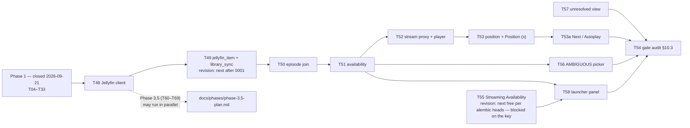

# Phase 3 — Playback over the owner's own files, and the launcher for everything else

> **For agentic workers:** REQUIRED SUB-SKILL: Use superpowers:subagent-driven-development (recommended) or superpowers:executing-plans to implement this plan task-by-task. Steps use checkbox (`- [ ]`) syntax for tracking.

**Goal:** Play the next thing, from the owner's own files, through a self-hosted Jellyfin that runs as a compose service beside the app — and, for every entry the library does not hold, open it on the owner's own subscription (ADR-012, the `NOT_IN_LIBRARY` fallback). Concretely: a backend-only Jellyfin client (T48), the `tmdb_id → Jellyfin Id` index `jellyfin_item` and the nullable `title.jellyfin_item_id`, both in **Phase 3's own Alembic revision** (T49), the episode join on the entry's stored `order_type` (T50), three-state availability as a real `Availability` enum (T51), the stream proxy `GET /api/playback/{jellyfin_item_id}/stream` and the `<video>` player overlay (T52), position reporting plus the `Position (s)` sheet column and `ColumnRole "position"` (T53), Next and Autoplay over `curated_entry_item.absolute_position` (T53a), the Streaming Availability client and `streaming_offer` (T55), the `AMBIGUOUS` picker (T56), the unresolved view (T57), the launcher panel (T58) — and the §10.3 gate audit (T54).

**Architecture:** Unchanged from Phase 1 and not negotiable here. The nineteen `.xlsx` workbooks stay the authored data and stay authoritative for watch order and hand curation; Postgres is a *derived projection* beside them (ADR-001, `CLAUDE.md` §0.2). Phase 3 adds a **third** store that is neither: the owner's own video files, indexed by the owner's own Jellyfin. Nothing in Phase 3 makes Jellyfin authoritative for anything — `jellyfin_item` is an index the sync rebuilds, availability is computed per entry and never stored, and the one durable Jellyfin fact the app keeps is `title.jellyfin_item_id`, the human's own pick. Phase 3 adopts `GET /api/categories/{id}/entries` for its availability-and-progress layer **only**; the workbook `CategoryDetail` stays the editing contract, unchanged (ADR-014 item 1).

**Tech Stack:** Python 3.13, FastAPI, Pydantic v2 + pydantic-settings, SQLAlchemy 2.0 (asyncio) + asyncpg + Alembic, PostgreSQL 16-alpine, `httpx` (backend only — **no `@jellyfin/sdk`**), `jellyfin/jellyfin:12.1` as a compose service, pytest + pytest-asyncio (`asyncio_mode = "auto"`), ruff, uv; React 18 + TypeScript strict + Vite + Redux Toolkit, `pnpm@9.15.9`, Vitest + React Testing Library, the Playwright layout guard; GitHub Actions.

**Spec:** `docs/TV_MASTER_PLAN.md` §4.3 (deliverables 3.1–3.14), §6.2, §6.6, §6.8, §6.9, §9.2 (the four new boundaries), §10.3 (**the gate — copied verbatim into this plan's tail**), §11 (the T46–T58 rows and the dependency graph), ADR-010, ADR-011, ADR-012, ADR-013, ADR-014 + `CLAUDE.md` §0.3, §0.4, §2.2, §5.13, §5.15, §5.16, §6.6, §8.3, §10.3 (B16–B19), §11.2 rule 7, §13.5, §14.9, §19 items 20–23, §20.2. This plan is supplementary to §11: it expands T46–T58 to task level (files, interfaces, steps, acceptance, tests), ending with the §10.3 gate audit checklist.

**Build order (ADR-014/ADR-015):** Phase 0 close → Phase 1 (T04–T33, **closed 2026-09-21**) → **Phase 3 and Phase 3.5, interleaved by task dependencies** → Phase 2 (T34–T45) **deferred, not cancelled**. T52 depends on T51 and T33, not T45 or T69. Phase numbers identify scope, not a barrier between the playback and import tracks.



---

## Sequencing note — Phase 3.5 runs beside the playback track

**Phase 3.5 (the import pipeline, `docs/phases/phase-3.5-plan.md`, T60–T69) depends on T48 and consumes T49's and T51's feedback.** Two consequences for the order of work in this plan:

1. **T48 is built first, before anything else in Phase 3.** It is the single dependency Phase 3.5 has on this phase, and holding it behind T49 would idle the whole import track. T48 is also the smallest Phase 3 task that stands entirely on its own: one client, one settings pair, recorded fixtures, no migration and no UI.
2. **After T48 lands, Phase 3.5 may run in parallel with the remaining playback tasks.** The import pipeline writes files into `${TV_JELLYFIN_MEDIA_HOST}`; T49's `library_sync` notices them and T51's `services/availability.py` computes their availability. Respect the cross-track dependencies: T61 needs T49, T65 needs T50, and T67 needs T51. T52 needs T51 and T33, not completion of T69. **T53/T66 are implemented and reviewed; next are T53a and T67, after resolving their documented contract gaps.** T49/T51 can receive integration findings from the import track without holding all playback work behind it.

Neither plan edits the other's files. This plan owns `docs/phases/phase-3-plan.md` and nothing else under `docs/phases/`; `docs/TV_MASTER_PLAN.md` §8 ADR-015 and `docs/phases/phase-3.5-plan.md` belong to the Phase 3.5 track.

---

## Global Constraints

Copied from `docs/phases/phase-1-plan.md` and extended with Phase 3's own. Every task's requirements implicitly include this block.

### Carried forward from Phase 1

- **Python 3.13+.** `requires-python = ">=3.13"` (`app/backend/pyproject.toml:5`).
- **`from __future__ import annotations`** at the top of every module.
- **Ruff:** `line-length = 120`, `select = ["E", "F", "I", "N", "UP", "ANN", "S"]`, `per-file-ignores { "tests/*" = ["S101"] }` (`pyproject.toml:36-44`). CI runs **both** `uv run ruff check .` and `uv run ruff format --check .`. The `# noqa` invariant in `src/` is **five, named** (Ruling 52) — three `ANN401` on heterogeneous openpyxl values plus `ingest/tmdb_ingest.py` `SLF001` and `services/watch_events.py` `BLE001`; a sixth needs a written reason on the same line and a note in the hand-off. `# type: ignore` in `src/` stays **zero**.
- **pytest:** `asyncio_mode = "auto"`, `testpaths = ["tests"]`, `pythonpath = ["tests", "tests/agent", "tests/services"]` (`pyproject.toml:46-52`). Test directories carry **no `__init__.py`**, so every test file basename must be unique across the whole tree — 120 exist today with no duplicates, and this plan's names are chosen to keep it that way.
- **No mocking of the workbook layer or the database.** Tests write real `.xlsx` copies in `tmp_path` and hit a **real Postgres 16** — never SQLite, never a mock (`CLAUDE.md` §16.4). The Postgres-gated tests skip **loudly** when nothing answers on `localhost:5525` and **fail** in CI, where `TV_REQUIRE_POSTGRES: "1"` is set. Never set it locally to silence a skip; never unset it in CI to get a green run.
- **Per-process test database (Ruling 58).** `tests/database_support.py` names the throwaway database per process (`tv_test` → `tv_p<pid>_test`), drops it at session end and reclaims any sibling whose pid is gone. Do not reintroduce a shared fixed name.
- **One concept per file.** One SQLAlchemy model per file under `data/models/`; one Pydantic model per file under `models/`; one React component per `.tsx`; one hook per `useCamelCase.ts`. The single sanctioned exception is `data/enums.py` (`CLAUDE.md` §3.1) — which is where `Availability` and `JellyfinItemKind` land, at their own tasks.
- **Every workbook write goes through `Catalog._write` → `_mutate`** (`services/catalog.py:137-155`, `:131-141` in the current tree): `guard_fresh` → snapshot → writer → invalidate → re-read, inside `lock_for(path)` on a worker thread. Phase 3 adds exactly one new workbook writer — T53's `Position (s)` — and it uses that funnel. **A second write path is the single most damaging change available in this repository.**
- **`TV_` env prefix** (`config.py:24`, `env_prefix="TV_"`): a field `jellyfin_base_url` is set by `TV_JELLYFIN_BASE_URL`, mechanically, never by a bare name and never by `os.environ`.
- **Never edit `version`** in `app/backend/pyproject.toml:3`, `app/frontend/package.json:4`, or the `version="0.1.0"` argument at `main.py:27`. Compute the next number and record it in `docs/versions.md`; **one unreleased heading at a time** (`CLAUDE.md` §17.4).
- **The owner does git.** No `git add/commit/checkout/…`, no `gh` mutation. Each task ends with "Hand to the owner to commit — suggested message".
- **Never create or edit any `.env*` file except `.env.example`.** The root `.env` is the owner's; `scripts/hooks/pre-tool-use.cjs` blocks the write mechanically, and blocks any direct `Write`/`Edit` of an `*.xlsx` for the funnel reason above.
- **Durations are `Integer` seconds named `*_seconds` with a named `CHECK`; never `INTERVAL`. Timestamps are `DateTime(timezone=True)`.** Native enum labels are the member *values* (`values_callable`, `data/enums.py:pg_enum`). `expire_on_commit=False` on the factory; `lazy="raise_on_sql"` on every relationship; `selectinload` at the query site. **Nothing crosses the `from_attributes` boundary unless it was eagerly loaded.**
- **Every `CheckConstraint` names itself** — the `ck` template in `data/base.py:NAMING_CONVENTION` interpolates `constraint_name`, and an unnamed constraint raises at import time.
- **No stubs before their consumer (Ruling 12).** A field, an enum member, a settings key or a table with no caller is a stub. `Availability` lands at T51, `jellyfin_base_url` / `jellyfin_api_key` at T48, `streaming_availability_api_key` at T55, `ColumnRole "position"` at T53 — each with the code that reads it, never earlier. `tests/data/test_data_enums.py::test_no_phase_three_vocabulary_is_stubbed_here_ahead_of_its_task` asserts the Phase 1 half of this and **will need updating by the task that adds each label** — that is the test doing its job, not a failure.
- **Rulings 44/45/47/48 hold over the API tail.** `POST /api/watch-events` answers **201 `WatchEventRead`** with the entry's derived `progress` embedded, never a bare `EntryProgress`; `CuratedEntryRead.resolution_note` is `str = ""`, never `str | None`; the review queue predicate is `resolution_state IN ('unresolved','auto')` with **no confidence threshold**; a re-resolve after a cell edit replaces `resolution_note` wholesale, and **T57 is where the durability question is decided**.
- **Ruling 49 as amended** governs the reconciler's skip: digest over the normalised grid **and** `identities_intact`. Phase 3 must not weaken it. **Ruling 54's follow-up is T57's to close**: since an untouched workbook is skipped, nothing retries a provider-outage `unresolved` except the next real edit or the review queue — T57 decides between a "Retry resolution" control on the unresolved view and a `--force` flag on the bootstrap runner.
- **Ruling 56:** a CLI that writes a report refuses any `--out` path that is not `.md`, before a single live call.

### New in Phase 3

- **Loopback only.** Every listener this project publishes binds `127.0.0.1` or is the compose bridge. `jellyfin` publishes `${TV_JELLYFIN_PORT:-8096}:8096` because the owner opens its own web UI; nothing else widens. No route gains auth, because nothing gains an audience.
- **The Jellyfin key never leaves the server.** `TV_JELLYFIN_API_KEY` is a `SecretStr`, rendered into exactly one header — `Authorization: MediaBrowser Token="…"` — inside `clients/jellyfin_client.py`. It appears in no URL, no log line, no error envelope, no `CuratedEntryRead` payload and no frontend bundle. The `<video src>` is the same-origin `/api/playback/{jellyfin_item_id}/stream` path and nothing else. **T54 greps the built `dist/`, a full playback access log and every proxy error body for it.**
- **Jellyfin is an optional peer, not a dependency.** No `depends_on` edge from `backend` to `jellyfin`, ever. An unreachable, unconfigured or still-scanning Jellyfin is a **disabled feature**: every entry reports `not_in_library` with a visible "Jellyfin unreachable" notice, surfaced as data in the same spirit as `unreadable` and `shadowed`. It is never a 500, never a boot failure and never a retry storm.
- **No ten-foot CSS.** Phase 2 is deferred and owns the ten-foot pass as one coherent change (`CLAUDE.md` §2.2). Phase 3's surfaces ship at the four laptop viewports the guard already covers — `1512x900`, `1280x720`, `1024x768`, `960x1040`. **No `env(safe-area-inset-*)`, no ten-foot type scale, no spatial-navigation library, no `1920x1080` project.** Design so they land later; do not land half of them now.
- **Recorded fixtures or a mock Jellyfin — never a live server in a test.** The Phase 1 seam is `httpx.MockTransport` (`tests/agent/mock_responder.py:8-18`) and the recorded bodies under `tests/fixtures/` with their header sidecars (`tests/provider_fixtures.py`). T48, T49, T50 and T55 reuse both. **Ruling 51:** a missing fixture is *recorded live* with the existing recorder, reading the credential through `Settings` and sending it only as a header; a hand-authored body is a stopgap, and only when no credential is configured.
- **The database is never mocked**, including here. T49's sync, T51's availability and T56's picker are tested against a real Postgres with the per-test rollback fixture.
- **No `@jellyfin/sdk`, anywhere in the tree** — only the backend talks to Jellyfin, over `httpx` (ADR-014 item 2). T54 greps for it.
- **Model-free.** No chat surface ever sees Jellyfin data, availability, or a `streaming_offer` row; the chat's fetch tool gains a **denylist** of the streaming services' domains (ADR-012 rule 7, landed at T55/T58). TMDB content still never reaches a prompt (`CLAUDE.md` §0.3, §10.3 B6).
- **Text-only rendering.** A Jellyfin `name` or `path` is free text from the owner's own filesystem and is rendered exactly like a provider overview (B12): React escapes it. There is **zero** `dangerouslySetInnerHTML` in `src/` and none may be added.
- **Ticks convert exactly once, at the boundary** (`CLAUDE.md` §11.2 rule 7): `position_seconds = ticks // 10_000_000`, `jellyfin_item.run_time_seconds = RunTimeTicks // 10_000_000`, `position_seconds = round(video.currentTime)`. There is no ticks column, no float-seconds column and no milliseconds column anywhere in the schema or the workbooks.
- **Host ports this project binds:** `5284`, `8284`, `5286` (live) + **`5525`** Postgres (Phase 1) + **`8096`** Jellyfin (Phase 3, already registered at `PORT_ASSIGNMENTS.md:109` by T47a). Phase 3 allocates **no further port**. Never host `5432`.

### Conventions used in this plan

- Every backend path is under `/Users/amrambouskila/IMPORTANT/Personal/TV/app/backend/` unless it starts with `/` or with a repo-root name (`README.md`, `docker-compose.yml`, `run_tv.sh`, `scripts/`, `docs/`).
- `BACKEND=/Users/amrambouskila/IMPORTANT/Personal/TV/app/backend`, `FRONTEND=/Users/amrambouskila/IMPORTANT/Personal/TV/app/frontend` and `REPO=/Users/amrambouskila/IMPORTANT/Personal/TV` in every `Run:` line.
- **Versions bookkeeping.** `docs/versions.md` carries exactly one unreleased heading, `## v0.2.0 — Phase 0 closed, and the metadata spine beside the workbooks` (`docs/versions.md:28`), while `app/backend/pyproject.toml:3` and `app/frontend/package.json:4` both still read `0.1.0`. **Read both before every task.** While the source-of-truth version is still `0.1.0` and `v0.2.0` is still unreleased, every Phase 3 task adds its own `### T<nn> — …` subsection **under that same heading**; a contract change renames the heading upward only if the accumulated work stops being a minor bump. **Never open a second unreleased heading** (`CLAUDE.md` §17.4, Ruling 53: one current subsection per task, no "(revised)" twins).
- **Alembic.** The current chain is `0001` (eleven Phase 1 tables, views and trigger) → `0002`
  (T49 library index) → `0003` (T61 import provenance) → `0004` (T66 recovery journal) → `0005`
  (T53a durable file completions).
  T55's revision is still future work.
  **Read `alembic heads` before assigning the next revision (R62)**; interleaved phases invalidate
  guessed numbering. Chain-wide round-trip/parity tests live in `test_migration_round_trip.py`.
- Line numbers cite the tree as read on 2026-09-22. Another agent is concurrently appending ADR-015 to `docs/TV_MASTER_PLAN.md` and writing `docs/phases/phase-3.5-plan.md`; re-read any region of the master plan before editing it.
- **Where `CLAUDE.md` and `docs/TV_MASTER_PLAN.md` differ, the master plan wins and `CLAUDE.md` is corrected in the same task.** The four known differences today are recorded at the end of this plan under "Docs to reconcile".

---

## Task T46: A real local file library exists — prerequisite

**Status:** **SATISFIED 2026-09-20.** The owner's own video files exist on this machine. A precondition, not work to be scheduled; ADR-013 records the basis (personal, single-instance, local files, no internet at playback time, one user, one machine) and states plainly that **there is no further review gate in any phase**.

**Depends on:** —

**Files:** none. `/media/` at the repository root is gitignored (T47a); the owner's files are never committed.

**Acceptance (§10.3 line):**
> - [x] A real local file library exists — **satisfied 2026-09-20** (the owner's files; indexed by T47a's compose service and T49's sync).

**Do not re-open ADR-013.** The one trigger that would is the build ceasing to be local — a third-party stream host or CDN in the playback path, a public endpoint, multi-tenant state — and that is a new decision for the owner, not a Phase 3 task.

---

## Task T47: Jellyfin server version — decided

**Status:** **DECIDED 2026-09-20 (ADR-014 item 2).** `jellyfin/jellyfin:12.1`, verified against Docker Hub and the GitHub release feed (12.1 released 2026-09-15; 12.0 on 2026-09-08). Pinned, never `:latest` — the API surface is what T48 codes against. **There is no `@jellyfin/sdk`**, because only the backend ever talks to Jellyfin, over `httpx`.

**Depends on:** T46.

**Files:** none of its own — the pin lands in `docker-compose.yml:122` (T47a) and is stated in `CLAUDE.md` §6.2/§6.6 and `docs/TV_MASTER_PLAN.md` deliverable 3.7.

**Acceptance (§10.3 line):**
> - [ ] The pinned Jellyfin version is **12.1**, recorded in `docker-compose.yml` and `CLAUDE.md`; there is no `@jellyfin/sdk` anywhere in the tree.

Checked at T54 by `grep -rn "jellyfin/jellyfin" docker-compose.yml` and `grep -rn "@jellyfin/sdk" $FRONTEND/package.json $FRONTEND/pnpm-lock.yaml $BACKEND`.

---

## Task T47a: The `jellyfin` compose service

**Status:** **DONE 2026-09-20** — landed ahead of its phase, by owner request, so the API key could be created in Jellyfin's own UI. `docker-compose.yml:118-143`: `jellyfin/jellyfin:12.1`, `restart: unless-stopped`, named volumes `tv_jellyfin_config:/config` and `tv_jellyfin_cache:/cache`, the read-only media bind mount `"${TV_JELLYFIN_MEDIA_HOST:-./media}:/media:ro"`, `ports: - "${TV_JELLYFIN_PORT:-8096}:8096"`, a `GET /health` healthcheck, and **no `depends_on` edge from `backend`**. `backend`'s `environment:` carries `TV_JELLYFIN_BASE_URL: "http://jellyfin:8096"` (`:39`) and `TV_JELLYFIN_API_KEY: "${TV_JELLYFIN_API_KEY:-}"` (`:40`). `/media/` is gitignored; `PORT_ASSIGNMENTS.md:109` carries the `8096` row and the `Personal/TV` inventory bullet.

**The container has never started on this machine.** Docker Desktop's VM transfers nothing while NordVPN's Shield network system extension is active (`docs/status.md` §0, owner action 1; re-attempted and still blocked 2026-09-21). The compose service, the volumes, the gitignored `/media/` and the registry row are all in place and reviewed; only the running container is outstanding, and it is the owner's to unblock. **Nothing in Phase 1 depends on it, and the backend must boot and serve with Jellyfin absent.**

**Depends on:** T47.

**Files:**
- Modify (done): `docker-compose.yml`, `.gitignore`, `/Users/amrambouskila/IMPORTANT/Projects/PORT_ASSIGNMENTS.md`, `.env.example`
- Test (done): `tests/test_compose.py` reads the compose file rather than running it.

**Owner actions still outstanding** (`docs/status.md` §0, items 1 and 2) — **T48 onwards cannot be verified end to end until these land**, though every task below is testable without them:

1. Pause NordVPN (or add Docker to its exceptions, or run compose on the Windows machine), then `docker compose up -d postgres jellyfin`.
2. Open `http://localhost:8096/web`, create the admin account, add `/media` as a library, let the scan finish, then **Dashboard → API Keys → New**, named `tv-app`. Type into the root `.env`: `TV_JELLYFIN_API_KEY=<that key>`, `TV_JELLYFIN_BASE_URL=http://localhost:8096` (the host launchers' value; compose sets `http://jellyfin:8096` itself), `TV_JELLYFIN_MEDIA_HOST=<the directory holding the video files>`. **No agent writes a credential.**

**Acceptance (§10.3 lines):**
> - [ ] `docker compose up` brings `jellyfin` (`jellyfin/jellyfin:12.1`) up **healthy** on host port `8096` with `tv_jellyfin_config`, `tv_jellyfin_cache` and the read-only `/media` mount; and the backend **boots and serves every workbook endpoint while `jellyfin` is stopped** — there is no `depends_on` edge, and an absent Jellyfin is a disabled feature, not a failure.
> - [ ] `PORT_ASSIGNMENTS.md` carries the `8096` row and the per-project inventory bullet, landed in the T47a commit.

---

## Task T48: `clients/jellyfin_client.py` — the one thing that talks to Jellyfin

**Status:** DONE 2026-09-23 — implemented, reviewed (two workflow rounds: spec/security/quality/tests,
then a scoped re-review) and approved. `JellyfinClient` + `build_jellyfin_http`/`build_jellyfin_client`
(363 lines, then fix rounds), four models under `models/jellyfin/`, the `assert_within_configured_base`
/ `configured_url` guard pair (Rulings 65-66, shared with Phase 3.5's T62 from the start), the key in
one `Authorization: MediaBrowser Token="…"` header, `stream()` returning a narrowed `StreamedResponse`
(Ruling 81), a boot-time `field_validator` on `jellyfin_base_url` (Ruling 80), and
`clients/transport.read_text()`/`unreachable()` added for T48 and reused across all three provider
clients. Fixtures hand-authored from the 12.1 OpenAPI document — a Ruling 51 exception, recorded in
`tests/fixtures/jellyfin/README.md`, superseded by T49's live confirmation. 135 tests, then 78 more
across two fix rounds; full suite 2734 passed / 0 failed / 0 skipped; 100% coverage on the client,
models, `http_guard.py` and `transport.py`. Docs synced separately (this file's own instruction, per
R78). See `docs/versions.md`'s `### T48` subsection for the full record.

**Depends on:** T47a, T12. **Contract additions:** two `Settings` fields (`jellyfin_base_url`, `jellyfin_api_key`) and the `models/jellyfin/` response models. No wire contract changes, so **no semver bump of its own** beyond the `### T48` subsection under `## v0.2.0`.

**Files:**
- Create: `src/tv_watchlist/clients/jellyfin_client.py`; `src/tv_watchlist/models/jellyfin/__init__.py`, `models/jellyfin/jellyfin_item_dto.py`, `models/jellyfin/jellyfin_item_page.py`, `models/jellyfin/jellyfin_provider_ids.py`; `tests/fixtures/jellyfin/README.md` (**R64** — names the OpenAPI schema source and the date read, for any hand-authored fixture)
- Modify: `src/tv_watchlist/config.py` (two fields, after the provider credentials block at `:40-44`), `src/tv_watchlist/constants.py` (`JELLYFIN_ITEM_FIELDS`, `JELLYFIN_PAGE_SIZE`, `MAX_JELLYFIN_PAGES`, `JELLYFIN_TIMEOUT_SECONDS`), `src/tv_watchlist/clients/http_guard.py` (**two new functions — see Interfaces**), `src/tv_watchlist/api/dependencies.py` (**R64** — a `get_jellyfin_client` singleton, the same `lru_cache(maxsize=1)` shape as `get_ingest_runtime`), `src/tv_watchlist/main.py` (**R64** — the lifespan close beside the agent/ingest runtimes, guarded by `.cache_info().currsize` exactly as `get_ingest_runtime` is), `tests/test_env_example.py` (**R64** — `TV_JELLYFIN_BASE_URL` and `TV_JELLYFIN_API_KEY` leave `DECLARED_EXTRAS`, now that both fields exist; their comments are corrected), `CLAUDE.md` §8.3 (flip the two `TV_JELLYFIN_*` rows from "declared, no field reads it" to live), `docs/versions.md`
- Test: `tests/clients/test_jellyfin_client.py`, `tests/clients/test_jellyfin_base_guard.py`, `tests/models/test_jellyfin_models.py`, `tests/api/test_jellyfin_dependency.py` (**R64** — the singleton and the lifespan close; the `get_ingest_runtime` tests are the shape to copy); fixtures under `tests/fixtures/jellyfin/`

**Interfaces:**

- **Consumes** `clients/transport.py` — `build_provider_http`, `read_json`, `refusal_for`, `elapsed_ms_since`, `log_call`, `CacheOutcome`, `scrubbed` — verbatim, and `clients/errors.py`'s hierarchy. It does **not** consume `clients/response_cache.py`: Jellyfin is a local server with its own `DateLastSaved` cursor and no ETag discipline worth caching in `sync_state`.
- **Does NOT consume `agent/url_guard.assert_public_http_url`.** That guard (`agent/url_guard.py:13-61`) rejects every private, loopback and link-local address by design, and a self-hosted Jellyfin lives on exactly those. **The carve-out is written down** (master plan §9.2, `CLAUDE.md` §10.3 B16), not discovered: the configured host *is* the allowlist for this one upstream, and the client exposes no method that takes a URL at all.
- **`clients/http_guard.assert_within_base` cannot be reused as-is: it requires `https`** (`http_guard.py:29-30`), and `http://jellyfin:8096` is not. Add a sibling rather than loosening the existing one — a scheme relaxation on the shared function would silently weaken both provider clients. **This sibling, and its URL builder, are shared from the start (R65, R66):** Phase 3.5's `clients/qbittorrent_client.py` (T62) is a second loopback-or-LAN upstream, and it consumes both functions unchanged rather than extracting or repointing anything later.

```python
# clients/http_guard.py  (proposed additions — NOT changes to assert_within_base or provider_url)
def assert_within_configured_base(url: str, base_url: str) -> None:
    """Like `assert_within_base`, but allows `http` — for a configured LAN or loopback upstream the
    owner runs (Jellyfin, qBittorrent). Same exact-host-and-port rule, same credentials-in-URL refusal,
    same traversal refusal. Never used for a provider on the public internet."""


def configured_url(base_url: str, *segments: str, **query: str) -> str:
    """The `provider_url`-shaped builder for a configured upstream: composes `base_url` + `segments` +
    `query`, then calls `assert_within_configured_base` — never `assert_within_base` — before returning.
    T48 and Phase 3.5's T62 both consume this; there is no second URL builder for either upstream (R66)."""
```

```python
# config.py  (appended to Settings, after tvdb_pin)
    # Jellyfin - Phase 3. `None` is a disabled feature: every entry reports not_in_library and the
    # player never renders. Only the scheme, host and port are configuration; the paths are constants.
    jellyfin_base_url: str | None = None
    jellyfin_api_key: SecretStr | None = None
```

```python
# clients/jellyfin_client.py  (proposed)
class JellyfinClient:
    """Every Jellyfin call this project makes. The `http` it is handed carries no credential; this adds it."""

    def __init__(self, base_url: str | None, api_key: SecretStr | None, *,
                 http: httpx.AsyncClient, clock: Callable[[], datetime] = utcnow) -> None: ...

    @property
    def configured(self) -> bool:
        """Both a base URL and a key are present. False means every call refuses before a request is built."""

    async def health(self) -> bool:
        """GET /health. False - never an exception - when Jellyfin is stopped, scanning or unreachable."""

    async def items(self, *, include_item_types: Sequence[JellyfinItemKind], has_tmdb_id: bool = True,
                    min_date_last_saved: datetime | None = None, start_index: int = 0,
                    limit: int = JELLYFIN_PAGE_SIZE) -> JellyfinItemPage:
        """GET /Items?recursive=true&includeItemTypes=…&hasTmdbId=…&fields=ProviderIds,Path,DateLastSaved
        &startIndex=…&limit=…  — one page. Jellyfin has NO provider-id lookup endpoint (master plan 3.2),
        so this paged scan is the only way to build the index; never assume a ?tmdbId= filter exists."""

    async def series_episodes(self, series_id: str, *, fields: str = JELLYFIN_ITEM_FIELDS) -> JellyfinItemPage:
        """GET /Shows/{seriesId}/Episodes — the episode join's source (T50). ParentIndexNumber /
        IndexNumber / IndexNumberEnd are carried VERBATIM and never reinterpreted."""

    def stream(self, jellyfin_id: str, *, range_header: str | None) -> AbstractAsyncContextManager[httpx.Response]:
        """A streaming GET of /Videos/{id}/stream?static=true, with the key in the header and `Range`
        forwarded when present. Returns the live response for the proxy to relay chunk by chunk (T52).
        There is deliberately no `build_stream_url()`: a URL the caller could hold is a URL that can leak."""

    async def refresh_library(self) -> None:
        """POST /Library/Refresh - a constant path, confirmed against Jellyfin 12.1's own OpenAPI
        document (no body, expects 204). Shipped here from the start (R67), so Phase 3.5's T67 consumes
        it rather than adding a second Jellyfin client or editing this module later."""
```

```python
# models/jellyfin/jellyfin_item_dto.py  (proposed; extra="ignore", frozen=True)
class JellyfinItemDto(BaseModel):
    id: str = Field(alias="Id", max_length=64)
    name: str = Field(alias="Name", max_length=500)
    kind: str = Field(alias="Type")                      # "Movie" | "Series" | "Episode"
    provider_ids: JellyfinProviderIds = Field(alias="ProviderIds", default_factory=JellyfinProviderIds)
    path: str | None = Field(alias="Path", default=None, max_length=1000)
    series_id: str | None = Field(alias="SeriesId", default=None, max_length=64)
    parent_index_number: int | None = Field(alias="ParentIndexNumber", default=None)
    index_number: int | None = Field(alias="IndexNumber", default=None)
    index_number_end: int | None = Field(alias="IndexNumberEnd", default=None)
    run_time_ticks: int | None = Field(alias="RunTimeTicks", default=None, ge=0)
    date_last_saved: datetime | None = Field(alias="DateLastSaved", default=None)

    @property
    def run_time_seconds(self) -> int | None:
        """The ONE place ticks become seconds (CLAUDE.md section 11.2 rule 7): ticks // 10_000_000."""
```

- `JellyfinProviderIds` reads the TMDB id through **one explicit key lookup**, because the OpenAPI schema is `additionalProperties: string` with **no enum** and the casing (`Tmdb` / `TMDB` / `tmdb`) is **unconfirmed until T49 pages a live server** (`CLAUDE.md` §20.2 item 1). Write it as a single constant so the confirmed spelling changes one line; write the test as a `@pytest.mark.parametrize` over all three spellings so whichever one arrives is already covered.

**Steps:**

- [ ] **Step 1: Read the seam before writing anything.** `clients/transport.py` in full, `clients/http_guard.py` in full, `clients/tmdb_client.py:66-130` (the `_fetch` / `_fetch_uncached` shape), `agent/url_guard.py:13-61` (so the carve-out is a decision rather than an omission), and `CLAUDE.md` §10.3 B16.
- [ ] **Step 2: Write the failing tests.** `tests/clients/test_jellyfin_base_guard.py` first — it needs no fixtures:
  - `test_an_http_lan_base_is_accepted_where_the_https_provider_guard_refuses_it` — `assert_within_configured_base("http://jellyfin:8096/Items", "http://jellyfin:8096")` passes, while `assert_within_base(...)` on the same pair raises `OutboundUrlError`.
  - `test_a_different_host_or_port_is_refused` — `http://jellyfin:8097/Items` and `http://evil/Items` against the same base both raise.
  - `test_a_url_carrying_credentials_is_refused` and `test_a_traversal_segment_is_refused` (including `..%2F`, which only splits after `unquote`).
  - `test_the_public_provider_guard_is_unchanged` — every existing `tests/clients/` assertion about `assert_within_base` still holds; `https` is still mandatory there.

  Then `tests/clients/test_jellyfin_client.py` against `httpx.MockTransport`:
  - `test_an_unconfigured_client_refuses_before_building_a_request` — no base URL, or no key → `ProviderNotConfiguredError`, and the transport recorded **zero** requests.
  - `test_the_key_travels_only_in_the_media_browser_header` — the recorded request's `Authorization` is exactly `MediaBrowser Token="<key>"`; the key's literal value appears in **no** part of `str(request.url)`.
  - `test_health_answers_false_rather_than_raising_when_jellyfin_is_unreachable` — a transport raising `httpx.ConnectError` → `False`.
  - `test_items_pages_with_start_index_and_stops_at_the_page_cap` — a transport that always reports more items than it returns must not loop forever; `MAX_JELLYFIN_PAGES` bounds it and the overflow is logged, not raised.
  - `test_run_time_ticks_become_whole_seconds_exactly_once` — `RunTimeTicks: 72_000_000_000` → `run_time_seconds == 7200`; no attribute anywhere exposes ticks to a caller.
  - `test_provider_ids_are_read_through_one_explicit_key` — parametrized over `"Tmdb"`, `"TMDB"`, `"tmdb"`.
  - `test_an_oversized_body_is_refused_rather_than_truncated` — `ProviderResponseTooLargeError` via the shared `read_json`.
  - `test_a_redirect_is_reported_not_followed` — `follow_redirects=False` through `build_provider_http`.
  - `test_the_call_log_carries_no_header_and_no_key` — caplog over a successful `items()`: one `provider_call` record, `host=`/`path=`/`status=`/`outcome=` present, the key absent.
  - `test_stream_forwards_a_range_header_and_yields_without_buffering` — the context manager yields an `httpx.Response` whose body is read by `aiter_bytes`; the recorded upstream request carries the same `Range` value.
  - `test_refresh_library_posts_with_no_body_and_expects_204` (**R67**) — the recorded request is `POST /Library/Refresh`, no body; a non-204 response raises the client's standard provider-error mapping.
  - `test_configured_url_calls_the_configured_guard_not_the_public_one` (**R66**, in `test_jellyfin_base_guard.py`) — `configured_url("http://jellyfin:8096", "Items")` succeeds where `provider_url` on the same base would refuse the scheme.
  - `tests/api/test_jellyfin_dependency.py::test_get_jellyfin_client_is_a_singleton` and `::test_the_lifespan_closes_it_only_if_built` (**R64** — the `get_ingest_runtime` tests are the shape to copy).
- [ ] **Step 3: Run them to verify they fail.** Run: `cd $BACKEND && uv run pytest -q tests/clients/test_jellyfin_client.py tests/clients/test_jellyfin_base_guard.py tests/models/test_jellyfin_models.py tests/api/test_jellyfin_dependency.py` — expect collection errors (`ModuleNotFoundError: tv_watchlist.clients.jellyfin_client`).
- [ ] **Step 4: Record the fixtures.** Prefer **Ruling 51**: with `TV_JELLYFIN_BASE_URL` and `TV_JELLYFIN_API_KEY` present in the root `.env` and the container up, record real bodies with the existing recorder into `tests/fixtures/jellyfin/` (`items_movies_page1.json`, `items_series_page1.json`, `shows_episodes_one_piece.json`, `health.txt`) with their header sidecars. **If the container is still blocked (T47a), hand-author minimal bodies from Jellyfin 12.1's OpenAPI document — a documented Ruling 51 exception, not a guess** — and write `tests/fixtures/jellyfin/README.md` naming the OpenAPI schema source and the date it was read, per file (**R64**). Say so in the hand-off, because T49's live confirmation supersedes these hand-authored bodies when a server exists.
- [ ] **Step 5: Implement**, in this order: `models/jellyfin/` (three files), the `constants.py` additions, `assert_within_configured_base` and `configured_url` (**R66**), the two `Settings` fields, then the client — including `refresh_library` (**R67**) — then `api/dependencies.get_jellyfin_client` and the `main.py` lifespan close (**R64**).
- [ ] **Step 6: Run the whole suite.** Run: `cd $BACKEND && uv run pytest -q` then `uv run ruff check . && uv run ruff format --check .`. Record the new total; it moves every task, so **measure, never quote**.

**Acceptance (§10.3 lines this task carries):**
> - [ ] Series matching is by provider id only. No fuzzy series-title matching exists in the Jellyfin path — an anime title variant must never produce a silent wrong match.
> - [ ] The Jellyfin key is backend-only and appears in no bundle, no log and no error body, proven by grepping the built `dist/`.

Plus `CLAUDE.md` §10.3 **B16** in full: the configured host is the allowlist, `follow_redirects=False`, every response `model_validate`d with `extra="ignore"`, explicit timeouts, a fixed page `Limit` with a hard page cap, one shared `httpx.AsyncClient` closed in the `main.py` lifespan beside the agent runtime — **the dependency singleton and the lifespan close are this task's own (R64), not deferred to T49.**

**Docs, then hand to the owner.** `CLAUDE.md` §8.3 (the two Jellyfin rows become live fields), §10.3 B16 (from "required defence" to "the defence, as built"), §12.3 (add `clients/jellyfin_client.py`, `models/jellyfin/` and the `get_jellyfin_client` dependency); `docs/versions.md` → `### T48 — the Jellyfin client (backend-only, key in one header)`. Suggested message: `feat(clients): backend-only Jellyfin client over httpx, configured-host allowlist, key in one header (T48)`.

---

## Task T49: `jellyfin_item` + `title.jellyfin_item_id` + `services/library_sync.py` — Alembic revision (numbered by `alembic heads`)

**Status:** DONE AND REVIEWED — 2026-09-23. Revision `0002_phase_3_jellyfin_item.py`,
the persisted index, and `POST /api/library/sync` are built. The accepted review fixes are part of the
contract: the incremental cursor is explicit `since` → maximum live `last_seen_at` → full scan (R87),
a transaction-scoped PostgreSQL advisory lock serialises overlapping syncs through commit (R88), and
a separate incremental episode walk catches new files without requiring their series to be re-saved
(R89). Only full scans soft-delete, and neither scan changes the owner's title pick. Live fixture
confirmation remains an owner-assisted T54 gate (R79), not an unfinished implementation prerequisite.

**Depends on:** T48, T06. **Contract additions:** two schema objects and one route — **minor bump**, recorded in `CLAUDE.md` §5.13 and §13.5 **before** the code.

**Files:**
- Create: `src/tv_watchlist/data/models/jellyfin_item.py`; `alembic/versions/000N_phase_3_jellyfin_item.py` (N is whatever `uv run alembic heads` reports, plus one — expected `0002` since `0001` is the only revision that exists before this task runs, but read it, never assumed — R62); `src/tv_watchlist/services/library_sync.py`; `src/tv_watchlist/models/library_sync_result.py`; `src/tv_watchlist/api/library.py`
- Modify: `src/tv_watchlist/data/models/__init__.py` (import the model so `Base.metadata` is complete), `src/tv_watchlist/data/models/title.py` (the nullable `jellyfin_item_id`, replacing the "No `jellyfin_item_id` here" comment at `title.py:46-47`), `src/tv_watchlist/data/enums.py` (`JellyfinItemKind`), `src/tv_watchlist/data/errors.py` (**`JellyfinUnavailableError`, a `ProjectionError` subclass — R72**), `src/tv_watchlist/api/errors.py` (**registers it in both `_STATUS_BY_ERROR` (503) and `_MESSAGE_BY_ERROR` — R72, the mechanism `POST /api/library/sync`'s "never a 500" promise needs**), `src/tv_watchlist/main.py:13` and `:48-53` (import and `include_router(library.router)`), `CLAUDE.md` §5.13 / §12.3 / §13.5 / §4.3 (the new error row), `docs/versions.md`
- Test: `tests/data/test_jellyfin_item_model.py`, `tests/data/test_migration_000N.py` (named after the revision's actual number), `tests/services/test_library_sync.py`, `tests/api/test_library_sync_route.py`, `tests/data/test_models_metadata.py` (**R60** — `EXPECTED_TABLES` gains `jellyfin_item`, `ALL_MODELS` gains `JellyfinItem`)

**A note on what this task no longer does.** An earlier draft of this task had it create `api/dependencies.get_jellyfin_client`; that singleton is now built at **T48**, in the same task that ships the client itself (R64), so `main.py`'s Jellyfin-shaped dependency already exists by the time this task's route is written — `api/library.py` only **consumes** it. This task also no longer edits `tests/data/test_data_enums.py`: that file's no-stubs test asserts nothing about `JellyfinItemKind` (verified — R61), so there is no absence guard here to flip, and the earlier instruction to touch it was a no-op.

**Interfaces:**

```python
# data/enums.py  (appended — the sanctioned multi-concept module)
class JellyfinItemKind(StrEnum):
    MOVIE = "movie"
    SERIES = "series"
    EPISODE = "episode"
```

```python
# data/models/jellyfin_item.py  (proposed — CLAUDE.md section 5.13 verbatim)
class JellyfinItem(UuidPk, Base):
    """The tmdb_id -> Jellyfin Id index services/library_sync.py maintains. A cache, honestly:
    stale between syncs, rebuilt by one job, never hand-edited."""

    __tablename__ = "jellyfin_item"
    __table_args__ = (
        UniqueConstraint("jellyfin_id"),
        CheckConstraint("run_time_seconds IS NULL OR run_time_seconds > 0", name="run_time_seconds_positive"),
        Index("ix_jellyfin_item_kind_tmdb_id", "kind", "tmdb_id"),     # the availability lookup
        Index("ix_jellyfin_item_series_jellyfin_id", "series_jellyfin_id"),  # the episode join
    )

    jellyfin_id: Mapped[str] = mapped_column(String(64))
    kind: Mapped[JellyfinItemKind] = mapped_column(pg_enum(JellyfinItemKind, "jellyfin_item_kind"))
    name: Mapped[str] = mapped_column(String(500))
    tmdb_id: Mapped[int | None] = mapped_column(Integer)        # Jellyfin fills ProviderIds.Tmdb only when its own scan matched
    series_jellyfin_id: Mapped[str | None] = mapped_column(String(64))
    parent_index_number: Mapped[int | None] = mapped_column(Integer)   # Jellyfin's numbers, VERBATIM
    index_number: Mapped[int | None] = mapped_column(Integer)
    index_number_end: Mapped[int | None] = mapped_column(Integer)
    run_time_seconds: Mapped[int | None] = mapped_column(Integer)      # RunTimeTicks // 10_000_000, at the boundary
    path: Mapped[str | None] = mapped_column(String(1000))             # for the picker to show
    date_last_saved: Mapped[datetime | None] = mapped_column(DateTime(timezone=True))  # optional upstream metadata
    first_seen_at: Mapped[datetime] = mapped_column(DateTime(timezone=True), server_default=func.now())
    last_seen_at: Mapped[datetime] = mapped_column(DateTime(timezone=True), server_default=func.now())
    removed_at: Mapped[datetime | None] = mapped_column(DateTime(timezone=True))
```

```python
# data/models/title.py  (one added column)
    # The AMBIGUOUS picker's remembered choice - per TITLE, not per file. NULL means "no pick made",
    # never "not in library": availability is computed by services/availability.py, not read off this.
    jellyfin_item_id: Mapped[uuid.UUID | None] = mapped_column(
        ForeignKey("jellyfin_item.id", ondelete="SET NULL")
    )
```

```python
# services/library_sync.py  (proposed)
async def sync_library(session: AsyncSession, client: JellyfinClient, *, full: bool = False,
                       since: datetime | None = None,
                       clock: Callable[[], datetime] = utcnow) -> LibrarySyncResult:
    """Page /Items for Movie+Series, then /Shows/{id}/Episodes per series, into jellyfin_item.
    Incremental on minDateLastSaved (explicit since, else max live last_seen_at) unless `full`.
    A file that vanishes is marked `removed_at`, NEVER deleted - title.jellyfin_item_id may point at it.
    Idempotent: a second run over an unchanged library writes nothing and reports seen>0, added=0.
    Raises JellyfinUnavailableError (R72) when the client is unconfigured or unreachable, so the route
    answers through the normal error-envelope path rather than a bespoke check."""

# models/library_sync_result.py  (frozen=True)
class LibrarySyncResult(BaseModel):
    seen: int; added: int; updated: int; removed: int; synced_at: datetime; incremental: bool

# api/library.py
router = APIRouter(prefix="/api/library", tags=["library"])
@router.post("/sync", response_model=LibrarySyncResult)
async def sync(session: SessionDep, client: JellyfinClientDep, full: bool = False,
               since: AwareDatetime | None = None) -> LibrarySyncResult:
    """503 when Jellyfin is unreachable or unconfigured - a disabled feature, never a 500.

    The mechanism (R72): `sync_library` raises `JellyfinUnavailableError`, a `ProjectionError`
    subclass registered in both of `api/errors.py`'s tables at 503; the route itself catches nothing."""
```

**The scan query, reconciled.** Master plan deliverable 3.2 gives the index scan as `GET /Items?recursive=true&includeItemTypes=Series,Movie&hasTmdbId=true&fields=ProviderIds`; `CLAUDE.md` §5.13 says `jellyfin_item` holds "one row per movie, series **and episode** the library holds" and names `fields=ProviderIds,Path,DateLastSaved,…`. Both are right about different halves and this plan reconciles them explicitly: **movies and series come from the paged `/Items` scan with `hasTmdbId=true`; episode rows come from `GET /Shows/{seriesId}/Episodes` per series** — episodes rarely carry their own TMDB id, so `hasTmdbId=true` would exclude them from the scan entirely. `fields` is `ProviderIds,Path,DateLastSaved` on both calls. Record this in `CLAUDE.md` §5.13 in the same commit.

**Steps:**

- [ ] **Owner-assisted T54 follow-up: confirm the shapes against a live Jellyfin.** R79 accepts the
  documented OpenAPI-derived fixtures for implementation. Once the owner's key is configured,
  confirm `ProviderIds` casing, `IndexNumberEnd`, nullable `DateLastSaved`, and wire date/array/id
  formats using `tests/fixtures/jellyfin/README.md`; do not claim these were recorded live.
- [ ] **Step 2: Write `CLAUDE.md` §5.13 and §13.5 first.** The contract lands before the code (`CLAUDE.md` §17.1). §5.13 already carries the `jellyfin_item` paragraph and `title.jellyfin_item_id`; correct anything Step 1 falsified, and add the reconciled scan query above.
- [ ] **Step 3: Write the failing tests.**
  - `tests/data/test_jellyfin_item_model.py::test_the_unique_and_indexes_are_named_by_the_convention` — `uq_jellyfin_item_jellyfin_id`, `ck_jellyfin_item_run_time_seconds_positive`, both indexes.
  - `::test_a_second_row_with_the_same_jellyfin_id_is_refused` (real Postgres).
  - `::test_a_removed_item_keeps_the_titles_pick` — soft-delete sets `removed_at` and `title.jellyfin_item_id` is unchanged; a real `DELETE` of the row nulls it via `ON DELETE SET NULL` rather than raising.
  - `tests/data/test_migration_000N.py::test_the_round_trip_is_green` (file named after the revision's actual number) — `upgrade head` → `downgrade base` → `upgrade head` against a real Postgres; `downgrade` drops `title.jellyfin_item_id` **before** `jellyfin_item`, and the `jellyfin_item_kind` type after both. `::test_alembic_check_is_clean_after_upgrade` — no autogenerate diff.
  - Check table parity against `Base.metadata`, with `alembic_version` counted separately. At T49
    there were twelve domain tables; T61 adds `media_import` before T55, so tests must follow the
    actual chain rather than assuming Phase 3 finishes before Phase 3.5 begins.
  - `tests/data/test_models_metadata.py` (**R60**) — extend `EXPECTED_TABLES` with `jellyfin_item` and `ALL_MODELS` with `JellyfinItem`; the existing exact-equality assertions go red until both are added.
  - `tests/services/test_library_sync.py::test_a_first_sync_indexes_movies_series_and_episodes` — mock Jellyfin fixtures; counts and kinds.
  - `::test_a_second_sync_over_an_unchanged_library_writes_nothing` — `added == updated == removed == 0`, and a statement tap (`tests/statement_support.py`) shows no `UPDATE` on `jellyfin_item`.
  - `::test_an_incremental_sync_sends_min_date_last_saved` — the recorded request carries `minDateLastSaved` equal to the table's max.
  - `::test_a_vanished_file_is_marked_removed_not_deleted`.
  - `::test_no_series_is_matched_by_title` — a fixture whose Jellyfin `Name` differs from the TMDB name but whose `ProviderIds.Tmdb` matches is indexed by id; a fixture with a matching name and **no** provider id is indexed with `tmdb_id IS NULL` and never joined to a title. **This is the §10.3 "series matching is by provider id only" box.**
  - `tests/api/test_library_sync_route.py::test_an_unconfigured_jellyfin_answers_503_not_500`, `::test_the_route_answers_the_counts`, and `::test_jellyfin_unavailable_error_is_registered_in_both_error_tables` (**R72**).
- [ ] **Step 4: Run them to verify they fail.** Run: `cd $BACKEND && TV_REQUIRE_POSTGRES=1 uv run pytest -q tests/data/test_jellyfin_item_model.py tests/data/test_migration_000N.py tests/services/test_library_sync.py tests/api/test_library_sync_route.py tests/data/test_models_metadata.py`
- [ ] **Step 5: Implement.** `uv run alembic heads` (expect `0001`, since this is Phase 3's first revision-adding task), then the enum, the model, `uv run alembic revision --autogenerate -m "phase 3 jellyfin item"` — **read the generated revision and hand-order its `downgrade`**, exactly as `0001` does; autogenerate orders neither the FK drop nor the enum drop correctly. Then `JellyfinUnavailableError` in both error tables (R72), the service, the result model, and the route — which **consumes** T48's `get_jellyfin_client` dependency rather than building its own — and the `main.py` wiring.
- [ ] **Step 6: Run the whole suite plus the round trip.** Run: `cd $BACKEND && uv run alembic upgrade head && uv run alembic downgrade base && uv run alembic upgrade head && TV_REQUIRE_POSTGRES=1 uv run pytest -q`

**Acceptance (§10.3 lines):**
> - [ ] The `tmdb_id → Jellyfin Id` index (`jellyfin_item`) builds from a paged library scan, is persisted, and refreshes on `minDateLastSaved`. No code anywhere assumes a provider-id filter exists.
> - [ ] Series matching is by provider id only. No fuzzy series-title matching exists in the Jellyfin path — an anime title variant must never produce a silent wrong match.

**Docs, then hand to the owner.** `CLAUDE.md` §5.13 (confirmed shapes + the reconciled scan query), §12.3, §13.5 (`POST /api/library/sync` built), §10.3 B16, §4.3 (the `JellyfinUnavailableError` row); `docs/versions.md` → `### T49 — jellyfin_item, title.jellyfin_item_id and the library sync (minor: two schema objects, one route)`. Suggested message: `feat(data): jellyfin_item index, title.jellyfin_item_id and POST /api/library/sync (T49)`.

---

## Task T50: The episode join — the entry's stored `order_type`, and `IndexNumberEnd`

**Status:** DONE AND REVIEWED — 2026-09-23. The final Claude review approved all fixes; 79 focused
tests passed. `numberings_for(entry)` remains the sole numbering selector (R97), including specials
and unit-kind rules; a removed owner pick stays ambiguous while live candidates remain (R98).
`EpisodeMatch` carries `state`, `order_type` and `order_label` as well as the matched file and range
flag. The join and `episode_for_sequence` share `within_numberings`; the join batches its SQL rather
than making a per-slot lookup. The UI's display of the chosen order remains T52 work, not a claim
that playback already exists.

**Depends on:** T49, T20. **No contract change** — this task produces the join the availability service consumes.

**Files:**
- Create: `src/tv_watchlist/services/episode_match.py`; `src/tv_watchlist/services/episode_lookup.py` (**R70** — the `episode_for_sequence` helper, extracted so Phase 3.5's T65 can reuse it instead of writing a second `episode_order` lookup)
- Modify: `src/tv_watchlist/services/library_sync.py` (only if Step 1 shows the episode page needs a field the scan did not request), `CLAUDE.md` §20.2 item 3, `docs/versions.md`
- Test: `tests/services/test_episode_match.py`, `tests/services/test_episode_lookup.py` (**R70**)

**Interfaces:**

```python
# services/episode_match.py  (proposed)
async def episodes_for_entry(session: AsyncSession, entry: CuratedEntry) -> list[EpisodeMatch]:
    """Map each curated_entry_item episode slot to a jellyfin_item row.

    ORDER FIRST, JOIN SECOND. The entry's span was already resolved in its stored `order_type` at T24;
    this reads `curated_entry_item` through the stored EpisodeOrder printed season/episode pair and matches
    against jellyfin_item on (series_jellyfin_id, parent_index_number, index_number).
    NEVER infer an order at read time (CLAUDE.md section 20.2 item 3).

    IndexNumberEnd non-null means ONE FILE covers episodes index_number..index_number_end, so one
    jellyfin_item satisfies several curated_entry_item rows - a many-to-one, recorded as such, never
    silently collapsed to the first episode."""

@dataclass(frozen=True, slots=True)
class EpisodeMatch:
    item_id: uuid.UUID                  # curated_entry_item.id
    episode_id: uuid.UUID
    jellyfin_item_id: uuid.UUID | None  # None = this episode is not in the library
    state: MatchState
    covers_range: bool                  # True when IndexNumberEnd made one file answer for several
    order_type: str | None
    order_label: str
```

```python
# services/episode_lookup.py  (new — R70, extracted here so T50 and Phase 3.5's T65 share one query
# rather than two)
async def episode_for_sequence(
    session: AsyncSession, title_id: uuid.UUID, order_type: str, label: str = NO_LABEL, *, sequence: int
) -> Episode | None:
    """The `episode_order` row at (title_id, order_type, label, sequence) -> its episode, or None when
    no such numbering or slot exists. The one place any caller resolves a stored numbering into an
    episode - never by arithmetic (CLAUDE.md section 11.2 rule 9). The batched episode join reuses
    this module's `within_numberings` predicate rather than calling this once per slot."""
```

**The trap this task exists to avoid, stated once.** TMDB numbers anime episodes **absolute-continuously inside season buckets**: One Piece season 2's `episode_number` values run **62–77, not 1–16** (`CLAUDE.md` §11.2 rule 9). Jellyfin's `IndexNumber` reflects whatever the file naming produced. A join on `(season_number, episode_number)` taken straight off `episode` is therefore right for Western TV and silently wrong for anime — the worst failure shape available. The join must use the numbering the entry's `order_type` names, which is what `episode_order.order_season_number` / `order_episode_number` carry beside `sequence`. **`sequence` is what the app computes with; `order_season_number` / `order_episode_number` are what the join and the UI print.** Season 0 is the specials bucket and lives under `SPECIALS_ORDER_TYPE` (`= OrderType.ALTERNATE.value`, `"alternate"`) with `SPECIALS_ORDER_LABEL = "Specials"` (`constants.py:173`, `ingest/episode_orders.py:65-69`) — it is excluded from the aired walk and must not be folded back in here.

**Steps:**

- [ ] **Step 1: Read `ingest/episode_orders.py` and `ingest/expansion.py` in full** before writing a line. They already answer "which numbering does this entry use" and "what does its queue hold"; this task must not re-derive either.
- [ ] **Step 2: Write the failing tests.**
  - `::test_an_anime_span_joins_on_the_stored_order_not_on_tmdb_season_and_episode` — a One Piece entry in `absolute` order against a Jellyfin fixture numbered `S01E62`-style; the match is correct, and a join written the naive way would have been off. Assert the naive join's result differs, so the test cannot pass by accident.
  - `::test_the_order_actually_used_is_reported` — `EpisodeMatch` (or the entry read that carries it) names the `order_type` the join used; the §10.3 box requires it to be **visible in the UI**, so it must leave the service.
  - `::test_index_number_end_lets_one_file_answer_for_several_rows` — a file with `IndexNumber=1, IndexNumberEnd=2` satisfies two `curated_entry_item` rows, both with `covers_range=True`.
  - `::test_a_specials_entry_joins_under_the_specials_label_not_the_aired_walk`.
  - `::test_an_episode_with_no_jellyfin_row_reports_none_rather_than_guessing`.
  - `::test_no_query_matches_a_series_by_name` — a statement tap asserting no `ILIKE`/`similarity` over `jellyfin_item.name` in this path.
  - `tests/services/test_episode_lookup.py::test_episode_for_sequence_resolves_the_stored_numbering` and `::test_an_unknown_sequence_returns_none_rather_than_guessing` (**R70**).
- [ ] **Step 3: Run them to verify they fail.**
- [x] **Step 4: Implement**, with batched SQL, never one query per episode. `episode_for_sequence`
  and the join share `within_numberings`; entry numbering selection reuses `numberings_for` (R97).
  T51 extends the existing single-entry API with page batching without changing its semantics.
- [ ] **Step 5: Run the whole suite.**

**Acceptance (§10.3 line):**
> - [ ] The episode join uses the entry's stored `order_type`, and the order actually used is visible in the UI.

**Docs, then hand to the owner.** `CLAUDE.md` §20.2 item 3 (from requirement to built), §12.3 (add `services/episode_lookup.py` beside `services/episode_match.py`); `docs/versions.md` → `### T50 — the episode join, on the stored order`. Suggested message: `feat(services): join curated episodes to Jellyfin files on the entry's stored order (T50)`.

---

## Task T51: `services/availability.py` + the `Availability` enum + the two `CuratedEntryRead` fields

**Status:** DONE AND REVIEWED — 2026-09-23. Independent review passed **207 focused tests, zero
skips** after closing two remembered-pick edge cases: a picked episode with no reported parent keeps
T50's exact-provider-ID fallback, and its explicit live parent still resolves if provider metadata
changes. The enum and exactly two response fields are live on both sides of the wire, without a
migration. Page query counts remain constant. Badge/player rendering is still T52, so the combined
phase acceptance line below is deliberately not checked yet.

**Depends on:** T50. **Contract additions: `CuratedEntryRead.availability` and `.jellyfin_item_id`, both sides of the wire, in one commit — a minor bump, written into `CLAUDE.md` §5.15 and §5.13 *before* the code** (`CLAUDE.md` §17.1, master plan §6.2).

**Files:**
- Create: `src/tv_watchlist/services/availability.py`
- Modify: `src/tv_watchlist/data/enums.py` (`Availability`), `src/tv_watchlist/models/curated_entry_read.py` (the two fields, replacing the "join this model at T51" comment), `src/tv_watchlist/services/entries.py` (compute availability for the page in one query), `src/tv_watchlist/services/resolution_review.py` (the same, so the review queue's rows carry the same shape), `app/frontend/src/types/CuratedEntryRead.ts` (the TypeScript twin, **same commit**), `tests/models/test_read_models.py` (**R61** — deletes `::test_the_phase_three_fields_are_absent_until_the_service_that_computes_them_exists` and replaces it with the positive counterpart, now that this task is the service that computes them), `tests/data/test_data_enums.py` (**R61** — replaces the `not hasattr(enums, "Availability")` assertion with its positive counterpart), `CLAUDE.md` §5.13 / §5.15 / §3.1, `docs/versions.md`
- Test: `tests/services/test_availability.py`, `tests/api/test_entries_availability.py`, `tests/models/test_availability_contract.py`

**Interfaces:**

```python
# data/enums.py  (appended at T51, never earlier - Ruling 12)
class Availability(StrEnum):
    """Three states, never a nullable id. The ambiguous case is real - absolute-versus-official
    numbering, multi-episode files - and collapsing it into "not in library" produces a UI that
    quietly lies (master plan deliverable 3.4, ADR-013)."""

    IN_LIBRARY = "in_library"
    NOT_IN_LIBRARY = "not_in_library"
    AMBIGUOUS = "ambiguous"
```

**It is computed, never stored**, so it needs **no Alembic revision and no Postgres enum type** — the phase-1-plan tail says so explicitly and this plan keeps it that way.

```python
# services/entry_availability.py
class EntryAvailability(BaseModel):
    model_config = ConfigDict(frozen=True)
    availability: Availability
    jellyfin_item_id: uuid.UUID | None = None

# services/availability_result.py; service-only, not an API response envelope (R103)
class AvailabilityResult(BaseModel):
    model_config = ConfigDict(frozen=True)
    entries: dict[uuid.UUID, EntryAvailability]
    notice: str | None = None

# services/availability.py
async def availability_for(session: AsyncSession, client: JellyfinClient | None,
                           entries: Sequence[CuratedEntry]) -> AvailabilityResult:
    """One probe and two batched SQL lookups per page, independent of the number of entries."""
```

R96 governs series aggregation: any ambiguous slot wins; otherwise every slot must match, and
an empty queue stays `NOT_IN_LIBRARY`. A live owner pick narrows candidates but never makes missing
episodes available. A dangling pick stays ambiguous while candidates remain (R98). The wire id
is the movie or series selection, never an episode-file id; those remain in `EpisodeMatch`.
Unresolved/rejected entries and unconfigured/unreachable Jellyfin return `NOT_IN_LIBRARY`; only
the service result carries a notice. No schema column/native enum is added.

```python
# models/curated_entry_read.py  (the two fields, appended after `progress`)
    # Phase 3 (T51, ADR-014). Computed by services/availability.py, never read off a nullable id.
    availability: Availability
    jellyfin_item_id: uuid.UUID | None = None
```

```ts
// app/frontend/src/types/Availability.ts (one concept per file)
export type Availability = "in_library" | "not_in_library" | "ambiguous";
// app/frontend/src/types/CuratedEntryRead.ts imports Availability
  availability: Availability;
  jellyfin_item_id: string | null;
```

**Steps:**

- [ ] **Step 1: Write `CLAUDE.md` §5.15 and §5.13 first**, flipping the two "land at T51" notes to the built shape, and §3.1's `data/enums.py` exception note to say `Availability` has arrived (and that `JellyfinItemKind` arrived at T49).
- [ ] **Step 2: Flip the two Ruling-12 absence guards (R61).** Delete `tests/models/test_read_models.py::test_the_phase_three_fields_are_absent_until_the_service_that_computes_them_exists` and replace it with the positive counterpart (the two fields now exist and are exercised); delete `tests/data/test_data_enums.py`'s `not hasattr(enums, "Availability")` assertion and replace it the same way. Both currently pass by asserting *absence*; left standing after this task ships, each would be wrong, not merely obsolete.
- [ ] **Step 3: Write the failing tests** — five service tests, one per rule, on a real Postgres:
  - `::test_an_unconfigured_jellyfin_reports_not_in_library_for_every_entry_with_a_notice` — and the notice reaches the caller as data, not a log line.
  - `::test_an_unreachable_jellyfin_is_the_same_as_unconfigured_and_never_raises`.
  - `::test_a_stored_pick_wins_over_re_derivation` — two candidate files, `title.jellyfin_item_id` set → `IN_LIBRARY` with that exact id, not `AMBIGUOUS`.
  - `::test_a_soft_deleted_pick_returns_the_entry_to_ambiguous` — `removed_at` set on the picked row.
  - `::test_two_candidates_are_ambiguous_with_no_id` — **not** `IN_LIBRARY` with an arbitrary one, and **not** `NOT_IN_LIBRARY`.
  - `::test_an_unresolved_entry_is_not_in_library`.
  - `tests/api/test_entries_availability.py::test_the_entries_route_serves_availability_for_every_row` and `::test_the_review_queue_serves_the_same_shape`.
  - `tests/models/test_availability_contract.py` compares the Python enum with
    `types/Availability.ts` using the existing `ts_types.py` helper. **Only that comparison lives
    here (R61)**; field-name/order parity stays in the existing `test_read_models.py` parametrisation.
  - `tests/data/test_data_enums.py` proves the computed enum appears in no metadata column or migration.
- [ ] **Step 4: Run them to verify they fail.**
- [x] **Step 5: Implement** page batching: one title/pick lookup plus one episode join, not an N+1.
  The existing entries query-count test now checks fixed totals of five SQL statements when disabled
  and seven when configured for both small and larger pages; progress still uses its one statement.
- [ ] **Step 6: Run the whole suite, `tsc -b`, `pnpm lint` and `pnpm test`.** Both sides move in one commit.

**Acceptance (§10.3 line):**
> - [ ] Every curated entry reports `IN_LIBRARY` / `NOT_IN_LIBRARY` / `AMBIGUOUS` on `CuratedEntryRead.availability`, and the UI shows the ambiguous state as ambiguous rather than as absent.

**Docs, then hand to the owner.** `CLAUDE.md` §5.13, §5.15, §3.1, §12.3; `docs/versions.md` → `### T51 — three-state availability (minor: CuratedEntryRead gains two fields, both sides)`. Suggested message: `feat(api): three-state availability on CuratedEntryRead, computed never stored (T51)`.

---

## Task T52: `api/playback.py` — the stream proxy — and the `<video>` player overlay

**Status:** DONE 2026-09-23. Implementation and measured checks are recorded in
`docs/playback-import-validation.md`; phase-wide T54/live-media/security gates remain separate.
Backend focused coverage is 100%; frontend has 279 tests across 34 files, all eight new runtime
modules at 100%, and 180 layout checks (21 surfaces × two checks, plus three shared cases, across
four viewports). The two new surfaces include the native video, slot selector, Play and Close.

The implemented proxy uses `PlaybackResponse`, acquiring the stream only after function-scoped
database teardown and closing it under cancellation shielding even if response headers cannot be
sent. Acquisition failures return a safe 502 envelope; body failures terminate the stream without
appending JSON or exposing provider exceptions. Streaming alone requests identity encoding and
refuses unexpected content encoding so decoded bytes cannot disagree with forwarded lengths.
The declared FastAPI minimum is 0.121.0 for dependency scope; locked 0.141.1 is unchanged.

The implementation inventory and regression evidence supersede the original build checklist below.
The native overlay deliberately has no Next/Autoplay, resume or progress events; unavailable slots
stay visible and range files carry an explicit warning instead of an invented chapter offset.

**Depends on:** T51, T33. **Contract additions:** the stream route, the owner-approved R104
`GET /api/playback/entries/{entry_id}/items` and frozen `PlaybackItemRead`/TypeScript mirror
(master plan §6.2 and `CLAUDE.md` §5.15), plus `ui.playing` in the frontend store. Minor bump.
The entry response remains unchanged: its title-level series UUID is never passed to the stream.
The overlay loads ordered slots, initially selects the first, and offers explicit selection while
displaying the numbering actually used. No Next/Autoplay or position reporting lands in T52.

**Files:** the complete implementation/test inventory is in `docs/playback-import-validation.md`.
Backend responsibilities are isolated in `api/playback.py`, `api/playback_response.py`,
`services/playback_items.py` and `models/playback_item_read.py`, reusing
`clients/jellyfin_client.py` and `JELLYFIN_RELAYED_HEADERS`. Frontend responsibilities are isolated
in `PlayerOverlay`, `PlayButton`, `AvailabilityBadge`, the entries slice, `entryForRow`, the wire
model and shared paginated request helpers, with mirrored subject tests and two new layout probes.

**Interfaces:**

```python
# api/playback.py  (implemented signatures; dependencies defined in the module)
router = APIRouter(prefix="/api/playback", tags=["playback"])

@router.get("/{jellyfin_item_id}/stream", response_class=StreamingResponse)
async def stream(
    jellyfin_item_id: uuid.UUID, request: Request, session: StreamSessionDep, client: JellyfinDep
) -> PlaybackResponse: ...

@router.get("/entries/{entry_id}/items", response_model=list[PlaybackItemRead])
async def list_items(
    entry_id: uuid.UUID,
    session: SessionDep,
    client: JellyfinDep,
    limit: Annotated[int, Query(ge=1, le=MAX_ENTRIES_PAGE_SIZE)] = MAX_ENTRIES_PAGE_SIZE,
    offset: Annotated[int, Query(ge=0)] = 0,
) -> list[PlaybackItemRead]: ...
```

**The `Range` rule, reconciled and implemented — the master plan wins.** Master plan §9.2 requires
one ASCII `bytes=<start>-<end?>` range and 416 on malformed input. The former B17 multi-range/drop
draft was corrected in `CLAUDE.md` with this task. Multipart framing is not part of the narrow proxy
contract; refusal must not silently become a full-file download. Reversed bounds are also refused.

```python
# constants.py  (appended)
# One range only: a multipart/byteranges response has boundary framing the proxy's four-header
# allowlist cannot relay, so the second range is refused rather than mis-served (master plan section 9.2).
RANGE_HEADER_PATTERN: Final[str] = r"bytes=([0-9]+)-([0-9]*)"  # fullmatch; reject reversed bounds
DEFAULT_STREAM_CONTENT_TYPE: Final[str] = "video/mp4"   # only when the upstream sends none
```

The pre-existing `JELLYFIN_RELAYED_HEADERS` owns the three upstream headers. The response adds
`Accept-Ranges: bytes`; a second header-allowlist constant was not introduced.

```ts
// stores/uiSlice.ts  (appended to UiState)
  playing: { entryId: string; title: string } | null;
```

The player is an **overlay over the category view, not a route**: `AppView` gains no value for it (`AppView` gains `"unresolved"` at T57 and nothing here). Native `<video controls>` only in Phase 3 — **no custom scrubber**. `src` is `/api/playback/${jellyfinItemId}/stream` and nothing else, so `app/frontend/nginx.conf:40`'s CSP needs **no `media-src`** and gains none; nginx declares no Jellyfin upstream and **no `add_header` is added inside any location** (`nginx.conf:9-12` — one would silently delete every security header for that path). Escape closes it, capture-phase, like `useFocusTrap`.

**Steps:**

- [ ] **Step 1: Read `api/chat.py:47-73`** — the `StreamingResponse` headers and the shielded cancel handling are the shape this route copies — and `app/frontend/nginx.conf` in full, so nothing is "improved" there.
- [ ] **Step 2: Write the failing backend tests** against a **mock Jellyfin** (an `httpx.MockTransport` serving a byte body), through `ASGITransport` with `get_jellyfin_client` overridden:
  - `::test_a_range_request_is_206_with_content_range_and_accept_ranges` — `Range: bytes=0-1` → 206, `Content-Range` relayed verbatim, `Accept-Ranges: bytes` present, body is the two bytes.
  - `::test_a_rangeless_request_is_200_with_the_whole_body`.
  - `::test_a_malformed_or_multi_range_header_is_416_and_never_forwarded` — parametrized over `"bytes=abc"`, `"bytes=0-1,5-6"`, `"items=0-1"`, `"bytes=0-1\r\nX-Injected: 1"`; the recorded upstream request count is **zero**.
  - `::test_only_the_range_header_reaches_jellyfin` — the inbound request carries `Cookie`, `Host`, `X-Forwarded-For` and `Authorization`; none appears upstream.
  - `::test_only_four_headers_come_back` — the mock sends `Set-Cookie`, `Server` and `X-Jellyfin-Version`; none reaches the client.
  - `::test_content_type_is_passed_through_and_only_defaults_when_absent`.
  - `::test_an_unknown_or_removed_item_is_404_before_any_upstream_call`.
  - `::test_the_body_is_streamed_not_buffered` — **the gate test**: the mock serves a body larger than the worker's memory budget in chunks; assert peak process RSS stays flat (`tracemalloc` over the response iteration, or a chunk counter proving the client received chunk N before the mock produced chunk N+1). §10.3 requires this proof.
  - `::test_an_upstream_connection_failure_is_502_not_500` — the mock transport raises; `PlaybackUpstreamError` → 502, envelope intact (**R72**).
  - `::test_an_unconfigured_or_unreachable_jellyfin_is_503_reusing_t49s_error_class` — `get_jellyfin_client` returns an unconfigured client; `JellyfinUnavailableError` → 503, the same class T49's route raises, not a second one for the same meaning (**R72**).
  - `::test_the_key_appears_in_no_response_and_no_error_body` — over 200, 206, 404, 502 and 503, plus caplog.
  - `::test_a_client_disconnect_cancels_the_upstream_read`.
- [ ] **Step 3: Write the failing frontend tests.** `PlayerOverlay.test.tsx`: the `src` is the same-origin proxy path and contains no Jellyfin host and no key; Escape closes; closing unmounts. `AvailabilityBadge.test.tsx`: three states render three distinct labels — `In library`, `Opens on your subscription`, `Needs a pick` — **text plus an icon, never colour alone**; the play button renders **only** for `in_library`.
- [ ] **Step 4: Run both suites to verify they fail.**
- [ ] **Step 5: Implement.** `PlaybackUpstreamError` in both error tables first (R72), then the route, then the slice and the three components.
- [ ] **Step 6: Add the two layout-guard surfaces** — `"category-with-a-playable-entry"` and `"player-overlay"` — to `layout/surfaces.ts` with their `expects` lists, and their arrangements to `layout/probes/arrangements.ts` driving off a new `aPlayableCategory.ts` probe library. **A new screen with no surface is an untested screen** (`CLAUDE.md` §21 item 13). The player's Close and Next must be in the promised-size set — the Approve-button bug (`CLAUDE.md` §16.5) is exactly this shape.
- [ ] **Step 7: Run everything.** Run: `cd $BACKEND && uv run pytest -q` and `cd $FRONTEND && pnpm exec tsc -b && pnpm lint && pnpm test && pnpm test:layout`. **Record the new layout-guard run count** — it is `tests × 4 viewports` and this task moves it.

**Acceptance (§10.3 lines):**
> - [x] The stream proxy `GET /api/playback/{jellyfin_item_id}/stream` **honours `Range` (206)**, passes `Content-Type` through, sets `Accept-Ranges: bytes`, and **never buffers** the body — proven through a mock Jellyfin, with the synthetic key absent from responses, captured logs and error bodies.
> - [ ] The Jellyfin key is backend-only and appears in no bundle, no log and no error body, proven by grepping the built `dist/`.

The bundle was checked for the synthetic key, configured-fixture host and credential-header/env
markers with no matches. The owner's real key was not obtained for this audit; live fixture/key
verification and the full security-scanner set remain T54/owner-assisted checks, not certified here.

Plus `CLAUDE.md` §19 item 20 (the key-leak audit) and §10.3 **B17** in full.

**Docs, then hand to the owner.** `CLAUDE.md` §10.3 B17 (**including the `Range` correction above**), §13.5, §14.9, §12.3, §12.4, §4.3 (the `PlaybackUpstreamError` row); `docs/versions.md` → `### T52 — the stream proxy and the player overlay (minor: two routes and an additive playback-slot contract)`. Suggested message: `feat(playback): add ordered-slot selection and safe same-origin streaming`.

---

## Task T53: Automatic one-minute progress and workbook snapshots

**Status:** IMPLEMENTED AND REVIEWED, 2026-09-24 (owner-approved R105).
**Depends on:** T52, T29, T21. Read the Excel-safety and dual-store protocols before editing.
The exact additive contract was recorded first in master plan §6 R105 and CLAUDE.md §5.17.
It replaces the original five-second ticks and terminal-only workbook saves.

**Implementation contract:**

- Save both stores every 60 seconds while playing and on pause/ended/player close or unmount.
  No save for a video that never played. Deduplicate identical terminal callbacks; latch ended
  before async work so pause/cleanup cannot regress completion.
- Keep WatchEventCreate and WatchEventRead unchanged. Paired playback_entry_id/jellyfin_item_id
  UUID query parameters select the server-validated PLAYER path on POST /api/watch-events.
  Only progressed/completed player facts are accepted; non-player behaviour remains unchanged.
  Player writes do not schedule the separate background mirror.
- POST /api/playback/entries/{entry_id}/position accepts PositionWrite
  {watch_event_id: UUID, expected_mtime: float}, forbids extras and returns CategoryDetail.
  It validates the committed event and derives integer position/runtime from the newest player
  snapshot for that entry, not arbitrary cell input.
- The frontend puts each entire event-plus-projection pair inside the existing write queue.
  Capture occurred_at and immutable entry/file/category/mtime when taking the snapshot.
  A failed projection retains its committed event id and original expected_mtime for retry;
  refreshing the category must not authorize overwriting a human edit with that old event.
  New snapshots use the freshest queue stamp and supersede only committed older projections.
  Failed event POSTs remain retryable with their captured occurred_at even after newer saves succeed.
  A persistent save error and Retry control survive closing the player.
- Serialize server recording/projection by selected category; never regress Position on older-event recovery.
  Range siblings with matching occurred_at/kind/position/runtime are one snapshot.
- Whole-file ended completes every provably contained episode in one transaction, including those
  outside the selected entry span. Reuse T50/T51 actual stored numbering and inclusive file indices.
  Missing/conflicting mapping is 409 before any insert. No guessed offsets, early thresholds or
  TMDB season arithmetic. Positive runtime and position >= runtime are required for completion.
- One Catalog._write combines Position and all pending eligible Watched cells in the selected workbook,
  repairing older failed completion projections, including range siblings outside the selected span.
  Keep backup.NO_THROTTLE, freshness, lock, snapshot, atomic swap and range/style preservation.
  Current Row ID is checked before FIRST write; a single stale retry requires unchanged identity,
  captured Position and Watched mirror baseline. Human edits and dropdown vocabularies win.
- Add position to both ColumnRole definitions, role/header aliases and app-owned sets.
  Reuse identity-column styling helpers. Position is numeric, visible in Excel and excluded from
  public columns/cells, CategoryCreate headers, row/chat writes and ingest truth.

**Tests and acceptance:**

- [x] Shape-selected real workbook copies: visible column, numeric values, fingerprint preservation,
      expanded table/validation/conditional-format ranges, public-reader equality and write refusal.
- [x] Real PostgreSQL API tests: paired context validation, source PLAYER, exact entry/file membership,
      DB commit survives workbook423/409, projection-only retry appends no event, stale stamp refusal.
- [x] First-write stale sheet_row/current Row ID, missing/duplicate identities, human-edited status,
      invalid dropdown, raced Position edit, safe one retry, backup and lock cases.
- [x] Simulated five-minute playback: five logical snapshots to BOTH stores, no five-second writes;
      terminal saves happen immediately, and duplicate ended/pause/cleanup notifications do not reopen.
- [x] Combined file: no contained episode completes during progress; ended completes all exact mapped
      episodes atomically, including other spans; incomplete/conflicting numbering writes no events.
- [x] Selection change/navigation saves the old subject; retry notice survives close; stale retry cannot
      overwrite a newer snapshot; optimistic pending row edits survive CategoryDetail responses.
- [x] Full backend/frontend checks and four-viewport layout guard, including retry-error surface.

New runtime modules receive matching tests and 100% focused coverage; existing suite floors hold.
No real workbook is written. Browser/process hard termination is best-effort, never guaranteed.
Focused backend **198**, workbook **147**; combined backend **3891 / zero skips / 98.93%**;
frontend **320 / 46 files**, layout **196 / four viewports**. Native Replay and repeated `playing`
events have regression tests, as do original-stamp retries and preservation of older unsaved facts.
Full evidence and environment limits: [snapshot/recovery audit](../snapshots-recovery-validation.md).
Docs stay under pending v0.2.0 (minor additive contract). Suggested owner-only commit:
`feat(playback): save both stores every minute and complete whole range files (T53)`.

---

## Task T53a: **Next** and **Autoplay** over the curated order

**Status:** IN PROGRESS — ordering and durable file history approved 2026-09-24; receipt contract
documented before code in master §6.9 / CLAUDE.md §5.19. The foundation passes 4,040 backend tests
at 98.94% coverage but is **not ready**: cross-show episode reassignment can bypass the source
title's completion fence. The owner must choose refusal/flagging versus automatic reassignment
and watch-list reconciliation before the atomic correction. Same-show numbering is protected.
Evidence and 14-item audit: `docs/playback-completion-validation.md`. Navigation UI is not implemented.

**Depends on:** T52, T53, T24.

**Readiness finding, 2026-09-24:** the original "no wire contract change" assumption below is not
implementable as written: the proposed next-target type does not exist, unresolved entries have
no queue slot, and absolute positions can renumber. Before code, approve/document a typed
entry/subject cursor and barrier-capable response. **The owner has now approved** the concrete
sequence: completed episodes 1–3 file → interleaved film → episode 4, without replaying the file.
The owner subsequently approved durable PostgreSQL history across closing/reopening with explicit
Play available for rewatches. Revision 0005 adds immutable file receipts and exact watch-event
membership, capturing semantic queue and covered-occurrence evidence in the same T53 transaction.
No historical backfill is inferred. Deliberate repeat occurrences still need to remain distinct
from already-covered continuation slots. See `docs/next-playback-decision.md`.
The following old interface remains a proposal, not an established or implementation-ready contract;
its numeric cursor and undefined `CuratedEntryItemRef` must be replaced after that decision.

**Files:**
- Create: `src/tv_watchlist/services/playback_queue.py`; `app/frontend/src/components/NextControl.tsx`, `src/components/AutoplayToggle.tsx`; `app/frontend/src/api/fetchNextItem.ts`
- Modify: `src/tv_watchlist/api/playback.py` (`GET /api/playback/next`), `src/components/PlayerOverlay.tsx`, `src/stores/uiSlice.ts` (`autoplay: boolean`), `layout/surfaces.ts` + `layout/probes/arrangements.ts`, `CLAUDE.md` §13.5 / §14.9, `docs/versions.md`
- Test: `tests/services/test_playback_queue.py`, `tests/api/test_playback_next.py`; `app/frontend/tests/NextControl.test.tsx`

**Interfaces:**

```python
# services/playback_queue.py  (proposed)
async def next_item(session: AsyncSession, client: JellyfinClient, *, category_slug: str,
                    after_absolute_position: int) -> NextItem:
    """The item at the next absolute_position after the one playing now. Master plan section 6.9, rules 1-7:

    1. The order is the category's `absolute_position` - episodes and films interleaved exactly as the
       workbook orders its rows, each span expanded in its stored order_type. ONE INDEXED SCAN.
    2. Next plays the item at the next absolute_position.
    3. Autoplay starts that same item on completion, after a short cancellable countdown.
    4. Items marked `Skip` are PASSED OVER (the owner marked them deliberately).
    5. An item that CANNOT be played is NEVER silently jumped: NOT_IN_LIBRARY, AMBIGUOUS or an
       `unresolved` entry STOPS playback ON it and says why, with an explicit "skip to the next
       playable item" action. Jumping past it would break the order this feature exists to respect.
    6. The queue is ONE CATEGORY's order. At the last item, Next and Autoplay stop; they do not cross
       into another workbook.
    7. Finishing an item records it exactly like a manual mark: a watch_event with source = 'player',
       mirrored into the Watched? cell through Catalog._write.
    """

@dataclass(frozen=True, slots=True)
class NextItem:
    item: CuratedEntryItemRef | None          # None at the end of the category (rule 6)
    playable: bool                            # False -> stop ON it and explain (rule 5)
    reason: str                               # "" when playable; otherwise why, for the UI to print
```

**Rules 4, 5 and 6 are recorded defaults flagged for the owner to confirm or overturn** (master plan §6.9). Build them as written, and say in the hand-off that the owner may overturn any of the three — in particular rule 6, whose alternative reading is a cross-category queue.

**Steps:**

- [ ] **Step 1: Read `ingest/expansion.py`** — the queue it builds is the thing this walks, and its movie-slot decision (ADR-010, one row per film at `position_in_entry = 1`) is why Next works at all.
- [ ] **Step 2: Write the failing tests**, against the real `One_Piece.xlsx` copy the T24 suite already uses:
  - `::test_next_from_an_episode_whose_next_row_is_a_film_plays_the_film` — the requirement, verbatim.
  - `::test_after_the_film_the_next_episode_in_order_plays`.
  - `::test_a_skip_marked_item_is_passed_over`.
  - `::test_an_unplayable_next_item_stops_on_it_with_a_reason_and_a_skip_action` — parametrized over `NOT_IN_LIBRARY`, `AMBIGUOUS` and an `unresolved` entry; `playable is False`, `reason` non-empty, and **the item is returned, not skipped**.
  - `::test_the_queue_stops_at_the_categorys_last_item`.
  - `::test_completing_an_item_records_a_player_sourced_event_and_mirrors_it`.
  - `::test_next_is_one_indexed_scan` — a statement tap: no lateral per entry.
  - `NextControl.test.tsx::test_autoplay_counts_down_and_is_cancellable`.
- [ ] **Step 3: Run them to verify they fail.**
- [ ] **Step 4: Implement.**
- [ ] **Step 5: Extend the `"player-overlay"` layout surface** so Next and the Autoplay toggle are in its `expects` list, and add a `"player-overlay-stopped-on-an-unplayable-item"` surface — that is a screen the owner only sees when something is already wrong, which is exactly when its control must be reachable.
- [ ] **Step 6: Run everything**, including the guard.

**Acceptance (§10.3 line):**
> - [ ] **Next and Autoplay follow the curated order** (§6.9): from an episode whose next row is a film, both play the film; after the film, the next episode in order plays; `Skip` items are passed over; and an unplayable next item stops playback on it with an explicit skip action rather than being silently jumped.

**Docs, then hand to the owner.** `CLAUDE.md` §13.5, §14.9; `docs/versions.md` → `### T53a — Next and Autoplay over the curated order`. Suggested message: `feat(playback): Next and Autoplay follow the curated order across episodes and films (T53a)`.

---

## Task T55: `clients/streaming_availability_client.py` + `streaming_offer` — Alembic revision (numbered by `alembic heads`)

**Status:** OPEN and **BLOCKED**. `TV_STREAMING_AVAILABILITY_API_KEY` must be present in the root `.env` before this task starts (master plan §11 T55; ADR-012's closing note; `docs/status.md` §0, owner action 7). The owner signs up for the free plan at `developers.movieofthenight.com` — 1,000 requests a month, no payment details — and types the key in themselves. **No agent writes a credential.** Until then, T58 renders the launcher **shell with no link**, which is a first-class state and not a placeholder.

**Depends on:** T12, T06, T28. **Contract additions:** one table and one `Settings` field. Minor bump.

**Files:**
- Create: `src/tv_watchlist/clients/streaming_availability_client.py`; `src/tv_watchlist/data/models/streaming_offer.py`; `alembic/versions/000N_phase_3_streaming_offer.py` (N is whatever `uv run alembic heads` reports, plus one, at implementation time — never assumed in advance, **R62**); `src/tv_watchlist/models/streaming/streaming_option_dto.py`; `src/tv_watchlist/services/streaming_offers.py`
- Modify: `src/tv_watchlist/config.py` (`streaming_availability_api_key: SecretStr | None = None`), `src/tv_watchlist/constants.py` (`STREAMING_AVAILABILITY_BASE_URL` — **a constant, read off the API's own OpenAPI document at this task, never configuration** — plus `AVAILABILITY_COUNTRY: Final[str] = "il"`), `src/tv_watchlist/data/enums.py` (`SyncResourceType.STREAMING_AVAILABILITY`), `src/tv_watchlist/data/models/__init__.py`, `src/tv_watchlist/agent/constants.py` (**the fetch-tool denylist — see below**), `src/tv_watchlist/agent/url_guard.py` or `agent/fetcher.py` (enforce it), `tests/data/test_data_enums.py`, `CLAUDE.md` §5.13 / §8.3 / §10.3 B18 / §12.3, `docs/versions.md`
- Test: `tests/clients/test_streaming_availability_client.py`, `tests/data/test_streaming_offer_model.py`, `tests/data/test_migration_000N.py` (named after the revision's actual number), `tests/services/test_streaming_offers.py`, `tests/agent/test_streaming_denylist.py`, `tests/data/test_models_metadata.py` (**R60** — `EXPECTED_TABLES` gains `streaming_offer`, `ALL_MODELS` gains `StreamingOffer`)

**Interfaces:**

```python
# data/models/streaming_offer.py  (proposed - CLAUDE.md section 5.13)
class StreamingOffer(UuidPk, Base):
    """The ADR-012 launcher's cache. `country` is in the unique key even though ADR-011 pins it to
    `il`, so adding a second country later is data, not a migration of the constraint."""

    __tablename__ = "streaming_offer"
    __table_args__ = (UniqueConstraint("title_id", "service", "country", "offer_kind"),)

    title_id: Mapped[uuid.UUID] = mapped_column(ForeignKey("title.id", ondelete="CASCADE"), index=True)
    service: Mapped[str] = mapped_column(String(64))      # netflix | prime | hbo | apple | crunchyroll | disney
    country: Mapped[str] = mapped_column(String(2), server_default=text("'il'"))
    offer_kind: Mapped[str] = mapped_column(String(32))   # subscription | rent | buy | free | addon
    link: Mapped[str] = mapped_column(String(2000))       # https:// only
    audio_languages: Mapped[list[str]] = mapped_column(ARRAY(String(16)), server_default=text("'{}'"))
    subtitle_languages: Mapped[list[str]] = mapped_column(ARRAY(String(16)), server_default=text("'{}'"))
    fetched_at: Mapped[datetime] = mapped_column(DateTime(timezone=True), server_default=func.now())
    # true marks a HAND-ENTERED Disney+ row - no data source covers Disney+ in Israel (ADR-012 rule 3).
    # A manual row is NEVER overwritten by a refresh.
    manual: Mapped[bool] = mapped_column(Boolean, server_default=text("false"))
```

**Both the `service` and `offer_kind` vocabularies above are PROPOSED until this task confirms them against the live Streaming Availability OpenAPI document** (master plan §11 T55, `CLAUDE.md` §5.13). Confirm them in Step 1 and correct `CLAUDE.md` §5.13 before the migration is written. They are plain `String` columns, never Postgres enums, for the same reason `order_type` is.

```python
# agent/constants.py  (appended — ADR-012 rule 7)
# The chat never sees availability data and never visits a streaming service's site. A fetch of any of
# these hosts (or a subdomain) is refused by the same guard that refuses a private address.
STREAMING_SERVICE_DOMAINS: Final[frozenset[str]] = frozenset({
    "netflix.com", "disneyplus.com", "primevideo.com", "amazon.com",
    "max.com", "hbomax.com", "tv.apple.com", "crunchyroll.com",
})
```

**Steps:**

- [ ] **Step 1: Confirm the key is present, then read the OpenAPI document.** If `TV_STREAMING_AVAILABILITY_API_KEY` is absent from the root `.env`, **stop and report the block** — do not hand-author a vocabulary. With the key: read the API's own OpenAPI document, record the base URL as a constant, and confirm the `service` ids and the streaming-option `type` values.
- [ ] **Step 2: Make the One Piece proof call** (ADR-012 rule 6) — **the first real request this task makes, before anything relies on the data**. Episodes come with links but **without season or episode numbers**, so episodes are matched by **title and air year, never by a service's season numbers**; when a span cannot be matched exactly, the launcher opens the **series page** and names the episode to pick. Record the response as a fixture and record the outcome in the hand-off.
- [ ] **Step 3: Write `CLAUDE.md` §5.13 and §8.3** with the confirmed vocabulary and the base URL.
- [ ] **Step 4: Write the failing tests.**
  - `tests/clients/test_streaming_availability_client.py::test_the_key_travels_as_a_header_never_a_query_parameter`.
  - `::test_country_is_fixed_to_il` — no call path can change it (ADR-011).
  - `::test_no_image_or_description_is_parsed_or_stored` — the fixture carries both; the model has no field for either (ADR-012 rule 2, a licence obligation).
  - `::test_a_429_stops_the_pass_and_does_not_retry` — the free plan's 1,000-a-month quota is a resource.
  - `::test_every_stored_link_is_https_and_matches_the_url_pattern` — `HTTP_URL_PATTERN` (`constants.py:103`, **R77** — corrected from an earlier `:91`), and `https://` specifically, since `HTTP_URL_PATTERN` itself (`^https?://`) admits plain `http`.
  - Extend the chain-wide `tests/data/test_migration_round_trip.py` and add revision-specific
    assertions. After T55, the chain has seventeen domain tables / eighteen including
    `alembic_version`, including T66's journal and T53a's two receipt tables; do not duplicate the round trip.
  - `tests/data/test_models_metadata.py` (**R60**) — extend `EXPECTED_TABLES` with `streaming_offer` and `ALL_MODELS` with `StreamingOffer`.
  - `tests/services/test_streaming_offers.py::test_a_manual_disney_row_survives_a_refresh` — `manual = true` is never overwritten.
  - `::test_one_lookup_per_title_is_cached`.
  - `tests/agent/test_streaming_denylist.py::test_the_fetch_tool_refuses_every_streaming_domain_and_its_subdomains` — parametrized over the set plus `www.` and a deep path; `::test_the_denylist_does_not_break_an_ordinary_fetch`.
- [ ] **Step 5: Run them to verify they fail.**
- [ ] **Step 6: Implement.** Run `uv run alembic heads` and take whatever it reports as the parent (**R62** — expected to be T49's revision, since T49 runs before this task in the dispatch order, but read it, never assumed), then the model, then `revision --autogenerate`, then hand-order the `downgrade`. The `SyncResourceType.STREAMING_AVAILABILITY` label is an `ALTER TYPE … ADD VALUE` in this same revision — which is safe here **only because the revision inserts no row using it**; if that ever changes, the label needs a revision of its own (`CLAUDE.md` §5.13).
- [ ] **Step 7: Run everything.**

**Acceptance (§10.3 line — shared with T58):**
> - [ ] Every `NOT_IN_LIBRARY` entry offers the launcher: with the key present it opens the title on the owner's own subscription in a new tab, with the attribution line shown; with no key it shows the launcher shell with no link; a hand-marked Disney+ title opens its `/browse/entity-…` page (ADR-012).

Plus `CLAUDE.md` §10.3 **B18**.

**Docs, then hand to the owner.** `CLAUDE.md` §5.13 (confirmed vocabulary), §8.3, §10.3 B18, §12.3; `docs/versions.md` → `### T55 — the Streaming Availability client and streaming_offer (minor: one table, one setting)`. Suggested message: `feat(clients): Streaming Availability client for Israel and the streaming_offer cache (T55)`.

---

## Task T56: The `AMBIGUOUS` picker — `PATCH /api/titles/{title_id}/jellyfin-item`

**Status:** OPEN.

**Depends on:** T51. **Contract additions:** one request model and one route (`CLAUDE.md` §5.15 and §13.5 already carry both). Minor bump.

**Files:**
- Create: `src/tv_watchlist/models/jellyfin_item_choice.py`; `src/tv_watchlist/models/jellyfin_item_read.py`; `src/tv_watchlist/api/titles.py`; `src/tv_watchlist/services/jellyfin_pick.py`; `app/frontend/src/components/JellyfinItemPicker.tsx`; `app/frontend/src/api/pickJellyfinItem.ts`
- Modify: `src/tv_watchlist/main.py` (`include_router(titles.router)`), `src/tv_watchlist/services/library_sync.py` (**respect a stored pick rather than re-deriving it**), `src/components/RouteEntry.tsx` (the "Needs a pick" affordance opens the modal), `layout/surfaces.ts` + `layout/probes/arrangements.ts`, `CLAUDE.md` §5.15 / §13.5 / §14.9, `docs/versions.md`
- Test: `tests/api/test_jellyfin_pick.py`, `tests/services/test_jellyfin_pick_survives_sync.py`; `app/frontend/tests/JellyfinItemPicker.test.tsx`

**Interfaces:**

```python
# models/jellyfin_item_choice.py  (CLAUDE.md section 5.15 verbatim)
class JellyfinItemChoice(BaseModel):
    """Request body for PATCH /api/titles/{title_id}/jellyfin-item: the AMBIGUOUS picker's pick."""

    model_config = ConfigDict(extra="forbid")

    jellyfin_item_id: uuid.UUID
```

```python
# api/titles.py
router = APIRouter(prefix="/api/titles", tags=["titles"])

@router.patch("/{title_id}/jellyfin-item", response_model=TitleRead)
async def pick_jellyfin_item(title_id: uuid.UUID, body: JellyfinItemChoice, session: SessionDep) -> TitleRead:
    """Verify the item EXISTS, is not removed_at, and belongs to this title's tmdb_id (or to its
    series, for an episode pick) BEFORE writing title.jellyfin_item_id. A pick that fails any of those
    is a 404 or a 409, never a silent write. The next library_sync respects the stored pick."""
```

The modal (`CLAUDE.md` §14.9) lists the candidate `jellyfin_item` rows for the title — `name`, `path`, `run_time_seconds` rendered as `h:mm`, and the episode numbers where they exist — with one primary "Use this file" per candidate and a Cancel. It uses `useFocusTrap` like the three existing dialogs and is built on the existing `Modal` component. `path` is free text from the owner's filesystem and is rendered as **text**.

**Steps:**

- [ ] **Step 1: Write the failing tests.**
  - `::test_a_valid_pick_persists_and_the_entry_becomes_in_library_with_that_id`.
  - `::test_an_unknown_or_removed_item_is_404_and_writes_nothing`.
  - `::test_an_item_belonging_to_another_title_is_409_and_writes_nothing`.
  - `::test_an_episode_pick_is_accepted_when_its_series_matches_the_titles_tmdb_id`.
  - `tests/services/test_jellyfin_pick_survives_sync.py::test_a_sync_that_still_reports_both_files_leaves_the_pick_alone` — **the gate test** (`CLAUDE.md` §19 item 22): pick one of two ambiguous rows, run `library_sync` against a mock Jellyfin still reporting both, assert `title.jellyfin_item_id` is unchanged and the entry is `in_library` with that id.
  - `::test_soft_deleting_the_picked_item_returns_the_entry_to_ambiguous`.
  - `::test_purging_the_picked_row_nulls_the_column_rather_than_failing` — `ON DELETE SET NULL`.
  - `JellyfinItemPicker.test.tsx::test_it_lists_every_candidate_with_its_path_and_runtime` and `::test_a_pick_closes_the_modal_and_reloads_the_entries`.
- [ ] **Step 2: Run them to verify they fail.**
- [ ] **Step 3: Implement.**
- [ ] **Step 4: Add the `"jellyfin-item-picker"` layout surface** and its arrangement. Its confirm buttons are in the promised-size set — a picker whose button is below the fold is the Approve bug again (`CLAUDE.md` §14.9).
- [ ] **Step 5: Run everything, including the guard.**

**Acceptance (§10.3 line):**
> - [ ] The `AMBIGUOUS` picker persists `title.jellyfin_item_id` through `PATCH /api/titles/{title_id}/jellyfin-item`, and the next library sync respects the pick rather than overwriting it.

Plus `CLAUDE.md` §19 item 22.

**Docs, then hand to the owner.** `CLAUDE.md` §5.15, §13.5, §14.9, §12.3; `docs/versions.md` → `### T56 — the AMBIGUOUS picker (minor: one request model, one route)`. Suggested message: `feat(api): PATCH /api/titles/{id}/jellyfin-item and the AMBIGUOUS picker modal (T56)`.

---

## Task T57: The unresolved view — `AppView` gains `"unresolved"`

**Status:** DONE 2026-09-23 — implemented, reviewed (two workflow rounds: spec/backend/frontend/tests,
then a scoped re-review) and approved. Both open decisions closed exactly as this section specified:
no second listing route was built (**R71**), and Ruling 54's follow-up closed with a new
`POST /api/review/entries/{entry_id}/retry` reusing the reconciler's own store step
(`ingest/reconciler.resolve_stored_entry`, extracted from `_resolve_one` so the retry and the ordinary
ingest pass share one leg, never two — the full suite proved this behaviour-identical), never a
bootstrap `--force` flag. The fix round added one contract field beyond this section's own scope,
**R82** — `CuratedEntryRead.category_slug: str`, placed after `id` — because the queue spans every
category and a row had no way to say which workbook it came from; `services/entries.py:_slugs_for()`
serves it with one `IN` query per page. The fix round also closed a paging gap (the listing now walks
`?limit=REVIEW_PAGE_SIZE&offset=n` rather than fetching one page), a `rejected`-row refusal gap
(`HUMAN_DECIDED` now covers both `confirmed` and `rejected`), and added `raw_type_cell` test coverage
across all nineteen workbooks. Backend: 50 tests on the three named suites, full scope 1409 passed.
Frontend: Vitest 237/25 (was 219), layout guard 164/164 twice (19 surfaces, was 156/18). See
`docs/versions.md`'s `### T57` subsection for the full record.

**Depends on:** T30, T28. **Contract additions:** `AppView` gains a value (frontend-only), and one new backend route — `POST /api/review/entries/{entry_id}/retry` (**R71**, closing Ruling 54's follow-up). Minor bump.

**Files:**
- Create: `app/frontend/src/components/UnresolvedView.tsx`, `src/components/UnresolvedRow.tsx`, `src/components/RetryResolutionButton.tsx`, `src/api/fetchReviewQueue.ts`, `src/api/retryResolution.ts`, `src/stores/reviewSlice.ts`; `app/frontend/layout/probes/aLibraryWithUnresolvedRows.ts`
- Modify: `app/frontend/src/types/AppView.ts` (`"home" | "category" | "unresolved"`), `src/stores/uiSlice.ts` (the nav action), `src/stores/store.ts` (**R71** — registers `reviewSlice`; a slice with no `configureStore` entry is dead code), `src/index.css` (**R71** — adds `unresolved.css` as the next `@import`, re-reading the file first), `src/components/Sidebar.tsx` (the main-nav entry), `src/App.tsx` (the third view branch), `src/styles/home.css` or a new `unresolved.css`, `src/tv_watchlist/api/review.py` (the new `POST /entries/{entry_id}/retry` route), `src/tv_watchlist/services/resolution_review.py` (a one-entry re-resolve function the route calls), `layout/surfaces.ts` + `layout/probes/arrangements.ts`, `CLAUDE.md` §13.5 / §14.9 / §12.4, `docs/versions.md`
- Test: `app/frontend/tests/UnresolvedView.test.tsx`, `app/frontend/tests/RetryResolutionButton.test.tsx`; `tests/api/test_review_retry.py`

**The route, reconciled — do not build a second endpoint for the listing.** `CLAUDE.md` §13.5 lists a Phase 3 route `GET /api/entries/unresolved`. **It must not be built.** T30 already shipped `GET /api/review/entries` (`api/review.py:31-48`), whose predicate is exactly `resolution_state IN ('unresolved','auto')` on live entries of non-retired categories, with `state`, `category_id`, `limit` and `offset` query parameters, ordered worst-first, capped at `MAX_ENTRIES_PAGE_SIZE` (500) and backed by the partial index `ix_curated_entry_needs_review` (Ruling 47). Master plan §11's T57 row says "backed by T30", and the master plan wins. **T57 consumes `GET /api/review/entries` and adds no route for the listing**; `CLAUDE.md` §13.5's `GET /api/entries/unresolved` row is corrected to name the existing path in this same commit. Confirming a resolution is likewise already built — `POST /api/review/entries/{entry_id}` with `ResolutionUpdate` — and the view's per-row "Confirm" control calls it.

**Ruling 54's follow-up — DECIDED (R71): a "Retry resolution" control on this view, calling a NEW `POST /api/review/entries/{entry_id}/retry`.** Because an untouched workbook is now skipped (Ruling 49 as amended), nothing retries an entry a provider outage left `unresolved` except the next real edit or the review queue. The route takes no body, re-runs a one-entry re-resolve in `services/resolution_review.py` against that entry's already-stored raw cells (the same resolution path the bootstrap ingest runs per row, scoped to one entry), rebuilds its `curated_entry_item` rows exactly as `apply_resolution` does, and answers with the row as it now stands (`CuratedEntryRead`). **No `--force` flag is added to `ingest/bootstrap.py`** — the queue is where a human is already looking at the row, and a bootstrap-wide flag would re-spend provider quota over 996 rows to fix a handful. `docs/TV_MASTER_PLAN.md` §11's T57 row is updated to record this as decided, not open.

**Ruling 48 — DECIDED (R71): no.** A re-resolve after a cell edit replaces `resolution_note` wholesale, so a `review:` clause recording a confirm or a reject is **not durable across a cell edit**, and that stays true in Phase 3. The note is a *why it is here now*, not a decision log; a durable history is a table, which is a schema change nothing else needs. The unresolved view shows `resolution_note` exactly as it stands, with no history.

**Steps:**

- [ ] **Step 1: Read `api/review.py`, `services/resolution_review.py` and `models/resolution_update.py` in full.** The listing and the confirm/correct/reject path already exist; this task's whole backend surface is the one retry route above.
- [ ] **Step 2: Write the failing tests.**
  - `UnresolvedView.test.tsx::test_it_lists_every_unresolved_and_auto_entry_with_its_raw_cells` — including `resolution_state`, `resolution_confidence` and `resolution_note`, and the category and position of each.
  - `::test_it_is_reachable_from_the_main_nav_not_buried_in_a_category`.
  - `::test_a_confirm_posts_to_the_review_route_and_removes_the_row`.
  - `::test_the_note_is_rendered_as_text` — a `resolution_note` containing `<script>` renders escaped.
  - `::test_an_empty_queue_says_so_rather_than_rendering_nothing` — the 166-row dry-run measurement means this view is worked down to zero and that state is normal (`docs/resolver-dry-run.md`, Ruling 36).
  - `RetryResolutionButton.test.tsx::test_a_retry_posts_to_the_retry_route_and_refreshes_the_row`.
  - `tests/api/test_review_retry.py::test_a_retry_re_resolves_one_entry_and_answers_the_row_as_it_now_stands`, `::test_a_retry_on_an_unknown_entry_is_404`, `::test_a_retry_does_not_touch_any_other_entry`.
- [ ] **Step 3: Run them to verify they fail.**
- [ ] **Step 4: Implement**, the backend route first, then the frontend.
- [ ] **Step 5: Add the `"unresolved-view"` layout surface** with its `expects` list — the main-nav entry, the per-row Confirm, the per-row Retry, and the attribution foot the shell carries on every screen (`layout/surfaces.ts:THE_ATTRIBUTION`).
- [ ] **Step 6: Run everything, including the guard.**

**Acceptance (§10.3 line):**
> - [ ] The unresolved view lists **every** `unresolved` and `auto` entry with its raw cells, and is reachable from the main navigation (`AppView` `"unresolved"`).

**Docs, then hand to the owner.** `CLAUDE.md` §13.5 (**the `GET /api/entries/unresolved` correction, and the new retry route**), §14.9, §12.4; `docs/TV_MASTER_PLAN.md` §11's T57 row (both decisions recorded as closed); `docs/versions.md` → `### T57 — the unresolved view and its retry control (minor: AppView gains a value, one new route)`. Suggested message: `feat(ui): the unresolved view over the existing review queue, with a per-row retry (T57)`.

---

## Task T58: The launcher panel — the behaviour of every `NOT_IN_LIBRARY` entry

**Status:** OPEN. Renders in all three configurations from day one; the linked configuration needs T55's key.

**Depends on:** T55, T51. **No wire contract change** — offers ride on the title.

**Files:**
- Create: `app/frontend/src/components/LauncherPanel.tsx`, `src/components/StreamingOfferButton.tsx`, `src/components/StreamingAttribution.tsx`; `app/frontend/src/utils/openOnService.ts`
- Modify: `src/components/RouteEntry.tsx` (the panel renders where the play button would be), `src/tv_watchlist/services/entries.py` (serve the title's offers — **T51 also mutates `_read` in this file; never concurrent, and this task lands after T51 and re-reads it fresh, R69**), `src/tv_watchlist/models/title_read.py` (the offers list — **a minor contract addition, both sides, same commit**), `app/frontend/src/types/TitleRead.ts`, `layout/surfaces.ts` + `layout/probes/arrangements.ts`, `CLAUDE.md` §14.9 / §5.15, `docs/versions.md`
- Test: `app/frontend/tests/LauncherPanel.test.tsx`, `tests/StreamingOfferButton.test.tsx`; `tests/api/test_entries_offers.py`

**Interfaces:**

```ts
// utils/openOnService.ts
/** One press, one new tab, on the owner's own subscription. The launcher NEVER plays, proxies, frames,
 *  scrapes, reads or controls a service's page (ADR-012 rule 1). */
export function openOnService(link: string): void {
  window.open(link, "_blank", "noopener,noreferrer");
}
```

**The three configurations, each a first-class state** (`CLAUDE.md` §19 item 23):

| Configuration | What renders |
|---|---|
| No `TV_STREAMING_AVAILABILITY_API_KEY` | The **shell**: the wording and a **disabled** control. Never an empty cell — the state is visible, not hidden. |
| Key present, offers cached | One button per `streaming_offer` (`Open on Netflix`, `Open on Prime Video`, …), each `window.open(link, "_blank", "noopener,noreferrer")`, plus the API's **attribution line at the panel's foot**, as its terms require. |
| A hand-marked Disney+ row (`manual = true`) | Its `/browse/entity-…` page opens. |

**Next-on-press** (ADR-012 rule 4): when the tab regains focus after a launch, a one-line prompt offers "Mark watched and open the next". §6.9 rules 1, 2 and 4–6 apply unchanged. **There is no Autoplay across streaming services** (rule 5) — no timer opens titles, no extension watches a player; true Autoplay stays with the files the app plays itself (T53a).

**Two rules that hold over every line of this task:** the chat never sees availability data (rule 7 — T55 installed the denylist; T58 must not feed `streaming_offer` into any prompt, tool result or library digest), and every link is rendered as an `href`/`window.open` target, **never as markup**, having already passed `HTTP_URL_PATTERN` and an `https://` check server-side (B18).

**Steps:**

- [ ] **Step 1: Write the failing tests**, one per configuration:
  - `::test_with_no_key_the_shell_renders_with_a_disabled_control_and_no_link`.
  - `::test_with_offers_one_button_per_offer_opens_a_new_tab_with_noopener_noreferrer`.
  - `::test_a_hand_marked_disney_row_opens_its_browse_entity_page`.
  - `::test_the_attribution_line_is_present_wherever_an_offer_is` — a licence obligation, tested like T32's provider attribution.
  - `::test_the_panel_renders_only_for_not_in_library_entries`.
  - `::test_returning_to_the_tab_offers_to_mark_watched_and_open_the_next`.
  - `::test_no_offer_reaches_the_chat` — assert `agent/digest.py`'s library digest and the `get_category` tool result carry no offer field.
  - `tests/api/test_entries_offers.py::test_offers_are_served_with_the_title_and_carry_no_image_or_description`.
- [ ] **Step 2: Run them to verify they fail.**
- [ ] **Step 3: Implement.**
- [ ] **Step 4: Add the `"launcher-panel"` layout surface at all four viewports**, in the three configurations the §10.3 box names (the gate requires the panel to have a surface).
- [ ] **Step 5: Run everything, including the guard.**

**Acceptance (§10.3 line):**
> - [ ] Every `NOT_IN_LIBRARY` entry offers the launcher: with the key present it opens the title on the owner's own subscription in a new tab, with the attribution line shown; with no key it shows the launcher shell with no link; a hand-marked Disney+ title opens its `/browse/entity-…` page (ADR-012).

Plus `CLAUDE.md` §19 item 23.

**Docs, then hand to the owner.** `CLAUDE.md` §14.9, §5.15, §12.4; `docs/versions.md` → `### T58 — the launcher panel for NOT_IN_LIBRARY entries (minor: TitleRead gains offers)`. Suggested message: `feat(ui): the ADR-012 launcher panel as the NOT_IN_LIBRARY fallback, in all three configurations (T58)`.

---

## Task T54: Phase 3 gate audit (§10.3)

**Status:** OPEN — the last Phase 3 task, run on a quiet tree after the final documentation sync.

**Depends on:** T53, T53a, T56, T57, T58, T47a. (Master plan §11's dependency list, verbatim.)

**Files:**
- Modify: `docs/TV_MASTER_PLAN.md` §10.3 (flip each checkbox with one line of evidence), `docs/status.md` (Phase 3 closed; **Phase 2, T34–T45, is next**), `docs/versions.md` (the heading closes with its one-paragraph summary; the `version` fields stay untouched), `CLAUDE.md` §19 (must still read as "in addition to §10.3"; any item that drifted is corrected here, never the other way round), `CLAUDE.md` §13 (**R78** — re-measure the HTTP route count; it is already stale by at least four routes before Phase 3 starts, since T28/T29/T30 added `api/entries.py`, `api/review.py` and `api/watch_events.py`), `README.md` (only if a command changed)
- Test: the full suites and the SAST set, **run**, with output recorded — not asserted from memory

**Interfaces:** none. This task produces evidence.

**Procedure:**

1. Read `docs/TV_MASTER_PLAN.md` §10.3 in full, then the checklist below (a verbatim copy — **if they differ, §10.3 wins and this copy is corrected**).
2. For each box, run the command that proves it and paste the one-line result next to the box in §10.3:
   - `cd $BACKEND && TV_REQUIRE_POSTGRES=1 uv run pytest -q` (against a real Postgres 16) — **re-measure the count; never quote it.**
   - `uv run alembic heads` first, to see the current head chain; then `uv run alembic upgrade head && uv run alembic downgrade base && uv run alembic upgrade head` — the **full** round trip, through **every revision `alembic heads` reports**, never a hard-coded number (**R62**).
   - `grep -c '@router\.' src/tv_watchlist/api/*.py` (or equivalent) to re-measure the HTTP route count, and correct `CLAUDE.md` §13's opening line to it (**R78**).
   - `uv run ruff check . && uv run ruff format --check .`
   - `cd $FRONTEND && pnpm exec tsc -b && pnpm lint && pnpm test && pnpm test:layout && pnpm build` — record the guard's `tests × 4` run count.
   - `docker compose up --build -d && docker compose ps` — `jellyfin` **healthy** on `8096`; then `docker compose stop jellyfin` and confirm **the backend still boots and serves every workbook endpoint** (the no-`depends_on` box).
   - The four SAST commands from `CLAUDE.md` §15.6 plus the Trivy scan of both images.
   - Coverage from `pytest --cov` and `pnpm test:coverage` against the five floors at `ci.yml:39-43` — **the floors ratchet; a shortfall is fixed with tests, never by editing the floor.**
   - `grep -n 8096 /Users/amrambouskila/IMPORTANT/Projects/PORT_ASSIGNMENTS.md`
   - `grep -rn "@jellyfin/sdk" $FRONTEND $BACKEND` — expect nothing.
   - **The key-leak audit (§19 item 20):** grep the built `app/frontend/dist/`, a full playback session's backend access log, every proxy error body (404, 416, 502, 503) and a `CuratedEntryRead` payload for the key's literal value and for any Jellyfin URL.
   - **The tick audit (§19 item 21):** the one-minute dual-store snapshot test from T53, run and recorded.
3. **Any box that fails is a task reopened, not a box left unticked.**
4. Self-audit per `CLAUDE.md` §21 — the universal ten plus the four project items (Excel-safety, derived-column-schema, layout-guard, dual-store) — reported in the hand-off.

**Acceptance:** every line of §10.3, copied below, ticked with evidence.

**Docs, then hand to the owner.** `docs/status.md` says Phase 3 is done and Phase 2 (T34–T45) is next; `docs/versions.md`'s heading closes. Suggested message: `docs: Phase 3 gate audit — every §10.3 item ticked with evidence (T54)`.

---

# Phase 3 gate audit checklist

Copied verbatim from `docs/TV_MASTER_PLAN.md` §10.3 on 2026-09-22. **§10.3 is canonical**; if the two ever differ, this copy is the one that is wrong. Tick each box in §10.3 with its evidence line during T54; this copy is the working list.

- [x] A real local file library exists — **satisfied 2026-09-20** (the owner's files; indexed by T47a's
      compose service and T49's sync).
- [ ] `docker compose up` brings `jellyfin` (`jellyfin/jellyfin:12.1`) up **healthy** on host port `8096`
      with `tv_jellyfin_config`, `tv_jellyfin_cache` and the read-only `/media` mount; and the backend
      **boots and serves every workbook endpoint while `jellyfin` is stopped** — there is no
      `depends_on` edge, and an absent Jellyfin is a disabled feature, not a failure.
- [ ] The `tmdb_id → Jellyfin Id` index (`jellyfin_item`) builds from a paged library scan, is
      persisted, and refreshes on `minDateLastSaved`. No code anywhere assumes a provider-id filter
      exists.
- [ ] Every curated entry reports `IN_LIBRARY` / `NOT_IN_LIBRARY` / `AMBIGUOUS` on
      `CuratedEntryRead.availability`, and the UI shows the ambiguous state as ambiguous rather than as
      absent.
- [ ] Series matching is by provider id only. No fuzzy series-title matching exists in the Jellyfin
      path — an anime title variant must never produce a silent wrong match.
- [ ] The episode join uses the entry's stored `order_type`, and the order actually used is visible in
      the UI.
- [ ] The stream proxy `GET /api/playback/{jellyfin_item_id}/stream` **honours `Range` (206)**, passes
      `Content-Type` through, sets `Accept-Ranges: bytes`, and **never buffers** the body — proven
      through a mock Jellyfin, with the key absent from every response, log line and error body.
- [ ] Playing something records `progressed` `watch_event` rows every 60 seconds, carrying
      `source = 'player'` (the browser reports the position; `jellyfin` stays free for server-reported
      sessions), with `position_seconds` converted exactly once, at the boundary (ticks ÷ 10 000 000, or
      `<video>.currentTime` rounded); a completion mirrors into the workbook's `Watched?` cell through
      the same path as a manual mark.
- [ ] The `Position (s)` column is written **every 60 seconds while playing and on pause, ended and unmount**, through
      `Catalog._write`; **a test proves five dual-store snapshots in five minutes**; and the `position`
      role is excluded from `columns` and `WatchRow.cells` exactly as `identity` is.
- [ ] **Next and Autoplay follow the curated order** (§6.9): from an episode whose next row is a film, both play the film; after the film, the next episode in order plays; `Skip` items are passed over; and an unplayable next item stops playback on it with an explicit skip action rather than being silently jumped.
- [ ] The `AMBIGUOUS` picker persists `title.jellyfin_item_id` through
      `PATCH /api/titles/{title_id}/jellyfin-item`, and the next library sync respects the pick rather
      than overwriting it.
- [ ] The unresolved view lists **every** `unresolved` and `auto` entry with its raw cells, and is
      reachable from the main navigation (`AppView` `"unresolved"`).
- [ ] Every `NOT_IN_LIBRARY` entry offers the launcher: with the key present it opens the title on the
      owner's own subscription in a new tab, with the attribution line shown; with no key it shows the
      launcher shell with no link; a hand-marked Disney+ title opens its `/browse/entity-…` page
      (ADR-012).
- [ ] The Jellyfin key is backend-only and appears in no bundle, no log and no error body, proven by
      grepping the built `dist/`.
- [ ] The pinned Jellyfin version is **12.1**, recorded in `docker-compose.yml` and `CLAUDE.md`; there
      is no `@jellyfin/sdk` anywhere in the tree.
- [ ] `PORT_ASSIGNMENTS.md` carries the `8096` row and the per-project inventory bullet, landed in the
      T47a commit.
- [ ] **SAST is green with zero HIGH findings**, including Trivy against images that now carry the
      Jellyfin client.

**Which task carries each box:** 1 → T46; 2 → T47a; 3 → T49; 4 → T51; 5 → T48, T49; 6 → T50; 7 → T52; 8 → T53; 9 → T53; 10 → T53a; 11 → T56; 12 → T57; 13 → T55, T58; 14 → T48, T52 (audited at T54); 15 → T47, T47a; 16 → T47a; 17 → every task's tests, checked at T54.

**`CLAUDE.md` §19's four project-specific items (20–23) are in addition to this list, not a replacement**, and each is carried by its task: 20 (the key-leak proof) → T48/T52, audited at T54; 21 (the tick audit) → T53; 22 (picker persistence survives the sync) → T56; 23 (the launcher in all three configurations) → T58.

---

## The six Phase 3 layout-guard surfaces

`CLAUDE.md` §14.9 requires that **every Phase 3 surface gets an entry in `layout/surfaces.ts` and an arrangement in `layout/probes/arrangements.ts` in the same change that adds it.** There is no single "add the surfaces" task — the master plan's T54 is the gate audit, not a surface task — so each is listed here against its owner, and T54 checks all six:

| Surface | Added by | Root | Notes |
|---|---|---|---|
| `category-with-a-playable-entry` | T52 | `THE_STAGE` | The play button and the availability badge, three states, text plus an icon, never colour alone. |
| `player-overlay` | T52 (extended by T53a) | the overlay | Close and — after T53a — Next and the Autoplay toggle, all in the promised-size set. |
| `player-overlay-stopped-on-an-unplayable-item` | T53a | the overlay | §6.9 rule 5's explicit skip action. A screen seen only when something is already wrong. |
| `jellyfin-item-picker` | T56 | `.dialog` | Confirm buttons in the promised-size set — the Approve-button bug's exact shape. |
| `unresolved-view` | T57 | `THE_SHELL` | The main-nav entry, per-row Confirm, per-row Retry (R71), and the attribution foot. |
| `launcher-panel` | T58 | `THE_STAGE` | All three configurations: no key, offers present, the Disney+ hand mark. |

All six run at the existing four viewports — `1512x900`, `1280x720`, `1024x768`, `960x1040`. **`1920x1080` is Phase 2's (T36) and is not added here.** The guard's own rules are unchanged and may not be softened: `retries: 0`, `forbidOnly: true`, disabled controls are measured, controls are scrolled to through panes a person can actually scroll (never `Element.scrollIntoView`), and a control passes only at ≥50% of its promised size with ≥75% of it answering a click.

---

## Docs to reconcile — `CLAUDE.md` against the master plan

The master plan wins in each case; the correction lands in the task named, in the same commit as its code.

| # | `CLAUDE.md` says | `docs/TV_MASTER_PLAN.md` says | Corrected at |
|---|---|---|---|
| 1 | §13.5: a Phase 3 route `GET /api/entries/unresolved` | §11 T57: the view is "backed by the Phase 1 review API (T30)" — i.e. `GET /api/review/entries`, which already exists | **T57** — no second endpoint is built for the *listing*; §13.5's row is rewritten to name the existing path, and gains one genuinely new route this task adds: `POST /api/review/entries/{entry_id}/retry` (**R71**, Ruling 54's decision) |
| 2 | §10.3 B17: `Range` matched by `^bytes=\d*-\d*(,\d*-\d*)*$`, multi-range accepted, a mismatch **dropped** so the upstream answers 200 | §9.2: a strict single-range regex, and anything else **refused with 416** rather than relayed | **T52** — the master plan's rule is built; B17 is rewritten |
| 3 | §5.13: `jellyfin_item` holds "one row per movie, series **and episode**", scanned with `fields=ProviderIds,Path,DateLastSaved,…` | Deliverable 3.2: the scan is `includeItemTypes=Series,Movie&hasTmdbId=true` — which excludes episodes, since episodes rarely carry a TMDB id | **T49** — reconciled explicitly: movies and series from the paged `/Items` scan, episode rows from `GET /Shows/{seriesId}/Episodes` (deliverable 3.3) |
| 4 | §5.13 / ADR-014 item 3: `jellyfin_item` is the "`tmdb_id` → Jellyfin Id" index, column `tmdb_id` | `docs/phases/phase-1-plan.md`'s tail calls it the "`tmdb_key` → Jellyfin `Id` index" | **T49** — the column is `tmdb_id` (an `int | None`); `tmdb_key` is `watch_event`'s durable pointer (`movie:603`, `tv:1399:s2:e5`) and is a different thing |
| 5 | §13 opens "Fourteen routes, in `api/categories.py` … `api/rows.py` … `api/chat.py`" | §11's T28/T29/T30 rows shipped `api/entries.py`, `api/review.py` and `api/watch_events.py` in Phase 1 already | **T54 and T69 each re-measure it (R78)** — §13 is already stale by at least four routes before Phase 3 starts, and Phase 3 (T49, T52, T56) and Phase 3.5 (T68) each add more; neither gate task may tick its box on the old count |
| 6 | §5.13: `Availability` and `JellyfinItemKind` "will live in the same file beside the Phase 1 vocabulary — but they land with the code that reads them"; `enums.py` as written holds "the eleven Phase 1 enums only" | ADR-014 item 3 + §11 T51 | Consistent, but `tests/data/test_data_enums.py`'s no-stubs test asserts absence only for `Availability`, not `JellyfinItemKind` — **T49's earlier instruction to edit that file for `JellyfinItemKind` was a no-op and is struck (R61)**; T51 is the task that actually flips an absence guard, for `Availability` |

Two further notes, neither a contradiction:

- **`CLAUDE.md` §2.1 item 12 and §6.6** say "`5525` is the only host port Phase 1 allocates" and record `8096` as bound at T47a. Both are current; nothing to fix.
- **ADR-012's *Context* section opens "The owner has no video files"**, which T46 (2026-09-20) falsified. The ADR's *Decision* already accounts for it (rule 8 places the launcher in Phase 3 beside the player), so the context paragraph is history rather than an error. Leave it.

---

## Closing reminder

Re-read `CLAUDE.md` in full before the next change — all of it, not a section. Then `docs/TV_MASTER_PLAN.md`, `docs/status.md`, `docs/versions.md`, and the source files you intend to touch.

Three sentences carry this phase:

1. **The workbooks are still the point.** Phase 3 adds a third store — the owner's own files — and makes none of them authoritative for anything the sheets own. The one new column it writes, `Position (s)`, is a projection that is never read as truth.
2. **A refusal is a feature.** 423 when Excel holds the file, 409 when it changed underneath you, 416 on a range the proxy will not relay, 503 when Jellyfin is stopped — every one of those is the app declining to destroy something or to lie, and none may be softened into a silent success.
3. **jsdom has no layout engine.** Run the guard, at all four viewports, for every one of the six new surfaces.

**Maximal clarity. Minimal tech debt. Optimal alignment.**
