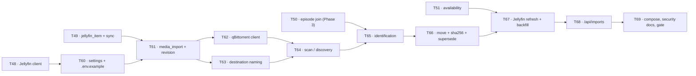

# Phase 3.5 — Media Import Pipeline — Implementation Plan

> **For agentic workers:** REQUIRED SUB-SKILL: Use superpowers:subagent-driven-development (recommended) or superpowers:executing-plans to implement this plan task-by-task. Steps use checkbox (`- [ ]`) syntax for tracking.

**Goal:** Take a media file the owner has already obtained and placed in a staging directory — or that the owner's own host-run qBittorrent has finished downloading into that directory — identify it against the `title` / `episode` rows Phase 1 already resolved, rename it to the convention Jellyfin's TMDB provider matches, move it into the media root, hash it, record where it came from in a new `media_import` provenance table, and ask Jellyfin to refresh so Phase 3's sync maps the file and `availability` flips from `NOT_IN_LIBRARY` to `IN_LIBRARY`. Ten tasks, **T60–T69**. `T59` is deliberately left free.

**The boundary, stated once and never widened:** *the pipeline organises files the owner already obtained; it does not obtain them.* There is no search provider, no release-selection heuristic, no magnet injection, no acquire endpoint, and the qBittorrent client has **no** add-torrent and **no** add-magnet method. ADR-015 records why, and T62 asserts it with a test.

**Architecture:** The nineteen `.xlsx` workbooks stay the authored data and Postgres stays a derived projection beside them (ADR-001, `CLAUDE.md` §0.2). This phase adds **no workbook column, no `ColumnRole`, and no workbook write of any kind** — the only Excel-adjacent statement it makes is that it makes none. It adds one table (`media_import`), one client (`clients/qbittorrent_client.py`), five services under `services/`, four routes under `/api/imports`, six `TV_` `Settings` fields plus one compose-only host-side name (**R68**), and one compose mount change. Everything it writes to disk is a media file under the media root; everything it reads is either the staging root or a loopback qBittorrent. It consumes Phase 3's Jellyfin client (T48) and library sync (T49/T51) and **does not duplicate them**. **This phase is backend-only (R74):** `GET /api/imports` is the progress readout, and it ships with no frontend surface; a future import-progress screen is recorded as a later task to schedule, not built here.

**Tech Stack:** Python 3.13, FastAPI, Pydantic v2 + pydantic-settings, SQLAlchemy 2.0 (asyncio) + asyncpg + Alembic, PostgreSQL 16-alpine (compose), `httpx`, `hashlib.file_digest`, `shutil` + `os.replace` on a worker thread, pytest + pytest-asyncio (`asyncio_mode = "auto"`), ruff, uv. No new third-party dependency is introduced by this phase.

**Spec:** **ADR-015** in `docs/TV_MASTER_PLAN.md` §8 — that ADR is this plan's specification and this plan implements nothing it does not authorise. Supporting: `CLAUDE.md` §0.3, §2.2, §3.4, §5.13, §6.6, §8.3, §10.3 (B16/B17), §11.2, §13.5, §14.9, §20.2; `docs/TV_MASTER_PLAN.md` §6.1–§6.5, §9.2, §10.3, §11; ADR-006, ADR-012, ADR-013, ADR-014 — **none of which this phase re-opens**.

**Build order:** Phase 0 close → Phase 1 (T04–T33, **done**) → **Phase 3 and Phase 3.5, interleaved by task dependencies** → Phase 2 (T34–T45, deferred). Phase 3.5 is a distinct scope, not a requirement to finish every Phase 3 task first. Its dependencies on the playback track are the specific artefacts below; **T53 automatic snapshots and T66 recoverable imports are implemented and reviewed; T53a/T67 need the documented next-task decisions**:

| Depends on | Why it cannot be front-loaded |
|---|---|
| **T48** — `clients/jellyfin_client.py` | T67's refresh call is a method on that client. This plan **consumes** T48 and must not write a second Jellyfin client. **`refresh_library()` ships with T48 from the start (R67)** — T67 calls it and edits nothing in T48's file. |
| **T49** — `jellyfin_item` + `services/library_sync.py` | `media_import.jellyfin_item_id` is a foreign key to `jellyfin_item.id`. Phase 3's Alembic revision must exist before this phase's, or the FK has nothing to point at. |
| **T51** — `services/availability.py` | "the file is now in the library" is `availability == IN_LIBRARY`, which is T51's computation. This phase proves its own success by that, and does not invent a second answer. |

**A fourth, now-hard dependency: T50**, specifically its extracted `services/episode_lookup.episode_for_sequence` helper (**R70**). T65 identifies an absolute episode number through `episode_order` by calling that exact function — never a second query — so T65 cannot start until T50's extraction lands.



---

## Global Constraints

Copied from `CLAUDE.md` and `docs/TV_MASTER_PLAN.md`; every task's requirements implicitly include this block. The first six are carried verbatim from `docs/phases/phase-1-plan.md` because they have not changed.

- **Python 3.13+.** `requires-python = ">=3.13"` (`app/backend/pyproject.toml:5`).
- **`from __future__ import annotations`** at the top of every module.
- **Ruff:** `line-length = 120`, `select = ["E", "F", "I", "N", "UP", "ANN", "S"]`, `per-file-ignores { "tests/*" = ["S101"] }`. CI runs **both** `uv run ruff check .` and `uv run ruff format --check .`. The `# noqa` invariant in `src/` is **five, named** (Ruling 52) and `# type: ignore` in `src/` is **zero**; a sixth needs a written reason on the same line and re-measures the invariant.
- **pytest:** `asyncio_mode = "auto"`, `testpaths = ["tests"]`. Test directories carry no `__init__.py`, so **every test file basename must be unique across the whole tree**.
- **No mocking of the workbook layer or the database.** Tests hit a **real Postgres 16** — never SQLite, never a mock (`CLAUDE.md` §16.4). The Postgres-gated tests skip *loudly* where nothing answers on `localhost:5525`, and CI sets `TV_REQUIRE_POSTGRES=1` so they fail rather than skip there.
- **Recorded or hand-authored fixtures for every outbound client — zero live network in tests.** `httpx.MockTransport` through `tests/agent/mock_responder.py` is the seam.
- **One concept per file.** One SQLAlchemy model per file under `data/models/`; one Pydantic model per file under `models/`; the single sanctioned exception is `data/enums.py` (`CLAUDE.md` §3.1).
- **Every workbook write goes through `Catalog._write` → `_mutate`.** **This phase writes no workbook at all**, and a test asserts it: `Catalog._write` is called zero times across a full import pass.
- **`TV_` env prefix** (`config.py:24`, `env_prefix="TV_"`): a field `import_staging_dir` is set by `TV_IMPORT_STAGING_DIR`, mechanically, never by a bare name and never through `os.environ`.
- **`SecretStr` for every credential**, never logged, never in a URL, never in the frontend bundle.
- **Never edit `version`** in `app/backend/pyproject.toml:3`, `app/frontend/package.json:4`, or the `version="0.1.0"` argument in `main.py`. Compute the next number and record it in `docs/versions.md`; **one unreleased heading at a time** (`CLAUDE.md` §17.4). This phase is a **minor** bump (new tables, new routes, new settings, a contract addition) and lands under whatever single unreleased heading `docs/versions.md` carries at the time.
- **The owner does git.** No `git add/commit/checkout/…`, no `gh` mutation. Each task ends with "Hand to the owner to commit — suggested message".
- **Never create or edit any `.env*` file except `.env.example`.** The root `.env` is the owner's; `scripts/hooks/pre-tool-use.cjs` blocks the rest mechanically.
- **Durations are `Integer` seconds named `*_seconds` with a `CHECK`; never `INTERVAL`. Timestamps are `DateTime(timezone=True)`.** Native enum labels are member *values* (`values_callable`). `expire_on_commit=False`; `lazy="raise_on_sql"` on every relationship. Every `CheckConstraint` carries an explicit `name=` (the `ck` naming template interpolates it; an unnamed one raises at import).
- **Nothing is ever deleted.** That rule, which already governs workbook retirement (`services/retirement.py`) and hero replacement (`services/hero_backup.py`), governs this phase's files too: a superseded media file is **moved** into `_superseded/`, never unlinked, and a `media_import` row is **superseded**, never deleted.
- **Host ports this project binds:** 5284, 8284, 5286 (live) + **5525** Postgres + **8096** Jellyfin. **This phase binds no new host port** — qBittorrent's `8080` is the owner's own already-running listener, not this project's allocation, so `PORT_ASSIGNMENTS.md` gains nothing. If the owner's qBittorrent is not on `8080`, `TV_QBITTORRENT_URL` says so; the registry is still untouched.
- **A new input boundary is written into `CLAUDE.md` §10.3 and `docs/TV_MASTER_PLAN.md` §9.2 in the same change that introduces it** (global Definition of Done item 15).

### Conventions used in this plan

- Every backend path is under `/Users/amrambouskila/IMPORTANT/Personal/TV/app/backend/` unless it starts with `/` or with a repo-root name (`README.md`, `docker-compose.yml`, `docs/`, `.env.example`).
- `BACKEND=/Users/amrambouskila/IMPORTANT/Personal/TV/app/backend` and `REPO=/Users/amrambouskila/IMPORTANT/Personal/TV` in every `Run:` line.
- Every task is TDD: **failing test first**, run it and watch it fail for the stated reason, implement, run it again, then the whole suite.
- Line numbers cite the tree as read on **2026-09-22**. Phase 3 lands between this plan and its execution, so **re-read every region before editing it** — in particular `api/errors.py`, `data/enums.py`, `config.py`, `.env.example`, `docker-compose.yml` and `clients/jellyfin_client.py`.
- Signatures marked **proposed** are the intended shape; the behaviour beside them is the requirement. A task may improve a signature and must not quietly change a behaviour.

### Decisions this plan makes, stated once

Each of these is a real choice with a cost. They are recorded here rather than rediscovered in a task.

1. **Identification matches the projection, never TMDB.** A file is matched against `title.match_key` and `episode` rows **already in Postgres**. No import ever calls TMDB. Reasons: Phase 1 has already resolved the library (830 of 996 rows, T31), an import is for a title the owner curated, a fresh search would spend quota outside the six-month-capped cache, and a search could match something that is not in the watch list at all. A file that matches no projected title is `unidentified` and waits for the owner — which is the same "never invent" rule §18.2 applies to spans.
2. **The filename carries TMDB's own aired numbering** — `episode.season_number` and `episode.episode_number` — **never `episode_order.sequence`**, because Jellyfin's TMDB provider matches the path against those two numbers. **The consequence is named, not hidden:** TMDB numbers anime absolutely inside season buckets (`CLAUDE.md` §11.2 rule 9), so One Piece's season 2 becomes `S02E62 … S02E77`, which looks wrong and is right. A file named `S02E01` for that episode would be the one that fails to match.
3. **The series/film name in the path is `title.original_name` when TMDB provides one, else `title.name`** (the owner's choice, recorded in ADR-015). The consequence: non-ASCII directory names for anime (`ワンピース`). The sanitiser therefore preserves Unicode and strips only what a filesystem cannot carry.
4. **The absolute source path for a qBittorrent file is `save_path / file.name`**, not `content_path / file.name` — the WebUI API documents `name` as "File name (including relative path)" against `save_path`, while `content_path` is the *content root* and for a single-file torrent is the file itself. `content_path` is used only to distinguish single-file from multi-file.
5. **A qBittorrent download whose `save_path` is not under `TV_IMPORT_STAGING_DIR` is reported and skipped, never imported.** Two reasons at once: under compose the backend container cannot see an arbitrary host path, and path containment (§10.3 B20) is only meaningful against a configured root. The owner sets qBittorrent's completed-download path to the staging directory; the scan result says how many were skipped for this reason so the misconfiguration is visible rather than silent.
6. **Moving a seeding torrent's file breaks the seed, and the pipeline still moves.** The owner stops or removes the torrent first. R106 retains a temporary second copy through verification and commit; free disk space must accommodate that safety requirement, but no permanent duplicate is created.
7. **R106 replaces the original delete-before-hash sequence.** A durable PostgreSQL operation claims source/destination before mutation. Copy to an exclusive sibling temp, preserve a replaced destination, atomically install without clobbering a raced external file, verify bytes and commit provenance before removing unchanged staging. Unknown ownership or uncertain commit retains bytes and active recovery state. Never use shutil.move's delete-on-copy fallback.
8. **sha256 is computed with `hashlib.file_digest` over a streamed read**, after the move, on the destination — never by reading a file into memory. A 40 GB file must never touch the heap.
9. **`_superseded/` is a directory at the media root, and Jellyfin's libraries point at `<media root>/TV` and `<media root>/Movies`, never at the media root itself.** That keeps superseded files out of every library path without asserting anything about Jellyfin's own ignore mechanics.
10. **`POST /api/imports/scan` discovers and identifies synchronously and returns counts; the move, hash and refresh run as a background task after the response**, reusing the pattern `POST /api/watch-events` already established for the mirror (Ruling 44) with its own session created after the commit. Progress is read through `GET /api/imports`. A directory walk plus a few queries answers in milliseconds; hashing 40 GB does not, and a request must not hold a connection for it.
11. **A `media_import` row is never deleted.** A re-import writes a **new** row and stamps the old one `superseded_at` + `superseded_by_id`. The uniqueness that makes `duplicate_skipped` mechanical is a **partial** unique index on `file_sha256` where the row is live and past the move.
12. **`title_id` on `media_import` is nullable.** T65 requires a title when identifying a file, but
    the database must allow later metadata deletion to null the pointer in every status. R100's
    `identified_records_how` check requires `identified_by`, not `title_id`, after identification.
    Title/episode FKs use `ON DELETE SET NULL`; provenance must outlive a metadata rebuild.

---

## Task T60: `Settings` fields, `.env.example`, and the import constants

**Status:** DONE 2026-09-23 — implemented and reviewed (APPROVED). Six fields on `Settings`
(`qbittorrent_url`, `qbittorrent_user`, `qbittorrent_password`, `import_staging_dir`, `media_root`,
`import_concurrency`), the `qbittorrent_url` validator per R80, fourteen constants in one `--- T60 ---`
block, seven `.env.example` lines (16 → 23 names). One deviation from this task's own draft snippet
below, by the controller's explicit override — see the note under it. 64 tests on the named suites;
1781 offline regression. See `docs/versions.md`'s `### T60` subsection for the full record.

**Depends on:** T48 (`Settings.jellyfin_base_url` / `.jellyfin_api_key` land there; this task must not add them a second time).

**Files:**
- Edit: `src/tv_watchlist/config.py` — six new fields (**R68**).
- Edit: `src/tv_watchlist/constants.py` — the import constants.
- Edit: `/Users/amrambouskila/IMPORTANT/Personal/TV/.env.example` — six new lines, appended at the end in the order `EXPECTED_NAMES` asserts, with placeholders and one comment each.
- Edit: `tests/test_env_example.py` — `EXPECTED_NAMES`, `SECRET_NAMES`, `EXPECTED_DEFAULTS`, `DECLARED_EXTRAS`/`DECLARED_EXCLUSIONS` kept truthful, **and a new placeholder-presence assertion for the two machine-dependent paths (R68)**.
- Test: `tests/test_import_settings.py` (new basename, unique across the tree).

**Interfaces** (**proposed**; the behaviours are ADR-015 and `CLAUDE.md` §8.3):

**No committed default names a personal directory (R68).** `import_staging_dir` follows the same degrade rule as a provider credential: `None` means the staging-folder arm of the scan is disabled until the owner configures it, never a boot failure. A **new** field, `media_root`, is the backend's own view of the media directory `docker compose` already mounts for Jellyfin — the two names stay separate because one is a compose-only mount source and the other is a `Settings` field the import services read, mirroring the existing `TV_LIBRARY_HOST` (compose) / `TV_LIBRARY_DIR` (`Settings`) split.

**Implemented as `None`, not the literal default below (controller's explicit override, applied
2026-09-23):** `qbittorrent_url: str | None = None`, mirroring `jellyfin_base_url`'s shape exactly —
`http://localhost:8080` is the `.env.example` placeholder, never a `Settings` default. This draft
snippet is kept as written for history; do not implement it literally.

```python
# config.py, on Settings — beside the Phase 3 jellyfin_* fields T48 added
    qbittorrent_url: str = "http://localhost:8080"
    qbittorrent_user: str | None = None
    qbittorrent_password: SecretStr | None = None
    # None disables the staging-folder scan arm, exactly as an absent provider credential disables a
    # client - never a boot failure. The owner's real path is typed into the root .env; no default here
    # may name a personal directory (R68).
    import_staging_dir: Path | None = None
    # The backend's own media directory. Compose sets it to /media (the same host directory
    # TV_JELLYFIN_MEDIA_HOST mounts into jellyfin, read-write for this service - T69); the launcher path
    # reads the owner's real value from the root .env. TV_JELLYFIN_MEDIA_HOST itself stays compose-only
    # and gets no Settings field, exactly as it does today.
    media_root: Path | None = None
    import_concurrency: int = Field(default=2, ge=1, le=8)
```

```python
# constants.py
MEDIA_IMPORT_EXTENSIONS: Final[frozenset[str]] = frozenset({".mkv", ".mp4", ".m4v", ".avi", ".mov", ".ts", ".webm"})
MEDIA_IMPORT_MIN_BYTES: Final[int] = 50_000_000        # below this it is a sample, a trailer or an .nfo's neighbour
MEDIA_IMPORT_MIN_CONFIDENCE: Final[float] = 0.80        # under it the row is `unidentified`, never a guess
MEDIA_IMPORT_TEMP_PREFIX: Final[str] = ".~tv-import-"
MEDIA_IMPORT_SUPERSEDED_DIRNAME: Final[str] = "_superseded"
MEDIA_IMPORT_TV_DIRNAME: Final[str] = "TV"
MEDIA_IMPORT_MOVIES_DIRNAME: Final[str] = "Movies"
MAX_IMPORTS_PAGE_SIZE: Final[int] = 200
QBITTORRENT_TIMEOUT_SECONDS: Final[float] = 10.0
MAX_QBITTORRENT_RESPONSE_BYTES: Final[int] = 8_000_000
QBITTORRENT_LOGIN_PATH: Final[str] = "/api/v2/auth/login"
QBITTORRENT_TORRENTS_INFO_PATH: Final[str] = "/api/v2/torrents/info"
QBITTORRENT_TORRENTS_FILES_PATH: Final[str] = "/api/v2/torrents/files"
QBITTORRENT_WEBAPI_VERSION_PATH: Final[str] = "/api/v2/app/webapiVersion"
```

**Steps:**

- [ ] Write `tests/test_import_settings.py` first: `Settings()` exposes the six fields with those defaults (`import_staging_dir` and `media_root` both `None`); `qbittorrent_password` is a `SecretStr` whose `repr()` and `str()` do **not** contain the value; `import_concurrency` rejects `0` and `9`; the field names derive mechanically from `TV_QBITTORRENT_URL`, `TV_QBITTORRENT_USER`, `TV_QBITTORRENT_PASSWORD`, `TV_IMPORT_STAGING_DIR`, `TV_MEDIA_ROOT`, `TV_IMPORT_CONCURRENCY` through `settings_env_names()`. Run: `cd $BACKEND && uv run pytest tests/test_import_settings.py -q` — fails on `AttributeError`.
- [ ] Add the six fields to `Settings`, grouped under a comment naming Phase 3.5 and ADR-015, re-reading `config.py` first since T48 lands between this plan's writing and its execution. `qbittorrent_user`/`_password`, `import_staging_dir` and `media_root` all default to `None` for the same reason every provider credential does: **an absent value is a disabled arm, never a boot failure.**
- [ ] Add the constants. No literal from this list may appear anywhere else in the phase (`CLAUDE.md` §3.1, the data-driven rule).
- [ ] Add six `.env.example` lines — `TV_QBITTORRENT_URL`, `TV_QBITTORRENT_USER`, `TV_QBITTORRENT_PASSWORD`, `TV_IMPORT_STAGING_DIR`, `TV_MEDIA_ROOT`, `TV_IMPORT_CONCURRENCY` — **appended at the end, in the exact order `EXPECTED_NAMES` asserts (R68)**, each with its own comment line above it (the two parsers disagree about inline comments — `tests/env_example_support.py` depends on that). `TV_IMPORT_STAGING_DIR` and `TV_MEDIA_ROOT` both get a placeholder value, never a real or personal one — the committed file never names the owner's actual directories, the same rule that already keeps `TV_JELLYFIN_MEDIA_HOST`'s committed default at `./media`. **The compose-only `TV_IMPORT_STAGING_HOST` is declared too**, alongside `TV_JELLYFIN_MEDIA_HOST`, as the host-side name T69's compose mount substitutes from (mirroring `TV_LIBRARY_HOST` / `TV_LIBRARY_DIR`); it joins `DECLARED_EXTRAS` in the next step, since no `Settings` field reads it.
- [ ] Update `tests/test_env_example.py`: `TV_QBITTORRENT_URL`, `TV_QBITTORRENT_USER`, `TV_QBITTORRENT_PASSWORD`, `TV_IMPORT_STAGING_DIR`, `TV_MEDIA_ROOT`, `TV_IMPORT_CONCURRENCY` join `EXPECTED_NAMES`, in that order; `TV_QBITTORRENT_PASSWORD` joins `SECRET_NAMES`; `TV_QBITTORRENT_URL=http://localhost:8080` and `TV_IMPORT_CONCURRENCY=2` join `EXPECTED_DEFAULTS`. **`TV_IMPORT_STAGING_DIR` and `TV_MEDIA_ROOT` get no `EXPECTED_DEFAULTS` entry** — both default to `None`, and pinning a path in a committed test is exactly the drift that file exists to prevent. **Add a new test, parametrised over both names, asserting each `.env.example` placeholder line is present and non-empty (R68)** — the gap the first draft of this task left open. `TV_IMPORT_STAGING_HOST` joins `DECLARED_EXTRAS` with a comment naming it compose-only, mirroring `TV_JELLYFIN_MEDIA_HOST`'s existing entry; none of the six real fields belongs in `DECLARED_EXTRAS` or in `DECLARED_EXCLUSIONS` (every one is owner-overridable).
- [ ] Run the whole suite: `cd $BACKEND && uv run pytest -q`. `tests/test_env_example.py` must be green — it fails loudly on any drift between `Settings` and the file, which is its whole job.

**Acceptance:**
- [ ] Six `TV_` `Settings` names plus the compose-only `TV_IMPORT_STAGING_HOST`, six `.env.example` lines for the `Settings` names (seven including the compose-only one), and `tests/test_env_example.py` green — no name exists in one place and not the others.
- [ ] `TV_QBITTORRENT_PASSWORD` is a `SecretStr` and appears in no `repr`, log line or error message.
- [ ] No committed default names a personal directory; `import_staging_dir` and `media_root` both default to `None`.
- [ ] The backend boots with all six unset.
- [ ] `docker compose config --quiet` still passes (nothing in compose changed yet; T69 owns that).

**Docs, then hand to the owner.** `docs/versions.md` → a `### T60` subsection under the single unreleased heading; `CLAUDE.md` §8.2/§8.3 gain the six rows plus the compose-only `TV_IMPORT_STAGING_HOST` row. Suggested message: `feat(config): TV_QBITTORRENT_* and TV_IMPORT_* settings, media_root, and .env.example lines (T60)`.

---

## Task T61: the `media_import` table, its three enums, and the Alembic revision

**Status:** DONE AND REVIEWED — 2026-09-23. Claude's interrupted final review was completed:
100 focused tests passed, zero skips, including the real-Postgres migration round trip and Alembic
parity. The sole final hygiene finding (two unused migration-test helpers) is removed. The accepted
schema has nine named checks and ten violation cases (R100a), `BigInteger` sizes (R101), and
`identified_records_how` rather than a title-presence check (R100). Deleting a title must preserve
provenance in every status; T65 enforces title presence at identification time. The TypeScript read
model waits for its T68 consumer (R93).

**Depends on:** T60; **T49** (the FK target `jellyfin_item.id` must already exist in a migration).

**The revision number, read and never guessed (R62).** This task landed as
`0003_media_import.py`, with `down_revision = "0002"`, after T49's library-index revision.
At T61 the head was `0003`; T66 now extends it to the single head `0004`.
T55's `streaming_offer` revision is still future work. The ordering
is forced by `media_import.jellyfin_item_id` referencing `jellyfin_item.id`. Never renumber an
existing revision or assume a future task's number without reading `alembic heads`.

**Files:**
- Create: `src/tv_watchlist/data/models/media_import.py` (one class, one file).
- Edit: `src/tv_watchlist/data/models/__init__.py` (import it, so `Base.metadata` is complete for autogenerate).
- Edit: `src/tv_watchlist/data/enums.py` — three new `StrEnum`s. This is the one sanctioned multi-concept module (`CLAUDE.md` §3.1) and the exception is not widened by using it.
- Create: `alembic/versions/0003_media_import.py` (number read from the chain at implementation).
- Create: `src/tv_watchlist/models/media_import_read.py` (`MediaImportRead`, frozen, `from_attributes=True`).
- Test: `tests/data/test_media_import_model.py`, `tests/data/test_migration_0003.py`,
  `tests/data/test_migration_round_trip.py`, `tests/models/test_media_import_read.py`, and
  `tests/data/test_models_metadata.py` (**R60** — the expected table/model sets include this model).

**Interfaces** (**proposed**):

```python
# data/enums.py
class MediaImportSource(StrEnum):
    STAGING_FOLDER = "staging_folder"
    QBITTORRENT_COMPLETED = "qbittorrent_completed"
    MANUAL = "manual"


class MediaImportIdentifiedBy(StrEnum):
    FILENAME = "filename"
    OWNER_PICK = "owner_pick"


class MediaImportStatus(StrEnum):
    FOUND = "found"
    IDENTIFIED = "identified"
    MOVED = "moved"
    HASHED = "hashed"
    REFRESHED = "refreshed"
    FAILED = "failed"
    DUPLICATE_SKIPPED = "duplicate_skipped"
    UNIDENTIFIED = "unidentified"
```

```python
# data/models/media_import.py
class MediaImport(UuidPk, TimestampMixin, Base):
    """One file's journey from where the owner put it to where Jellyfin found it. Never deleted; superseded."""

    __tablename__ = "media_import"

    title_id: uuid | None          # FK title.id, ON DELETE SET NULL — null until identified
    episode_id: uuid | None        # FK episode.id, ON DELETE SET NULL — null for a film
    jellyfin_item_id: uuid | None  # FK jellyfin_item.id, ON DELETE SET NULL — set once the sync maps it
    source: MediaImportSource      # pg_enum
    source_path: str               # Text — where the file was found, verbatim
    original_name: str             # String(500) — the source basename, before any renaming
    size_bytes: int                # BigInteger, CHECK > 0; media can exceed 2 GiB (R101)
    file_path: str | None          # Text — RELATIVE to the media root, POSIX separators; null before the move
    file_sha256: str | None        # String(64) — null before the hash
    identified_by: MediaImportIdentifiedBy | None   # pg_enum, null while `found`/`unidentified`
    identification_confidence: float | None         # Float, CHECK 0..1
    status: MediaImportStatus      # pg_enum
    error: str | None              # Text — why the row stopped: a failure's reason, or why identification
                                    # did not match, for an `unidentified` row (R76)
    found_at: datetime             # timestamptz, server_default now()
    imported_at: datetime | None   # timestamptz — when the move landed
    superseded_at: datetime | None # timestamptz
    superseded_by_id: uuid | None  # FK media_import.id, ON DELETE RESTRICT — the row that replaced this one
```

Named constraints, every one explicit because the `ck` naming template interpolates `constraint_name`:

| Name | Predicate | Why |
|---|---|---|
| `size_positive` | `size_bytes > 0` | A zero-byte candidate is not a media file. |
| `sha256_shape` | `file_sha256 IS NULL OR char_length(file_sha256) = 64` | A digest is 64 hex characters or it is not one. |
| `confidence_range` | `identification_confidence IS NULL OR (identification_confidence >= 0 AND identification_confidence <= 1)` | Same scale as `curated_entry.resolution_confidence`. |
| `identified_records_how` | `status IN ('found','unidentified','failed') OR identified_by IS NOT NULL` | R100: keep identification provenance without defeating the title FK's `ON DELETE SET NULL`; title presence is a T65 write-path requirement. |
| `moved_has_path` | `status NOT IN ('moved','hashed','refreshed') OR file_path IS NOT NULL` | A moved row that cannot say where the file went is not a provenance record. |
| `hashed_has_digest` | `status NOT IN ('hashed','refreshed') OR file_sha256 IS NOT NULL` | Same, for the hash. |
| `stopped_has_error` | `status NOT IN ('failed','unidentified') OR error IS NOT NULL` | A row that stopped — failed, or could not be identified — with no reason is an unanswerable support question (**R76**: covers both `failed` and `unidentified`, not `failed` alone). |
| `superseded_pair` | `(superseded_at IS NULL) = (superseded_by_id IS NULL)` | Superseded means *by something*. |
| `not_self_superseded` | `superseded_by_id IS NULL OR superseded_by_id <> id` | A row cannot replace itself. |

Indexes:

| Index | Shape | Why |
|---|---|---|
| `ix_media_import_live_sha256` | **partial unique** on `file_sha256`, `WHERE file_sha256 IS NOT NULL AND superseded_at IS NULL AND status IN ('moved','hashed','refreshed')` | This is what makes `duplicate_skipped` a database fact rather than a service convention. A superseded row keeps its digest without blocking the row that replaced it. |
| `ix_media_import_status_found_at` | `(status, found_at)` | The paged `GET /api/imports` list. |
| `ix_media_import_source_path` | `source_path` | The scan's "have I already seen this path" question. |
| plus btree on `title_id`, `episode_id`, `jellyfin_item_id` | | `mapped_column(..., index=True)`. |

**Steps:**

- [ ] Write `tests/data/test_media_import_model.py` first (Postgres-gated, loud skip): the table exists with those columns; every `CheckConstraint` is named and rejects its own violation — nine named constraints, **`stopped_has_error` gets two parametrised cases (a `failed` row and an `unidentified` row, each with `error IS NULL`, R76), the rest one case each: ten parametrised cases in all**; the partial unique index refuses a second live `moved` row with the same `file_sha256` and **accepts** it once the first is superseded; `title_id`, `episode_id` and `jellyfin_item_id` all survive their parent's deletion as `NULL`; `superseded_by_id` refuses the row's own id. Run it — fails on `UndefinedTable`.
- [ ] Add the three enums to `data/enums.py` with `pg_enum(...)` usage in the model. **The first migration created every type explicitly** (`create_type=False` on the helper), so the new revision must `CREATE TYPE` each of the three itself, before the table.
- [ ] Write the model. `status` has no `server_default` — a row is always created by the scan with an explicit status.
- [ ] Extend `tests/data/test_models_metadata.py`'s `EXPECTED_TABLES` and `ALL_MODELS` (**R60**) — these exact-equality assertions go red the moment `MediaImport` joins `Base.metadata` otherwise.
- [ ] Write the revision by hand from an autogenerate draft (`uv run alembic revision --autogenerate -m "media import provenance"`), then **fix what autogenerate always gets wrong here**: the three `CREATE TYPE` statements, the partial unique index's `postgresql_where`, and a hand-ordered `downgrade` that drops the table, then the three types, in that order.
- [x] Keep the chain-wide round trip and `alembic check` in `test_migration_round_trip.py`;
  `test_migration_0003.py` verifies this revision's SQL ordering and PostgreSQL FK actions without
  duplicating the chain test.
- [ ] Write `models/media_import_read.py`: `MediaImportRead`, `ConfigDict(from_attributes=True, frozen=True)`, exposing every column above plus a derived `title_name: str | None`. **Nothing crosses the boundary unless it was eagerly loaded** (`CLAUDE.md` §5.15) — the service `selectinload`s `title` before converting, or `MissingGreenlet` arrives at serialisation time with a stack trace that names nothing useful.
- [ ] Run: `cd $BACKEND && TV_REQUIRE_POSTGRES=1 uv run pytest tests/data -q`, then the whole suite.

**Acceptance:**
- [x] `media_import` exists with all nine named checks (`stopped_has_error` covering both `failed` and `unidentified` — R76) and the partial unique index; the round trip and `alembic check` are green against a real Postgres 16.
- [x] Deleting a `title`, an `episode` or a `jellyfin_item` **nulls** the pointer and destroys no provenance row.
- [x] The revision's `down_revision` is Phase 3's head, read from `alembic heads` (never assumed — R62), and no existing revision was renumbered.
- [x] `MediaImportRead` is frozen and converts without a lazy load.
- [x] `tests/data/test_models_metadata.py` is green with `media_import` and `MediaImport` in its two sets (**R60**).

**Docs, then hand to the owner.** `docs/versions.md` → `### T61`; `CLAUDE.md` §5.13 describes
`media_import`. At this T61 checkpoint there were **thirteen domain tables** (eleven Phase 1 +
`jellyfin_item` + `media_import`), or fourteen including `alembic_version`. T66 now adds the
fourteenth domain table, `media_import_operation`; `streaming_offer` does not exist yet.
Suggested message: `feat(data): media_import provenance table, three enums and its Alembic revision (T61)`.

---

## Task T62: `clients/qbittorrent_client.py` — login, completed torrents, torrent files. **No add-torrent, no add-magnet.**

**Status:** DONE AND REVIEWED — 2026-09-23. Review fixes R85/R86/R90/R91 are accepted:
recognised hashes are lowercase 40- or 64-hex; acquisition is excluded by a public-surface and parsed
route-path test; configured-upstream clients share `clients/configured_upstream.py`; blank
credentials disable the client before any HTTP request. The singleton and lifespan close are built.

**Depends on:** T60, T12 (`clients/` scaffolding), **T48** (`clients/http_guard.assert_within_configured_base` and `.configured_url` — both ship there, per R65/R66).

**The hard constraint, first.** This client has exactly four methods: `webapi_version`, `login` (internal), `completed_torrents`, `torrent_files`. It has **no** `add_torrent`, **no** `add_magnet`, **no** `/api/v2/torrents/add` anywhere in the module, and **no** search API. A test asserts the class's public surface by name so a later session cannot quietly add one; ADR-015 is the reason and the test's docstring cites it.

**The API, verified against the official WebUI API documentation** — `https://github.com/qbittorrent/qBittorrent/wiki/WebUI-API-(qBittorrent-4.1)`, read **2026-09-22**. Nothing below is inferred:

| What | Verbatim from the page |
|---|---|
| Base path | All endpoints are `/api/v2/<APIName>/<methodName>`. |
| Login | `POST /api/v2/auth/login`, parameters `username` and `password`. On success the body is `Ok.` and **the response carries a cookie with the `SID`**; the documentation states: *"Upon success, the response will contain a cookie with your SID. You must supply the cookie whenever you want to perform an operation that requires authentication."* |
| Header requirement | *"Set `Referer` or `Origin` header to the exact same domain and port as used in the HTTP query `Host` header."* qBittorrent enforces this as CSRF protection; a request without it is refused. |
| Unauthenticated / banned | **HTTP 403**, with the documented scenario *"User's IP is banned for too many failed login attempts"*. A 403 on a data call therefore means "log in again"; a 403 on the login call itself means "banned — back off, do not retry in a loop". |
| Torrent list | `GET /api/v2/torrents/info`, parameters include `filter`, `category`, `tag`, `sort`, `reverse`, `limit`, `offset`, `hashes`. Accepted `filter` values: `all`, `downloading`, `seeding`, **`completed`**, `paused`, `active`, `inactive`, `resumed`, `stalled`, `stalled_uploading`, `stalled_downloading`, `errored`. |
| Torrent fields used | `hash` (string, "Torrent hash"), `name` (string, "Torrent name"), `content_path` (string, "Absolute path of torrent content (root path for multifile torrents, absolute file path for singlefile torrents)", **exposed since WebAPI v2.6.1**), `save_path` (string, "Path where this torrent's data is stored"), `state` (string), `progress` (float, "Torrent progress (percentage/100)"), `completion_on` (integer, "Time (Unix Epoch) when the torrent completed"), `size` (integer, bytes), `amount_left` (integer, bytes), `category` (string), `tags` (string, comma-concatenated). |
| Torrent contents | `GET /api/v2/torrents/files`, required parameter `hash`. File fields: `index` (integer, "File index", **since 2.8.2**), `name` (string, **"File name (including relative path)"**), `size` (integer, bytes), `progress` (float), `priority` (integer), `is_seed` (bool), `piece_range` (integer array), `availability` (float). |
| Versions | `GET /api/v2/app/webapiVersion` returns the Web API version as a string (e.g. `"2.0"`); `GET /api/v2/app/version` returns the application version (e.g. `"v4.1.3"`). |

**Two version floors follow directly from that page and are enforced, not assumed:** `content_path` requires WebAPI **≥ 2.6.1** and the file `index` field requires **≥ 2.8.2**. The client reads `GET /api/v2/app/webapiVersion` once per session and refuses with `QbittorrentUnsupportedVersionError` below `2.8.2`, naming the version it found. Guessing that an older server carries these fields is exactly the "do not guess field names" failure this task is written to avoid.

**Files:**
- Create: `src/tv_watchlist/clients/qbittorrent_client.py`.
- Create: `src/tv_watchlist/models/qbittorrent/__init__.py` (empty), `qbittorrent_torrent.py` (`QbittorrentTorrent`), `qbittorrent_file.py` (`QbittorrentFile`) — one frozen `extra="ignore"` model per file, under `models/` like every other contract.
- Edit: `src/tv_watchlist/clients/errors.py` — three new `ProviderError` subclasses.
- Edit: `src/tv_watchlist/clients/transport.py` (**R63** — a new `read_text(response, *, limit=MAX_PROVIDER_RESPONSE_BYTES)` beside `read_json`, same byte cap, `response.text` in place of `json.loads`), `tests/clients/test_transport.py` (its tests).
- Edit: `src/tv_watchlist/api/dependencies.py` (**R63** — `get_qbittorrent_client`, an `lru_cache(maxsize=1)` singleton over `build_qbittorrent_client(settings, transport=None)`, the same shape as `get_ingest_runtime`).
- Edit: `src/tv_watchlist/main.py` (**R63** — the lifespan close, guarded by `get_qbittorrent_client.cache_info().currsize` exactly as `get_ingest_runtime` is).
- Create: `tests/fixtures/qbittorrent/torrents_info_completed.json`, `torrents_files_multi.json`, `torrents_files_single.json`, `webapi_version.txt`.
- Test: `tests/clients/test_qbittorrent_client.py`, `tests/models/test_qbittorrent_models.py`, `tests/api/test_qbittorrent_dependency.py` (**R63** — the singleton and the lifespan close).

**Fixtures are hand-authored, and that is a decision with a reason.** Every other provider fixture in this repo was **recorded live** (Ruling 51). These cannot be: there is no qBittorrent account, no running instance the agent may reach, and the owner's own instance holds the owner's own download history, which is not test data and must not land in a public repository. The fixtures are therefore **hand-authored from the response tables quoted above, field for field, with invented torrent names and invented 40-hex hashes**, and each file carries a header comment naming the wiki page and the date it was read. `tests/models/test_qbittorrent_models.py` asserts that every field the client reads is present in the fixture, so a hand-authored body that drifts from the documented shape fails rather than passes. **If the owner ever wants recorded fixtures, Ruling 51's recorder is the path** and the hand-authored ones are replaced wholesale.

**Interfaces** (**proposed**):

```python
class QbittorrentClient:
    """Read-only. Lists what the owner has already finished downloading. It cannot add anything (ADR-015)."""

    def __init__(
        self,
        base_url: str,
        username: str | None,
        password: SecretStr | None,
        *,
        http: httpx.AsyncClient,
        clock: Callable[[], datetime] = utcnow,
    ) -> None: ...

    @property
    def configured(self) -> bool: ...
    async def webapi_version(self) -> str: ...
    async def completed_torrents(self) -> list[QbittorrentTorrent]: ...
    async def torrent_files(self, torrent_hash: str) -> list[QbittorrentFile]: ...


def build_qbittorrent_client(settings: Settings, *, transport: httpx.AsyncBaseTransport | None = None) -> QbittorrentClient: ...
```

```python
# api/dependencies.py  (R63 — same shape as get_ingest_runtime)
@lru_cache(maxsize=1)
def get_qbittorrent_client() -> QbittorrentClient:
    """Process-wide qBittorrent client, so its cookie jar (the SID) is shared across requests."""
    return build_qbittorrent_client(get_settings())
```

T64 (`scan`) and T68 (the scan route) both consume this singleton rather than constructing their own client.

```python
# clients/errors.py
class QbittorrentNotConfiguredError(ProviderError): ...
class QbittorrentAuthError(ProviderError): ...            # 403 — re-login once, then give up; a ban is not retried
class QbittorrentUnsupportedVersionError(ProviderError): ...
```

**Behaviour, point by point:**

- **`configured`** is `False` when the URL or either credential is absent or blank, including an
  empty `SecretStr` (R91). Every method then raises `QbittorrentNotConfiguredError` before HTTP.
- **The base URL is the configured host and that is the allowlist**, exactly as the Jellyfin client's is (`CLAUDE.md` §10.3 B16). `agent/url_guard.assert_public_http_url` is **not** used — it rejects loopback by design — and `clients/http_guard.assert_within_base` is **not** used either, because it requires `https` (`http_guard.py:_HTTPS`) and qBittorrent is a plain-`http` loopback service. **T48 already ships the shared helpers (R65, R66):** `clients/http_guard.assert_within_configured_base(url, base_url)` and `clients/http_guard.configured_url(base_url, *segments, **query)`. This client **consumes both, unchanged** — there is nothing private to extract or repoint, because T48 built them as shared from the start.
- **Every path is a constant** from `constants.py`; only query values vary. `torrent_hash` must be
  lowercase 40- or 64-hex before it reaches a URL (R85: v1 and v2). Unrecognised hashes may be
  listed, but T64 skips them explicitly rather than constructing a request with one.
- **`Referer` and `Origin` are set to the configured origin on every request**, because the server requires it. They are derived from `base_url`, never from an inbound request header.
- **The password is a `SecretStr`, sent form-encoded in the login body only.** It never enters a URL, a log record or an error message. `log_call` (T12) records method, host, path, status, elapsed and bytes — never a header, never a body, never a cookie.
- **The `SID` cookie is held in the `httpx.AsyncClient`'s own cookie jar**, in memory, for the process lifetime. It is never written to disk and never logged.
- **Re-auth on 403, exactly once per call.** A data call answering 403 triggers one `login()` and one retry. A second 403 raises `QbittorrentAuthError` and the pass gives up — the documented 403 scenario is an IP ban for repeated failed logins, and a retry loop is how a client earns one.
- **`follow_redirects=False`**, an explicit `QBITTORRENT_TIMEOUT_SECONDS` timeout, and every JSON response read through `read_json` under `MAX_QBITTORRENT_RESPONSE_BYTES` — refused past the cap, never truncated. `webapi_version`'s and `login`'s plain-text bodies (`2.8.2`, `Ok.`) are **not** JSON, so both go through a new sibling, `read_text(response, *, limit=MAX_QBITTORRENT_RESPONSE_BYTES)`, added to `clients/transport.py` in this task (**R63**) — same byte cap, same refuse-not-truncate behaviour, `response.text` in place of `json.loads`.
- **`completed_torrents`** calls `GET /api/v2/torrents/info?filter=completed` and, belt and braces, keeps only rows whose `progress >= 1.0` and `amount_left == 0` — the `filter` is the server's word for it and the two numbers are the file's.
- **Every response body is `model_validate`d** into a frozen `extra="ignore"` model before anything reads it.

**Steps:**

- [ ] Write `tests/clients/test_qbittorrent_client.py` first. Run it — every test fails on `ModuleNotFoundError`.
  - `test_the_public_surface_is_read_only` — `{name for name in dir(QbittorrentClient) if not name.startswith("_")}` equals exactly `{"configured", "webapi_version", "completed_torrents", "torrent_files"}`; and `"torrents/add"`, `"add_torrent"`, `"add_magnet"` and `"magnet:"` appear nowhere in the module source. Docstring cites ADR-015.
  - `test_a_missing_credential_means_not_configured_and_no_request_is_made`.
  - `test_login_posts_form_encoded_credentials_and_keeps_the_sid_cookie` — the recorded request body is `username=…&password=…`, the response's `Set-Cookie: SID=…` is carried on the next request's `Cookie` header, and the password appears in no recorded URL.
  - `test_every_request_carries_referer_and_origin_matching_the_base` — both headers equal the configured origin.
  - `test_a_403_on_a_data_call_re_authenticates_once_and_retries` — responder answers 403 then 200; exactly two logins total and one retry.
  - `test_a_second_403_raises_auth_error_without_a_third_attempt` — the ban case; the request count is asserted.
  - `test_a_webapi_version_below_2_8_2_is_refused_by_name` — parametrise `"2.0"`, `"2.6.0"`, `"2.8.1"` → `QbittorrentUnsupportedVersionError` naming the version; `"2.8.2"` and `"2.11.4"` pass.
  - `test_completed_torrents_asks_for_filter_completed` — the recorded query is exactly `filter=completed`.
  - `test_a_partial_torrent_is_dropped_even_if_the_server_lists_it` — a fixture row with `progress: 0.5` / `amount_left: 1` is not returned.
  - `test_torrent_files_refuses_a_hash_that_is_not_forty_hex` — parametrise `""`, `"../../etc/passwd"`, `"ZZZZ"`, a 39-character hash; none reaches the transport.
  - `test_an_oversized_body_is_refused_not_truncated`.
  - `test_the_credential_never_appears_in_a_log_record` — `caplog` over a full login-and-list cycle.
  - `tests/models/test_qbittorrent_models.py::test_every_documented_field_is_present_and_an_unknown_one_is_ignored` — parametrised over both models; each is frozen.
- [ ] Write `tests/clients/test_transport.py`'s new cases for `read_text` first (**R63**): `test_read_text_returns_the_body_under_the_cap`, `test_read_text_refuses_past_the_cap_rather_than_truncating` — the same shape as the existing `read_json` tests. Then `tests/api/test_qbittorrent_dependency.py`: `test_get_qbittorrent_client_is_a_singleton`, `test_the_lifespan_closes_it_only_if_built` (the `get_ingest_runtime` tests are the shape to copy).
- [ ] Hand-author the four fixtures from the tables above, each with the wiki-page header comment. The multi-file fixture's `name` values carry a relative path (`Some.Show.S01/Some.Show.S01E01.mkv`) so decision 4 is exercised; the single-file fixture's `content_path` is the file itself.
- [ ] Write `read_text` in `clients/transport.py`, then the two models, then the client (calling `read_text` for `webapi_version` and `login`), then the three error classes, then `api/dependencies.get_qbittorrent_client` and the `main.py` lifespan close. **None of the three error classes is registered in `api/errors.py`** — like every other `ProviderError`, a qBittorrent failure happens inside a service and lands in `media_import.error` or the scan result, never in an HTTP status (`clients/errors.py`'s module docstring states the rule).
- [ ] Run: `cd $BACKEND && uv run pytest tests/clients/test_qbittorrent_client.py tests/clients/test_transport.py tests/models/test_qbittorrent_models.py tests/api/test_qbittorrent_dependency.py -q`, then the whole suite; `uv run ruff check . && uv run ruff format --check .`.

**Acceptance:**
- [x] The client logs in, carries `SID`, lists completed torrents and their files, and refuses an old Web API version by name.
- [x] **No add-torrent, add-magnet or search path exists**, proven by the public-surface and parsed route-path test (R86).
- [x] Zero live network in the test suite.
- [x] The password appears in no log, URL or error message.
- [x] `read_text` exists beside `read_json` in `clients/transport.py`, with the same byte cap, and both `webapi_version` and `login` use it for their plain-text bodies (**R63**).
- [x] `api/dependencies.get_qbittorrent_client` and the `main.py` lifespan close exist, in the same shape as `get_ingest_runtime` (**R63**).

**Docs, then hand to the owner.** `docs/versions.md` → `### T62`; `CLAUDE.md` §10.3 gains **B21** (T69 consolidates the section, but the row is written now so the boundary is never undocumented); `docs/TV_MASTER_PLAN.md` §9.2 gains the matching row. Suggested message: `feat(clients): read-only qBittorrent client — login, completed torrents, torrent files (T62)`.

---

## Task T63: `services/media_filename.py` and `services/import_naming.py` — the destination path, and containment

**Status:** DONE 2026-09-23 — implemented, reviewed (two rounds: an escape-probe review, then a scoped
re-review) and approved. `safe_component`/`optional_component` and `DestinationPlan`/`assert_within`/
`plan_destination` built as specified below, reusing `ILLEGAL_FILENAME_CHARACTERS` and
`RESERVED_FILENAME_STEMS` rather than `workbook/stem.validate_stem`. The fix round added **Ruling 84**:
every component is capped in `MAX_MEDIA_COMPONENT_BYTES` (255) UTF-8 bytes as well as characters —
ext4, overlayfs, APFS and NTFS all enforce that per-component limit, and a CJK title's character cap
alone could exceed it — trimmed on whole code-point boundaries, with the `RESERVED_FILENAME_STEMS`
guard running **after both caps** rather than before (the fix round's one real bug: appending the
guard's suffix before truncating let the cap cut it back off, or manufacture a device name out of a
longer title). `assert_within` also converts the `ValueError` `Path.resolve()` raises on an embedded
null byte into `ImportPathError`. Two new `ProjectionError` subclasses land in `data/errors.py`
(`ImportNamingError`, `ImportPathError`); their `api/errors.py` status/message rows are **T68**'s.
163 tests (130 before the fix round), **100% coverage on both new modules**. `CLAUDE.md` §10.3 and
`docs/TV_MASTER_PLAN.md` §9.2 gain boundary **B22**, scoped for now to path composition and
containment — T66's `services/import_move.py` extends the same letter with the actual file move.
See `docs/versions.md`'s `### T63` subsection for the full record.

**Depends on:** T60.

**Why two modules.** `media_filename.py` sanitises one path *component*; `import_naming.py` composes the whole destination *path* from a `title` and an optional `episode`. One concept per file, and the sanitiser is the piece the containment tests hammer hardest.

**The reuse check, done before writing anything.** `workbook/stem.py:validate_stem` already answers "is this string a legal filename stem", and `constants.py:87-88` already holds `ILLEGAL_FILENAME_CHARACTERS` and `RESERVED_FILENAME_STEMS`. **The constants are reused; the function is not**, and the reason is a behaviour difference, not a preference: `validate_stem` **refuses** an illegal character, which is right for a workbook the owner named and wrong for a media path, where a legitimate title (`Star Wars: Episode II — Attack of the Clones`) legally contains `:`. `media_filename.py` therefore **replaces** rather than refuses, importing both constants so the two definitions can never drift.

**The convention, from ADR-015:**

```
Episode:  TV/<Series Name>/Season <nn>/<Series Name> S<nn>E<nn> - <episode title>.<ext>
Movie:    Movies/<Title> (<year>)/<Title> (<year>).<ext>
```

- `<Series Name>` / `<Title>` = `title.original_name` when TMDB provides one, else `title.name` (decision 3).
- `<year>` = `title.first_air_date.year`. **Verified 2026-09-22:** T19's ingest writes a film's TMDB `release_date` into `first_air_date` (`ingest/tmdb_ingest.py:204`), so this is the release year for a film and the first-air year for a series. A title with no `first_air_date` cannot be named and its row goes `failed` with that reason — the app does not invent a year.
- `<nn>` = `episode.season_number` and `episode.episode_number`, **TMDB's own aired numbering** (decision 2), zero-padded to two digits; three or more digits pass through unpadded (`S01E1085`).
- Season 0 follows the same template with no special case: `Season 00`.
- `<episode title>` = `episode.name`, sanitised; absent → the segment and its ` - ` separator are both dropped, never left as a dangling dash.
- `<ext>` = the source extension, lowercased, and **only** if it is in `MEDIA_IMPORT_EXTENSIONS`.

**Interfaces** (**proposed**):

```python
# services/media_filename.py
def safe_component(value: str, *, limit: int = MAX_FILENAME_STEM_LENGTH) -> str:
    """One path component a filesystem can carry: Unicode kept, separators and control characters gone."""
```

```python
# services/import_naming.py
@dataclass(frozen=True, slots=True)
class DestinationPlan:
    relative_path: PurePosixPath   # what media_import.file_path stores
    absolute_path: Path            # relative_path resolved under the media root


def plan_destination(media_root: Path, title: Title, episode: Episode | None, source_suffix: str) -> DestinationPlan: ...
def assert_within(path: Path, root: Path) -> Path:
    """`path.resolve()`, refused with `ImportPathError` unless it is inside `root.resolve()`."""
```

`safe_component` in order: NFC-normalise; replace every character of `ILLEGAL_FILENAME_CHARACTERS` and every codepoint below `0x20` with a space; collapse runs of whitespace to one; strip leading and trailing whitespace and dots (Windows silently drops trailing dots, which turns `Title.` into a different path than the one recorded); if the result lowercases into `RESERVED_FILENAME_STEMS`, append `_`; truncate to `limit` on a character boundary; if the result is empty, raise `ImportNamingError`. **It never returns a string containing `/`, `\`, `..`, a null byte or a newline**, and a property test asserts that over a generated corpus.

**Steps:**

- [ ] Write `tests/services/test_media_filename.py` and `tests/services/test_import_naming.py` first. Run them — fail on `ModuleNotFoundError`.
  - `test_a_separator_never_survives` — parametrise `"a/b"`, `"a\\b"`, `"../etc"`, `"..\\..\\x"`, `"a\x00b"`, `"a\nb"`, `"CON"`, `"nul"`, `"trailing."`, `"trailing "`, `" "`, `"."`, `".."`; assert no `/`, `\`, `\x00` or `\n` in the result and that `".."` alone raises.
  - `test_unicode_survives` — `"ワンピース"` and `"Pokémon"` come back intact (decision 3 depends on it).
  - `test_a_colon_is_replaced_not_refused` — `"Star Wars: Episode II"` → a legal component, no exception.
  - `test_the_episode_template` — reference value: One Piece (`original_name` `"ワンピース"`), season 2 episode 62 → `TV/ワンピース/Season 02/ワンピース S02E62 - <name>.mkv`. **This is the §11.2 rule 9 case and the test's docstring says so**: TMDB numbers anime absolutely inside season buckets, so 62 is correct and `E01` would be the bug.
  - `test_a_three_digit_episode_is_not_padded_to_two` — `S01E1085`.
  - `test_season_zero_is_season_00`.
  - `test_a_missing_episode_name_drops_the_separator_too` — no trailing ` - `.
  - `test_the_movie_template` — `Movies/The Matrix (1999)/The Matrix (1999).mkv`.
  - `test_a_title_with_no_first_air_date_raises_rather_than_guessing`.
  - `test_an_extension_outside_the_allowlist_raises` — parametrise `".exe"`, `".torrent"`, `".nfo"`, `".lnk"`, `""`.
  - `test_assert_within_refuses_an_escape` — parametrise a `..` path, an absolute path outside the root, a symlink inside the root pointing outside it (created in `tmp_path`), and the root itself; each raises `ImportPathError`. **The symlink case is the one that matters**: `resolve()` follows links, which is precisely why containment is checked on the resolved path and not the joined one.
- [ ] Implement both modules. `plan_destination` composes through `safe_component` for **every** segment, then calls `assert_within` on the joined absolute path before returning — so a caller cannot forget.
- [ ] Add `ImportNamingError` and `ImportPathError` to `data/errors.py` as `ProjectionError` subclasses (T68 registers them in `api/errors.py`'s two tables).
- [ ] Run both test files, then the whole suite.

**Acceptance:**
- [ ] Both templates produce the exact strings above, including the anime case.
- [ ] No sanitised component can contain a separator, a traversal, a control character or a reserved stem.
- [ ] `assert_within` refuses `..`, an absolute escape and a symlink escape.
- [ ] `ILLEGAL_FILENAME_CHARACTERS` and `RESERVED_FILENAME_STEMS` are imported from `constants.py`, not redeclared.

**Docs, then hand to the owner.** `docs/versions.md` → `### T63`. Suggested message: `feat(services): destination naming and path containment for media imports (T63)`.

---

## Task T64: `services/import_scan.py` — discovery from the staging directory and from qBittorrent

**Status:** DONE AND REVIEWED — 2026-09-23. **60 focused tests, zero skips**, independently rerun;
the four new production modules have **100% line coverage (171 statements)**. Filesystem discovery,
candidate and result each have their own module/test subject. Tests include 1,001-path batching,
worker-thread execution, symlink escapes/loops, metadata failures, partial qBittorrent failure, and
two real PostgreSQL sessions blocked until the first caller commits or rolls back. No route, move,
hash, identification or workbook write is part of this task.

**Depends on:** T61, T62, T63.

**Files:**
- Create: `src/tv_watchlist/services/import_scan.py`, `src/tv_watchlist/models/import_scan_result.py` (`ImportScanResult`, frozen).
- Test: `tests/services/test_import_scan.py`.

**Interfaces** (**proposed**):

```python
async def scan(
    session: AsyncSession,
    settings: Settings,
    *,
    qbittorrent: QbittorrentClient | None,
) -> ImportScanResult:
    """One discovery pass. Creates `found` rows; moves nothing, hashes nothing, calls no provider."""
```

```python
class ImportScanResult(BaseModel):
    """Everything `scan()` itself determines. Identification counts are NOT here (R75) - they are
    T65's `IdentifyPassResult`, which `POST /api/imports/scan` (T68) merges into its response after
    calling this function; a field with no producer in this function is a stub (Ruling 12)."""

    model_config = ConfigDict(frozen=True)

    staging_dir: str
    candidates_seen: int
    found: int                 # new `found` rows written
    already_known: int         # a live row already carries this source_path
    too_small: int
    wrong_extension: int
    qbittorrent_reachable: bool
    qbittorrent_outside_staging: int   # completed downloads skipped because save_path is not under the staging root
    path_refused: int          # paths refused by resolved containment, including symlink escapes
    unreadable: int            # filesystem observations that failed, not silently lost candidates
```

**Behaviour:**

- **The staging arm** walks the configured directory on a worker thread without following directory
  symlinks. Files pass `assert_within` before `stat`, extension and minimum-byte checks. Canonical
  resolved paths deduplicate aliases and both discovery arms. `None` disables discovery entirely:
  without a containment root, qBittorrent must not be consulted either. `path_refused` counts rejected
  paths, and `unreadable` counts filesystem failures; neither outcome is silently discarded.
- **The qBittorrent arm** runs only with a staging root and a configured client. It reuses
  `QbittorrentFile.absolute_path(save_path)` for `save_path / file.name`; the root itself is a valid
  save directory, while relative, outside and escaping save paths are counted/skipped. R85's
  unrecognised hashes are skipped with `skipped=unrecognised_hash`; 40-/64-hex are accepted.
  The arm is collected before filesystem discovery: any `ProviderError`, including one after a
  successful earlier torrent, discards its paths and leaves staging discovery working. When both
  arms report one file, the more specific `qbittorrent_completed` provenance wins. Sizes come from
  the contained local file, not the peer's claim.
- **Idempotence.** A `source_path` that already carries a live row (`superseded_at IS NULL`) in any status but `failed` is counted in `already_known` and not re-added. Re-running the scan over an unchanged staging directory writes nothing.
- **De-duplication within one pass.** The same absolute path can arrive from both arms; it produces one row.
- **One transaction at a time.** The scanner takes a PostgreSQL transaction-scoped advisory lock,
  using a named constant/bound parameter as T49 does. The caller owns commit/rollback; the lock
  remains held through that boundary, so another session sees the committed rows before checking
  idempotence. This supersedes the draft process-global `asyncio.Lock`, which would release before
  caller commit and allow duplicate inserts, and would not serialise separate backend workers.
- **Structured logging**, key=value, never interpolated prose (`CLAUDE.md` §9.2): one record at pass start and one at pass end carrying every count above. **A pass that found nothing logs that it found nothing** — silence is indistinguishable from not having run.

**Steps:**

- [ ] Write `tests/services/test_import_scan.py` first (Postgres-gated), against a `tmp_path` staging root and a `MockResponder`-backed qBittorrent. Run — fails on `ModuleNotFoundError`.
  - `test_a_media_file_in_staging_becomes_a_found_row`.
  - `test_a_nested_torrent_folder_is_walked`.
  - `test_a_small_file_and_a_wrong_extension_are_counted_and_skipped` — a 1 KiB `.mkv` and a 2 GiB `.exe`.
  - `test_a_symlink_out_of_staging_is_refused_and_counted` — **the containment case**, on a real symlink in `tmp_path`.
  - `test_a_second_scan_over_an_unchanged_directory_writes_nothing` — `already_known` equals the first pass's `found`, and the row count is unchanged.
  - `test_a_qbittorrent_path_is_save_path_plus_relative_name` — the multi-file fixture; asserts the exact absolute path (decision 4).
  - `test_a_completed_torrent_outside_the_staging_root_is_skipped_and_counted`.
  - `test_an_unreachable_qbittorrent_leaves_the_staging_arm_working` — `qbittorrent_reachable is False`, staging rows still written.
  - `test_an_unconfigured_qbittorrent_makes_no_request`.
  - `test_the_same_path_from_both_arms_produces_one_row`.
  - `test_a_pass_that_found_nothing_says_so_in_the_log` — `caplog` carries the end record with zeroes.
- [ ] Implement. The `stat()` and directory walk run on a worker thread via `asyncio.to_thread` — a large staging tree must not block the event loop.
- [ ] Run the file, then the whole suite.

**Acceptance:**
- [x] A staging file becomes exactly one `found` row; a second pass adds none.
- [x] A symlink escape is refused; a small file and a non-media extension are skipped and counted.
- [x] qBittorrent paths are built `save_path / name`; an out-of-staging save path is skipped and counted.
- [x] An unreachable or unconfigured qBittorrent never fails the pass.
- [x] Nothing is moved, hashed, deleted or written to a workbook by this task.
- [x] `ImportScanResult` carries no identification count — `identified`/`unidentified` are T65's, never this model's (**R75**).

**Docs, then hand to the owner.** `docs/versions.md` → `### T64`; `CLAUDE.md` §10.3 gains **B20**. Suggested message: `feat(services): import discovery over the staging directory and qBittorrent completions (T64)`.

---

## Task T65: `services/import_filename.py` + `services/import_identify.py` — match a found file to a title and an episode

**Status:** DONE 2026-09-23 — implemented and independently reviewed. **97 focused tests, zero
skips; 149/149 new production statements covered**, with real PostgreSQL and clean Ruff lint/format.
`FilenameParse` and `IdentifyPassResult` are frozen Pydantic models in their own files under
`models/`; parsing and identification remain separate services. The five planned confidence levels
are named constants. Numeric titles survive parsing; mixed/range episode names, ambiguous years
and empty normalized tokens are refused. Exact key precedes pg_trgm; media type/year constrain both,
raw-score ties are refused, and confidence is `min(parse confidence, title similarity)`.

`identify` locks and refreshes the persisted row; `identify_pending` uses `FOR UPDATE SKIP LOCKED`
over live, undecided FOUND rows. Caller commit/rollback and concurrent owner-pick preservation are
tested. Absolute sequence resolution reuses `episode_for_sequence`; tests include a seeded 1085
projection and the recorded One Piece season-2 episode-62 destination proof. No provider client or
workbook operation is invoked. Franchise expansion is not invented without category context.

**Depends on:** T64; **T50** (consumes `services/episode_lookup.episode_for_sequence`, **R70** — no longer optional).

**The reuse check.** `resolver/match_key.py` (normalisation, franchise-prefix expansion) is **reused verbatim** for the series/film token — it is the same question the resolver already answers. `resolver/span.py` is **not** reused, and the reason is a vocabulary difference: `span.py` parses the workbook's hand-written `Unit` column (`E19–53`, `Seasons 1-25`), while a release filename is a different language (`[Group] Series - 1085 (1080p) [HASH].mkv`, `Series.S01E02.1080p.WEB-DL.mkv`). A second small parser is warranted; a stretched first one is not. **For the absolute-number-to-episode resolution specifically, `services/episode_lookup.episode_for_sequence` (T50, R70) is reused verbatim too — this task must not write a second `episode_order` lookup query.**

**Files:**
- Create: `src/tv_watchlist/services/import_filename.py` (`parse_filename`), `src/tv_watchlist/services/import_identify.py` (`identify`, `identify_pending` — **R75**), `src/tv_watchlist/models/filename_parse.py`, `src/tv_watchlist/models/identify_pass_result.py`.
- Test: `tests/services/test_import_filename.py`, `tests/services/test_import_identify.py`.

**Interfaces** (implemented as separate frozen Pydantic models):

```python
class FilenameParse(BaseModel):
    model_config = ConfigDict(frozen=True)

    series_token: str = ""
    year: int | None = None
    season_number: int | None = Field(default=None, ge=0)
    episode_number: int | None = Field(default=None, ge=0)
    absolute_number: int | None = Field(default=None, gt=0)
    confidence: float = Field(default=0, ge=0, le=1)


def parse_filename(name: str) -> FilenameParse: ...


async def identify(session: AsyncSession, media_import: MediaImport) -> MediaImport:
    """Set `title_id` / `episode_id` / `identified_by` / `identification_confidence`, or mark `unidentified`."""


class IdentifyPassResult(BaseModel):
    model_config = ConfigDict(frozen=True)

    identified: int = Field(default=0, ge=0)
    unidentified: int = Field(default=0, ge=0)


async def identify_pending(session: AsyncSession) -> IdentifyPassResult:
    """Run `identify` over every live `found` row and report the counts. R75: identification counts are
    this module's, never `ImportScanResult`'s. `POST /api/imports/scan` (T68) calls this immediately
    after `import_scan.scan(...)` and merges the two results into its response."""
```

**Behaviour:**

- Shapes recognised, each with its own confidence: `Series.S01E02…` (0.95); `Series - 1085` / `Series - 1085v2` (absolute, 0.90); `Series 1x02` (0.90); `Title (1999)` (film, 0.95); `Title.1999.1080p…` (film, 0.85). Release-group brackets, quality tokens, codec tokens and trailing CRC hashes are stripped before the series token is taken.
- **The match is against the projection only** (decision 1): `match_key(series_token, year=…)` against `title.match_key` — the exact btree path first, the `pg_trgm` GIN index on `title.name` as the fuzzy fallback, which is what that index exists for.
- **An absolute number resolves through `episode_order`** — `order_type = 'absolute'`, `label = ''`, `sequence = <n>` → `episode_id` — via `services/episode_lookup.episode_for_sequence` (T50, **R70**), never a second query, and never by arithmetic (`CLAUDE.md` §11.2 rule 9). A title with no absolute ordering and an absolute-numbered file is **`unidentified`**, not a guess against `aired`.
- **A season/episode pair resolves through `episode` on `(title_id, season_number, episode_number)`.**
- **Below `MEDIA_IMPORT_MIN_CONFIDENCE` (0.80), or on a tie between two titles, the row is `unidentified`** with the reason in `error`. Ruling 35's principle applies unchanged: a coin flip is never persisted.
- A successful automatic match sets `identified_by = filename` and status `identified`. `POST /api/imports/{id}/identify` (T68) sets `identified_by = owner_pick` and `identification_confidence = 1.0`.
- A film title (`media_type = movie`) never takes an `episode_id`; a series file with no episode resolution stays `unidentified` rather than pointing at a series with no episode.

**Steps:**

- [x] Write both test files first. Run — fail on `ModuleNotFoundError`.
  - `tests/services/test_import_filename.py`, parametrised over hand-written real-world shapes, each asserting the full `FilenameParse`; plus `test_a_name_that_parses_to_nothing_has_zero_confidence` and `test_a_release_group_bracket_never_becomes_the_series_token`.
  - `tests/services/test_import_identify.py` (Postgres-gated, against seeded `title` / `episode` / `episode_order` rows): an exact `match_key` hit; a fuzzy hit above threshold; a **tie → `unidentified`, nothing chosen**; a below-threshold parse → `unidentified`; an absolute number resolving through `episode_order` to the right `episode_id`; **an absolute number against a title with no absolute ordering → `unidentified`, never `aired`**; a film matching with no `episode_id`; a series file with no episode resolution → `unidentified`; `identified_by = filename` on success.
  - **One reference-value test, mandatory:** One Piece episode 1085 by absolute number resolves (through `episode_for_sequence`) to the episode `episode_order` ranks at `sequence = 1085`, and the destination T63 then plans for it carries **that episode's TMDB `season_number` and `episode_number`**, not `S00E1085`. This is the single test that proves decisions 1, 2 and the §11.2 rule 9 chain hold end to end.
  - `test_identify_pending_reports_the_counts_over_a_mixed_batch` (**R75**) — a batch of `found` rows, some identifying and some not; asserts `IdentifyPassResult.identified` / `.unidentified` match, and that no `found` row is left unprocessed.
- [x] Implement `import_filename.py` (pure, no I/O — it is the easiest thing in the phase to test exhaustively), then `import_identify.py`, including `identify_pending`.
- [x] Run both, then the whole suite; measurements are in `docs/playback-import-validation.md`.

**Acceptance:**
- [x] Every parametrised filename shape parses to the stated `FilenameParse`.
- [x] An identification is either confident or `unidentified` — never a low-confidence guess, never a tie broken silently.
- [x] An absolute number goes through `episode_order` via `services/episode_lookup.episode_for_sequence` (T50); this task writes no second lookup query (**R70**). No arithmetic converts an absolute number to a season/episode pair anywhere in the phase.
- [x] No TMDB call is made by this task, proven by a test that fails if the TMDB client is constructed.
- [x] `IdentifyPassResult` (identified/unidentified counts) is produced only by `services/import_identify.py`, never stored on `ImportScanResult` (**R75**).

**Docs, then hand to the owner.** `docs/versions.md` → `### T65`. Suggested message: `feat(services): release-filename parsing and projection-only identification for imports (T65)`.

---

## Task T66: Recoverable copy, verify, commit and source cleanup

**Status:** IMPLEMENTED AND REVIEWED, 2026-09-24 (owner-approved R106).
**Depends on:** T63, T65.
The exact media_import_operation schema, active uniqueness and session-factory service signatures
are recorded in master plan §6 R106 and CLAUDE.md §5.18 before implementation.
Migration 0004 follows 0003; existing media_import schema/statuses remain unchanged.

**Required ordering:**

1. Validate configured roots, source identity and naming plan; stream source/previous destination
   digests off-thread. Claim import/source/destination and commit PREPARED intent before mutation.
2. Copy to an exclusive sibling temp while retaining staging; record owned temp identity/COPIED.
3. Preserve a different destination under _superseded/<timestamp-plus-operation-UUID>/relative-path,
   then install the temp with native atomic exclusive rename and record INSTALLED. Refuse unsupported
   filesystems rather than falling back to an overwriting rename or requiring hard links.
4. Hash the installed destination and compare the source digest. Commit HASHED provenance,
   superseded-row stamps and operation COMMITTED in one transaction.
5. Only after confirmed successful commit remove the unchanged staging source; record COMPLETED.
   A cleanup error keeps a recoverable committed operation, not a false pre-commit failure.
6. Recover unfinished operations before new batch work. Verify actual files, identities, digests
   and committed rows; never trust a phase alone. Changed roots or unknown ownership retains all
   bytes and active claims with an explicit error.
7. Pre-commit failure or duplicate digest conflict records ROLLING_BACK before compensation.
   Remove only proven owned copied bytes, restore the archived original and keep staging.
   Then record FAILED or DUPLICATE_SKIPPED. An identical existing destination remains untouched.
   An uncertain database commit retains source/artifacts until committed state can be inspected.

move_one(session_factory, settings, import_id) returns a fresh detached MediaImport;
move_pending returns completed moves; recover_pending returns reconciled operations.
Each bounded worker owns its phase sessions/commits and holds a pinned-connection operation lock
across them. An OS source-file lock also fences cooperating workers after database connection loss;
identity is verified after locking and the descriptor stays held through cleanup. COMMITTED recovery
verifies actual provenance and installed bytes, including when staging was already removed. Recheck
root/parent confinement before destructive transitions. These guards do not make arbitrary concurrent
external edits safe; process-crash tests do not certify power-loss durability on every filesystem.
No concurrent use of one AsyncSession. Cancellation drains filesystem workers before
releasing ownership; bounded TaskGroup orchestration waits for every worker even on repeated
parent cancellation. Every filesystem call is off-thread; hashing is streamed, never whole-file.
T67 reloads the result by id in its own session. T66 accepts staging sources only; reimport of an
already-moved file needs T68's explicit source-authority decision.

**Tests and acceptance:**

- [x] Matching tests for each module, using tmp_path bytes and real PID-isolated PostgreSQL.
- [x] Migration upgrade/downgrade/upgrade and metadata parity; named checks and active unique claims.
- [x] Copy/install between distinct roots without source rename, streamed reference sha256 and
      bounded memory/concurrency. A physical second-volume run remains unverified.
- [x] Identical destination leaves both originals; replacement archives collision-safely and stamps
      provenance only after verification.
- [x] Copy/install/hash/DB commit/cleanup failures and cancellation: retain source until confirmed
      successful commit, compensate only owned artifacts, preserve explicit recovery state.
- [x] Recovery at each filesystem/transaction boundary, including uncertain commit and cleanup
      already completed; idempotent retries, changed roots/source/destination and unowned temp refusal.
- [x] Racing duplicate digest restores prior destination and old provenance; source survives.
- [x] No database session sharing, no workbook writes, no live media paths or acquisition surface.

Focused gate **154 passed / zero skips**, **607/607 new statements**; full backend **3891 passed /
zero skips / 98.93%**. Native macOS, actual PostgreSQL connection loss and cached-episode metadata
changes are tested; Windows/Linux adapters are tested, not claimed executed on those platforms.
No live owner-media import or physical cross-volume/power-loss certification.
Full evidence: [snapshot/recovery audit](../snapshots-recovery-validation.md).
Document under pending v0.2.0. Suggested owner-only commit:
`feat(imports): journal and recover verified media imports before source cleanup (T66)`.

---

## Task T67: `services/import_refresh.py` — ask Jellyfin to look, then backfill `jellyfin_item_id`

**Status:** NOT STARTED.

**Depends on:** T66; **T48** (the Jellyfin client), **T49** (`library_sync`), **T51** (`availability`).

**Readiness finding, 2026-09-24:** linking must prove the exact imported destination, not just an
older file for the same title/episode. Refresh is asynchronous, incremental sync can retain old
rows, and backend/Jellyfin paths use different namespaces; document an approved path mapping
before code. Canonical import numbering is already Episode.season_number/episode_number;
episode matching must join through its parent SERIES provider id. T51 availability remains
independent: linking one exact file does not prove every slot of a curated span is playable.
The broad matching and availability assertions below must be reconciled before implementation.

**This task consumes Phase 3 and duplicates none of it.** It writes no Jellyfin client, no sync loop and no availability computation. **`refresh_library()` is T48's method from the start (R67)** — T48's `clients/jellyfin_client.py` ships it in the same task that ships the rest of the client, with its exact path (`POST /Library/Refresh`) confirmed against Jellyfin 12.1's own OpenAPI document. **This task adds nothing to that module**; it only calls the method. Every other Jellyfin fact this phase needs is already T48's and T49's.

**Files:**
- Create: `src/tv_watchlist/services/import_refresh.py`.
- Test: `tests/services/test_import_refresh.py`.

**Interfaces** (**proposed**):

```python
async def refresh_and_link(session: AsyncSession, settings: Settings, jellyfin: JellyfinClient | None) -> int:
    """Refresh Jellyfin, re-run the scoped sync, and link every `hashed` row it can. Returns rows linked."""
```

**Behaviour:**

1. `jellyfin is None` or not configured, or the base URL unreachable → **return 0, change nothing, log it.** Every `hashed` row stays `hashed` and the next pass retries. An absent Jellyfin is a disabled feature, never a failure (§6.6, and the Phase 3 gate's "the backend boots and serves while `jellyfin` is stopped").
2. `jellyfin.refresh_library()` (T48's method, consumed here — **R67**), then T49's `library_sync` refresh on `minDateLastSaved` — **T49's function, called, not reimplemented.**
3. For each live `hashed` row: find the `jellyfin_item` whose `tmdb_id` matches the row's title and — for an episode — whose `parent_index_number` / `index_number` match the episode's season and episode numbers. On a hit: `jellyfin_item_id` set, status `refreshed`. On a miss: the row stays `hashed` with a note; the next pass retries.
4. **The success criterion is T51's, not this task's:** an integration test asserts that after `refresh_and_link`, `CuratedEntryRead.availability` for the entry that title belongs to reads `IN_LIBRARY`. That is what "the file is in the library" means in this codebase, and inventing a second answer here would be a second source of truth.
5. Structured log per pass: rows linked, rows still `hashed`, whether Jellyfin was reachable.

**Steps:**

- [ ] Write `tests/services/test_import_refresh.py` first, against a `MockResponder`-backed Jellyfin (no network). Run — fails.
  - `test_an_absent_jellyfin_links_nothing_and_fails_nothing` — rows stay `hashed`, return 0, no exception.
  - `test_an_unreachable_jellyfin_is_the_same_as_an_absent_one`.
  - `test_a_matching_item_links_the_row_and_marks_it_refreshed`.
  - `test_an_episode_links_on_parent_index_and_index_number`.
  - `test_a_miss_leaves_the_row_hashed_for_the_next_pass`.
  - `test_refresh_library_is_called_before_the_sync` — the recorded call order, against T48's method.
  - `test_the_entry_reports_in_library_after_a_successful_link` — **through T51's `availability`**, end to end.
  - `test_no_second_jellyfin_client_exists` — a source grep asserts `httpx` is not used to reach Jellyfin from anywhere under `services/import_*`, and that `clients/jellyfin_client.py` was not edited by this task.
- [ ] Implement. **This task's `clients/jellyfin_client.py` diff is zero** — if it is not, that is a defect in T48, not a reason to fix it here.
- [ ] Run, then the whole suite.

**Acceptance:**
- [ ] An absent or unreachable Jellyfin changes nothing and fails nothing.
- [ ] A hashed file becomes `refreshed` with `jellyfin_item_id` set once Jellyfin sees it.
- [ ] `availability` reads `IN_LIBRARY` afterwards, computed by T51.
- [ ] No second Jellyfin client, sync or availability computation exists, and `clients/jellyfin_client.py` is unchanged by this task.

**Docs, then hand to the owner.** `docs/versions.md` → `### T67`. Suggested message: `feat(services): Jellyfin refresh and jellyfin_item backfill for completed imports (T67)`.

---

## Task T68: `api/imports.py` — four routes, their models, and both `api/errors.py` tables

**Status:** NOT STARTED.

**Depends on:** T64, T65, T66, T67.

**Files:**
- Create: `src/tv_watchlist/api/imports.py`.
- Create: `src/tv_watchlist/models/import_identify.py` (`ImportIdentify`, `extra="forbid"`).
- Edit: `src/tv_watchlist/data/errors.py` — `ImportNotFoundError`, `ImportStateError`, `ImportTargetError` (`ImportNamingError` / `ImportPathError` arrived at T63).
- Edit: `src/tv_watchlist/api/errors.py` — **both** `_STATUS_BY_ERROR` and `_MESSAGE_BY_ERROR`. A class in neither silently becomes a bare 400 carrying `str(error)` as its whole message (`CLAUDE.md` §4.3), which is exactly how `InvalidNameError` ended up as the codebase's one worked example of the mistake.
- Edit: `src/tv_watchlist/main.py` — include the router.
- Test: `tests/api/test_imports_api.py`.

**The routes** (`CLAUDE.md` §13.5 style):

| Method | Path | Body | Query | Response | Success |
|---|---|---|---|---|---|
| GET | `/api/imports` | — | `status` (optional `MediaImportStatus`), `limit` ≤ `MAX_IMPORTS_PAGE_SIZE` (200), `offset` ≥ 0 | `list[MediaImportRead]` | 200 |
| POST | `/api/imports/scan` | — | — | A T68 response composing `ImportScanResult` and T65 identification counts (R75), not a mutation of either service result | 200 |
| POST | `/api/imports/{import_id}/identify` | `ImportIdentify` | — | `MediaImportRead` | 200 |
| POST | `/api/imports/{import_id}/reimport` | — | — | `MediaImportRead` | 200 |

```python
class ImportIdentify(BaseModel):
    model_config = ConfigDict(extra="forbid")

    title_id: uuid.UUID
    episode_id: uuid.UUID | None = None
```

**Error classes, both tables:**

| Exception | Status | Message template |
|---|---|---|
| `ImportNotFoundError` | 404 | `No import matches '{detail}'.` |
| `ImportStateError` | 409 | `{detail}` |
| `ImportTargetError` | 409 | `{detail}` |
| `ImportNamingError` | 409 | `That title cannot be named for the library yet ({detail}).` |
| `ImportPathError` | 409 | `{detail}` |

All five subclass `ProjectionError`, which is **already a registered handled base** (`api/errors.py:_HANDLED_BASES`), so no new handler and no new base class is needed — the minimal-debt route.

**Behaviour:**

- **`POST /api/imports/scan`** runs T64's discovery and T65's identification **synchronously** (a walk plus queries; milliseconds) and returns the counts. The response combines `import_scan.scan(...)`'s `ImportScanResult` with `import_identify.identify_pending(session)`'s `IdentifyPassResult` — **`identified` and `unidentified` in the JSON body come from the latter, never from `ImportScanResult` itself (R75)**. **The move, hash and refresh run as a FastAPI background task after the response**, with its own session created from `session_factory` after the commit — the pattern `POST /api/watch-events` already established for the mirror (Ruling 44), and for the same reason: a background task outlives the request, so it must not borrow the request's session. Progress is read through `GET /api/imports`.
- **`POST /api/imports/{id}/identify`** is the owner's pick, the T56 picker pattern applied to imports. It accepts only a row whose status is `unidentified` or `failed` (anything else → `ImportStateError`, 409). It verifies the `title_id` exists, and that an `episode_id` — when given — belongs to that title (otherwise `ImportTargetError`, 409), **before** writing anything. On success: `identified_by = owner_pick`, `identification_confidence = 1.0`, status `identified`, and the move is scheduled as a background task exactly as the scan schedules it.
- **`POST /api/imports/{id}/reimport`** re-runs move + hash + refresh for one row. It **deletes nothing on disk**: an existing destination is moved into `_superseded/` by T66's own path, a **new** `media_import` row is written, and the old one is stamped `superseded_at` / `superseded_by_id`. The response is the **new** row. A row that never reached `identified` → `ImportStateError`.
- **`GET /api/imports`** pages with the cap as both default and ceiling, matching `GET /api/categories/{id}/entries` (`api/entries.py:31`), and orders newest-first by `found_at`.
- **Every route is loopback-only like every other route in this app.** There is no auth, by design (`CLAUDE.md` §10.3 B1).
- **The scan route obtains its qBittorrent client via `api/dependencies.get_qbittorrent_client` (T62, R63)** — it never constructs one of its own.

**Steps:**

- [ ] Write `tests/api/test_imports_api.py` first, through `httpx.ASGITransport` against the real app. Run — fails on 404.
  - `test_the_list_pages_and_filters_by_status`; `test_a_limit_over_the_cap_is_refused_at_the_boundary` (422); `test_an_unknown_status_value_is_refused` (422).
  - `test_scan_returns_counts_and_schedules_the_move` — the background task is observed, not guessed.
  - `test_identify_accepts_only_an_unidentified_or_failed_row` — parametrise the six other statuses → 409 with `ImportStateError` in the envelope.
  - `test_identify_refuses_an_episode_that_belongs_to_another_title` — 409 `ImportTargetError`, **and nothing was written**.
  - `test_identify_refuses_an_unknown_title` — 404.
  - `test_reimport_writes_a_new_row_and_supersedes_the_old_one` — the old row still exists, stamped; the file that was at the destination is under `_superseded/`; the response carries the new row's id.
  - `test_reimport_on_a_never_identified_row_is_a_conflict` — 409.
  - `test_an_unknown_import_id_is_a_404_with_the_standard_envelope` — `{error, message, detail}` with `error == "ImportNotFoundError"`.
  - `test_every_new_error_class_is_in_both_tables` — a parametrised test over the five classes asserting membership in `_STATUS_BY_ERROR` **and** `_MESSAGE_BY_ERROR`. This test exists because `InvalidNameError` is the repository's standing proof that forgetting one table is silent.
- [ ] Implement the router, the request model and the five error classes; register the router in `main.py`.
- [ ] Run the file, then the whole suite; `uv run ruff check . && uv run ruff format --check .`.

**Acceptance:**
- [ ] Four routes, the documented statuses, the standard `{error, message, detail}` envelope on every refusal.
- [ ] All five error classes in both tables, proven by a test.
- [ ] `reimport` deletes nothing and supersedes correctly.
- [ ] The HTTP surface count in `CLAUDE.md` §13 and `docs/status.md` moves from its Phase 3 figure by **four**.

**Docs, then hand to the owner.** `docs/versions.md` → `### T68`; `CLAUDE.md` §13.5 gains the four rows and §4.3's status table gains the five classes. Suggested message: `feat(api): /api/imports — list, scan, identify, reimport (T68)`.

---

## Task T69: the compose mount change, the security inventory, the docs, and the Phase 3.5 gate audit

**Status:** NOT STARTED.

**Depends on:** T60–T68.

### The compose change, and why it is shaped this way

The backend's import job must **write** into the media root. Jellyfin must not, and today's mount is `"${TV_JELLYFIN_MEDIA_HOST:-./media}:/media:ro"` on the `jellyfin` service only — the backend has no media mount at all.

Two options were on the table. **The chosen one: the backend gains its own read-write mount of the same host directory, and Jellyfin keeps `:ro`.** The reason is least privilege and it is not close: Jellyfin never needs to write a media file — it reads, it indexes, and its own state lives in `tv_jellyfin_config` and `tv_jellyfin_cache` — so widening its mount to `rw` would grant write access to the owner's entire library to the one service in the stack that has no use for it. The backend genuinely does need to write, and it is the service this project controls, whose every write goes through T63's containment and T66's temp-and-swap. Relaxing Jellyfin's mount instead would have been one character shorter and strictly worse.

```yaml
  backend:
    environment:
      # ... existing ...
      TV_QBITTORRENT_URL: "${TV_QBITTORRENT_URL:-http://host.docker.internal:8080}"
      TV_QBITTORRENT_USER: "${TV_QBITTORRENT_USER:-}"
      TV_QBITTORRENT_PASSWORD: "${TV_QBITTORRENT_PASSWORD:-}"
      # Container-side Settings values, matching TV_LIBRARY_DIR's own pattern: the *_HOST names in
      # `volumes:` below are what the host-side substitution reads; these two are what Settings reads
      # inside the container, and they never vary (R73).
      TV_MEDIA_ROOT: /media
      TV_IMPORT_STAGING_DIR: /staging
      TV_IMPORT_CONCURRENCY: "${TV_IMPORT_CONCURRENCY:-2}"
    volumes:
      - "${TV_LIBRARY_HOST:-.}:/library"
      # Read-WRITE, and only here: the backend's import job moves files in here once identified.
      # Jellyfin keeps :ro below - it only reads and indexes, and the comment above ITS mount is
      # corrected in this same commit, because it currently says the opposite (R73).
      - "${TV_JELLYFIN_MEDIA_HOST:-./media}:/media"
      # Where the owner drops downloads, and where qBittorrent completes them. Read-write: the source
      # file is removed once the destination is in place. TV_IMPORT_STAGING_HOST is the host-side name
      # (DECLARED_EXTRAS, T60) substituted here, exactly as TV_JELLYFIN_MEDIA_HOST substitutes above -
      # TV_IMPORT_STAGING_DIR itself is never used for this substitution; it is the container-side
      # Settings value set in `environment:` above (R73).
      - "${TV_IMPORT_STAGING_HOST:-./staging}:/staging"
    extra_hosts:
      # qBittorrent is host-run and never a compose service (ADR-015). On Docker Desktop this name
      # resolves to the host; on Linux the mapping makes it resolve there too.
      - "host.docker.internal:host-gateway"
```

And, in the same commit, the `jellyfin` service's own mount comment is corrected (it currently claims the opposite of what this task makes true):

```yaml
  jellyfin:
    volumes:
      # ...
      # Read-only for Jellyfin: it reads and indexes but never writes a media file itself. The backend's
      # import job is the one writer, on its own read-write mount above (R73 - this comment used to say
      # "this app never writes a video file", which T69 makes false).
      - "${TV_JELLYFIN_MEDIA_HOST:-./media}:/media:ro"
```

Four notes that are part of the change, not commentary:

- **Two names per path, never one doing double duty (R73).** `TV_JELLYFIN_MEDIA_HOST` (host) / `TV_MEDIA_ROOT` (container, `/media` under compose) for the media root, and `TV_IMPORT_STAGING_HOST` (host) / `TV_IMPORT_STAGING_DIR` (container, `/staging` under compose) for staging — the same split `TV_LIBRARY_HOST` / `TV_LIBRARY_DIR` already uses. `TV_IMPORT_STAGING_DIR` and `TV_MEDIA_ROOT` are `Settings` fields (T60); `TV_JELLYFIN_MEDIA_HOST` and `TV_IMPORT_STAGING_HOST` are compose-only substitutions with no `Settings` field, exactly as `TV_LIBRARY_HOST` has none today.
- The committed compose defaults for both host-side names are gitignored placeholders (`./media`, `./staging`), for the same reason: a `~`-path in a public repository breaks `docker compose config` everywhere else. The owner's real paths go in the root `.env`.
- **`host.docker.internal` is recorded, not discovered.** The backend under compose reaches the owner's host-run qBittorrent at `http://host.docker.internal:8080`; from the host launchers it is `http://localhost:8080`. qBittorrent is **never** a compose service — it is the owner's own application with the owner's own download history, and this project neither runs it nor manages it.
- `./staging` joins `/media/` in `.gitignore`.

### Steps

- [ ] Write the failing tests first.
  - `tests/test_compose_imports.py` (new basename): the backend has an `rw` media mount and a `/staging` mount; **the `jellyfin` media mount still ends `:ro`** — parse the compose file and assert the suffix, because this is the one line whose silent relaxation would undo the whole least-privilege argument; the backend's `environment:` carries the `TV_QBITTORRENT_*` variables plus `TV_MEDIA_ROOT: /media` and `TV_IMPORT_STAGING_DIR: /staging`; the backend's `volumes:` substitute `TV_JELLYFIN_MEDIA_HOST` / `TV_IMPORT_STAGING_HOST` — **never** `TV_MEDIA_ROOT` / `TV_IMPORT_STAGING_DIR`, which are container-side only (**R73**); `extra_hosts` carries `host.docker.internal:host-gateway`; **no service named `qbittorrent` exists**; no new host port is published.
  - `tests/test_no_acquisition_surface.py`: a source grep over `src/` for `torrents/add`, `add_torrent`, `add_magnet`, `magnet:`, `torrentio`, `rarbg`, `1337x`, `nyaa` and `jackett` finds **nothing**; no route path contains `acquire`. The test's docstring cites ADR-015 and names it as the mechanical guard on the phase's boundary.
- [ ] Make the compose change, **including the corrected `jellyfin` mount comment (R73)**. Run `cd $REPO && docker compose config --quiet`. Add `staging/` to `.gitignore`.
- [ ] Consolidate the security inventory. `CLAUDE.md` §10.3 gains **B20, B21, B22** (the rows written at T64, T62 and T66 are gathered and checked against the final code), and `docs/TV_MASTER_PLAN.md` §9.2's "New boundaries" table gains the same three:

  | Boundary | Injection classes | Defence |
  |---|---|---|
  | **B20 — staging discovery** (`services/import_scan.py`, `services/import_discovery.py`) | **Path traversal, symlink escape, resource exhaustion** | Recheck the T64 inventory against final code: configured root, resolved containment before stat, no directory-link traversal, extension/size gates, worker-thread filesystem work, explicit refusal/error counts, bounded SQL lookups, and a transaction-scoped PostgreSQL advisory lock through caller commit/rollback. Discovery reads no media content and never moves/hashes/deletes. |
  | **B21 — read-only qBittorrent** (`clients/qbittorrent_client.py`) | **SSRF, credential leakage, unsafe deserialization, CSRF-by-omission** | Recheck the built T62 inventory: configured-origin/path guards, fixed endpoints, lowercase 40-/64-hex hashes (R85), configured Origin/Referer, login-form credentials, in-memory SID, blank credentials disabled, no redirects, capped validated responses and one re-login on 403. Public-surface and parsed-route tests forbid acquisition (R86); do not restore the obsolete text-only source sweep. |
  | **B22 — recoverable media-root import** (`services/import_move.py`, R106) | **Path traversal, data destruction, symlink escape, concurrent ownership** | Projection-only safe naming and repeated canonical confinement; durable active source/destination claims; PostgreSQL plus OS source-file locks; exclusive temp copy and native no-overwrite install; streamed digest and actual provenance verification before staging cleanup. Previous destinations are archived and only proven-owned copies can be removed during rollback. Unknown ownership or uncertain commit keeps bytes and recovery state. Worker-thread I/O, bounded concurrency and cancellation draining are mandatory. Cooperating-worker locks do not make arbitrary concurrent external edits safe; host power-loss durability is not inferred. |

- [ ] Reconcile the remaining docs at the gate: `CLAUDE.md` §0.4 (P3/P3.5 interleaved by dependencies,
      P2 deferred), §2 (scope and no acquisition), §5 (fourteen domain tables including the recovery
      journal, fifteen after T55; count `alembic_version` separately), §8 (settings), §12 (modules),
      §13 (R78: re-measure routes after T68), §15–16 (commands and measured counts); both READMEs;
      master-plan deliverables/task graph; `docs/status.md` and the existing pending `docs/versions.md`
      heading. Frontend import progress remains deferred (R74).
- [ ] **The master plan's §10 gains a `### 10.35 Phase 3.5 gate — media import` when this phase starts, copied from the checklist below.** It is deliberately not added today: a gate section in §10 for a phase nobody has begun is a checklist that rots.
- [ ] Run the gate audit below, box by box, each with a one-line evidence, on a quiet tree against a real Postgres. Re-measure every count the docs carry.

**Acceptance:** every box below is `[x]` with evidence, or explicitly `UNVERIFIED HERE` with the reason — the T33 convention. No box is ticked on the strength of a plan.

**Docs, then hand to the owner.** Suggested message: `feat(compose): backend read-write media mount, staging mount and qBittorrent host access; Phase 3.5 docs (T69)`.

---

## The Phase 3.5 gate

Copy this into `docs/TV_MASTER_PLAN.md` §10 as **§10.35** when the phase starts. Nothing here is ticked by this plan.

- [ ] **The round trip works on copies.** A fixture media file in a temporary staging root is discovered, identified against seeded `title` / `episode` rows, moved into a temporary media root **at the exact expected path** (both templates covered, including the anime `S02E62` case), sha256'd, recorded as a `media_import` row, and a refresh is called on a mock Jellyfin — with no network, no real media root and no workbook touched.
- [ ] **Path traversal is refused, proven.** `..` in a parsed name, an absolute escape, and a **real symlink** out of each root are each refused before any byte moves, on both the staging side and the media side.
- [ ] **A file already at the destination with the same sha256 becomes `duplicate_skipped`**, the source survives in staging, and nothing at the destination changed.
- [ ] **A re-import moves the old file into `_superseded/` and writes a new row**; the old row carries `superseded_at` and `superseded_by_id`; **no file and no row was deleted anywhere in the phase.**
- [ ] **The move is atomic.** A forced failure at `os.replace` leaves no partial file at the destination, no `.part` file behind, and the source intact.
- [ ] **sha256 is streamed.** A file larger than the test's memory budget is hashed without peak memory approaching its size.
- [ ] **The qBittorrent client is fixture-driven and read-only.** No live network in any test; its public surface is exactly `configured`, `webapi_version`, `completed_torrents`, `torrent_files`; a source grep finds no add-torrent, add-magnet, magnet link, tracker name or acquire route anywhere in `src/`.
- [ ] **A Web API version below 2.8.2 is refused by name**, because `content_path` needs ≥ 2.6.1 and the file `index` needs ≥ 2.8.2 (verified against the WebUI API wiki, 2026-09-22).
- [ ] **An unreachable or unconfigured qBittorrent, and an unreachable or unconfigured Jellyfin, each leave the rest of the pipeline working** and fail nothing.
- [ ] **An identification is confident or absent.** No row is ever moved on a match below `MEDIA_IMPORT_MIN_CONFIDENCE`, and a tie is `unidentified` with a reason.
- [ ] **No arithmetic converts an absolute episode number into a season/episode pair** anywhere in the phase; the resolution goes through `episode_order` (`CLAUDE.md` §11.2 rule 9).
- [ ] **No TMDB call is made by the import pipeline.**
- [ ] **Zero workbook writes.** A full pass with `Catalog._write` instrumented records none, and the phase added no `ColumnRole`, no workbook column and no `Catalog` call.
- [ ] **`availability` reads `IN_LIBRARY`** for the entry whose file was imported, computed by T51 and not by this phase.
- [ ] **The compose change is validated.** `docker compose config --quiet` passes; the backend has an `rw` media mount and a `/staging` mount; **`jellyfin`'s media mount still ends `:ro`**, with its comment corrected (R73); the media/staging volume substitutions use the host-side names (`TV_JELLYFIN_MEDIA_HOST`, `TV_IMPORT_STAGING_HOST`), never the container-side `Settings` names (R73); `extra_hosts` carries `host.docker.internal:host-gateway`; there is no `qbittorrent` service and no new host port, so `PORT_ASSIGNMENTS.md` is unchanged.
- [ ] **The five error classes are in both `api/errors.py` tables**, proven by a parametrised test.
- [ ] **The Alembic round trip is green** — `upgrade head && downgrade base && upgrade head` against a real Postgres 16, plus `alembic check` — and the revision's `down_revision` is Phase 3's head, with no existing revision renumbered.
- [ ] **`.env.example` and `Settings` agree**, `tests/test_env_example.py` green, and the qBittorrent password appears in no log, URL, error body or bundle.
- [ ] **The three new boundaries B20, B21 and B22 are written into `CLAUDE.md` §10.3 and `docs/TV_MASTER_PLAN.md` §9.2**, each naming its injection classes and its defence.
- [ ] **SAST is green with zero HIGH findings**, including Trivy against the rebuilt images.
- [ ] **Lint, types and the whole suite are green** — `ruff check`, `ruff format --check`, `pnpm exec tsc -b`, `pnpm lint`, the backend suite against a real Postgres with zero skips, Vitest, and the layout guard — with every count in `CLAUDE.md` §4.4/§12.3/§16.1, `README.md` and `app/README.md` re-measured on a quiet tree.
- [ ] **`docs/status.md` and `docs/versions.md` are current**, the version computed for the phase is a **minor** bump, and it sits under the single unreleased heading.
