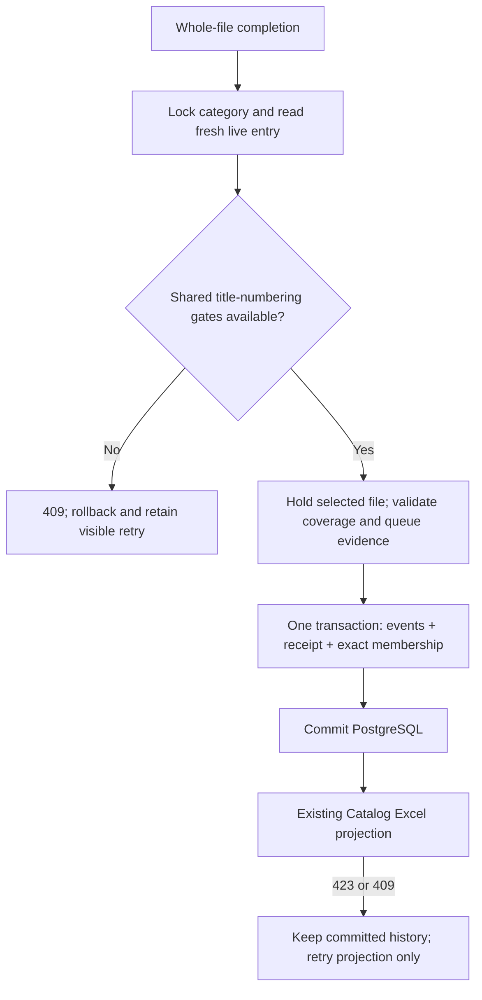

# Durable file-completion evidence — T53a foundation

2026-09-24. **NOT READY TO SHIP:** local verification passes, but cross-show episode reassignment
still bypasses the source show's completion fence and needs an owner policy decision. This is the
durable history foundation, not a shipped Next/Autoplay endpoint or player control. Migration `0005`
is tested only on disposable databases; the owner's live projection has not been migrated.

## What this change establishes

The owner's approved completion history survives closing/reopening because each contextual
PLAYER/COMPLETED snapshot records an immutable `playback_completion` and its exact
`playback_completion_event` members in PostgreSQL. Members are the actual returned watch-event
UUIDs, never events guessed from timestamps. A range file includes covered episodes outside the
selected row's span. A deliberate manual replay produces a separate receipt.

The receipt retains the file UUID/provider ID, actual numbering and indices, every matching live
queue occurrence, and a semantic queue fingerprint. Disposable queue-item UUIDs, watch state and
timestamps do not enter the fingerprint. Rebuilding only the queue cache preserves it; edits to
curation or applicable provider numbering change it. Repeated occurrences remain separate evidence,
not automatic permission to skip them. No historical receipts are manufactured from old events.



No route, HTTP field, frontend contract, workbook column, dependency, port or source version changes.
The existing 60-second/pause/finish/close reporting and the single Catalog write funnel remain intact.

## Review findings and corrections

1. A joined SELECT waiting for a category row lock could return older entry columns under READ
   COMMITTED. The shared `locked_curated_entry` helper now locks first and then reads the live entry
   and category in a fresh statement, pinned to the category it actually locked.
2. Refreshing the selected Jellyfin ORM row and holding it with a shared lock prevents stale
   identity-map data or file-index updates from changing file evidence midway through a snapshot.
3. A real numbering refresh from another category reproduced old receipt members `[1, 2]` with a
   newer fingerprint whose current file coverage was `[1, 3]`. Completion and numbering ingestion
   now coordinate through batched, nonblocking transaction advisory gates. Both sides refuse
   contention, avoiding advisory waits behind earlier episode/FK locks or opposing title orders.
4. Reconciler and manual resolution/retry must participate in the same category fence, with fresh
   ORM reads after acquisition. A busy numbering ingest rolls back the entire pass; review retry
   uses the existing ResolutionConflictError envelope.
5. Two newly introduced test modules originally shared a basename. The service suite is now
   `test_playback_completion_service.py`, distinct from the ORM suite.
6. TMDB-only ingestion can change an episode's provider identity without running the alternate-order
   ingestor. A real upsert reproduced an old receipt occurrence key with a newer member-event key.
   The actual TMDB episode writer therefore participates in the same exclusive try-lock protocol
   for its target title; same-title refreshes are protected. Cross-title reassignment remains the
   blocker below. No provider configuration or runtime-construction behavior is changed.

### Open correctness blocker: cross-show episode reassignment

Two independent real-PostgreSQL reproductions held a shared completion gate on show A, then called
the actual `TmdbIngest._stored_episodes` writer for show B with A's existing `tmdb_episode_id`.
The write committed the episode's `title_id=B` despite A's held gate. `_EPISODE_COLUMNS` includes
`title_id`, `_episode_upsert` conflicts globally on `tmdb_episode_id`, and `_stored_episodes` locks
only the target title; `_episode_index` also reads only that target's episodes. Same-show reseasoning
is intended, but the current SQL additionally permits cross-show ownership changes.

Rejecting that reassignment versus automatically moving the episode and reconciling its existing
watch-list links is an owner-visible behavior decision. Neither policy is approved by the durable
history request. Recommendation: refuse and flag the provider inconsistency. If approved, enforce
the rule atomically at the upsert boundary, including a concurrent provider-ID collision regression;
a preflight ownership query alone is insufficient. Do not mark this foundation complete or ship it
until the choice is implemented, independently reviewed and the gates are rerun.

The dedicated two-integer advisory namespace is separate from the existing bigint import/library
locks, and transaction locks release with commit/rollback. These are PostgreSQL's documented
semantics, also exercised against the real server in the helper tests.
[PostgreSQL 16 advisory-lock functions](https://www.postgresql.org/docs/16/functions-admin.html#FUNCTIONS-ADVISORY-LOCKS).

## Verification and safety notes

Measured checks on the final current code in this pass:

| Check | Result |
|---|---|
| Full backend against real PostgreSQL | **4,040 passed, zero skips, 112.16 seconds; 98.94%** line coverage (9,510/9,612 statements), above the unchanged 97% floor |
| New receipt/queue/lock runtime modules, including the moved entry-lock helper | 149/149 statements across ten modules in the full run; migration `0005` separately 30/30 |
| Data schema/migrations before concurrency additions | 273 passed, zero skips; 273/273 statements including all five migrations and new ORM models |
| Queue evidence | 39 passed; 63/63 statements and 12/12 branches |
| Batched numbering-lock helper | 20 passed; 11/11 statements and 2/2 branches |
| Receipt service and numbering integration | 168 passed; changed playback modules 196/196 statements; existing ordering module 225/230 |
| Category/review/reconciler fencing | 153 passed; new helper 14/14 statements and 4/4 branches; final cleanup separately 82 passed |
| TMDB same-title numbering fence | Six targeted cases (four failed before the fix), 75 combined tests passed; independently repeated with the same result |
| Backend lint, formatting and package build | Ruff clean; 469 files already formatted; offline wheel and sdist build pass |
| Frontend | 320 passed across 46 files; lines 81.01%, statements 80.73%, functions 73.38%, branches 72.75% |
| Four-viewport layout guard | 196 passed in 28.4 seconds |
| Hook tests | 31 passed |
| Frontend build / lint | Build passes; lint has zero errors and three existing generated-coverage warnings |
| Frontend dependency audit | No known vulnerabilities reported |
| Compose syntax | Passes with dotenv disabled |
| API/schema inspection | 21 paths, 24 operations, 16 domain tables, one Alembic head `0005`; source version `0.1.0` |

An intermediate full backend run passed 3,992 tests, but its coverage result is invalid for the
gate: the credential-safe app preload ran before pytest-cov began measuring imports. The final run
above starts coverage before any application import; the 97% floor is not lowered. The final run
has one harmless anyio assertion-rewrite warning from preloading the application.

Final-run artifacts: `/tmp/tv-t53a-full.coverage`, `/tmp/tv-t53a-full-coverage.json` and
`/tmp/tv-t53a-full-junit.xml`. Reproduce from `app/backend/` with the existing isolated test harness:

```sh
rtk proxy env TV_REQUIRE_POSTGRES=1 COVERAGE_FILE=/tmp/tv-t53a-full.coverage uv run --offline python -c 'import coverage; measured = coverage.Coverage(source=["tv_watchlist"]); measured.start(); import sys; from tv_watchlist.config import Settings; declared = Settings.model_config["env_file"]; Settings.model_config["env_file"] = None; import tv_watchlist.main; Settings.model_config["env_file"] = declared; import pytest; result = pytest.main(sys.argv[1:]); measured.stop(); measured.save(); measured.json_report(outfile="/tmp/tv-t53a-full-coverage.json"); total = measured.report(skip_covered=True); raise SystemExit(result or int(total < 97))' --no-cov -q --junitxml=/tmp/tv-t53a-full-junit.xml
```

The session also found an existing isolation gap: `tests/conftest.py::declared_env_file` disables
dotenv after collection, while API imports instantiate the module-level app during collection.
The initial 43-test baseline and some ordinary agent-focused API/review runs (including the 153-test
and 82-test checks) may therefore have loaded the owner's `.env` into process memory. No credentials
were printed, no live provider calls were made, and no credential file was changed; provider tests
use recorded transports. The root's credential-safe runs, including the final full suite, disable
dotenv before the app import, restore the declared path before pytest starts, and let the existing
fixture isolate execution. That protection must not be inferred for ordinary targeted commands.
Fixing the general collection-time harness gap remains a separate follow-up; it is not claimed fixed.

Another pre-existing discrepancy remains outside this change: `IngestRuntime.reconciler` constructs
the ordering ingestor only when TheTVDB is configured, although its docstring describes TMDB-only
aired ordering. This pass does not change provider construction; it protects actual TMDB episode
writes independently of that configuration.

All database mutation uses the existing PID-isolated `*_test` harness and real PostgreSQL; no
database is mocked. The harness drops its disposable test databases. Workbook mutations use
throwaway copies. No owner workbook, media file, credential, live database, running service, git
index, branch or history is changed by this implementation/validation.

Full Semgrep/gitleaks/Python dependency audit/Trivy, fresh Docker image builds, remote CI, Windows
execution and live owner-Jellyfin confirmation remain unverified. The earlier image-build attempt
stalled before application build steps; no Docker success is inferred from package builds.

## Remaining owner decisions

**Blocking the foundation:** if a provider moves an existing episode to a different show, should
the app refuse and flag the update (recommended), or automatically move it and reconcile its
existing watch-list links? The independently reproduced correctness gap above remains open.

**Before navigation:** should a deliberately repeated episode later in the same watch order play again through Next?
Recommendation: yes. The receipt foundation preserves all occurrences and does not choose an
expiry/first-occurrence policy. The previously approved durable lifetime and explicit manual
rewatches are not open questions. After that rule, the next implementation needs a typed stable
entry/subject cursor and barrier-capable navigation response, then Next/Autoplay integration.

The conditional Empire of the Sun repeat in `WWII.xlsx` is not an unconditional replay instruction;
its note says to mark Skip if already watched. Stored Skip state is authoritative for skipping, not
an inferred command parsed from prose.

## Task-completion self-audit — CLAUDE.md §21

**Overall verdict: NOT READY.** Final local suites pass, but independent review reproduced the
cross-show ownership gap. The entries below do not waive that blocker or certify environment gates.

1. **Summary.** Added immutable, exact file-completion evidence and coordinated the readers/writers
   whose concurrent changes could corrupt that evidence. Next/Autoplay itself is not implemented.
2. **Reuse check.** Searched `services/playback_events.py`, `watch_events.py`, `playback_position.py`,
   `episode_match.py`, `library_selections.py`, `tmdb_key.py`, `ingest/expansion.py`, `episode_orders.py`,
   `reconciler.py`, `services/resolution_review.py`, `data/base.py`, existing migrations and tests.
   Reused `record_watch_event`, `numberings_for`, `tmdb_key`, the caller-owned transaction and Catalog
   projection. Existing events had no file/batch identity, so dedicated receipt tables were required.
3. **Tech-debt check.** No dependency substitution, stub, timestamp backfill, global Watched-item skip,
   type escape hatch, second workbook writer or duplicated episode-numbering dispatch. Coordination
   uses nonblocking gates and whole-transaction refusal, not a deadlock-prone blocking title sequence.
   **Not complete:** the source-title ownership hole remains, explicitly blocked on owner policy.
4. **File-organisation check.** Each new model, helper and service has its own file and corresponding
   test subject. The shared curation-lock helper was moved and reused; no compatibility wrapper remains.
5. **Data-contract check.** The additive database/internal evidence contract was recorded in master
   §6.9 and CLAUDE.md §5.19 before implementation. Existing HTTP fields, status envelopes, frontend
   types and workbook contracts remain unchanged; no unapproved navigation contract was added.
   Cross-show reassignment behavior has not been selected or changed without approval.
6. **Docs check.** Updated `CLAUDE.md`, `docs/TV_MASTER_PLAN.md`, `docs/phases/phase-3-plan.md`,
   `docs/status.md`, `docs/versions.md`, `docs/next-playback-decision.md`, and this audit. Work joins
   the sole pending **v0.2.0**, an additive minor over manifest **0.1.0**; neither manifest version
   is edited. No port changes, so no registry change. READMEs/app docs need no new run instructions.
7. **Test check.** Exact test files are listed below; measured results are in the verification table.
   Real PostgreSQL concurrency, database failures at both receipt inserts, exact same-timestamp
   membership, projection-only retries, queue rebuilds, provider renumbering and SQL query bounds
   are covered. Existing coverage gaps are not concealed by a lower floor or excluded source.
   All 4,040 current tests pass; the independent cross-show reproduction demonstrates why passing
   coverage is not completion. Its policy-specific regression and fix remain required.
8. **Forward-compatibility check.** Historical evidence retains identities without depending on
   disposable metadata/queue rows. It preserves P2's deferred status, the provider joins, explicit
   manual rewatches and future barrier-aware navigation. It does not predetermine repeat expiry.
   Future navigation is still gated on closing the ownership gap and agreeing its repeat contract.
9. **Git state.** The working tree already contained extensive Phase 1/3/3.5 changes. This pass's
   file attribution and suggested grouping are below; no git mutation was run. Unrelated root
   `package.json`/`package-lock.json` artifacts remain untouched. Final `git diff --check` passes
   with pre-existing CRLF-normalisation notices; explicit whitespace checks cover untracked docs.
   Manifest/heading checks confirm only pending v0.2.0 above source v0.1.0.
10. **Security check.** Full local SAST is **not verified**; the available frontend audit and lint
    results are listed above. UUIDs/titles remain bound SQL values; advisory SQL function selection
    uses a fixed internal boolean, not client syntax. Receipt JSON/fingerprints are server-derived
    typed values, never SQL, shell, path, template or prompt instructions. No new command, path,
    SSRF, XSS, deserialisation or header/log boundary was introduced. Master §9.3 and CLAUDE B13
    document the persistence boundary. The import-time dotenv limitation is disclosed above.
    Provider-driven cross-show reassignment remains an open integrity issue, not a clean sign-off.
11. **Excel-safety check.** No workbook write path changed: Catalog freshness guard, backup, Excel
    lock refusal, atomic temporary-file swap, invalidation and live-lock reread remain the funnel.
    Existing expected-mtime and Row ID checks are retained. No owner file was deleted or moved;
    no sheet rows/grid were structurally changed by this feature, so no new ranges-sync path exists.
    Digest-equal, identities-intact reconciliation still performs zero workbook writes.
12. **Contract check against the derived-column-schema rule.** No fixed column index, header-text
    inference, dropdown vocabulary, first-blank-header boundary or cross-language field changed.
    The schema addition is PostgreSQL evidence only, documented before code as required.
13. **Layout-guard check.** No rendered source/styles changed, but the four-viewport guard was rerun:
    **196 passed**, with the existing player/retry surfaces. No new screen requires a new surface.
14. **Dual-store check.** Existing progress still reaches PostgreSQL and Excel through the same
    one-directional lossy mirror. An Excel-only 409/423 preserves the committed receipt and retries
    projection without another completion. Observed/mirrored cells, human-edit precedence, invalid
    dropdown-choice skips and standalone workbook meaning remain unchanged. The dual-store,
    validation, data-driven and Excel-safety skills directed this reuse and the isolated fixtures.

## Changed-file attribution for this pass

Backend paths below are relative to `app/backend/`; a moved file's old name is shown explicitly.
This list is not an instruction to stage the entire pre-existing dirty tree.

| File | Reason |
|---|---|
| `src/tv_watchlist/constants.py` | Dedicated numbering-lock namespace only. |
| `src/tv_watchlist/data/models/playback_completion.py` | Immutable completed-file header and constraints. |
| `src/tv_watchlist/data/models/playback_completion_event.py` | Exact immutable watch-event membership. |
| `src/tv_watchlist/data/models/__init__.py` | Register/export both new ORM models. |
| `src/tv_watchlist/data/episode_order_lock.py` | One batched, bound, nonblocking transaction gate. |
| `alembic/versions/0005_playback_completion.py` | Add both tables, constraints, indexes and mutation-refusal triggers; ordered downgrade. |
| `src/tv_watchlist/models/playback_coverage.py` | Frozen validated file/numbering evidence. |
| `src/tv_watchlist/models/playback_occurrence.py` | Frozen logical occurrence identity. |
| `src/tv_watchlist/models/playback_queue_snapshot.py` | Frozen semantic digest and occurrences. |
| `src/tv_watchlist/services/playback_completion.py` | Append header/members within the existing caller transaction. |
| `src/tv_watchlist/services/playback_queue_snapshot.py` | Canonical live curation/numbering capture, at most two queries. |
| `src/tv_watchlist/services/playback_events.py` | Fresh file validation, coherent numbering gates and exact receipt insertion. |
| `src/tv_watchlist/services/locked_curated_entry.py` ← `playback_entry.py` | Fresh category-fenced helper shared by playback/review. |
| `src/tv_watchlist/services/playback_position.py` | Use the renamed shared curation helper; no projection rewrite. |
| `src/tv_watchlist/services/resolution_review.py` | Participate in the fence and translate busy numbering to existing 409. |
| `src/tv_watchlist/ingest/episode_order_busy_error.py` | Typed whole-ingest refusal on contention. |
| `src/tv_watchlist/ingest/episode_orders.py` | Exclusive gate before numbering comparison/mutation. |
| `src/tv_watchlist/ingest/tmdb_ingest.py` | Same exclusive gate before an actual provider episode upsert. |
| `src/tv_watchlist/ingest/reconciler.py` | Category fence and fresh entries before reconciliation planning. |
| `tests/playback_completion_support.py` | Shared real-database receipt fixtures. |
| `tests/data/test_playback_completion.py` | Header constraints, historical identity and append-only behavior. |
| `tests/data/test_playback_completion_event.py` | Membership uniqueness/FKs and append-only behavior. |
| `tests/data/test_migration_0005.py` | Revision DDL and teardown order. |
| `tests/data/test_models_metadata.py` | Sixteen-table metadata inventory. |
| `tests/data/test_migration_round_trip.py` | Whole-chain sixteen-table round-trip/parity inventory. |
| `tests/data/test_episode_order_lock.py` | Lock modes, batching, namespaces, contention and transaction lifetime. |
| `tests/models/test_playback_coverage.py` | Frozen file-evidence contract. |
| `tests/models/test_playback_occurrence.py` | Occurrence validation and immutability. |
| `tests/models/test_playback_queue_snapshot_model.py` | Digest/tuple contract with a unique test basename. |
| `tests/services/test_playback_completion_service.py` | Exact membership, replay, failed insertion rollback and fresh file evidence. |
| `tests/services/test_playback_events.py` | Adapt existing completion regressions to validated file evidence. |
| `tests/services/test_playback_queue_snapshot.py` | Cache-rebuild stability, semantic invalidation, duplicates and bounded queries. |
| `tests/services/test_playback_numbering.py` | Actual writer races, retry, opposing title order and prior episode/FK mutations. |
| `tests/services/test_locked_curated_entry.py` ← `test_playback_entry.py` | Lock lifetime and post-wait fresh-entry regressions. |
| `tests/services/test_curated_entry_concurrency.py` | Review/category-fence concurrency. |
| `tests/ingest/test_episode_order_busy_error.py` | Busy numbering is an ingest refusal. |
| `tests/ingest/test_tmdb_numbering_lock.py` | Actual TMDB same-title mutation refusal, rollback and no-op behavior. |
| `tests/ingest/test_reconciler_concurrency.py` | Fresh planning, no-op workbook preservation and full busy rollback. |
| `tests/api/test_player_snapshots.py` | Receipt-preserving Excel retries and numbering-conflict 409→201. |
| `tests/api/test_review_retry.py` | Existing retry error envelope and rollback on numbering contention. |

Repository documentation:

- `CLAUDE.md`: approved evidence/coherence contract, current table/migration inventory and boundaries.
- `docs/TV_MASTER_PLAN.md`: durable-history approval, exact schema, coordination and remaining policy.
- `docs/phases/phase-3-plan.md`: implemented foundation versus still-unimplemented navigation.
- `docs/status.md`: current checkpoint, measured verification and next decision.
- `docs/versions.md`: one additive subsection under the existing pending minor version.
- `docs/next-playback-decision.md`: approved lifetime, unresolved repeat rule and current audit link.
- `docs/playback-completion-validation.md`: this verification, limitations and handoff.

Local memory records only the owner's durable-history/manual-rewatch approval in
`/Users/amrambouskila/.codex/memories/tv_playback_advancement.md`, indexed by `MEMORY.md`;
it does not record an unapproved repeat policy or replace source/status lookups.

After the ownership blocker is resolved, this is one cohesive owner-managed change group following
its existing T53/T66 prerequisites. It is **not ready to commit as a completed feature** now.
**Suggested future commit message — not executed:**

```text
feat(playback): persist coherent file-completion receipts

Retain exact event membership and historical file/queue evidence.
Fence curation and provider numbering against concurrent completion saves.
Preserve dual-store projection-only retry and explicit manual rewatches.
Leave Next/Autoplay navigation and intentional-repeat policy separate.
```
