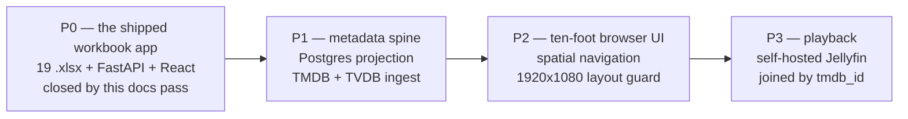
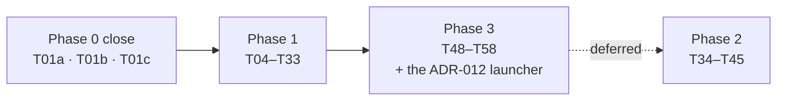
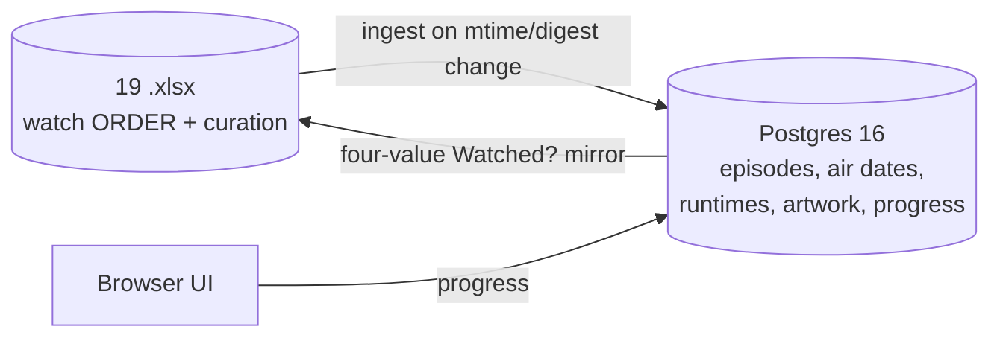

# Status

Where this project actually is, right now. Not a history — for that, read `docs/versions.md`.
Anything written here is true of the working tree as it stands; when it stops being true, this file
changes.

**Working tree checkpoint: 2026-09-24. The owner manages git.**

**Latest completed code, 2026-09-24:** owner-approved R105 saves PostgreSQL **and Excel every 60 seconds**
while playing, plus pause/finish/player close; a combined file's mapped episodes complete only when
the whole file ends. R106 adds a durable PostgreSQL import operation and migration 0004, retaining
staging until destination verification and confirmed database commit. Both contracts are recorded
in the master plan §6 and CLAUDE.md §5.17–5.18 before code. **T53/T66 are implemented and
independently reviewed.** T53 focused checks pass: backend **198**, workbook **147**;
T66 **154**, including crash/recovery, actual connection loss and multiworker cancellation.
**Next/Autoplay ordering approved, 2026-09-24:** a finished episodes 1–3 file → interleaved movie →
episode 4, without replaying that completed file. **Durability also approved:** PostgreSQL remembers
finished files across close/reopen, with explicit Play still available for rewatches. T53a's additive
receipt contract is documented in master plan §6.9 / CLAUDE.md §5.19 and is implemented and locally
tested, but **NOT READY**: a provider can move an existing episode to another show while bypassing
the source show's completion fence. Independent real-database review reproduced it. The owner must
choose refusal/flagging (recommended) or automatic reassignment plus watch-list reconciliation;
the approved policy then needs an atomic correction and regression. Repeated queue occurrences
also need a navigation policy; receipt capture does not infer one. No Next/Autoplay endpoint or UI.
Read [the decision checkpoint](next-playback-decision.md) and
[current verification/blocker audit](playback-completion-validation.md).

**Phase 0 and Phase 1 are closed; Phase 3 and Phase 3.5 are proceeding interleaved
(ADR-014/ADR-015). Phase 2 remains deferred.** T33 closed 2026-09-21 with the local Docker/Windows/CI
verification limitations recorded explicitly; closure did not turn unverified checks into passes.

**Recovered Claude checkpoint:** T48/T49/T50/T57 and T60/T61/T62/T63 are complete and reviewed.
T61's final review had been interrupted by the usage limit; it is now approved after 100 focused
tests and removal of two unused test helpers. **T51 availability, T64 discovery, T52 playback and
T65 import identification are now implemented and independently approved.** The owner approved
R104's separate typed per-entry playback-slot endpoint before implementation; the existing entry
response remains unchanged. Playback uses actual movie/episode file IDs, explicit ordered-slot
selection and a same-origin streaming proxy. T53 now implements progress writes; resume and
Next/Autoplay are not implemented. Identification is conservative and local-projection-only; T66
move/hash/recovery is locally verified, while refresh and import routes remain unimplemented.
The authoritative task detail is in `docs/phases/phase-3-plan.md` and
`docs/phases/phase-3.5-plan.md`; §3 below lists the next dependencies.

The migration chain is `0001 → 0002 → 0003 → 0004 → 0005`: eleven Phase 1 tables, `jellyfin_item`,
`media_import`, `media_import_operation`, `playback_completion` and `playback_completion_event`
(sixteen domain tables, plus `alembic_version`). Migration 0005 has been applied only to disposable
test databases, not the owner's live projection. OpenAPI
currently has **21 paths / 24 operations across eight routers**, including three playback routes.
These counts were measured without loading owner credentials. Imports have no HTTP surface until T68.

**Current-code local verification, not a completion verdict:** backend **4040 passed, zero skips,
98.94% line coverage** (9510/9612 statements), 112.16 s against real PostgreSQL, local Python 3.14.7; frontend
**320 tests / 46 files**, coverage lines **81.01** / statements **80.73** / functions **73.38** /
branches **72.75**; layout **196 passed** (23 surfaces, four viewports); hooks **31 passed**.
New receipt/queue/lock modules, including the moved entry-lock helper, cover 149/149 statements;
migration 0005 separately covers 30/30. Ruff lint/format (469 Python
files), TypeScript and both application builds pass. Whole-tree `pnpm lint` has zero
errors and three pre-existing generated-coverage warnings. No coverage floor was lowered.
Detailed evidence, session-specific file attribution and the 14-item audit:
[Durable file-completion foundation — NOT READY](playback-completion-validation.md).
The prior completed T53/T66 checkpoint was 3891 backend tests at 98.93%:
[Automatic snapshots and recoverable imports](snapshots-recovery-validation.md).
The initial baseline and some ordinary focused test imports may have loaded dotenv into process
memory before their fixture disabled it; no credentials were printed or live provider calls made.
The final full run disables dotenv before application import; that protection is not inferred for
ordinary commands. The collection-time harness gap remains a separate follow-up in the current audit.

**Environment rechecked 2026-09-24:** PostgreSQL and Jellyfin containers are healthy. Backend
`uv build --offline`, frontend `pnpm build`, compose syntax validation without loading the owner's
environment, and `pnpm audit --audit-level=high` all pass. Both fresh standalone Docker builds
stalled resolving `docker.io/docker/dockerfile:1` and were cancelled after approximately 45 seconds,
before application build steps; container builds remain unverified.
No running service was restarted. Semgrep, gitleaks, Trivy and the Python dependency auditor are
unavailable locally, with no scanner images cached; those checks and remote CI remain unverified.
Live Jellyfin fixture confirmation/key setup and Windows launcher execution still require the owner.

Version in flight: **0.2.0**, the single pending heading in `docs/versions.md`.
Both source manifests stay **0.1.0**. No root workbook or credential file has been changed by this
continuation. The pre-existing untracked root `package.json` / `package-lock.json` plugin artifacts
are unrelated and remain untouched.

---

## 0. Phase 0/1 build record and outstanding owner actions

The current checkpoint is the header and §3; dated evidence below records earlier verification.
**Steps 1 through 15e are done** — Phase 0 closed on 2026-09-20, Phase 1's build
finished the same day, and **step 15e, the Phase 1 gate audit (T33), ran on 2026-09-20**; its one
reopened box (24, the `js-yaml` HIGH) was fixed the same evening (see §0 step 15e). "**You**"
means the repository owner and cannot be done by an agent; "**Agent**" means it needs no account, key
or purchase. The last column names the one thing only the owner can do at that step; "—" means
nothing.

| # | Step | Tasks | Who | State | Owner action |
|---|---|---|---|---|---|
| 1 | The workbook app shipped — nineteen `.xlsx` categories, FastAPI + React, chat dock, layout guard, CI | — | — | **Done** (Phase 0 app) | — |
| 2 | `streambert` evaluated and **rejected**; the three-phase plan chosen; dual store, browser-only UI and deferred playback settled | ADR-001…008 | — | **Done** 2026-09-08 | — |
| 3 | Documentation foundation written — this file, `CLAUDE.md`, `docs/TV_MASTER_PLAN.md`, `docs/versions.md` | T00, T01 | Agent | **Done** 2026-09-08 | — |
| 4 | **TMDB coverage measured before committing to it** — 139/140 sampled titles found, ~99.5% weighted. Coverage is not a risk; resolution is. T13/T16/T18 sharpened, `title.tmdb_id` made nullable | — | Agent | **Done** 2026-09-09 — see §2.8 | — |
| 5 | **Get the two provider credentials** — TMDB's v4 Read Access Token, and a TheTVDB v4 key on the End-User Subscriptions funding model plus the subscriber PIN | T02, T03 | **You** | **Done** 2026-09-15 — the PIN came from the separate $11.99/yr user subscription, which also issues a legacy **v3** key this project does not use; only the v4 key goes in `TV_TVDB_API_KEY`. All three values are typed into the gitignored root `.env` and were exercised live against both services (§2.9) | Done |
| 6 | **The four open items closed and the Phase 3 shape decided** — ADR-009 (licence: all rights reserved, no `LICENSE` file, ever; T01d closed), ADR-011 (the app never switches a VPN; availability is Israel's), ADR-012 (the launcher, accepted as proposed, placed in Phase 3), ADR-013 (personal-use basis for playback accepted) and ADR-014 (Phase 3 follows Phase 1 directly, Phase 2 deferred, the Phase 3 shape). Decided by the owner, in-session | T01d | **You** | **Done** 2026-09-20 | Done |
| 7 | **The `jellyfin` compose service stood up** so the owner can create the API key — `jellyfin/jellyfin:12.1`, named volumes `tv_jellyfin_config` and `tv_jellyfin_cache`, `${TV_JELLYFIN_MEDIA_HOST:-./media}:/media:ro`, a `GET /health` healthcheck, `${TV_JELLYFIN_PORT:-8096}:8096`, and **no `depends_on` edge from the backend** (an optional peer). `/media/` gitignored; the `8096` row in `PORT_ASSIGNMENTS.md` | T47a | Agent | **Service landed 2026-09-20; the container has never started** — Docker Desktop's VM pulls no image at all while NordVPN's Shield extension is active on this Mac | **Owner actions 1 and 2** below |
| 8 | `.claude/` wiring — `settings.json` plus the OS-agnostic `.cjs` hook set, `commands/`, `skills/`. Node `.cjs` only, stdin not env vars | T01a | Agent | **Done** 2026-09-20 — `scripts/hooks/` holds seven hooks plus `hooks.test.cjs` (**31 tests**, `node --test scripts/hooks/hooks.test.cjs` — the directory form fails on Node 24); `.claude/` wires six PascalCase hook entries, six commands and five skills. `.gitignore:27` ignores `.claude/`, so **only `scripts/hooks/` travels with a clone**. `pre-tool-use.cjs` denies `.env*` (not `.env.example`), credentials, key material and **any `*.xlsx`**. Reviewed | — |
| 9 | `.env.example` with every variable and a safe placeholder | T01b | Agent | **Done** 2026-09-20 — **16 `TV_` variables**, each with a placeholder and a one-line comment, including the five Phase 3 names; `tests/env_example_support.py` and `tests/test_env_example.py` (19 tests) hold it in step with `Settings` and `docker-compose.yml`. Reviewed | — |
| 10 | README reconciliation — the `OWNER/REPO` placeholders, eighteen→nineteen workbooks, the stale test count, the Semgrep description, the "There is no database." opening, Licensing reworded to ADR-009, and a P0→P1→P2→P3 phase diagram. **Closes Phase 0** | T01c | Agent | **Done** 2026-09-20 — all of it, plus `app/README.md` alongside and the same off-by-one corrected in `.gitignore:4` and the compose comment. Reviewed. **Phase 0 is code-complete** | — |
| 11 | The data layer — SQLAlchemy 2.0 async models, Alembic, the first revision, `postgres:16-alpine` on host port 5525, CI's service container, the `PORT_ASSIGNMENTS.md` row, and both launchers gaining `[q]`/`[v]` | T04-T11, T32a | Agent | **Done** 2026-09-20 — the three dependencies (T04); `data/base.py`, `session.py`, `enums.py` and the Phase 1 `Settings` fields (T05); eleven ORM models with 34 named `CHECK`s and `lazy="raise_on_sql"` (T06); Alembic against the async engine (T07); `0001_phase_1_schema.py` — eleven tables, two views, the append-only trigger (T08); the compose `postgres` service, the migrating `docker-entrypoint.sh` and the registry row (T09, T11); CI's Postgres service container with `TV_REQUIRE_POSTGRES=1` and the round-trip step (T10); `[r]`/`[k]`/`[q]`/`[v]` in both launchers, the host path bringing Postgres up and running `alembic upgrade head` before the dev servers (T32a). Each passed its review. **The live compose bring-up is still unverified** | **Owner action 1** |
| 11b | The provider clients and the resolver | T12-T20 | Agent | **Done** 2026-09-20 — the httpx scaffolding, URL guard, token bucket and `CacheOutcome` (T12); the TMDB client and `models/tmdb/` (T13); the TheTVDB v4 client and `models/tvdb/` (T14); the Postgres response cache `ingest/sync_cursor.py` (T15); `match_key` and the franchise prefixes (T16); the `Unit` span parser (T17); title resolution — normalise → franchise expansion → search → season/episode fallback → verification → confidence (T18); the TMDB ingest (T19); episode orders against the runtime-fetched season-type list (T20). Every provider call in the suite replays a recorded fixture; **no test makes a live call** | — |
| 12 | *(folded into step 11b)* — the provider clients, T12-T15, are tracked there | T12-T15 | Agent | See step 11b | — |
| 13 | *(folded into step 11b)* — the resolver, T16-T20, is tracked there | T16-T20 | Agent | See step 11b | — |
| 14 | **The dry-run report over all nineteen workbooks** → `docs/resolver-dry-run.md`. The real go/no-go, with per-workbook numbers instead of a 140-title sample | T31 | Agent | **Done** 2026-09-20 — run 2, on the final resolver: **830 of 996 rows auto-resolved (83%), 166 left for the review queue, 0 confirmed** (the resolver never awards `confirmed`; a human does). Rungs: 0.95×475, 0.80×187, 0.65×126, 0.50×42, 0.00×166. **166 is a one-sitting job, not several hundred** — so `unresolved` stays an exception state rather than the default rendering mode, which is the open question this measurement settled | — |
| 15 | Identity, reconciliation and the watch mirror | T21-T26 | Agent | **Done** 2026-09-20 — `workbook/identity.py`, the hidden `Row ID` column at width 38 (T21); `ColumnRole` gains `identity` on both sides, the reader excludes it from `columns`/`WatchRow.cells`, and `CategoryCreate` refuses an app-owned header (T22); `ingest/reconciler.py`, master plan §6.5 verbatim, the pass's whole diff as **one** `Catalog._write` (T23); `ingest/expansion.py`, the flattened `curated_entry_item` queue with one slot per film so Next never skips one (T24); `services/watch_mirror.py`, the four-value projection that never fails a pass (T25); and the mirror-race proof — the race injected at the real seam and refused by the production `guard_fresh`, with `services/watch_mirror.py` **unchanged**, because the mirror already loses (T26) | — |
| 15a | **The first-ingest runner** | T27 | Agent | **Done** 2026-09-20 — `ingest/bootstrap.py`, run as `uv run python -m tv_watchlist.ingest.bootstrap` from `app/backend`, with `--dry-run` and `--only <slug>`. The exit codes are a shell contract: **0** every workbook ingested, **1** a workbook was refused (locked, stale or unreadable — the others still ran), **2** an infrastructure fault (database down, migrations behind — retry). 26 tests | **Owner action 3** — the first live run |
| 15b | **The read API, the review API and provider attribution** | T28-T30, T32 | Agent | **Done** 2026-09-20 — `GET /api/categories/{category_id}/entries` → `list[CuratedEntryRead]`, live entries by `position`, `limit`/`offset` capped at 500, 404 for an unknown category and `[]` for a never-ingested one (T28); `POST /api/watch-events` → **201 `WatchEventRead`**, the event as recorded with the entry's `progress` embedded, the mirror scheduled as a background task strictly after commit (T29); `GET /api/review/entries` and `POST /api/review/entries/{entry_id}`, the queue being `resolution_state IN ('unresolved','auto')` with **no** confidence threshold (T30); and the TMDB attribution notice and logo in the sidebar foot, with a layout-guard spec of its own (T32). **Nineteen HTTP routes now, up from fourteen** | — |
| 15c | **The whole backend suite run against a real PostgreSQL 16.2** — the first time on this machine | — | Agent | **Done** 2026-09-20 — a `pgserver` 16.2 cluster on `127.0.0.1:5525` with `pg_trgm` built from the matching contrib source, no Docker. First pass **2495 passed, 7 failed, 0 skipped** — zero skips being the point of the exercise — with the Alembic round trip green. All seven reproduced in isolation: six were test defects, one was a production disagreement (**Ruling 49**, amended). After the fixes: **2506 passed, 0 failed, 0 skipped** | — |
| 15d | The final documentation sync | — | Agent | **Done** 2026-09-20 — `CLAUDE.md` (the nineteen routes, the Phase 1 contracts, the rulings), `docs/phases/phase-1-plan.md` and `docs/TV_MASTER_PLAN.md` (task states, ruling notes, §6.5 and §12 R1), `README.md` and `app/README.md` (counts, the first-ingest command, testing against a real Postgres), `docs/versions.md` (one subsection per task under the single `v0.2.0` heading) and this file | — |
| 15e | **The Phase 1 gate audit** — `docs/TV_MASTER_PLAN.md` §10.1 line by line, on a quiet tree against a real Postgres, with every count the docs carry re-measured | T33 | Agent | **Done** 2026-09-20 — §10.1 walked box by box, each with a one-line evidence: **22 verified here, 1 UNVERIFIED HERE** (box 1, the compose bring-up — Docker pulls nothing under the VPN) and 1 reopened (box 24, SAST: one HIGH from `js-yaml@4.3.1` through eslint's devDependencies, fixed in 4.3.2). Suite **2506 passed / 0 failed / 0 skipped** against the real server and **2290 / 227 loud skips** offline (2517 collected after the final-review and fixture fixes); coverage **98.34%**; Alembic round trip and `alembic check` green; ruff, `tsc -b`, lint, `pnpm build` and `uv build` clean; guard 156; hooks 31; `pip-audit` clean. Counts in `CLAUDE.md` §4.4/§12.3/§16.1 and both READMEs re-measured. The scratch PostgreSQL was stopped. **Box 24 fixed the same evening** — `pnpm.overrides` pinning `js-yaml` to `^4.3.2` (matching `@eslint/eslintrc`'s own `^4.1.0` major; resolves to `4.3.2` exactly, confirmed with `pnpm why js-yaml`) in `app/frontend/package.json`, `pnpm install` regenerating `pnpm-lock.yaml`; `pnpm audit --audit-level=high` now clean, `tsc -b`/lint/`pnpm test` (219)/`pnpm build` all still green. **Gate now 23 of 24 verified here, 1 UNVERIFIED HERE** | — |
| 16 | **Phase 3 and Phase 3.5** — playback support and import pipeline | T46–T69 | Agent | **In progress.** Both task plans exist; §3 lists completed tasks and the current dependency frontier. T55 still needs the owner's key. | **Owner actions 2 and 7** |
| 17 | **Phase 2** — the ten-foot UI: spatial navigation, ten-foot type and safe-area tokens, the 1920×1080 layout project | T34-T45 | Agent | **Deferred** (ADR-014) — not cancelled; taken up after Phase 3 | — |

See `docs/TV_MASTER_PLAN.md` §4 and §11 for the deliverables and the task table, and
`docs/phases/phase-1-plan.md` for the step-level plan of steps 11 to 15e.

**Resume from the header and §3.** Phase 1 is closed, Phase 3/3.5 are already in progress, and the
older Docker evidence below is superseded only where a later measured check says so. Git remains
the owner's responsibility; implementation does not wait for a Phase 1 commit.

### Owner actions — dated evidence and current follow-ups

Nine things. Items 1-3 are what turns Phase 1 from "passes its tests" into "has run against the real
library"; item 4 must ride in the same commit as the Dockerfile change or a fresh clone will not
build the image; **item 9 is new from T33** — the gate boxes no agent could verify on this machine;
the rest is housekeeping and follow-ups.

1. **Unblock the Docker image pull, then bring the stack up.** On this Mac, Docker Desktop's VM
   transfers nothing while NordVPN and its Shield network system extension are active, so no image
   ever downloads. **Pause NordVPN, or add Docker to its exceptions** — or run compose on the Windows
   machine instead; a Docker Desktop restart was tried and did not help. **Re-attempted 2026-09-21:
   `postgres` itself now pulls and stays healthy under compose** (`tv-watchlist-postgres-1`,
   `127.0.0.1:5525`), but `backend`/`frontend` still cannot build — both fail at
   `resolve image config for docker-image://docker.io/docker/dockerfile:1: DeadlineExceeded`, and a
   bare `docker pull hello-world` hangs for minutes transferring nothing. `systemextensionsctl list`
   confirms Shield is still `[activated enabled]`, so the block has not actually cleared — the one
   image already cached is the exception, not evidence the VM's network path is open again. Then
   `docker compose up -d postgres jellyfin`: expect `Running upgrade  -> 0001` in the backend log
   *before* `Uvicorn running`, `/openapi.json` answering, and twelve tables in `tv` (the eleven Phase 1
   tables plus `alembic_version`). Neither `backend` nor `jellyfin` has ever started here, so this is
   still the one thing about T09/T11 and T47a that is asserted on paper only.
2. **Create the Jellyfin API key and type the Jellyfin values into the root `.env`** — no agent writes
   a credential. Open `http://localhost:8096/web`, create the admin account, then
   Dashboard → API Keys → New, naming it `tv-app`. Into the root `.env`:
   `TV_JELLYFIN_API_KEY=<that key>`, `TV_JELLYFIN_BASE_URL=http://localhost:8096` (the host launchers'
   value; compose sets `http://jellyfin:8096` itself), and
   `TV_JELLYFIN_MEDIA_HOST=<the directory holding your video files>`.
3. **Run the first ingest.** With Postgres up and the provider tokens in place:

   ```
   cd app/backend && uv run python -m tv_watchlist.ingest.bootstrap
   ```

   Expect `19 workbooks, 19 ingested, 0 skipped, 0 refused` and `996 rows projected, 996 identities
   minted, 19 workbooks written`, exit **0**. Exit **1** means a workbook was refused — open in Excel,
   stale, or unreadable — and the others still ran; exit **2** is an infrastructure fault (database
   down, migrations behind) and is worth retrying. `--dry-run` writes nothing but still takes each
   workbook's lock, needs a reachable database and spends provider quota; `--only <slug>` narrows it.
   This is the run that writes 996 `Row ID` values into the nineteen workbooks — one `Catalog._write`
   per file, each preceded by a `.backups` snapshot.
4. **Stage `app/backend/data/franchise_prefixes.json` in the same commit as the Dockerfile change.**
   It is untracked today and `app/backend/Dockerfile:56` does `COPY data ./data`, so a fresh clone
   that builds the image without it fails. T16's resolver reads it at runtime, and a green `uv build`
   will not catch the gap — the file sits outside the wheel by the project skeleton.
5. **Renormalise the line endings, at your convenience.** 126 tracked files read `i/lf w/crlf` in the
   working copy — pre-existing and repo-wide, with the index already LF. `git add --renormalize .`
   clears it. It never blocks a commit.
6. **Run `run_tv.bat` once on Windows, for real.** Both launchers were rewritten at T32a and their
   four branches are covered by `tests/test_launchers.py`, but **neither has been executed end to
   end** — the same VPN block stops `ensure_postgres`. The `.bat` half in particular has never met a
   live `choice /c rkqv`.
7. **Get the Streaming Availability key.** Sign up for the free plan at
   `developers.movieofthenight.com` (1,000 requests a month, no payment details) and type it into the
   same file as `TV_STREAMING_AVAILABILITY_API_KEY`. Until it is present, a `NOT_IN_LIBRARY` entry
   shows the launcher shell with no link (T55, T58).
8. **Three follow-ups to file as tickets, none urgent.** (a) `tests/api/test_chat_stop.py` fails only
   under `-W error`, with a `PytestUnraisableExceptionWarning` out of anyio's
   `MemoryObjectReceiveStream.__del__` — a GC-timing artefact in a stream finaliser, characterised and
   deliberately not chased. (b) **Closed 2026-09-21** — `tests/database_support.py` now names the
   throwaway database per process (`TV_POSTGRES_DB=tv_test` becomes `tv_p<pid>_test`), drops it at
   session end and reclaims any sibling whose pid is gone, so two local runners no longer evict each
   other's connections with `DROP DATABASE … WITH (FORCE)` mid-test. (c) Ruling 54's Phase 3 follow-up: now that an untouched workbook is skipped,
   nothing retries an entry a provider outage left `unresolved` except the next real edit or the review
   queue — decide at T57 whether the unresolved view gains a "Retry resolution" control or the
   bootstrap runner gains a `--force` flag.

9. **Run the gate boxes T33 could not verify on this machine — pause the VPN first.** Two §10.1 boxes
   and three SAST legs need Docker, which pulls nothing here (item 1). With NordVPN paused, from the
   repository root:

   ```
   docker compose up --build -d && docker compose ps          # box 1: postgres healthy, then backend
   docker run --rm -v "$PWD:/src" -w /src semgrep/semgrep semgrep scan \
     --config p/default --config p/owasp-top-ten \
     --config p/python --config p/typescript --config p/react --config p/docker \
     --severity ERROR --error --metrics=off
   docker run --rm -v "$PWD:/src" ghcr.io/gitleaks/gitleaks:latest detect --source /src --no-git --redact
   docker build -t tv-watchlist-backend:ci app/backend && docker run --rm \
     -v /var/run/docker.sock:/var/run/docker.sock aquasec/trivy:latest \
     image --severity HIGH,CRITICAL --ignore-unfixed --scanners vuln --exit-code 1 tv-watchlist-backend:ci
   ```

   CI runs all of these on push, so a green pipeline closes them too. The `js-yaml` HIGH that used to
   block `sast / dependency audit` is already fixed (§0 step 15e, the `pnpm.overrides` pin) — nothing
   further to land before the push on that front.

   **Re-attempted 2026-09-21, still blocked.** `docker compose up --build -d postgres backend frontend`
   ran twice and failed identically before building `backend`/`frontend` (box 1's evidence above); none
   of the three scanner images could be pulled either. `docker image ls` still shows only
   `postgres:16-alpine`. Not a VPN or Docker Desktop setting was touched. See `docs/TV_MASTER_PLAN.md`
   §10.1 boxes 1 and 24 for the full evidence trail.

10. **New, 2026-09-23 — create the Jellyfin admin account and the `tv-app` API key now that the
    container is up.** The blocker in item 1 above finally cleared overnight: `postgres` and
    `jellyfin` are both running and healthy on this machine (T09/T47a). Open
    `http://localhost:8096/web`, create the admin account, let the initial library scan settle, then
    Dashboard → API Keys → New, named `tv-app`. Type `TV_JELLYFIN_API_KEY=<that key>` and
    `TV_JELLYFIN_BASE_URL=http://localhost:8096` into the root `.env` (compose already sets
    `http://jellyfin:8096` for the container itself) — both `Settings` fields are real as of **T48**,
    so this is no longer typing into a stub. `backend`/`frontend` still cannot be built here (the
    Docker state row in §1 has the reason), so the app itself is not yet reachable at `5284`/`8284`
    from a container; the host launchers (`run_tv.sh` / `run_tv.bat`) are the path that can reach the
    now-live Jellyfin today.
11. **T54 (the Phase 3 gate audit) will ask you to confirm five fixture ambiguities against your live
    server.** T48's Jellyfin fixtures under `app/backend/tests/fixtures/jellyfin/` are hand-authored
    from the 12.1 OpenAPI document rather than recorded (Ruling 51's one exception — no server was
    reachable when T48 was built), and `tests/fixtures/jellyfin/README.md` lists exactly what to
    check once one is: the `ProviderIds` key casing (`Tmdb` vs `TMDB` vs `tmdb`), whether
    `DateLastSaved` actually arrives on an item (it is not a declared `BaseItemDto` property in 12.1),
    the comma-delimited array parameter encoding, the item-id form (dashed vs 32-hex), and the
    `minDateLastSaved` wire format. None of these block T49, which reads the `ProviderIds` key through
    one named constant for exactly this reason (Ruling 79) — but T54 is where a real mismatch gets
    caught before the gate closes.

`.env.example` (T01b) lists every credential name above with a placeholder, so the shape is already
on disk; only the values are missing. Still open and unchanged: Node 20 versus 22 in CI and the
`app/heroes` 21-versus-20 attribution gap (section 4, items 11 and 12).

**Not an owner action, a note.** The scratch PostgreSQL 16.2 that step 15c and T33 ran against is
**stopped**, its cluster and socket directory removed (T33, 2026-09-20); nothing listens on
`127.0.0.1:5525` any more. The `pgserver` binaries and the compiled `pg_trgm` stay in the uv cache,
so the next bring-up is one `pg_ctl … start` rather than a rebuild — section 15.2 of `CLAUDE.md` has
the recipe. It was never the compose Postgres and held nothing the project needs.

**Resumed 2026-09-20: the decisions are made and the order is set.**
- **Order.** Phase 0 close (T01a, T01b, T01c) → Phase 1 (T04–T33, the resolver and the `title` table
  everything else joins on) → **Phase 3** with the ADR-012 launcher folded in as the `NOT_IN_LIBRARY`
  fallback → Phase 2 **deferred, not cancelled**. T52 depends on T33, not T45. Phase 3 adopts
  `GET /api/categories/{id}/entries` for its availability-and-progress layer only; `CategoryDetail`
  stays the editing contract (ADR-014).
- **The four open items closed.** ADR-009 decided: all rights reserved, public but unlicensed by
  choice, no `LICENSE` file ever, T01d closed. ADR-011 decided as proposed: no VPN, availability
  looked up for Israel. ADR-012 decided as proposed, placement moved to Phase 3. ADR-013, new: the
  personal-use basis is accepted, which closes §2.20's "get legal advice" line and §2.11's open
  question. ADR-014, new: the Phase 3 shape.
- **Jellyfin, and the stream.** `jellyfin/jellyfin:12.1` as a compose service (step 7; verified
  2026-09-20 — 12.1 released 2026-09-15, 12.0 on 2026-09-08), no `@jellyfin/sdk`, backend `httpx`
  only. The stream is proxied by the backend: `GET /api/playback/{jellyfin_item_id}/stream` relays
  Jellyfin's `/Videos/{id}/stream` with the key in a header — `Range` passed through both ways,
  `Content-Type` passed through, `Accept-Ranges: bytes` set, streamed and never buffered; the key
  never leaves the server, and because the `<video src>` is same-origin the nginx CSP needs no
  `media-src`.
- **Schema, contracts and position** (all additive, minor bump, recorded before code). Phase 1's
  first Alembic revision holds the **eleven** Phase 1 tables; T49's `0002` adds `jellyfin_item` and
  the title pick, T61's `0003` adds `media_import`, and T66's `0004` adds `media_import_operation`:
  T53a's `0005` adds the two durable completion tables: **sixteen domain tables now**.
  T55's future `streaming_offer` makes seventeen;
  count `alembic_version` separately. The flattened queue
  is **`curated_entry_item`** from the
  first revision. Position: a `progressed` `watch_event` every 60 s (`position_seconds` an integer,
  converted once at the boundary — Jellyfin ticks ÷ 10 000 000, `<video>.currentTime` rounded), the
  `Watched?` mirror on whole-file completion, **plus** a `Position (s)` sheet column written on the
  same 60-second cadence and on pause, ended and unmount through `Catalog._write` — a projection
  never read as truth (R105).
  Those events carry `source = 'player'`, **not** `'jellyfin'`: the position comes from the browser
  and only the media comes from Jellyfin, so `'jellyfin'` stays free for server-reported sessions if
  one is ever added. `ColumnRole` gains `"identity"` (hidden `Row ID`, T22, Phase 1) and
  `"position"` (visible in Excel, T53, Phase 3), both app-owned and excluded by the reader from
  `columns` and `WatchRow.cells`.
- **Env, keys and ports.** New: `TV_JELLYFIN_BASE_URL`, `TV_JELLYFIN_API_KEY` (`SecretStr`),
  `TV_JELLYFIN_PORT`, `TV_JELLYFIN_MEDIA_HOST` (compose only), `TV_STREAMING_AVAILABILITY_API_KEY`
  (`SecretStr`). The owner types the Jellyfin and Streaming Availability values into the root `.env`
  themselves; no agent writes a credential. Host ports this project binds: 5284, 8284, 5286 (live)
  + 5525 Postgres (Phase 1) + 8096 Jellyfin (Phase 3) — "5525 is the only new host port" is no
  longer true; it is 5525 and 8096.

`docs/` is already committed (HEAD `04923f8`), so the earlier "do not commit `docs/` yet" concern is
moot: the owner accepted that the docs name the country and the subscriptions in a public repository
(section 4, item 10).

### Build rulings in force (2026-09-20)

Decisions made while building Phase 1 that override plan text and stand until the owner revisits
them — the full list is this machine's `tv-phase1-build-rulings` memory; the per-task record is
`docs/versions.md`. **No stubs by phase:** `Availability`, `jellyfin_*` and the Jellyfin/Streaming
enum members wait for T48/T51/T55; `ColumnRole` gains `identity` at T22 (done), `position` at T53.
**Schema fixes against the plan text:** `title.tmdb_id` nullable; `watch_event` carries `one_subject`
plus `kind_matches_column`; every `CheckConstraint` names itself; `order_type` stays an open
`String(32)`, never a pg enum. **Settings and Alembic:** `env_file` is the absolute repo-root `.env`,
blanked in tests by the autouse `declared_env_file` fixture; `database_url` uses `URL.create(...)`,
not `quote_plus`. **A workstation Postgres is a fallback, not an absence** — the database tests skip
*loudly* when nothing answers on `localhost:5525`, run for real in CI's service container, and were
run for real here too, against a `pgserver` PostgreSQL 16.2, while the VPN blocks Docker pulls (step
15c). One database runner at a time (section 4, item 14).

Added while building the compose, provider and resolver tracks:

- **The compose Postgres publication binds loopback only** — `127.0.0.1:${TV_POSTGRES_PORT:-5525}:5432`,
  as every listener this project publishes does; the dev credentials are defaults.
- **Launcher `[k]` is plain `docker compose down`**, per the global launcher contract, which is
  non-negotiable — so a separately started `jellyfin` container is removed by it, while its data
  survives in the named volumes.
- **An unknown cache age never trusts a 304.** When `sync_state.last_success_at` is NULL and a
  validator (etag or payload digest) is present, the TMDB client renews rather than revalidating —
  TMDB's licence caps caching at six months and an unknown age could already be past it.
- **`CacheOutcome` (`clients/transport.py`) gains a fifth member, `failed`** — refusals (401/404/429),
  outages and invalid bodies log `outcome=failed`, leaving `throttled` to mean only a token-bucket or
  429 wait. The `changes` cursor key carries its date window.
- **The refusal, retry-after and scrub helpers T14 duplicated from the TMDB client are consolidated
  into `clients/transport.py`** in a T14 fix round, once T13's fix round has landed.
- **A blank `Unit` cell is not `movie @ 1.00`** — 66 Misc_Anime series rows have one. It parses at
  confidence 0.50 with a note, taking its kind from the sheet's Type/Format cell (`TV` or `Series` →
  `series`, otherwise `movie`); only T18 finalises the kind from TMDB's `media_type` (movie → movie,
  tv → series), and only then may confidence reach 1.00.
- **`SpanParse` gains read-only `episode_span` and `season_span` properties**, and consumers (T18,
  T24) use those and never the raw `span_start` / `span_end` — `Seasons 1–25` carries SEASON numbers
  in those fields, with `order_type=None`.
- **The season-scoped shape (`S5 E10-19`, `Season 2 E26-37`) emits `order_type=None`, not `aired`** —
  8 of its 53 rows carry series-wide numbers (Attack_On_Titan `Season 2 E26-37`; My_Hero_Academia
  `Season 3 E39-58` and `Season 7 E139-156`), so the note says the numbering may be within-season or
  series-wide and must be confirmed against the title's own orders.

Added while building the ingest, the read and review API, and the verification pass — numbered from
here on, because there are now enough of them that a reader needs to be able to cite one:

- **Ruling 32** — `match_key` stays `String(255)`, and every clip is logged
  (`clipped table= column= from= to=`) rather than widened away.
- **Ruling 33** — a season- or episode-level match exposes `title_tmdb_id` = the **parent** tv id,
  with the parent's name and year and a `MatchedUnit`. `title.tmdb_id` never holds a season id.
- **Ruling 34** — the "search both the roman and the arabic form" idea is retired: it rescued zero
  rows and cost one live call per form.
- **Ruling 35** — a tie on equal score is `unresolved`, with a capped ambiguity note and no chosen
  candidate. A coin flip is never persisted; `RED` (2010), where three TMDB films score identically,
  is the worked example.
- **Ruling 36** — two live dry runs in total. `docs/resolver-dry-run.md` is run 2, on the final
  resolver.
- **Ruling 37** — `TitleMatch.EXTENDED`: TMDB's title equals a leading segment of the row's title
  (cut at a `:` or a space-surrounded dash), films only, years must agree, scored 0.65, ranked below
  `EXACT` and `CONTAINED`.
- **Ruling 38** — `TvdbEpisodesResult.reported` comes from `links.total_items`, and a walk whose
  length differs from it is refused rather than trusted as a sparse order.
- **Ruling 39** — `workbook/curated_columns.py` answers "which column carries the title, the unit, the
  release and the type". It is a schema question, so it lives beside `workbook/schema.py`, and
  `resolver/` imports nothing from `ingest/`.
- **Ruling 40** — a franchise-form match at 0.65 is the form working as intended, and it belongs in
  the review queue rather than in the resolved set.
- **Ruling 41** — the mirror never fails an ingest pass. A value the sheet's own dropdown does not
  offer is skipped with `skipped=invalid_choice` and a logged reason.
- **Ruling 42** — a test-to-test import duplication is fixed the moment it is found
  (`tests/workbook_edits.py`, `tests/statement_support.py`), never carried forward as a T33 cleanup
  item.
- **Ruling 43** — `layout/support/openProbe.ts` waits with `Promise.allSettled`: a cancelled CSS
  transition rejects `Animation.finished` with `AbortError`, which was a 1-to-3-in-152 flake.
- **Ruling 44** — `POST /api/watch-events` answers **201 `WatchEventRead`**, carrying the event as
  recorded *and* the entry's `progress: EntryProgress`. The plan's bare `EntryProgress` response is
  superseded.
- **Ruling 45** — `CuratedEntryRead.resolution_note` is `str = ""`, never `str | None`: the column is
  `NOT NULL DEFAULT ''`, and the human's reason has to reach the reader.
- **Ruling 46** — a successful confirm or correct rebuilds that entry's `curated_entry_item` rows
  immediately, so the queue is never stale behind a review decision.
- **Ruling 47** — the review queue predicate is `resolution_state IN ('unresolved','auto')`, the
  partial index's own predicate. **There is no confidence threshold anywhere**; the earlier
  "unresolved or confidence < 0.80" phrasing is retired, because §18.2's "`auto` is not trusted"
  requires the superset.
- **Ruling 48** — a re-resolve after a cell edit replaces `resolution_note` wholesale, so the
  `review:` clause recording a confirm or a reject is not durable across a cell edit. T57 decides
  whether it needs to be.
- **Ruling 49, as amended** — the reconciler skips a workbook when the sha256 over the normalised grid
  matches `workbook_digest` **and** the sheet's identity cells are exactly the live entries' ids
  (`identities_intact`). The stamp is not in the test: an equal `st_mtime` already implies equal bytes,
  so ANDing it in made the digest dead weight. The identity half is not optional either —
  `workbook_digest` excludes the `Row ID` column **by design**, which is what lets a first ingest write
  996 identities and still see nineteen unchanged files next pass, so a cleared, blanked, hand-typed or
  duplicated id moves no digest at all and must still reach adoption, re-minting or the
  malformed-identity refusal. A digest-equal, identities-intact pass with a moved stamp records the new
  `workbook_mtime` and touches nothing else.
- **Ruling 50** — the reorder gate test levels the mirror first, through the production
  `mirror_category`, and only then reorders and asserts position-only. Its own arrangement had recorded
  a `COMPLETED` event, which §5.16 *requires* the mirror to write.
- **Ruling 51** — a missing provider fixture is **recorded live** with the existing recorder, reading
  the credential through `Settings` and sending it only as a header. A hand-authored body is a stopgap,
  and only when no token is configured.
- **Ruling 52** — the `# noqa` invariant in `src/` is **five, named**: three `ANN401` on genuinely
  heterogeneous openpyxl values (`workbook/cells.py:14`, `workbook/writer.py:85`,
  `workbook/writer.py:113`), plus `ingest/tmdb_ingest.py:433` `SLF001` and
  `services/watch_events.py:167` `BLE001`, each reasoned on its own line. `# type: ignore` in `src/`
  stays **zero**.
- **Ruling 53** — `docs/versions.md` carries **one** current subsection per task. A stale entry beside
  a "(revised)" twin is drafting history, and an unreleased version's changelog records what ships.
- **Ruling 54** — because an untouched workbook is now skipped (Ruling 49), an entry a provider outage
  left `unresolved` is **no longer retried by an Excel open moving the stamp**; that retry was
  incidental, never designed. The deliberate paths are the next full pass over that workbook, where
  `needs_resolution` picks it up, and the review queue (`GET`/`POST /api/review/entries`, T30). An
  automatic retry over an untouched workbook — a "Retry resolution" control on T57's unresolved view,
  or a `--force` flag on the bootstrap runner — is a recorded **Phase 3** follow-up, not Phase 1 work.

Added while building Phase 3's Jellyfin client and Phase 3.5's shared settings (pre-flight rulings on
both plans, decided 2026-09-22, `scratchpad/sdd/phase-3/preflight-rulings.md`):

- **Ruling 63** — `clients/transport.py` gains `read_text(response, *, limit=…)` beside `read_json`,
  the same byte-capped reader shape, so `health()` and `refresh_library()` stop pulling an unbounded
  body; T62's qBittorrent client reuses it rather than writing a second one. `api/dependencies.py`
  gets a matching `get_qbittorrent_client` singleton at T62, the identical `lru_cache(maxsize=1)` +
  `main.py`-lifespan-close shape T48 and T23 already use.
- **Ruling 64** — T48 owns `api/dependencies.get_jellyfin_client`, the `main.py` lifespan close beside
  the agent and ingest runtimes, and the two `TV_JELLYFIN_*` names leaving `tests/test_env_example.py`'s
  `DECLARED_EXTRAS`. Because no Jellyfin has ever been reachable under the VPN, its fixtures are
  **hand-authored from Jellyfin 12.1's own OpenAPI document**
  (`https://api.jellyfin.org/openapi/jellyfin-openapi-stable.json`, fetched 2026-09-23) — a Ruling 51
  exception, recorded in `tests/fixtures/jellyfin/README.md` with the schema source and superseded by
  T49's live confirmation once a server exists (it now does — §0 owner action 10).
- **Ruling 65** — `assert_within_configured_base`'s docstring states the rule plainly: "for a
  configured LAN or loopback upstream the owner runs (Jellyfin, qBittorrent) — never a provider on the
  public internet."
- **Ruling 66** — `configured_url(base_url, *segments, **query)` is the one URL builder for a
  configured upstream, calling `assert_within_configured_base` rather than the https-only
  `assert_within_base`; T48 and T62 both consume it, and there is no second builder for either.
- **Ruling 67** — `refresh_library()` (`POST /Library/Refresh`, a constant path, no body, expects
  `204`) is T48's method from the start, not something a later task adds; T67 only consumes it.
- **Ruling 68** — no committed default names a personal directory. `import_staging_dir` and the
  **new** `media_root` field are both `Path | None = None` — disabled until configured, exactly like a
  provider credential — and `media_root` (`TV_MEDIA_ROOT`) stays a separate `Settings` name from the
  compose-only `TV_JELLYFIN_MEDIA_HOST`, mirroring the existing `TV_LIBRARY_HOST`/`TV_LIBRARY_DIR`
  split. T60 therefore declares six `Settings`-backed names (`TV_QBITTORRENT_URL/USER/PASSWORD`,
  `TV_IMPORT_STAGING_DIR`, `TV_MEDIA_ROOT`, `TV_IMPORT_CONCURRENCY`) plus the compose-only
  `TV_IMPORT_STAGING_HOST`.
- **Ruling 73** — the two staging names stay two names, host and container: `TV_IMPORT_STAGING_HOST`
  is the compose substitution, `TV_IMPORT_STAGING_DIR` is the `Settings` field (`/staging` under
  compose) — mirroring `TV_JELLYFIN_MEDIA_HOST` / `TV_MEDIA_ROOT` (`/media` under compose). T69
  corrects the compose comment above the media mount to say the backend's import job writes there and
  Jellyfin only reads it.
- **Ruling 79** — with no Jellyfin reachable under the VPN, T49 proceeds on the 12.1 OpenAPI document
  exactly as T48 did rather than blocking on a live confirmation first: the `ProviderIds` key is read
  through one named constant (`JELLYFIN_TMDB_PROVIDER_KEY = "Tmdb"`, the schema's documented casing),
  `DateLastSaved` is declared explicitly and nullable on the DTO even though it is not one of
  `BaseItemDto`'s declared properties in 12.1. R87 supersedes the initial cursor proposal: explicit
  `since`, otherwise maximum live `last_seen_at`, otherwise full scan. Live confirmation moves
  to the T54 gate audit as an owner-run item (§0 owner action 11).
- **Ruling 80** — `Settings.jellyfin_base_url` carries a `field_validator` running the
  configured-base check at boot, so a malformed base fails at startup naming the variable rather than
  as a 503 at the first playback; `qbittorrent_url` gets the identical validator at T60.
- **Ruling 81** — `JellyfinClient.stream()` returns a narrowed `StreamedResponse` (status, three
  allowlisted headers, the live byte iterator), never the raw `httpx.Response`; T52's proxy relays
  exactly that surface, so an upstream `Set-Cookie` or `Server` header can never reach the browser.

Added while closing T57 (the unresolved view) and T63 (media import naming), both done and reviewed
2026-09-23:

- **Ruling 82 (R82)** — `CuratedEntryRead` gains `category_slug: str`, placed immediately after `id`,
  so the review queue's one request across every category can say which workbook a row came from
  (`CLAUDE.md` §14.9 names the category on each row). Served by a new `services/entries.py:_slugs_for()`
  — one `IN` query per page over the distinct `category_id`s, because `CuratedEntry.category` is
  `lazy="raise_on_sql"`. Additive, minor bump, `CuratedEntryRead.ts` mirror, landed in T57's fix round.
- **Ruling 84 (R84)** — every emitted media-import path component is capped in **bytes** as well as
  characters: `MAX_MEDIA_COMPONENT_BYTES = 255`, the ext4/overlayfs/APFS/NTFS per-component limit,
  trimming on whole code-point boundaries so the `SxxEyy` decoration always survives. The
  reserved-device-name guard (`_`) runs **after** truncation, replacing the tail when there is no room
  to append, rather than before it — the fix round's one real bug, since truncating after appending
  could cut the guard's own suffix back off or manufacture a device name the original title never was.
  Landed in T63's fix round, in `services/media_filename.py` and `services/import_naming.py`.

Recorded now, **not yet landed** — T62 (the qBittorrent client) is still in its own fix round, so these
four apply to code that exists in the tree but has not cleared review:

- **Ruling 85 (R85)** — the qBittorrent infohash pattern must accept both v1 (40 hex) **and** v2
  (64 hex); a torrent whose hash matches neither is skipped with a logged reason
  (`skipped=unrecognised_hash`), never a refusal of the whole pass.
- **Ruling 86 (R86)** — the "no acquisition surface" ADR-015 guarantee is checked as a **route-path**
  check (no `/acquire` route is ever registered), not a source-text sweep for the word — a sweep would
  both miss a route added under another name and false-positive on legitimate code
  (`TokenBucket.acquire`).
- **Ruling 90 (R90)** — the two configured-upstream clients (Jellyfin, qBittorrent) share **one** helper
  module, `clients/configured_upstream.py` (`build_configured_http`, the log/refusal/unreachable tail),
  rather than each carrying its own copy — T62's review found the qBittorrent client's tail was a
  verbatim duplicate of Jellyfin's.
- **Ruling 91 (R91)** — for every optional `str`/`SecretStr` setting, an **empty string is unset**: a
  `mode="before"` validator maps `""` to `None` so a blank `.env` line disables the feature instead of
  authenticating with empty credentials (a copied `.env.example` would otherwise log in as
  `username=&password=` on every pass). The Ruling 80 shape validators then run only on non-empty
  values.

---

## 1. What exists and works

The workbook app remains usable independently of the projection: nineteen curated workbooks,
edited through the existing locked, freshness-checked, backed-up atomic write path. Phase 1's
projection and the completed Phase 3/3.5 services sit beside that authored data.

| Area | Current implementation |
|---|---|
| Backend | Python 3.13, FastAPI, Pydantic v2, openpyxl, uvicorn; SQLAlchemy 2.0 async / asyncpg / Alembic; managed by uv. |
| HTTP | 24 operations / 21 OpenAPI paths in eight routers. No `/health`; compose probes `/openapi.json` without opening a workbook. Three playback routes are built; no import routes yet. |
| Frontend | React 18, strict TypeScript, Vite and Redux Toolkit, pnpm 9.15.9. Includes the unresolved/retry view. No router, chart library or UI framework. |
| Projection | Sixteen domain tables, migration head `0005`; metadata, authored-entry projection, watch events, Jellyfin index, import provenance/recovery and immutable file-completion evidence. |
| Chat | Claude CLI/SDK on the host; proposed writes still require human approval and use Catalog. No provider/library data is newly fed into chat. |
| Storage | Root workbooks; pre-write snapshots in `app/.backups/`; artwork in `app/heroes/`; derived data in PostgreSQL. |
| Services | Compose declares backend, frontend, PostgreSQL and optional Jellyfin. PostgreSQL and Jellyfin are healthy; app image builds remain blocked at the Dockerfile frontend download. No service lifecycle was changed in this continuation. |
| Ports | Frontend 5284, backend 8284, layout probe 5286, PostgreSQL 5525, Jellyfin 8096. No port changes. |
| Versions | Backend and frontend manifests remain 0.1.0; the one pending documentation version is 0.2.0. |

### Tests, as measured

The header carries current results; `docs/snapshots-recovery-validation.md` records commands, reviews,
changed files and the complete fourteen-item self-audit. Tests use workbook copies and PID-isolated
disposable databases, never the owner's workbook files or persistent application database.

### CI

`.github/workflows/ci.yml` runs `lint -> sast -> test -> coverage gate -> build -> docker-build`,
expressed with `needs:`, plus a separate CodeQL workflow. All six required stages are present and in
order. Every test job emits its own JUnit XML and publishes it with `dorny/test-reporter@v1`
(`reporter: java-junit`, `checks: write`, `if: !cancelled()`) — `junit-backend.xml`,
`junit-frontend.xml`, `junit-layout.xml`. Semgrep runs six named packs — `p/default`,
`p/owasp-top-ten`, `p/python`, `p/typescript`, `p/react`, `p/docker` (`ci.yml:122-127`) — with SARIF
uploaded to the Security tab; `pip-audit`, `pnpm audit --audit-level=high`, gitleaks and Trivy are
all wired in. Every `uses:` is pinned to a 40-character SHA.

Coverage floors, declared as workflow `env` at `ci.yml:39-43` and checked by an inline Python step:
backend **97%** lines; frontend **56%** lines / **54%** statements / **45%** functions / **45%**
branches. The comment above them (`ci.yml:35-38`) records these as measured, not aspirational —
backend is 2259 of 2322 lines. They ratchet upward and are not the fleet's 100% target; the gap is
recorded in section 4.

---

## 2. What was decided this session

No code changed. What changed is the plan, and it is now written down.

### 2.1 streambert: evaluated, rejected

`github.com/truelockmc/streambert` was assessed as a possible source of ideas or code. It is
rejected outright and adopted from in no part. It is an Electron desktop client under GPL-3.0 that
scrapes unlicensed stream hosts (VidSrc, videasy, vidking, allmanga.to) and rips m3u8 with ffmpeg,
and it self-tags as piracy. Three independent disqualifiers: zero technical overlap with a browser
app over a personal file library, GPL-3.0 contagion onto a repository that carries no `LICENSE` file
— by decision since 2026-09-20 (ADR-009: all rights reserved), and vendoring it would have settled
that question as a side effect of a code-reuse convenience, on GPL-3.0 (section 4, item 1) — and legal
exposure this project has no appetite for. It is recorded as ADR-006 in `docs/TV_MASTER_PLAN.md` and
summarised in the status and versions entries for this change. Nothing from it is adopted.

### 2.2 The phase sequence



**Phase 0 is the app described in section 1** — it shipped before this plan existed, and this
documentation pass is what closes it, on five tasks: `T00` (root `docs/`), `T01` (root `CLAUDE.md`),
`T01a` (the `.claude/` wiring), `T01b` (`.env.example`) and `T01c` (the README reconciliation).
Phase 0 is named explicitly so a reader of the phase sequence never has to guess what came before
Phase 1.

**Execution order, changed 2026-09-20 (ADR-014).** The numbering above stands; the order of work does
not. Phase 0 closes first (T01a, T01b, T01c), Phase 1 follows (T04–T33), then **Phase 3** (T48–T58)
with the ADR-012 launcher folded in as the `NOT_IN_LIBRARY` fallback, and **Phase 2 (T34–T45) is
deferred, not cancelled**. T52 depends on T33, not T45.



P3 was designed for and left unbuilt while **there were no video files on this machine**. On
2026-09-20 the owner's own files exist (T46 satisfied; the jellyfin compose service that will index
them landed at T47a, but the container has not started yet — §0, owner action 1), so the gate that
held it has lifted. The join key chosen for it — `tmdb_id` — is unchanged, so the schema does not
move now that the media server has appeared.

### 2.3 Dual store

The workbooks do not go away, and this is the load-bearing decision of Phase 1.



- **Excel stays authoritative** for watch order and hand curation, and stays editable in Excel.
- **Postgres becomes authoritative** for episodes, air dates, runtimes, artwork and watch progress.
- The `Watched?` cell is **mirrored back** into the sheet, so a workbook opened standalone still
  means something. The mirror is a lossy one-directional projection of the append-only progress log
  onto four values (`""` / `Watched` / `In progress` / `Skip`) — never read back as truth, only as a
  signal that a human changed something.
- A sheet row's identity is a UUID written into a hidden `Row ID` column at the far right, because
  the existing writer already relays whole row-value arrays through adds, moves and removes and so
  carries that identity for free. Row number and `Order` value are both disqualified: the writer
  resequences them.

### 2.4 Device and UI treatment

The app is watched on a TV, driven from a PC or laptop over HDMI or a cast. **It stays a browser
app.** No Tizen `.wgt`, no webOS `.ipk`, no `react-native-tvos`, no app store, no second native
codebase. The ten-foot treatment is CSS tokens (type scale, safe-area insets) plus one focus
library: **`@noriginmedia/norigin-spatial-navigation`** (MIT). `react-tv-space-navigation` was
rejected as stale; `bbc/lrud` is archived. That is Phase 2, **deferred on 2026-09-20 (ADR-014)** —
the choice stands and the library is installed when Phase 2 is taken up, after Phase 3.

### 2.5 Metadata providers

- **TMDB is the spine** — identity, artwork, seasons, episodes. Bearer token server-side only, read
  from `TV_TMDB_READ_ACCESS_TOKEN`. Two constraints land in the schema rather than in a comment: a
  hard **6-month cache ceiling** in TMDB's terms, and the fact that anime `episode_number` is
  absolute-continuous across seasons (One Piece season 2 is episodes 62-77), so an `SxxEyy` built
  from TMDB numbers is silently wrong for exactly the anime workbooks this library is half made of.
- **TheTVDB v4, on an End-User Subscriptions key** supplies alternate episode **orders**, authenticated with
  `TV_TVDB_API_KEY` plus `TV_TVDB_PIN`. **Seven season types are live in production — `official`, `dvd`, `absolute`, `alternate`, `regional`, `altdvd`, `alttwo` (measured 2026-09-15) — and the
  OpenAPI spec lists them as *examples*, not an `enum`, so the list is not closed.** The operative
  rule everywhere these orders are touched: **read the season-type list at runtime from a cached
  `GET /v4/seasons/types` and never hard-code it.** Only `official` and `absolute` are broadly
  populated; `dvd` is materially incomplete and `alternate`, `alttwo` and `regional` are effectively
  absent for most titles. An unrecognised season type returns HTTP 200 with an empty list, so a
  zero-length response means *unknown*, never *no episodes*.
- **AniList is not adopted now, and is revisitable behind an ADR and a feature flag** — it is not a
  permanent non-goal. It is not needed for ordering, because TheTVDB already supplies absolute
  order; what it would add is franchise topology (`Media.relations` across separately-titled films,
  OVAs and ONAs). It is held back on operational grounds: its API is currently degraded to **30
  requests per minute** (the documented limit is 90, the response headers still advertise 90, and
  rate-limit-increase requests are not being accepted), and it returns **HTTP 403** during outages.
  Revisit it when franchise chaining becomes a real requirement.
- **Trakt is inspiration only, not adopted** — its February 2026 free tier caps a user at 1,000
  total list items, below this library's row count.
- **Plex is not adopted** — its 2026 remote-streaming paywall was extended to third-party API
  clients.
- **Jellyfin is the designated Phase 3 playback layer**, self-hosted. Noted now so the schema is
  built against it: Jellyfin cannot filter items by provider id at all, so a `tmdb_id -> item id`
  index has to be built and cached from a paged library scan. **Decided 2026-09-20 (ADR-014):** it
  runs as the compose service `jellyfin/jellyfin:12.1` (no `@jellyfin/sdk`; only the backend talks to
  it, over `httpx`), and that index is the `jellyfin_item` table, maintained by
  `services/library_sync.py` (T49).

### 2.6 Storage allocation

Postgres host port **5525** is allocated for this project — the first free slot in the documented
`5520-5591` range, adjacent to `Torah_Learning_Sidra` at `5524`. It is now bound as well as
allocated — `127.0.0.1:${TV_POSTGRES_PORT:-5525}:5432` at `docker-compose.yml:108`, registered at
`PORT_ASSIGNMENTS.md:96` (T09/T11). It was the only new host port this design took until 2026-09-20;
ADR-014 adds **`8096`** for the `jellyfin` compose service — `${TV_JELLYFIN_PORT:-8096}:8096`, bound
at `docker-compose.yml:135` and registered at `PORT_ASSIGNMENTS.md:109`. **Two new host ports, then:
`5525` (Phase 1) and `8096` (Phase 3), both bound and both registered.** See section 4, item 6.

---

### 2.7 The library's shape, measured against the real workbooks

Read straight off the nineteen `.xlsx` files with `openpyxl` on 2026-09-09, not estimated:

| Measurement | Value |
|---|---|
| Rows carrying a `Title` | **996 of 996** — every row has one |
| Distinct `(title, type)` pairs | **686** |
| Of those, "hard" kinds (Short, OVA, Special, TV Special, Web Animation, Compilation Movie, Miniseries episode, LEGO Animation, ...) | **134 pairs**, covering **147 of the 996 rows** |
| Ordinary kinds (TV, Movie, Film, Anime, Animation, Crossover, Live-action, ...) | **552 pairs** |

Two findings that decide whether Phase 1's resolver is tractable at all:

1. **The `Title` column is clean.** Every row holds a real title string — `Enemy at the Gates`,
   `Spider-Man: Homecoming`, `Vinland Saga` — and the *span* lives separately in the `Unit` column
   (`E153–195`, `S5 E10-19`, `Movie 2`, `1942–43 — Battle of Stalingrad`). There is no free-text
   prose in the title field. `resolver/match_key.py` (T16) therefore has a real string to normalise,
   and `resolver/span.py` (T17) has a separate field to parse. That separation is what makes T18
   possible; had the two been mixed, the design would have needed rethinking.
2. **996 rows collapse to 686 works.** `Arrow` recurs across DCU with different episode spans,
   `One Piece` likewise. The resolver identifies 686 things, and each identification serves several
   rows — so `curated_entry` rows outnumber `title` rows by roughly 1.45x, as the schema assumes.

The raw extraction is reproducible: it reads the first sheet of each workbook, takes the `Title`
column plus whichever of `Unit` / `Season / Unit` / `Season / Episode / Movie` /
`Season / Episode Block` / `Event` / `Episodes / Seasons` that workbook uses, and needs no key.

---

### 2.8 TMDB coverage — measured, 2026-09-09

**The question:** does TMDB actually carry every show and film in the nineteen workbooks? If not,
the project was going to be scrapped. It was measured before any Phase 1 code was written, against a
stratified sample of 140 of the 686 distinct `(title, type)` pairs — 100 drawn uniformly from the 552
ordinary pairs, 40 from the 134 hard ones (Short, OVA, Special, TV Special, Web Animation,
Compilation Movie, Miniseries episode, ...). Probed against the public themoviedb.org catalogue; no
API key needed to answer it.

| Measure | Result |
|---|---|
| Ordinary stratum found in TMDB | **100 / 100** |
| Hard stratum found in TMDB | **39 / 40** |
| Weighted estimate, whole library | **~99.5% of pairs, ~99.6% of rows** (~4 rows genuinely absent) |
| Exact character-for-character title match | **67%** of pairs (76% ordinary, 30% hard) |
| Resolvable with no normalisation, no disambiguation, no parent lookup | **~47%** — the true zero-touch rate |

**The answer is yes — coverage is not the risk.** The single genuine miss in 140 probes was
*Fullmetal Alchemist: Brotherhood — Simple People*, an individual OVA that TMDB carries only inside a
bundled "OVA Collection" entry. The risk is entirely in *resolution*, and the probe turned up five
failure classes that are now design input rather than surprises:

1. **Franchise prefix stripped in the workbook, present on TMDB** — ~17% of pairs. `Attack of the
   Clones` → `Star Wars: Episode II - Attack of the Clones`; `Dead End Adventure` → `One Piece: Dead
   End Adventure`; `The Consultant` → `Marvel One-Shot: The Consultant`. Deterministic and cheap: the
   workbook *filename* already names the franchise.
2. **The work exists only as a season or a season-0 episode of a parent, with no top-level entry** —
   ~17% of pairs, ~127 rows. `Inuyasha: The Final Act` is season 2 of `tv/35610`; `Attack on Titan:
   Ilse's Notebook` is `tv/1429` S0E7. **This is schema-relevant**: an `external_id` scheme that can
   only address top-level ids silently strips ~13% of the library.
3. **Real same-title collisions** — ~24% need disambiguation. Eight distinct films are titled exactly
   `Superman`, and TMDB's default ranking puts the 2025 one above the 1978 one that a DCU row means.
   About 4% are undecidable from the workbook as it stands and want a year column or a human.
4. **Confidently wrong matches, which are worse than misses** — ~5% observed. An unrelated 2015 show
   is titled exactly `Skeleton Crew`; a Bleach TYBW *theatrical compilation* carries almost the exact
   string of the TV cour a row means.
5. **Genuinely absent** — ~4 rows library-wide.

**In plain terms, because this is easy to misread.** Nothing is missing from TMDB. The gap is that
the workbook and TMDB *spell the same work differently* — `Attack of the Clones` is TMDB's `Star Wars:
Episode II - Attack of the Clones`; `Dead End Adventure` is `One Piece: Dead End Adventure`; `Inuyasha:
The Final Act` is season 2 of `Inuyasha` rather than a page of its own. Same films, same episodes,
different strings. So this is a lookup problem, not a coverage problem, and the ~4 genuinely absent
rows degrade to a manually-typed local record rather than to a failure. The thing actually worth
engineering against is the *opposite* of missing data: a matcher that confidently attaches the **wrong**
work — the 2025 `Superman` to a row that means 1978, or the unrelated 2015 `Skeleton Crew` to a row
that means `Star Wars: Skeleton Crew`. Those are silent, and they are why verification and the review
queue are not optional. Expect the queue to hold roughly 100 rows, cleared by hand once, after which
every row is pinned by id and never ambiguous again.

**Consequence:** build the resolver as *normalise → franchise-prefix expansion → search →
season/episode fallback including season 0 → type-and-runtime verification → confidence score*, and
expect ~85-90% of rows to land automatically and correctly, ~10% in the review queue, and a handful
needing a manual local record. **Never let the resolver rank by popularity alone** — that is exactly
how a 1978 row gets the 2025 film. The plan's existing `resolution_state` / `resolution_confidence` /
review-queue design (§12 R1) is the right shape; T13, T16 and T18 have been sharpened with what this
probe found.

---

### 2.9 Credentials verified live, and what the live APIs corrected — 2026-09-15

All three credentials in the root `.env` were exercised against the real services by a throwaway
script that reads the file itself and prints no secret. **Everything authenticates and returns data.**

| Check | Result |
|---|---|
| TMDB — authenticate with the v4 Read Access Token | HTTP 200 |
| TMDB — `tv/37854` One Piece | 23 regular seasons plus season 0 specials, 1181 episodes |
| TMDB — `tv/37854/season/2` | 16 episodes numbered **62-77**: the absolute-inside-season-buckets numbering the schema is built for |
| TMDB — search `Attack of the Clones` | top hit `Star Wars: Episode II - Attack of the Clones` (2002) — the franchise-prefix case from §2.8, live |
| TheTVDB — `POST /v4/login` with v4 key + PIN | HTTP 200, token issued |
| TheTVDB — `GET /v4/seasons/types` | 7 types: `official`, `dvd`, `absolute`, `alternate`, `regional`, `altdvd`, `alttwo` |
| TheTVDB — `series/81797` episodes under `absolute`, `official`, `dvd`, `default` | every one returned a full first page of 500 |

**One episode, four numberings.** *The First Line of Defense? The Giant Whale Laboon Appears!*, aired
2001-03-21, is:

| Numbering | Source | Value |
|---|---|---|
| TMDB | `tv/37854` | season 2, `episode_number` 62 |
| TheTVDB `absolute` | `series/81797` | #62 (season 1, episode 62) |
| TheTVDB `dvd` | `series/81797` | season 2, episode 1 |
| TheTVDB `official` | `series/81797` | season 5, episode 2 |

That is the case for `episode_order` (`CLAUDE.md` section 5.13) made by one real row rather than an
argument: no arithmetic maps one column onto another, and a UI that prints `S{season}E{episode}` from
any single provider is wrong for this title.

**These are metadata services.** Everything above is information *about* episodes — names, dates,
numbering, artwork. Neither TMDB nor TheTVDB supplies video, audio, dubs or subtitles. The `/eng`
variants below return English *titles and descriptions*, not English audio. Dub versus sub is a
property of the video files the owner plays in Phase 3.

**Four corrections the live APIs made, now applied across all four documents:**

1. **The season-type list was wrong.** The documents named `default, official, dvd, absolute,
   alternate, alttwo, regional`. The live list has **`altdvd`**, not `default`. `default` is still
   accepted as an episodes-endpoint path and returned exactly what `official` returned, so it is an
   alias, not a type. This is the never-hard-code-the-list rule proving itself: the hard-coded copy was
   already stale.
2. **TheTVDB's search is not in the resolution path.** Searching `One Piece` returned ten series; the
   first was Netflix's `ONE PIECE (2023)` and the anime ranked **eighth**, under its Japanese primary
   name `ワンピース`. TMDB's `/tv/{id}/external_ids` returns `tvdb_id` directly instead — verified for
   One Piece (37854 → 81797), Dexter (1405 → 79349) and Pokémon (60572 → 76703). Resolution is
   **TMDB title → `external_ids.tvdb_id` → TheTVDB orders.**
3. **TheTVDB returns original-language names by default** — Japanese for anime. English comes from the
   language variants: `/series/{id}/translations/eng` returned `One Piece`, and
   `/series/{id}/episodes/{type}/eng` returned English episode names. The ingest requests `/eng`.
4. **"24 seasons" was imprecise.** TMDB reports `number_of_seasons = 23`; the `seasons` array has 24
   entries because it includes season 0, the specials bucket.

T14 and T20 in `docs/TV_MASTER_PLAN.md` now carry corrections 2 and 3.

---

### 2.10 Decided — Next and Autoplay follow the curated order (2026-09-15)

The owner's requirement: once a category has an order, playback respects it. A **Next** button and an
**Autoplay** toggle advance to whatever the workbook orders next — from a One Piece episode to the film
that follows it, then back to the next episode. Recorded as `docs/TV_MASTER_PLAN.md` §6.9 and ADR-010,
with deliverables 2.8 (Up next, Phase 2) and 3.8 (Next and Autoplay, Phase 3), tasks T24, T41 and T53a,
and a line in each of the Phase 1, 2 and 3 gates.

It changed one planned table. `curated_entry_item`, the flattened queue that answers "what plays
next", was designed with **no rows for movie entries**, which would have made Next skip every film.
Movie entries now occupy one slot each. Nothing is built yet, so this costs only the design.

**Three defaults recorded for the owner to confirm or overturn** (§6.9, rules 4-6): items marked `Skip`
are passed over; a next item that cannot be played — not in the library, ambiguous, or unresolved —
stops playback on it with an explicit skip action rather than being silently jumped; and the queue is
one category's order, stopping at the category's end. **Confirmed 2026-09-20: the defaults stand**
(ADR-012 item 4 applies §6.9 rules 1, 2 and 4-6 unchanged). **One contract decision, closed
2026-09-20:** the table name `curated_entry_episode` no longer described its contents; it is renamed
**`curated_entry_item`** now, before any migration exists, under the owner's standing autonomy rule
(ADR-010 keeps the old name as history with a one-line note).

**Dub versus sub** is recorded as a Phase 3 decision (deliverable 3.9). TMDB and TheTVDB supply
metadata only; which audio and subtitle tracks exist is a property of the owner's video files.

---

### 2.11 Closed 2026-09-20 — where the video comes from, and adding content through the chat (2026-09-15)

**The gap, stated plainly.** Nothing in the app or in this plan produces video. TMDB and TheTVDB supply
metadata only — titles, dates, numbering, artwork — never the episodes or films themselves. Phase 3
assumed a local file library, from the owner's earlier answers ("plays video, from my own library";
"no files exist yet"), which is why it is gated on one existing. The owner has since said those answers
were given believing the metadata services supplied the video. **Where playback comes from is
therefore undecided, and that decision sets the shape of Phase 3, Next and Autoplay.** Until it is made,
no playback design in `docs/TV_MASTER_PLAN.md` — including §6.9 and ADR-010 — is settled.

**Requirement received the same day — adding content through the in-app Claude chat.** The owner wants
to tell the chat "add a new category of <kind of shows or films>" or "add <show> to <category>",
misspellings included, and have it infer the intended works, confirm them back as a plan, create or
update the workbook on approval, offer hero artwork to choose from, and have the result available to
watch straight away — or show that it is still being made available. **Much of this already shipped in
Phase 0** (`CLAUDE.md` sections 3.5, 5.8, 13.3 and 14.7): create, edit and hero proposals, a
human-approved diff, up to three artwork candidates, and the new category selected on approval. **Not
yet covered:** matching each approved work to one exact TMDB entry in a non-AI picker the owner confirms (TMDB content may not enter the chat, §2.20); an immediate scoped ingest after approval; and the
"watch it now" half, which depends on the decision above. The plan update for both follows that
decision.

**The owner's answers, 2026-09-15.** Pays for **Netflix, Crunchyroll and Amazon Prime Video**. Owns **none** of the library on disc or as video files. Selected **"my own files only"** for playback — a choice whose consequence (no playback at all until files exist, and few legitimate ways to obtain files for this library) is being confirmed with the owner before the plan is rewritten around it.

**Closed 2026-09-20.** Playback comes from the **owner's own files, via Jellyfin** — the owner has since
obtained local files and asked for Jellyfin playback over them, on the personal, single-instance,
local-files basis recorded in ADR-013 and with the shape recorded in ADR-014 — and the **ADR-012
launcher is the fallback** for every `NOT_IN_LIBRARY` entry: titles the owner still streams open on the
owner's own subscriptions, in a new tab, on a press. The playback designs this section held open —
§6.9, ADR-010, Next and Autoplay — are settled on that basis. **The "adding content through the chat"
requirement stays open and unchanged**: the non-AI TMDB picker the owner confirms, the scoped ingest
after approval, and the "watch it now" half (which now means: in the library, or the launcher) are still
to be planned, and TMDB content still never enters the chat (§2.20).

---

### 2.12 Measured — where the library can be watched today (US, 2026-09-15)

TMDB's watch-provider data — sourced from JustWatch, which must be credited wherever the app displays
it — was pulled for the 139 titles of the §2.8 coverage sample, for the United States.

| Stratum | Included with a subscription | Free with ads only | Rent or buy only | Not watchable in the US |
|---|---|---|---|---|
| Ordinary titles (100) | 79% | 8% | 4% | 9% |
| Shorts, OVAs, specials (39) | 54% | 0% | 0% | 46% |

Services carrying the most ordinary titles: Disney+ 25%, Netflix 17% (a further 12% listed under
"Netflix Standard", largely overlapping), Crunchyroll 16%, Hulu 13%, HBO Max 12%, Prime Video 11%. The
fewest subscriptions for the most coverage, chosen greedily: Disney+ (25%) → + Crunchyroll (41%)
→ + HBO Max (53%) → + Prime Video (63%) → + Netflix (69%). Free with ads: Tubi 15%, Hoopla
14%, The Roku Channel 10%, Pluto TV 10%, Kanopy 8%.

By workbook, subscription availability in the sample runs from near-complete — Marvel 23/24, Star Wars
5/5, Misc_Anime 9/9, Attack on Titan 7/8, DCU 16/19 — to poor for the anime whose orders are full of
films, OVAs and specials: One Piece 2/11, Pokémon 5/13, Bleach 2/5.

**What this does and does not establish.** A streaming service can be *opened* from the app but not
*controlled*: another service's player cannot be driven by this app, so true Autoplay through the
curated order is possible only for video the app plays itself. The free data names the service that
carries a title, not a link to a specific episode inside it. Caveats: a sample, not the library;
specials the probe matched to a parent series inherit that series' availability, which overstates
them; and availability is regional and changes month to month.

---

### 2.13 Measured — Israel versus the US, on the owner's own subscriptions (2026-09-15)

The owner lives in Israel, so §2.12's US-only figures overstated what is watchable where the owner
is. Same 139-title sample, same TMDB watch-provider data (JustWatch-sourced):

| Regular titles (100) | Israel | United States |
|---|---|---|
| On Netflix, Crunchyroll or Prime Video — what the owner pays for | 17% | 37% |
| On any subscription service | 32% | 79% |
| Rent or buy only | 26% | 4% |
| Not available at all | 42% | 9% |
| Free, officially, on YouTube (playable inside the app) | 0% | 6% |

For the 39 shorts, OVAs and specials: Israel 8% on the owner's services and 74% unavailable; the US
33% and 46%. In Israel the services carrying the most of this library are Netflix 10%, HBO Max 9%,
Crunchyroll 8% and Shahid VIP 5%; adding HBO Max to the owner's services lifts coverage from 17% to
26%. Disney+ does not appear in TMDB's Israel data at all, and Israeli pay-TV operators may carry titles
this data does not track, so Israel may be undercounted. By workbook, on the owner's services in Israel:
Misc_Anime 7/9 and Pokémon 5/13 are the only strong ones; Marvel 1/24, DCU 3/19, WWII 0/22,
One Piece 0/11, Star Wars 0/5.

**Unlicensed sources stay out of scope, reaffirmed 2026-09-15.** No phase plays video from sources that
do not hold the rights to it (`CLAUDE.md` §0.3, ADR-006), and no design in this repository may depend
on one. The legitimate sources the app itself can play are the owner's own files (Jellyfin), official
free uploads (YouTube's embeddable player) and public-domain films; per the table above, official
YouTube uploads cover 0% of this library in Israel. **The playback direction is open** until the owner
chooses among: opening titles on the services that carry them, the owner's own files, or no playback
for now.

---

### 2.14 Decided — launcher now, own files later; worldwide availability requested (2026-09-15)

**Direction.** Playback starts as a **launcher**. Every title shows where it can be watched and opens
there in one click, and Next opens the next title in the curated order. In-app playback with true
Autoplay — Jellyfin, §4.3 — follows for any video files the owner adds later. Phases 1 and 2 are
unchanged by this choice: both are needed on every route.

**Region requirement.** Availability is to be **worldwide**, not one country. For each title the app
should find which country's catalog carries it on a service the owner pays for (Netflix, Crunchyroll,
Prime Video), and the owner wants the app to switch their **NordVPN** connection to that country before
opening the service. Before this is planned, three things are being verified: whether NordVPN can be
driven from software on Windows and macOS; what each service's terms say about viewing another
country's catalog; and how much coverage worldwide switching actually adds for this library.

**Note, 2026-09-20.** The launcher is now **Phase 3's `NOT_IN_LIBRARY` fallback** — ADR-012 was accepted
as proposed on 2026-09-20 with its placement moved from Phase 2 to Phase 3 — and sits beside the Jellyfin
player for the files the owner now has (ADR-013, ADR-014); "own files later" arrived before the launcher
did. The region requirement above was **settled by ADR-011: no VPN.** The app never switches a VPN and
never chooses a country for a title; availability is looked up for Israel, the account country of every
service the owner pays for. The three verifications named here were carried out (§2.16, §2.20) and are
what ADR-011 rests on.

---

### 2.15 Measured — worldwide availability on the owner's own services (2026-09-15)

Same 139-title sample; TMDB's watch-provider data covers 139 regions. A title counts when some country's
catalog carries it on Netflix, Crunchyroll or Prime Video — the services the owner already pays for.

| Regular titles (100) | Share |
|---|---|
| On the owner's services in Israel | 17% |
| On the owner's services in **some** country | **74%** |
| On **any** subscription service in some country | 96% |

Service by service, anywhere in the world: Prime Video 65%, Netflix 49%, Crunchyroll 19%. For the 39
shorts, OVAs and specials: 8% in Israel, 44% in some country, 77% on any service somewhere.

**A few countries do most of the work.** Starting from Israel's 17%, adding Japan reaches 46%, France
60% and the United States 66%; beyond that each extra country adds a title or two, up to 74%. Two
cautions, both unverified: a country carrying a title says nothing about whether that catalog has
English audio or subtitles, and only countries where the VPN provider has servers are usable.

**By workbook**, Israel versus some country: WWII 0/22 → 19/22, DCU 3/19 → 17/19, Attack on Titan
0/8 → 7/8, Bleach 0/5 → 5/5, Misc_Anime 7/9 → 9/9, Naruto 1/5 → 4/5, Pokémon 5/13 → 8/13,
One Piece 0/11 → 4/11 — but Marvel only 1/24 → 5/24 and Star Wars 0/5 → 0/5. Of the 26 regular
titles on none of the owner's services anywhere, 17 are on Disney+ somewhere, which is where Marvel and
Star Wars live; 4 are on no subscription service in any country.

---

### 2.16 Verified — can the app switch NordVPN, and what the services' terms say (2026-09-15)

**NordVPN control, by operating system**, checked against NordVPN's own support articles with each
command re-verified:

| OS | Can software switch the VPN country? | How |
|---|---|---|
| Windows (the owner's machine) | **Partly.** Connect and disconnect are officially documented; confirming the result is not | `nordvpn -c -g "<country>"` and `nordvpn -d`, run from `C:\Program Files\NordVPN\`. No documented status command, country list, exit codes or protocol flag, so the app must confirm a switch by checking its own public IP afterwards |
| macOS | **No.** NordVPN documents no command line, script or API for the macOS app | Manual switching only |
| Linux | **Yes.** An official, open-source `nordvpn` CLI | `nordvpn connect <country>`, `nordvpn status`, `nordvpn countries`, `nordvpn disconnect` |

NordVPN's support site states "8,400+ servers in 167+ countries"; an undocumented JSON endpoint lists
150. NordVPN's own terms on automated access could not be read programmatically and need a manual
check.

**What the owner's services' terms say about VPNs:**
- **Netflix** — Terms §1.5 limit access to content "primarily within the country in which you have
  established your account". On detecting a VPN Netflix shows error E106, and its help pages say a VPN
  user **may see only titles Netflix licenses worldwide** — so a VPN does not reliably unlock another
  country's catalog; it can shrink the one shown.
- **Prime Video** — Terms §3: "You may not use any technology or technique to obscure or disguise your
  location." Under §6(a) rights end on any violation, and Amazon may revoke access without a refund.
- **Crunchyroll** — Terms §5: "the use of VPNs, proxy servers, IP spoofing, or similar methods to
  circumvent geo-filtering mechanisms is strictly prohibited", and accounts may be suspended or
  terminated for "attempted circumvention of security measures".

No official page describes a penalty aimed specifically at VPN use; account action sits in the general
suspension and termination clauses. This is a contract matter between the owner and each service, not
a copyright one, and no authoritative source settles its legal status for a consumer.

**TMDB's where-to-watch data**, verified: each country's `link` opens **TMDB's own watch page**, not the
service — TMDB's docs say the API is "*not* going to return full deep links". There is series- and
season-level data but **no episode-level availability**. Everywhere the app shows it must credit
**JustWatch** and TMDB; the data refreshes daily and may not be cached beyond six months.

**Project conflict, to resolve in the plan update:** `CLAUDE.md` §2.2 lists "deep links to
Netflix/Disney+/Prime, 'where to watch' providers" as a *never* item. The owner's launcher decision
(§2.14) reverses that, so it needs an ADR and an edit to §2.2 before any launcher code.

---

### 2.17 Measured — the whole library, every title, best case (2026-09-15)

The 140-title sample (§2.8, §2.12–§2.15) is superseded by a measurement of **the whole library**:
every distinct (workbook, title, type) — 686 of them, covering all 996 rows — resolved to TMDB
automatically and checked against TMDB's watch-provider data in the 116 countries where TMDB has data
and NordVPN has servers. Matching accuracy against the 140 hand-verified titles: 124 agree, 6 wrong, 9
unmatched. 649 titles resolved (most low-confidence matches are anime arcs correctly mapped to their
parent series); 37 did not match at all. The wrong matches are the known traps — *Superman* 1978
versus 2025, *Supergirl* 1984 versus 2026, a premiere special or compilation film instead of the work.

**This is a best case.** It assumes every service shows the catalog of whatever country the VPN is set
to. §2.16 verified that this is not reliably true: Netflix can show only its worldwide titles when it
detects a VPN, and Prime Video and Crunchyroll prohibit VPN use in their terms. Real coverage is lower.

| Services, with VPN country switching (best case) | Share of titles |
|---|---|
| Netflix + Crunchyroll + Prime Video, **no VPN** (Israel) | 15% (21% of rows) |
| Netflix + Crunchyroll + Prime Video, with the VPN | 58% (65% of rows) |
| + Disney+ | 79% |
| + Disney+ + HBO Max | 82% |
| All ten candidates (also Hulu, Paramount+, Peacock, Apple TV+, JioHotstar) | 82% (86% of rows) |

**100% is not reachable with subscriptions.** With all ten services and perfect country switching, the
ceiling is 82% of titles and 86% of rows — 89% of regular films and series, but only 46% of shorts, OVAs
and specials. Of the 115 titles still uncovered, 66 are not offered on any service in any country, 39 are
on subscription services outside the ten, 6 can only be rented or bought, and 4 are free with ads
somewhere. Once Disney+ and HBO Max are in, the other five services add under 1%. The countries doing
the work, in order: Israel, Japan, the United States, the United Kingdom, Spain, then a title or two each
from several more. Counting only confident matches gives the same shape: 57% → 79% → 82.7%.

---

### 2.18 Measured — fixed VPN countries, and what is missing (2026-09-15, best case)

Same whole-library data and the same best-case assumption as §2.17. Setting the VPN to a few fixed
countries, instead of switching per title, costs little coverage:

| Countries reachable | Owner's 3 services | + Disney+ | + Disney+ and HBO Max | All ten |
|---|---|---|---|---|
| Israel only (no VPN) | 15% | 15% | 21% | 21% |
| Israel + US | 33% | 54% | 62% | 65% |
| Israel + US + Japan | 45% | 66% | 75% | 77% |
| Israel + US + Japan + UK | 51% | 72% | 77% | 79% |
| Any NordVPN country | 58% | 79% | 82% | 82% |

Disney+ adds nothing without a VPN because it does not appear in TMDB's Israel data.

**The 115 titles even all ten services cannot reach — preliminary, being verified title by title:**
- **66 not offered on any service anywhere.** Concentrated in OVAs, shorts, web animation and specials
  (One Piece 12, Naruto 11, Pokémon 9, Star Wars 5, Hunter x Hunter 3, My Hero Academia 3), plus recent
  or upcoming releases not yet on streaming, and a few suspected mismatches (for example *The Fantastic
  Four: First Steps*, which the matcher attached to a premiere special).
- **39 on subscription services outside the ten** — mostly Korean (Watcha, wavve, TVING), Japanese
  (U-NEXT) and niche anime services; none is worth adding for a handful of titles each.
- **6 rent or buy only** — *Birds of Prey*, *Constantine*, *Powerless*, *Y: The Last Man*, *Blade: The
  Series*, *Uprising*.
- **4 free with ads somewhere.**
- A further **37 titles did not match TMDB at all**; their availability is unknown, and most are OVAs.

TMDB's data does not track official free uploads on YouTube, so some web series listed as "not offered
anywhere" (Pokémon and Star Wars shorts among them) may in fact be watchable free from the rights
holder — being checked.

---

### 2.19 Re-checked — mismatches and the "not offered anywhere" list (2026-09-15, preliminary)

- **All six known mismatches are in fact available** under their hand-verified TMDB entries: *Superman*
  (1978) on Prime Video, HBO Max and Hulu; *Supergirl* (1984) on Prime Video and HBO Max; *The Fantastic
  Four: First Steps* on Disney+; and *BLEACH: Thousand-Year Blood War — The Calamity*, *Fullmetal
  Alchemist: Reflections* and the *My Hero Academia* special through their parent series. The
  whole-library matcher's errors therefore understate coverage slightly.
- **Six titles are recent or upcoming releases** by the workbooks' own release column, not yet on
  streaming: *Clayface*, *Spider-Man: Brand New Day*, *VisionQuest*, *Avengers: Doomsday*, *The Lord of the
  Rings: The Hunt for Gollum* and *Star Wars: Starfighter*. They are gaps today, not permanently.
- **A looser re-match of the rest proposed eleven alternates, most of them wrong** — for example the
  1977 animated *The Hobbit* attached to the 2014 live-action film, and *Truman* attached to *The Truman
  Show*. Only a few look right (*Birds of Prey* 2020, *The Flash* crossover episodes, *Canopy*, *Yu-Gi-Oh!
  CARD GAME THE CHRONICLES*). No figure in this file uses these heuristic results; a title-by-title
  verification against official sources is authoritative.

---

### 2.20 Verified — prices, catalog rules, and why VPN country-switching is out (2026-09-15)

**VPN country-switching does not work legitimately, so the plan drops it.** Verified against each
service's own pages:
- **Netflix:** "With a VPN, you may only be shown TV shows and movies Netflix has worldwide licensing
  for." A VPN shrinks the catalog; it does not show another country's. The account country "can't be
  changed unless you move to a new one."
- **Prime Video:** the catalog is tied to the account's home country, with location verification; the
  terms forbid disguising location; abroad, only "selected" titles stream.
- **Crunchyroll:** "the use of VPNs, proxy servers, IP spoofing, or similar methods to circumvent
  geo-filtering mechanisms is strictly prohibited."
- **HBO Max:** the home country is where you subscribed, the payment method must be issued there, and
  users are told to disable VPNs.
- **Hulu, Paramount+, Peacock and JioHotstar** are not sold in Israel and require US (or Indian)
  residency or presence; several ban VPNs outright.
- NordVPN's own streaming page frames streaming as reaching "your paid legal content from home ...
  while you're traveling", and its support articles document region locks (Prime Video by first billing
  address, HBO Max by account region, Disney+ regional libraries) that defeat per-title switching.

**Sold in Israel, verified monthly prices:**

| Service | Israel | Notes |
|---|---|---|
| Netflix | Basic ₪32.90 · Standard ₪54.90 · Premium ₪69.90 | no ad plan; VAT not stated |
| Prime Video (standalone) | US$5.99 | billed in US dollars |
| Crunchyroll | web price unverified; App Store Fan ₪17.90 · Mega Fan ₪23.90 | App Store prices may carry a markup |
| Disney+ | ₪49.90 (₪499 a year) | one plan, no ads, **includes a Hulu section** |
| HBO Max | Standard ₪49.90 · Premium ₪64.90 | VAT included |
| Apple TV | ₪25.90 | also included with iCloud+ in Israel |

**Where-to-watch data for Israel is weak.** TMDB's JustWatch-sourced data does not track Disney+ in
Israel, and a title whose US page lists five offers showed none for Israel, so the Israel figures in
§2.12–§2.18 undercount. The Streaming Availability API (Movie of the Night) covers Israel for
Netflix, Prime Video, HBO Max, Apple TV and Crunchyroll — not Disney+ — with episode-level deep
links and per-country audio and subtitle languages; its free tier is 1,000 requests a month.
Watchmode needs US$349 a month for deep links; JustWatch's API is contract-only.

**The in-app chat and the owner's Claude plan.** Through the Agent SDK with a subscription login, chat
usage draws from the same usage limits as Claude Code. An API key would bill per use instead.

**Filling gaps legitimately, and Israeli law.** Apple in Israel sells films but not TV seasons; Google
Play Movies and Microsoft do not sell films to Israel. Israeli copyright law has no anti-circumvention
provision (Telran, CA 5097/11), but whether copying a disc you own to a computer or NAS is lawful is
unresolved: the private-copying provision covers "cassettes" and excludes computer devices, and fair
use has no ruling on it. Get legal advice before relying on it — **Closed 2026-09-20 by ADR-013**: the
owner read this and §2.25 and accepted the residual risk on the personal, single-instance, local-files
basis recorded there. Israel is DVD Region 2 and Blu-ray Region B.

**Verified 2026-09-15 — TMDB's terms forbid feeding its data to the chat.** TMDB's API Terms (last
updated 2023-10-20) §1.C prohibit using "the TMDB APIs or TMDB Content in connection with, including
for training, a machine learning (ML) or artificial intelligence (AI) based Application", and §2.A
counts interactive query-response systems, "including large language model (LLM) ... chatbots", as
commercial use. That contradicts `CLAUDE.md` §0.3 and §10 (B6) as first written, which said
inference-time use was allowed; both are being corrected. **The design rule that follows: TMDB content
never enters the chat agent's context.** Whether TMDB may be used at all in an app that also contains
an AI chat is not answered by the terms, and is an owner decision (asking TMDB is the clean route).
TMDB's documented rate limit is "somewhere in the 40 requests per second range" (docs updated
2025-10-20), with nothing said about per-IP or per-key limits, so `CLAUDE.md`'s "~50 req/s, 20
connections per IP" is also being corrected.

---

### 2.21 Measured — realistic coverage in Israel, and who carries each franchise (2026-09-15)

With VPN switching out (§2.20), what counts is the Israeli catalog of services sold in Israel. TMDB
cannot measure that exactly: its Israel data shows Netflix on 55 library titles, Crunchyroll 46, HBO Max
36, Prime Video 5 and Disney+ 0 (untracked). Coverage is therefore a range. The **lower bound** is TMDB's
Israel data; the **upper bound** counts a title if the service carries it anywhere in the world (Hulu
counted inside Disney+). The true Israeli figure lies between the two.

| Israeli subscriptions | Titles | Rows |
|---|---|---|
| Netflix + Prime Video + Crunchyroll (already paid) | 15%–59% | 21%–65% |
| Netflix + Prime Video + Crunchyroll + HBO Max | 21%–61% | 25%–67% |
| Netflix + Prime Video + Crunchyroll + Disney+ | 15%–80% | 21%–84% |
| Netflix + Prime Video + Crunchyroll + Disney+ + HBO Max | 21%–82% | 25%–86% |

Apple TV changes nothing: it carries none of the library.

**Who carries the most of each franchise** (upper bound; useful for rotating one subscription at a
time): Marvel and Star Wars — Disney+ (104 of 116, 46 of 51); DCU — HBO Max (61 of 85); Misc_Anime —
Crunchyroll (60 of 66); WWII and Pokémon — Prime Video (53 of 79, 55 of 76); One Piece and Naruto —
Netflix (19 of 43, 15 of 28); Attack on Titan and Inuyasha — Disney+ and Crunchyroll.

**Prime Video's Israeli catalog is the largest unknown.** TMDB finds 323 library titles on Prime Video
worldwide but only 5 in Israel, and the US$5.99 Israeli plan is Amazon's international catalog, not the
US one. Its real contribution in Israel may sit far below the upper bound.

**Cheaper combinations**, measured the same way (added 2026-09-15). These are the options for keeping
fewer services, or rotating one at a time:

| Israeli subscriptions | Titles | Rows |
|---|---|---|
| Netflix + Disney+ | 9%–68% | 12%–72% |
| Netflix + HBO Max | 14%–44% | 15%–52% |
| Netflix + Crunchyroll + Disney+ | 15%–68% | 20%–72% |
| Netflix + Crunchyroll + HBO Max | 21%–50% | 24%–57% |
| Netflix + Crunchyroll | 15%–43% | 20%–49% |

**Titles found on no other of the five services** (upper bound):

| Service | Titles | Rows |
|---|---|---|
| Disney+ | 136 | 180 |
| Prime Video | 56 | 63 |
| Netflix | 15 | 32 |
| HBO Max | 14 | 22 |
| Crunchyroll | 3 | 3 |

The upper bound overstates the overlap. A title that Crunchyroll shares with Netflix in some other country
can still be Crunchyroll-only in Israel.

---

### 2.22 Verified — TheTVDB's terms, and the exchange rate used for the bill (2026-09-15)

- **TheTVDB's Terms of Service (last updated 2020-10-23) contain no clause on machine learning, AI,
  LLMs or chatbots.** API access is "solely for the product or project for which you have been
  provided access", and the terms forbid "excessive calls to the API". TMDB's AI restriction
  (§2.20) therefore has no TheTVDB counterpart, but TheTVDB's terms cover episode data, not a
  licence to put TMDB content in front of the chat.
- **Exchange rate for bill figures:** US$1 = ₪3.0534 (ECB reference rate via frankfurter, 2026-09-14).
  Prime Video in Israel and the TheTVDB subscription bill in US dollars; the shekel amount actually
  charged depends on the card issuer's rate and any foreign-transaction fee.

---

### 2.23 Reviewed — what a launcher cannot do, and the decisions pending (2026-09-15)

An independent completeness review, measured against the owner's stated experience ("click on whatever
category, show or movie I want and then it automatically plays it and allows me to autoplay through the
whole category"), found hard limits on streamed titles. The first four are being verified:
- **No completion signal.** The app cannot see that an episode or film finished inside another site's
  player, so nothing marks it watched and nothing advances automatically.
- **Autoplay across streaming services is not buildable within the rules.** Browsers block a tab opened
  without a click, and the review reports that Netflix's, Amazon's and Crunchyroll's terms ban automated
  access, so neither a timer that opens the next title nor an extension that watches their players is
  acceptable. For streamed titles Next is a human press; true Autoplay exists only for video the app
  plays itself (Jellyfin, later).
- **Each service's own autoplay follows that service's episode order**, so a curated span can overrun
  unless the service's autoplay setting is turned off.
- **Casting DRM video from a browser tab typically shows a black screen**, and Netflix removed casting to
  most newer TVs in late 2025. For streamed titles the launcher route is effectively HDMI from the PC.
- **Disney+ in Israel has no data or link source**, though it carries Marvel and Star Wars.
- **Services number long anime their own way** — a fourth numbering beside TMDB's, TheTVDB absolute
  and aired — so opening a span on a service needs a per-service episode map.

**Before anything in `docs/` is committed:** this file now records the owner's country, subscriptions and
VPN plans, and the repository is public. Decide first between keeping those details out of the public
repository (for example a gitignored `docs/private/`), making the repository private, or accepting the
exposure. **Moot as of 2026-09-20:** `docs/` is committed (HEAD `04923f8`), the owner accepted the
exposure, and the repository stays public (ADR-009). Section 4, item 10.

**Owner decisions, gathered in one place — annotated 2026-09-20.**

*Decided:*
- **The repository's visibility** — stays public, unlicensed by choice (ADR-009).
- **The launcher's availability states, and what Next does at an item that cannot be opened** — the
  §6.9 rules 4-6 defaults stand (§2.10): `Skip` items are passed over; an item that cannot be played —
  `NOT_IN_LIBRARY` without a launcher link, `AMBIGUOUS`, or unresolved — stops playback on it with an
  explicit skip action, never a silent jump; the queue is one category's order. Availability is the
  three-state enum `IN_LIBRARY` / `NOT_IN_LIBRARY` / `AMBIGUOUS` (ADR-013, ADR-014), and a
  `NOT_IN_LIBRARY` entry offers the launcher (ADR-012).
- **Keeping or cancelling NordVPN** — out of the app's scope (ADR-011). Whether the launcher warns when
  a VPN is detected is left to the launcher's design, not decided here.

*Still open:*
- the completion signal for streamed titles, beyond a manual "Finished, play next" press (the only
  terms-safe option found; for files the app plays itself, Phase 3 has a real signal);
- each service's own autoplay setting;
- the input device used at the TV;
- HDMI-only versus casting;
- the Claude billing path for the chat;
- monthly, annual or rotating subscriptions;
- an audio and subtitle language policy;
- how the chat confirms an exact work without TMDB content (Wikidata, TheTVDB, or TMDB's written
  permission);
- rentals and purchases;
- which machine is the TV machine, and how it starts.

---

### 2.24 Measured — TheTVDB carries almost the whole library (2026-09-15)

**Why this was measured.** TMDB's terms may rule it out of an app that contains an AI chat (§2.20).
TheTVDB's terms have no AI clause (§2.22), which makes it the fallback metadata source. Its coverage
was measured against the same 649 resolved (workbook, title, type) pairs:
- **Series:** mapped through TMDB's `tvdb_id` cross-reference, then confirmed with TheTVDB `/series/{id}`.
- **Everything else:** mapped through the IMDb id and TheTVDB `/search/remoteid/{id}`.

The script and data are `tvdb_coverage.py` and `facts/tvdb_coverage.json`. They live in the session
scratchpad and are not committed.

| Slice | Pairs TheTVDB carries | Rows |
|---|---|---|
| All resolved pairs | 615 of 649 (94.8%) | 920 of 956 (96.2%) |
| Films | 352 of 375 (93.9%); 17 of them only as an episode of a series | 357 of 380 |
| Series | 263 of 274 (96.0%) | 563 of 576 |
| Regular titles | 529 of 544 (97.2%) | 824 of 841 |
| Shorts, OVAs and specials | 86 of 105 (81.9%) | 96 of 115 |

- **The 34 misses overstate what TheTVDB lacks.** They include mainstream titles such as *The Fantastic
  Four: First Steps*, *The Punisher* and *Pokémon Horizons*. For those, the id cross-reference
  failed, and no name search was tried.
- **The weakest workbooks are all heavy on OVAs and specials:** HunterXHunter (4 of 7),
  My_Hero_Academia (8 of 11), Naruto (24 of 28) and One_Piece (38 of 43).
- **TMDB records a Wikidata item for 594 of the 649 pairs (91.5%).** Wikidata was not queried directly:
  its query service refused this machine with HTTP 429 and `Retry-After: 1000`.
- **What this settles.** Whether TMDB may be used does not decide whether the app is possible.
  TheTVDB alone would supply identity, seasons and alternate orders for about 95% of the library. It
  would, however, move the Phase 3 join key off `tmdb_id`; Jellyfin can hold TheTVDB ids through its
  TheTVDB plugin. TheTVDB's image terms remain open (§2.22).

---

### 2.25 Verified — every title no subscription carries, checked one by one (2026-09-15)

**What was checked: 113 titles (131 rows), one at a time.**
- 76 titles that no subscription carries anywhere: 66 offered nowhere, 6 rent or buy only, 4 free with ads
  (§2.17–2.19).
- 37 titles the automatic matcher could not identify.

**How.** Four agents split the titles by franchise group. A verifier then re-checked 104 of the claims,
upheld 97 and downgraded 7 to "unsure". Only rights holders and licensed services counted as sources.
**Not checked:** 39 titles (41 rows) that are on a subscription outside the ten services measured.

| Verified status | Titles | Rows | Detail |
|---|---|---|---|
| On a subscription the provider data missed | 27 | 30 | Found mostly in **US** catalogs; Israeli catalogs were not checked. Crunchyroll: OVAs for Attack on Titan, My Hero Academia and One Piece. HBO Max: *Band of Brothers* episodes and *The Hobbit* (1977). Disney+: *The Punisher* and *The Fantastic Four: First Steps*, plus two Bleach entries outside the US. |
| Free from the rights holder | 17 | 27 | The official Pokémon YouTube channel (*Evolutions*, *Generations*, *Hisuian Snow*, *Paldean Winds*, *Path to the Peak*, *Pokétoon*, *Bidoof's Big Stand*); StarWarsKids.com; Studio Pierrot's *Road of Naruto*; Konami's Yu-Gi-Oh! channel. Five are free only in the US or UK (Tubi, Plex, YouTube's free-movie section, Channel 4). |
| Rent or buy only | 9 | 10 | Mostly US stores. DC: *Birds of Prey* (2002), *Constantine*, *Powerless*, *Vixen*, and *Y: The Last Man* (Canada and Australia only). Also *Blade: The Series* and two WWII films. One Naruto OVA exists only inside a Steam game. |
| Disc only | 36 | 36 | Mostly bonus discs of OVAs and shorts, many Japan-only: Naruto 11, One Piece 8, Hunter × Hunter 3, My Hero Academia 3. Also the 1980 *Return of the King* and 1995 *Truman* on US DVD. Several are second-hand only. |
| Not released yet | 7 | 7 | *Spider-Man: Brand New Day* (in cinemas); *VisionQuest* (Disney+, 2026-10-14); *Clayface* (2026-10-23); *Avengers: Doomsday* (2026-12-18); *Star Wars: Starfighter* (2027-05-28); *The Hunt for Gollum* (2027-12-17); *Shadow of the Past* (in development). |
| Not legally watchable anywhere | 6 | 6 | *Arrow: Blood Rush*; *Sunny Side Battle!!!*; the 2006 Naruto Toonami special; *Defeat the Pirate Ganzack!*; *One Piece 3D: Gekisou! Trap Coaster*; *The Star Wars Holiday Special* (only its cartoon segment is on Disney+). |
| Unsure | 11 | 14 | Four Fullmetal Alchemist: Brotherhood OVAs and the *4-Koma Theater* (digital sale unconfirmed); *Training of the Dead*; *Superhero Fight Club*; *Pikachu & Pichu*; *Pokémon: Mega Evolution Special*; *Le Grand Charles*; *Nueremberg Trials* (the row does not say which work is meant). |

Rows were linked back to the workbooks for 112 of the 113 titles (130 of 131 rows). Where a title is
watchable is mostly the US view.

**What it changes.**
- **100% is still unreachable, but the hard floor is far smaller than "66 offered nowhere" implied.**
  Only **6 titles (6 rows) cannot be watched legally anywhere**, and 7 are simply not released yet.
- **The 17 free official uploads** open from the launcher like any service title.
- **The 36 disc-only rows** belong to the "own files later" path, and whether ripping discs is lawful in
  Israel is unresolved.
- **The 27 missed subscription titles** need a check of the Israeli catalogs before they count.

---

### 2.26 Researched — driving it from the sofa, and getting back to the app (2026-09-15)

**How this was researched.** From vendor documentation, the HTML spec, Chromium's source and each service's
help centre. Nothing was tested live, and no streaming account was used.

**Input devices, best first.** Ranked by how well each one drives both this app and the services' players.

1. **A wireless keyboard with a touchpad.** For example the Logitech K400 Plus: US$34.99 in Logitech's US
   store, 10 m range.
   - It sends every documented player shortcut and every browser tab key.
   - It types into the chat.
   - Its touchpad clicks the on-screen Skip Intro and Next Episode buttons, which have no key on Disney+,
     HBO Max or Crunchyroll.
2. **A phone as a remote.** For example Unified Remote.
   - Keyboard, touchpad and media control are free; the full version is US$4.99, one-time, on iOS.
   - It needs its server app running on the PC.
3. **The TV's own remote over HDMI-CEC, which needs an adapter.** Pulse-Eight: "Almost all graphics cards do
   not support CEC in any form".
   - **The adapter.** Pulse-Eight's USB-CEC Adapter costs US$48.94 and ships from the UK. Its Israeli
     distributor, Top Audio, may not stock it. It supports Windows 10 and 11.
   - **How the remote's buttons arrive.** Arrows arrive as arrow keys, OK as Enter and Play/Pause as the
     media key. Back/Exit arrives as **Backspace**, which is not Back in Chrome or Edge.
   - **Limits.** There is no pointer and no typing, and video through the adapter is capped at 4K60 4:2:0
     8-bit. How each TV brand handles CEC is undocumented.
4. **A gamepad.** It works only in pages written for the Gamepad API, and no service documents support
   for one.

**Player shortcuts in the desktop web players:**

| Service | Documented shortcuts |
|---|---|
| Netflix | Space/Enter (play/pause), F (fullscreen), Esc, arrows (seek, volume), M (mute), **S (Skip Intro)** |
| Prime Video | Space, F, arrows, M, C (subtitles), A (audio track); Esc exits fullscreen "or exit[s] playback" |
| HBO Max | Space, Esc, arrows, M. Skip Intro and Next Episode are buttons only; autoplay starts after 15 seconds |
| Disney+ | none |
| Crunchyroll | none |

No service documents a Next Episode key.

**Handing off between the app and a service tab:**
- **The app cannot bring its own tab back to the front.** The HTML spec and Chromium's `DOMWindow::focus`
  both require user activation, and a background tab has none. An opener can focus a tab *it opened*,
  but a tab cannot focus its opener.
- **Crunchyroll cuts the app off from any tab the app opens.** Its homepage sends
  `Cross-Origin-Opener-Policy: same-origin-allow-popups`, which severs the opener's reference to the tab.
  The other services' watch pages were not checked.
- **The app can tell when the viewer comes back.** Switching back to its tab fires a `visibilitychange` event.
- **The workable pattern:**
  - Keep the app as the first tab, so **Ctrl+1** returns to it.
  - When the app sees the viewer return, it offers "Finished? Play next".
  - **Ctrl+W** closes the service's tab.
  - Optionally, an owner-installed browser extension adds a one-key return. It would use
    `chrome.tabs.update`; global hotkeys are limited to Ctrl+Shift+0–9.
  - Not verified: whether Ctrl+1 works while a player is fullscreen.
- **Titles open in a new tab.** Opening them in the same tab and pressing Back is unreliable: Chromium's
  history-manipulation intervention affects Back, and no service documents how Back behaves.

**Voice for the chat:**
- **English: Windows 11 voice typing (Win+H).** It works in any text box with no code, needs internet and
  uses Azure speech services.
- **Browser speech recognition** sends audio to Google (Chrome's Web Speech API) or to Azure (Edge's).
- **Hebrew dictation has no verified path.** Win+H does not list Hebrew, and neither does Chrome's
  on-device mode.

---

### 2.27 Verified — what a launcher can and cannot do (2026-09-15)

**How this was checked.** Five research agents, then an adversarial verifier. Of the 23 claims the plan
depends on, 15 were verified, 2 contradicted and 6 left unverified. The sources were vendor
documentation, Chromium's source code and the Streaming Availability API's OpenAPI file. Nothing was
tested in a browser, and no streaming account was used.

**Availability data and links: the Streaming Availability API (Movie of the Night).**
- **Free plan.** 1,000 requests a month on a key from developers.movieofthenight.com. The quota is a hard
  cap: "access to the API will be temporarily blocked until the next billing cycle". There are no
  overage fees.
- **Coverage in Israel.** Netflix, Prime Video, HBO Max, Apple TV, Mubi, Curiosity Stream, Crunchyroll
  and Zee5. **Disney+ is not covered.** This comes from the docs page; the live endpoint needs a key.
- **Links to individual episodes exist.** Set `series_granularity=episode`; the `link` field is always
  present.
- **Contradicted: episodes carry no season or episode number.** An episode has only a title, an
  overview, an air year and links, and the order of the episode list is undocumented.
  - A curated span such as One Piece E19–53 therefore has to be matched by title or air year.
  - One real call must prove the matching before anything relies on it:
    `/shows/tv/37854?country=il&series_granularity=episode`.
- **Disney+ in Israel has no availability source at all.**
  - JustWatch has no Israeli Disney+ page, and Reelgood does not cover Israel.
  - Disney+'s own pages carry an undocumented `hasContent` flag. It is unreliable (it reads true for a
    film that is only in cinemas), and Disney+'s terms may forbid reading it automatically.
  - So Disney+ availability would have to be marked by hand.

**Opening the next title automatically.**
- **The click window is 5 seconds.** A browser opens a new tab only within 5 seconds of a click or key
  press (Chromium's `kActivationLifespan`), so by default a countdown that opens the next title after
  10 seconds is blocked.
- **A per-site "Pop-ups and redirects: Allow" setting skips that check in Chrome.** This was read in
  Chromium's source, not tested. Whether Edge accepts a `localhost` address in that setting is
  unverified.
- **The app's tab is throttled while a service plays in another tab:**
  - timers run once a second, and once a minute after 5 minutes hidden;
  - Chrome's Energy Saver can freeze an eligible background tab, which stops its timers;
  - Edge puts tabs to sleep after 2 hours when its sleeping-tabs setting is on.
- **The app cannot see when a title ends or is paused**, so any automatic advance would be a guess based
  on runtime.
- **Conclusion: Next is a press.** Across streaming services there is no reliable Autoplay that stays
  within the services' terms. True Autoplay stays with video the app plays itself (Phase 3).
- **Each service's own autoplay follows the service's order.**
  - Netflix: "Autoplay Next Episode" is set per profile (verified).
  - HBO Max: "Autoplay Episodes" is set per profile on the web (US help page).
  - Prime Video, Disney+ and Crunchyroll: unverified.

**Getting the picture onto the TV.**
- **HDMI from the PC is the only route with documented requirements.**
  - Netflix no longer supports casting from phones to most TVs (Netflix, quoted by 9to5Google on
    2025-12-01).
  - No vendor documents what happens to protected video when a Chrome tab is cast or the desktop is
    mirrored. Test that before relying on it.
- **Netflix Ultra HD** in Chrome 117+ or Edge 118+ needs a 4K 60 Hz display over HDCP 2.2, and "every
  active display must also meet these requirements". A second, older monitor can block 4K.
- **Prime Video** in a browser plays "up to HD".
- **Windows hardware DRM enforces HDCP on every monitor**, judged by the least capable one. That is
  Microsoft's documentation for UWP apps; that it applies to browsers is an inference.

**Billing Claude for the chat is a policy risk, not a settled question.**
- **Today:** Agent SDK use under a subscription login draws from the plan's usage limits (support article
  15036540; the separate credit is paused).
- **Against it:** Anthropic's Legal & compliance page says developers building products "including those
  using the Agent SDK, should use API key authentication". It reserves subscription login for "ordinary
  use of Claude Code and other native Anthropic applications", and says Anthropic may enforce this
  "without prior notice". It does not say whether a single-user personal app counts.
- **Safe path:** an API key, billed per use, or asking Anthropic.

**Still unverified, and needing a real test:**
- protected video when casting;
- the autoplay settings of Prime Video, Disney+ and Crunchyroll;
- the exact Cross-Origin-Opener-Policy header on each service's player page;
- whether Edge's pop-up allow-list accepts `localhost`.

---

### 2.28 Verified — the services' terms, the availability API's licence, and Disney+ in Israel (2026-09-15)

Sources are official texts, but every quote came through a fetch tool. Re-open the source before quoting
any of it word for word.

**What the services' terms say:**
- **Netflix Israel** (updated 2026-04-10), §1.8, forbids:
  - any "robot, spider, scraper or other automated means";
  - to "insert any code or product or manipulate the content";
  - under (ix), any of these "in connection with ... any machine learning tool".
- **Prime Video in Israel** falls under Amazon's Conditions of Use (2026-08-14), which forbid "data mining,
  robots, or similar data gathering and extraction tools".
- **Crunchyroll**, §5, forbids any "robot, spider, scraper, deep-link, mod, hack ... or other automated
  data gathering or extraction tool ... to access, acquire, modify, copy, monitor, or otherwise interfere
  with any portion of the Services".
- **Disney+**, 3(c)(viii), forbids automated access "including ... for the purposes of creating or developing
  any AI Tool". This is the US agreement of 2025-10-17; the Israeli text could not be retrieved.
- **HBO Max Israel** (effective 2026-01-13):
  - 15.3(a) lists "link to" and "frame" among the ways of exploiting the platform that are banned;
  - 15.3(b) bans robots and extraction tools;
  - 15.3(c) bans scraping for AI training.

**What that means for the launcher:**
- **A press that opens a service's own title page is ordinary use of the owner's account**, much like a
  bookmark. The documents do not say so explicitly, and they do not settle how HBO Max's "link to" or
  Crunchyroll's "deep-link" applies to it.
- **Anything automated is on the wrong side of every one of these clauses:**
  - a timer that opens the next title;
  - a browser extension that reads or controls a player;
  - a script that reads a service's pages.
- **The plan therefore keeps to one press per title**, and never reads, scrapes or controls a service's
  pages.

**The chat must never visit the services' sites.** Netflix, Disney+ and HBO Max tie their bans on
automated access to AI tools, and the chat's fetch tool can currently open any public page. A denylist of
streaming-service domains belongs in that tool.

**Crunchyroll pages cut the app's handle to their tab.** They send
`Cross-Origin-Opener-Policy: same-origin-allow-popups`, measured on the homepage and on a `/watch/` page.
The logged-out Netflix, Prime Video, Disney+ Israel and HBO Max pages checked sent no such header.

**The Streaming Availability API's own terms.** The developer-portal version governs. It is undated, under
German law, and changes need 30 days' notice.
- **Plans.**
  - Free: 1,000 requests a month.
  - Starter: US$49 for 25,000.
  - Growth: US$99 for 100,000.
  - Scale: US$299.

  No per-endpoint weighting is documented, so one "Get a Show" call most likely counts as one request.
- **AI.** The terms forbid using the data "to train, fine-tune, evaluate, or improve machine learning models
  or artificial intelligence systems". They say nothing about passing data to a model when answering a
  question. The plan keeps availability data out of the chat regardless.
- **Attribution.** "Streaming Availability API by Movie of the Night", with a link to
  https://www.movieofthenight.com/about/api, on an About page or another visible place. The pricing FAQ
  asks for it only when the data is "made public", but the binding terms make no exception, so the app
  attributes.
- **Images and text are not licensed.** Artwork, service logos and descriptions count as "Third-Party
  Content", which the vendor does not license and which must be deleted on notice. The launcher shows no
  images from this API.
- **Caching is allowed** "for as long as required", including after the subscription ends. One cached lookup
  for each of the library's 591 distinct works fits within the free plan.

**Long anime is split into different seasons on each service.**
- **How One Piece is split:**
  - TMDB: 23 seasons plus specials.
  - Prime Video's Crunchyroll listing: 21 seasons, labelled by episode range.
  - Netflix: about 26 seasons, with a gap from episode 751 to 1088 (a third-party guide from February 2025).
- **Some arcs line up and others do not.** TMDB and Prime Video's listing match on East Blue, Water
  Seven, Enies Lobby, Thriller Bark and Wano, but not on Impel Down & Marineford, Zou or Whole Cake Island.
- **Consequence: a service's season numbers can never be used to find an episode.**

**Disney+ in Israel, from Disney's own pages.** These are logged-out spot checks on 2026-09-15 of the
undocumented `hasContent` flag. "Present" means Disney+ Israel has a title page with content, not a
guarantee that the title plays.
- **Marvel, present.**
  - Every MCU feature film tested except *The Incredible Hulk*.
  - The Disney+ Marvel series.
  - The Netflix-era Defenders shows, including *The Punisher*.
  - The Fox *X-Men* films and *Deadpool*.
  - *The Fantastic Four: First Steps*.
- **Marvel, absent in Israel although Disney+ US has them.**
  - *The Incredible Hulk*.
  - Sony's *Spider-Man* films (2002–2007) and *Across the Spider-Verse*.
  - The *Venom* films, *Morbius* and *Kraven*.
  - *Daredevil* (2003) and the 1990s *X-Men* animated series.
- **Star Wars, present.** All nine saga films, *Rogue One*, *Solo*, and the main series (*The Mandalorian*,
  *Andor*, *Ahsoka*, *The Clone Wars*, *Rebels*, *The Bad Batch* and others).
- **Hulu.** Disney+ Israel has had a Hulu section since 2025-10-08 (Israeli press), with titles such as
  *The Bear*.
- **Availability data.** No data source covers Disney+ in Israel (§2.27), so the app would mark its
  availability by hand.

---

### 2.29 Checked — anime and English dubs in Israel (2026-09-15)

**How this was checked, and its limits.**
- **Netflix: checkable.** It identifies this machine as being in Israel, and its public Israeli title
  pages list audio and subtitle languages, per title rather than per season.
- **Crunchyroll: not checkable.** Its site blocked automated reading.
- **Disney+ and HBO Max: not checkable.** They build their catalogs only in a logged-in browser.
- **No web search.** The search budget was used up, so there were no news or dub-announcement sources.

**On Netflix Israel, with an English dub and English subtitles:**
- ***One Piece*, but only 7 seasons:** "East Blue", "Entering into the Grand Line", "Enter Chopper at the
  Winter Island", "Alabasta", "Egghead Arc ①", "Egghead Arc ②" and "Elbaph Arc". The long middle
  of the series, Skypiea through Wano, is not among them.
- ***Hunter x Hunter* (2011):** 6 seasons.
- ***My Hero Academia*:** 7 seasons, plus the film *You're Next*.
- ***Demon Slayer*:** 5 seasons.
- **Pokémon:** *Indigo League*, *Horizons* seasons 1 and 2, and three films. These also have a Hebrew
  dub.

*One Piece Fan Letter* and *One Piece: Heroines* are Japanese-only, with English subtitles.

**Not found on Netflix Israel.** The check merged about 21 public genre pages, which sample the catalog
rather than list all of it.
- *Naruto*, *Naruto Shippuden* and *Boruto*.
- *Bleach* and *Attack on Titan*.
- The *Fullmetal Alchemist* anime and *Inuyasha*.
- *Yu-Gi-Oh!*.
- *Demon Slayer: Mugen Train*, *Infinity Castle* and *One Piece Film Red*.

**Elsewhere in Israel:**
- **Prime Video.** A logged-out Israeli search for all fifteen names returned none of them (medium
  confidence).
- **Crunchyroll.** JustWatch Israel lists *One Piece*, *Naruto Shippuden* and *My Hero Academia* among the
  first ~78 of its 895 titles. The audio languages are unknown for every title.
- **Disney+.** None of these anime appeared on its public Israeli browse pages (1,022 titles, including the
  Hulu hub). Whether it has *Bleach: Thousand-Year Blood War* is still unknown.
- **HBO Max.** It has an anime collection in Israel whose titles load only when logged in. Its Israeli page
  confirms "plans from ₪49.90/month", with Premium at ₪64.90.

**What this changes.**
- **The Israeli upper bound in §2.21 is too high for the anime workbooks.** It counted a title as
  covered if a service carried it anywhere in the world. Netflix Israel has only part of *One Piece*, and
  none of *Naruto*, *Bleach* or *Attack on Titan* turned up on Netflix or Prime Video.
- **Crunchyroll is probably the main source of anime in Israel.** Its Israeli catalog and dubs are now the
  largest unknown.
- **A free Streaming Availability API key would settle this for the whole library** before any new
  subscription is bought. The API covers Crunchyroll, Netflix, Prime Video and HBO Max in Israel, with
  audio and subtitle languages.

**What only the owner can check.**
- **In any player:** the Audio & Subtitles menu on the newest season, for example One Piece's Elbaph arc.
- **Crunchyroll:** each series page's audio details.
- **Disney+:** a search for *Bleach*.

---

### 2.30 Verified — VAT, card fees, Israeli operators, and the licensing of metadata and images (2026-09-15)

Five research agents checked these findings and an adversarial verifier reviewed them, 40 claims in all.
Web search was exhausted, so nothing dated after 1 January 2026 was found on whether Israel enforces VAT
on foreign digital services.

**VAT and card fees:**
- **Israel's VAT rate is 18%**, from 1 January 2025 (Tax Authority).
- **Foreign digital services are not yet made to charge Israeli VAT to consumers.** The Tax Authority's
  circular is "in effect but is not yet enforced", and the bill requiring registration "has yet to pass"
  (EY VAT guide, 2026).
- **Prices that include VAT:**
  - HBO Max: ₪49.90 Standard, ₪64.90 Premium, "incl VAT".
  - Crunchyroll: ₪17.90 Fan, ₪22.90 Mega Fan, "VAT INCLUSIVE" (seen from Israel).
- **Prices that do not say:**
  - Netflix Israel: "you may be charged taxes in addition to your membership price".
  - Prime Video: its pricing "may include VAT and/or other taxes".
  - Disney+: ₪49.90 a month or ₪499 a year, confirmed on its Hebrew page; its VAT wording was not
    retrieved.
  - TheTVDB: no tax wording at all.
  - Anthropic: prices "don't include applicable tax".

  Nobody reached a checkout page, so whether any of these adds 18% is not known.
- **Card fees on US-dollar charges:**
  - Isracard: 2.9% on non-bank cards, from June 2026.
  - Max: 3%.
  - Cal: 3.0%, charged only "when a conversion occurs".
  - Isracard's BASIC card advertises 0%.
  - Bank-issued cards were not checked.
- **What this does to the bill:**
  - US-dollar lines cost about 3% more, under ₪1 a month in total.
  - If Netflix, Prime Video and TheTVDB each added 18% VAT, the full scenario would rise by about
    ₪14.50.

**Israeli TV operators.** They are only another way to pay for Disney+ or HBO Max, not another way to watch.
HOT, STING+ and Partner have no Windows browser player for their own TV service, so every title still plays
on the streaming service's own website. The offers below are new-customer promotions read on 2026-09-15;
commitment periods and exit fees were not verified.

| Operator | Offer |
|---|---|
| yes | Disney+ free for three months, then ₪49.9 a month (the same as buying direct) |
| HOT | HBO Max at ₪49.90 a month. With a HOT package: free for three months, then ₪25 a month for nine months |
| Cellcom tv+ | HBO Max free for the first three months with its bundles |
| STING+ | An HBO Max bundle at ₪69 a month for 12 months, then ₪98.9 |

**Licensing of metadata and images:**
- **TMDB.**
  - Commercial use needs a written agreement; without one it "constitutes a material breach".
  - No price is published. The "US$149 a month" figure has no official source; prices come from
    sales@themoviedb.org.
  - The terms do not say whether an app is used "in connection with" AI when it contains an AI chat that
    never receives TMDB content. That needs a written answer from TMDB.
  - Caching is capped at 6 months, and TMDB may not be used as an image host.
- **TheTVDB.**
  - Its terms (2020-10-23) say: "THE TERMS OF THE API LICENSE DO NOT GIVE YOU AUTHORIZATION TO USE OR
    DISPLAY IMAGES, TRAILERS OR PROGRAMMING ASSOCIATED WITH THE API".
  - **So TheTVDB artwork cannot be shown in the app.**
  - No retention clause and no AI clause were found.
- **Wikidata.**
  - Its structured data is CC0.
  - Its query service throttles each client and may block requests without a compliant User-Agent. That
    is the likely cause of the refusal in §2.24.
- **Streaming Availability API.**
  - The free plan "doesn't require any payment information".
  - Its `/changes` feed returns 25 changes per page and reaches 31 days back and 31 days ahead. Upcoming
    changes exclude Crunchyroll. Whether each page costs a request is undocumented.
  - Its two terms documents disagree on using images after a subscription ends. The stricter reading
    applies, and the app shows none of its images in any case.

---

## 3. What is next — Phase 3/3.5 interleaved, Phase 2 deferred

The Phase 1 gate is closed; neither the Phase 3 gate (§10.3 of the master plan) nor the Phase 3.5
gate has run. The owner's pending commits do not block implementation.

| Track | Complete and reviewed | Latest completed checkpoint | Next |
|---|---|---|---|
| Phase 3 | T48/T49/T50/T51/T52/T53/T57 | T53 automatic one-minute dual-store snapshots and whole-file episode completion | T53a receipts locally tested but not ready: cross-show ownership policy/correction required; repeat navigation policy pending; T56 picker and T58 launcher; T54 gate |
| Phase 3.5 | T60/T61/T62/T63/T64/T65/T66 | T66 durable source-retaining copy/verify/commit/recovery | T67 exact-file Jellyfin refresh/backfill → T68 import routes → T69 deployment/no-acquisition gate; import-progress UI is deferred (R74) |
| Phase 2 | Deferred by ADR-014 | None | T34–T45 ten-foot layout/spatial navigation after Phase 3 |

T55 (Streaming Availability) remains owner-key-blocked; no credential file was edited.
The owner confirmed that a finished episodes 1–3 file should cause Next to play an interleaved
movie and then episode 4 without replaying that file, and approved durable file history across
closing/reopening with manual rewatches. Additive receipts now capture the selected file and exact
completion-event membership; existing episode watch facts are not reinterpreted as file evidence.
Stable entry/subject cursors and an unplayable barrier response require a new typed contract;
the plan's old "no wire contract change" assumption is not sufficient. Proposed behavior must
also preserve deliberate rewatches rather than globally skipping Watched episodes.
See `docs/next-playback-decision.md`. T67 needs an explicit backend/Jellyfin path mapping to verify the **exact**
imported file, not an older title match. T68 needs source authority after staging was removed.
Read the next-task findings in `docs/snapshots-recovery-validation.md` before implementation.
T54 must verify the five live-Jellyfin fixture ambiguities in
`app/backend/tests/fixtures/jellyfin/README.md`. OpenAPI-derived fixtures are accepted for
implementation (R79), not claimed to be recorded live.

T51's approved rules: availability is computed, never persisted; series require every queued slot
to match, with ambiguity taking precedence over missing slots (R96). The returned item id is the
title-level selection; episode file ids stay per-slot. Unreachable notice is service data, not a
third entry field (R103). T50's numbering selector and dangling-pick semantics remain authoritative.

T64 retains transaction ownership in its caller and holds a PostgreSQL advisory lock until
commit/rollback. A process-only lock ending when the service returns would allow duplicate rows
before the first caller commits. Discovery never identifies, moves, hashes or deletes a file and
never writes a workbook; qBittorrent is read-only and optional.

T53's `ColumnRole = "position"` is implemented in Python/TypeScript together, with real-copy
workbook tests; the existing `identity` role landed at T22. No import task adds a column role. Keep the standalone-workbook and
append-only watch-event contracts unchanged.

---

## 4. Open items

Gaps between this repository and the conventions in `~/.claude/CLAUDE.md`, plus the decisions that
are not this document's to make. Each is listed rather than silently fixed, and each names the task
that closes it. **Items 1 through 7 are closed** and kept here with the closure recorded, so a
reader who remembers the gap can see how it went rather than wonder whether it was dropped. **Items
11-14 are follow-ups the reviews surfaced and left for the owner**, each outside the scope of the
task that found it.

1. **Closed 2026-09-20 — ADR-009 decided: all rights reserved, no file.** The repository stays
   public and unlicensed on purpose; no `LICENSE` file is added, now or later — the absence is the
   decision, not a gap. `T01d` closes with that record (Phase 0, done), and `README.md`'s Licensing
   section — which read "no licence file yet" — was reworded to state that decision in the `T01c`
   pass, 2026-09-20. One constraint stands and is not the owner's to change: the artwork in `app/heroes/` came
   from Wikimedia Commons under free licences (public domain, CC0, CC BY) and stays governed by
   `app/heroes/ATTRIBUTION.md` (`README.md:238-241`), with the CC BY items carrying a live
   attribution requirement. ADR-006's second ground never depended on this decision: vendoring
   GPL-3.0 code would have settled the licence question as a side effect of a code-reuse convenience
   — on GPL-3.0.
2. **Closed 2026-09-20 — `T01c`.** The README badges and clone commands no longer point at a
   placeholder repository: `github.com/OWNER/REPO` is gone from the comment, from both badge URLs and
   from both `git clone` commands, replaced by the real `amrambouskila/watch-list` path taken from the
   `origin` remote. Both badges resolve.
3. **Closed 2026-09-20 — `T01a`.** The `.claude/` wiring exists. `scripts/hooks/` carries
   `hookUtils.cjs` (a verbatim copy of the fleet reference), `session-start.cjs`, `pre-tool-use.cjs`,
   `post-tool-use.cjs`, `pre-compact.cjs`, `stop.cjs`, `stop-memory.cjs` and `hooks.test.cjs` — Node
   `.cjs` only, never shell hooks, every payload read from **stdin** and never from a `$CLAUDE_*`
   variable. **31 tests**, run as `node --test scripts/hooks/hooks.test.cjs`; the directory form
   fails on Node 24, so name the file. `.claude/settings.json` wires six PascalCase hook entries —
   `SessionStart`, `PreToolUse`/`PostToolUse` (`Write|Edit`), `PreCompact` (`auto|manual`) and two
   `Stop` hooks; `.claude/commands/` holds six commands (`scaffold`, `review`, `pre-commit`,
   `validate`, `phase-status`, `new-model`) and `.claude/skills/` five skills (`phase-awareness`,
   `excel-safety-protocol`, `data-driven-check`, `validation-protocol`, `dual-store-protocol`).
   **The split matters on a fresh clone:** `scripts/hooks/` is committable and will travel with the
   repo once the owner commits it, while `.claude/` is ignored by `.gitignore:27` and must be handed
   over separately — a clone gets the hook code but no wiring to run it. The rule that writes to `.env*`
   are blocked is **now enforced by `pre-tool-use.cjs`, not by discipline**; the same hook also
   refuses any `*.xlsx`, because `Catalog._write` is the only path to a workbook.
4. **Closed 2026-09-20 — `T32a`, reviewed.** Both launchers now offer all four branches.
   The reason they carried only `[r]` and `[k]` was that neither invoked `docker compose` — both
   started host-native dev servers with nothing to tear down. Compose now owns a Postgres service and
   a named volume, so the host path brings Postgres up, waits for health and runs `alembic upgrade
   head` before the dev servers, `[q]` runs `docker compose down --remove-orphans` and removes only
   the `tv-watchlist-*` images while keeping volumes, and `[v]` adds `--volumes`, dropping
   `tv_postgres_data` and the Jellyfin volumes. `app/backend/tests/test_launchers.py` covers the four.
   **Neither launcher has been run end to end yet** — the same VPN block stops `ensure_postgres`
   (owner action 6).
5. **Closed 2026-09-20 — `T01b`.** `.env.example` exists and fills the slot `.gitignore:30-32`
   reserved for it (`.env` and `.env.*` ignored, `!.env.example` negated): **16 `TV_` variables**,
   each with a safe placeholder and a one-line comment, covering the three provider credentials, the
   five `TV_POSTGRES_*` names, the four `TV_JELLYFIN_*` names,
   `TV_STREAMING_AVAILABILITY_API_KEY` and the ports. `app/backend/tests/env_example_support.py` and
   `tests/test_env_example.py` (19 tests) hold it in step with `Settings` and `docker-compose.yml`, so
   a variable added to one and forgotten in the other fails the suite.
6. **Closed 2026-09-20 — `T11`.** `PORT_ASSIGNMENTS.md` gained this project's Postgres row in the
   same change that bound the port, as the rule requires: `5525` is in the Final Host Listener Map
   (`PORT_ASSIGNMENTS.md:96`) and the per-project inventory names `tv` (app) and `tv_test` (CI and
   local tests) as the two databases, both inside this project's own container and never on the
   shared `5432` listener. **This project binds two new host ports across all phases, not one:
   `5525` (Postgres, Phase 1) and `8096` (Jellyfin, Phase 3)** — both bound, both registered.
   `8096` landed the same way at `PORT_ASSIGNMENTS.md:109` with `docker-compose.yml:135` (T47a).
7. **Closed 2026-09-20 — `T01c`.** The READMEs' numbers no longer drift. Every "eighteen" is now
   **nineteen**, in `README.md`, `app/README.md`, `.gitignore:4` and the `docker-compose.yml` comment
   alike; the stale **712** pytest figure is replaced by the measured count in all four places
   (`README.md:30`, `:168`, `:198` and `app/README.md:130`); Semgrep is described by the six packs the
   workflow actually names (`ci.yml:122-127`) rather than as `auto`; the "There is no database."
   opening is replaced by the dual-store description that survives Phase 1; the Licensing section
   states ADR-009's decision; the Ports table carries the `jellyfin` service with `8096` and `5525`;
   and the phase-flow mermaid diagram (`P0 → P1 → P2 → P3`) the global contract requires is in place,
   with a note that the build order runs P3 before P2 (ADR-014).
8. **ESLint carries no security plugins.** `eslint-plugin-security` and `eslint-plugin-no-unsanitized`
   are required by the fleet standard and appear in neither `app/frontend/eslint.config.js` nor
   `app/frontend/package.json:26-42`, and `pnpm lint` is a bare `eslint .`
   (`app/frontend/package.json:11`) with no `--max-warnings 0`, so warnings do not fail the job. The
   Python half is compliant: `app/backend/pyproject.toml:38` selects `S` (flake8-bandit), with `S101`
   excluded under `tests/` at `:41`.
9. **Nothing bumps the version fields.** There is no release workflow — `.github/workflows/` holds
   only `ci.yml` and `codeql.yml` — so `app/backend/pyproject.toml:3` and
   `app/frontend/package.json:4` have both sat at `0.1.0` since the first commit, as has the
   `version="0.1.0"` argument to `FastAPI(...)` in `create_app`
   (`app/backend/src/tv_watchlist/main.py:24-27`) — kept in step by the release pipeline, not
   hand-edited by a session. Under the protocol those fields are the release pipeline's to change and
   never a session's, which means the pipeline has to exist before a version can legitimately move.
10. **The docs record the owner's country and subscriptions in a public repository — accepted by the
    owner, 2026-09-20.** §2.11, §2.13–§2.30 and ADR-011/ADR-012 name Israel, the services the owner
    pays for, their prices and the NordVPN question, and `docs/` has been committed on `main` of a
    public repository since `04923f8`. The choice §2.23 asked for — a gitignored `docs/private/`, a
    private repository, or accepting the exposure — was made: the exposure is accepted and the
    repository stays public (ADR-009). Listed so the next reader knows it was decided, not overlooked.
11. **`README.md` still says "Node 20+" where CI and the Dockerfile use Node 22 — for the owner.**
    Surfaced by the `T01c` review and left alone deliberately: the version claim is a real
    inconsistency, but reconciling it means deciding which number is right (raise the README, or pin
    CI and `app/frontend/Dockerfile` back down), and that was outside `T01c`'s scope. One line to
    change once the owner picks.
12. **`app/heroes/` holds 21 images but `ATTRIBUTION.md` carries 20 rows — for the owner.** One image
    is uncredited. That matters beyond tidiness: the artwork came from Wikimedia Commons under
    public-domain, CC0 and CC BY licences (item 1), and the CC BY items carry a live attribution
    requirement, so a missing row is a licence gap rather than a documentation one. Identify the
    image, find its source page and licence, and add the row.
13. **`docker-compose.yml`'s working copy has CRLF line endings — noted, harmless.** `.gitattributes`
    normalises it to LF on commit, so nothing reaches the repository with CRLF and no `RUN` line or
    healthcheck is affected. Recorded only so the next reader who sees `^M` in an editor does not
    treat it as a defect.
14. **One shared `*_test` database, dropped with `WITH (FORCE)` — for the owner.** Surfaced by the
    T27 review and confirmed by the database-verification run:
    `app/backend/tests/database_support.py` guards the name (`require_disposable_database` refuses
    anything not ending `_test`) but the name itself is a single value, so two test runners pointed at
    the same database evict each other mid-run with `DROP DATABASE … WITH (FORCE)`. It is
    infrastructure, not any one task's defect, and it was deliberately not fixed inside T27. The fix
    is a per-worker database name; until it lands, **one database runner at a time** is the operating
    rule, and it is why T33 runs alone. Also for the owner, from the same run:
    `tests/api/test_chat_stop.py`'s `-W error`-only `PytestUnraisableExceptionWarning` out of anyio's
    stream finaliser — characterised, unrelated to the database, not chased.

---

## 5. Where to read next

| File | What it is |
|---|---|
| `docs/TV_MASTER_PLAN.md` | The authoritative plan: goals, the phases, architecture decisions and their reasoning (ADR-009 to ADR-014 carry the 2026-09-20 decisions), the per-phase gates (section 10.1 is Phase 1's, 10.3 is Phase 3's), the task table, the Phase 1 schema contract. |
| `docs/phases/phase-1-plan.md` | The step-level plan for Phase 1 — T04 to T33 as ordered work, with acceptance criteria per step. Supplementary to the master plan; the §0 table here is its summary. |
| `docs/phases/phase-3-plan.md` | **Planned, written when Phase 1 closes** — not yet written: the step-level plan for Phase 3 (T46 to T58). |
| `docs/versions.md` | Semver changelog, newest first. |
| `docs/resolver-dry-run.md` | **Written 2026-09-20 (T31).** The Phase 1 resolver dry run, per workbook: rows, confirmed, auto-resolved, unresolved, plus each workbook's worst-confidence examples. 830 of 996 automatic, 166 for the review queue. |
| `README.md` | The repository: what is in it, how to run it on a fresh machine, what CI does to it. |
| `app/README.md` | The app: how a category works, how the artwork is built, what happens when Excel is holding a file, and why the layout guard exists. |
| `app/docs/chat-feature-design.md` | Design notes for the chat dock. `app/docs/` stays design notes; the root `docs/` is the plan. |
